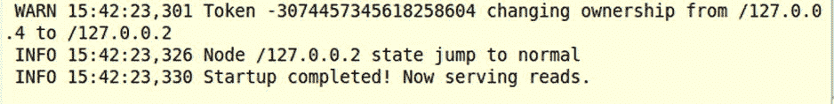
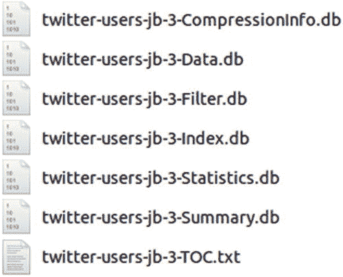
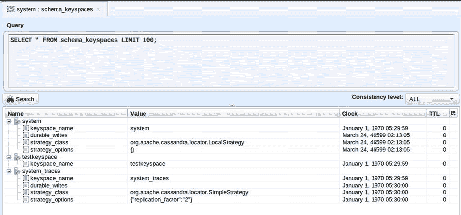
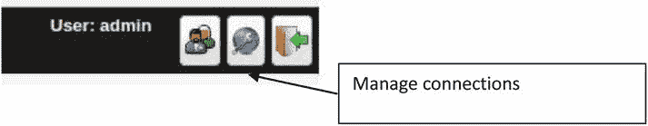
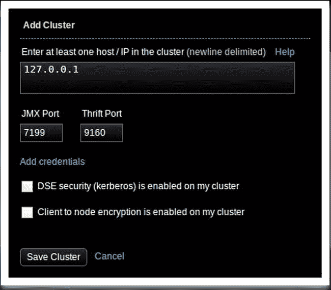
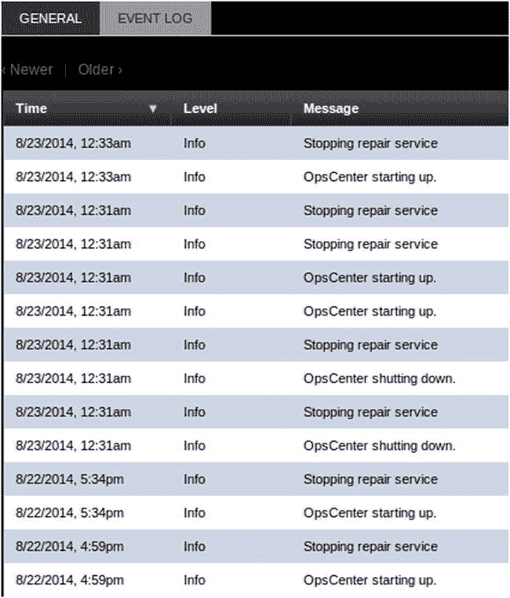
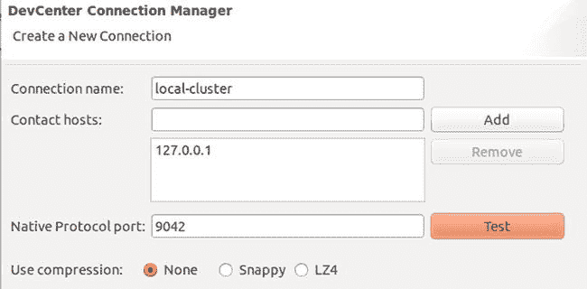
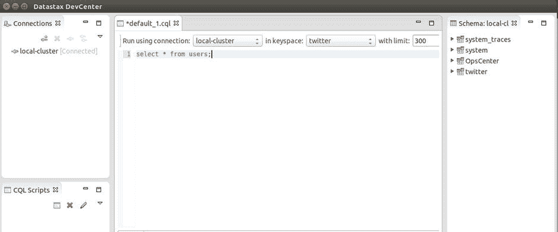

# 9. Cassandra：管理与监控

数据库管理意味着管理一系列活动，如确保数据库可用性、管理安全性、性能调优和备份。然而，“管理”的具体细节已经发生了显著变化。

在 NoSQL 世界演进之前，数据库管理员（`DBAs`）被认为是团队中最关键的成员之一。但随着 NoSQL 的普及，管理工作量以及对专门数据库管理团队的需求已大幅减少。在第一章中，我们讨论了从 `RDBMS` 向 NoSQL 世界的转变。让我们重温其中几个关键差异：

- 无表连接
- 无关系模式
- 无静态模式

这意味着管理工作（至少从应用设计角度来看）确实减少了，而且开发人员与 `DBA` 之间关于“谁搞崩了服务器”的争论可能很快就会消失。

但这并不意味着完全不需要数据库管理。NoSQL 是指“不仅仅是 SQL”，而不是“不用 SQL”。我们或许在应用建模上投入的精力较少，但诸如安全性、性能调优等核心问题仍需处理。传统 `RDBMS` 可能在数据库层面嵌入应用逻辑，而使用 NoSQL 时，目前通常不需要，或者至少不那么必要。然而，随着 NoSQL 世界的不断发展和成熟，将需要更多管理工作来应对比添加索引和创建表更重要、更复杂的事务。

本章将涵盖以下主题：

- 向 Cassandra 集群添加新节点
- 替换节点
- 数据库备份与恢复
- 监控工具

## DBA 技能

随着数据库世界的变化，理解管理员所需的技能集非常重要。为了进行正确高效的数据库管理，需要具备以下基本技能：

- 能够根据提供的逻辑蓝图设计和建模数据库。
- 精通数据库备份与恢复流程的管理能力。
- 能够管理数据完整性及其高可用性。
- 确保数据安全的技能。数据库管理员负责管理不同环境（如测试环境、预发布环境和生产环境）间的数据安全层。

## 向 Cassandra 集群添加节点

在第一章中，我们讨论了在单台机器上配置一个三节点 Cassandra 集群。在本节中，我们将首先启动一个包含两个节点的 Cassandra 集群，然后添加另一个节点。

首先，对于 `RandomPartitioner`，我们使用 `token-generator` 工具为三个节点生成令牌。该工具位于 `$CASSANDRA_HOME/tools/bin` 文件夹中。

```
vivek@vivek-Vostro-3560:∼/software/local-cluster/node1$ tools/bin/token-generator
RandomPartitioner
Token Generator Interactive Mode

How many datacenters will participate in this Cassandra cluster? 1
How many nodes are in datacenter #1? 3
DC #1:
Node #1:                                                0
Node #2:   56713727820156410577229101238628035242
Node #3:  113427455640312821154458202477256070484
```

这里的 `software/local-cluster/node1` 指的是 `$CASSANDRA_HOME`。如果你选择使用 `Murmur3Partitioner`，可以通过执行以下命令生成令牌值：

```
python -c 'print [str(((2**64 / 3) * i) - 2**63) for i in range(3)]'
```

它会输出以下结果：

```
['-9223372036854775808', '-3074457345618258603', '3074457345618258602']
```

下一步是配置三个节点以进行集群设置。关于如何设置的详细说明，请参考第一章中的“在单台机器上配置多节点”部分。简而言之，我们需要在相应的 `Cassandra.yaml` 中修改配置，例如 `listen_address`、`rpc_port`、`jmx_port`、数据目录、提交日志目录和 `native_protocol`。

让我们启动两个节点并检查环状态：

```
vivek@vivek-Vostro-3560:∼/software/local-cluster/node2$ bin/nodetool -h 127.0.0.2 -p 7200 ring
Datacenter: datacenter1
==========
Address    Rack        Status State   Load         Owns       Token

127.0.0.1  rack1       Up     Normal  36.06 KB     100.00%    -9223372036854775808
127.0.0.2  rack1       Up     Normal  45.06 KB     100.00%    -3074457345618258603
```

可以看到两个节点都已启动并运行。

现在启动第三个节点并检查环状态：

```
vivek@vivek-Vostro-3560:∼/software/local-cluster/node1$ bin/nodetool ring
Datacenter: datacenter1
==========
Address    Rack        Status State   Load         Owns       Token

127.0.0.1  rack1       Up     Normal  36.06 KB     66.67%     -9223372036854775808
127.0.0.2  rack1       Up     Normal  45.06 KB     66.67%     -3074457345618258603
127.0.0.3  rack1       Up     Normal  43.7 KB      66.67%     3074457345618258602
```

所有三个节点都已启动并运行。至此，我们结束了在运行中的 Cassandra 集群上添加节点的示例练习。借助 Cassandra 的环拓扑和点对点架构，让节点动态加入变得非常简单。此外，除了生成初始令牌值，我们还可以使用虚拟节点进行设置。

在 Cassandra 1.2 版本之前，我们需要使用 `token-generator` 工具手动为每个数据节点分配一个令牌范围，但现在借助虚拟节点，我们可以为每个节点分配多个令牌范围。使用 `num_tokens` 属性，我们可以为每个数据节点分配多个虚拟节点，这意味着会持有大量更小的数据范围。这在需要替换或重建死节点时非常方便。

死节点指的是因网络或硬件故障导致对其他节点的流言/内部通信无响应的节点。每个节点都可以是跨 Cassandra 集群分布数据的主节点或副本节点。当死节点准备重新加入 Cassandra 环时，它必须从副本节点流式传输所有数据。如果没有虚拟节点，连续的令牌分配会带来大量开销，因为数据需要从多个主节点和副本节点进行流式传输。而有了虚拟节点，每个节点分配的令牌越多，意味着数据分布更小、更异构，这意味着相同容量的数据可以从多个节点同时流式传输！显然，这要快得多。

接下来，让我们通过一个示例练习来探索用新节点替换死节点。

## 替换故障节点

在集群中有时可能会出现少数故障节点。也就是说，这些节点无法响应 Gossip 协议，需要用新节点替换。在运行的 Cassandra 集群中替换故障节点很简单。我们通过延续上一节的示例练习来演示一下。

首先，让我们关闭节点 2 并检查环状态：

```
vivek@vivek-Vostro-3560:∼/software/local-cluster/node1$ bin/nodetool ring

数据中心: datacenter1
==========
地址        机架  状态    状态  负载        拥有量       令牌

127.0.0.1  rack1       Up     Normal  50.44 KB     66.67%      -9223372036854775808
127.0.0.2  rack1       Down   Normal  54.82 KB     66.67%      -3074457345618258603
127.0.0.3  rack1       Up     Normal  71.09 KB     66.67%      3074457345618258602
```

可以看到节点 2（`127.0.0.2`）已宕机，状态显示为 `Down`。

让我们配置一个新节点，并为其分配一个令牌值，该值比 `127.0.0.2` 的令牌值小 1（即 `-3074457345618258604`）。不过，在启动新节点之前，让我们先运行一些命令来修复并移除故障节点：

```
vivek@vivek-Vostro-3560:∼/software/local-cluster/node1$ bin/nodetool rebuild
vivek@vivek-Vostro-3560:∼/software/local-cluster/node1$ bin/nodetool removenode fd733376-0cf0-49af-bd0b-79ab526350f8
```

这里，`fd733376-0cf0-49af-bd0b-79ab526350f8` 是节点 2 的主机 ID。你可以通过运行 `nodetool` status 命令获取每个节点的主机 ID。

最后，启动上一步中配置的新节点，并检查环状态：

```
vivek@vivek-Vostro-3560:∼/software/local-cluster/node1$ bin/nodetool status

数据中心: datacenter1
=======================
状态=Up/Down
|/ 状态=Normal/Leaving/Joining/Moving
--  地址        负载       令牌  拥有量（有效） 主机 ID                               机架
UN  127.0.0.4  78.66 KB   256     66.7%             cdcecd4b-ac26-4763-99c4-9f757c2d8074  rack1
UN  127.0.0.1  50.44 KB   1       66.7%             8718be22-ed20-43ca-95c1-701864bb1e20  rack1
UN  127.0.0.3  71.09 KB   1       66.7%             0039bf7e-4e9c-4028-b3b6-1d027aedc690  rack1
```

在这里，你可以看到节点 4（`127.0.0.4`）已启动并加入了集群环。

你一定好奇节点 2（`127.0.0.2`）发生了什么！一旦节点 2 启动并运行，它会自动替换替代节点（即节点 4）。只要节点 2 启动并加入环，它就会从节点 4 那里收回所有权。查看节点 2 的服务器日志以获取信息（见图 9-1）。



图 9-1。 从替换节点（即 `127.0.0.4`）收回所有权

## 数据备份与恢复

数据库备份意味着定期将副本保存在安全位置。在发生自然灾害或硬件损失时，可以使用备份来恢复数据库。因为数据库的可扩展性和性能绝不应以数据丢失为代价，Cassandra 也提供了对备份和恢复的支持。

使用 Cassandra 进行数据备份可以通过创建快照来实现。Cassandra 提供了一种使用 `nodetool` 工具收集数据快照的机制。我们在本章和上一章中已经讨论过这个工具。（第 10 章将详细介绍 `nodetool` 和其他 Cassandra 相关实用程序。）可以在集群启动并运行时对整个键空间进行快照。但是，只能通过关闭集群节点来实现恢复。

## 使用 `nodetool snapshot` 和 `sstableloader`

发出 `snapshot` 命令会将所有 Memtable 数据刷写到磁盘，然后与已刷写的 SSTable 创建硬链接。

我们通过一个示例练习来讨论这一点。

首先，让我们准备模式并填充一些数据：
```
create keyspace sample_backup with replication = { 'class':'SimpleStrategy','replication_factor':2};  // 创建键空间
use sample_backup ; // 设置键空间
// 创建表
create table twitter(hashtag timeuuid primary key, account_name text, tweets set<text>);
// 插入记录
insert into twitter(hashtag,account_name,tweets) values(now(),'apress_pub',{'New book on Cassandra is out'});
```
```
insert into twitter(hashtag,account_name,tweets) values(now(),'thenews',{'Obama meeting with European allies on Ukraine http://t.co/l8P8bPcbom from #APress','Bergdahl uproar halts plan for return celebration http://t.co/BhF6kMy5pW from #APress'});
```

使用 `select` 命令验证记录已成功持久化：
```
select * from twitter;

hashtag                              | account_name | tweets
--------------------------------------+--------------+--------------------------------------------------------------------------------------------------------------------------------------------------
12da45f0-2702-11e4-861b-9d03f52e8a2b |   apress_pub | {'New book on Cassandra is out'}
74dc73e0-2702-11e4-861b-9d03f52e8a2b |      thenews | {'Bergdahl uproar halts plan for return celebration http://t.co/BhF6kMy5pW from #APress', 'Obama meeting with European allies on Ukraine http://t.co/l8P8bPcbom from #APress'}
(2 rows)
```

要创建快照，我们需要使用 `nodetool` 工具：
```
nodetool -h localhost -p 7199 snapshot twitter

Requested creating snapshot for: twitter
Snapshot directory: 1408816064473
```

输出显示，在本地节点上运行 `nodetool snapshot` 已在 `$CASSANDRA_DATA_DIR/twitter/users` 文件夹下创建了一个名为 `1408816064473` 的快照。这里的 `$CASSANDRA_DATA_DIR` 是在 `Cassandra.yaml` 文件中为 `data_file_directories` 属性定义的值（见图 9-2）。

要删除一些数据以便后续恢复，让我们先截断 `users` 表：


**图 9-2。** 数据目录下的快照目录 `1408816064473`

```
truncate users;
```

通过步骤 4，我们已截断了数据，接下来让我们尝试调用数据恢复。Cassandra 有多种启动恢复的方法。首先，我们探讨使用 `sstableloader` 工具进行恢复。开始时，我们需要将 `Snapshot` 目录中的所有 `.db` 文件复制到一个应与数据库模式同步的文件夹中，即 `keyspace/tablename`。在我们的示例中，应该是 `twitter` 下的 `users` 文件夹（`/home/vivek/twitter/users`）。接下来，让我们执行恢复工具：
```
$CASSANDRA_HOME/bin/sstableloader -d localhost  /home/vivek/twitter/users
```

这里 `/home/vivek/twitter/users` 是包含所有备份 `.db` 文件的本地文件夹。值得一提的是，该快照数据也可以用于使用 Hadoop MapReduce 作业的批量分析。你可以使用 `org.apache.cassandra.db.OnDiskAtom` 和 `org.apache.cassandra.io.sstable.SSTableIdentityIterator` 插入自定义的记录读取器实现。运行上述命令后，你将在控制台上看到以下输出：
```
Established connection to initial hosts
Opening sstables and calculating sections to stream
Streaming relevant part of /home/vivek/vivek/twitter/users/twitter-users-jb-1-Data.db to [/127.0.0.1, /127.0.0.2, /127.0.0.3]
progress: [/127.0.0.2 1/1 (100%)] [/127.0.0.3 1/1 (100%)] [total: 100% - 0MB/s (avg: 0MB/s)]
```

完成后，我们可以通过运行 `select` 命令来验证数据是否已恢复：
```
select * from twitter.users;

user_id | age | name
---------+-----+-------
ckbrown |  32 | chris
mevivs |  34 |
```

### 使用 `nodetool refresh`

另一种恢复数据的方式是使用 `nodetool refresh` 工具。它与 `sstableloader` 方法的不同之处在于，你需要手动将 `.db` 文件复制到 Cassandra 数据目录中。图 9-3 展示了复制后 sstable 的结构。



图 9-3. Cassandra 数据目录中复制的 sstable

然后运行 `nodetool refresh` 命令：
```
vivek@vivek-Vostro-3560:∼$ $CASSANDRA_HOME/bin/nodetool refresh twitter users
```

这里传递给 `nodetool refresh` 命令的参数是键空间，后跟表名。这将刷新数据，可以通过运行 `select` 命令来验证。

### 使用 `clearsnapshot`

为了备份目的而定期拍摄快照会占用大量磁盘空间；因此，也需要定期清理过时的快照。我们可以使用 `nodetool clearsnapshot` 命令定期清理快照目录，如下所示：
```
vivek@vivek-Vostro-3560:∼$ $CASSANDRA_HOME/bin/nodetool -h localhost -p 7199 clearsnapshot
```

上述命令将清除所有键空间中的快照目录。我们也可以像这样清除一个或多个键空间的快照目录：
```
/home/vivek/software/local-cluster/node1/bin/nodetool -h localhost -p 7199 clearsnapshot twitter anotherkeyspace
```

这里，`twitter` 和 `anotherkeyspace` 是被选中要清除快照目录的键空间。

在本节中，我们了解了如何使用各种工具来执行数据库备份和恢复流程。接下来我们将讨论各种监控工具。

## Cassandra 监控工具

系统监控是一个分析和收集系统状态的过程。尽管 Cassandra 是分布式且容错的，但它也取决于如何构建应用程序。有几个必须定期关注的关键问题：

-   性能
-   数据访问
-   监控节点状态

有许多监控工具可以分析数据和 Cassandra 的特性。其中一些流行的工具是：

-   Helenos
-   JConsole
-   nodetool
-   DataStax DevCenter 和 OpsCenter

我们已经在第 1 章中讨论过如何使用 JConsole 进行监控和日志记录（请参阅“通过 JConsole 管理日志”部分）。第 1 章 0 将详细介绍各种 Cassandra 工具，包括 `nodetool`。它主要用于 Cassandra 监控和其他操作，其中一些我们在本章前面已经使用过，例如 `removenode` 和 `refresh`。

在本节中，我们将讨论 Helenos 以及 DataStax DevCenter 和 OpsCenter，以进行一般监控。

### Helenos

Helenos 是一个基于知识共享署名许可免费分发的 Web 界面。此工具可用于访问和操作数据及模式。Helenos 支持的一些功能包括：

-   浏览键空间和列族
-   模式管理
-   CQL 支持
-   授权和认证

该项目托管在 [`https://github.com/tomekkup/helenos`](https://github.com/tomekkup/helenos) 上。或者，你可以从 [`https://sourceforge.net/projects/helenos-gui/files/`](https://sourceforge.net/projects/helenos-gui/files/) 下载捆绑的分发包。

您需要从上述链接下载并解压 `helenos-1.4-tomcat7_bundle.zip` 文件。该分发包包含捆绑了可直接使用的 Helenos WAR 文件的 Tomcat 7。

你只需要运行 `catalina.sh` shell 文件（位于 `bin` 文件夹中）来启动 Tomcat。然后，在浏览器中输入 `localhost:8080`，这将打开 Helenos 登录页面（见图 9-4）。


图 9-4. Helenos 登录页面

默认凭据是：名称为 admin，密码也是 admin。成功连接后，控制台将显示，如图 9-5 所示。


图 9-5. Helenos 控制台

在左侧面板中，你可以看到所有已配置键空间的树形视图（见图 9-6）。


图 9-6. 显示集群和可用的键空间

我们还可以通过运行 CQL3 格式的查询来浏览数据，例如图 9-7 所示的查询。



图 9-7. 从 `schema_keyspace` 表中获取 100 行的结果

使用 Helenos 添加另一个键空间或刷新可用模式的选项位于右上角（参见图 9-5）。图 9-8 显示了添加键空间或刷新模式的选项。


图 9-8. 我们也可以使用 Helenos 添加键空间或刷新模式

使用 Helenos 还可以添加表/列族或删除键空间（见图 9-9）。


图 9-9. 你可以添加列族或删除 testkeyspace 键空间

选择“添加列族”选项会打开图 9-10 所示的对话框。


图 9-10. 添加 Twitter 列族

还有一个用于管理连接的选项（见图 9-11）。



图 9-11. 使用 Helenos 管理连接

点击此选项后，我们可以添加、编辑或删除连接（见图 9-12）。


图 9-12. 使用 Helenos 编辑连接

您还可以探索 Helenos 的分页、CQL 支持和身份验证功能。在 [`https://github.com/tomekkup/helenos#wish-list`](https://github.com/tomekkup/helenos#wish-list) 上有一个计划功能列表，例如将数据导出到文件、查询日志文件以及 JMX 和集群监控。但是，目前 Helenos 没有活跃的开发活动。

### DataStax DevCenter 和 OpsCenter

DataStax 是一家领先的软件解决方案提供商，提供关于 Cassandra 及相关技术栈的商业产品和技术支持。该公司的联合创始人 Jonathan Ellis 也是 Apache Cassandra 项目的负责人。DataStax 提供 Datastax Enterprise，其中包含 DataStax DevCenter 和 OpsCenter。该公司还提供开源 DataStax Java 驱动程序，用于构建应用程序。在本节中，我们将讨论配置和使用这些工具进行监控。

这些软件包可以单独下载，也可以作为 DataStax All-in-One Installer 的一部分从 [`www.datastax.com/download`](http://www.datastax.com/download) 下载。您是选择一起下载还是分开下载，取决于您的使用情况。

## OpsCenter

DataStax OpsCenter 可作为全能安装包的一部分下载（如前所述），也可以从 `http://downloads.datastax.com/community/opscenter.tar.gz` 单独下载。撰写本文时最新的发行版本是 5.0。解压并运行 `opscenter.sh`（位于 `bin` 文件夹下）后，即可启动 DataStax 代理和 Web 界面。OpsCenter 的 URL 为 `http://localhost:8888`。在浏览器中访问此 URL 后，您将看到如图 9-13 所示的界面。


图 9-13. DataStax OpsCenter 控制台

以下是 OpsCenter 提供的功能列表：

*   集群管理。包括其健康状态、容量和监控
*   节点和令牌环管理
*   告警和报告生成

在本节中，我们将探讨这些功能。让我们从集群管理开始。

通过点击控制台右上角的“新建集群”选项（参见图 9-13），我们可以使用 OpsCenter 添加一个集群。图 9-14 显示了“添加集群”对话框。



图 9-14. 使用 OpsCenter 添加集群信息

成功添加集群后，将显示其仪表盘屏幕（参见图 9-15）。


图 9-15. OpsCenter 仪表盘，其中集群名称为“测试集群”

通过点击“测试集群”标签（参见图 9-13），我们可以使用 OpsCenter 查看集群环和节点状态（如图 9-16 和 9-17 所示）。


图 9-17. 环视图，用于显示节点列表及其健康状态


图 9-16. 在集群中显示节点信息和状态

当您在“列表视图”中点击一个节点（例如 `127.0.0.1`），如图 9-17 所示，它将在仪表盘上显示一个标签页，使您能够通过使用“事件日志”选项来监控已执行的事件（参见图 9-18）。



图 9-18. OpsCenter 显示包含事件消息的事件日志

OpsCenter 企业版提供备份与恢复、节点重平衡等功能。您可以使用社区版通过添加小部件（如图表小部件）来试验 OpsCenter，以便以图形格式导出和管理数据。您还可以参考 `http://www.datastax.com/what-we-offer/products-services/datastax-opscenter/compare` 了解 DataStax OpsCenter 社区版与企业版之间的对比信息。

## DevCenter

DataStax DevCenter 是用于管理模式和执行 CQL3 查询的可视化界面。它对于在 Cassandra 上进行快速数据操作非常方便。最新可用版本是 1.2。下载（可在全能安装包 `http://www.datastax.com/download` 中获得，或者单独从 `http://www.datastax.com/download#dl-devcenter` 下载）并成功解压后，我们可以通过运行 `devcenter.sh`（位于 `bin` 文件夹下）来启动。这将打开 DevCenter 连接管理器控制台，用于输入集群连接详细信息，如图 9-19 所示。



图 9-19. DevCenter 连接管理器控制台

成功连接后，将显示 DevCenter 工作台界面（参见图 9-20）。



图 9-20. 带有查询编辑器的 DataStax DevCenter

您可以使用 `ALT+F11` 执行 CQL3 查询，输出将如图 9-21 所示。


图 9-21. DevCenter 工作台中的查询输出

DevCenter 对于开发人员和管理员来说，是创建和管理模式的非常有用的工具。您还可以使用它来探索第 2 章和第 3 章中讨论的各种数据建模技术。

DataStax OpsCenter 和 DevCenter 的用户指南可分别在 `http://www.datastax.com/documentation/opscenter/5.0/opsc/about_c.html` 和 `http://www.datastax.com/documentation/getting_started/doc/developer/devcenter/usingDevCenter.html` 处获取，以供参考。这些是商业产品，因此部分功能可能仅在企业版中可用。社区版可供免费下载，但仅供有限用途使用。有关许可模式的更多详细信息，请参阅 `http://www.datastax.com/download/dse-vs-dsc` 和 `http://www.datastax.com/developer-license-terms`。

## 小结

在本章中，我们讨论了可用于 Cassandra 监控和数据操作的各种工具。本章还介绍了数据备份和恢复的基础知识，以及集群中节点的管理。下一章将讨论各种 Cassandra 实用程序，并使用 YCSB 进行基准测试。


