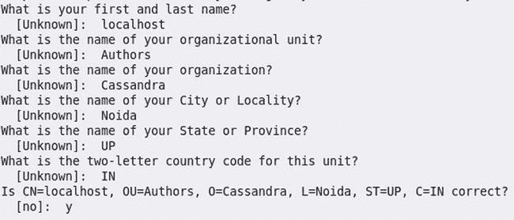
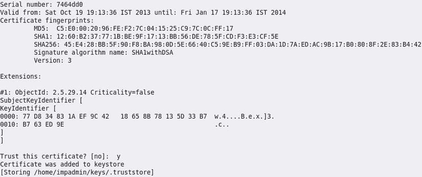
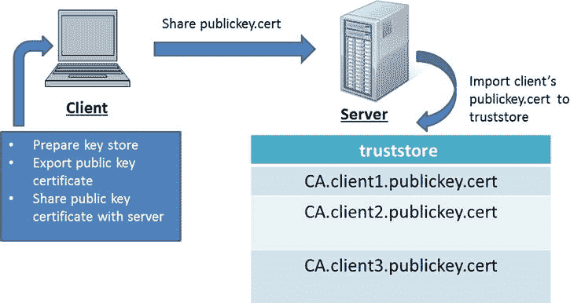
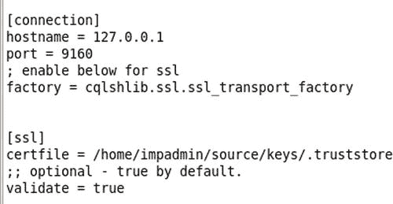

# 准备服务器证书

近年来，社交媒体和基于互联网的应用程序使得全球范围内的数据访问和共享成为可能。SSL 协议用于通过互联网安全地发送加密数据。

对于基于 SSL 的客户端-服务器或节点间通信，我们需要准备服务器证书。一个文件包含服务器密钥，而另一个文件则包含所有客户端或节点的可信 SSL 证书。

在开始新的操作指南之前，让我们先讨论一些可能出现的错误及解决方案。配置并启动 Cassandra 服务器后，如果收到如下错误，则需要将已安装的 Java 版本配置为支持 Java 加密扩展(JCE)。

`Cannot support TLS_RSA_WITH_AES_256_CBC_SHA with currently installed providers`

从以下地址下载 JCE 包：

[`http://www.oracle.com/technetwork/java/javase/downloads/jce-6-download-429243.html`](http://www.oracle.com/technetwork/java/javase/downloads/jce-6-download-429243.html) (Java 6)

[`http://www.oracle.com/technetwork/java/javase/downloads/jce-7-download-432124.html`](http://www.oracle.com/technetwork/java/javase/downloads/jce-7-download-432124.html) (Java 7)

然后将`local_policy.jar`和`US_export_policy.jar`复制到`$JAVA_HOME/jre/lib/security`文件夹下。

既然必要的配置已经完成，下面我们通过一个简单的练习来探索如何准备服务器证书。

首先，使用`keytool`为服务器生成一个密钥库：

`keytool -genkey -alias servernode -keystore /home/impadmin/keys/server/server.jks -storepass server -keypass server`

这里，`/home/impadmin/keys/server`是存放密钥库文件的文件夹路径。你可以根据实际情况更改。图 4-24 显示了生成密钥库时需要输入的基本信息。

从密钥库文件中导出公钥部分：



图 4-24. 生成密钥库时提供的输入信息

`keytool -export -alias servernode -file /home/impadmin/keys/publickey.cer -keystore /home/impadmin/keys/server.jks -storepass server`

图 4-25 显示了`publickey.cer`已存储在`/home/impadmin/keys`文件夹中。

将`publickey.cer`作为可信证书导入到服务器的信任库中：


图 4-25. 存储的带有完整路径的公钥证书

`keytool -import -v -trustcacerts -alias client -file /home/impadmin/keys/publickey.cer -keystore /home/impadmin/keys/.truststore -storepass client`

图 4-26 显示证书已成功添加。



图 4-26. 客户端的证书已成功添加到服务器的信任库中

至此，我们已经准备好了服务器证书。在接下来的几个操作指南中，我们将使用信任库来通过受信任的证书访问服务器。对于节点间通信，我们需要在每个节点上重复上述操作，并将每个节点的公钥证书复制到其他节点的信任库中。

图 4-27 以图形方式展示了客户端证书准备以及导入到信任库的过程。



图 4-27. 为服务器准备和共享客户端公钥证书的流程

在 Cassandra 节点之间准备和共享证书的流程与此相同，每个节点都必须导出其公钥证书并与 Cassandra 集群中的所有其他节点共享。

证书准备过程完成后，需要启用并连接已启用 SSL 加密的命令行客户端。下一节将讨论这个过程。

### 使用 SSL 加密进行连接

前一节讨论了连接启用了 SSL 的`cqlsh`。下面我们来探索如何连接启用了 SSL 加密的`cassandra-cli`命令行客户端。

#### 通过 Cassandra-cli 连接

让我们为 Cassandra 启用加密的客户端到节点通信，并以 Thrift 方式（使用`cassandra-cli`）连接服务器。

首先，我们需要为客户端到节点加密配置服务器。

```
// 启用服务器
enabled: true
// 密钥库路径
keystore: /home/impadmin/keys/server.jks
// 密钥库密码
keystore_password: server
```

以下内容显示了在`cassandra.yaml`中配置密钥库和信任库路径所需进行的配置更改：

```
# 启用或禁用客户端/服务器加密。
client_encryption_options:
  enabled: false
  keystore: /home/impadmin/keys/server.jks
  keystore_password: server
  # require_client_auth: false
  # 如果 require_client_auth 为 true，则设置信任库和信任库密码
  truststore: /home/impadmin/keys/.truststore
  truststore_password: client
  # 下面的选项为更高级的默认配置：
  protocol: TLS
  algorithm: SunX509
  store_type: JKS
  cipher_suites: [TLS ECDHE RSA WITH AES 256 CBC SHA, TLS DHE RSA WITH AES 128 CBC SHA, TLS ECDH ECDSA WITH AES 128 CBC SHA, TLS DHE RSA WITH AES 256 CBC SHA,
  SSL DHE RSA WITH 3DES EDE CBC SHA, TLS ECDH RSA WITH AES 256 CBC SHA, SSL RSA WITH RC4 128 SHA, TLS ECDH ECDSA WITH 3DES EDE CBC SHA, TLS ECDHE RSA WITH RC4 128 SHA,
  TLS ECDH ECDSA WITH RC4 128 SHA, TLS ECDHE ECDSA WITH RC4 128 SHA, TLS ECDHE RSA WITH AES 128 CBC SHA, TLS ECDHE ECDSA WITH 3DES EDE CBC SHA,
  TLS ECDH RSA WITH RC4 128 SHA, TLS EMPTY RENEGOTIATION INFO SCSV, TLS ECDH RSA WITH 3DES EDE CBC SHA, TLS ECDH RSA WITH AES 128 CBC SHA,
  TLS ECDHE ECDSA WITH AES 256 CBC SHA, TLS ECDHE ECDSA WITH AES 128 CBC SHA, TLS DHE DSS WITH AES 256 CBC SHA, TLS RSA WITH AES 128 CBC SHA,
  TLS ECDH ECDSA WITH AES 256 CBC SHA, TLS RSA WITH AES 256 CBC SHA, TLS ECDHE RSA WITH 3DES EDE CBC SHA, SSL RSA WITH RC4 128 MD5, TLS DHE DSS WITH AES 128 CBC SHA,
  SSI DHF DSS WTTH 3DFS FDF CRC SHA. SSI RSA WTTH 3DFS FDF CRC SHA1]
```

这里的`cipher_suites`配置包含了所有有效的协议，建议在使用此应用程序进行配置时保持原样。

您可以启用`require_client_auth`并将其设置为`true`以进行客户端证书认证。

启动 Cassandra 服务器并连接`cassandra-cli`：

```
$CASSANDRA_HOME/bin/cassandra-cli -h 127.0.0.1 -p 9160 -ts
/home/impadmin/keys/.truststore -tf org.apache.cassandra.cli.transport.SSLTransportFactory -tspw client
```

这里，`-ts`、`-tf`和`-tspw`分别代表信任库、传输工厂和信任库密码。

通过 SSL 加密，我们可以使用传输工厂和信任库配置连接到 Thrift 客户端。接下来，我们将连接启用了 SSL 加密的`cqlsh`。

#### 通过 cqlsh 连接

要连接已启用加密的`cqlsh`，我们需要在`home`目录下创建`.cqlshrc`文件。此外，我们可以在`require_client_auth=false`的情况下连接`cqlsh`。在本操作指南中，我们将连接并配置`cqlsh`。

在`home`目录下创建用于 SSL 特定配置的`.cqlshrc`文件。

```
factory = cqlshlib.ssl.ssl_transport_factory
// 信任库文件路径
certfile = /home/impadmin/source/keys/.truststore
```

图 4-28 显示了`.cqlshrc`文件中的配置更改。

就是这样！让我们运行`cqlsh`连接到 Cassandra 服务器：



图 4-28. `.cqlshrc`配置更改

```
SSL_CERTFILE=/home/impadmin/source/keys/publickey.cer
SSL_VALIDATE=$CASSANDRA_HOME/bin/cqlsh -3 -t cqlshlib.ssl.ssl_transport_factory
```


#### 通过 Cassandra Thrift 客户端连接

以下代码片段展示了如何通过基于 Java 的 Cassandra Thrift 客户端与安全服务器建立连接：

```
TSSLTransportFactory.TSSLTransportParameters params =
new TSSLTransportFactory.TSSLTransportParameters();
params.setTrustStore("path to .truststore", "trustore password");
transport = TSSLTransportFactory.getClientSocket("localhost", 7001, 10000, params);
TProtocol protocol = new TBinaryProtocol(transport);
Cassandra.Client client = new Cassandra.Client(protocol);
```

这里的 `7011` 是 SSL 端口，其余步骤与 `Cassandra-cli` 方式类似。使用配置了 SSL 的传输参数（例如：配置信任库路径、密码和 SSL 传输工厂）来打开客户端套接字。

这样，我们就可以通过命令行客户端和基于 Java 的 Thrift 客户端连接到 Cassandra 服务器。

### 总结

本章讨论的主题概括如下：

- 通过超级用户和非超级用户管理用户角色与权限
- 为客户端-服务器通信和节点间通信准备 SSL 加密证书
- 通过多种客户端连接到安全的 Cassandra 服务器

至此，我们完成了关于 Cassandra 数据安全与用户管理的讨论。

下一章将转向大数据分析，讨论如何使用 Hadoop 的 MapReduce 算法进行批处理，以及如何通过 Cassandra 文件系统作为输入和输出来运行 MapReduce 程序！

