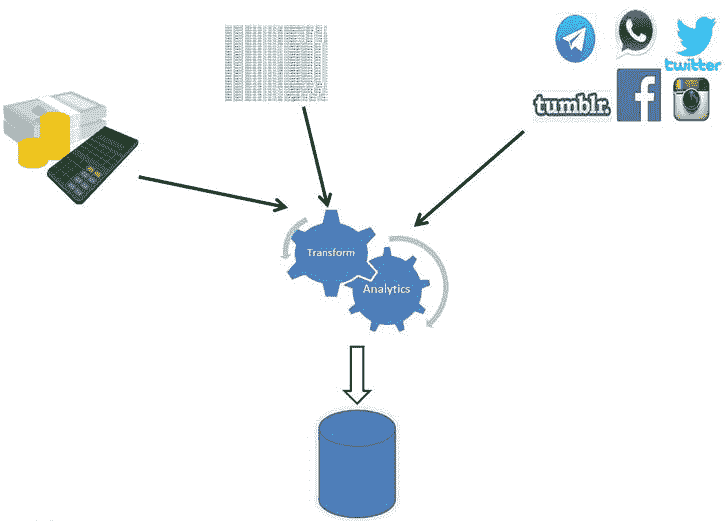
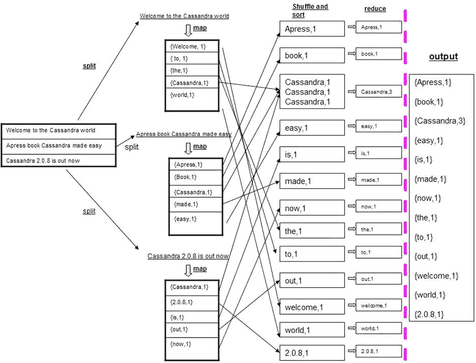
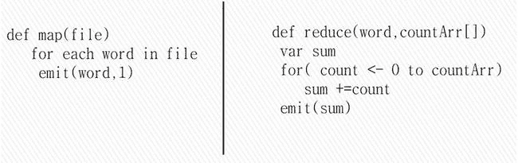
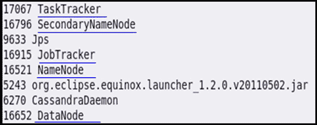
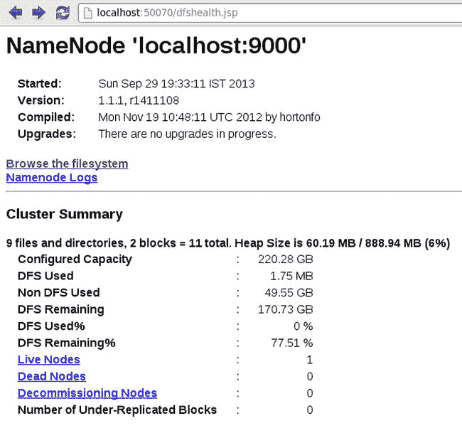

# 5. 使用 Cassandra 的 MapReduce

那么，在讨论了数据建模、安全性和用户角色权限管理之后，下一步是什么？借助 Cassandra 查询语言（CQL），我们确实可以通过主键和二级索引管理基本的基于查询的分析，并尽可能保持数据模型的非规范化。但是，我们仍然可以对海量数据进行分析，例如类似连接（join）的操作，或者在计算特定字段后将数据持久化到 Cassandra 中，比如统计特定用户账户在给定日期范围内的推文数量。这显然属于大数据分析，更具体地说是批处理分析的范畴。

在本章中，我们将：

- 介绍 MapReduce
- 探索 Hadoop
- 讨论 HDFS 和 MapReduce
- 描述 Cassandra 与 MapReduce 的集成

### 批处理与 MapReduce

任何形式的数据，无论结构化还是非结构化，如果不经过处理都将毫无意义。到目前为止，我们已经讨论了在 Cassandra 中管理和建模数据量的各种方法。

那么，如何处理这些归档的海量数据集的分析呢？大数据分析可以分为两大类：

- 批处理
- 流处理

通俗地说，批处理就是执行一个或多个作业。这些作业被编程为需要最少的人为干预。所需的输入/输出参数和资源都预先配置在作业中。批处理机制的历史可以追溯到打孔卡和大型机计算时代。

以卫星频道应用存档多年的日志为例。每年年底（或者每半年），供应商希望了解特定年龄段的用户在黄金时段观看了哪些特定节目。由于数据量巨大且完全非结构化，我们无法将其流式传输并放入内存中进行此类计算。这些数据之间通常关联性不大，要批量处理它们，需要预先定义好并行处理的步骤。

对于大数据而言，批处理作业可以分为三个简单步骤：

- 提取（extract），
- 转换（transform），
- 以及加载（load）

这个过程通常被称为 ETL。市面上有各种 ETL 工具，例如 Ab Initio、CloverETL、Pentaho 和 Informatica，可用于数据仓库和分析。

ETL 系统的另一个方面是分析。想象一下，一个系统需要执行大数据分析，其中数据输入点来自不同应用，系统需要生成一个汇总聚合报表。这时，数据将从各种输入渠道提取出来，在进行计算和转换后，再加载到数据库中。图 5-1 展示了一个基于 ETL 的分析示例，需要从社交媒体渠道、金融应用和服务器日志中提取数据。转换/计算在引擎端完成，最终输出加载到数据库中。



图 5-1. 基于 ETL 的分析

2008 年，谷歌的研究项目发表了一篇题为“MapReduce：大型集群上的简化数据处理”的论文，引入了 MapReduce 范式，尽管该范式自 2003 年以来就已在使用。（你可以在 [`http://static.googleusercontent.com/media/research.google.com/en//archive/mapreduce-osdi04.pdf`](http://static.googleusercontent.com/media/research.google.com/en//archive/mapreduce-osdi04.pdf) 下载这份白皮书。）MapReduce 算法是一种分布式并行编程模型，由 `map` 和 `reduce` 函数组成，是针对需要对异构形式的海量数据进行分析的业务问题的一种解决方案。自谷歌论文发表以来，已经构建了多种 MapReduce 实现。其中一种流行且开源的是 Apache Hadoop。

### Apache Hadoop

Apache Hadoop 是一个流行的开源库，用于大规模数据集的分布式计算。它是一个大规模批处理基础设施，主要旨在处理分布在数百个节点上的数据的批处理分析。

在 MapReduce 作业中，数据集被分割成若干块，使得每个块都可以作为一个 `map` 任务以协同定位的方式独立处理，然后框架对输出进行排序并提供给 reduce 任务。Hadoop 框架自动管理任务调度和数据分发。

显然，如此庞大的数据无法在单个节点上管理，必须分布在多个节点上。这里明显可见两个问题：

- 数据分布
- 协同定位的数据处理

#### HDFS

Hadoop 的数据分布由 Hadoop 分布式文件系统（HDFS）管理。HDFS 是 Apache Hadoop 项目的子模块之一。它专门设计用于在廉价硬件上构建可扩展的系统。HDFS 基于主/从架构，其中称为 `NameNode` 的单个进程在主节点上运行，并管理集群节点间关于数据文件和复制的所有信息。

有关 HDFS 架构的更多信息，请参考 [`http://hadoop.apache.org/docs/r1.2.1/hdfs_design.html`](http://hadoop.apache.org/docs/r1.2.1/hdfs_design.html) 。


#### MapReduce

`MapReduce`的实现也解决了另一个问题：它是一个用于在多个节点上并行处理大量数据的框架。

`MapReduce`过程中执行的三个主要任务是：

- 拆分与映射
- 混洗与排序
- 归约与输出

提交作业后，输入数据被分块，并作为并行映射任务分配给每个映射器。每个映射器生成一个不同的键值对作为输出，该输出经混洗后按键排序，然后作为输入提供给每个归约器。每个在数据节点上运行的映射器和归约器仅对本地数据进行操作（数据本地性）。另一个附加优势是，该框架完全解耦，并且映射器、归约器、文件格式和记录读取都可以自定义实现。

让我们通过一个著名的单词计数问题来简化理解。这里，程序需要输出输入文件中每个单词出现的次数（见图 5-2）。



图 5-2. `MapReduce` 如何使用单词计数工作

图 5-2 是一个针对 Word 文件中三行给定文本进行单词计数的 `MapReduce` 程序的图形化表示。

```
Welcome to the Cassandra world   Apress book Cassandra made easy   Cassandra 2.0.8 out now   
```

这里，每个映射任务在数据所在的本地数据节点上运行。然后，数据由 Hadoop `MapReduce` 框架隐式混洗并排序，最终传递给归约任务，归约过程后将结果输出到一个文件中。

为了更底层地理解，你也可以参考图 5-3 中的伪代码表示。



图 5-3. 单词计数 `MapReduce` 算法

### 将推文读取并存储到 HDFS

由于我们在本书中一直使用基于 Twitter 的示例，让我们再次为 HDFS/MapReduce 示例使用实时推文。从 HDFS 开始的原因是让我们先熟悉如何在默认的 HDFS 上运行 `MapReduce`，然后再解释如何将其在外部文件系统（例如 Cassandra 文件系统）上执行。在本节中，我们将讨论如何设置并获取关于“apress”的推文。在我们的示例中，我们将流式获取一些关于“Apress 出版物”的推文，并将其存储到 HDFS 上。此配方的目的是设置和配置 Hadoop 进程，并为下一节“Cassandra `MapReduce` 集成”中的配方打下基础。

#### 读取推文

首先，让我们构建一个基于 Maven 的示例 Java 项目，以演示如何从 Twitter 读取推文。（有关使用 Maven 的更多详细信息，你也可以参考 [`http://maven.apache.org/plugins/maven-site-plugin/usage.html`](http://maven.apache.org/plugins/maven-site-plugin/usage.html)。）

首先，让我们生成一个 Maven 项目：

```
mvn archetype:create –DgroupId=com.apress –DartifactId=twitterExample –Dversion=1.0 –Dpackaging=jar
```

让我们在 `pom.xml` 中添加一个 `twitter4j` 依赖（见图 5-4）：

```
<!-- Twitter 4j dependency -->
<dependency>
  <groupId>org.twitter4j</groupId>
  <artifactId>twitter4j-core</artifactId>
  <version>[3.0,)</version>
</dependency>
```

为消费者和访问凭据配置 `twitter4j.properties`（位于 `src/main/resources` 下）：

```
#twitter4j.properties
# 下面给出的密钥已被加密。在运行 DefaultTwitterService 之前，请根据你的设置更改它们。
oauth.consumerSecret=8xxxxxxcxxxxxxxxxxxxxxxxxxxxxxxxxxxxx
oauth.accessToken=3ccxxxxxxxxxxxxxxxxxxxxxxxxxxxxxxxxxxxxxxxxxxxxxxxx
oauth.accessTokenSecret=hxxxxxxxxxxxxxxxxxxxxxxxxxxxxxxxxxxxxxxxxxx
oauth.consumerKey=oxxxxxxxxxxxxxxxxxxxxx
```

让我们使用 Twitter API 创建一个连接，如下所示：

```
twitter = new TwitterFactory().getInstance();
```

> 注意：具体实现请参考 `com.apress.chapter5.mapreduce.twittercount.hdfs.ConnectionHandler`。

接下来，将 `apress` 配置为搜索词并获取推文：

```
Query query = new Query("apress");
QueryResult result = connection.search(query);
```

让我们将这些推文存储到本地文件夹中：

```
final String filePath = "tweets"; // 你可以根据你的配置更改此路径
File file = new File(filePath);
FileOutputStream fos = null;
try
{
  fos = new FileOutputStream(file);
}
catch (FileNotFoundException e)
{
  // 记录错误
}
// 在本地文件系统上读取和写入推文
do
{
  List<Status> statuses = result.getTweets();
  for (Status status : statuses)
  {
    StringBuilder sb = new StringBuilder();
    sb.append(status.getUser().getCreatedAt());
    sb.append("\001");
    if (status.getUser() != null)
    {
      sb.append(status.getUser().getName());
      sb.append("\001");
    }
    sb.append(status.getText());
    sb.append("\n");
    try
    {
      fos.write(sb.toString().getBytes());
    }
    catch (IOException e)
    {
      // 记录错误
    }
    count++;
  }
} while ((query = result.nextQuery()) != null);
```

运行后会将一个推文文件存储在当前目录中。

本章所使用的所有示例的源代码均可在本书的下载资源中找到。上述代码片段的完整源代码位于 `com.apress.chapter5.mapreduce.twittercount.hdfs.DefaultTwitterService`。


```markdown
#### 将推文存储到 HDFS

接下来，将推文存储到 HDFS 中。您还需要安装并配置 Hadoop。本示例将使用 Hadoop 单节点设置，我们将首先完成这项操作。

设置的基本步骤如下：

1. 下载 Hadoop tarball 发行版：
   [`https://archive.apache.org/dist/hadoop/core/hadoop-1.1.1/hadoop-1.1.1-bin.tar.gz`](https://archive.apache.org/dist/hadoop/core/hadoop-1.1.1/hadoop-1.1.1-bin.tar.gz)

2. 将 tarball 解压到本地文件夹，并运行以下命令：
   `$HADOOP_HOME/bin/hadoop namenode –format`
   其中，`$HADOOP_HOME` 是包含解压后 Hadoop 二进制文件的目录。

3. 修改 `$HADOOP_HOME/conf/core-site.xml` 以设置默认文件系统：
   ```
   <configuration>
   <property>
   <name>fs.defaultFS</name>
   <value>hdfs://localhost:9000</value>
   </property>
   </configuration>
   ```

4. 修改 `$HADOOP_HOME/conf/hdfs-site.xml` 以设置副本数：
   ```
   <configuration>
   <property>
   <name>dfs.replication</name>
   <value>1</value>
   </property>
   </configuration>
   ```

5. 通过运行以下命令启动 Hadoop 进程：
   `$HADOOP_HOME/bin/start-all.sh`

现在，完成以下步骤以复制推文文件：

在将本地文件复制到 HDFS 之前，让我们先确认所有五个进程是否正在运行。图 5-4 显示了这些进程（已加下划线）。将推文文件复制到 HDFS：



图 5-4. 在本地机器上运行的五种 Hadoop 进程（已加下划线）

```
// create /apress/tweetdata on HDFS
$HADOOP_HOME/bin/hadoop fs -mkdir /apress/tweetdata
$HADOOP_HOME/bin/hadoop fs -put $DIR/tweets /apress/tweetdata
```

此处，推文存储在 HDFS 目录 `/apress/tweetdata` 下。

数据复制完成后，您可以通过 Web 管理界面（`localhost:50070`）点击“浏览文件系统”进行验证，如图 5-5 所示。您将看到数据已通过 Hadoop Web UI 控制台可用。



图 5-5. Hadoop Web UI 管理控制台

或者，您也可以运行以下命令来验证存储的推文文件：
`$HADOOP_HOME/bin/hadoop fs –lsr /apress/tweetdata`

仅在此示例练习中，我们先将直播推文流存储到本地文件系统。对于实时推文流，您可能希望使用 Flume 或 Scribe 将直播推文流直接存储到 HDFS 中。请参考 [`https://cwiki.apache.org/FLUME/`](https://cwiki.apache.org/FLUME/) 或 [`https://github.com/facebook/scribe`](https://github.com/facebook/scribe)。

有关安装和设置的更多信息，请参考 [`http://hadoop.apache.org/docs/stable/single_node_setup.html`](http://hadoop.apache.org/docs/stable/single_node_setup.html)。

在本示例中，我们讨论了如何将直播推文存储到 HDFS。在下一节中，我们将探讨如何编写一个 MapReduce 程序，将特定用户和日期的推文计数存储到 Cassandra 列族中。

### Cassandra MapReduce 集成

在本节中，我们将从 HDFS 读取推文（参见上文），并讨论一个 MapReduce 程序来执行推文统计。最终，归约后的输出将存储在 Cassandra 的 `tweetcount` 列族中。我们将通过两个案例来讨论基于 Cassandra 的 MapReduce 集成：

*   从 HDFS 读取推文，并将推文计数存储到 Cassandra 中。
*   从 Cassandra 读取推文，并将推文计数存储到 Cassandra 中。

在本示例中，我们将使用 Thrift 协议来创建 Cassandra 模式。作为一个开源 API，MapReduce 集成可通过 Thrift 协议使用。示例练习将演示如何在 CQL3 方式下实现与 Cassandra 的 MapReduce 集成。

#### 从 HDFS 读取推文并将计数结果存储到 Cassandra

在本节中，我们将读取之前存储在 HDFS 目录 `/apress/tweetdata` 中的推文文件（参见上一节），并将每个用户和每天的推文计数存储到 Cassandra 中。Cassandra 为 Thrift 和 CQL3 都提供了 MapReduce 支持。我们将从 Thrift 开始，探讨这两种协议。
```


#### Thrift 方法

我们仍使用相同的 Twitter 示例进行探索，其中用户及其推文应存储在本地，并按 `tweet_date` 排序。

首先，需要准备数据定义。让我们使用 Cassandra-cli 创建一个列族 `tweetcount`：

```sql
// 创建 keyspace。
Create keyspace tweet_keyspace;
use tweet_keyspace;

// 创建列族 tweetcount。
create column family tweetcount with comparator='UTF8Type' and key_validation_class = 'UTF8Type' and column_metadata=[{column_name:'count', validation_class:'Int32Type'}];
```

接下来创建一个 MapReduce 作业。我们需要创建一个 Hadoop 配置实例，并配置 NameNode 主机和端口：

```java
Configuration conf = new Configuration();
conf.set("fs.default.name","hdfs://localhost:9000");   // 请根据您的 Hadoop 配置修改此项。
conf.set("mapred.child.java.opts", "-Xms1024m -Xmx2g -XX:+UseSerialGC");
conf.set("mapred.job.map.memory.mb", "4096");
conf.set("mapred.job.reduce.memory.mb", "2048");
conf.set("mapreduce.map.ulimit","1048576");
conf.set("mapred.job.reduce.physical.mb", "2048");
conf.set("mapred.job.map.physical.mb", "2048");
```

> **注意：** 如果您在远程机器上运行，可能需要修改 `fs.default.name`。

现在，让我们为 Mapper 和 Reducer 配置 MapReduce 作业：

```java
//Mapper 配置
job.setMapperClass(TweetTokenizer.class);
job.setMapOutputKeyClass(Text.class);
job.setMapOutputValueClass(IntWritable.class);

// Reducer 配置
job.setReducerClass(TweetAggregator.class);
job.setOutputKeyClass(ByteBuffer.class);
job.setOutputValueClass(List.class);
job.setOutputFormatClass(ColumnFamilyOutputFormat.class);
```

接着，我们需要为输出映射提供 Cassandra 特定的配置：

```java
ConfigHelper.setOutputRpcPort(job.getConfiguration(), "9160");
ConfigHelper.setOutputInitialAddress(job.getConfiguration(), "localhost");
ConfigHelper.setOutputPartitioner(job.getConfiguration(), "Murmur3Partitioner");
ConfigHelper.setOutputColumnFamily(job.getConfiguration(), KEYSPACE_NAME, COLUMN_FAMILY);
```

> **注意：** 如果您不是在 localhost 上运行，也可以修改 rpc 端口和初始地址。

最后，我们需要提供输入和输出路径：

```java
FileInputFormat.addInputPath(job, new Path(otherArgs[0]));
job.setOutputFormatClass(ColumnFamilyOutputFormat.class);
```

这里的 `otherArgs[0]` 是 HDFS 推文文件的输入路径（例如 `/apress/tweetdata`）。

让我们看一下 Mapper：

```java
public class TweetMapper
{
  public static class TweetTokenizer extends Mapper<LongWritable, Text, Text, IntWritable>
  {
    private final static IntWritable one = new IntWritable(1);
    /* (non-Javadoc)
     * @see org.apache.hadoop.mapreduce.Mapper#map(KEYIN, VALUEIN, org.apache.hadoop.mapreduce.       Mapper.Context)
     */
    public void map(LongWritable key, Text value, Context context)
      throws IOException, InterruptedException
    {
      // 分割成 token，并将日期和计数作为键传递。
      String[] values = StringUtils.split(value.toString(), "\001");
      if(values.length >=2 && values.length <=3)
      {
        context.write(new Text(values[0]), one);  // 按日期计数。
        context.write(new Text(values[1]), one);  // 按用户计数。
      }
    }
  }
}
```

现在，让我们看一下 Reducer：

```java
public static class TweetAggregator extends  org.apache.hadoop.mapreduce.Reducer<Text, IntWritable, ByteBuffer, List<Mutation>>
{
  public void reduce(Text word, Iterable<IntWritable> values, Context context) throws IOException,
    InterruptedException
  {
    int sum = 0;
    for (IntWritable val : values)
      sum += val.get();
    context.write(ByteBufferUtil.bytes(word.toString()), Collections.singletonList(getMutation(word, sum)));
  }

  private static Mutation getMutation(Text word, int sum)
  {
    Column c = new Column();
    c.setName(ByteBufferUtil.bytes("count"));
    c.setValue(ByteBufferUtil.bytes(sum));
    c.setTimestamp(System.currentTimeMillis());
    Mutation m = new Mutation();
    m.setColumn_or_supercolumn(new ColumnOrSuperColumn());
    m.column_or_supercolumn.setColumn(c);
    return m;
  }
}
```

此 MapReduce 作业的完整源代码可在本书的下载文件中找到。可执行类是 `TwitterHDFSJob`（位于 `com.apress.chapter5.mapreduce.twittercount.hdfs` 包中）。您也可以参考 `README.txt` 文件（位于 `src/main/resources` 下），以获取有关设置数据库和运行此 MapReduce 作业的更多说明。

成功执行作业后，列族中的输出将如下所示：

```sql
[default@tweet_keyspace] list tweetcount;
Using default limit of 100
Using default cell limit of 100
-------------------
RowKey: Mon May 11 06:16:04 IST 2009
=> (name=count, value=334, timestamp=1407569960904)
-------------------
RowKey: Hazem Saleh
=> (name=count, value=334, timestamp=1407569960798)
-------------------
RowKey: cessprin
=> (name=count, value=334, timestamp=1407569960990)
-------------------
RowKey: Thu Feb 23 00:24:16 IST 2012
=> (name=count, value=334, timestamp=1407569960966)
-------------------
RowKey: Hunter Scott
=> (name=count, value=334, timestamp=1407569960803)
22 Rows Returned.
```

存储的 `tweetcount` 的示例输出共包含 22 行。行键是推文日期或用户名，并包含一个名为 `count` 的列及其值。


#### CQL3 方式

在前面的章节中，我们讨论了 CQL3 与 Thrift 之间的差异及互操作性问题。Cassandra 为 MapReduce 提供了对 CQL 兼容的输入和输出格式类的支持。请注意，这些实现仍然基于 Thrift，而非原生的 CQL3 驱动程序。在本示例中，我们将使用 `CqlOutputFormat` 来写入 CQL3 列族。我们知道通过 CQL3 创建的列族在 Thrift 中是不可见的，因此让我们探讨如何对 CQL3 表/列族运行 MapReduce。使用 CQL3 运行前述 MapReduce 程序所需的更改很小。我们需要以 CQL3 格式定义表，并修改 Hadoop 作业配置以指向基于 CQL3 的输出格式。下面我们来讨论这些更改：

首先，你需要创建表 `tweetcount`：

```
create table tweetcount_cql (key text primary key, count int);
```

在 Hadoop 作业级别需要进行的更改如下：

```
// 设置更新 CQL 和行键
job.getConfiguration().set("row_key", "key");

String query = "UPDATE " + KEYSPACE_NAME + "." + COLUMN_FAMILY + " SET count = ? ";
CqlConfigHelper.setOutputCql(job.getConfiguration(), query);

// 设置 CQL 输出格式类
job.setOutputFormatClass(CqlOutputFormat.class);
```

基于 CQL3 的聚合器如下：

```
public static class TweetCQLAggregator extends org.apache.hadoop.mapreduce.Reducer<Text, IntWritable, Map<String,ByteBuffer>, List<ByteBuffer>>
{
    private static Map<String,ByteBuffer> keys = new HashMap<>();

    /* (non-Javadoc)
     * @see org.apache.hadoop.mapreduce.Reducer#reduce(KEYIN, java.lang.Iterable,org.apache.hadoop.mapreduce.Reducer.Context)
     */
    public void reduce(Text word, Iterable<IntWritable> values, Context context) throws IOException,
        InterruptedException
    {
        int sum = 0;
        for (IntWritable val : values)
            sum += val.get();
        System.out.println("writing");
        keys.put("key", ByteBufferUtil.bytes(word.toString()));
        context.write(keys, getBindVariables(word, sum));
    }

    private List<ByteBuffer> getBindVariables(Text word, int sum)
    {
        List<ByteBuffer> variables = new ArrayList<ByteBuffer>();
        variables.add(Int32Type.instance.decompose(sum));
        return variables;
    }
}
```

最后，在运行 HDFS 作业（参见 `TwitterHDFSCQLJob`，输出后的源代码参考）后，我们可以使用 `cqlsh` 客户端查看输出：

```
select * from tweetcount_cql;
```

```
 key                          | count
------------------------------+-------
 Mon May 11 06:16:04 IST 2009 |   334
 Hazem Saleh                  |   334
 cessprin                     |   334
 Thu Feb 23 00:24:16 IST 2012 |   334
 Hunter Scott                 |   334
 Tue Sep 29 22:01:16 IST 2009 |   334
 Elena Vielva Gómez           |   334
 Sun Dec 18 20:13:39 IST 2011 |   334
 Alejandro || Serras          |   334
 Tue Jul 06 18:01:47 IST 2010 |   334
 Wed Mar 07 05:11:11 IST 2012 |   334
 Wed Nov 07 14:04:18 IST 2012 |   334
 Oseias Moraes                |   334
 Adeesh Fulay                 |   334
 Sat Nov 05 21:29:20 IST 2011 |   334
 Sun Jul 24 21:44:17 IST 2011 |   334
 Manthita.                    |   334
 ebooksdealofdaybot           |   334
 Wed Apr 23 19:19:49 IST 2014 |   334
 The News Selector            |  6680
 Louise Corrigan              |   334
 Mon Mar 03 01:19:17 IST 2014 |  6680
22 Rows Returned.
```

完整的源代码可随本书的下载内容获得，讨论的类包括：

- `com.apress.chapter5.mapreduce.twittercount.hdfs.TwitterHDFSCQLJob`
- `com.apress.chapter5.mapreduce.twittercount.hdfs.TweetAggregator`

在下一节中，我们将讨论将 Cassandra 作为 MapReduce 的输入和输出格式。

