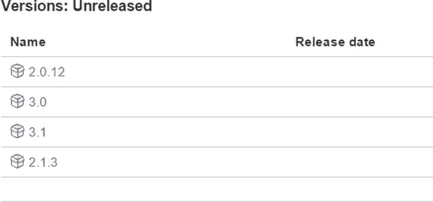

# 11. 升级 Cassandra 与故障排除

到目前为止，本书讨论的主题包括配置、批量分析、数据建模技术、性能调优以及各种工具。还有一个重要的主题尚未讨论，那就是 Cassandra 版本升级。在过去一年半的时间里，Cassandra 发展迅速，发布了多个版本。近期版本中引入的一些更改存在向后兼容性问题，这使得 Cassandra 版本升级成为一个需要解决的重要议题。在撰写本文时，最新的版本是 2.1，它包含了一些我们尚未在其他地方介绍的重要新特性。

我们在本书的不同地方讨论过各种故障排除技巧。在本章中，我们将总结几个关键技巧，以解决你可能遇到的那些问题。

本章的主题包括：

*   Cassandra 2.1 版本概览
*   Cassandra 版本升级
*   故障排除技巧
*   Cassandra 的未来发展

让我们先从讨论最近发布的 Cassandra 2.1 所引入的新特性开始。

## Cassandra 2.1

最近发布的 Cassandra 2.1 在提供许多性能相关修复的同时，还启用了一些重要特性。在本节中，我们将讨论 Cassandra 2.1 支持的三个重要特性：

*   用户自定义类型
*   冻结类型
*   集合属性索引

**注**

有关 Cassandra 2.1 新特性的完整概览，请参阅以下文档页面：[`www.datastax.com/documentation/cassandra/2.1/cassandra/features2.html`](http://www.datastax.com/documentation/cassandra/2.1/cassandra/features2.html)。

### 用户自定义类型

用户自定义类型允许你在单个表中组合多个信息字段。例如，你可以使用 `CQL3` shell 像这样将多个字段的信息合并到一个字段中：

```sql
create type if not exists twitter_keyspace.user_metadata(fname,lname)
```

这里的 `user_metadata` 是一个用户自定义类型，它是多个列的包装器。使用用户自定义类型，我们可以通过将多个表减少到更少的表来简化数据建模模式。

### 冻结类型

使用 `frozen` 关键字，我们可以像下面这样定义一个特定的用户自定义类型：

```sql
CREATE TABLE twitter_keyspace.users (
user_id timeuuid PRIMARY KEY,
name frozen <user_metadata>,
);
```

在这里，`name` 是键空间 `twitter_keyspace` 中 `users` 表的一个 `user_metadata` 类型的冻结类型。对于使用 `frozen` 关键字定义的列字段，Cassandra 会将多个组件序列化为单个值。例如，对于 `user_metadata`，`fname` 和 `lname` 将被序列化为单个值。一旦使用 `frozen` 关键字冻结了用户自定义数据类型，我们就无法更新该用户自定义类型的组件。

### 对集合属性创建索引

在第 2 章中，我们讨论了数据建模概念以及集合的操作。同样在第 2 章的“二级索引”部分，我们提到 Cassandra 不支持对集合属性创建索引。从 Cassandra 2.1 开始，现在可以像这样对 Cassandra 集合属性创建索引：

```sql
create table users(user_id text PRIMARY KEY,fullname text,email text,password text, followers map<text, text>);
```

```sql
insert into users(user_id,email,password,fullname,followers) values ('imvivek','imvivek@xxx.com','password','vivekm',{'mkundera':'milan kundera','guest': 'guestuser'});
```

```sql
create index followers_idx on users(followers);
```

这里，`users`是一个表，`followers`是一个映射，其键为`user_id`，值为`name`。`create index`命令将对`followers`映射的值（例如全名）启用索引。我们也可以像这样对`followers`映射的键（例如`user_id`）启用索引：

```sql
create index followers_idx_keys on users(KEYS(followers));
```

我们可以使用索引从`followers`中获取记录，如下所示：

```sql
SELECT email, followers FROM users  WHERE followers CONTAINS 'milan kundera';
```

此命令将返回所有全名为“milan kundera”的关注者。

另一个值得讨论的变化是，Cassandra 2.1 不支持早于 Cassandra 2.x 版本的`sstable`格式，这引出了一个重要问题：如何处理版本升级！在下一节中，我们将讨论如何使用 Cassandra 处理版本升级。

## 升级 Cassandra 版本

在过去一年半中，Cassandra 经历了多个版本的快速发布，包括 1.2.x、2.0.x 和 2.1.x。在多个版本上并行开发的原因是维护、优先级错误修复以及推出 2.0 版本。版本 2.0 带来了许多新功能集，我们在第 2 章中讨论过这些功能。

使用 Cassandra 作为数据库的应用程序也需要升级到其最新版本。理想情况下，这应该是一个平滑的过程，但主要版本的变化带来了`sstable`格式的变化，并引入了版本限制。

自去年夏天以来的发布量如图 11-1 所示，该图显示了自 2013 年 8 月以来的许多 Cassandra 发布，并且为了维护和功能发布，需要在 Cassandra 端进行并行开发。维护发布也可以称为次要发布，例如关键错误修复，而主要发布主要侧重于新功能支持和性能修复。


图 11-1. 自 2013 年 8 月以来的 Cassandra 发布图表

### 向后兼容性

如果一个 Cassandra 版本能够正常处理先前版本获得的输入和数据模型，那么它就是向后兼容的。理想情况下，每个未来的版本都应该向后兼容，以避免管理上的麻烦。然而，随着新功能支持和性能增强的快速发布，Cassandra 的存储架构发生了重大变化。理解各个 Cassandra 版本之间的兼容性问题以及在某些情况下必须遵循的顺序以避免问题，是极其重要的。

通常，Cassandra 要求你按顺序依次升级主要和次要版本。这种顺序升级的原因是每个版本会告诉你兼容性问题及其版本升级过程。例如，Cassandra 2.0 版本与 1.2.9 之前的版本不兼容。类似地，从 1.2.x 版本的 Cassandra 升级到 2.1 需要先滚动重启到 2.0.7 版本，然后再升级到 2.1 版本。如果不进行滚动重启，你应该会在 Cassandra 服务器日志中看到以下错误：

```
java.lang.RuntimeException: Can't open incompatible SSTable! Current version jb, found file: /var/lib/cassandra/data/system/schema_columnfamilies/system-schema_columnfamilies-ib-5
at org.apache.cassandra.db.ColumnFamilyStore.createColumnFamilyStore(ColumnFamilyStore.java:410)
at org.apache.cassandra.db.ColumnFamilyStore.createColumnFamilyStore(ColumnFamilyStore.java:387)
at org.apache.cassandra.db.ColumnFamilyStore.initCf(ColumnFamilyStore.java:309)
at org.apache.cassandra.db.ColumnFamilyStore.<init>(ColumnFamilyStore.java:266)
at org.apache.cassandra.db.ColumnFamilyStore.open(ColumnFamilyStore.java:110)
at org.apache.cassandra.db.ColumnFamilyStore.open(ColumnFamilyStore.java:88)
at org.apache.cassandra.db.SystemKeyspace.checkHealth(SystemKeyspace.java:499)
at org.apache.cassandra.service.CassandraDaemon.setup(CassandraDaemon.java:228)
```

因此，建议遵循发布说明来正确解决版本升级相关的问题。如上所述，要解决此类版本升级问题，我们需要执行滚动重启。滚动重启不会使集群宕机并在每个节点上执行版本升级，而是在零停机时间的情况下对节点执行升级。节点逐一升级并重启，以便仍然可以保证数据可用性。这意味着，例如，一个运行 Cassandra 1.1.x 版本的节点需要先升级到 Cassandra 1.2.9 版本，然后像前面提到的那样升级到 2.0 版本：也就是说，顺序是 1.1.x -> 1.2.9 -> 2.0.7，最后到 2.1。

版本 2.0 中的一些配置更改包括：

*   `index_interval`属性已移至表级别，不再在`cassandra.yaml`中可用。
*   虚拟节点（例如`num_tokens`）在 2.0 及更高版本中默认启用，而在早期版本中则禁用。
*   对于 2.0 及更高版本，必须安装 Java 版本 7。

既然我们已经讨论了向后兼容性，让我们看看如何在 Cassandra 节点上执行版本升级。

### 通过滚动重启执行升级

使用前面章节中提到的场景，让我们逐步了解执行顺序升级的步骤：

在开始滚动升级之前，我们应该注意上述更改，并备份属于先前 Cassandra 版本和配置的所有数据。对于数据备份，我们可以按如下方式创建快照：

```bash
vivek@vivek-Vostro-3560:∼$CASSANDRA_HOME$ bin/nodetool -h localhost snapshot twitter_keyspace
```

在前面的命令中，请将`$CASSANDRA_HOME$`替换为当前安装的 Cassandra 版本（例如`$apache-cassandra-1.1.6$`）。

在前面的命令中，我们正在为键空间`twitter_keyspace`创建快照。

在下载下一个版本（此处为 1.2.9）之前，请确保从正在运行的 Cassandra 集群中移除所有死节点。然后运行以下命令：

```bash
nodetool upgradesstables
```

这将把现有的`sstable`（1.1.x 版本）升级为与 1.2.9 兼容的格式。

然后，依次按照上述步骤从 1.2.9 升级到 2.0.7，最后，对从 2.0.7 升级到 2.1 执行相同操作。

对于多节点 Cassandra 集群，我们需要在所有节点上执行相同的步骤。如果任何节点上的版本升级失败，我们可以尝试从另一个节点复制模式，并从其他活动节点复制数据。

## Cassandra 故障诊断

故障诊断是诊断和修复问题的过程。在本节中，我们将诊断一些常见问题——例如打开文件过多和内存不足——这些你可能遇到并需要解决。

### 打开文件过多

如果遇到如下错误：

```
java.net.SocketException: Too many open files
at java.net.Socket.createImpl(Socket.java:447)
at java.net.Socket.getImpl(Socket.java:510)
at java.net.Socket.setSoLinger(Socket.java:984)
```

这意味着你已触及允许的最大打开文件数限制。默认值为 1024。使用 Cassandra 时，极有可能超出此限制。我们可以通过修改 `/etc/security/limits.conf` 文件来提高该限制，示例如下：

```
root soft nofile 65535
```

这里的 `65535` 是打开的文件描述符数量。这应该可以解决问题。此外，我们还可以通过监控运行中的 Java 进程来监控文件描述符的数量，以验证是否为内存泄漏的情况！

使用 `lsof` 命令，我们可以列出所有打开的文件。例如，我们可以按如下方式列出某个进程 ID (PID) 的所有打开文件：

```bash
lsof –p 13241
```

```
COMMAND    PID      USER    FD     TYPE    DEVICE    SIZE/OFF    NODE NAME
init       13241    root    cwd    DIR     225,0         4096    1 /
init       13241    root    rtd    DIR     225,0         4096    1 /
```

### 栈大小限制

栈大小限制了我们在 Java 虚拟机（JVM）中能拥有的线程数量。如果你看到类似如下的错误：

```
The stack size specified is too small, Specify at least 228k
Error: Could not create the Java Virtual Machine.
Error: A fatal exception has occurred. Program will exit.
```

这意味着栈大小设置得过小。默认分配值为 180K，根据 Cassandra 的建议，我们可以通过修改 `Cassandra-env.sh` 文件（位于 `conf` 文件夹下）将其设置为 228K，示例如下：

```bash
JVM_OPTS="$JVM_OPTS –Xss228k"
```

### 内存溢出错误

由于 Cassandra 处理的数据量巨大，节点有时可能会因“内存溢出”错误而宕机。如果遇到这种情况，首先要检查行缓存和 memtable 的大小，并验证它们是否设置得过大。这里的“过大”简单地意味着它们无法很好地适应可用内存。如果这些值远低于可用内存限制，那么我们应该检查堆转储文件以及服务器和应用程序日志，以获取更多关于错误的详细信息。从 Cassandra 1.2.9 开始，许多后台进程已从堆内处理转移到堆外处理，以避免垃圾回收活动。因此，你可能会遇到堆外或堆内的内存不足。关于堆外和堆内的更多讨论，请参考第 8 章中的“CPU 和内存利用率”以及“堆外与堆内”部分。此外，如果应用程序正在读取类似整行或大列的数据，你也可以检查客户端代码。

### 垃圾回收活动过多

如果垃圾回收（GC）耗时超过几秒钟，请检查 `system.log` 文件中是否有类似如下的消息：

```
INFO [ScheduledTasks:1] 2014-01-29 02:41:16,579 GCInspector.java (line 116) GC for ConcurrentMarkSweep: 341 ms for 1 collections, 8001582816 used; max is 8126464000
INFO [ScheduledTasks:1] 2014-01-29 02:41:29,135 GCInspector.java (line 116) GC for ConcurrentMarkSweep: 350 ms for 1 collections, 8027555576 used; max is 8126464000
```

长时间的垃圾回收暂停会造成“停止一切”的场景，使数据节点在一段时间内处于冻结状态。在这种情况下，JVM 中未使用的部分极有可能被换出。建议通过以下命令禁用交换：

```bash
swapoff –all
```

在 Linux 终端上运行此命令将禁用所有设备的交换功能。

这些是一些你可能会遇到的常见问题及其解决方案。接下来，让我们讨论一下 Cassandra 的未来发展道路。

## Cassandra 的未来发展道路

Apache Cassandra 仍在积极开发中，一个极其活跃的社区使其保持着发展势头。我们已经讨论了可用于 Apache Cassandra 开发的多种工具和 API。图 11-2 显示了撰写本书时即将发布的 Cassandra 版本图表（取自[`issues.apache.org/jira/browse/CASSANDRA/fixforversion/12324945/?selectedTab=com.atlassian.jira.jira-projects-plugin:version-summary-panel`](https://issues.apache.org/jira/browse/CASSANDRA/fixforversion/12324945/?selectedTab=com.atlassian.jira.jira-projects-plugin:version-summary-panel)）。



图 11-2. 即将发布的 Cassandra 版本（截至 2014 年 11 月）

毫无疑问，Cassandra 已被广泛接受，成为构建可扩展大数据应用的首选列式数据库。eBay、Netflix 和 Facebook 等公司正在将 Cassandra 用于多种用途。这些组织的开发者们一直在定期贡献并介绍他们基于 Cassandra 的工具，这对未来发展是个好兆头。

此外，几乎所有语言都有可用的高级客户端。表 11-1 列出了流行的 Cassandra 高级客户端 API。

表 11-1. Cassandra 高级客户端

| 语言 | 客户端 |
| --- | --- |
| Java | DataStax Java driver、Astyanax、Hector、Kundera |
| Python | DataStax Python driver、pycassa |
| .NET | DataStax C# driver、CqlSharp |
| C++ | libcql |
| Scala | scqla |
| Perl | perlcassa |
| PHP | Cassandra PDO driver、phpcasa |

凭借多种不同语言的 API、一个活跃的社区以及计划中的版本发布，Cassandra 无疑拥有广阔的未来。即将发布的 Cassandra 版本预计将带来一系列全新的有趣功能。再次强调，Cassandra 是一个流行的 NoSQL 数据库，非常适合处理大数据；其生态系统拥有丰富的 Cassandra 客户端 API；持续数年的积极开发仍在继续；Netflix、eBay 和 Facebook 等公司正在使用并推广它。随着许多新的商业工具和产品进入这一领域，这是一个值得学习和使用的数据库！

## 总结

至此，本章和本书已接近尾声。从第 1 章到第 11 章，我们通过示例练习的形式讨论了 Cassandra 的不同特性及其实现。在本章中，我们探讨了升级到新版本 Cassandra 的过程，以及如何应对众多近期版本带来的复杂性。我们还考虑了几个常见且重要的问题，你可能需要在某个时候对其进行故障排除，并且我们展望了 Cassandra 的未来发展道路。

本书前面涵盖的关键主题包括批处理分析和可用工具（第 5 章和第 6 章）、基于 Cassandra 的图实现（第 7 章）、性能调优以及各种与性能相关的注意事项（第 8 章）。

在本书中，我试图在示例实践与理论之间保持平衡。希望你喜欢这本书，并学到了你期望的知识。谢谢！