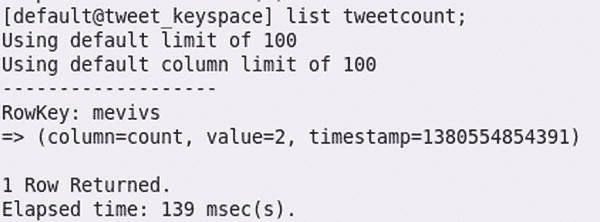

# Cassandra 输入与输出

接下来讨论运行一个 MapReduce 作业，其中输入将从 Cassandra 获取，输出也将存储到 Cassandra 中。

到目前为止，我们已经看到 MapReduce 作业可以在默认的 HDFS 以及外部文件系统（如 Cassandra）上执行。你可能想知道应该采用哪种文件系统以及原因？这取决于具体的用例。例如，如果某个应用已经基于各种 Cassandra 特性构建，那么最好将其 MapReduce 批量分析继续在 Cassandra 中实现。也可能存在这样的情况：HDFS 已被用于存储原始数据，用户可能不同意迁移，但仍希望运行一些 MapReduce 作业并将输出存储到 Cassandra 中。类似地，用户可能希望从 HDFS 及其生态系统（Hive、Pig 等）迁移到单一的数据库解决方案（即 Cassandra）。我们必须记住的一个主要区别是：HDFS 是分布式文件系统，而 Cassandra 是分布式数据库。Cassandra 具有容错能力且没有单点故障，而 HDFS 则不具备这些特性。另一个关键区别是 Hadoop 采用主从架构，而 Cassandra 采用对等架构。由于基于 Cassandra 构建的解决方案具有可扩展性，并且使用了 Cassandra 的特定功能（如二级索引、复合列等），我们可能仍然需要使用 MapReduce 在 Cassandra 上执行批量分析。在本节中，我们将讨论相同的推文计数示例，但使用 Cassandra 同时作为输入和输出格式。

该程序将用户名作为输入参数（默认用户值为 `mevivs`），并计算该用户的推文数量。

我们需要首先准备数据定义。让我们创建一个键空间 `tweet_` 以及列族 `tweetstore` 和 `tweetcount`。在这里，`tweetstore` 将存储原始推文，而特定用户的计数将通过 `cqlsh` 存储在 `tweetcount` 列族中。

```
// 创建键空间
create keyspace tweet_keyspace with replication={'class': 'SimpleStrategy', 'replication_factor':3};

use tweet_keyspace;

// 创建输入列族
create table tweetstore(tweet_id timeuuid PRIMARY KEY, user text, tweeted_at timestamp, body text);

// 通过 Cassandra-cli（Thrift 方式）更新列族以启用对 user 的索引
create column family tweetstore with column_metadata=[{column_name:'user', validation_class:'UTF8Type', index_type: KEYS},{column_name:'body', validation_class: 'UTF8Type'}, {column_name:'tweeted_at',validation_class: 'DateType'}]

// 通过 Cassandra-cli 创建输出列族
create column family tweetcount with comparator='UTF8Type' and key_validation_class = 'UTF8Type' and column_metadata=[{column_name:'count', validation_class:'Int32Type'}];
```

让我们使用 `cqlsh` 客户端向 `tweetstore` 中填充一些行：

```
use tweet_keyspace;

// 复制命令
copy tweetstore from STDIN;
```

以下是从 STDIN 复制数据的控制台输出：

```
cqlsh:tweet_keyspace> copy tweetstore from STDIN;
[Use \. on a line by itself to end input]
[copy]  now(),bama meeting with European allies on Ukraine http://t.co/1Ik3qBOPxC from #APress #tns, 2013-10-20,mevivs
[copy] now(),nergdahl uproar halts plan for return celebration http://t.co/bywaBAoWTP from #APress #tns,2012-09-22,Chrisk
[copy] now(),booksdealofdaybot^A[Apress]?Android Apps Security?http://t.co/5XLSObkk9f,2014-03-24,mevivs
[copy] \.
3 rows imported in 6 minutes and 35.900 seconds.
```

让我们使用以下映射器和缩减器配置创建一个 MapReduce 作业：

```
Configuration conf = new Configuration();
String[] otherArgs = new GenericOptionsParser(conf, args).getRemainingArgs();
Job job = new Job(conf, "tweet count");
job.setJarByClass(TwitterCassandraJob.class);

// 映射器配置
job.setMapperClass(TweetMapper.class);
job.setMapOutputKeyClass(Text.class);
job.setMapOutputValueClass(IntWritable.class);
job.setInputFormatClass(ColumnFamilyInputFormat.class);

// 缩减器配置
job.setReducerClass(TweetAggregator.class);
```


`job.setOutputKeyClass(ByteBuffer.class);`

`job.setOutputValueClass(List.class);`

`job.setOutputFormatClass(ColumnFamilyOutputFormat.class);`

接下来，我们需要为输入列族和格式配置配置 MapReduce 作业：

`// Cassandra 输入列族配置`
`ConfigHelper.setInputRpcPort(job.getConfiguration(), "9160");`
`ConfigHelper.setInputInitialAddress(job.getConfiguration(), "localhost");`
`ConfigHelper.setInputPartitioner(job.getConfiguration(), "Murmur3Partitioner");`
`ConfigHelper.setInputColumnFamily(job.getConfiguration(), KEYSPACE_NAME, INPUT_COLUMN_FAMILY);`
`job.setInputFormatClass(ColumnFamilyInputFormat.class);`

由于我们需要获取特定索引列（user）的记录，我们将使用 Thrift Slice API 来为经过过滤的流数据配置 MapReduce 作业及其 `mapper` 类。

`// 创建切片谓词`
`SlicePredicate slicePredicate = new SlicePredicate();`
`slicePredicate.setSlice_range(new SliceRange(ByteBufferUtil.EMPTY_BYTE_BUFFER, ByteBufferUtil.EMPTY_BYTE_BUFFER, false, Integer.MAX_VALUE));`

`// 准备索引表达式`
`IndexExpression ixpr = new IndexExpression();`
`ixpr.setColumn_name(ByteBufferUtil.bytes(COLUMN_NAME));`
`ixpr.setOp(IndexOperator.EQ);`
`ixpr.setValue(ByteBufferUtil.bytes(otherArgs.length > 0 && !StringUtils.isBlank(otherArgs[0])? otherArgs[0]: "mevivs"));`

`List<IndexExpression> ixpressions = new ArrayList<IndexExpression>();`
`ixpressions.add(ixpr);`

`ConfigHelper.setInputRange(job.getConfiguration(), ixpressions);`
`ConfigHelper.setInputSlicePredicate(job.getConfiguration(), slicePredicate);`

接下来，我们需要为输出列族和格式配置配置 MapReduce 作业：

`// Cassandra 输出列族配置`
`ConfigHelper.setOutputRpcPort(job.getConfiguration(), "9160");`
`ConfigHelper.setOutputInitialAddress(job.getConfiguration(), "localhost");`
`ConfigHelper.setOutputPartitioner(job.getConfiguration(), "Murmur3Partitioner");`
`ConfigHelper.setOutputColumnFamily(job.getConfiguration(), KEYSPACE_NAME, OUTPUT_COLUMN_FAMILY);`
`job.setOutputFormatClass(ColumnFamilyOutputFormat.class);`

我们来看一下 `mapper()`：

```
public class TweetMapper extends Mapper<ByteBuffer, SortedMap<ByteBuffer, Column>, Text, IntWritable>
{
  static final String COLUMN_NAME = TwitterCassandraJob.COLUMN_NAME;
  private final static IntWritable one = new IntWritable(1);

  /* (non-Javadoc)
   * @see org.apache.hadoop.mapreduce.Mapper#map(KEYIN, VALUEIN, org.apache.hadoop.mapreduce.Mapper.Context)
   */
  public void map(ByteBuffer key, SortedMap<ByteBuffer, Column> columns, Context context) throws IOException, InterruptedException
  {
    Column column = columns.get(ByteBufferUtil.bytes(COLUMN_NAME));
    String value = ByteBufferUtil.string(column.value());
    context.write(new Text(value), one);
  }
}
```

它简单的读取特定列（例如，来自流数据的 user 列），并为每个列值写入一个计数。我们将使用同一个 `reducer()` 来执行归约操作。

此 MapReduce 作业的完整源代码可在本书的下载文件中找到。可执行类是 `TwitterCassandraJob`（位于 `com.apress.chapter5.mapreduce.twittercount.cassandra` 包内）。您也可以参考 `README.txt` 和 `db.txt` 文件（位于 `src/main/resources` 目录下）以获取进一步说明。

成功执行作业后，列族中的输出如图 5-6 所示。



**图 5-6.** 特定于用户 `mevivs` 的计数存储在 `tweetcount` 中

本方案的完整源代码可在本书下载文件的 `com.apress.chapter5.mapreduce.twittercount.cassandra` 文件夹中找到。

### 流式或实时分析

批处理框架非常适用于“一次写入，处处读取”的范式。但对于数据集的持续更新，任何正在执行的 Hadoop 作业都无法捕获这些数据更新，需要重新运行。

实时分析要求在处理海量数据进入系统的同时对其进行分析处理。像股票市场交易和动态预测分析这类应用，需要在数据被系统处理的同时实时提供分析结果。

在过去一年左右的时间里，人们对构建此类实时分析应用的兴趣显著增加。因此出现了一些新的框架，例如 `storm`、`Samaza` 和 `Kafka`。我们将在后续章节讨论它们的集成。

### 总结

如前所述，本章分享的所有代码片段都可以作为完整源代码在本书的下载文件中找到。下载文件中还包含 `db.txt` 和 `README.txt`，提供了关于配置和运行这些 Java 程序以及这些示例中使用的 Cassandra 数据定义的相关说明。

在本章中，我们讨论了 HDFS 和 MapReduce，以及它们与 Cassandra 的集成。运行 MapReduce 是处理大数据分析的一种解决方案。然而，为了满足更复杂的分析需求，可能需要使用能够自动构建和执行此类 MapReduce 程序的内置 API。两个最流行的工具是 Hive 和 Pig。下一章将讨论 Hive 和 Pig 的使用及其与 Cassandra 的集成。

