# 3. 索引与复合列

在前面的章节中，我们讨论了大数据问题、Cassandra 数据建模概念以及各种模式管理技术。虽然你应该避免过度规范化数据形式，但在数据库应用中，你仍然需要围绕列（而非主键）来建模读取需求。

本章将涵盖以下主题：

- 索引概念
- 数据分区
- Cassandra 读写机制
- 二级索引
- 复合列
- Cassandra 2.0 的新特性

## 索引

数据库中的索引是一种用于更快检索表中数据集的数据结构。索引可以建立在单个或多个列上。

索引化是创建和管理称为“索引”的数据结构以快速检索数据的过程。每个索引由索引字段值和指向物理记录的引用组成。在某些情况下，引用可以是实际的记录行本身。我们将在聚集索引部分讨论这些情况。

物理上，数据以数据结构的形式存储在数据块上（例如 Cassandra 中的 `sstable`）。这些数据块是无序的，并分布在多个节点上。如果没有主键或索引，访问数据记录将需要在多个节点上进行线性搜索。我们来讨论索引数据结构的格式。

索引按排序顺序存储在 B 树（平衡树）结构中，其中索引是分支节点下的叶节点。图 3-1 展示了数据存储方式：多级叶节点（0，1）按排序顺序索引，而数据则无序排列。这里每个叶节点都是一个包含多个键的 B 树节点。根据插入、更新、删除操作，每个 B 树节点的键数量会不断变化，但始终保持排序顺序。

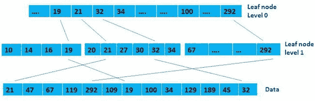

图 3-1. B 树索引及多级叶节点的数据结构

让我们进一步简化。在图 3-2 中，包含年龄和行键的表是叶节点，另一个是物理表。

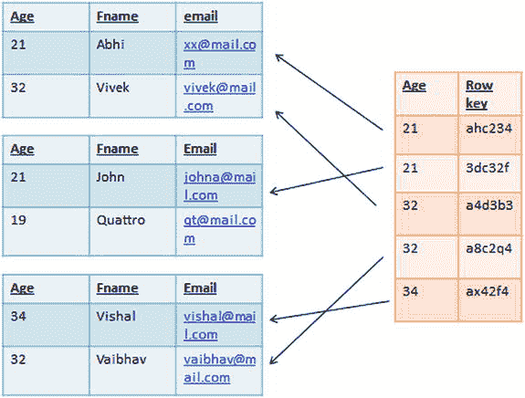

图 3-2. 物理表与作为叶节点的索引表

这允许使用二分搜索更快地检索记录。由于 B 树为加快搜索速度而对数据进行了排序，这会对插入、更新和删除操作带来一些开销，并需要重新排列索引。对于大量读写操作来说，B 树是首选的数据结构，这就是它在分布式数据库中被广泛使用的原因。

### 聚集索引与非聚集索引

独立于物理行进行维护、并且不管理行排序的索引称为非聚集索引（见图 3-1）。另一方面，聚集索引会按照索引字段的排序顺序存储实际的行。由于聚集索引会存储和管理物理行的顺序，因此每个表只能有一个聚集索引。

一个重要的问题是，在哪些场景下我们应该使用聚集索引，哪些场景下使用非聚集索引。例如，一个部门可以有多个员工（多对一关系），并且经常需要按部门读取员工详细信息。在这里，部门是聚集索引的合适候选者。所有包含员工详细信息的行都将按部门存储和排序，以实现更快的检索。而员工姓名则是非聚集索引的完美候选，因此我们可以在一个表中拥有多个非聚集索引，但每个表始终只有一个聚集索引。

### 索引分布

在分布式数据库中，数据会跨多个节点分布和复制。检索一个数据集需要从多个节点获取行。为非行键列选择索引也要求该索引分布在多个节点上，例如分片。长时间的查询可以利用这种基于分片的索引来快速检索数据集。

由于采用点对点架构，Cassandra 集群中的每个节点都持有相同的配置。数据复制、最终一致性和分区模式是数据分布的两个重要方面。

有关复制因子、策略类以及读/写一致性的更多详细信息，请参考第 1 章。

### Cassandra 中的索引

在 Cassandra 节点上，数据是按行本地存储的。行分布在多个节点上，但特定行键的所有列都将存储在本地的一个节点上。Cassandra 默认提供基于行键的主索引，以便按行键进行更快的检索。


### 二级索引

基于列值的索引被称为二级索引。这些索引存储在实际数据所在的节点本地。这使得 Cassandra 能够基于索引更快地检索数据。二级索引存储在一个隐藏的列族中，并由节点自身进行内部管理。

让我们通过一个简单的练习来进一步了解二级索引。

首先，创建一个键空间 `twitter` 和列族 `users`。

```
create keyspace twitter with replication = { 'class':'SimpleStrategy' , 'replication_factor':3};
use twitter;
```

```
create column family users with key_validation_class='UTF8Type' and comparator='UTF8Type' and default_validation_class='UTF8Type';
```

```
create table users (user_id uuid primary key, first_name text, twitter_handle text);
```

使用 `create index` 语法在 `first_name` 上创建索引（见图 3-3）。

```
create index fname_idx on users(first_name);
```

描述表 `users`：

```
describe table users;
```

图 3-3 显示了在 `first_name` 上创建索引后的 `users` 模式。

在 `users` 列族中插入几行数据。

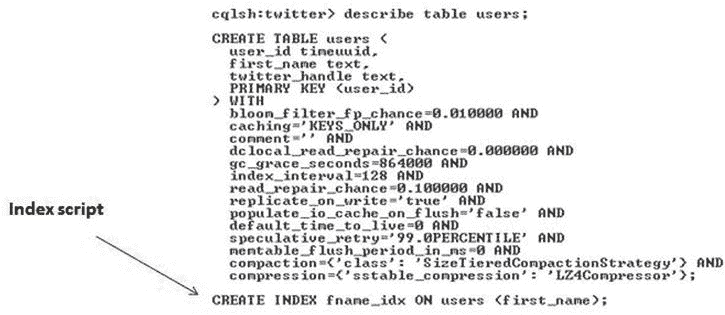

**图 3-3.** 在 `first_name` 上创建了索引的 Users 表

```
insert into users(user_id,first_name,twitter_handle) values(now(),'apress','#apress_team');
insert into users(user_id,first_name,twitter_handle) values(now(),'jonathan','#jhassell');
insert into users(user_id,first_name,twitter_handle) values(now(),'vivek','#mevivs');
insert into users(user_id,first_name,twitter_handle) values(now(),'vivek','#vivekab');
```

尝试使用索引列 `first_name` 查找记录（见图 3-4）。

```
select * from users where first_name='vivek';
```

图 3-4 展示了查询 first name 为 `vivek` 的用户的结果。

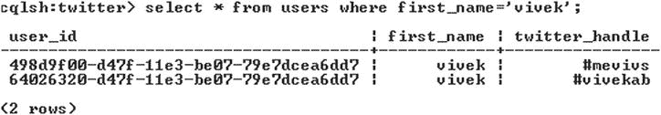

**图 3-4.** 通过 `first_name` 查询用户

通过索引列 `first_name` 查询值为 `'vivek'` 的数据（图 3-4）返回了两行数据。这两行数据可能位于同一个节点上，也可能位于不同的节点上。

这里值得指出的一点是，索引也会与数据行一起存储在本地，这确保了数据的位置亲和性。

另一方面，如果我们尝试使用非索引列 `twitter_handle` 来获取行：

```
select * from users where twitter_handle='#imvivek';
```

会导致以下错误：

```
Bad Request: No indexed columns present in by-columns clause with Equal operator
```

让我们尝试另一种类型的例子：

添加另一个列 `age`：

```
alter table users add age int;
```

为 `age` 更新几行数据：

```
update users set age = 21 where user_id = 498d9f00-d47f-11e3-be07-79e7dcea6dd7;
update users set age = 51 where user_id = 498b06f0-d47f-11e3-be07-79e7dcea6dd7;
```

在 `age` 列上创建索引：

```
create index age_idx on users(age);
```

现在，尝试获取年龄为 21 的用户的 `user_id`：

```
select user_id from users where age = 21;
```

```
 user_id
--------------------------------------
 498d9f00-d47f-11e3-be07-79e7dcea6dd7

(1 rows)
```

接下来，尝试获取年龄大于 21 的用户：

```
select user_id from users where age >= 21;
```

这会得到与前一个例子相同的错误：

```
Bad Request: No indexed columns present in by-columns clause with Equal operator
```

二级索引仅允许用户使用 `=` 运算符，通过索引列来检索记录。但实时应用程序仍然希望对非行键列执行范围查询。

通常建议对具有低基数的列进行索引，因为从集群中不同节点检索数据的概率非常高。而高基数的列在高数据负载和大型 Cassandra 集群下可能会导致性能开销。在数据量不大的情况下，对唯一列进行索引应该没问题。此外，你可以开启跟踪来监控对二级索引的查询。通常，跟踪可用于调查 CQL3 查询。你可以按如下方式开启/关闭跟踪：

```
TRACING ON;
TRACING OFF;
```

从 1.2 版本开始，Cassandra 提供了复合列支持。利用复合列支持，可以对复合列执行范围扫描。

让我们在下一节中更深入地探讨复合列。


## 复合列

将更细的行分布在集群中的多个节点上，并辅以二级索引支持，效果良好。然而，应用程序可能仍需要对获取的行应用排序顺序。在客户端处理海量数据实现此类排序机制显然并不可取。应用程序应依赖数据库来提供此类支持。

从 1.1 版本开始，Cassandra 通过复合列提供了对排序宽行的支持。排序宽行意味着用更多的列来取代细窄行，从而允许以协同定位的方式存储更多数据。

让我们用同样的 Twitter 例子来探讨，在这个例子中，用户及其推文需要本地存储并按顺序排序。

首先，我们创建一个键空间 `twitter` 和列族 `users`：

```
create keyspace twitter with replication = {'class':'SimpleStrategy','replication_factor':1};
```

```
use twitter;
```

```
create table users(user_id text,followers set<text>, tweet_date timestamp, tweet_body text, first_name text, PRIMARY KEY(user_id,tweet_date, first_name));
```

这里，`users` 表包含一个由 `user_id`、`tweet_date` 和 `first_name` 组成的复合主键。

让我们为 user_id 为 `'imvivek'` 的用户在 `users` 列族中存储一些列：

```
// 为 'imvivek' 插入记录
insert into users(user_id,tweet_date,tweet_body,first_name) values('imvivek','2013-12-31','good bye 2013','vivek');
insert into users(user_id,tweet_date,tweet_body,first_name) values('imvivek','2014-01-01','welcome 2014','vivek');
insert into users(user_id,tweet_date,tweet_body,first_name) values('imvivek','2014-01-04','Working on Cassandra book on weekend','vivek');
```

让我们为 user_id 为 `'jhassell'` 的用户在 `users` 列族中存储一些列：

```
// 为 'jhassell' 插入记录
insert into users(user_id,tweet_date,tweet_body,first_name) values('jhassell','2013-12-21','2013 bye bye','jonathan');
insert into users(user_id,tweet_date,tweet_body,first_name) values('jhassell','2014-01-01','2014! another exciting year','jonathan');
insert into users(user_id,tweet_date,tweet_body,first_name) values('jhassell','2014-03-25','Cassandra book, rolling out!','jonathan');
```

让我们尝试按 `tweet_date` 降序获取行（见图 3-5）。

```
select * from users where user_id='imvivek' order by tweet_date DESC;
```

图 3-5 的输出显示了 user_id 为 `imvivek` 的行按 `tweet_date` 排序的结果。

我们还可以如下查询 `users` 表，获取多个 user_id 并按 `tweet_date` 排序的行（见图 3-6）：

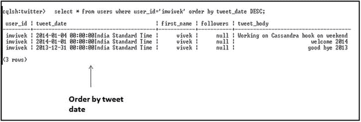

*图 3-5. 按推文日期排序的 user_id 为 imvivek 的用户*

```
select * from users where user_id in('imvivek','jhassell') order by tweet_date DESC;
```

图 3-6 显示了用户 `imvivek` 和 `jhassell` 的行按 `tweet_date` 排序的结果。

让我们更新一些 `followers` 的行，并探究其内部数据结构的大致形态：

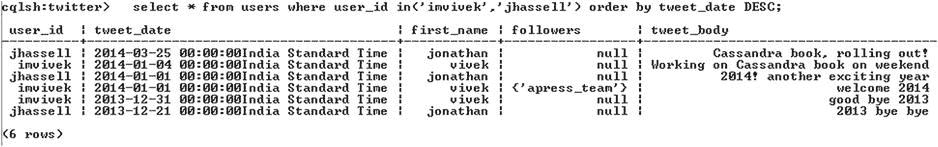

*图 3-6. 此处我们使用 in 子句检索 user_id 为 imvivek 和 jhassell 的行*

```
update users set followers = {'jhassell'} where user_id='imvivek' and tweet_date = '2013-12-31' and first_name = 'vivek';
update users set followers = {'jhassell'} where user_id='imvivek' and tweet_date = '2014-01-01' and first_name = 'vivek';
```

在这里，`user_id` 将是分区键，其余的列 `tweet_date` 和 `first_name` 将成为聚类键的一部分。让我们借助图 3-7 来查看存储的数据。

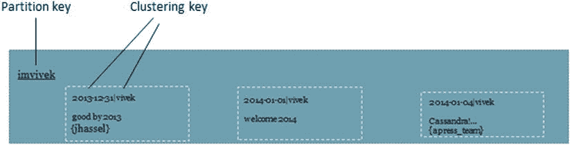

*图 3-7. 复合列，以 imvivek 作为分区键，其余部分作为聚类键*

在对 Cassandra 进行数据建模时，一个值得提及的重要点是：对聚类键的排序仅在分区键出现在 `EQ`/`IN` 子句中时才有效。因此，在定义表结构时，务必确保需要排序的列是聚类列的一部分。你还可以在创建表时指定聚类顺序，如下所示：

```
create table users(user_id text,followers set<text>, tweet_date timestamp, tweet_body text, first_name text, PRIMARY KEY(user_id,tweet_date, first_name)) with clustering order by (tweet_date DESC);
```

这将确保聚类数据按 `tweet_date` 降序排列。

### 允许过滤

正如“二级索引”部分所述，二级索引的一个限制是只允许对索引列使用 `EQ` 运算符。如果某些非行键列被定义为聚类列，我们可以在这些列上执行范围查询。下面的查询可以工作，因为 `tweet_date` 是剩余聚类键的一部分。

默认情况下，Cassandra 会限制此类查询的执行，并通过要求用户显式使用 `ALLOW FILTERING` 子句来智能地告知用户此类查询的性能开销。

用户可以通过在 `select` 查询中显式添加 `ALLOW FILTERING` 子句来运行此类查询，例如：

```
select * from users where tweet_date>='2013-12-31' allow filtering;
```

图 3-8 显示了启用 `allow filtering` 后，按 `tweet_date` 选择用户的结果输出。

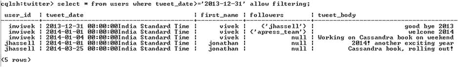

*图 3-8. 启用过滤选项后，获取推文日期大于等于 2013 年 12 月 31 日的行*

当海量数据分布在一个大型集群中时，如果分区键没有与 `EQ`/`IN` 子句一起出现，运行此类查询可能会降低应用程序的性能。建议用户在执行此类查询前先分析数据，而不是针对特定分区键执行范围查询。


### 过期列

我们还可以为 Cassandra 表中的每一列设置 TTL（生存时间）值。一旦超过设定的 TTL，该列将被逻辑删除并标记为过时。不过，内存只在压缩时才会被释放。

例如，在银行系统中，每个请求都会生成一个 OTP（一次性密码），并且会在一定时间后过期。对于此类场景，我们可以临时创建一个带有 TTL 值的列。

在 Cassandra 2.x 之前，只能通过插入和更新操作来设置 TTL 值。现在，在 2.x 版本中，我们还可以为每个列族/表设置默认的 TTL 值。为了存储 TTL 和过期时间，列族需要额外的八个字节。

让我们通过一个简单的练习来探索 TTL。

首先，创建一个键空间 `demo` 和列族 `TTLSample`。

```
create keyspace demo with replication = {'class':'SimpleStrategy','replication_factor':1};
```

```
use demo;
```

```
create table "TTLsample"(user_id text PRIMARY KEY, OTP text, name text);
```

让我们在 `TTLsample` 表中插入一条记录，并将 TTL 值设置为 16 秒。

```
insert into "TTLsample"(user_id,OTP,name) values('imvivek','12121','vivek') using TTL 16;
```

运行上述查询后，`TTLsample` 表中将存储一行数据，每一列的 TTL 值均设置为 16 秒。

让我们尝试在 16 秒前后获取该行数据。

```
select * from "TTLsample";
```

图 3-9 显示了 16 秒前后的输出结果。

你也可以通过 `insert` 或 `update` 操作为每一列设置 TTL 值。

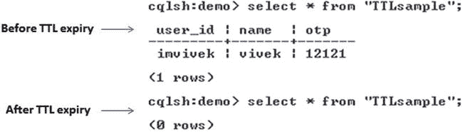

图 3-9. 生存时间过期前后的输出结果

```
insert into "TTLsample"(user_id,name) values('imvivek','vivek');
```

```
insert into "TTLsample"(user_id,OTP) values('imvivek','12121') using TTL 16;
```

图 3-10 显示了 `otp` 列在 TTL 过期前后的输出。

也可以在 TTL 过期之前重置 TTL 值。

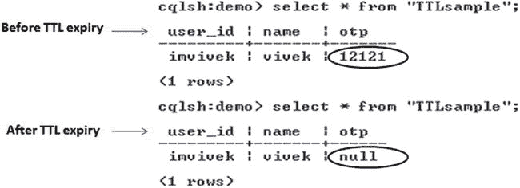

图 3-10. OTP 列 TTL 过期前后的对比

```
insert into "TTLsample"(user_id,OTP) values('imvivek','12121') using TTL 160;
// 160 秒后 OTP 过期
```

```
insert into "TTLsample"(user_id,OTP) values('imvivek','12121') using TTL 16;
// 将过期时间重置为 16 秒
```

### 默认 TTL

在 Cassandra 2.x 中，还可以为每个列族设置默认 TTL：

```
alter table "TTLsample" with default_time_to_live=10;
```

图 3-11 显示了默认 TTL 值设置为 10 秒的情形。

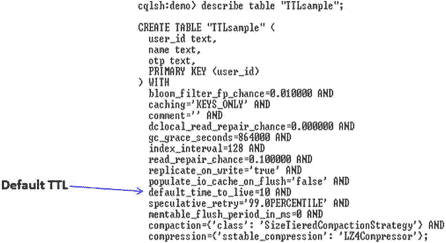

图 3-11. 输出显示默认 TTL 设置为 10 秒

### 数据分区

分区模式在跨节点数据分布中起着重要作用。Cassandra 提供了三种数据分区策略：

*   选择 `RandomPartitioner` 将使用 MD5 哈希算法在节点间分布数据。随机分区器会均匀地分布集群中的数据。数据分布依赖于为每个节点分配的 `initial_token` 值或 `num_tokens`。MD5 哈希值为 16 字节，用于表示十六进制数字。每个节点被分配一个由 token 值表示的数据范围。当收到读写请求，且随机分区器被选为分区策略时，会为每个行键生成哈希值，并将其分配给负责处理该读写请求的节点。这就是数据通过随机分区进行分布的方式。
*   默认分区器。与 `RandomPartitioner` 类似，但使用 Murmur Hash 函数来计算 token 值。Murmur3 哈希表示一个 32 位或 128 位的值，在 Cassandra 中它使用 128 位的值作为 token。MD5 和 Murmur3 哈希的另一个区别在于，后者是非加密哈希，而 MD5 是加密哈希函数（例如，单向哈希）。
*   推荐用于顺序数据访问。使用此分区器，数据会根据行键值在集群中的节点间分布。数据分布不均匀的频率很高，并且在特定范围内频繁写入时可能导致性能热点。

#### 更改分区器

在进行数据建模时，提前决定分区策略。不允许在集群已经开始接收数据后更改分区器，否则 Cassandra 会抛出类似以下的错误：

```
ERROR 23:34:10,630 Cannot open \var\lib\cassandra\data\system\schema_keyspaces\system-schema_keyspaces-jb-1; partitioner org.apache.cassandra.dht.Murmur3Partitioner does not match system partitioner org.apache.cassandra.dht.RandomPartitioner.
```

请注意，从 Cassandra 1.2 开始，默认分区器是 `Murmur3Partitioner`，因此如果升级，你需要编辑它以匹配旧分区器。

#### 数据本地化

每个行键的列将本地存储在该节点上。根据复制因子和策略，数据将在节点间进行复制。这就是 Cassandra 确保数据本地性和高可用性的方式。

让我们讨论一下 Cassandra 中读写的工作方式。

##### Cassandra 写入

在点对点架构中，集群中的每个节点都有资格接收读写请求。作为客户端和数据节点（负责处理写请求的节点）之间代理或委托者的节点称为协调节点。收到写请求后，列首先会被写入提交日志，然后写入指定节点上的 memtable。根据提供的**一致性级别**，会向客户端发送确认信息。

数据将根据 `memtable_total_space_in_mb` 以 sstable 的形式刷新到磁盘。超过该限制时，最大的 memtable 将被刷新到磁盘。图 3-12 显示了 Cassandra 插入和更新的图像表示。

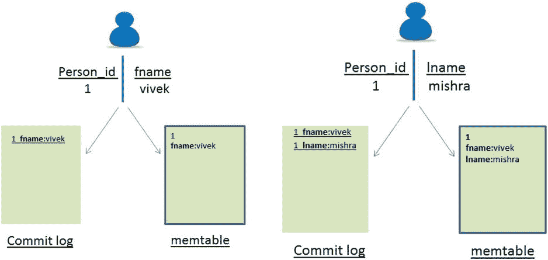

图 3-12. a) 左侧图像，为 id 1 插入名字；b) 右侧图像，为 person id 1 更新添加姓氏列

在图 3-12a 和 3-12b 中，`fname` 和 `lname` 列是通过连续的写入列请求存储的。每个 memtable 是列族的内存表示。而提交日志会按相同顺序保留数据。为 Person 列族插入一条记录，会将其不断添加到相应的 memtable 中。例如，为行键 1 添加另一个 `age` 列并更新 `fname`，会修改数据结构，如图 3-13 所示。

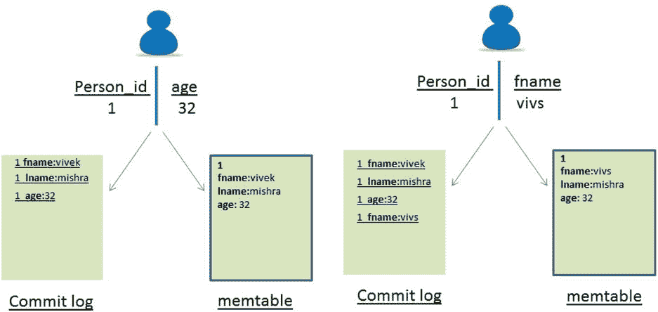

图 3-13. a) 左侧图像显示添加值为 32 的 `age` 列；b) 右侧图像显示更新 person id 1 的行，将 `fname` 列的值改为 vivs

图 3-13a 和 3-13b 分别描述了 `age` 列的插入和 `fname` 的修改。请注意，Cassandra 提供更快的写入吞吐量，因为它没有更新操作，只有插入操作。但是，基于时间戳，具有最新时间戳的行将作为输出返回。这里的时间戳由 Cassandra 内部管理。压缩过程将通过删除过时或墓碑行来管理释放空间。在 2.x 版本中，Cassandra 提供了比较并设置（CAS）支持。我们将在后面的“比较并设置”部分讨论这一点。


### Cassandra 读取操作

协调节点选择以及将读取请求分配给数据节点的过程与写入请求类似。Cassandra 会返回特定行键中带有最新时间戳的列。Cassandra 内部执行以下步骤来返回列名和值：

1.  首先在 `memtable` 中搜索缓存的值
2.  使用 `bloom filter` 行键扫描 `sstables` 以查找列
3.  按最新时间戳对符合条件的 `sstables` 进行排序
4.  合并并返回具有最新时间戳值的列

我们将在第 8 章中详细讨论`bloom filter`。

图 3-14 展示了读取操作如何与 Cassandra 存储架构协同工作。

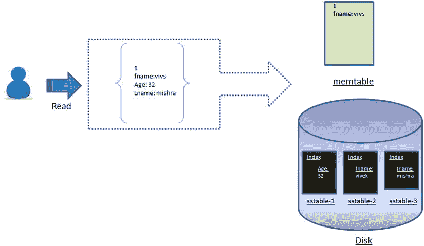

图 3-14. 使用 Cassandra 的读取机制

### Cassandra 2.0 的新特性

Cassandra 2.0 及后续版本带来了许多新功能，并在 CQL3 方面进行了大量性能增强。Cassandra 2.0 引入了对与索引和复合列相关的几个关键功能的支持，包括：

-   比较并设置（CAS）
-   复合列的二级索引
-   条件 DDL

> **注意**  
> 在本书付印之前，Cassandra 2.1 已经发布。请参阅第 1 章以了解 2.1 版本中若干重要新功能的信息。

#### 比较并设置

凭借最终一致性和复制支持，事务数据可以保持一致且高度可用。但在少数情况下，应用程序可能需要在多个线程之间独立访问数据，例如应用程序需要生成唯一的 OTP（一次性密码）并希望避免竞态条件。自 2.x 版本起，对比较并设置（CAS）的支持已经启用。

> **注意**  
> Cassandra 中的 CAS 支持基于 paxos 算法。你可以参考 [`http://en.wikipedia.org/wiki/Paxos_(computer_science`](http://en.wikipedia.org/wiki/Paxos_(computer_science) `)` 了解更多详情。

##### 算法

比较并设置操作需要从副本节点读取最新值，而充当协调者的节点称为领导者。领导者将协调副本节点，使它们执行以下任务：

1.  准备令牌并作出承诺
2.  向副本发出读取请求，并接收带有最新令牌的输出
3.  提议更新的值并获得接受
4.  向每个副本发出提交命令并接收确认

#### 使用 CAS

每个 CAS 操作都需要多次数据库往返；因此，建议仅在有限的需求下使用此类操作，以避免性能开销。

让我们以同一个 Twitter 示例来使用 CAS。

首先，创建一个键空间 `twitter` 和列族 `users`：

```
create keyspace twitter with replication={'class':'SimpleStrategy','replication_factor': 1 };
use twitter;
create table users(user_id text primary key,followers set<text>, tweet_date timestamp, tweet_body text, first_name text);
```

让我们使用 `if not exists` 命令为行键 `'imvivek'` 插入一条记录：

```
insert into users(user_id,tweet_date,tweet_body,first_name) values('imvivek','2013-12-31','good bye 2013','vivek')  if not exists;
```

让我们重新运行相同的命令，并将 `first_name` 设为 `'vivek_update'`：

```
insert into users(user_id,tweet_date,tweet_body,first_name) values('imvivek','2013-12-31','good bye 2013','vivek_update')  if not exists;
```

在图 3-15 中，由于在执行步骤 2 的命令之前表是空的，并且不存在任何记录，因此命令被成功应用，但在步骤 3 时同样的命令失败了。

让我们尝试使用 CAS 来更新用户，为名为 `"vivek"` 的用户添加关注者：

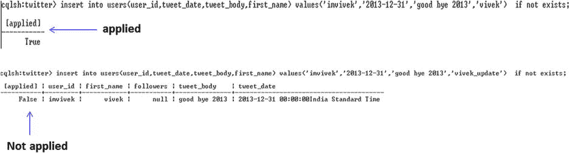

图 3-15. 如果不存在则插入行键为 `imvivek` 的行的 CAS 操作

```
update users set followers = {'apress'} where user_id='imvivek' if first_name='vivek';
select * from users;
```

图 3-16 显示了 CAS 更新操作后检索记录的结果。

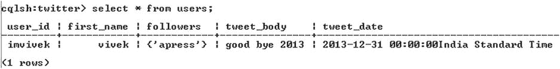

图 3-16. 使用 CAS 操作成功更新后的行

### 复合列的二级索引

从 Cassandra 2.x 版本开始，Cassandra 允许在聚类键上创建二级索引，这使得用户可以使用 EQ 运算符运行查询。在 2.x 之前，只有在 `where` 子句中提供了前一个聚类键部分时，才可以在 `where` 子句中包含剩余的聚类键。

让我们使用在“复合列”部分中讨论的同一个 Twitter 示例。

首先，创建一个键空间 `twitter` 和列族 `users`：

```
create keyspace twitter with replication = {'class':'SimpleStrategy','replication_factor':1};
use twitter;
create table users(user_id text,followers set<text>, tweet_date timestamp, tweet_body text, first_name text, PRIMARY KEY(user_id,tweet_date, first_name));
```

让我们为 user_id `'imvivek'` 在 `users` 列族中存储一些列：

```
// 为 'imvivek' 插入记录
insert into users(user_id,tweet_date,tweet_body,first_name) values('imvivek','2013-12-31','good bye 2013','vivek');
insert into users(user_id,tweet_date,tweet_body,first_name) values('imvivek','2014-01-01','welcome 2014','vivek');
insert into users(user_id,tweet_date,tweet_body,first_name) values('imvivek','2014-01-04','Working on Cassandra book on weekend','Vivs');
```

在 `first_name` 上添加索引，并检索名为 `vivek` 的记录：

```
create index on user(first_name);
select * from users where first_name = 'vivek';
```

图 3-17 显示了在启用二级索引后，通过聚类列 `first_name` 获取数据的结果。

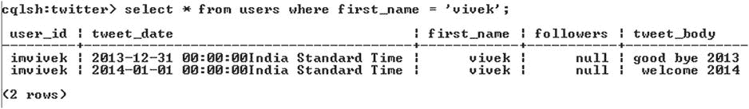

图 3-17. 在聚类列 `first_name` 上启用二级索引后获取记录

### 条件 DDL

从 Cassandra 2.x 开始，现在可以对键空间、表和索引执行条件 DDL 操作。条件 DDL 允许用户验证所查询的键空间、列族或索引是否存在。让我们看几个例子来了解其工作方式。

**键空间**

-   如果键空间 `twitter` 不存在，则创建它：

```
create keyspace if not exists twitter with replication = {'class':'SimpleStrategy', 'replication_factor': 3};
```

-   如果键空间 `twitter` 存在，则删除它：

```
drop keyspace if exists twitter;
```

**表**

-   如果表 `users` 不存在，则创建它：

```
create table if not exists users(user_id text,followers set<text>, tweet_date timestamp, tweet_body text, first_name text, PRIMARY KEY(user_id,tweet_date, first_name));
```

-   如果表 `users` 存在，则删除它：

```
drop table if exists users;
```

**索引**

-   如果 `users` 表上列 `first_name` 的索引不存在，则创建它：

```
create index if not exists users_first_name_idx on users(first_name);
```

-   如果索引 `users_first_name_idx` 存在，则删除它：

```
drop index if exists users_first_name_idx;
```

## 总结

在本章中，我们讨论了数据建模和索引概念及其在 Cassandra 中的使用。总而言之，有几点值得重申：

-   索引存储在数据节点本地。
-   对列值的更新即是对索引的更新，这是一个原子操作。
-   避免在高基数列值上使用二级索引。
-   过多的索引会严重影响写入性能，应予以避免。相反，应尝试对数据模型进行反范式化，或使用复合列。

有了数据模型，在设计使用 Cassandra 的应用程序时，自然而然会想到的下一个问题是数据安全性。第 4 章将讨论数据加密/解密以及 Cassandra 提供的安全选项。


