# 数据迁移与分析

数据迁移是在多个存储系统之间传输数据的过程。面对大数据问题，数据迁移的关键点在于从一种存储系统（例如关系型数据库管理系统 RDBMS）升级到另一种（例如 Cassandra），以提升可扩展性和性能。随着近年来众多 NoSQL 数据库的出现，数据迁移已成为评估和实现优选数据库解决方案的重要流程。

正如上述应用场景所讨论的，对结构化或非结构化形式的数据进行分析是另一个问题。探索新的业务领域，以及处理因已知局限性而被认为无用的数据，是大数据分析的几个重要因素。

数据科学是当今一个新兴领域，涉及从原始数据中过滤和提取信息的研究。它是人工智能和竞争情报的重要组成部分，而数据挖掘和分析则是与数据科学相关的其他实践。

数据挖掘的过程是通过使用各种人工智能和自然语言处理相关技术，研究大数据集后提取并定义数据模式。风险分析、行为定向和预测是需要数据挖掘和模式分析的几个大数据应用案例。

关于前端与后端实现的争论已经持续多年。程序员和数据库架构师对此话题各执己见。具备 Java 或其他技术经验的人可以轻松编写这类 MapReduce 实现。同样，精通数据库的开发者总是更倾向于在数据库端实现此类算法。我们来试着看看 MapReduce 任务在后端开发者和应用程序程序员手中会有何不同。

图 6-1 展示了在业务层（通过编程方式）按日期统计推文数量，并将输出存储到数据库中的 MapReduce 作业执行过程。此处 MapReduce 算法的实现位于应用程序层面。此类实现可以用 Java 或任何其他语言完成。

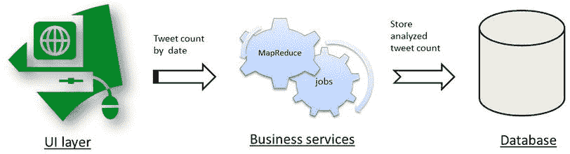

图 6-1. 在业务层实现推文分析的标准方案示意图

针对同一场景的另一种实现方式是，后端程序员或数据科学家更倾向于在数据库端编写 MapReduce 脚本或函数，如图 6-2 所示。

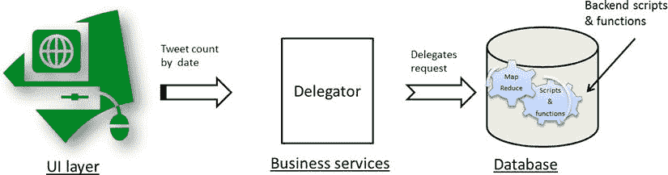

图 6-2. 在数据库层实现推文分析的方案示意图

几乎对所有事情都开发这样的 MapReduce 程序不仅难以维护，而且耗时。正因如此，使用类似 SQL 的语言或编写简单脚本会非常有用。数据库管理员或科学家可能更倾向于采用基于数据库的方法（图 6-2）以实现快速部署。由此可以得出结论，确实存在对这类工具的需求。例如，这些工具对于实现需要从大数据集中提取数据并存储输出的定时任务非常有用。

这引出了一个问题：是否存在可即用型的工具或开源库？像 Apache Hive、Apache Pig 和 Sqoop 这样的工具正好能满足此类需求。在深入探讨每个工具之前，我们先简要介绍一下它们。

`Apache Pig`允许终端程序员以脚本形式编写 MapReduce 实现。`Apache Pig`会将此 Pig 脚本简单地转换为与 Hadoop 兼容的 MapReduce 实现。`Apache Pig`提供了函数和数据类型支持，能够便捷、可复用地进行集成，从而快速编写由 Pig 驱动的 MapReduce 实现。构建数据管道或 ETL 类解决方案的人倾向于使用`Pig`，因为它支持过程式编程而非声明式。由于其非声明式的特性，你可以在工作流的任何节点创建检查点并插入自定义代码。

`Apache Hive`使用户能够使用类似 SQL 的查询语言来管理和分析大型数据集。SQL 在业界广受欢迎且应用广泛。它通过提供类查询接口（即 Hive 查询语言，`Hive QL`），使程序员能够快速采用 Hadoop 和 HBase 大数据平台。通常它用于基于 SQL 的即席分析。借助`Hive QL`，我们可以以 SQL 的方式执行各种 DDL 和 DML 操作。数据定义语言（`DDL`）用于执行创建和修改表等任务，数据操作语言（`DML`）则用于插入和删除记录等操作。`DDL`和`DML`的语义与 SQL 类似。有关`DDL`的更多信息，请参考[`https://cwiki.apache.org/confluence/display/Hive/GettingStarted#GettingStarted-DDLOperations`](https://cwiki.apache.org/confluence/display/Hive/GettingStarted#GettingStarted-DDLOperations)。Hive 的数据分区和外部表支持为用户提供了额外优势，可以使用`Hive`在外部文件系统上声明和分析数据。我们将在本章后续部分介绍这一点。

`Sqoop`意为 SQL 到 Hadoop。基于 RDBMS 构建的解决方案缺乏可扩展性，用户期望迁移至大数据驱动的解决方案。首要任务是将现有生产数据迁移到另一个数据库或文件系统。这正是`Apache Sqoop`大显身手之处，它可以帮助轻松地将数据从一个数据库迁移到另一个数据库。

现在，让我们详细探索这些工具。我们从`Apache Pig`开始。

### Apache Pig

`Apache Pig` 是一个平台，它提供了一种名为 Pig Latin 的简单脚本语言，用于以抽象方式构建 MapReduce 程序。它最初是雅虎研究相关工作的一部分，但后来于 2007 年进入 Apache 孵化器。它以 Pig（猪）命名，因为它几乎可以吞入/读取任何格式的数据。

#### 安装与配置

设置 `Apache Pig` 发行版有两种方式。可以手动下载 tarball 包，也可以在 Linux 系统上安装第三方二进制发行版（`.deb` 或 `.rpm`）。

对于 Windows，需要下载并使用 `cygwin` 设置一个类似 Linux 的环境。`Cygwin` 是 Windows 上类 Unix 的环境和命令行接口。`Cygwin` 提供了 Windows 原生应用、数据和系统资源与类 Unix 环境下的应用、软件工具和数据的集成。更多详情，请参考 [`http://en.wikipedia.org/wiki/Cygwin`](http://en.wikipedia.org/wiki/Cygwin)。你可以从 [`www.cygwin.com/install.html`](http://www.cygwin.com/install.html) 下载并设置 `cygwin`。

在本章中，我们将使用 tarball 发行版进行安装和配置。要在本地机器上完成设置，请遵循以下步骤：

首先创建一个文件夹：

```
mkdir pig-dist
cd pig-dist
```

然后，下载 tarball 发行版：

```
wget http://mirrors.ibiblio.org/apache/pig/pig-0.12.1/pig-0.12.1.tar.gz
```

> 注意：在编写本章时，最新的 tarball 安装版本是 0.12.1。你可以根据最新版本相应修改。

使用以下命令解压下载的 tarball：

```
tar -xvf pig 0.12.1.tar.gz
```

完成第三步后，`pig-dist` 文件夹下将包含解压后的 `pig-0.12.1` 文件夹，如图 6-3 所示。

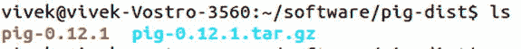

图 6-3. 解压到本地文件夹后的 tarball 发行版


#### 理解 Pig

图 6-4 展示了 Apache Pig 的架构及其各个组件。它描绘了 Pig 脚本如何被编译并转换为 MapReduce 作业。根据 Pig 的架构，编写的 Pig 脚本会被编译成 MapReduce 程序，并由 Hadoop 作业管理器作为 MapReduce 作业提交。`Grunt` 命令 shell 是一个用于运行 Pig 脚本的命令行界面，而 Pig API 可用于构建自定义实现。

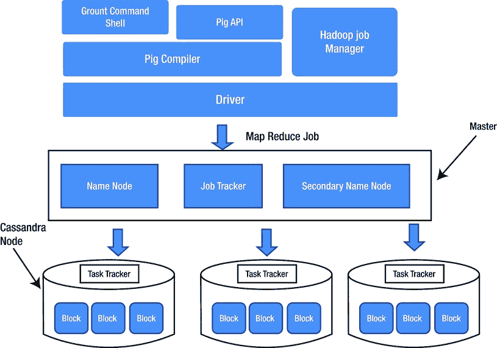

图 6-4. Apache Pig 组件及 MapReduce 作业转换

在开始示例之前，我们先讨论一下这两种模式，然后介绍一些重要的 Pig 命令和数据类型，这些将在本章后续的练习中使用。

#### Pig 执行模式

Apache Pig 提供了两种执行模式：

*   本地模式 (Local)
*   MapReduce 模式

##### 本地模式

Pig 有一个交互式 shell，我们可以在本地模式下启动 Pig 的执行，这需要运行以下命令（见图 6-5）：

`pig –x local`

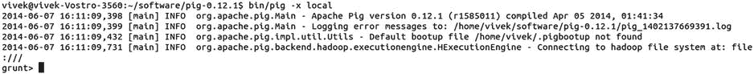

图 6-5. 在本地模式下启动 Pig

##### MapReduce 模式

在 MapReduce 模式下运行 Pig 需要 Hadoop 进程正在运行。（可以参考第 5 章中的“从 HDFS 读取推文并将计数结果存储到 Cassandra”部分。）要以 MapReduce 模式运行 Pig，我们需要运行

`$ pig`

连接成功后，我们还可以使用 Grunt shell 浏览 HDFS 目录，如下所示：

```
grunt> cd hdfs:///
grunt> ls
hdfs://0.0.0.0/tweets  <dir>
hdfs://0.0.0.0/usr     <dir>
```

完成此设置和配置后，我们现在可以探索 Pig 提供的其他配置和功能集了。那么，让我们从数据类型开始。

#### 数据类型

Pig 支持的数据类型可分为简单数据类型和复杂数据类型。

##### 简单数据类型

简单数据类型，例如 `String`、`int` 等，通常是大多数数据库通用的且最常使用的数据类型。表 6-1 展示了 Pig 支持的所有简单数据类型。

表 6-1. Pig 支持的简单数据类型

| 数据类型       | 描述                                     |
| -------------- | ---------------------------------------- |
| `charArray`    | UTF-8 编码的字符串（例如，Cassandra）         |
| `ByteArray`    | 字节数组 (blob)                          |
| `Double`       | 64 位精度格式（例如，11.9）                   |
| `Float`        | 32 位精度格式（例如，10.2f）                  |
| `Int`          | 32 位有符号整数（例如，100）                 |
| `Long`         | 64 位有符号整数（例如，50L）                 |

##### 复杂数据类型

复杂数据类型，例如存储键值对的 `map`，倾向于某种预定义的数据结构格式。表 6-2 展示了 Pig 支持的所有三种复杂数据类型。

表 6-2. Pig 支持的复杂数据类型

| 数据类型 (Data Type) | 描述                                                                                                                                                                                                                                                                                        |
| ----------------- | -------------------------------------------------------------------------------------------------------------------------------------------------------------------------------------------------------------------------------------------------------------------------------------------------------- |
| 元组 (Tuples)       | 元组是一个有序的数据集。可以将元组视为具有多个字段的行，这些字段可以是任何类型，并且可能有数据也可能没有数据。元组用 `()` 括起来。例如，`(Vivek,Apress,6)` 表示一个包含作者姓名、出版社和章节号字段的元组。                                                                             |
| 包 (Bags)          | 包是元组的集合。一个包可以包含重复的元组，并且每个元组的字段数量及其数据类型可能不同。例如，这是一个包含多个元组的包：`{(Vivek,Apress,6),(Chris,Apress,Reviewer,6),(Melissa,Apress,Coordinator,6),(Brian,Apress,Tech reviewer)}`                                                                             |
| 映射 (Map)         | 映射是键值对的集合。每个键值对由 `#` 分隔。例如，`[name#vivek,email#vivek.mishra@nomail.com]` 是一个包含两个键值对的映射。第一个元素以 `name` 为键，`vivek` 为值；第二个元素以 `email` 为键，`vivek.mishra@nomail.com` 为值。 |

#### Pig 函数

Pig 内置了许多函数。用户也可以实现自定义用户定义函数 (UDF)。内置的 Pig 函数可以进一步分类为：

*   计算函数 (Eval functions)
*   数学函数 (Math functions)
*   字符串函数 (String functions)
*   存储函数 (Store functions)
*   包/元组函数 (Bag/tuple functions)

在本节中，让我们来看一些最常用的 Pig 函数。

##### PigStorage

用于以 UTF-8 格式加载数据的默认函数。`PigStorage` 的示例将在接下来的两节中给出。

##### LOAD

`LOAD` 函数从文件系统加载数据。默认情况下，它与 `PigStorage` 函数一起使用，步骤如下所示：

在本地文件系统的一个文件夹（本例中为 `/home/vivek`）中创建一个示例 `tweets.txt` 文件。该文件将包含以下格式的数据：

`apress_team|technology|A whole bunch of new technology books about to come. Watch this space!`

运行以下命令，使用 `PigStorage` 通过 Grunt shell 加载推文文件：

`pipe_input = LOAD '/home/vivek/input/tweets.txt' USING PigStorage('|');`

要转储 `pipe_input` 的输出（如图 6-6 所示），请运行以下命令：

`dump pipe_input;`

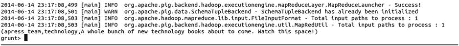

图 6-6. MapReduce 程序的输出

##### STORE

此函数用于将中间或计算后的 Pig 脚本结果加载到文件系统的输出结果中。在下面的示例中，我们读取包含由 `|` 分隔字段的 `tweets.txt`，并将其存储为包含由 `,` 分隔字段的文件（见图 6-7）。

```
pipe_input = LOAD '/home/vivek/input/tweets.txt' USING PigStorage('|') as (screen_name:chararray, category:chararray, body:chararray);
csv_output = STORE input into '/home/vivek/output/tweets.csv' USING PigStorage(',');
```

上述命令的输出如图 6-7 所示。

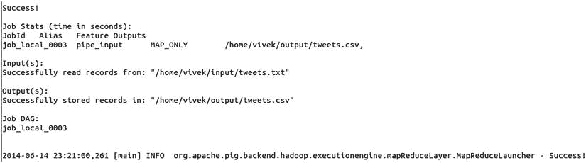

图 6-7. 读取并将推文存储到 CSV 文件的输出

运行上述命令后，将在 `/home/vivek/output` 文件夹中写入一个新文件（`part-m-00000`），该文件包含逗号分隔的值，如下所示：

```
apress_team,technology,A whole bunch of new technology books about to come. Watch this space!
```

这类文件是由 Pig 脚本执行的 MapReduce 作业生成的输出文件。有关 MapReduce 的更多详细信息，请参考上一章。

请注意，这里我们使用了默认的存储函数 `PigStorage()`，但读者可以创建自己的 UDF，并使用它们进行存储/加载。例如，对于 Cassandra，要加载数据到 Cassandra 文件系统，将使用 `CSVStorage` 和 `CassandraStorage` 函数。我们将在接下来的练习中讨论 Cassandra 特有的 Pig 函数。

##### FILTER

`FILTER` 用于根据提供的条件选择行/元组。让我们描述 `pipe_input` 并根据 `screen_name` 过滤出值为 `apress_team` 的行：

```
describe pipe_input;
filter_by_name = FILTER pipe_input BY screen_name matches 'apress_team';
```

运行此命令将过滤 `pipe_input`，只保留 `screen_name` 值为 `apress_team` 的实例（见图 6-8）。

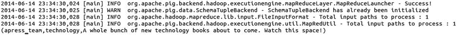

图 6-8. FILTER 命令的输出

##### FOREACH

使用此函数可以遍历结果包并转换为输出或中间结果（见图 6-9）。

```
similar_result = FOREACH pipe_input GENERATE(*);
result_with_screen_name_only = FOREACH pipe_input GENERATE screen_name;
dump result_with_screen_name_only;
```

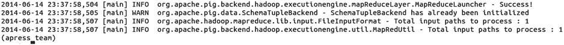

图 6-9. 运行 FOREACH 生成中间结果


###### TOTUPLE

`TOTUPLE` 是一个用于生成元组的函数。例如，我们可以使用 `TOTUPLE` 来生成包含列名和值的元组，如图 6-10 所示。

```
screen_tuple = FOREACH pipe_input GENERATE TOTUPLE('screen_name',screen_name);
```

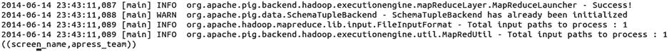

图 6-10. 展示了生成的元组，其中 screen_name 为 apress_team

之前，我们讨论了一些基础的 Pig Latin 命令。让我们通过更多示例练习来探索 Apache Pig。在本章的所有练习中，我们将引用包含关于 apress 推文的推文文件。您可以从附件文件夹（`datafiles`）中下载示例推文文件。该文件包含推文数据、屏幕名称和推文正文，它们由 `'\001'` 分隔（见图 6-11）。

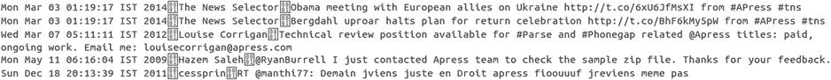

图 6-11. 由 `'\001'` 分隔的示例推文文件

#### 统计推文数量

在本例中，我们将演示如何使用交互式 Grunt Shell 运行各种 Pig 命令。对于中等复杂度的 Pig 脚本，我们可能也希望准备并以 Pig 脚本的形式运行它们。运行 Pig 脚本的命令如下：

```
Pig –x local myscript.pig
```

这里的 `myscript.pig` 是一个编译后的 Pig 脚本。我们也可以按如下方式以嵌入式模式执行此类 Pig 脚本：

```
// 编译为 .class 文件
javac –cp pig.jar MyScript.java
// 以嵌入式模式作为 Java 程序运行 Pig 脚本
java –cp:pig.jar:. MyScript
```

在本练习中，我们将探索使用 Apache Pig 运行 MapReduce 程序，以统计推文总数和统计特定 `screen_name` 的推文数量。

首先使用 `PigStorage` 加载推文：

```
tweets = LOAD '/home/vivek/tweets' USING PigStorage('\ua001') as (date:chararray,screen_name:chararray,body:chararray);
```

让我们筛选屏幕名称为 `The News Selector` 的推文。

```
name = FILTER tweets by screen_name matches 'The News Selector';
```

让我们使用 `GROUP` 命令对 `name` 的所有字段进行分组：

```
namegroup = group name ALL;
```

要统计 `namegroup` 的推文数量，运行带有 `COUNT` 函数的 `FOREACH` 命令：

```
tweetCount = FOREACH namegroup generate  COUNT(name);
dump tweetCount;
```

图 6-12 显示了将 `tweetCount` 输出到控制台的结果。屏幕名称为 `The News Selector` 的推文数量为 6680。

要将输出存储到文件中，我们可以使用 `CSVExcelStorage` 函数。为此，首先需要将其注册到 Pig 注册表中：

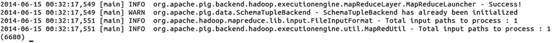

图 6-12. 在控制台上输出 `tweetCount` 的结果

```
register '$PIG_HOME/contrib/piggybank/java/piggybank.jar' ;
define CSVExcelStorage org.apache.pig.piggybank.storage.CSVExcelStorage();
```

在 Grunt Shell 上运行这些命令后，该函数将被注册并可供使用。

继续同一个练习，我们也可以按如下方式存储总的推文数量：

```
totalGroup = group tweets ALL;
totalCount = foreach totalGroup generate COUNT(tweets);
store totalCount into 'totalcount' using CSVExcelStorage(',','YES_MULTILINE');
```

一个名为 `tweetcount` 的文件夹将在 `PIG_HOME` 目录中被创建，其中将包含一个名为 `part-r-00000` 之类的文件，里面存放着总的推文数量。

到目前为止，我们已经探索了在本地文件系统上使用 Pig 运行 MapReduce 作业。现在，让我们尝试在 Cassandra 文件系统上运行 Pig MapReduce 脚本。

需要注意的是，我们可以创建复杂的 Pig 脚本，这些脚本最终可能会运行多个 MapReduce 作业。这类 Pig 脚本的一个问题是，这些作业会按顺序运行，从而失去并行编程的优势。此外，您一定也注意到了在运行 Pig 脚本过程中产生的中间输出，例如加载的推文。

#### Pig 与 Cassandra

Cassandra 和 Pig 的集成相当简单。如上所述，要将 Pig Latin 脚本转换为在 Cassandra 上运行的 MapReduce，需要特定于 Cassandra 的存储函数和连接设置。默认情况下，Apache Cassandra 在 `org.apache.cassandra.hadoop.pig` 包下自带了对 Pig 集成的内置函数支持。

在本节中，我们将使用基于 CQL 的存储函数进行练习。读者也可以使用 `CassandraStorage` 运行相同的练习，该函数主要用于以非 CQL 方式创建的列族。有关 CQL 与 Thrift 的更多详细信息，请参阅第 1 章。

第一步是为 Cassandra 特定设置配置 Pig：

```
# cassandra 守护进程主机，
export PIG_INITIAL_ADDRESS=localhost
/# thrift rpc 端口
export PIG_RPC_PORT=9160
#配置的分区器
export PIG_PARTITIONER=org.apache.cassandra.dht.Murmur3Partitioner
#将 thrift 库添加到 pig 的类路径中。
export PIG_CLASSPATH=/home/vivek/software/apache-cassandra-2.0.4/lib/libthrift-0.9.1.jar
```

##### 数据导入

在本节中，我们将创建一个 Cassandra 表来存储推文，并使用 Apache Pig 将推文加载到 Cassandra 中。

首先，在 Cassandra 中创建一个键空间和表，如下所示：

```
create keyspace twitter with replication = {'class':'SimpleStrategy','replication_factor':1};
use twitter;
create table twitterdata(screen_name text primary key, tweetdate text, body text);
```

以本地模式启动 Pig 并加载推文：

```
tweets = LOAD '/home/vivek/tweets' USING PigStorage('\ua001') as (date:chararray,screen_name:chararray,body:chararray);
```

您可能需要根据您的设置更改目录路径。

注册 `apache-cassandra-2.0.4.jar`：

```
register '$CASSANDRA_HOME/lib/apache-cassandra-2.0.4.jar';
define CqlStorage org.apache.cassandra.hadoop.pig.CqlStorage();
```

使用 `TOTUPLE` 生成一个元组：

```
data_to = FOREACH tweets GENERATE TOTUPLE(TOTUPLE('screen_name',screen_name)),TOTUPLE(TOTUPLE('tweetdate',date), body);
```

最后，使用 `CqlStorage` 函数将生成的元组存储到 Cassandra 中：

```
STORE data_to INTO 'cql://twitter/twitterdata?output_query=update twitterdata set tweetdate %3D%3F,body %3D%3F' USING CqlStorage();
```

最后，连接到 cql shell 并验证加载的数据（见图 6-13）：

```
Select * from twitterdata;
```

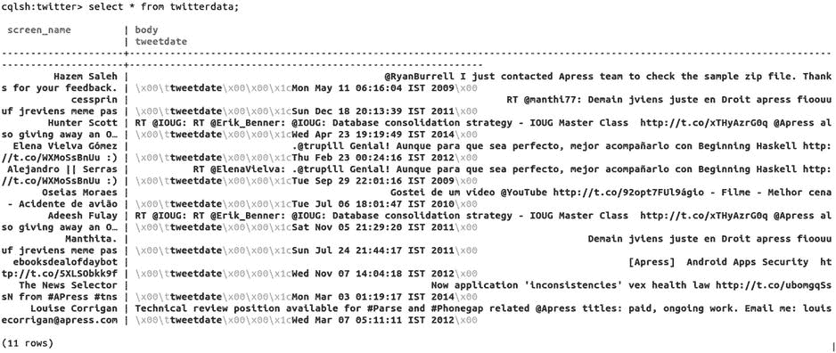

图 6-13. 控制台显示了持久化在 `twitterdata` 表中的数据输出

您一定已经注意到，总的推文数量是 10,020，但 Cassandra 中的 `twitterdata` 表却填充了 11 行。原因是同一个屏幕名称存在多条推文，而该字段被定义为 `twitterdata` 表中的主键。

在现实世界中，数据文件中很可能存在非唯一字段，用户可能希望 Cassandra 负责处理唯一键部分。我们可以通过定义一个 `timeuuid` 类型的隐式主键，并在原始数据文件外部填充它来解决这个问题。在下一个练习中，我们将尝试通过引入一个唯一主键来解决这个问题。


##### 使用 timeuuid 加载数据

Pig Latin 不直接支持 Cassandra 的数据类型，例如 `timeuuid` 和 `uuid`。但有一个名为 Pygmalion 的开源项目 [`https://github.com/jeromatron/pygmalion`](https://github.com/jeromatron/pygmalion)，它为 Cassandra 提供了许多 Pig 工具。

你可以 `git clone` 或下载压缩包（[`https://github.com/jeromatron/pygmalion/archive/master.zip`](https://github.com/jeromatron/pygmalion/archive/master.zip)），并在本地机器上构建它。或者，你也可以在本书下载文件的 `jars` 文件夹中找到 `pygmalion-1.1.0-SNAPSHOT.jar`。

首先，我们在 Cassandra 中创建键空间和表，如下所示：

```
create keyspace twitter with replication = {'class':'SimpleStrategy','replication_factor':1};
use twitter;
create table twitterdata(id timeuuid primary key, screen_name text, tweetDate text, body text);
```

使用 `PigStorage` 加载推文：

```
tweets = LOAD '/home/vivek/tweets' USING PigStorage('\ua001') as
(date:chararray,screen_name:chararray,body:chararray);
```

将 jar 包注册到 Pig 注册表中：

```
register /home/vivek/Documents/apress_book/Apress/uuid-3.2.jar;
register /home/vivek/Documents/apress_book/Apress/hector-core-0.7.0-28.jar;
register /home/vivek/Documents/apress_book/Apress/pygmalion-1.1.0-SNAPSHOT.jar;
```

定义 Pig 函数：

```
define FromCassandraBag org.pygmalion.udf.FromCassandraBag();
define ToCassandraBag org.pygmalion.udf.ToCassandraBag();
define CqlStorage org.apache.cassandra.hadoop.pig.CqlStorage();
define GenerateBinTimeUUID org.pygmalion.udf.uuid.GenerateBinTimeUUID();
```

使用 `GenerateBinTimeUUID` 函数生成一个包含 `timeuuid` 值 ID 的元组，以及来自实际推文文件的其他元组：

```
data_to = FOREACH tweets GENERATE TOTUPLE(TOTUPLE('id',GenerateBinTimeUUID())),TOTUPLE(TOTUPLE('tweetdate',date), body);
```

最后，将此数据加载到 Cassandra 中：

```
STORE data_to INTO 'cql://twitter/twitterdata?output_query=update twitterdata set tweetdate %3D%3F,body %3D%3F' USING CqlStorage();
```

现在，你可以探索 `twitterdata` 列族以查看插入的数据：

```
Select * from twitterdata;
Select count(*) from twitterdata;
```

到目前为止，我们已经探索了使用 Apache Pig 通过多种方式将数据加载到 Cassandra 并对其运行 MapReduce 程序。Apache Pig 对于开发者来说非常方便，可以快速编写 Pig Latin 脚本来执行 MapReduce 程序，无需编写冗长的原生 MapReduce 程序。

在下一节中，我们将探讨以更常用的 SQL 方式在 Cassandra 上运行 MapReduce 分析。

### Apache Hive

Apache Hive 是一个为存储在 HDFS 上的海量数据提供数据分析支持的平台。Hive 具有多种特性，例如内置的 UDTF（用户自定义表函数）、UDAF（用户自定义聚合函数）、对压缩数据的分析，以及最重要的 Hive 查询语言（Hive QL）。我们将在接下来的章节中讨论这些函数。

最初 Hive 是作为 Facebook 研究计划的一部分而开发的，后来它成为了 Apache 的顶级项目。

在本节中，我们将讨论 Hive 的安装、执行模式以及与 Cassandra 的集成。

#### 安装与配置

要在 MapReduce 模式下设置 Hive，我们需要对 Hadoop 安装进行一些配置步骤。请注意，有关 MapReduce 和 Hadoop 的更多详细信息，你可以参考第 5 章。

对于 Hadoop，请确保 `JAVA_HOME` 已正确配置。你可以通过修改 `$HADOOP_HOME/conf/hadoop-env.sh` 并添加 `JAVA_HOME` 指向 `jdk` 安装目录来配置：

```
export JAVA_HOME=/usr/lib/jvm/java-7-oracle
```

通过运行以下命令启动 Hadoop 安装：

```
$HADOOP_HOME/bin/start-all.sh
```

请确保名称节点已正确格式化。更多详细信息请参阅第 5 章。如果你遇到如下错误：

```
connect to host localhost port 22: Connection refused
```

你需要在你的机器上安装一个 SSH 服务器。对于 Ubuntu 系统，你可以通过运行 `sudo apt-get install openssh-server` 来安装。

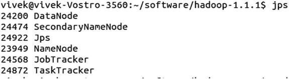

图 6-14。

显示所有 Hadoop 进程正在运行。此后，请验证所有 Hadoop 进程是否正常运行（图 6-14）。

接下来，你需要设置并运行 Hive：

首先，从 [`http://apache.mirrors.tds.net/hive/`](http://apache.mirrors.tds.net/hive/) 下载最新的 jar 包。将 tarball 解压到一个本地文件夹，并将该本地文件夹设置为 `HIVE_HOME`。在 `$HIVE_HOME/bin/hive.sh` 文件中设置 `HADOOP_HOME`。当 Hive 的配置完成后，我们可以通过运行 `$HIVE_HOME/bin/hive.sh` 来启动 Hive 终端。

#### 理解 UDF、UDAF 和 UDTF

Hive 附带内置的用户自定义函数（UDF）、用户自定义聚合函数（UDAF）和用户自定义表函数（UDTF）。使用 Hive 终端，我们可以获取可用函数列表并描述它们：

```
SHOW FUNCTIONS;
DESCRIBE FUNCTION <function_name>;
DESCRIBE FUNCTION EXTENDED <function_name>;
```

Hive 内置的 UDF 包括 `round()`、`pow()` 和 `rand()` 等函数。还有内置的集合函数，例如 `mapkeys` 和 `map_values`，分别用于返回键和值的无序列表。有关 UDF 的更多信息，请参阅 [`https://cwiki.apache.org/confluence/display/Hive/LanguageManual+UDF#LanguageManualUDF-Built-inFunctions`](https://cwiki.apache.org/confluence/display/Hive/LanguageManual+UDF#LanguageManualUDF-Built-inFunctions)。

Hive 支持的内置 UDAF 包括 `count`、`min`、`max` 和 `percentile` 等函数。有关支持的聚合函数的详细列表，你还可以参阅 [`https://cwiki.apache.org/confluence/display/Hive/LanguageManual+UDF#LanguageManualUDF-Built-inAggregateFunctions(UDAF)`](https://cwiki.apache.org/confluence/display/Hive/LanguageManual+UDF#LanguageManualUDF-Built-inAggregateFunctions(UDAF))。

此外，还有在多个行和表级别进行操作的表生成型 UDTF。例如，`explode` 函数为每个数组元素生成一行。更多详细信息及其用法，请访问 [`https://cwiki.apache.org/confluence/display/Hive/LanguageManual+UDF#LanguageManualUDF-Built-inTable-GeneratingFunctions(UDTF)`](https://cwiki.apache.org/confluence/display/Hive/LanguageManual+UDF#LanguageManualUDF-Built-inTable-GeneratingFunctions(UDTF)。

#### Hive 表

Hive 提供了创建两种类型表的机制：

*   Hive 管理表
*   Hive 外部表

对于 Hive 管理表，Hive 负责管理表的元数据和实际数据。删除此类表将导致数据也被删除。而对于外部表，它不受 Hive 管理，任何删除表的操作都不会导致数据丢失。我们将在接下来的练习中进一步探讨这些类型的表。


#### 本地文件系统数据加载

在本节中，我们将进一步讨论 Hive 的 DDL/DML 操作。第一个练习中，我们将在 Hive 中创建一个简单模式，并从本地文件系统加载数据。

首先，创建一个数据库：

```
create database employee_store;
```

接着，按如下方式创建表：

```
use employee_store;
```

```
create table employee(person_id string, fname string) row format delimited fields terminated by ',';
```

此处，通过表 DDL 操作我们定义了字段以`','`分隔。

我们可以像下面这样从本地文件系统加载数据：

```
load data local inpath '/home/vivek/Documents/apress_book/Apress/datafiles/person_store' overwrite into table employee ;
```

最后，我们可以查看插入的数据（见图 6-15）：

```
select * from employee;
```

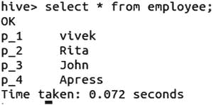

图 6-15. 从 employee 表中获取的行

我们来讨论一下基于 Hive、Hadoop 和 Cassandra 的架构会是什么样子。图 6-16 中的图片展示了由 Hive 驱动的 MapReduce 作业如何在 Cassandra 数据节点上运行。在这里，每个 Hive 查询都会被转换为一个 MapReduce 作业，并提交给 Hadoop，而 Hadoop 则会依赖名称节点和元数据来识别 Cassandra 数据节点，以在这些数据节点上本地运行相应的 map 和 reduce 任务。

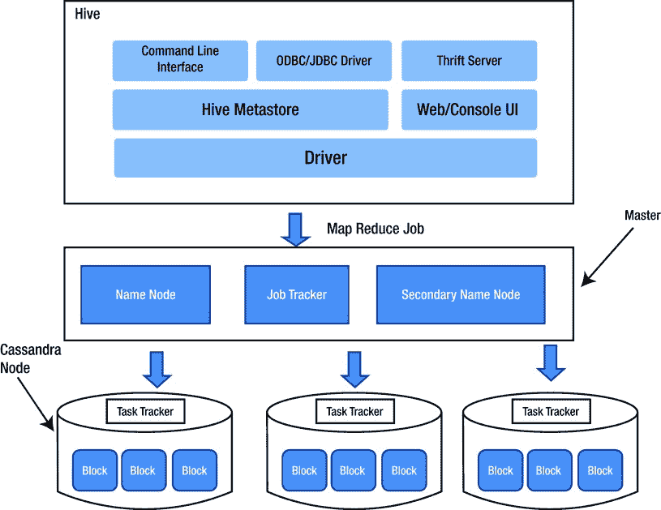

图 6-16. 该图描绘了在 Cassandra 数据节点上运行 Hive MapReduce 的架构表示

值得一提的是，在 HDFS 上运行 Hive MapReduce 作业与图 6-17 所示相同，只是数据块属于 HDFS 而非 Cassandra 节点。

#### HDFS 数据加载

我们也可以使用 `load data` 命令从 HDFS 向 Hive 管理的表中加载数据。让我们通过一个简单的练习来探索这部分内容：

首先使用 `put` 命令将 tweets 文件放到 HDFS 上：

```
bin/hadoop fs -put /home/vivek/Documents/apress_book/Apress/datafiles/person_store /usr/vivek/employee_store/infile
```

我们可以使用 `load` 命令直接向 HDFS 目录加载数据，如下所示：

```
load data inpath  '/usr/vivek/employee_store/infile' overwrite into table employee ;
```

这里的区别是使用了 `load data inpath` 而不是 `load data local inpath`，这使得可以从文件路径映射到 HDFS 目录（例如 `/usr/vivek/employee_store/infile`）。

最后，我们可以查看插入的数据（见图 6-17）：

```
select * from employee;
```

我们还可以使用条件查询，例如按姓名获取员工（见图 6-18）：

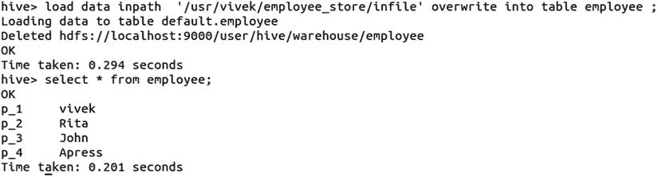

图 6-17. 通过 Hive 终端从 employee 表中获取行

```
select * from employee where fname = 'vivek';
```

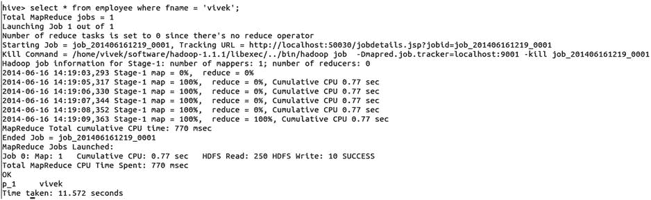

图 6-18. 获取 fname 为 vivek 的行

运行此类查询时，除非条件列不是分区键，否则它们会被转换为 MapReduce 作业。针对分区键的查询可以直接从数据节点获取数据，并且由于数据已按分区键进行分区，因此不需要 MapReduce 过程。我们可以在创建表时定义分区键，如下所示：

```
CREATE TABLE employee (
fname  String,
lname  String,
emailId   String,
salary      FLOAT,
)
PARTITIONED BY (location STRING, joining_year INT, joining_month INT, joining_day INT) ;
```

任何针对分区键所有部分的条件查询都将快速定位数据文件夹，因为数据会根据定义的分区键自动排列到不同的文件夹中。

#### Hive 外部表

我们也可以在 HDFS 目录上创建 Hive 外部表。如果不需要由 Hive 管理，则建议创建外部表。

让我们重新审视同一个 tweets 示例，来进行外部表的练习。

首先使用 `put` 命令将 tweets 文件放到 HDFS 上（见图 6-19）：

```
bin/hadoop fs -put /home/vivek/Documents/apress_book/Apress/datafiles/person_store /usr/vivek/employee_store/infile
```

然后，我们可以在 Hive 中基于 HDFS 位置创建外部表：

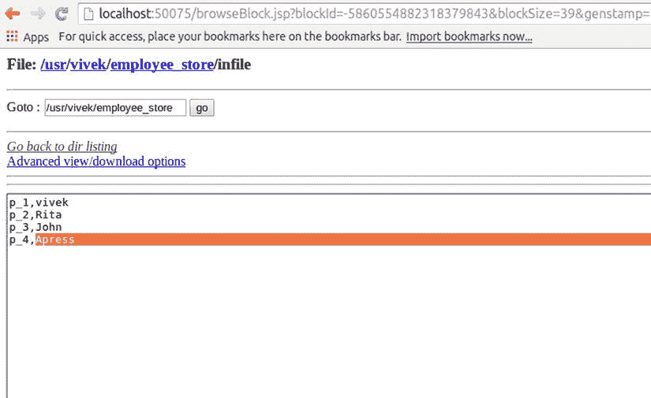

图 6-19. 包含员工记录的 Hive 目录

```
create external table employee_ext(person_id string, fname string) row format delimited fields terminated by ',' location 'hdfs://localhost:9000/usr/vivek/employee_store';
```

这里的 `hdfs://localhost:9000` 是 `fs.default.name` 属性的值。

我们可以查看插入的数据（见图 6-20）：

```
select * from employee_ext;
```

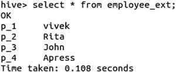

图 6-20. 从 employee_ext 外部表中获取记录


#### Hive 与 Cassandra 的集成

借助外部表支持，通过使用 Cassandra 专用的 `storageHandler` 实现，可以在 Hive 中对 Cassandra 进行数据分析。DataStax ([www.datastax.com](http://www.datastax.com/)) 提供诸如 DataStax Enterprise (DSE) 等商业产品，这些产品能够与 Hive 等工具实现无缝集成。我们将在本章稍后的“Apache Sqoop”部分中，进一步探讨 DSE 提供的功能。

在本节中，我们将讨论开源 Apache Cassandra 与 Hive 的集成。一个开源的实现方案是 Cassandra 专用的存储处理器，可在 [`github.com/tuplejump/cash`](https://github.com/tuplejump/cash) 获取。你可以通过 `git clone` 或下载 zip 源码包并在本地构建以生成 jars 包。或者，你也可以在 `jars` 文件夹中找到作为源码附件的这些 jars 包。

在我们的示例中，我们将在 Cassandra 中创建一个表，并在 Hive 上创建外部表，以探索通过 Cassandra 和 Hive 插入的数据。

首先，我们创建一个 `twitter` 键空间和 `twitterdata` 表：

```
create keyspace twitter with replication={'class':'SimpleStrategy','replication_factor':2};
```

```
use twitter;
```

```
create table twitterdata(tweet_id timeuuid primary key, body text, tweeted_by text);
```

让我们使用 `insert` 命令插入几条记录：

```
insert into twitterdata(tweet_id,body,tweeted_by) values(now(),'my first tweet','@mevivs');
```

```
insert into twitterdata(tweet_id,body,tweeted_by) values(now(),'Cassandra book:beginning cassandra development','@apress_team');
```

```
insert into twitterdata(tweet_id,body,tweeted_by) values(now(),'Technical review position available for #Parse and #Phonegap related @Apress titles: paid','@apress_team');
```

```
insert into twitterdata(tweet_id,body,tweeted_by) values(now(),'Android Apps Security http://t.co/5XLSObkk9f','@jhassel');
```

接下来，我们通过配置 Cassandra 存储处理器、Thrift 以及 Cassandra 专用的 jars 包来连接到 Hive shell：

```
/home/vivek/software/hive-0.9.0/bin/hive --auxpath /home/vivek/source/cash/cassandra-handler/target/hive-cassandra-1.2.9.jar:/home/vivek/.m2/repository/org/apache/cassandra/cassandra-all/1.2.9/cassandra-all-1.2.9.jar:/home/vivek/software/apache-cassandra-2.0.4/lib/libthrift-0.9.1.jar:/home/vivek/.m2/repository/org/apache/cassandra/cassandra-thrift/1.2.9/cassandra-thrift-1.2.9.jar
```

成功连接到 Hive shell 后，我们可以按如下方式创建外部表：

```
CREATE EXTERNAL TABLE twitter.twitterdata(tweet_id string, body string, tweeted_by string) STORED BY 'org.apache.hadoop.hive.cassandra.cql.CqlStorageHandler' WITH SERDEPROPERTIES ("cql.primarykey" = "message_id, author", "comment"="check", "read_repair_chance" = "0.2", "dclocal_read_repair_chance" = "0.14", "gc_grace_seconds" = "989898", "bloom_filter_fp_chance" = "0.2", "compaction" = "{'class' : 'LeveledCompactionStrategy'}", "replicate_on_write" = "false", "caching" = "all");
```

请注意，Cassandra 存储处理器项目目前尚不支持 Hive 管理的 Cassandra 表。尝试以下方式创建一个 Hive 管理的表：

```
CREATE TABLE twitter.twitterdata_hive(tweet_id string, body string, tweeted_by string) STORED BY 'org.apache.hadoop.hive.cassandra.cql.CqlStorageHandler' WITH SERDEPROPERTIES ("cql.primarykey" = "message_id, author", "comment"="check", "read_repair_chance" = "0.2", "dclocal_read_repair_chance" = "0.14", "gc_grace_seconds" = "989898", "bloom_filter_fp_chance" = "0.2", "compaction" = "{'class' : 'LeveledCompactionStrategy'}", "replicate_on_write" = "false", "caching" = "all");
```

将会导致如图 6-21 所示的错误。

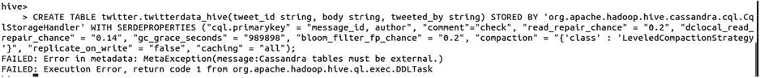

图 6-21 展示了在 Hive 中为 Cassandra 创建内部表时出现的错误。

到目前为止，我们已经探讨了通过 Hive 和 Pig 对 Cassandra 执行 MapReduce 算法的各种方法。数据分析的另一个重要方面是数据迁移，其中现有的关系型数据库管理系统（RDBMS）数据需要迁移到 Cassandra 上，以获得更好的可扩展性和性能。

在下一节中，我们将进一步探讨数据迁移。

### 数据迁移

基于传统 RDBMS 构建的旧版应用程序，为了寻求可扩展性和性能而转向 NoSQL 数据库时，可能需要将数据从 RDBMS 迁移到 Cassandra。例如，金融应用希望迁移交易日志，或是在 RDBMS 中存储活动日志的热门网站现在希望将这些日志迁移到 Cassandra。

#### 传统方式

这是从 MySQL 等 RDBMS 导出数据的最简单方式：先导出为 CSV 格式文件，再将数据加载到 Cassandra 中。我们通过一个示例练习来进一步讨论。

首先，在 MySQL 中创建一个数据库和表：

```
create schema twitter;
```

```
create table twitterdata(id varchar(20) primary key,screen_name varchar(20),body varchar(30));
```

插入一些示例推文：

```
insert into twitterdata('1','mevivs','my first tweet');
```

```
insert into twitterdata values('2','jhassel','my first tweet');
```

```
insert into twitterdata values('3','rfernando','my first tweet');
```

接下来，从 `twitterdata` 表中导出数据：

```
select * from twitterdata INTO OUTFILE '/tmp/mysql_output.csv' Fields TERMINATED BY ',' ENCLOSED BY '"' LINES TERMINATED BY '\n';
```

然后，在 Cassandra 中创建一个表和键空间：

```
create table ntwitterdata(id text primary key, screen_name text, bodt text);
```

最后，我们可以通过 cql shell 中的 `copy` 命令，从 csv 文件中复制 `twitterdata`：

```
copy twitterdata from '/tmp/mysql_output.csv';
```

这样，我们就可以通过传统方式执行数据迁移了。但不幸的是，这种方式是本地化的。

这看起来很简单，但如果要迁移包含多个表的完整模式呢？仅提供模式名称就足以建立通道并迁移数据吗？Apache Sqoop (SQL 到 Hadoop) 正是这些问题的答案。

#### Apache Sqoop

Apache Sqoop 是一个将数据从关系型数据库传输到 NoSQL 数据库（如 Cassandra）或分布式文件系统（如 Hadoop）的工具。Sqoop 自 2012 年起已成为 Apache 顶级项目。当我们需要在 RDBMS 和 NoSQL（例如 Cassandra、Hadoop）之间建立数据迁移通道时，Sqoop 会非常方便。

在本节中，我们将使用 DataStax 的 DSE 来进行 Sqoop Cassandra 集成的示例。有关 DSE 安装和配置的更多详细信息，请参考：

[`www.datastax.com/docs/datastax_enterprise3.1/reference/start_stop_dse`](http://www.datastax.com/docs/datastax_enterprise3.1/reference/start_stop_dse)

[`www.datastax.com/docs/datastax_enterprise3.0/install/install_rpm_pkg`](http://www.datastax.com/docs/datastax_enterprise3.0/install/install_rpm_pkg)

你也可以下载并将 tarball 解压到本地文件夹中。


#### 结合 Cassandra 使用 Sqoop

在本练习示例中，我们将沿用之前使用的相同推文文件，并最终利用 DSE Sqoop 支持，将数据从 MySQL 迁移至 Cassandra。

首先，连接到 MySQL 客户端：

`mysql -u root -p –local-infile`

接下来，我们将创建一个键空间 `twitter` 和表 `twitterdata`：

`create keyspace twitter with replication={'class':'SimpleStrategy','replication_factor':2};`

`use twitter;`

`create table twitterdata(tweetdate varchar(50),screen_name varchar(50),body varchar(300), id int NOT NULL AUTO_INCREMENT, PRIMARY KEY(id));`

现在，将推文数据加载到 `twitterdata` 表中（见图 6-22）：

`LOAD DATA LOCAL INFILE '/home/vivek/tweets' INTO TABLE twitterdata FIELDS TERMINATED BY 0x01 LINES TERMINATED BY '\n';`

然后，启动带有 Hadoop 支持的 DSE Cassandra：

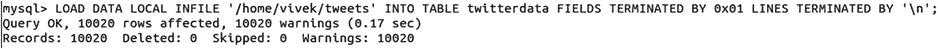

图 6-22. 将本地文件系统中的文件加载到 Hive 表中

`bin/dse cassandra -t`

接下来，运行 `sqoop import`，如下所示：

`bin/dse sqoop import --connect jdbc:mysql://localhost/twitter --username root -P --table twitterdata --cassandra-keyspace twitter --cassandra-column-family twitterdata --cassandra-row-key id --cassandra-thrift-host localhost –cassandra-create-schema`

成功导入后，让我们通过 `cassandra-cli` 来探索 `twitterdata` 列族（见图 6-23）：

`$DSE_HOME/bin/cassandra-cli`

你也可以从 `cqlsh` 来探索 `twitterdata` 表（见图 6-24）：

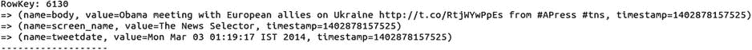

图 6-23. 使用 cassandra-cli 探索已加载的数据

`$DSE_HOME/bin/cqlsh`

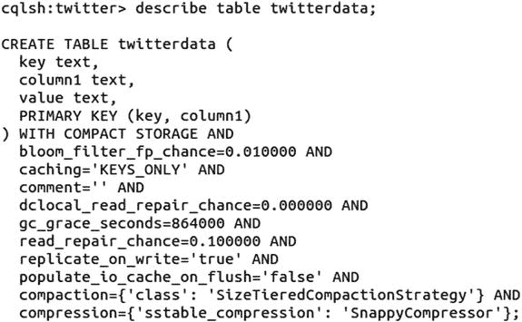

图 6-24. 描述 twitterdata 表

至此，我们可以得出结论：Sqoop 可以轻松地与 Cassandra 进行配置，用于数据迁移。

下一章将继续讨论图数据库相关话题。

### 本章小结

以下是本章讨论内容的总结：

*   配置并运行基于 Hive 的查询，以类似 SQL 的方式集成并运行 MapReduce 作业。
*   如果读者精通基于脚本的编程，并熟悉编写脚本，那么使用 Pig 会非常方便。
*   使用 Sqoop 将数据从 HDFS/MySQL 迁移到 Cassandra，反之亦然。

下一章将向前推进，讨论新的范式——基于图的数据库。该章节将讨论为什么、如何以及何时使用图数据库，最重要的是，如何与 Cassandra 结合使用。

