# 7. 基于 Cassandra 的 Titan 图数据库

到目前为止，我们已经讨论了 Cassandra 中的数据建模，以及使用 Hadoop 及相关技术构建大型数据分析平台。当业务需求要求不同对象之间相互关联时，一种解决方案是在多个对象之间进行引用（连接）查询。当我们必须处理众多此类关系，或者数据量变得非常庞大时，一切看似美好但问题也随之而来。

LinkedIn、Twitter 和 Facebook 是常见的例子，注册用户之间的关系可以被描述为社交图谱。另一个例子可能是构建信用历史并对一组客户进行贷款授信的风险分析。当然，通过使用多表和连接理论，我们可以实现一个解决方案，但这显然不具备可扩展性和高性能。这就是使用图数据库的想法发挥作用的地方。

在本章中，我们将讨论：

*   图概念简介
*   图框架与图数据库
*   Titan 图数据库的安装与配置
*   图的使用案例

### 图简介

图论可以追溯到 1736 年。图是一种由顶点/节点和边组成的数据结构。一个图可以有零条或多条边。没有边的图也称为空图。

顶点是一个图节点，它通过边与其他图节点/顶点相连接。每条边是一条弧线或线段，连接多个顶点。

在计算机科学中，图可以按多种方式进行分类。其中一些常见的分类包括：

*   简单图与非简单图
*   有向图与无向图
*   有环图与无环图

#### 简单图与非简单图

顾名思义，简单图是一种在两个顶点之间最多只有一条边的基图。它是一种没有自环但包含多个节点的图（见图 7-1a）。另一方面，具有自环和多条边的图是非简单图（见图 7-1b）。这里，自环是指连接到自身顶点的一条边。在相同节点之间具有多条边的图也称为多重图或并行图。图 7-1c 所示的是一个多重图，并且是一个自环图。它在顶点 A 上包含一个自环，并且在顶点 A 和 B 之间有多条边。

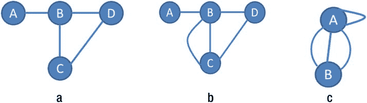

图 7-1. a) 左侧为简单图；b) 中间为非简单图；c) 右侧为带自环的多重图

#### 有向图与无向图

具有多个节点和有向边的图称为有向图（见图 7-2a）。无向图是边没有方向的图（见图 7-2b）。

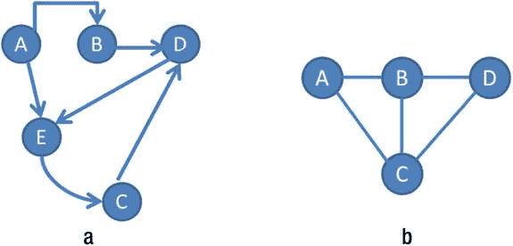

图 7-2. a) 左侧为带有有向边的有向图；b) 无向图

#### 有环图与无环图

如果一条路径包含至少一条边，并且起点和终点是同一个顶点，则称该图包含一个环，而无环图则不包含任何环。此类图可以是有向的或无向的。图 7-3 展示了有环图和无环图的图形表示。

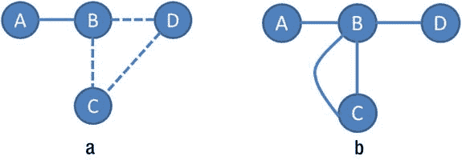

图 7-3. a) 虚线显示了一个图中的环；b) 无环图

图 7-3a 表示一个有环图，环的边由连接顶点 B、C 和 D 的虚线表示。

以上是一些基本的图类型。可能想到的下一个问题是：是否有专门用于处理图相关问题的开源工具、框架或数据库？

### 图的开源软件

开源软件是免费的，易于提交错误，并且可以根据我们的需求请求功能修改，最重要的是成本效益高。近年来，在 IT 行业中使用开源软件变得流行起来，更多的组织倾向于选择开源解决方案。在采用开源解决方案之前，需要考虑的几个因素是：

*   应成熟稳定
*   应处于活跃开发中，并且必须有社区支持
*   必须有实际生产系统来验证其行业用途

我们之前提出了一个问题：是否存在用于解决图相关问题的工具、框架或数据库。那么，让我们来探索和寻找答案！

#### 图框架：TinkerPop

图框架用于图数据建模和可视化。在本节中，我们将讨论 TinkerPop（ [www.tinkerpop.com/](http://www.tinkerpop.com/) ）及其功能集。TinkerPop Blueprints 被许多 NoSQL 数据库（包括 Titan）用作规范。Blueprints 提供了一套用于图数据建模的接口和实现，将在本节稍后部分讨论。

TinkerPop 是一个开源图计算框架，包含多个组件、框架和命令行工具，用于处理图数据建模和可视化。在本节中，我们将逐一讨论它们。


##### Pipes

`Pipes`是一个数据流框架，支持从输入到输出的数据拆分、合并、过滤和转换。计算以内存高效、惰性求值的方式执行。

可以将`Pipes`视为由边连接的顶点，通常包含用于提取、转换和数据计算的函数。

##### Gremlin

`Gremlin`是一种图遍历语言，用于图查询、分析和操作。`Gremlin`发行版内置了对 Java 和 Groovy 的 API 支持。我们将在本章后面的“命令行工具和客户端”部分详细讨论`Titan`相关的`Gremlin`。

##### Frames

`Frames`将`Blueprints`图的元素暴露为 Java 对象。使用`Frames`时，无需以顶点和边的方式编写软件，而是以领域对象及其相互关系的方式来编写。

##### Rexster

`Rexster`是一个多功能的图服务器，它通过多种机制（主要侧重于 REST）暴露任何`Blueprints`图。它通过`REST API`和`RexPro`协议暴露图服务器。`RexPro`是`Rexster`的二进制协议，可用于将`Gremlin`脚本发送到远程的`Rexster`实例。脚本在服务器端处理，结果经过序列化后返回给调用客户端。它还提供了基于浏览器的界面工具，即`Dog House`和`Rexster`控制台（将在`Titan`生态系统中讨论）。

##### Furnace

`Furnace`是一个属性图算法包。它提供了标准图分析算法的实现，这些算法可以以有意义的方式应用于属性图。`Furnace`提供了针对不同图计算场景（如单机图和分布式图）优化的不同图算法实现。

注意

单机图涉及单个节点上的图数据，而分布式图的数据分布在多个节点上。

##### Blueprints

`Blueprints`，顾名思义，是一个具有已提供实现的属性图模型接口。实现了`Blueprints`接口的数据库会自动支持启用了`Blueprints`的应用程序。

可以将`Blueprints`视为图数据库的`JDBC`（Java 数据库连接）或`JPA`（Java 持久化 API）API。大多数图数据库都实现了`Blueprints`。图 7-4 展示了如何将`Blueprints`与前面提到的`TinkerPop`组件关联起来的可视化表示。

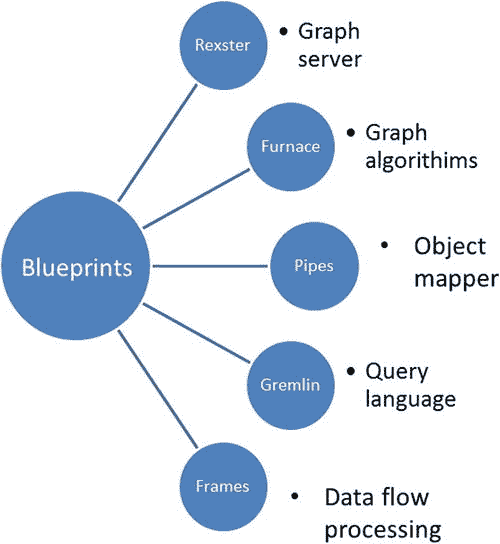

图 7-4. `TinkerPop Blueprints`实现

至此，我们已经介绍了`TinkerPop`框架、其组件以及其他与图相关的概念。接下来的问题是，是否存在可以视为图数据库的基于图的解决方案。在下一节中，我们将回答这些问题。

#### 图作为数据库

与传统的关系型数据库管理系统（RDBMS）相比，NoSQL 数据库更少关注模式，而更多关注数据的非规范化形式。然而，图数据库提供了通过边定义节点之间关系的灵活性，这就是为什么用 RDBMS 概念来理解它们很容易的原因。使用 RDBMS 构建类似图的查询当然是可能的，但如前所述，其用途非常有限。对于非图数据库，运行基于图的遍历查询或构建图结构的能力不受支持，并且构建起来可能很繁琐。由于固有的图数据结构支持，图数据库将比传统 RDBMS 更具优势。

RDBMS 与图数据库之间的一些区别包括：

- 使用图数据库无需索引查找，因为节点或顶点知道它们所连接的属性（例如边），而在 RDBMS 中我们需要依赖索引机制。
- 通过边互连的两个顶点在属性上可能不同，并且可能动态演变，但 RDBMS 强制使用固定的模式集。
- 在图数据库中，两个顶点之间的关系存储在记录级别，而在 RDBMS 中，它是在表级别定义的。

我们需要记住的一点是，当前的应用程序开发时代是针对特定需求使用特定技术，这非常适合于构建多语言或混合解决方案。这意味着，如果您的需求最适合通过运行类似图的查询来满足，并且您的需求本身更适合基于图的快速模型，那么答案很简单：使用图数据库。图数据库使用节点和边及其属性来构建和存储图结构中的数据。图数据库中的每个元素都有一个指向相邻节点的引用，这意味着不需要索引查找。图 7-4 展示了一个图数据库的示例，它将 Twitter 用户存储为节点，将他们的粉丝存储为边。每个节点包含`fname`、`id`、`lname`和`role`作为属性，而每条边都有一个属性来表示用户成为相邻节点（即用户）粉丝的日期。

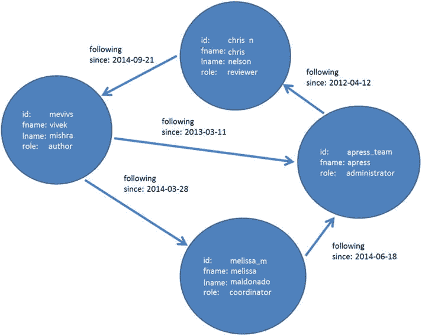

图 7-5. 一个存储 Twitter 用户、其属性和粉丝的图数据库

图 7-5 展示了用户`mevivs`、`chris_n`、`apress_team`和`melissa_m`的 Twitter 连接和粉丝图。这里，顶点`apress_team`被顶点`mevivs`和`melissa_m`关注。另一方面，`chris_n`和`apress_team`之间存在传递关系/遍历：`chris_n`关注`mevivs`，`mevivs`关注`apress_team`，并且`apress_team`关注`chris_n`。在“Gremlin Shell”和“用例”部分，我们将引用同一个 Twitter 示例，在示例练习中探索命令行工具和 Java API。在考虑此类传递性图查询时，值得讨论的一点是，图数据库处理此类查询的方式与 SQL 查询不同。使用 SQL 处理此类传递性查询并不直接，需要执行复杂的连接、并集或交集操作。但使用图数据库处理此类传递性查询要容易得多，只需根据边的属性，跟随边进行传入和传出的数据查询即可。“用例”部分将讨论这些图遍历。

让我们来谈谈可用的图数据库。一些流行的图数据库包括：

- Neo4J
- OrientDB
- Objectivity 的 InfiniteGraph
- Titan

由于本章的目的是详细讨论 Cassandra 和 Titan 图数据库，我们将仅讨论这里提到的其他数据库提供的重要特性。

##### Neo4J

Neo4J（[`www.neo4j.org/`](http://www.neo4j.org/)）是一个采用 GPU（通用公共使用）许可证的开源数据库。它由 Neo Technology Inc.开发。它以由有向边连接的节点形式存储数据。提供的一些重要特性包括：

- 可扩展且高可用的数据
- 完全的 ACID 事务支持
- 基于 REST 的访问
- 支持 Cypher 和 Gremlin 图查询语言

##### OrientDB

OrientDB（[`www.orientechnologies.com/orientdb/`](http://www.orientechnologies.com/orientdb/)）是一个采用 Apache 2 许可证的 NoSQL 图数据库。它由 Orient Technologies 的 Luca Garulli 管理和开发。OrientDB 提供的一些重要特性包括：

- 基于 REST 的访问
- 完全的 ACID 事务支持
- 类似 SQL 的查询支持接口

##### InfiniteGraph

InfiniteGraph（[`www.infinitegraph.com/`](http://www.infinitegraph.com/)）是一个由 Objectivity Inc.构建的企业级分布式图数据库。InfiniteGraph 支持的一些重要特性包括：

- 支持并发和一致性
- 完全的 ACID 事务支持
- 一个可视化工具


##### Titan

Titan（`thinkaurelius.github.io/titan/`）是一个遵循 Apache 许可的可扩展图数据库，旨在以节点和边的形式存储大量数据。它支持 Cassandra 作为后端存储。其一些重要特性包括：

*   通过 Lucene/ES 支持全文搜索和地理空间查询
*   支持 ACID 事务
*   最终一致性和中间一致性
*   支持多种数据库，适用于多语言图应用
*   支持 Gremlin 和 Cypher 查询语言

Titan 及其各个组件将在后续章节中讨论。

### Titan 图数据库

Titan 是一个事务性图数据库，允许数千个并发用户实时执行复杂的图遍历查询。它还通过 Hadoop 集成提供了对图数据分析、报表和 ETL 的支持。Titan 内置了对 Elasticsearch 和 Lucene 的支持，用于地理空间查询和全文搜索，并且原生支持 Blueprint TinkerPop 图栈。

图 7-6 展示了 Titan 生态系统的图形表示。

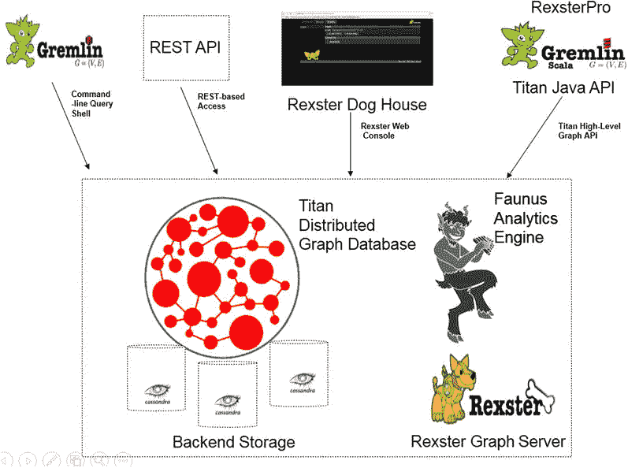

图 7-6. Titan 生态系统

#### 基本概念

本节将介绍一些对理解 Titan 图数据库至关重要的基本概念。

##### 以顶点为中心的索引

以顶点为中心的索引是针对特定顶点的。大多数引用或非引用顶点之间的遍历都是通过边或边属性进行的。为这些属性或边标签建立索引可以避免性能开销。此类索引也可称为本地索引。以顶点为中心的索引的目的是根据边的属性和标签对顶点的相邻边进行排序和索引。

Titan 还支持 Elasticsearch，它可以以独立模式或嵌入模式与 Titan 一起运行。借助 Elasticsearch，还可以执行全文搜索、地理空间查询和数值范围查询。Elasticsearch 也允许我们查询未索引的属性。

##### 边压缩

通过边压缩，Titan 可以存储压缩的元数据并保持较低的内存占用。它还可以将所有边标签和属性存储在同一数据块中，以实现更快的检索。

##### 图分区

这是底层数据库最为关键的地方。在 Cassandra 中，我们知道特定行的数据将存储在一个 Cassandra 节点上。Titan 通过理解按顶点 ID 排序的键，可以有效地在 Cassandra 节点之间分区和分布图数据。顶点 ID 是一个 64 位的唯一值。

默认情况下，Titan 采用随机分区策略将顶点随机分配给节点。随机分区效率高，能保持集群平衡，但在采用多个后端存储选项来存储图的情况下，会导致性能问题，并需要跨数据库实例进行通信。使用 Titan，我们还可以配置显式分区。通过显式分区，我们可以控制并将遍历过的子图存储在同一个节点上。

我们可以按如下方式在 Titan 中启用显式分区：

```
cluster.partition = true
cluster.max-partitions = 16
ids.flush = false
```

其中`cluster.max-partitions`是每个集群的最大分区数。此外，我们还需要禁用刷新 ID。

当使用 Cassandra 作为存储后端选项时，必须使用`ByteOrderedPartitioner`进行配置。

Titan 将顶点及其相邻边和属性存储为一个集合。这种机制称为数据共置。通过这种机制，连接到一个顶点的边及其属性将被存储在一起。每一行将包含一个顶点 ID 作为键，相邻边和属性作为单元格。这种数据表示格式在所有支持的数据库中都是通用的。

图 7-7 和 7-8 展示了 Titan 的数据布局和边存储机制。（这些图片来自 Titan 维基页面：[`https://github.com/thinkaurelius/titan/wiki/Titan-Data-Model`](https://github.com/thinkaurelius/titan/wiki/Titan-Data-Model)，并在 Apache 许可证 2.0 版本下重复使用，许可证地址：[`www.apache.org/licenses/LICENSE-2.0`](http://www.apache.org/licenses/LICENSE-2.0)。）

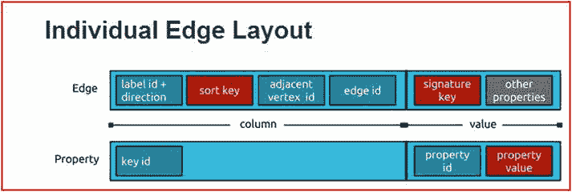

图 7-8. Titan 的边存储机制

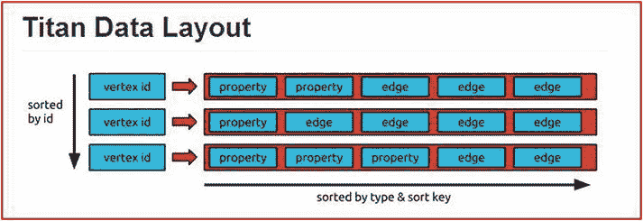

图 7-7. Titan 的数据布局机制

底层数据存储将每个顶点及其相邻边和属性存储为单行。这些行将按顶点 ID 排序，单元格将按属性和边键排序。动态单元格可以在运行时添加。数据共置非常重要，因此将顶点及其相邻边存储为单行有助于实现高可用性。

##### 后端存储

Titan 的存储架构是完全解耦的，支持多种 NoSQL 数据库，包括：

*   Cassandra
*   HBase
*   BerkeleyDB
*   Persistit

支持多种 NoSQL 数据存储允许根据应用需求选择合适的数据库。换句话说，您可以根据特定需求选择特定技术。基于 CAP 定理，我们可以选择任何一个支持的数据库。

使用 Titan，我们可以通过`storage.backend`选项动态配置后端存储。本章将介绍如何将它与 Cassandra 一起使用。

##### 事务处理

Titan 是一个事务性图数据库，因此每个读/写操作都在事务边界内进行。

以下代码片段展示了 Titan 如何将顶点`mevivs`包裹在事务边界内并提交它：

```
TitanGraph g = TitanFactory.open("/home/vivek/Titan");
Vertex mevivs = g.addVertex(null); //隐式包裹在事务内
mevivs.setProperty("fname", "vivek");
g.commit(); //提交事务
```

在数据量非常大且采用多语言架构的情况下，可能会发生永久性或临时性故障。临时故障包括网络故障、节点无响应等场景。在这种情况下，我们可以像这样配置 Titan 的重试延迟属性：

```
Configuration conf = new BaseConfiguration();
conf.setProperty("storage.attempt-wait ", 250); // 时间单位为毫秒
```

此类临时故障可以通过重试来处理，但永久性故障（例如硬件故障）需要用户显式处理`TitanException`：

```
try {
    TitanGraph g = TitanFactory.open("/home/vivek/Titan");
    Vertex mevivs = g.addVertex(null); //隐式包裹在事务内
    mevivs.setProperty("fname", "vivek");
    g.commit(); //提交事务
} catch (TitanException e) {
    //配置显式重试或快速失败场景。
}
```

以上是 Titan 的基本概念和架构。接下来，我们将介绍 Titan 图数据库的安装与配置。

#### 安装与配置

我们可以从 [`https://github.com/thinkaurelius/titan/wiki/Downloads`](https://github.com/thinkaurelius/titan/wiki/Downloads) 下载最新的 Titan 发行版。在撰写本文时，最新版本为 0.5.0。下载发行版后，将其解压到本地文件夹。在本章中，我们将在多处引用`TITAN_HOME`变量。我们可以按如下方式设置它：

```
export TITAN_HOME=/home/vivek/software/titan
```

#### 命令行工具和客户端

完成安装和配置后，首先想到的问题是：是否有任何命令行客户端？就像 Cassandra 有 CQL Shell 一样，Titan 是否提供用于服务器端脚本编写和快速分析的选项？本节我们将探讨两个命令行选项：Gremlin Shell 和 Rexster。


#### Gremlin Shell

Titan 支持通过 Gremlin Shell，使用 Gremlin 查询语言对图进行遍历和变更。它是一种函数式语言。每一步都会输出一个对象，通过 `.`（点号），我们可以调用其关联的函数。例如：

```
gremlin> conf = new BaseConfiguration() // 步骤 1
==>org.apache.commons.configuration.BaseConfiguration@2d3c117a
gremlin> conf.setProperty("storage.backend", "cassandrathrift") // 步骤 2
```

这里 `conf` 是在步骤 1 中创建的 `Configuration` 对象，其函数在步骤 2 中被调用。

让我们通过一个练习来讨论 Gremlin。在本方法中，我们将使用相同的 Twitter 示例，其中用户的推文将被视为图的顶点，用户与其推文及关注者之间的关系则作为边。在此示例中，我们将使用 Cassandra 作为后端存储选项。你可以选择运行独立的 Cassandra 服务器；否则，默认情况下它会启动并连接到一个内嵌的服务器。

接下来，我们需要初始化一个配置对象并设置一些 Cassandra 特有的属性：

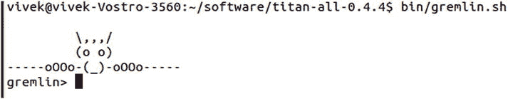

图 7-9. 连接到 Gremlin Shell

首先，我们需要如图 7-9 所示连接到 Gremlin。

```
gremlin> conf = new BaseConfiguration()
==>org.apache.commons.configuration.BaseConfiguration@2d3c117a
gremlin> conf.setProperty("storage.backend", "cassandrathrift")
==>null
gremlin> conf.setProperty("storage.hostname", "localhost")
==>null
gremlin> conf.setProperty("storage.port", "9160")
==>null
gremlin> conf.setProperty("storage.keyspace", "twitter")
==>null
```

接下来，获取一个 Titan 图对象：

```
gremlin> graph = TitanFactory.open(conf)
==>titangraph[cassandrathrift:localhost]
```

让我们创建一些顶点键和边标签：

```
gremlin> graph.makeKey("fname").dataType(String.class).indexed(Vertex.class).make()
==>fname
gremlin> graph.makeKey("lname").dataType(String.class).indexed(Vertex.class).make()
==>lname
gremlin> graph.makeKey("twitter_tag").dataType(String.class).indexed(Vertex.class).make()
==>twitter_tag
gremlin> graph.makeKey("tweeted_at").dataType(String.class).indexed(Vertex.class).make()
==>tweeted_at
gremlin> graph.makeLabel("has_tweeted").make()
==>has_tweeted
gremlin> tweet.setProperty("body", "Working on Cassandra book for apress")
==>null
gremlin> tweet.setProperty("tweeted_at", "2014-09-21")
==>null
```

这里 `fname`、`lname` 和 `twitter_tag` 是顶点键，标签 `has_tweeted` 将在下一步中用于边。

让我们为用户和推文创建顶点：

```
gremlin> vivs = graph.addVertex(null)
==>v[4]
gremlin> vivs.setProperty("fname", "vivek")
==>null
gremlin> vivs.setProperty("lname", "mishra")
==>null
gremlin> vivs.setProperty("twitter_tag", "mevivs")
==>null
gremlin> graph.V("fname","vivek")
==>v[4]
gremlin> tweet = graph.addVertex(null)
==>v[8]
```

接下来，在这两个顶点之间添加一条边：

```
gremlin> graph.addEdge(null, vivs, tweet, "has_tweeted")
==>e[2V-4-1E][4-has_tweeted->8]
```

让我们添加 `apress_team` 作为用户，并建立和定义“vivek 关注了 apress_team”的关系边：

```
gremlin> apress = graph.addVertex(null)
==>v[12]
gremlin> apress.setProperty("fname", "apress")
==>null
gremlin> apress.setProperty("twitter_tag", "apress_team")
==>null
gremlin> graph.addEdge(null, vivs, apress, "following")
==>e[3r-4-22][4-following->12]
```

我们可以通过键来查找顶点，如下所示：

```
gremlin> vivek = graph.V('fname','vivek').next()
==>v[4]
gremlin> vivek.map()
==>twitter_tag=mevivs
==>lname=mishra
==>fname=vivek
```

我们也可以从顶点 `vivek` 获取所有具有 `has` 关系的出边：

```
gremlin> outVertex = vivek.out('has').next()
==>v[8]
gremlin> outVertex.map()
==>body=Working on Cassandra book for apress
==>tweeted_at=2014-09-21
```

上述方法演示了如何使用 Gremlin 查询语言填充和遍历一个 Twitter 图应用。

让我们讨论一下 Rexster REST API、Dog House 和 Titan 服务器。

#### Rexster：服务器、REST API 和 Dog House

正如 TinkerPop 部分所讨论的，使用 REST API 和 Web 控制台，我们可以可视化和管理任何 Titan 图。在之前的方法中，我们讨论了下载并在本地机器上搭建 Titan 发行版。要启动 Titan 服务器、内嵌的 Elasticsearch 和 Cassandra，我们需要运行：

`TITAN_HOME/bin/titan.sh`

接下来，要连接 REST API 和 Dog House，我们需要执行：

`TITAN_HOME/bin/rexster-console.sh`

这将启动 Elasticsearch 并在端口 9300 上连接到 Elasticsearch 传输层，并使 Rexster 在端口 8184 上运行。REST API 和 Dog House 控制台将在 `localhost:8182` 端口上启动（见图 7-10）。

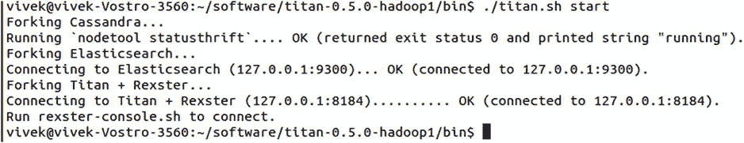

图 7-10. 启动 Rexster 服务器

##### Rexster Dog House

图 7-11 显示了 Dog House 控制台，其中包含仪表盘选项卡、浏览边和顶点的选项，以及内建的 Gremlin 命令行 Shell。

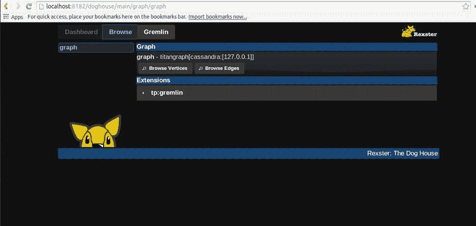

图 7-11. Rexster Dog House Web 控制台

内建的 Gremlin 命令行客户端允许你运行图的变更和遍历查询（本章前面已讨论过）。

让我们使用 Gremlin 查询语言探索存储在 Gremlin 方法中的图。我们可以使用“浏览顶点”（Browse Vertices）选项来分析顶点，如图 7-12 所示。

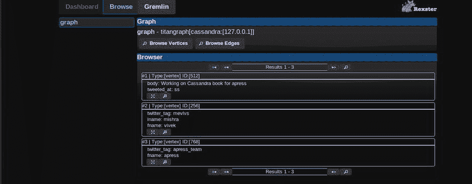

图 7-12. 浏览图顶点

我们还可以进一步钻取特定顶点的属性（见图 7-13）。该图显示了顶点“vivek”的属性以及入边和出边。它有两个出边：“has”和“following”，分别指向推文顶点和 `apress_team` 顶点。

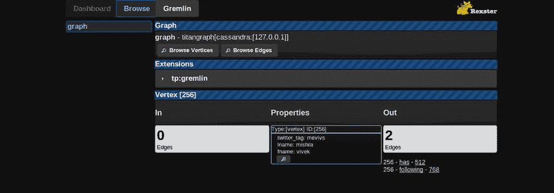

图 7-13. 探索顶点“vivek”的属性与关系

同样地，我们也可以探索边及其属性（见图 7-14 和图 7-15）。

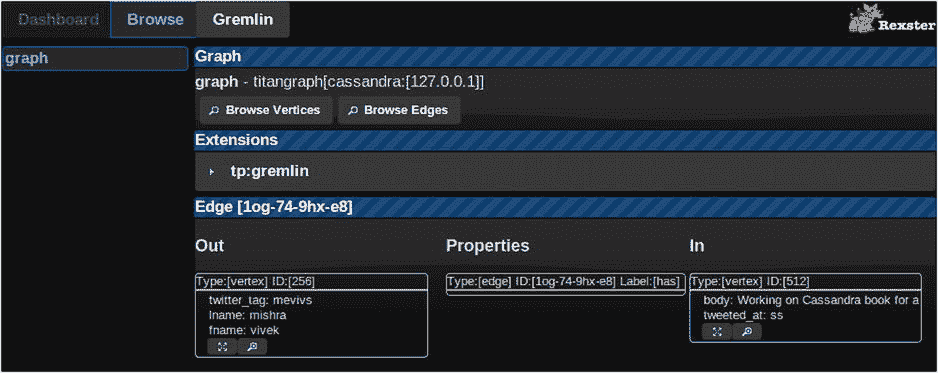

图 7-15. 探索标签为“has”的边

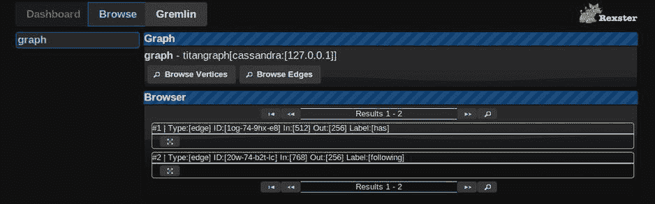

图 7-14. 探索标签为“has”和“following”的边

图 7-15 显示了边“has”的属性以及其连接的入边和出边顶点。顶点 `mevivs` 和 `tweet` 通过边“has”连接，用通俗的话说就是“Vivek 发了一条推文！”

我们还可以通过点击搜索图标来可视化图，这将呈现如图 7-16 所示的可视化效果。

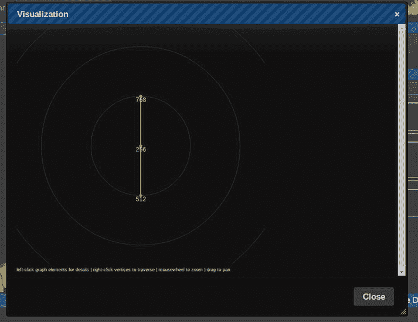

图 7-16. 顶点和边的可视化

该图展示了三个顶点和两条边的图形化表示。


#### Rexster REST API

我们也可以使用 REST API 查询 Titan 图数据库！例如，要获取所有顶点的列表，我们只需发起如下请求：

`localhost:8182/graphs/$graph_name/vertices`

例如，我们可以获取 Twitter “图”的所有顶点列表，如图 7-17 所示。

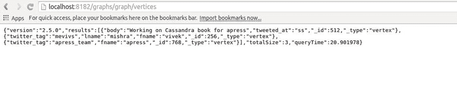

**图 7-17.** 使用 REST API 返回所有顶点列表

我们还可以通过其 ID 查询特定顶点（见图 7-18）。

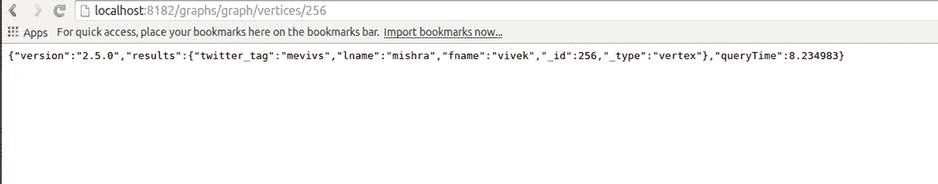

**图 7-18.** 使用 ID 256 获取一个顶点

所有支持的 REST 方法的完整列表可在 [`https://github.com/tinkerpop/rexster/wiki/Basic-REST-API`](https://github.com/tinkerpop/rexster/wiki/Basic-REST-API) 找到。

### Titan 与 Cassandra

在本节中，我们将讨论使用 Cassandra 作为存储选项的 Titan 实现。本节将介绍如何使用 Titan Java API 及 Cassandra，并执行读写图等用例。

#### Titan Java API

Titan 是 Blueprints 图接口的一种实现。Titan 提供了基于 Java 和 Groovy 的实现来访问 Titan。

Titan Java API 的设置相当简单。对于后端存储，它依赖于其他数据库，因此要开始使用 Titan，我们只需添加：

```
<dependency>
  <groupId>com.thinkaurelius.titan</groupId>
  <artifactId>titan-all</artifactId>
  <version>0.4.4</version>
</dependency>
```

撰写本文时最新的 Titan 版本是 0.5.0。对于 Cassandra，Titan 依赖于 Netflix 的 Astyanax Thrift 客户端。`TitanGraph` API 的最新版本支持 Astyanax 1.56.37 版本。请注意，如果项目中因其他 Cassandra 相关实现而使用了不同版本的 Astyanax Thrift，则可能会出现依赖问题。这意味着使用 Astyanax Thrift 客户端时，对 CQL 的支持也会非常有限。CQL3 特有的功能（例如集合）可能无法与此版本的 Astyanax 正常工作。

当 Cassandra 在远程多节点机器上运行时，我们可以通过逗号分隔的 IP 地址列表，在 Titan 中配置这些远程节点。

#### Cassandra 作为后端存储

如上所述，Cassandra 可以用作 Titan 的存储后端。在本节中，我们将配置 Titan 的存储选项（包括使用 Cassandra），并打开一个图实例。在接下来的“用例”部分，我们将通过一些简单练习，演示如何使用 Titan 与 Cassandra，例如对图进行读写操作。

首先，我们需要为 Titan 配置一些存储选项：

```
import org.apache.commons.configuration.BaseConfiguration;
import org.apache.commons.configuration.Configuration;
import com.thinkaurelius.titan.core.TitanFactory;
import com.thinkaurelius.titan.core.TitanGraph;
import com.thinkaurelius.titan.core.TitanKey;

Configuration conf = new BaseConfiguration();
conf.setProperty("storage.backend", "cassandrathrift");
conf.setProperty("storage.hostname", "localhost");
conf.setProperty("storage.port", "9160");
conf.setProperty("storage.keyspace", "twitter");
```

表 7-1 概述并描述了我们在上一步中使用的配置属性。

接下来，我们需要使用 `TitanFactory` 打开一个图实例：

**表 7-1.** Titan 配置属性

| 属性 | 值 | 描述 |
| --- | --- | --- |
| `storage.backend` | `cassandrathrift` | 使用 Cassandra 作为后端存储 |
| `storage.hostname` | `localhost` | Thrift 的 `listen_address`，根据你的 Cassandra 服务器设置修改。 |
| `storage.port` | `9160` | Thrift RPC 端口 |
| `storage.keyspace` | `Twitter` | 用于 Titan 图存储的 Cassandra 键空间 |

```
TitanGraph graph = TitanFactory.open(conf);
```

让我们通过一些用例（如读取、写入和批处理数据）进一步探索 Titan Java API 与 Cassandra 的结合使用。

#### 用例

在本节中，我们将讨论图的遍历、读取、写入和批处理。首先讨论一个顶点和连接边数量庞大的场景，这在处理大数据时非常常见。

##### 向图写入数据

实例化一个图实例后，让我们探索如何将顶点及其关联边写入图中。我们将使用相同的 Twitter 示例，为用户、其推文及其关注者构建一个基于图的实现。

图 7-19 展示了一个我们将使用 `TitanGraph` API 实现的问题的表示。

让我们向图中添加一个顶点：

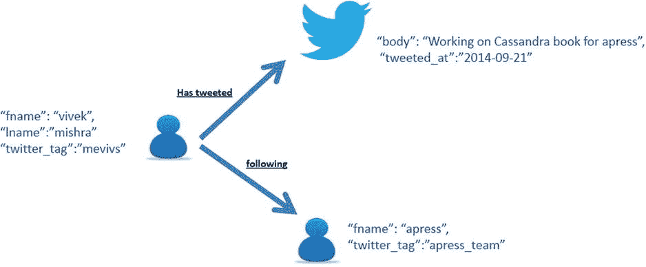

**图 7-19.** 用户 vivek 关注了 apress_team，并在 Twitter 上发布了关于其 Cassandra 书籍的推文

```
Vertex vivs = graph.addVertex(null);
vivs.setProperty("fname", "vivek");
vivs.setProperty("lname", "mishra");
vivs.setProperty("twitter_tag", "mevivs");
```

此处，`Vertex` 是一个来自 Blueprints 的 API。以下为上述代码片段的导入语句：

```
import com.tinkerpop.blueprints.Direction;
import com.tinkerpop.blueprints.Vertex;
```

你可以将顶点视为 Java POJO，将其属性视为字段变量。

让我们为推文创建另一个顶点，并在用户和推文顶点之间定义一条边：

```
Vertex tweet = graph.addVertex(null);
tweet.setProperty("body", "Working on Cassandra book for apress");
tweet.setProperty("tweeted_at", "2014-09-21");
graph.addEdge(null, vivs, tweet, "has_tweeted"); // 用户 vivs 拥有推文
```

我们还可以添加另一个顶点，并建立一个 `"following"` 关系：

```
Vertex apress = graph.addVertex(null);
apress.setProperty("fname", "apress");
apress.setProperty("twitter_tag", "apress_team");
graph.addEdge(null, vivs, apress, "following"); // Vivs 正在关注 apress 团队
```

最后提交事务：

```
graph.commit();
```

##### 从图读取数据

让我们探索如何从 Titan 图读取顶点和属性：

从图读取数据也非常简单，我们可以检索特定图的所有顶点，甚至特定的顶点：

```
Iterable<Vertex> vertices = graph.getVertices();
Iterator<Vertex> iter = vertices.iterator();
```

我们可以像这样遍历每个顶点并检索关联的边：

```
while(iter.hasNext())
{
    Vertex v = iter.next();
    Iterable<Edge> keys = v.getEdges(Direction.BOTH);
    ...
}
```

每条边都有 IN 和 OUT 顶点，我们可以通过边来检索这些顶点：

```
for(Edge key : keys)
{
    System.out.print(key.getVertex(Direction.IN).toString()); // 将在控制台打印 vivs
    System.out.print("=>");
    System.out.print(key.getLabel());
    System.out.print("=>");
    System.out.println(key.getVertex(Direction.OUT).toString()); // 将打印 tweets 或 apress
}
```

上述对 Titan 图的读写操作为如何使用 Titan 与 Cassandra 提供了一个简单的范例。

Cassandra 的核心在于大规模数据处理和分析。在使用基于 Cassandra 的图模型时，这一点也不例外。那么，使用 Titan 图数据库进行数据批处理呢？Titan 确实支持批量数据处理，在下一个示例中，我们将探索如何使用 Titan Java API 进行批量加载。


##### 批量加载

Titan 支持使用 `BatchGraph` API 进行批量加载，该 API 可视为 `TitanGraph` 的封装器，通过可配置参数来定义批量大小和顶点 ID 类型。我们可以按如下方式创建 `BatchGraph` 实例：

`BatchGraph bGraph = new BatchGraph<TITAN GRAPH INSTANCE>,<VERTEX ID TYPE>,<BATCH SIZE>);`

使用批量加载 API，我们只需单次数据库调用即可推送一批记录。这样，图数据的加载速度将始终更快。

接下来，我们通过一个 Java 示例来深入探讨 Titan 中的批量加载。在本例中，我们将从一个 `.csv` 文件中读取数据。

图 7-20 展示了“用户 A 关注用户 B”格式的数据。每个用户都有 `fname`、`lname` 和 `twitter_tag` 作为顶点属性，边的标签为“following”，并包含一个属性值“Cassandra”。请注意，你可以在本书源代码的 `src/main/resources` 文件夹下找到示例 `.csv` 文件。

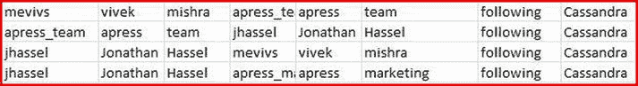

图 7-20. 显示用户与关注者关系的表格

按照以下步骤完成示例：

首先，通用步骤是为 Cassandra 配置一个图：

```
import org.apache.commons.configuration.BaseConfiguration;
import org.apache.commons.configuration.Configuration;
import com.thinkaurelius.titan.core.TitanFactory;
import com.thinkaurelius.titan.core.TitanGraph;
import com.thinkaurelius.titan.core.TitanKey;

Configuration conf = new BaseConfiguration();
conf.setProperty("storage.backend", "cassandrathrift");
conf.setProperty("storage.hostname", "localhost");
conf.setProperty("storage.port", "9160");
conf.setProperty("storage.keyspace", "batchprocess");
conf.setProperty("storage.batch-loading", "true");
```

让我们使用 `FileReader` 加载示例 `.csv` 文件：

```
File file = new File("src/main/resources/bulk_load.csv");
BufferedReader reader = new BufferedReader(new FileReader(file));
```

接下来，创建一个图实例，并用 `BatchGraph` 进行封装：

```
TitanGraph graph = TitanFactory.open(conf);
BatchGraph bgraph = new BatchGraph(graph, VertexIDType.STRING, 1000);
```

这里的 1000 是批量大小，顶点 ID 为字符串类型。

现在，让我们将每个顶点属性定义为顶点键，将每条边的属性定义为标签键：

```
// 为每个属性准备顶点键
KeyMaker maker = graph.makeKey("twitter_tag");
maker.dataType(String.class);
maker.make();
graph.makeKey("fname").dataType(String.class).make();
graph.makeKey("lname").dataType(String.class).make();

// 将边属性准备为标签
LabelMaker labelMaker = graph.makeLabel("contentType");
labelMaker.make();
graph.makeLabel("following").make();
```

这里 `TitanKey` 和 `LabelKey` 是 Titan Java API 提供的类，用于准备顶点和边的键。

现在，让我们从文件中逐行读取，并提取顶点和边属性：

```
while (reader.ready())
{
    String line = reader.readLine();
    StringTokenizer tokenizer = new StringTokenizer(line, ",");
    while (tokenizer.hasMoreTokens())
    {
        // System.out.println(tokenizer.nextToken());
        // twitter_tag,fname,lname,twitter_tag,fname,lname,edgeName,edgeProperty
        final String in_twitter_tag = tokenizer.nextToken();
        final String in_fname = tokenizer.nextToken();
        final String in_lname = tokenizer.nextToken();
        final String out_twitter_tag = tokenizer.nextToken();
        final String out_fname = tokenizer.nextToken();
        final String out_lname = tokenizer.nextToken();
        final String edgeName = tokenizer.nextToken();
        final String edgeProperty = tokenizer.nextToken();
        ...
    }
}
```

现在，在外部 `while` 循环（参见步骤 5）中创建入顶点和出顶点，并按如下方式分配边：

```
//入顶点
Vertex in = bgraph.addVertex(Math.random() + "");
in.setProperty("twitter_tag", in_twitter_tag);
in.setProperty("fname", in_fname);
in.setProperty("lname", in_lname);

//出顶点
Vertex out = bgraph.addVertex(Math.random() + "");
out.setProperty("twitter_tag", out_twitter_tag);
out.setProperty("fname", out_fname);
out.setProperty("lname", out_lname);

//分配边
bgraph.addEdge(null, in, out, edgeName);
```

最后，在成功从 `.csv` 文件读取所有记录并填充 `BatchGraph` 后，我们可以调用 `commit`：

```
bgraph.commit();
```

这里的批量大小是指在图上调用 commit 之前要加载的顶点和边的数量。我们需要留意的是，设置一个适中的批量大小，以避免在处理拥有数百万或数十亿条边的大型图时出现堆空间问题。

##### 超级节点问题

在现实世界中，基于大数据的图可能非常庞大，并且可能存在一组具有极高关联边数的顶点。在图论中，这样的顶点被称为超级节点。由于存在如此多的复杂路径，对图的随机遍历可能会导致我们遇到此类超级节点，从而严重影响系统性能。

图 7-21 展示了我（Vivek）的 LinkedIn 社交图谱，其中标记的顶点可被称为超级节点。

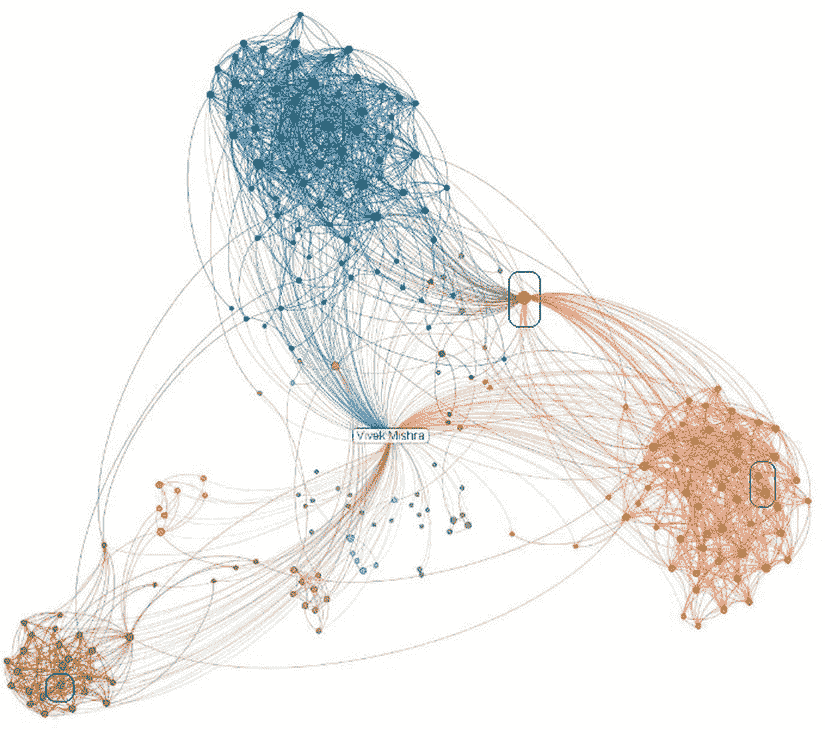

图 7-21. Vivek 的 LinkedIn 图谱

例如，如果我需要遍历某个特定群组（例如 graphDB）的所有连接，那么不带索引的此类遍历会导致性能问题。通过按标签对关联边进行索引，此类查找将快得多。

例如，如果我们想查找 Vivek 所有加入了“graphDB”群组的朋友，进行随机遍历将需要搜索 Vivek 的每一个连接，然后扫描他每个朋友所加入的群组。想象一下 Vivek 在 LinkedIn 上拥有大量连接。可以预见，在这种情况下，随机遍历要找到期望结果简直是一场噩梦。但是，使用标签索引查询，速度将快得多：

```
g.query().has("friends of", EQUAL, "vivek").has("group", EQUAL, "graphDB").vertices();
```

此查询是一个标签索引查询，它使用“friends of”标签搜索 Vivek 的所有朋友，然后使用“group”索引边搜索剩余子集中属于 graphDB 群组的人。

我们将在本章的下一节进一步探讨这一点。


#### 更快的深度遍历

深度遍历意味着访问图中层级结构的第 `n` 层。以我之前 LinkedIn 社交图谱的例子为例，我可以查询我的联系人以寻找共同的群组兴趣。根据数据量和关联边的数量，通过顶点查询逐个迭代每个顶点可能不是一个好主意。Titan 支持多顶点查询，可以将多个顶点查询合并为一个组合查询发送给图数据库。这样一来，数据检索速度会快得多，因为我们只需访问服务器一次。

让我们通过一个名为《罗摩衍那》的印度神话史诗，来探索如何使用 Titan 中的多顶点查询实现更快的深度遍历。在这个例子中，我们将尝试在叶节点级别查找`父子`关系。图 7-22 展示了罗摩及其祖先的家谱。

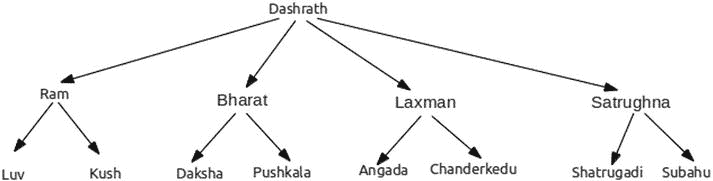

图 7-22. 罗摩衍那家庭图谱

在每一层查找`父子`关系的一种方法是像这样逐层遍历：

```
private static void iterateToLeaf(Vertex dasratha)
{
    System.out.println("Finding sons for::" + dasratha.getProperty("fname"));
    Iterable<Vertex> immediateSons = dasratha.getVertices(Direction.IN, "son of");
    Iterator<Vertex> iter = immediateSons.iterator();
    // one way is
    while (iter.hasNext())
    {
        Vertex v = iter.next();
        // recursive call
        iterateToLeaf(v);
    }
}
```

在上述代码片段中，我们需要用根顶点对象（即 `dasaratha`）进行调用，然后递归调用将遍历每一层的每个顶点。对于较小的图这可能可行，但对于大数据和大数据图来说，这不是一个可行的解决方案。这时，多顶点查询就变得非常有用且高效。

接下来，我们将通过几个代码片段来了解如何使用 Titan 执行多顶点查询。你可以在随附的源代码中找到完整的 `GraphTraversalRunner.java` 示例。

首先，将 `dasaratha` 添加为根顶点：

```
Vertex das = add("fname", "dasaratha", graph);

private static Vertex add(final String propertyName, final String value, TitanGraph graph)
{
    Vertex vertex = graph.addVertex(null);
    vertex.setProperty(propertyName, value);
    return vertex;
}
```

接下来，添加达萨拉塔（dasaratha）的儿子：

```
// add dasratha's son.
Vertex ram = addSon("fname", "ram", graph, das);
Vertex laxman = addSon("fname", "laxman", graph, das);
Vertex bharat = addSon("fname", "bharat", graph, das);
Vertex shatrugna = addSon("fname", "shatrugna", graph, das);

private static Vertex addSon(String propertyName, String value, TitanGraph graph, Vertex father)
{
    Vertex son = add(propertyName, value, graph);
    graph.addEdge(null, son, father, "son of");
    return son;
}
```

为 `ram`、`laxman`、`bharat` 和 `shatrugna` 重复步骤 2：

```
// ram's son
addSon("fname", "luv", graph, ram);
addSon("fname", "kush", graph, ram);
// bharat's son
addSon("fname", "Daksha", graph, bharat);
addSon("fname", "Pushkala", graph, bharat);
// laxman's son
addSon("fname", "Angada", graph, laxman);
addSon("fname", "Chanderkedu", graph, laxman);
// Shatrugna's son
addSon("fname", "Shatrugadi", graph, shatrugna);
addSon("fname", "Subahu", graph, shatrugna);
```

最后存储完整的层级结构：

```
graph.commit();
```

现在，为了利用多顶点支持，获取所有具有 `Direction.IN`（表示入边）且标签为 `son of` 的顶点，我们需要执行以下查询：

```
//prepare multi vertex query
TitanMultiVertexQuery mq = graph.multiQuery();
mq.direction(Direction.IN).labels("son of");
mq.addVertex((TitanVertex) das);// add root
mq.addVertex((TitanVertex) ram);
mq.addVertex((TitanVertex) bharat);
mq.addVertex((TitanVertex) laxman);
mq.addVertex((TitanVertex) shatrugna);
//execute multi vertex query
Map<TitanVertex, Iterable<TitanVertex>> dfsResult = mq.vertices();
//iterate through result and print
for (TitanVertex key : dfsResult.keySet())
{
    System.out.println("Finding son of" + key.getProperty("fname"));
    Iterable<TitanVertex> sons = dfsResult.get(key);
    Iterator<TitanVertex> sonIter = sons.iterator();
    while (sonIter.hasNext())
    {
        System.out.println(sonIter.next().getProperty("fname"));
    }
}
```

通过这种方式，我们可以使用 Titan 实现更快的深度遍历。

我们已经介绍了 Titan 图数据库支持的大部分重要特性。本章分享的示例代码片段应能让读者使用 Titan 与 Cassandra 配合，例如构建社交图谱、网络图谱或运行类似图的查询。就图数据库的未来而言，下一章将讨论一份关于图数据库领域正在进行的积极开发的报告。

至此，我们结束了对图数据库以及 Titan 如何与 Cassandra 集成的讨论。有关更多详细信息和所支持的特性集，请参阅 [`https://github.com/thinkaurelius/titan/wiki`](https://github.com/thinkaurelius/titan/wiki)。

### 总结

总结一下，本章涵盖的主题包括：

- 图简介
- 理解 TinkerPop 和 Blueprints
- Titan 数据库生态系统
- Titan 与 Cassandra

下一章将介绍 Cassandra 可用的性能调优和压缩技术。

