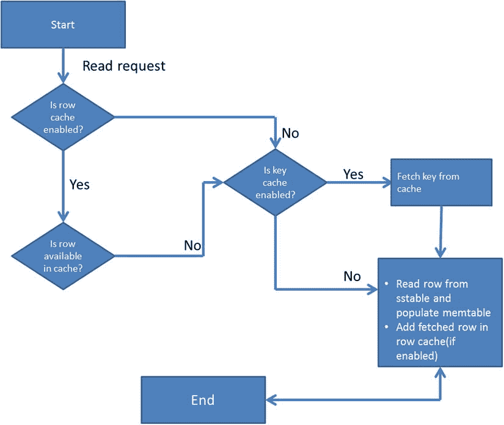
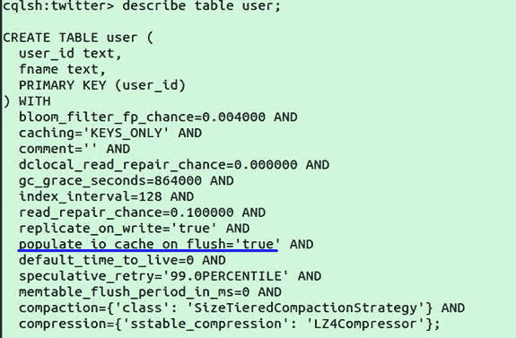
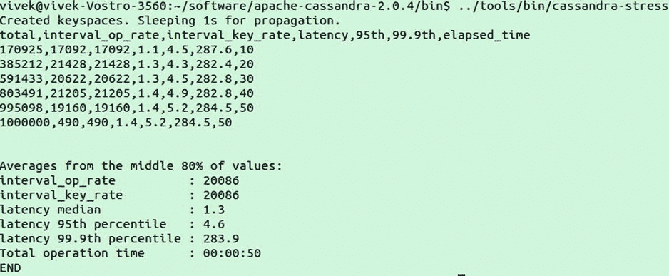
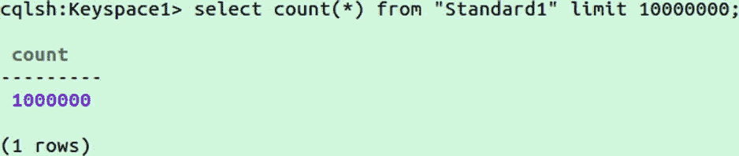
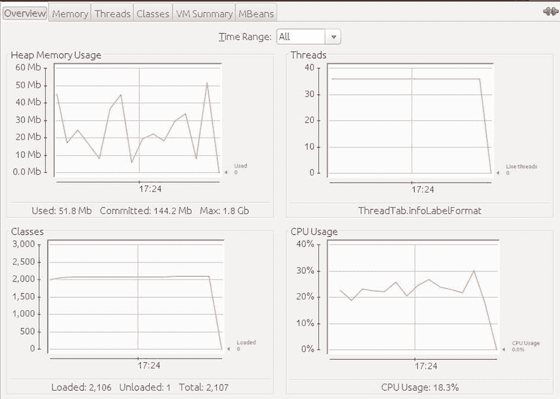
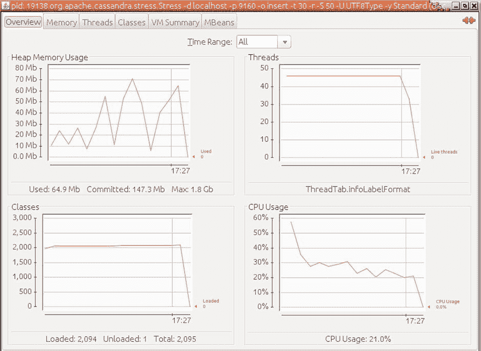
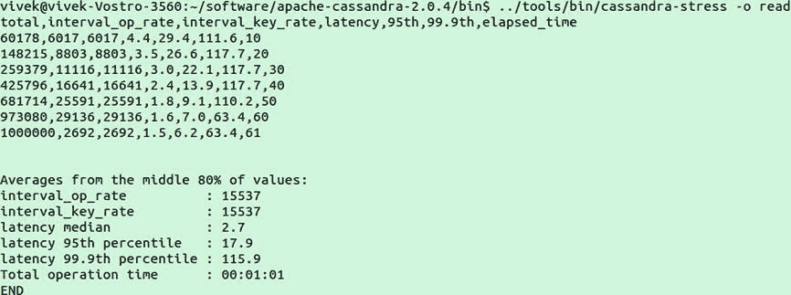
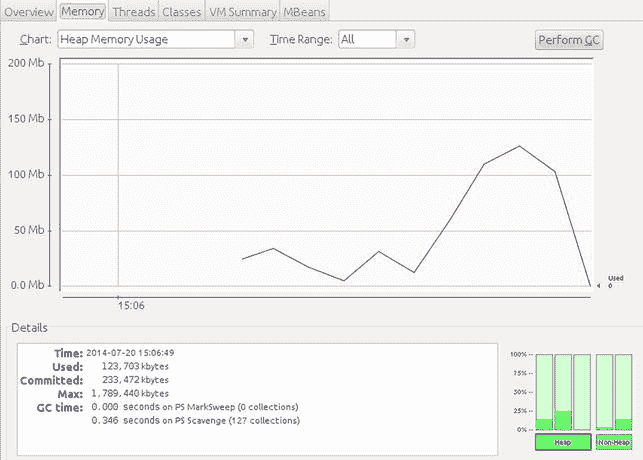
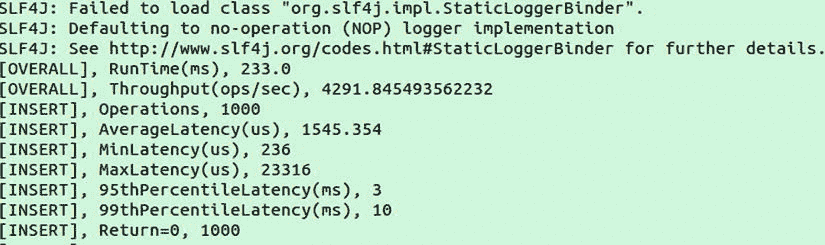

# 8. Cassandra 性能调优

随着存储硬件在容量方面变得更便宜、更高效，组织能够为其数 TB 的数据选择更便宜、维护成本更低的存储方案。显然，成本效益一直是技术选型背后的重要因素。大数据的存储和检索是需求，但经济的解决方案不应以牺牲性能为代价。数据，无论大小，如果不能有效使用并应用分析，就毫无价值。

从实际的大数据相关用例中获得的经验证明，许多组织和初创公司正在围绕大数据探索商业想法。对于面向在线受众的公司来说，实时数据流需求巨大。如今的应用程序每秒钟需要处理和分析数 GB 的数据，这清楚地表明性能是现代大数据应用的重要组成部分。

在本章中，我们将讨论

- 关键性能指标
- Cassandra 缓存配置
- 讨论布隆过滤器和垃圾回收
- Cassandra 压力测试
- Yahoo Cloud Serving Benchmark（YCSB）基准测试

### 理解关键性能指标

本节将讨论几个关键性能指标（KPI），包括：

- CPU 和内存消耗
- 高读写吞吐量和延迟
- 逻辑读取和物理读取

性能不一致或性能下降是应用程序需要进行性能调优的主要问题。这时需要从前端应用程序和后端数据库的性能角度进行调优。

首先，让我们初步了解几个 KPI，这些指标将指导我们如何配置 Cassandra 以提升性能。


#### CPU 与内存利用率

从性能角度来看，CPU 和内存利用率非常重要。有许多工具（如 `JConsole`、`JProfile` 和 `YourKit`）可通过监控 CPU 和内存占用情况来监测应用性能。值得一提的是，许多 Cassandra 服务器进程会占用堆外内存；因此，在为本地运行在同一台机器上的应用调优堆配置时，我们需要确保不发生内存不足或泄漏，从而避免应用不稳定。堆空间配置过小会触发频繁的垃圾回收活动。完全避免垃圾回收周期是不可能的，但我们可以对其进行调优以获得更好的响应时间。例如，将年轻代设置得较大可以容纳更多活跃对象，但会导致较长的 GC（垃圾回收）周期。通常，针对年轻代对象的垃圾回收活动速度较快，对响应时间的开销几乎可以忽略不计。但 Full GC 是一种“停止所有事件”的操作，会严重影响应用的性能。我们需要确保为 Eden 空间以及内存池中的后续临时空间和永久空间分配适当的内存。建议设置较小的永久代空间。

#### 高读写吞吐量与延迟

讨论大数据处理，关键就在于“言行一致”。应用必须能够以更快的速度进行数据摄入和读取，无论数据量大小如何。读写延迟是性能监控和调优的另一个重要方面。现代应用要求以最小延迟实现实时或近实时数据处理。因此，在采用技术和数据库时，我们必须牢记这一点，以避免此类性能开销。

#### 逻辑读取与物理读取

逻辑读取是指从数据缓存中读取行，而物理读取则涉及磁盘访问。逻辑读取次数偏高往往意味着较大的内存占用；同样，频繁的物理读取会引入读取延迟，并可能导致性能开销。因此，在两者之间取得平衡至关重要。Cassandra 提供了行缓存和键缓存，以及 `memtables` 来减少物理读取。我们将在本章中详细讨论这些内容。

接下来，让我们讨论各种 Cassandra 特有的配置。在本章后半部分，我们还将涵盖前端应用的性能监控和调优。

### Cassandra 配置

Cassandra 提供了多种配置，可用于针对高读写负载进行调整。让我们从缓存配置开始，逐一探索它们。

#### 数据缓存

数据缓存将频繁访问的行保存在内存中，以避免在服务器端进行磁盘访问。在 N 层架构中，数据缓存也可以在客户端实现（例如 `Ehcache`）。数据缓存的概念并不新鲜，传统的关系型数据库管理系统（RDBMS）也具备此功能。数据缓存对读取操作非常有用，建议对频繁获取的数据采用数据库级别的缓存。Cassandra 同时提供了键缓存和行缓存。图 8-1 展示了在从 Cassandra 数据库读取数据时，这些缓存如何工作的流程图。



图 8-1.  
Cassandra 服务器在收到读取请求时缓存的工作方式

行缓存和键缓存有助于检索最常使用的行。保持适中大小的行缓存和较多的键缓存可以获得更好的性能和更低的延迟。让我们来讨论这些与 Cassandra 相关的缓存配置。

##### 缓存目录

默认的缓存位置是 `/var/lib/cassandra/saved_caches`。我们也可以在 `cassandra.yaml` 中修改它：

`saved_caches_directory: /var/lib/cassandra/saved_caches`

##### 键缓存

使用键缓存，实际行键的引用将被缓存在内存中，每个列族对应一个缓存。对于高负载的、基于读取的应用，建议设置较大的键缓存——当然要在 JVM 设置允许的范围内。可以在 `cassandra.yaml` 中配置的各种键缓存配置如下表 8-1 所示。

表 8-1.  
键缓存配置

| 名称 | 描述 |
| --- | --- |
| `key_cache_size_in_mb` | 键缓存大小，以兆字节为单位。默认值为堆的 5% 或 100MB（取两者中较小值）。可以将其设置为 0 来禁用。 |
| `key_cache_save_period` | 将键缓存保存到配置的缓存目录的时间周期。默认值为 4 小时。 |
| `key_cache_keys_to_save` | 要保存的键数量，默认是禁用的，但建议将其设置为一个较大的值。 |

从 2.0 版本开始，键缓存已移至堆外，这显著减少了键序列化所花费的时间。我们将在本章后面讨论堆外与堆内。如前所述，内存利用率是性能的关键指标之一，在配置行缓存时，我们必须避免 Full GC 活动，无论键缓存现在是否已移至堆外。

#### `populate_io_cache_on_flush`

默认情况下，该参数是禁用的，设置为 `false`。在 Cassandra 1.2.x 之前，它仅在节点级别支持，但现在可以在列族级别启用。此标志的目的是在 `memtable` 刷新和压缩期间启用/禁用列族的页面缓存。如果设置为 `true`，它将把特定列族的数据缓存保留在内存中。如第 1 章所述，`memtables` 会持续将数据以 `sstables` 的形式刷新到磁盘。如果此参数设置为 `true`，Cassandra 会为该列族的所有行保留页面缓存。请注意，页面缓存仅在刷新和压缩时更新，以保持该节点上相应列族的数据为最新。用户需要确保数据大小能够很好地适应节点内存。我们可以在创建表或修改现有表时启用它：

```
create table tweets(tweet_id text primary key,body text) with caching='rows_only' and bloom_filter_fp_chance=0.004 and populate_io_cache_on_flush='true';  // 创建表

alter table user with populate_io_cache_on_flush='true'; // 修改表
```

建议对于频繁查询且能够很好地适应内存以获得更好读取吞吐量的列族，将此参数保持为 `true`。图 8-2 显示了用户创建的表，该属性已设置为 `true`（见标记行）。



图 8-2.  
启用了 `populate_io_cache_on_flush` 并设置为 `true` 的用户表


#### 行缓存

启用行级缓存后，整行数据都可在缓存中获取。与键级缓存相比，行缓存需要占用大量空间。从 Cassandra 1.2 开始，行缓存可以移至堆外，但行的反序列化仍会临时在堆内进行。表 8-2 展示了若干行缓存配置及其说明。

**表 8-2.** 行缓存配置

| 名称 | 说明 |
| --- | --- |
| `row_cache_size_in_mb` | 默认禁用，设为 0。 |
| `row_cache_save_period` | 默认禁用行缓存，启用它可改善冷启动性能，但缓存可能代价高昂且耗费大量内存。 |
| `row_cache_keys_to_save` | 默认禁用。要保存的行缓存键的数量。 |

对于频繁访问的行，行缓存非常有用，能显著减少磁盘读取。但它也消耗大量空间。如果应用程序的需求是经常获取完整行而非选择列，则建议启用行缓存。

要为特定列族启用缓存，可以在创建列族时进行如下设置：

```
create table user(user_id text primary key,fname text) with caching='keys_only';
create table tweets(tweet_id text primary key,body text) with caching='rows_only';
```

在上述脚本中，`user` 列族启用了键缓存，而 `tweets` 表启用了行缓存。建议在应用程序需要读取整行而不是选定列时启用行缓存。显然，如果采用选定列的方式，启用行缓存会产生负面影响，并且会因为无故将行保留在内存中而浪费内存空间。

以下代码片段展示了如何在 `Cassandra.yaml` 文件中配置这些缓存参数：

```
# 缓存中保存的键大小为 50 MB。
key_cache_size_in_mb: 50
# 键在缓存中保留的时间为 5 分钟或 3600 秒
key_cache_save_period: 3600
# 在键缓存中保存 100 个键
key_cache_keys_to_save: 100
# 在缓存中保留 100 MB 的行
row_cache_size_in_mb: 100
# 行在缓存中保留的时间为 5 分钟或 3600 秒。
row_cache_save_period: 3600
# 要从行缓存中保存的键数量为 100。
row_cache_keys_to_save: 100
# 保存缓存的目录。
saved_caches_directory: /var/lib/cassandra/saved_caches
```

#### 布隆过滤器

布隆过滤器是一种数据结构，用于判断某个元素是否存在于集合中。它由 Burton Bloom 于 1970 年提出，用于找出元素是否存在某个集合中的概率。启用布隆过滤器后，它能返回元素“绝对不在集合中”或“可能存在于集合中”。误报（FP）意味着元素实际不在集合中，但可能显示为存在；漏报则意味着元素实际存在，但被判断为绝对不在集合中。

Cassandra 中的每个表都包含一个布隆过滤器。通过设置误报概率值，它检查 SSTable 中某行可能存在的列，但漏报是绝对不可能的。这里的漏报意味着行的列确实存在，但布隆过滤器返回了不存在的结论。

将布隆过滤器的误报概率设置得更高意味着更少的内存消耗，并确保不会发生漏报（例如，对不存在的键不会进行磁盘 I/O）。布隆过滤器误报概率的范围是 0.000744 到 1.0。将误报概率设置得更高的结果是，在 SSTable 中找到某列的可能性存在，但对于否定场景不会进行磁盘读取。

你可以在创建列族时设置布隆过滤器，或者像这样更新列族：

```
create table tweets(tweet_id text primary key,body text) with caching='rows_only' and bloom_filter_fp_chance=0.004;
alter table user with bloom_filter_fp_chance=0.004;
```

#### 堆外内存 vs. 堆内内存

堆外内存是指直接从操作系统分配内存，而堆内内存对象则由 JVM 自身管理。Cassandra 也将行缓存和键缓存加载到堆外内存中，这意味着这些对象在非 Java 堆上进行序列化。这样，反序列化速度会快得多。

建议将堆大小保持适中，因为堆仅从系统内存中分配内存。经验表明，最好将其保持在 6 GB 以下（如果系统内存大于 6 GB）。你可以通过 Java 运行时获取 `maxMemory`：

```
Runtime rTime = Runtime.getRuntime();
long maxSize = rTime.maxMemory();
```

如果系统内存小于 2 GB，建议保留系统内存的 50%。

Cassandra 需要安装 Java Native Access (JNA) 库来实现缓存的堆外内存分配。

要启用 JNA 库，你需要从 [`https://github.com/twall/jna`](https://github.com/twall/jna) 下载 `JNA.jar` 并将其设置在类路径中。仅此而已！

我们还可以在 `cassandra.yaml` 中设置堆外内存分配器：

```
memory_allocator: NativeAllocator
可能的值为 NativeAllocator, JEMallocAllocator。
```

要安装 JEMallocAllocator，你需要下载并安装 jemalloc 库。jemalloc 的源代码可在 GitHub 上获取（[`https://github.com/jemalloc/jemalloc`](https://github.com/jemalloc/jemalloc)）。

##### 安装和配置 jemalloc

安装 jemalloc 的步骤如下：

首先，从 GitHub 克隆并下载源代码：

```
git clone https://github.com/jemalloc/jemalloc.git
```

将目录更改为 `jemalloc` 并运行 `configure`：

```
cd jemalloc
./configure
```

接着，通过运行以下命令进行安装：

```
make
make install
```

成功安装 `jemalloc` 后，我们需要在 `cassandra-env.sh` 中为 Cassandra 配置已安装的库：

```
export JEMALLOC_HOME= jemalloc/
export LD_LIBRARY_PATH=<JEMALLOC_HOME>/lib/
JVM_OPTS="$JVM_OPTS -Djava.library.path=<JEMALLOC_HOME>/lib/"
```

##### 垃圾回收

Cassandra 会执行显式垃圾回收，可以通过监控服务器日志中的 `GCInspector` 类获取更多信息。你也可以选择使用 `XX:+DisableExplicitGC` 禁用显式垃圾回收，但建议仅出于实验目的进行此操作。或者，配置 `gcInterval` 设置也是一种选择（`sun.rmi.dgc.server.gcInterval` 和 `sun.rmi.dgc.client.gcInterval`）。它表示 Java 运行时 RMI（远程方法调用）对未使用和软引用调用垃圾回收的最大间隔（以毫秒为单位）。默认设置为 1 小时。

我们可以在 `$CASSANDRA_HOME/conf` 文件夹中的 `cassandra-env.sh` 中调整垃圾回收设置。部分选项如下：

```
# GC 日志记录选项 -- 取消注释以启用
JVM_OPTS="$JVM_OPTS -XX:+PrintGCDetails"
JVM_OPTS="$JVM_OPTS -XX:+PrintGCDateStamps"
JVM_OPTS="$JVM_OPTS -XX:+PrintHeapAtGC"
JVM_OPTS="$JVM_OPTS -XX:+PrintTenuringDistribution"
JVM_OPTS="$JVM_OPTS -XX:+PrintGCApplicationStoppedTime"
JVM_OPTS="$JVM_OPTS -XX:+PrintPromotionFailure"
JVM_OPTS="$JVM_OPTS -XX:PrintFLSStatistics=1"
JVM_OPTS="$JVM_OPTS -Xloggc:/var/log/cassandra/gc-`date +%s`.log"
# 如果你使用 JDK 6u34 7u2 或更高版本，可以启用 GC 日志轮转
# 如果启用了轮转，不要在日志名称中包含日期。
JVM_OPTS="$JVM_OPTS -Xloggc:/var/log/cassandra/gc.log"
JVM_OPTS="$JVM_OPTS -XX:+UseGCLogFileRotation"
JVM_OPTS="$JVM_OPTS -XX:NumberOfGCLogFiles=10"
JVM_OPTS="$JVM_OPTS -XX:GCLogFileSize=10M"
```


#### 提示移交

当写入一行数据时，如果一个或多个副本节点宕机或不可用，此功能会非常有用。在这种情况下，协调节点会在 `system.hints` 表中保留一份数据副本，直到副本节点恢复运行。通常这是一个很好的特性，但如果多个节点发生此类故障，则会增加协调节点的堆大小。`system.hints` 表保存了副本节点的 IP 地址以及需要在副本节点恢复时重放的实际数据。在引导过程中，系统表会被加载到内存中，因此故障数量越多，意味着协调节点内存中的数据量越大。这种情况还可能导致数据丢失（直到修复为止）。默认情况下，此功能是启用的。禁用它可能会使堆大小相对较小，并减少垃圾回收活动。但为了确保写入的持久性，建议保持启用状态。默认情况下，协调节点会将数据在 `system.hints` 表中保留 3 小时，即 `Cassandra.yaml` 文件中 `max_hint_window_in_ms` 配置项的默认值。如果副本节点在此配置的时间窗口内未能恢复，它将被视为死节点，稍后当它恢复时，需要运行修复并从其他节点复制数据。

#### 堆大小配置

通常，对于应用程序，建议将堆大小保持在 4–8 GB 范围内；但如果内存小于 4 GB，我们仍应将其中的一半（约 2 GB）用于 I/O 操作。你可以在 `cassandra-env.sh`（查找 `JVM_OPTS`）中修改 JVM 设置以配置堆大小。

```
JVM_OPTS="$JVM_OPTS $JVM_EXTRA_OPTS" -Xms1G  -Xmx1G  -XX:+HeapDumpOnOutOfMemoryError  -XX:+UseParNewGC  -XX:+UseConcMarkSweepGC
```

### Cassandra 压力测试

Cassandra 压测是一个基于 Java 的工具，用于测试服务器在高读写负载下的性能。在二进制发行版中，它位于 `$CASSANDRA_HOME/tools/bin` 目录下。压力测试最常用的选项是：

- 仅写入
- 仅读取
- 搜索范围切片

该压力测试工具旨在监控数据库在高读取、高写入以及通过非主键列进行读取时的性能。用户可以使用各种可用参数，根据自身需求通过此工具实验和分析 Cassandra 的能力。要搜索此工具的所有可用选项，可以使用帮助选项：

```
$CASSANDRA_HOME/tools/bin/cassandra-stress -h
```

#### 写入模式

让我们从默认模式开始，即写入模式，我们将使用此工具对 Cassandra 服务器进行压力测试。使用这种模式，我们将创建一个预定义列大小和总写入操作数的列族。

让我们从一条简单的命令开始，执行仅写入模式：

```
$CASSANDRA_HOME/tools/bin/cassandra-stress
```

此命令的输出将类似于图 8-3。



**图 8-3.** 在默认写入模式下运行压力工具的输出

从图 8-3 所示的输出中需要监控的几个关键点包括：

-   `total_op_rate`：操作总数。
-   `interval_op_rate`：该时间间隔内执行的操作数。
-   `interval_key_rate`：该时间间隔内写入的行数。
-   `latency median`：该时间间隔内每次操作的平均写入延迟。
-   `total_operation_time`：运行期间花费的总秒数。

这里默认的主机和端口分别是 `localhost` 和 `9160`。默认情况下，要插入的记录数量为一百万。

你也可以按如下方式覆盖默认主机、端口和记录数量：

```
$CASSANDRA_HOME/tools/bin/cassandra-stress -n <记录数> -d <主机> -p <端口>
```

运行此压力测试所需的总时间约为 50 秒。

让我们快速连接到 CQL3 以验证已存储的行。该压力测试将创建一个名为 `"Keyspace1"` 的默认键空间和一个名为 `"Standard1"` 的表。要获取插入行总数的计数，我们可以运行以下命令：

```
use "Keyspace1" ;
```

```
select count(*) from "Standard1" limit 10000000;
```

图 8-4 显示了结果。



**图 8-4.** 查找通过压力工具创建的 `Standard1` 列族中记录总数的 CQL 查询

读者可以使用 `describe` 命令来描述默认的列及其数据类型。这里默认的列数为 5，并且所有列的类型都是 `blob`。

与其他默认值类似，也可以覆盖列数、大小、族类型、线程数和随机行键生成。让我们通过分别使用 20 和 30 个线程运行 `insert` 来检查示例输出。

**使用 20 个线程**

```
$CASSANDRA_HOME/tools/bin/cassandra-stress -d localhost -p 9160 -o insert -t 20 -r -S 50 -U UTF8Type -y Standard
```

```
中间 80% 值的平均值：
interval_op_rate          : 16657
interval_key_rate         : 16657
延迟中位数                : 2.8
延迟 95% 分位数            : 11.5
延迟 99.9% 分位数          : 646.7
总操作时间                : 00:01:01
结束
```

图 8-5 显示了使用 20 个线程时的 CPU 使用率、堆和其他资源利用率的 JConsole 概览图。



**图 8-5.** 使用 20 个线程的 JConsole 图表

**使用 30 个线程**

```
$CASSANDRA_HOME/tools/bin/cassandra-stress -d localhost -p 9160 -o insert -t 30 -r -S 50 -U UTF8Type -y Standard
```

```
中间 80% 值的平均值：
interval_op_rate          : 18467
interval_key_rate         : 18467
延迟中位数                : 0.5
延迟 95% 分位数            : 2.8
延迟 99.9% 分位数          : 122.8
总操作时间                : 00:01:04
```

图 8-6 显示了使用 30 个线程时的 CPU 使用率、堆和其他资源利用率的 JConsole 概览图。



**图 8-6.** 使用 30 个线程的 JConsole 图表

使用不同数量的线程，可以清楚地看到参数在资源利用率和性能方面可能有所不同。建议使用压力测试根据应用程序的服务等级协议来监控系统的极限。

#### 读取模式

使用读取模式，我们来测试 Cassandra 服务器用于繁重的仅读取操作。在这里，我们将对 Cassandra 服务器执行压力测试，以监控其在不同参数下的性能。

启动读取压力测试的最简单命令是：

```
$CASSANDRA_HOME/tools/bin/cassandra-stress -o read
```

图 8-7 显示了结果。



**图 8-7.** 在高读取操作下运行压力工具的输出

运行读取压力测试所需的总时间略高于写入压力测试。由于我们已经尝试调整了其他参数（如写入模式下的列大小、列数和线程数）的压力测试，这里我们将留给读者作为练习，尝试使用读取模式提供的可用选项。


#### 监控

要监控压力测试的进度，您可以使用 `jmxterm` 或 `JConsole` 来监控内存使用和线程。图 8-8 展示的是前一次读取模式运行时在 `JConsole` 中捕获到的图像。



**图 8-8.**
读取模式运行期间，在 `JConsole` 中捕获到的图像

关于如何配置 `JConsole` 并将其连接到 Cassandra 的更多细节，请参考第 1 章。

对于第三方工具，DataStax 的 OpsCenter 提供了关于运行中 Cassandra 集群的详细信息。关于 DataStax OpsCenter 使用的更多细节，请参考 [`www.datastax.com/what-we-offer/products-services/datastax-opscenter`](http://www.datastax.com/what-we-offer/products-services/datastax-opscenter)。

#### 压缩策略

在进行 Cassandra 压力测试期间，我们观察到 Cassandra 的写入速度极快。背后的原因是没有更新操作，所有列都会直接刷新到 `sstables` 中。这意味着在某些时候，会存在多个版本的列值，它们可能以多个 `sstables` 的形式存在。同样，物理删除也不会实时发生，但这些行会立即被逻辑删除。这种行被称为墓碑行或过时行。移除这些列并释放服务器端空间的过程称为压缩。

压缩总是在后台以异步模式运行。Cassandra 提供了两种压缩策略：

- 大小分级压缩策略
- 层级压缩策略

##### 大小分级压缩策略 (STCS)

大小分级压缩策略 (STCS) 是默认的压缩策略。基于配置 `min_compaction_threshold`（默认为 4），大小相似的 `sstables` 会被合并并压缩到一个表中。显然，对于写入量大而读取/更新操作不多的场景，这是首选策略。尽管特定行键的所有数据都会位于同一数据节点上，但它们仍然可能分散在多个 `sstables` 中。使用这种压缩策略，很可能在压缩过程完成之前，对相同列进行冗余压缩。对于同一行键频繁更新的场景，STCS 作为压缩策略可能会出现问题。

##### 层级压缩策略 (LCS)

层级压缩策略 (LCS) 的实现深受 Google LevelDB 的启发 ([`http://code.google.com/p/leveldb`](http://code.google.com/p/leveldb))。LCS 的目的是避免对行键的列进行冗余压缩。使用 LCS，每层 `sstables` 都不会重叠，从而保证了读取时数据的一致性。每提升一级，压缩过程就会进行，并将前一层的 `sstables` 添加进来。这里需要足够的空间来将最大的一层保留在内存中。LCS 比 STCS 执行更多的 I/O 操作。

您可以在创建表时这样定义层级压缩策略：

```
create table tweets(tweet_id text primary key,body text) with caching='rows_only' and compaction
='LeveledCompactionStrategy' and populate_io_cache_on_flush='true';  // 创建表
```

如果读取比例与较高的写入比例相当，或者预期会有频繁的更新，则建议使用 LCS。

### Yahoo 云服务基准测试

Yahoo 云服务基准测试 (YCSB) 项目是评估各种云数据存储和键值数据存储的行业标准，它通过并行执行多种工作负载来进行评估。该项目由雅虎研究实验室于 2010 年发布，托管在 [`https://github.com/brianfrankcooper/YCSB`](https://github.com/brianfrankcooper/YCSB)。

YCSB 是完全解耦且可扩展的，可以轻松添加任何新数据库的特定客户端。

配置和运行 YCSB 相当简单。在本节中，我们将讨论如何为 Cassandra 配置 YCSB 框架。

首先，您可以从源代码构建 JAR 包，或者从以下链接下载压缩包：

[`https://github.com/downloads/brianfrankcooper/YCSB/ycsb-0.1.4.tar.gz`](https://github.com/downloads/brianfrankcooper/YCSB/ycsb-0.1.4.tar.gz)

解压压缩包并切换目录：

`cd ycsb-0.1.4`

默认情况下，YCSB 会将数据插入到 `usertable` 键空间下的 `data` 表中。因此，请在 `Cassandra-cli` 中运行以下命令来创建数据定义：

```
create keyspace usertable;
use usertable;
create column family data;
```

接下来，创建一个包含以下属性的属性文件（例如 `Cassandra-ycsb.properties`）：

```
hosts=localhost
port=9160
fieldcount=4
threads=9
recordcount=1000
operationcount=1000
workload=com.yahoo.ycsb.workloads.CoreWorkload
readallfields=true
readproportion=0.5
updateproportion=0.5
scanproportion=0
insertproportion=0
```

这里，`hosts` 和 `port` 是 Cassandra Thrift 主机和 `rpc_port` 设置。`fieldcount` 是每行要存储的字段总数。`threads` 决定了并行执行的数量。同时，`readproportion` 和 `updateproportion` 可在测试期间进行调整。例如，对于仅大量写入的场景，您可以将 `insertproportion` 设置为 1.0，其余设置为 0.0！类似地，对于大量读取的场景，可以将 `readproportion` 设置为 1.0。

最后，运行此命令：

`bin/ycsb load cassandra-10 -P /home/vivek/source/book_source/ycsb/casssandra-ycsb.properties -threads 10`

运行上述命令的输出会相当庞大。图 8-9 展示了从性能角度来看比较有趣的部分。



**图 8-9.**
使用 YCSB Cassandra 项目运行负载的输出

在图 8-9 中，关键点是平均吞吐量和延迟。在此次运行中，每秒有 4291 次操作，总计 1000 次操作的延迟为 1545 微秒。

YCSB 提供了一种从客户端角度评估数据库的绝佳方式。您可以快速分析多个客户端针对 Cassandra 的性能。或者，您也可以用它来比较多个数据存储之间的性能。该框架是完全解耦的，这使得为新的数据存储添加客户端，或为同一数据存储添加多个客户端变得相当容易。

回到通过 YCSB 进行读取操作分析，我们可以这样运行：

`bin/ycsb run cassandra-10 -P /home/vivek/source/book_source/ycsb/casssandra-ycsb.properties -threads 10`

YCSB 有两种模式：加载模式和运行模式。使用加载模式时，它会将数据存储到后端，并测量吞吐量和延迟。而在运行模式下，我们可以针对大量读取或读/更新比例进行调整（参见 `Cassandra-ycsb.properties`）。

YCSB 提供了两种分布类型：齐夫分布和均匀分布。连续均匀分布指的是每个间隔内每个列的数据对称分布。而齐夫分布基于幂律分布，其中负载和吞吐量成反比。关于齐夫分布的更多细节，请参考 [`http://en.wikipedia.org/wiki/Zipf's_law`](http://en.wikipedia.org/wiki/Zipf's_law)。

### 总结

在本章结束时，这里有一些关键的性能检查点，用于判断应用程序的吞吐量是否随时间持续下降：

- 监控 GC 并检查 Cassandra 服务器日志中的 `GCInspector` 类。
- 如果数据节点空间不足，请添加新节点。我们将在下一章进一步讨论这一点。
- 监控 `bloom_filter_fp_chance` 和缓存配置。

在下一章中，我们将详细介绍更多的 Cassandra 管理和监控内容。


