# 替换故障节点

集群中有时会出现少量故障节点。也就是说，它们无法响应 gossip 协议，需要用新节点进行替换。在正在运行的 Cassandra 集群中替换故障节点很简单。我们通过一个延续上一节的示例练习来探讨。

首先，让我们关闭节点 2 并检查环状态：

```
vivek@vivek-Vostro-3560:∼/software/local-cluster/node1$ bin/nodetool ring

Datacenter: datacenter1
=======================
Address    Rack        Status State   Load         Owns        Token
3074457345618258602
127.0.0.1  rack1       Up     Normal  50.44 KB     66.67%      -9223372036854775808
127.0.0.2  rack1       Down   Normal  54.82 KB     66.67%      -3074457345618258603
127.0.0.3  rack1       Up     Normal  71.09 KB     66.67%      3074457345618258602
```

你可以看到节点 2（`127.0.0.2`）已宕机，状态显示为 `Down`。

让我们配置一个新节点，并为其分配一个令牌值，该值将 `127.0.0.2` 的令牌减一（即 `-3074457345618258604`）。然而，在启动新节点之前，让我们运行一些命令来修复并移除故障节点：

```
vivek@vivek-Vostro-3560:∼/software/local-cluster/node1$ bin/nodetool rebuild
vivek@vivek-Vostro-3560:∼/software/local-cluster/node1$ bin/nodetool removenode fd733376-0cf0-49af-bd0b-79ab526350f8
```

这里，`fd733376-0cf0-49af-bd0b-79ab526350f8` 是节点 2 的主机 ID。你可以通过运行 `nodetool status` 命令获取每个节点的主机 ID。

最后，启动上一步中配置好的新节点，并检查环状态：

```
vivek@vivek-Vostro-3560:∼/software/local-cluster/node1$ bin/nodetool status

Datacenter: datacenter1
=======================
Status=Up/Down
|/ State=Normal/Leaving/Joining/Moving
--  Address    Load       Tokens  Owns (effective)  Host ID                               Rack
UN  127.0.0.4  78.66 KB   256     66.7%             cdcecd4b-ac26-4763-99c4-9f757c2d8074  rack1
UN  127.0.0.1  50.44 KB   1       66.7%             8718be22-ed20-43ca-95c1-701864bb1e20  rack1
UN  127.0.0.3  71.09 KB   1       66.7%             0039bf7e-4e9c-4028-b3b6-1d027aedc690  rack1
```

在这里，你可以看到节点 4（`127.0.0.4`）已启动并加入了集群环。

你一定在想节点 2（`127.0.0.2`）发生了什么！一旦你让节点 2 启动并运行，它会自动替换替代节点（即节点 4）。每当节点 2 启动并加入环时，它会从节点 4 那里收回所有权。查看节点 2 的服务器日志以获取更多信息（参见图 9-1）。

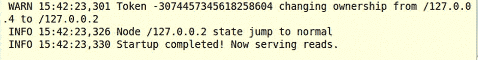

图 9-1. 从替代节点（即 `127.0.0.4`）收回所有权

### 数据备份与恢复

数据库备份意味着定期在安全位置保存一份副本。如果发生自然灾害或硬件丢失，可以使用备份来恢复数据库。由于数据库的可扩展性和性能不应以数据丢失为代价，Cassandra 也提供了对备份和恢复的支持。

使用 Cassandra 备份数据可以通过创建快照来实现。Cassandra 提供了一种使用 `nodetool` 实用程序收集数据快照的机制。我们已经在当前章节和前一章节中讨论过这个实用程序（第 10 章将详细介绍 `nodetool` 和其他 Cassandra 相关实用程序）。当集群启动并运行时，可以对整个键空间进行快照。但只有通过关闭集群节点才能进行恢复。

### 使用 `nodetool snapshot` 和 `sstableloader`

发出 `snapshot` 命令会将所有 memtable 数据刷新并复制到磁盘，然后准备与已刷新的 sstable 的硬链接。

让我们通过一个示例练习来讨论。

首先，让我们准备模式并填充一些数据：

```
create keyspace sample_backup with replication = { 'class':'SimpleStrategy','replication_factor':2};  // 创建键空间
use sample_backup ; // 设置键空间

// 创建表
create table twitter(hashtag timeuuid primary key, account_name text, tweets set<text>);

// 插入记录
insert into twitter(hashtag,account_name,tweets) values(now(),'apress_pub',{'New book on Cassandra is out'});
insert into twitter(hashtag,account_name,tweets) values(now(),'thenews',{'Obama meeting with European allies on Ukraine http://t.co/l8P8bPcbom from #APress','Bergdahl uproar halts plan for return celebration http://t.co/BhF6kMy5pW from #APress'});
```

使用 `select` 命令验证记录是否已成功持久化：

```
select * from twitter;

hashtag                              | account_name | tweets
--------------------------------------+--------------+--------------------------------------------------------------------------------------------------------------------------------------------------
12da45f0-2702-11e4-861b-9d03f52e8a2b |   apress_pub | {'New book on Cassandra is out'}
74dc73e0-2702-11e4-861b-9d03f52e8a2b |      thenews | {'Bergdahl uproar halts plan for return celebration http://t.co/BhF6kMy5pW from #APress', 'Obama meeting with European allies on Ukraine http://t.co/l8P8bPcbom from #APress'}

(2 rows)
```

要创建快照，我们需要使用 `nodetool` 实用程序：

```
nodetool -h localhost -p 7199 snapshot twitter
Requested creating snapshot for: twitter
Snapshot directory: 1408816064473
```

输出显示，在本地节点上运行 `nodetool snapshot` 已创建一个快照 `1408816064473`，位于 `$CASSANDRA_DATA_DIR/twitter/users` 文件夹下。这里 `$CASSANDRA_DATA_DIR` 是在 `Cassandra.yaml` 文件中为 `data_file_directories` 属性定义的值（参见图 9-2）。

为了删除一些数据以便我们稍后恢复，让我们先清空 `users` 表：

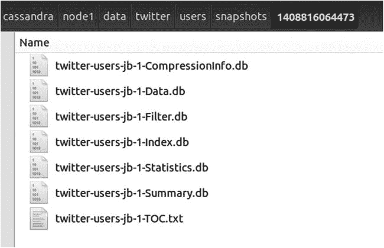

图 9-2. 数据目录下的快照目录 `1408816064473`

```
truncate users;
```

通过步骤 4，我们已清空了数据，现在让我们尝试调用数据恢复。Cassandra 有多种启动恢复的方法。首先，让我们探索使用 `sstableloader` 实用程序进行恢复。首先，我们需要将 `Snapshot` 目录中的所有 `.db` 文件复制到一个与数据库模式（即 keyspace/tablename）同步的文件夹中。在我们的例子中，它应该是 `twitter` 下的 `users` 文件夹（`/home/vivek/twitter/users`）。接下来，让我们执行恢复实用程序：

```
$CASSANDRA_HOME/bin/sstableloader -d localhost  /home/vivek/twitter/users
```

这里 `/home/vivek/twitter/users` 是包含所有备份的 `.db` 文件的本地文件夹。值得一提的是，这些快照数据也可以用于使用 Hadoop MapReduce 作业进行批量分析。你可以使用 `org.apache.cassandra.db.OnDiskAtom` 和 `org.apache.cassandra.io.sstable.SSTableIdentityIterator` 插入自定义的记录读取器实现。运行上述命令后，你将在控制台上看到以下输出：

```
Established connection to initial hosts
Opening sstables and calculating sections to stream
Streaming relevant part of /home/vivek/vivek/twitter/users/twitter-users-jb-1-Data.db to [/127.0.0.1, /127.0.0.2, /127.0.0.3]
progress: [/127.0.0.2 1/1 (100%)] [/127.0.0.3 1/1 (100%)] [total: 100% - 0MB/s (avg: 0MB/s)]
```

完成后，我们可以通过运行 `select` 命令来验证数据是否已恢复：

```
select * from twitter.users;

user_id | age | name
---------+-----+-------
ckbrown |  32 | chris
mevivs |  34 |
```


#### 使用 nodetool refresh

另一种恢复数据的方法是使用 `nodetool refresh` 工具。与 `sstableloader` 方法的不同之处在于，你需要手动将 `.db` 文件复制到 Cassandra 数据目录中。图 9-3 展示了已复制 sstable 的结构。

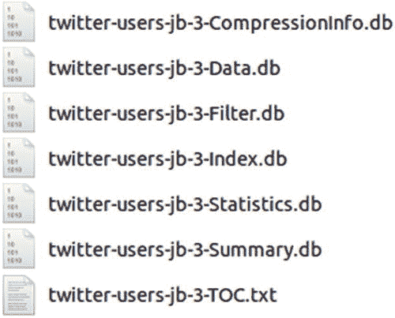

图 9-3. Cassandra 数据目录中已复制的 sstable

然后运行 `nodetool refresh` 命令：

```
vivek@vivek-Vostro-3560:∼$ $CASSANDRA_HOME/bin/nodetool refresh twitter users
```

这里传递给 `nodetool refresh` 命令的参数是 keyspace（键空间）后跟表名。这将刷新数据，可以通过运行 `select` 命令来验证。

#### 使用 clearsnapshot

出于备份目的定期拍摄快照会占用大量磁盘空间；因此，也需要不时地清理过时的快照。我们可以通过如下方式使用 `nodetool clearsnapshot` 命令定期清理快照目录：

```
vivek@vivek-Vostro-3560:∼$ $CASSANDRA_HOME/bin/nodetool -h localhost -p 7199 clearsnapshot
```

上述命令将清理所有 keyspace 中的快照目录。我们也可以像这样清理一个或多个 keyspace 的快照目录：

```
/home/vivek/software/local-cluster/node1/bin/nodetool -h localhost -p 7199 clearsnapshot twitter anotherkeyspace
```

这里，`twitter` 和 `anotherkeyspace` 是被选中的要清理快照目录的 keyspace。

在本节中，我们了解了如何使用各种工具执行数据库备份和恢复过程。接下来，我们将讨论各种监控工具。

### Cassandra 监控工具

系统监控是分析和收集系统状态的过程。尽管 Cassandra 是分布式且具有容错性的，但它也取决于如何用于构建应用程序。必须定期关注的一些关键问题包括：

-   性能
-   数据访问
-   监控节点状态

有许多监控工具可用于分析数据和 Cassandra 的特性。其中一些流行的工具有：

-   Helenos
-   JConsole
-   nodetool
-   DataStax DevCenter 和 OpsCenter

我们已经在第 1 章中讨论过如何使用 JConsole 进行监控和日志记录（请参阅“通过 JConsole 管理日志”部分）。第 10 章将更详细地介绍各种 Cassandra 工具，包括 `nodetool`。它主要用于 Cassandra 监控，并包含其他操作，其中一些我们在本章前面已经使用过，例如 `removenode` 和 `refresh`。

在本节中，我们将讨论用于常规监控的 Helenos 以及 DataStax DevCenter 和 OpsCenter。

#### Helenos

Helenos 是一个在 Creative Commons Attribution 许可下免费分发的 Web 界面。此工具可用于访问和操作数据及模式。Helenos 支持的一些功能包括：

-   浏览 keyspace 和列族
-   模式管理
-   CQL 支持
-   授权和认证

该项目托管在 [`https://github.com/tomekkup/helenos`](https://github.com/tomekkup/helenos)。或者你也可以从 [`https://sourceforge.net/projects/helenos-gui/files/`](https://sourceforge.net/projects/helenos-gui/files/) 下载捆绑包。

从上述链接，你需要下载并解压 `helenos-1.4-tomcat7_bundle.zip` 文件。该发行版包含 Tomcat 7 以及一个可直接使用的 Helenos WAR 文件。

你只需要通过运行 `catalina.sh` shell 脚本（位于 `bin` 文件夹中）来启动 Tomcat。然后，在浏览器中输入 `localhost:8080`，这将打开 Helenos 的登录页面（见图 9-4）。


图 9-4. Helenos 登录页面

默认凭据是：名称（Name）为 admin，密码（Password）也为 admin。成功连接后，将显示如图 9-5 所示的控制台。

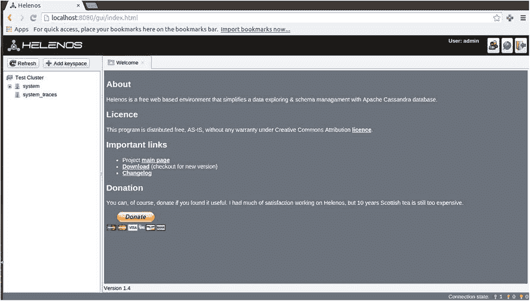

图 9-5. Helenos 控制台

在左侧面板中，你可以看到所有已配置 keyspace 的树状视图（见图 9-6）。

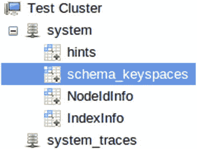

图 9-6. 显示集群和可用的 keyspace

我们还可以通过运行 CQL3 格式的查询来探索数据，例如图 9-7 中所示的查询。

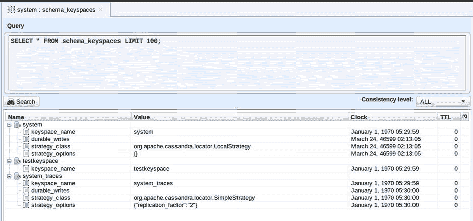

图 9-7. 从 schema_keyspace 表中获取 100 行的结果

使用 Helenos 添加另一个 keyspace 或刷新可用模式的选项位于右上角（参见图 9-5）。图 9-8 显示了添加 keyspace 或刷新模式的选项。


图 9-8. 我们也可以使用 Helenos 添加 keyspace 或刷新模式

使用 Helenos 还可以添加表/列族或删除 keyspace（见图 9-9）。

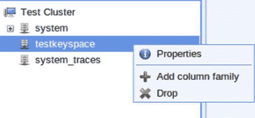

图 9-9. 你可以添加列族或删除 testkeyspace keyspace

选择“添加列族”（Add column family）选项会打开图 9-10 所示的对话框。

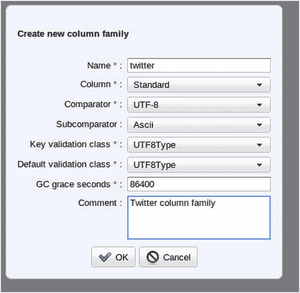

图 9-10. 添加 Twitter 列族

有一个用于管理连接的选项（见图 9-11）。

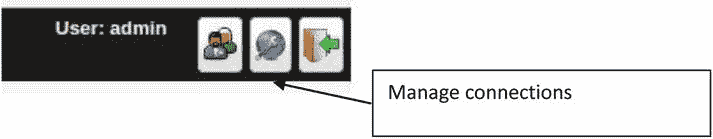

图 9-11. 使用 Helenos 管理连接

点击此选项后，我们可以添加、编辑或删除连接（见图 9-12）。

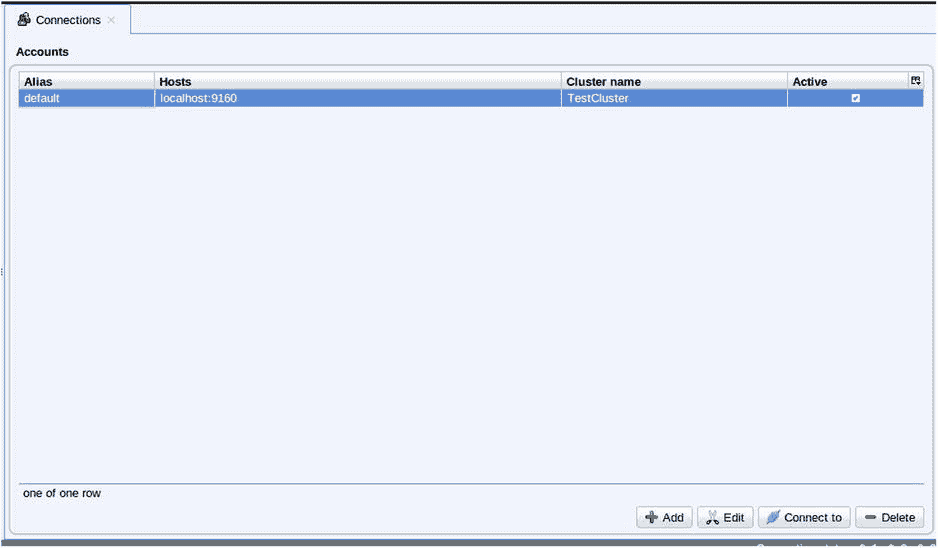

图 9-12. 使用 Helenos 编辑连接

你还可以使用 Helenos 探索分页、CQL 支持和身份验证等功能。在 [`https://github.com/tomekkup/helenos#wish-list`](https://github.com/tomekkup/helenos#wish-list) 上有一个计划中的功能列表，例如将数据导出到文件、查询日志文件以及 JMX 和集群监控。然而，目前 Helenos 没有活跃的开发进展。

#### DataStax DevCenter 和 OpsCenter

DataStax 是一家领先的软件解决方案提供商，为 Cassandra 及相关技术栈提供商业产品和技术支持。该公司的联合创始人 Jonathan Ellis 同时也是 Apache Cassandra 项目的项目主席。DataStax 提供 DataStax Enterprise，其中包含 DataStax DevCenter 和 OpsCenter。该公司还提供用于构建应用程序的开源 DataStax Java 驱动程序。在本节中，我们将讨论配置和使用这些工具进行监控。

这些软件包可以单独下载，也可以作为 DataStax All-in-One Installer（全能安装程序）的一部分从 [`www.datastax.com/download`](http://www.datastax.com/download) 下载。是下载统一安装包还是单独的发行版，取决于你的使用需求。


##### OpsCenter

DataStax OpsCenter 可作为一体化安装包的一部分下载（如前所述），也可以从[`http://downloads.datastax.com/community/opscenter.tar.gz`](http://downloads.datastax.com/community/opscenter.tar.gz) 单独下载。撰写本文时，最新版本为 5.0。解压并运行 `opscenter.sh`（位于 `bin` 文件夹下）后，即可启动 DataStax 代理和 Web 界面。OpsCenter 的 URL 为 `http://localhost:8888`。在浏览器中访问该 URL 后，您将看到如图 9-13 所示的界面。

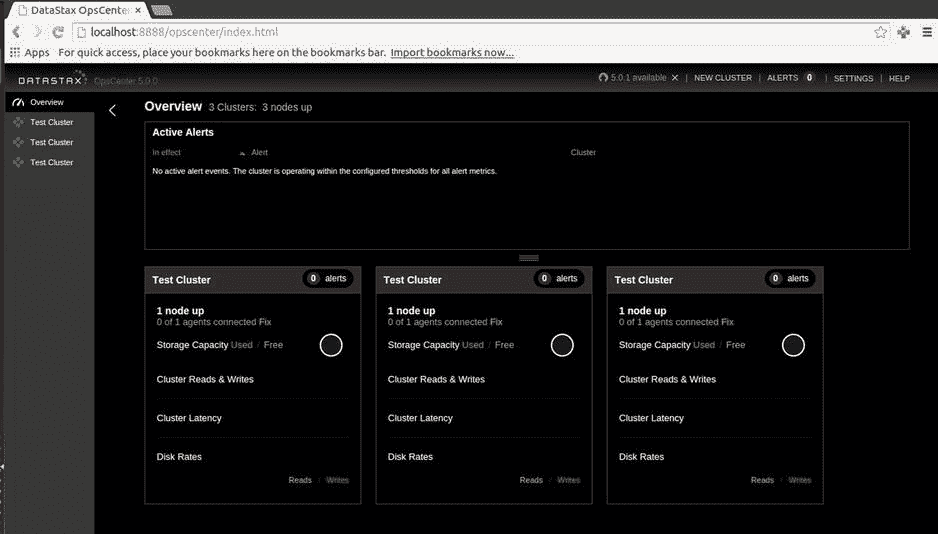

图 9-13.

DataStax OpsCenter 控制台

以下是 OpsCenter 提供的功能列表：

*   集群管理：包括其运行状况、容量和监控
*   节点和令牌环管理
*   警报和报告生成

在本节中，我们将探讨这些功能。让我们从集群管理开始。

我们可以通过单击控制台右上角的“新建集群”选项，使用 OpsCenter 添加一个集群（参见图 9-13）。图 9-14 显示了“添加集群”对话框。

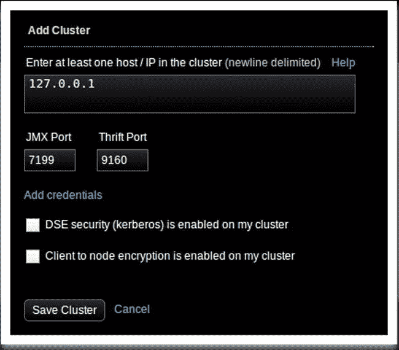

图 9-14.

使用 OpsCenter 添加集群信息

成功添加集群后，将显示其仪表盘屏幕（见图 9-15）。

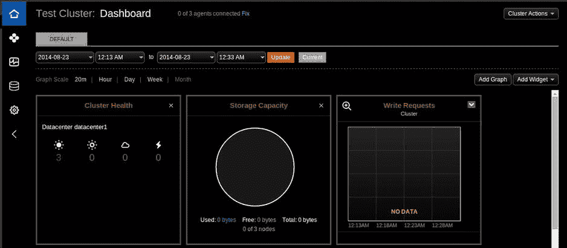

图 9-15.

OpsCenter 仪表盘，显示名为“Test Cluster”的集群

通过单击“Test Cluster”标签（参见图 9-13），我们可以使用 OpsCenter 查看集群环和节点状态（如图 9-16 和 9-17 所示）。

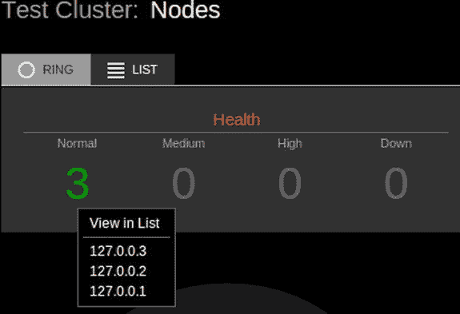

图 9-17.

显示节点列表和运行状况的环视图

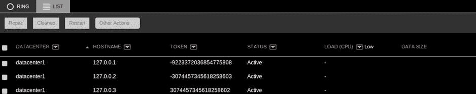

图 9-16.

显示集群中的节点信息和状态

当您从列表视图（如图 9-17 所示）中点击一个节点（例如 127.0.0.1）时，仪表盘上将显示一个选项卡，使您能够通过“事件记录”选项监控所执行的事件（见图 9-18）。

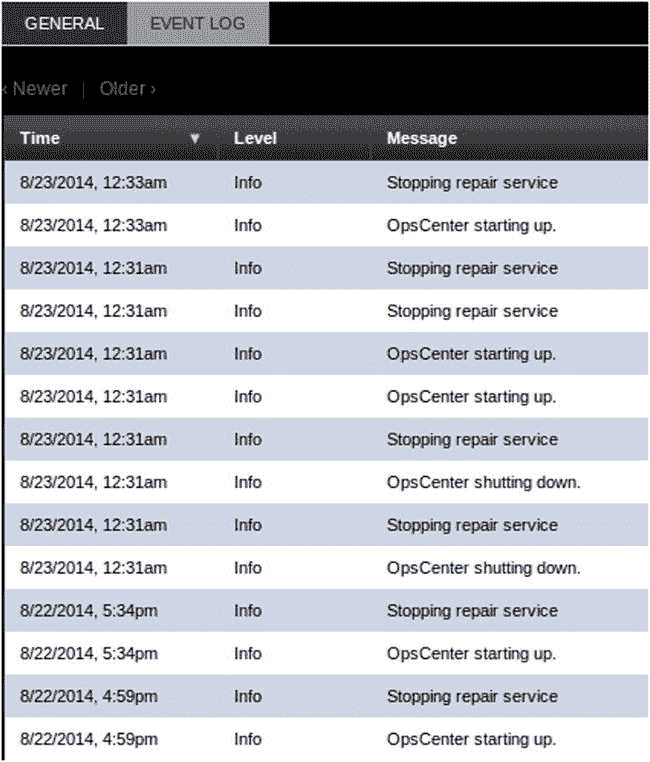

图 9-18.

OpsCenter 显示带有事件消息的事件记录

OpsCenter 企业版提供备份和恢复、节点再平衡等功能。您可以通过添加组件（如图形组件）来使用社区版体验 OpsCenter，从而以图形格式导出和管理数据。您也可以参考[`www.datastax.com/what-we-offer/products-services/datastax-opscenter/compare`](http://www.datastax.com/what-we-offer/products-services/datastax-opscenter/compare) 获取关于 DataStax OpsCenter 社区版与企业版产品的更多信息。

##### DevCenter

DataStax DevCenter 是一个用于管理模式和执行 CQL3 查询的可视化界面。它在对 Cassandra 进行快速数据操作时非常方便。最新版本为 1.2。下载后（可从一体化安装包 [`www.datastax.com/download`](http://www.datastax.com/download) 或单独从 [`www.datastax.com/download#dl-devcenter`](http://www.datastax.com/download#dl-devcenter) 获取）并成功解压后，我们可以通过运行 `devcenter.sh`（位于 `bin` 文件夹下）来启动。这将打开 DevCenter 连接管理器控制台，用于输入集群连接详细信息，如图 9-19 所示。

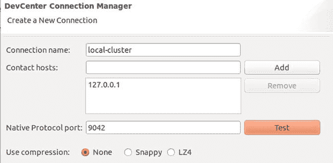

图 9-19.

DevCenter 连接管理器控制台

成功连接后，将显示 DevCenter 工作台界面（见图 9-20）。

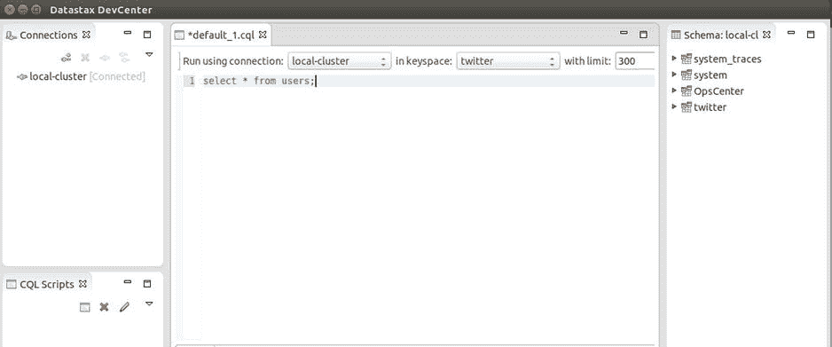

图 9-20.

带有查询编辑器的 DataStax DevCenter

您可以使用 ALT+F11 执行 CQL3 查询，输出结果将如图 9-21 所示显示。

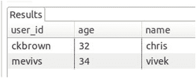

图 9-21.

DevCenter 工作台中的查询输出

对于开发人员和管理员来说，DevCenter 是一个非常实用的工具，可用于创建和管理模式。您也可以使用它来探索 第 2 章 和 第 3 章 中讨论的各种数据建模技术。

DataStax OpsCenter 和 DevCenter 用户指南分别位于 [`www.datastax.com/documentation/opscenter/5.0/opsc/about_c.html`](http://www.datastax.com/documentation/opscenter/5.0/opsc/about_c.html) 和 [`www.datastax.com/documentation/getting_started/doc/developer/devcenter/usingDevCenter.html`](http://www.datastax.com/documentation/getting_started/doc/developer/devcenter/usingDevCenter.html)，可供参考。这些都是商业产品，因此部分功能可能仅在企业版中提供。社区版可免费下载，但仅限有限用途。有关许可模式的更多详细信息，请访问 [`www.datastax.com/download/dse-vs-dsc`](http://www.datastax.com/download/dse-vs-dsc) 和 [`www.datastax.com/developer-license-terms`](http://www.datastax.com/developer-license-terms)。

### 总结

在本章中，我们讨论了可用于 Cassandra 监控和数据操作的各种工具。本章还涵盖了数据备份和恢复的基础知识，以及管理集群中的节点。下一章将讨论各种 Cassandra 实用程序以及使用 YCSB 进行基准测试。

