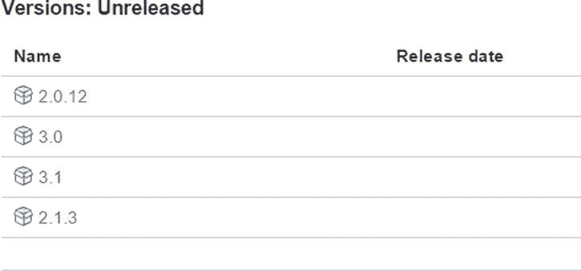

# 垃圾回收活动过多

如果垃圾回收（GC）耗时超过几秒钟，请检查 `system.log` 文件中是否有类似以下的消息：

```
INFO [ScheduledTasks:1] 2014-01-29 02:41:16,579 GCInspector.java (line 116) GC for ConcurrentMarkSweep: 341 ms for 1 collections, 8001582816 used; max is 8126464000
INFO [ScheduledTasks:1] 2014-01-29 02:41:29,135 GCInspector.java (line 116) GC for ConcurrentMarkSweep: 350 ms for 1 collections, 8027555576 used; max is 8126464000
```

长时间的垃圾回收暂停可能会造成“停止世界”场景，使数据节点冻结一段时间。在这种情况下，JVM 中未使用的部分很可能会被换出。建议使用以下命令来禁用交换：

```
swapoff –all
```

在 Linux 终端上运行此命令将禁用所有设备的交换。

这些是你可能会遇到的几个常见问题及其解决方案。接下来，让我们讨论一下 Cassandra 的未来发展之路。

### Cassandra 的未来之路

Apache Cassandra 仍在积极开发中，一个极其活跃的社区保持着发展的势头。我们已经讨论了可用于 Apache Cassandra 开发的多种工具和 API。图 11-2 显示了撰写本书时即将推出的 Cassandra 版本图表（取自 [`https://issues.apache.org/jira/browse/CASSANDRA/fixforversion/12324945/?selectedTab=com.atlassian.jira.jira-projects-plugin:version-summary-panel`](https://issues.apache.org/jira/browse/CASSANDRA/fixforversion/12324945/?selectedTab=com.atlassian.jira.jira-projects-plugin:version-summary-panel)）。



*图 11-2. 即将推出的 Cassandra 版本（截至 2014 年 11 月）*

毫无疑问，Cassandra 已被广泛接受为首选列式数据库，用于构建可扩展的大数据应用程序。eBay、Netflix 和 Facebook 等公司正在将 Cassandra 用于多种用途。这些组织的开发人员一直在定期贡献并推出他们基于 Cassandra 的工具，这对未来来说是个好兆头。

此外，几乎所有语言选项中都有高级客户端可用。表 11-1 列出了流行的 Cassandra 高级客户端 API 表格。

*表 11-1. Cassandra 高级客户端*

| 语言 | 客户端 |
| --- | --- |
| Java | DataStax Java 驱动、Astyanax、Hector、Kundera |
| Python | DataStax Python 驱动、pycassa |
| .NET | DataStax C# 驱动、CqlSharp |
| C++ | libcql |
| Scala | scqla |
| Perl | perlcassa |
| PHP | Cassandra PDO 驱动、phpcasa |

凭借多种语言的 API、活跃的社区以及计划中的版本发布，Cassandra 无疑拥有长远的发展前景。在即将到来的 Cassandra 版本中，预计会推出一系列全新且有趣的功能。再次强调，Cassandra 是一种流行的 NoSQL 数据库，非常适合处理大数据；其生态系统中拥有丰富的客户端 API；持续多年的活跃开发仍在继续；并且像 Netflix、eBay 和 Facebook 这样的公司正在使用和推广它。随着这一领域众多新的商业工具和产品的涌现，它是一款值得学习和使用的数据库！

### 总结

至此，我们本章及本书的内容就结束了。从第 1 章到第 11 章，我们通过示例练习的形式讨论了 Cassandra 的不同特性及其实现。在本章中，我们探讨了升级到新版本 Cassandra 的流程，以及如何应对近期众多版本带来的复杂性。我们还考虑了几个常见且重要的问题，你很可能在某个时候需要解决这些问题，并且我们展望了 Cassandra 的未来之路。

本书前面涵盖的关键主题包括批量分析和可用工具（第 5 章和第 6 章）、基于 Cassandra 的图实现（第 7 章）、性能调优及各种性能相关的注意事项（第 8 章）。

通过本书，我力求在示例菜谱和理论知识之间保持平衡。希望你喜欢本书，并学有所获。谢谢！
