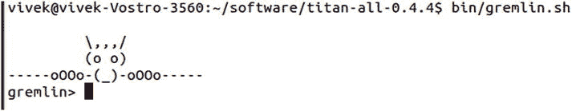
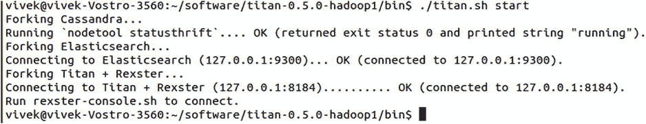
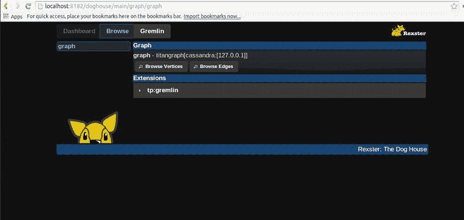
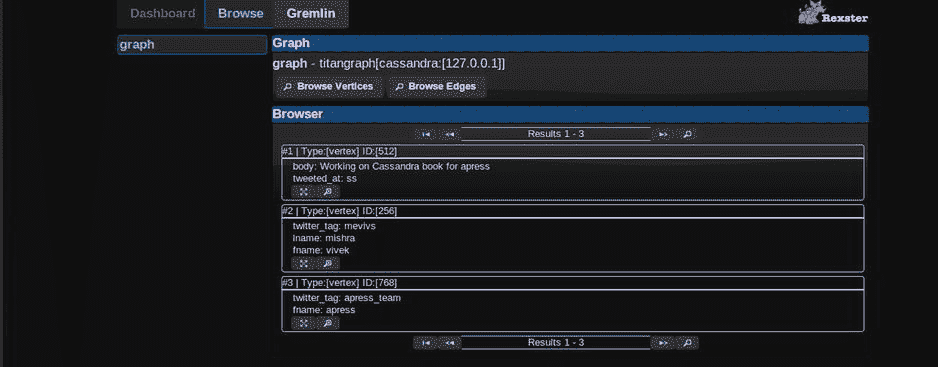
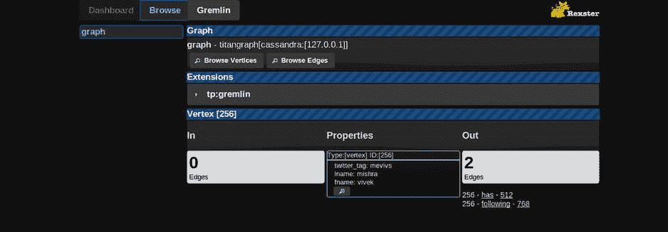
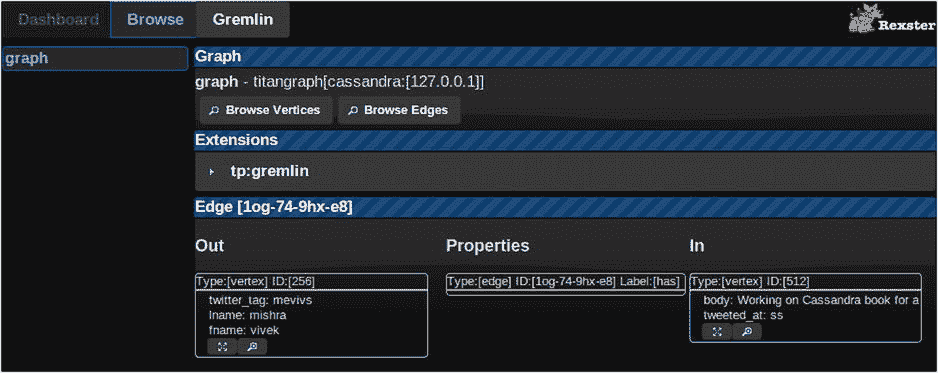
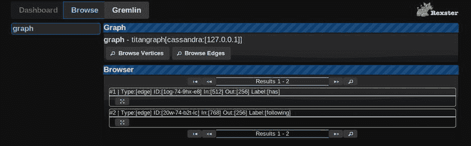
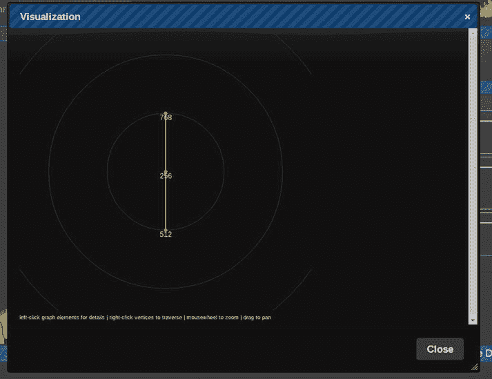

# Gremlin Shell

Titan 支持通过 Gremlin Shell 使用 Gremlin 查询语言进行图遍历和变更操作。这是一种函数式语言，每一步都会输出一个对象，通过`.`（点号）我们可以调用该对象的相关函数。例如：

```
gremlin> conf = new BaseConfiguration() // 第一步
==>org.apache.commons.configuration.BaseConfiguration@2d3c117a
gremlin> conf.setProperty("storage.backend", "cassandrathrift") // 第二步
```

这里 `conf` 是第一步中创建的 `Configuration` 对象，它的函数在第二步中被调用。

接下来，我们通过一个练习来讨论 Gremlin。在本教程中，我们将沿用之前的 Twitter 示例，其中用户的推文将作为图的顶点，用户与其推文及关注者之间的关系将作为边。在本例中，我们将使用 Cassandra 作为后端存储选项。你可以选择运行一个独立的 Cassandra 服务器；否则，默认情况下，它会启动并连接到一个内嵌的 Cassandra 实例。

接下来，我们需要初始化一个配置对象，并设置一些 Cassandra 特有的属性：



**图 7-9.** 连接到 Gremlin Shell

首先，我们需要像图 7-9 那样连接到 Gremlin。

```
gremlin> conf = new BaseConfiguration()
==>org.apache.commons.configuration.BaseConfiguration@2d3c117a
gremlin> conf.setProperty("storage.backend", "cassandrathrift")
==>null
gremlin> conf.setProperty("storage.hostname", "localhost")
==>null
gremlin> conf.setProperty("storage.port", "9160")
==>null
gremlin> conf.setProperty("storage.keyspace", "twitter")
==>null
```

接着，获取一个 Titan 图对象：

```
gremlin> graph = TitanFactory.open(conf)
==>titangraph[cassandrathrift:localhost]
```

让我们创建一些顶点键和边标签：

```
gremlin> graph.makeKey("fname").
dataType(String.class).indexed(Vertex.class).make()
==>fname
gremlin> graph.makeKey("lname").
dataType(String.class).indexed(Vertex.class).make()
==>lname
gremlin> graph.makeKey("twitter_tag").
dataType(String.class).indexed(Vertex.class).make()
==>twitter_tag
gremlin> graph.makeKey("tweeted_at").
dataType(String.class).indexed(Vertex.class).make()
==>tweeted_at
gremlin> graph.makeLabel("has_tweeted").make()
==>has_tweeted
gremlin> tweet.setProperty("body", "Working on Cassandra book for apress")
==>null
gremlin> tweet.setProperty("tweeted_at", "2014-09-21")
==>null
```

这里 `fname`、`lname` 和 `twitter_tag` 是顶点键，而标签 `has_tweeted` 将在下一步中用于边。

让我们为用户和推文创建顶点：

```
gremlin> vivs = graph.addVertex(null)
==>v[4]
gremlin> vivs.setProperty("fname", "vivek")
==>null
gremlin> vivs.setProperty("lname", "mishra")
==>null
gremlin> vivs.setProperty("twitter_tag", "mevivs")
==>null
gremlin> graph.V("fname","vivek")
==>v[4]
gremlin> tweet = graph.addVertex(null)
==>v[8]
```

接下来，在这两个顶点之间添加一条边：

```
gremlin> graph.addEdge(null, vivs, tweet, "has_tweeted")
==>e[2V-4-1E][4-has_tweeted->8]
```

让我们添加 `apress_team` 作为用户，并建立和定义“vivek 关注 apress_team”的关系边：

```
gremlin> apress = graph.addVertex(null)
==>v[12]
gremlin> apress.setProperty("fname", "apress")
==>null
gremlin> apress.setProperty("twitter_tag", "apress_team")
==>null
gremlin> graph.addEdge(null, vivs, apress, "following")
==>e[3r-4-22][4-following->12]
```

我们可以通过顶点的键来查找它，如下所示：

```
gremlin> vivek = graph.V('fname','vivek').next()
==>v[4]
gremlin> vivek.map()
==>twitter_tag=mevivs
==>lname=mishra
==>fname=vivek
```

我们还可以从顶点 `vivek` 中获取所有具有 `has` 关系的外向边：

```
gremlin> outVertex = vivek.out('has').next()
==>v[8]
gremlin> outVertex.map()
==>body=Working on Cassandra book for apress
==>tweeted_at=2014-09-21
```

上述教程演示了如何使用 Gremlin 查询语言填充和遍历 Twitter 图应用。

让我们来讨论一下 Rexster REST API、Dog House 和 Titan Server。

## Rexster：服务器、REST API 和 Dog House

正如在 TinkerPop 部分讨论的，通过 REST API 和 Web 控制台，我们可以可视化和管理任何 Titan 图。在前面的教程中，我们讨论了如何在本地机器上下载和设置 Titan 发行版。要启动 Titan Server、内嵌的 Elasticsearch 和 Cassandra，我们需要运行：

```
TITAN_HOME/bin/titan.sh
```

接下来，要连接 REST API 和 Dog House，我们需要执行：

```
TITAN_HOME/bin/rexster-console.sh
```

这将启动 Elasticsearch 并连接到端口 9300 上的 Elasticsearch 传输层，并使 Rexster 在端口 8184 上运行。REST API 和 Dog House 控制台将在 `localhost:8182` 端口上启动（见图 7-10）。



**图 7-10.** 启动 Rexster 服务器

### Rexster Dog House

图 7-11 展示了 Dog House 控制台，其中包含仪表盘标签页、浏览边和顶点的选项，以及内置的 Gremlin 命令行 Shell。



**图 7-11.** Rexster Dog House Web 控制台

内置的 Gremlin 命令行客户端允许你运行图变更和遍历查询（本章前面已讨论过）。

让我们使用 Gremlin 查询语言探索存储在 Gremlin 教程中的图。我们可以使用“浏览顶点”选项来分析顶点，如图 7-12 所示。



**图 7-12.** 浏览图顶点

我们还可以进一步深入查看特定顶点的属性（见图 7-13）。该图展示了顶点“vivek”的属性以及入边和出边。它有两条出边，分别是“has”和“following”，指向推文和 `apress_team` 顶点。



**图 7-13.** 探索顶点“vivek”的属性和关系

同样地，我们也可以探索边及其属性（见图 7-14 和 7-15）。



**图 7-15.** 探索标签为“has”的边



**图 7-14.** 探索标签为“has”和“following”的边

图 7-15 展示了边“has”的属性及其连接的入边和出边顶点。顶点 `mevivs` 和 `tweet` 通过边“has”连接，用通俗的话说就是“Vivek 发布了一条推文！”

我们还可以通过点击搜索图标来可视化图，这将呈现一个如图 7-16 所示的可视化效果。



**图 7-16.** 顶点和边的可视化

该图展示了三个顶点和两条边的图形化表示。