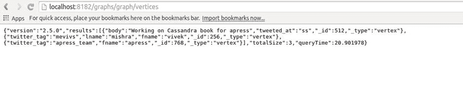
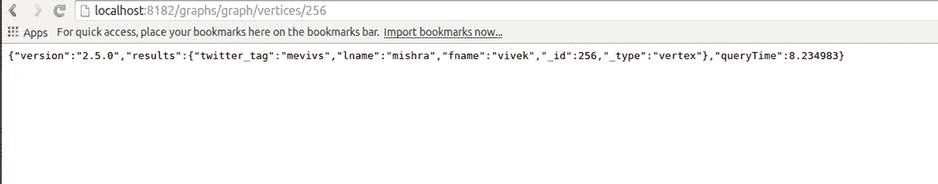
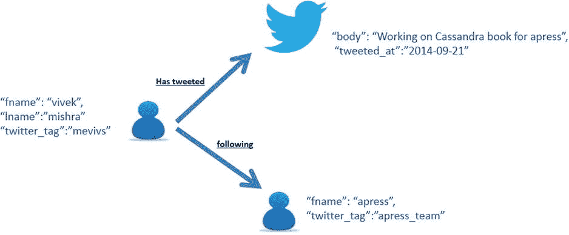
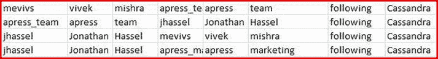
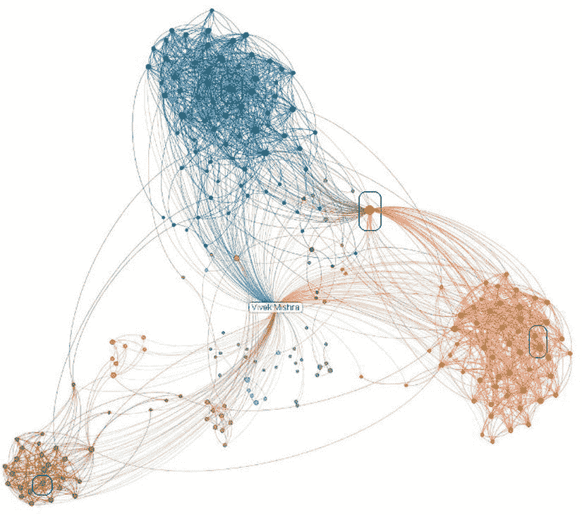

# Rexster REST API

我们也可以使用 REST API 来查询 Titan 图数据库！例如，要获取所有顶点的列表，我们只需发送一个如下所示的请求：

`localhost:8182/graphs/$graph_name/vertices`

例如，我们可以获取 Twitter “图” 中所有顶点的列表，如图 7-17 所示。



图 7-17.

使用 REST API 返回所有顶点的列表

我们还可以通过其 ID 查询特定的顶点（参见图 7-18）。



图 7-18.

使用 ID 256 获取一个顶点

所有支持的 REST 方法的完整列表可以在 [`https://github.com/tinkerpop/rexster/wiki/Basic-REST-API`](https://github.com/tinkerpop/rexster/wiki/Basic-REST-API) 找到。

## 使用 Cassandra 的 Titan

在本节中，我们将讨论使用 Cassandra 作为存储选项的 Titan 实现。本节将介绍如何使用 Titan Java API 与 Cassandra，并执行诸如读写图等用例。

### Titan Java API

Titan 是 Blueprints 图接口的一个实现。Titan 提供了基于 Java 和 Groovy 的实现来访问 Titan。Titan Java API 的设置相当简单。在后端存储方面，它依赖其他数据库，因此要开始使用 Titan，我们只需添加：

```
<dependency>
    <groupId>com.thinkaurelius.titan</groupId>
    <artifactId>titan-all</artifactId>
    <version>0.4.4</version>
</dependency>
```

在撰写本书时，最新的 Titan 版本是 0.5.0。对于 Cassandra，Titan 依赖于 Netflix 的 Astyanax Thrift 客户端。最新版本的 TitanGraph API 支持 Astyanax 1.56.37 版本。请注意，如果在项目中因其他 Cassandra 相关实现而使用了不同版本的 Astyanax Thrift，可能会遇到依赖性问题。这意味着在 Astyanax Thrift 客户端支持下，对 CQL 的支持也会非常有限。特定于 CQL3 的功能（例如，集合）可能无法与此版本的 Astyanax 正常工作。

当 Cassandra 在远程机器上跨多个节点运行时，我们可以使用逗号分隔的 IP 地址列表来配置这些远程节点与 Titan 的连接。

### 用于后端存储的 Cassandra

如上所述，Cassandra 可以作为 Titan 的存储后端使用。在本节中，我们将配置 Titan 存储选项，包括使用 Cassandra，并打开一个图实例。在接下来的“用例”部分，我们将通过一些简单的练习，演示如何使用 Titan 与 Cassandra，例如对图进行写入和读取操作。

首先，我们需要为 Titan 配置一些存储选项：

```
import org.apache.commons.configuration.BaseConfiguration;
import org.apache.commons.configuration.Configuration;
import com.thinkaurelius.titan.core.TitanFactory;
import com.thinkaurelius.titan.core.TitanGraph;
import com.thinkaurelius.titan.core.TitanKey;

Configuration conf = new BaseConfiguration();
conf.setProperty("storage.backend", "cassandrathrift");
conf.setProperty("storage.hostname", "localhost");
conf.setProperty("storage.port", "9160");
conf.setProperty("storage.keyspace", "twitter");
```

表 7-1 概述并描述了我们在上一步中使用的配置属性。

接下来，我们需要使用 `TitanFactory` 打开一个图实例：

表 7-1.

Titan 配置属性

| Property | Value | Description |
| --- | --- | --- |
| `storage.backend` | `cassandrathrift` | 使用 Cassandra 作为后端存储 |
| `storage.hostname` | `localhost` | Thrift `listen_address`，根据您的 Cassandra 服务器设置进行更改。 |
| `storage.port` | `9160` | Thrift rp |
| `storage.keyspace` | `Twitter` | 用于 Titan 图存储的 Cassandra keyspace |

```
TitanGraph graph = TitanFactory.open(conf);
```

接下来，让我们通过几个用例来进一步探索用于 Cassandra 的 Titan Java API，例如数据读取、写入和批处理。

### 用例

在本节中，我们将讨论图数据的遍历、读取、写入和批处理。我们首先讨论一个顶点和连接边数量庞大的场景，这种情况在大数据中非常常见。

#### 向图写入数据

在实例化一个图实例之后，让我们探讨如何将顶点和入射边写入到图中。我们将讨论同样的 Twitter 示例，并为用户、其推文和关注者构建一个基于图的实现。

图 7-19 展示了一个我们将使用 TitanGraph API 实现的问题的表示形式。

让我们向图中添加一个顶点：



图 7-19.

用户 vivek 正在关注 apress_team，并在 Twitter 上发布关于其 Cassandra 书籍的推文

```
Vertex vivs = graph.addVertex(null);
vivs.setProperty("fname", "vivek");
vivs.setProperty("lname", "mishra");
vivs.setProperty("twitter_tag", "mevivs");
```

这里，`Vertex` 是引用的 Blueprints 中的 API。以下是上述代码片段的导入语句：

```
import com.tinkerpop.blueprints.Direction;
import com.tinkerpop.blueprints.Vertex;
```

您可以将顶点视为 Java POJO，将其属性视为字段变量。

让我们为推文创建另一个顶点，并在用户和推文顶点之间定义一条边：

```
Vertex tweet = graph.addVertex(null);
tweet.setProperty("body", "Working on Cassandra book for apress");
tweet.setProperty("tweeted_at", "2014-09-21");
graph.addEdge(null, vivs, tweet, "has_tweeted"); // 用户 vivs 有推文
```

我们还可以添加另一个顶点并建立 `"following"` 关系：

```
Vertex apress = graph.addVertex(null);
apress.setProperty("fname", "apress");
apress.setProperty("twitter_tag", "apress_team");
graph.addEdge(null, vivs, apress, "following"); // Vivs 正在关注 apress 团队
```

最后提交事务：

```
graph.commit();
```

#### 从图读取数据

让我们进一步探索如何从 Titan 图中读取顶点和属性：

从图中读取数据也非常容易，我们可以检索特定图的所有顶点，甚至可以检索特定的顶点：

```
Iterable<Vertex> vertices = graph.getVertices();
Iterator<Vertex> iter = vertices.iterator();
```

我们可以像这样遍历每个顶点并检索入射边：

```
while(iter.hasNext())
{
    Vertex v = iter.next();
    Iterable<Edge> keys = v.getEdges(Direction.BOTH);
    ...
}
```

每条边都有 IN 和 OUT 顶点，我们可以通过边检索这些顶点：

```
for(Edge key : keys)
{
    System.out.print(key.getVertex(Direction.IN).toString()); // 将在控制台打印 vivs
    System.out.print("=>");
    System.out.print(key.getLabel());
    System.out.print("=>");
    System.out.println(key.getVertex(Direction.OUT).toString()); // 将打印 tweets 或 apress
}
```

上述对 Titan 图的读写操作提供了一个关于如何使用 Titan 与 Cassandra 的简单方法。

Cassandra 的核心在于大规模数据处理和分析。在使用 Cassandra 处理基于图的数据模型时也不例外。那么，如何使用 Titan 图数据库进行数据批处理呢？Titan 确实支持批量数据处理，在下一个示例中，我们将探讨如何使用 Titan Java API 执行批量加载。


### 批量加载

Titan 通过 `BatchGraph` API 支持批量加载，可将其视为 `TitanGraph` 的封装器，并带有可配置的参数来定义批量大小和顶点 ID 类型。我们可以按如下方式创建 `BatchGraph` 实例：

`BatchGraph bGraph = new BatchGraph<TITAN GRAPH INSTANCE>,<VERTEX ID TYPE>,<BATCH SIZE>);`

使用批量加载 API，我们可以通过一次数据库调用推送一批记录。这样图数据的加载速度总是更快。

让我们通过一个 Java 示例程序来探索 Titan 中的批量加载。在此示例中，我们将从一个 `.csv` 文件中读取数据。

图 7-20 展示了用户 A 关注用户 B 这种格式的数据。每个用户都有 `fname`、`lname` 和 `twitter_tag` 作为顶点的属性，其中边的标签是 following，并包含一个属性值为 Cassandra。请注意，您可以在本书源代码的 `src/main/resources` 文件夹下找到示例 `.csv` 文件。



图 7-20. 显示用户与粉丝关系的表格

按照以下步骤完成示例程序：

首先，常见步骤是为 Cassandra 配置一个图：

```
import org.apache.commons.configuration.BaseConfiguration;
import org.apache.commons.configuration.Configuration;
import com.thinkaurelius.titan.core.TitanFactory;
import com.thinkaurelius.titan.core.TitanGraph;
import com.thinkaurelius.titan.core.TitanKey;

Configuration conf = new BaseConfiguration();
conf.setProperty("storage.backend", "cassandrathrift");
conf.setProperty("storage.hostname", "localhost");
conf.setProperty("storage.port", "9160");
conf.setProperty("storage.keyspace", "batchprocess");
conf.setProperty("storage.batch-loading", "true");
```

我们使用 `FileReader` 来加载示例 `.csv` 文件：

```
File file = new File("src/main/resources/bulk_load.csv");
BufferedReader reader = new BufferedReader(new FileReader(file));
```

接下来，创建一个图的实例，并用 `BatchGraph` 封装它：

```
TitanGraph graph = TitanFactory.open(conf);
BatchGraph bgraph = new BatchGraph(graph, VertexIDType.STRING, 1000);
```

这里的 1000 是批量大小，顶点 ID 是字符串类型。

现在，让我们将每个顶点属性定义为顶点键，将每个边的属性定义为标签键：

```
// 为每个属性准备顶点键
KeyMaker maker = graph.makeKey("twitter_tag");
maker.dataType(String.class);
maker.make();

graph.makeKey("fname").dataType(String.class).make();
graph.makeKey("lname").dataType(String.class).make();

// 将边属性准备为标签
LabelMaker labelMaker = graph.makeLabel("contentType");
labelMaker.make();

graph.makeLabel("following").make();
```

这里 `TitanKey` 和 `LabelKey` 是 Titan Java API 提供的类，用于准备顶点键和边键。

现在，让我们逐行从文件读取并提取顶点和边的属性：

```
while (reader.ready())
{
    String line = reader.readLine();
    StringTokenizer tokenizer = new StringTokenizer(line, ",");
    while (tokenizer.hasMoreTokens())
    {
        // System.out.println(tokenizer.nextToken());
        // twitter_tag,fname,lname,twitter_tag,fname,lname,edgeName,edgeProperty
        final String in_twitter_tag = tokenizer.nextToken();
        final String in_fname = tokenizer.nextToken();
        final String in_lname = tokenizer.nextToken();
        final String out_twitter_tag = tokenizer.nextToken();
        final String out_fname = tokenizer.nextToken();
        final String out_lname = tokenizer.nextToken();
        final String edgeName = tokenizer.nextToken();
        final String edgeProperty = tokenizer.nextToken();
        ...
    }
}
```

现在，在最外层的 `while` 循环（参见步骤 5）中创建入顶点和出顶点，并如下所示分配边：

```
// 入顶点
Vertex in = bgraph.addVertex(Math.random() + "");
in.setProperty("twitter_tag", in_twitter_tag);
in.setProperty("fname", in_fname);
in.setProperty("lname", in_lname);

// 出顶点
Vertex out = bgraph.addVertex(Math.random() + "");
out.setProperty("twitter_tag", out_twitter_tag);
out.setProperty("fname", out_fname);
out.setProperty("lname", out_lname);

// 分配边
bgraph.addEdge(null, in, out, edgeName);
```

最后，在成功读取 `.csv` 文件中的所有记录并填充 `BatchGraph` 后，我们可以调用 `commit`：

```
bgraph.commit();
```

这里的批量大小是在图上调用 `commit` 之前要加载的顶点和边的数量。我们需要注意的一件事是，将批量大小设置为一个适中的值，以避免在处理具有数百万或数十亿条边的大型图时出现堆大小问题。

### 超级节点问题

在现实世界中，基于大数据的图可能非常庞大，并且可能存在一组具有极多关联边的顶点。在图论中，这样的顶点被称为超级节点。由于存在如此多的复杂路径，图中的随机遍历可能会将我们引向这些超级节点，这将对系统性能产生严重影响。

图 7-21 展示了我的领英社交图，其中标记出的顶点可被称为超级节点。



图 7-21. Vivek 的领英图

例如，如果我需要遍历特定群组（比如 graphDB）的所有连接，那么没有索引的此类遍历将导致性能问题。通过按标签对关联边建立索引，此类查询会快得多。

例如，如果我们想找到 Vivek 所有已加入“graphDB”群组的朋友，进行随机遍历需要搜索 Vivek 的每一个连接，然后扫描他每个朋友加入的群组。想象一下，Vivek 在领英上有大量的连接。可以想见，在这种情况下，随机遍历寻找所需结果将是一场噩梦。但是，使用标签索引查询，它会快得多：

```
g.query().has("friends of", EQUAL, "vivek").has("group", EQUAL, "graphDB").vertices();
```

此查询是一个标签索引查询，它使用“friends of”搜索 Vivek 的所有朋友，然后使用索引边“group”在剩余子集中搜索 graphDB。

我们将在本章下一节中进一步探讨这一点。


