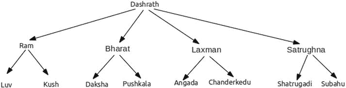

# 更快的深度遍历

深度遍历是指在图的层级结构中到达第 n 层。以我在前文提到的领英社交图为例，可以通过查询我的联系人来寻找共同的群组兴趣。根据数据量和关联边的数量，通过顶点查询逐个迭代顶点可能并非良策。Titan 支持多顶点查询，可以将多个顶点查询合并为一个单一的查询发送给图数据库。这样一来，数据检索速度会快得多，因为只需访问服务器一次。

接下来，我们将通过印度神话史诗《罗摩衍那》来探索如何在 Titan 中使用多顶点查询实现更快的深度遍历。在这个例子中，我们将尝试查找叶子节点级别的“父子”关系。图 7-22 展示了罗摩及其祖先的家谱。



图 7-22. 罗摩衍那家族图

在每个层级查找“父子”关系的一种方法是像这样逐层迭代：

```java
private static void iterateToLeaf(Vertex dasratha)
{
    System.out.println("Finding sons for::" + dasratha.getProperty("fname"));
    Iterable<Vertex> immediateSons = dasratha.getVertices(Direction.IN, "son of");
    Iterator<Vertex> iter = immediateSons.iterator();
    // one way is
    while (iter.hasNext())
    {
        Vertex v = iter.next();
        // recursive call
        iterateToLeaf(v);
    }
}
```

在上面的代码片段中，我们需要传入根顶点对象，即 `dasaratha`，然后递归调用会遍历每一层的每个顶点。对于较小的图，这可能有效；但对于大型数据和大数据图来说，这不是一个可行的解决方案。这正是多顶点查询大显身手且性能卓越的地方。

让我们通过几个代码片段来了解如何使用 Titan 执行多顶点查询。你可以在随附的源代码中找到完整的 `GraphTraversalRunner.java` 示例。

首先，添加 `dasaratha` 作为根顶点：

```java
Vertex das = add("fname", "dasaratha", graph);
```

```java
private static Vertex add(final String propertyName, final String value, TitanGraph graph)
{
    Vertex vertex = graph.addVertex(null);
    vertex.setProperty(propertyName, value);
    return vertex;
}
```

接着，添加 dasaratha 的儿子：

```java
// add dasratha's son.
Vertex ram = addSon("fname", "ram", graph, das);
Vertex laxman = addSon("fname", "laxman", graph, das);
Vertex bharat = addSon("fname", "bharat", graph, das);
Vertex shatrugna = addSon("fname", "shatrugna", graph, das);
```

```java
private static Vertex addSon(String propertyName, String value, TitanGraph graph, Vertex father)
{
    Vertex son = add(propertyName, value, graph);
    graph.addEdge(null, son, father, "son of");
    return son;
}
```

对 `ram`、`laxman`、`bharat` 和 `shatrugna` 重复步骤 2：

```java
// ram's son
addSon("fname", "luv", graph, ram);
addSon("fname", "kush", graph, ram);
// bharat's son
addSon("fname", "Daksha", graph, bharat);
addSon("fname", "Pushkala", graph, bharat);
// laxman's son
addSon("fname", "Angada", graph, laxman);
addSon("fname", "Chanderkedu", graph, laxman);
// Shatrugna’s son
addSon("fname", "Shatrugadi", graph, shatrugna);
addSon("fname", "Subahu", graph, shatrugna);
```

最后，存储完整的层级结构：

```java
graph.commit();
```

现在，要使用多顶点支持来获取所有具有 `Direction.IN`（表示入边）且标签为 “son of” 的顶点，我们需要执行以下查询：

```java
// prepare multi vertex query
TitanMultiVertexQuery mq = graph.multiQuery();
mq.direction(Direction.IN).labels("son of");
mq.addVertex((TitanVertex) das); // add root
mq.addVertex((TitanVertex) ram);
mq.addVertex((TitanVertex) bharat);
mq.addVertex((TitanVertex) laxman);
mq.addVertex((TitanVertex) shatrugna);
// execute multi vertex query
Map<TitanVertex, Iterable<TitanVertex>> dfsResult = mq.vertices();
// iterate through result and print
for (TitanVertex key : dfsResult.keySet())
{
    System.out.println("Finding son of" + key.getProperty("fname"));
    Iterable<TitanVertex> sons = dfsResult.get(key);
    Iterator<TitanVertex> sonIter = sons.iterator();
    while (sonIter.hasNext())
    {
        System.out.println(sonIter.next().getProperty("fname"));
    }
}
```

通过这种方式，我们可以在 Titan 中实现更快的深度遍历。

我们已经介绍了 Titan 图数据库支持的大部分重要特性。本章分享的示例代码片段应能使读者学会将 Titan 与 Cassandra 结合使用，例如构建社交图、网络图或运行类图查询。至于图数据库的未来，下一章将讨论关于图数据库领域活跃开发的一份报告。

至此，我们结束了关于图数据库以及如何将 Titan 与 Cassandra 集成的讨论。有关更多详细信息和受支持的特性集，你可以参考 [`https://github.com/thinkaurelius/titan/wiki`](https://github.com/thinkaurelius/titan/wiki)。

## 总结

总而言之，本章涵盖的主题包括：

*   图简介
*   理解 TinkerPop 和 Blueprints
*   Titan 数据库生态系统
*   Titan 与 Cassandra 的集成

下一章将介绍 Cassandra 的性能调优和压缩技术。