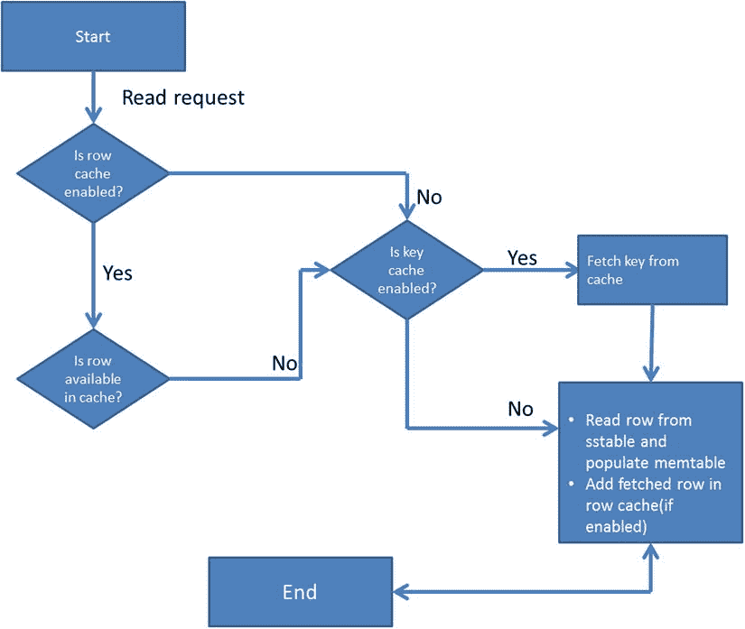
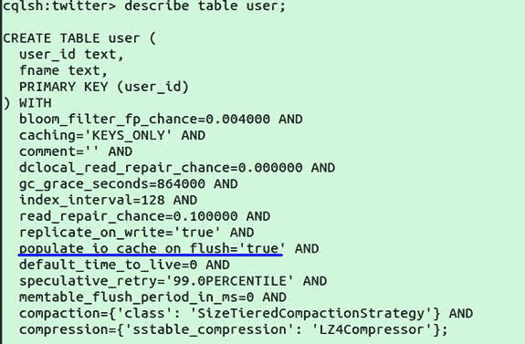

# 8. Cassandra 性能调优

随着存储硬件在容量方面变得更便宜、更高效，组织能够为其 TB 级的数据选择更便宜、维护成本更低的存储方案。显然，成本效益一直是技术选择背后的重要因素。大数据量的存储和检索是需求，但经济实惠的解决方案不应以牺牲性能为代价。数据，无论大小，除非可以有效地使用并进行分析，否则都是无益的。

通过真实世界大数据相关用例所证明的机遇，许多组织和初创公司正在围绕大数据探索商业构想。对于面向在线受众的公司来说，实时数据非常受欢迎。如今的应用程序每秒需要处理和分析数 GB 的数据，这清楚地表明性能是现代基于大数据的应用程序的重要组成部分。

在本章中，我们将讨论：

*   关键性能指标
*   Cassandra 缓存配置
*   讨论布隆过滤器和垃圾回收
*   Cassandra 压力测试
*   Yahoo Cloud Serving Benchmark（雅虎云服务基准测试）

## 理解关键性能指标

本节将讨论几个关键性能指标（KPI），包括：

*   CPU 和内存消耗
*   高读写吞吐量和延迟
*   逻辑读取和物理读取

性能不一致或性能下降是应用程序需要进行性能调优的主要问题。这就是前端应用程序和后端数据库需要从性能角度进行调优的地方。

首先，让我们初步了解几个 KPI，这些指标将指导我们如何配置 Cassandra 以提升性能。

### CPU 和内存利用率

从性能角度来看，CPU 和内存利用率非常重要。`JConsole`、`JProfile` 和 `YourKit` 等工具可通过监控 CPU 和内存占用来追踪应用程序的性能。值得一提的是，许多 Cassandra 服务进程会占用堆外内存；因此，在为同一节点上本地运行的应用程序调整堆配置时，我们需要确保不会发生内存不足或泄漏，以免导致应用不稳定。堆大小配置过低会触发频繁的垃圾回收活动。虽无法完全避免垃圾回收周期，但我们可以对其进行调优以获得更好的响应时间。例如，保留较大的年轻代空间可以容纳更多存活对象，但会导致较长的 GC（垃圾回收）周期。通常情况下，对年轻代对象进行的垃圾回收活动速度较快，对响应时间的影响几乎可以忽略不计。但 Full GC 是一种“停止一切”的事件，会严重影响应用程序的性能。我们需要确保为 Eden 区以及后续内存池中的临时区和永久区分配适当的内存。建议保留较小的永久代空间。

### 高读写吞吐量与延迟

大数据处理的讨论核心在于“实践出真知”。应用程序必须能够快速执行数据摄入和读取，无论数据量大小如何。读/写延迟是性能监控和调优的另一个重要方面。现代应用程序要求以最小延迟实现实时或近实时数据处理。因此，在采用技术和数据库时，我们必须牢记这一点，以避免此类性能开销。

### 逻辑读取与物理读取

逻辑读取指的是从数据缓存中读取行，而物理读取则涉及磁盘访问。较高的逻辑读取往往意味着较大的内存占用，同样，频繁的物理读取会引入读取延迟，并可能造成性能开销。因此，在两者之间取得平衡至关重要。Cassandra 提供了行缓存和键缓存，以及 memtable，以减少物理读取。我们将在本章中详细讨论这些内容。

接下来，让我们讨论各种 Cassandra 特有的配置。在本章的后续部分，我们还将介绍前端应用程序的性能监控和调优。

## Cassandra 配置

Cassandra 提供了多种配置，可针对高读写负载进行调整。让我们从缓存配置开始，逐一进行探讨。

### 数据缓存

数据缓存将频繁访问的行保存在内存中，以避免服务器端的磁盘访问。在 n 层架构中，数据缓存也可以在客户端实现（例如 `Ehcache`）。数据缓存的概念并不新鲜，传统的关系数据库管理系统（RDBMS）中也有应用。数据缓存在读取操作中非常有用，建议对频繁获取的数据采用数据库级别的缓存。Cassandra 同时提供了键缓存和行缓存。图 8-1 展示了在从 Cassandra 数据库读取数据时，这些缓存是如何工作的流程图。



图 8-1. 收到读取请求后缓存如何与 Cassandra 服务器协同工作

行缓存和键缓存有助于检索最常用的行。保持适度的行缓存大小和较多的键缓存数量可以带来更好的性能和更低的延迟。接下来让我们讨论这些与 Cassandra 相关的缓存配置。

#### 缓存目录

默认的缓存位置是 `/var/lib/cassandra/saved_caches`。我们也可以在 `cassandra.yaml` 中修改它：

```
saved_caches_directory: /var/lib/cassandra/saved_caches
```

#### 键缓存

使用键缓存时，对实际行键的引用将缓存在内存中，每个列族独立缓存。对于高负载的、基于读取的应用程序，建议设置较大的键缓存，当然这需要在 JVM 设置允许的范围内。表 8-1 描述了可以在 `cassandra.yaml` 中配置的各种键缓存参数。

表 8-1. 键缓存配置

| 名称 | 描述 |
| --- | --- |
| `key_cache_size_in_mb` | 键缓存大小，以兆字节为单位。默认情况下，它为堆的 5% 或 100MB（取两者中较小值）。设置为 0 可以禁用。 |
| `key_cache_save_period` | 将键缓存保存到已配置缓存目录的时间间隔。默认为 4 小时。 |
| `key_cache_keys_to_save` | 要保存的键数量，默认情况下禁用，但建议设置为一个较高的值。 |

从 2.0 版本开始，键缓存已移至堆外，这显著减少了键序列化所花费的时间。我们将在本章后面讨论堆外与堆内的问题。如前所述，内存利用率是性能的关键指标之一，在配置行缓存时，我们必须避免 Full GC 活动，无论键缓存现在是否已移至堆外。

#### `populate_io_cache_on_flush`

默认情况下，此参数处于禁用状态，设置为 false。在 Cassandra 1.2.x 之前，它在节点级别受支持，但现在可以在列族级别启用。此标志的目的是在 memtable 刷新和压缩期间，在列族级别启用/禁用页面缓存。如果设置为 true，它将把特定列族的数据缓存保留在内存中。正如 第 1 章 所讨论的，memtable 会以 sstable 的形式将数据持续刷新到磁盘。如果此参数设置为 true，Cassandra 会为该列族的所有行保留一个页面缓存。请注意，页面缓存仅在刷新和压缩期间刷新，以便节点上该列族的数据保持最新。用户需要确保数据大小能很好地适应节点的内存。我们可以在创建表或修改现有表时启用它：

```
create table tweets(tweet_id text primary key,body text) with caching='rows_only' and bloom_filter_fp_chance=0.004 and populate_io_cache_on_flush='true';  // 创建表

alter table user with populate_io_cache_on_flush='true'; // 修改表
```

建议对频繁查询且能很好地适应内存的列族将此参数设置为 true，以获得更好的读取吞吐量。图 8-2 显示了用户创建的、此属性设置为 true 的表（见标记行）。



图 8-2. 启用了填充 I/O 操作缓存的用户表（设置为 true）

### 行缓存

启用行级缓存后，整行数据都会存于缓存中。与键级缓存相比，行缓存需要大量空间。从 Cassandra 1.2 开始，行缓存可移至堆外，但行的反序列化仍会临时在堆内进行。表 8-2 展示了几种行缓存配置及其说明。

表 8-2. 行缓存配置

| 名称 | 说明 |
| --- | --- |
| `row_cache_size_in_mb` | 默认禁用，设置为 0。 |
| `row_cache_save_period` | 默认禁用行缓存，启用可改善冷启动性能，但缓存可能代价高昂且消耗大量内存。 |
| `row_cache_keys_to_save` | 默认禁用。要保存的行缓存键数。 |

行缓存非常有用，能显著减少对频繁访问行的磁盘读取。但它也占用大量空间。如果应用程序需要频繁获取整行数据而非选定列，建议启用行缓存。

要为特定列族启用缓存，可以在创建列族时进行如下设置：

```
create table user(user_id text primary key,fname text) with caching='keys_only';
```

```
create table tweets(tweet_id text primary key,body text) with caching='rows_only';
```

在上述脚本中，对 `user` 列族启用了键级缓存，而对 `tweets` 表启用了行级缓存。建议在应用程序需要读取整行而非选定列时启用行缓存。显然，若采用选定列的方式，启用行缓存反而会产生负面影响，并且会浪费内存空间，因为行会被无谓地保留在内存中。

以下代码片段展示了如何在 `cassandra.yaml` 文件中配置这些缓存参数：

```
# 要缓存的键大小为 50 MB。
key_cache_size_in_mb: 50

# 键在缓存中保留 5 分钟或 3600 秒。
key_cache_save_period: 3600

# 在键缓存中保存 100 个键。
key_cache_keys_to_save: 100

# 在缓存中保留 100 MB 的行数据。
row_cache_size_in_mb: 100

# 行在缓存中保留 5 分钟或 3600 秒。
row_cache_save_period: 3600

# 从行缓存中保存 100 个键。
row_cache_keys_to_save: 100

# 缓存保存目录。
saved_caches_directory: /var/lib/cassandra/saved_caches
```

### 布隆过滤器

布隆过滤器是一种用于判断元素是否存在于集合中的数据结构。它由 Burton Bloom 于 1970 年提出，用于判断元素存在于集合中的概率。启用布隆过滤器后，它会返回元素“肯定不在集合中”或“可能在集合中”。误报（FP）指元素实际不存在但过滤器认为可能存在；漏报指元素实际存在但过滤器认为肯定不存在。

Cassandra 中的每个表都包含一个布隆过滤器。它利用误报率值来检查 SSTable 中一行内可能存在的列，但漏报是绝对不可能的。这里的漏报意味着行中的列实际存在，但布隆过滤器却返回否定结果。

将布隆过滤器的误报率设置得更高意味着消耗更少内存，并确保永远不会出现漏报（例如，对不存在的键不会产生磁盘 I/O）。布隆过滤器误报率的范围是 0.000744 到 1.0。将误报率设置得较高会导致在 SSTable 中找到列的可能性增加，但对于否定情况不会产生磁盘读取。

你可以在创建列族时设置布隆过滤器，也可以像这样更新列族：

```
create table tweets(tweet_id text primary key,body text) with caching='rows_only' and bloom_filter_fp_chance=0.004;
```

```
alter table user with bloom_filter_fp_chance=0.004;
```

### 堆外 vs. 堆内

堆外内存分配是直接从操作系统分配内存，而堆内内存对象则由 JVM 本身管理。Cassandra 也会在堆外内存中加载行缓存和键缓存，这意味着这些对象在非 Java 堆上进行序列化。这样反序列化会快得多。

建议保持适中的堆大小，因为堆仅从系统内存中分配内存。根据经验，最好不要超过 6 GB（如果系统内存大于 6 GB）。你可以通过 Java 运行时获取 `maxMemory`：

```
Runtime rTime = Runtime.getRuntime();
long maxSize = rTime.maxMemory();
```

如果系统内存小于 2 GB，建议保留 50% 作为堆内存。

Cassandra 要求安装 Java Native Access (JNA) 库以支持堆外缓存。

要启用 JNA 库，你需要从 [`https://github.com/twall/jna`](https://github.com/twall/jna) 下载 `JNA.jar` 并将其放置在 classpath 中。就这么简单！

我们还可以在 `cassandra.yaml` 中设置堆外内存分配器：

```
memory_allocator: NativeAllocator
可选的值为 NativeAllocator, JEMallocAllocator。
```

要安装 `JEMallocAllocator`，你需要下载并安装 jemalloc 库。jemalloc 的源码可在 GitHub 上获取（[`https://github.com/jemalloc/jemalloc`](https://github.com/jemalloc/jemalloc)）。

#### 安装和配置 jemalloc

安装 jemalloc 的步骤如下：

首先从 github 克隆并下载源码：

```
git clone https://github.com/jemalloc/jemalloc.git
```

切换目录到 `jemalloc` 并运行 `configure`：

```
cd jemalloc
./configure
```

接下来，通过运行以下命令进行安装：

```
make
make install
```

成功安装 `jemalloc` 后，我们需要在 `cassandra-env.sh` 中为 Cassandra 配置已安装的库：

```
export JEMALLOC_HOME= jemalloc/
export LD_LIBRARY_PATH=<JEMALLOC_HOME>/lib/
JVM_OPTS="$JVM_OPTS -Djava.library.path=<JEMALLOC_HOME>/lib/"
```

#### 垃圾回收

Cassandra 会执行显式垃圾回收，可以通过监控服务器日志中的 `GCInspector` 类获取更多信息。你也可以选择使用 `XX:+DisableExplicitGC` 禁用显式垃圾回收，但建议仅用于实验目的。或者，配置 `gcInterval` 设置也是一个选项（`sun.rmi.dgc.server.gcInterval` 和 `sun.rmi.dgc.client.gcInterval`）。它表示 Java 运行时 RMI（远程方法调用）为回收未使用和软引用对象而调用垃圾回收的最大时间间隔（以毫秒为单位）。默认设置为 1 小时。

我们可以在 `$CASSANDRA_HOME/conf` 文件夹中的 `cassandra-env.sh` 文件中调整垃圾回收设置。部分选项如下：

```
# GC 日志选项 -- 取消注释以启用
JVM_OPTS="$JVM_OPTS -XX:+PrintGCDetails"
JVM_OPTS="$JVM_OPTS -XX:+PrintGCDateStamps"
JVM_OPTS="$JVM_OPTS -XX:+PrintHeapAtGC"
JVM_OPTS="$JVM_OPTS -XX:+PrintTenuringDistribution"
JVM_OPTS="$JVM_OPTS -XX:+PrintGCApplicationStoppedTime"
JVM_OPTS="$JVM_OPTS -XX:+PrintPromotionFailure"
JVM_OPTS="$JVM_OPTS -XX:PrintFLSStatistics=1"
JVM_OPTS="$JVM_OPTS -Xloggc:/var/log/cassandra/gc-`date +%s`.log"
# 如果你使用 JDK 6u34 7u2 或更高版本，可以启用 GC 日志轮转
# 如果启用了轮转，不要在日志名称中嵌入日期。
JVM_OPTS="$JVM_OPTS -Xloggc:/var/log/cassandra/gc.log"
JVM_OPTS="$JVM_OPTS -XX:+UseGCLogFileRotation"
JVM_OPTS="$JVM_OPTS -XX:NumberOfGCLogFiles=10"
JVM_OPTS="$JVM_OPTS -XX:GCLogFileSize=10M"
```