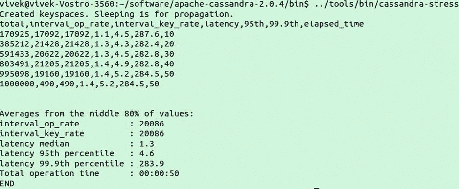
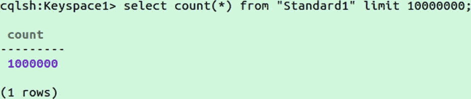
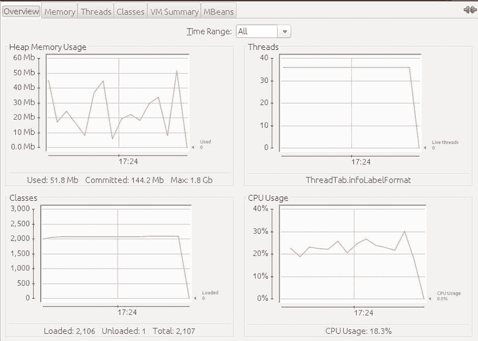
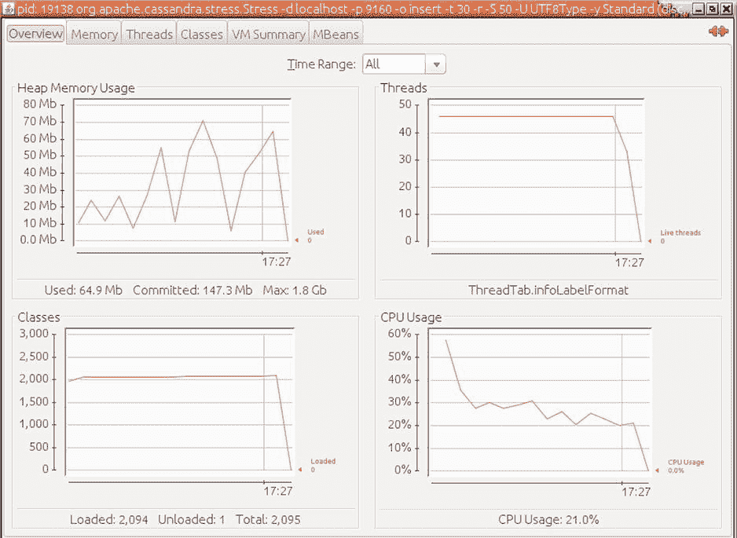
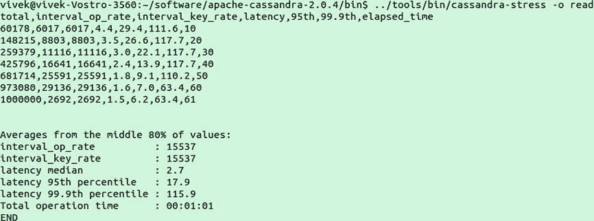
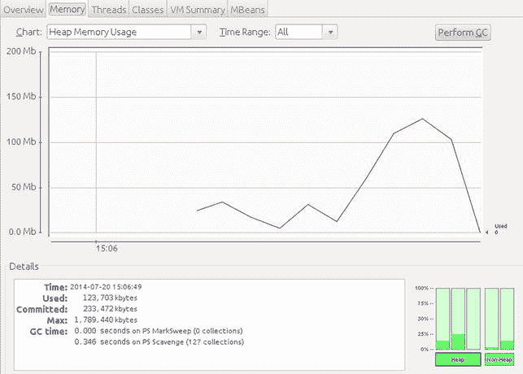
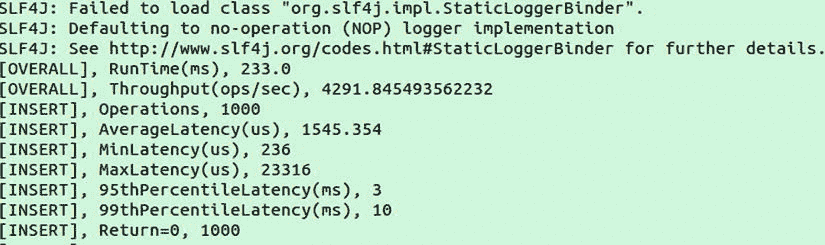

# 堆内存大小配置

通常，建议将应用程序的堆内存大小保持在 4–8 GB 范围内；但如果内存小于 4 GB，我们仍应将其中的一半（约 2 GB）用于 I/O 操作。您可以在 `cassandra-env.sh` 文件中修改 JVM 设置以配置堆内存大小（查找 `JVM_OPTS`）。

```
JVM_OPTS="$JVM_OPTS $JVM_EXTRA_OPTS" -Xms1G  -Xmx1G  -XX:+HeapDumpOnOutOfMemoryError^  -XX:+UseParNewGC  -XX:+UseConcMarkSweepGC
```

## Cassandra 压力测试

Cassandra stress 是一个基于 Java 的工具，用于测试服务器在高读写负载下的性能。使用二进制发行版时，它位于 `$CASSANDRA_HOME/tools/bin` 目录下。压力测试最常用的选项有：

- 仅写入
- 仅读取
- 搜索范围切片

压力工具旨在监控数据库在高读取、高写入以及通过非主键列进行读取时的性能。用户可以通过各种可用参数，根据自身需求使用此工具实验和分析 Cassandra 的能力。要搜索此实用程序的所有可用选项，可以使用帮助选项：

```
$CASSANDRA_HOME/tools/bin/cassandra-stress -h
```

### 写入模式

让我们从默认模式开始，即写入模式，我们将使用此工具对 Cassandra 服务器进行压力测试。在此模式下，我们将创建一个具有预定义列大小和总写入操作数量的列族。

让我们从一个简单的仅写入模式开始，使用一个简单的命令：

```
$CASSANDRA_HOME/tools/bin/cassandra-stress
```

此命令的输出将类似于图 8-3。



**图 8-3.** 在默认写入模式下运行压力工具的输出

从图 8-3 所示的输出中，需要监控的几个关键点包括：

-   总操作次数。
-   该时间间隔内执行的操作次数。
-   该时间间隔内写入的行数。
-   该时间间隔内每次操作的平均写入延迟。
-   运行期间消耗的总秒数。

此处的默认主机和端口分别是 `localhost` 和 `9160`。默认情况下，要插入的记录数为一百万。

您还可以按如下方式覆盖默认的主机、端口和记录数：

```
$CASSANDRA_HOME/tools/bin/cassandra-stress -n <记录数> -d <主机> -p <端口>
```

运行此压力测试所需的总时间约为 50 秒。

让我们快速连接到 `CQL3` 以验证存储的行。压力测试将创建一个名为 `Keyspace1` 的默认键空间和一个名为的表。要统计插入的总行数，我们可以运行以下命令：

```
use "Keyspace1" ;
select count(*) from "Standard1" limit 10000000;
```

图 8-4 显示了结果。



**图 8-4.** 一个 cql 查询，用于统计通过压力工具创建的 Standard1 列族中的记录总数

读者可以使用 `describe` 命令来描述默认列及其数据类型。此处默认列大小为 5，并且所有列的类型均为 `blob`。

与其他默认值类似，也可以覆盖列计数、大小、族类型、线程数和随机行键生成。让我们通过分别仅对 20 和 30 个线程运行 `insert` 来检查示例输出。

#### 使用 20 个线程

```
$CASSANDRA_HOME/tools/bin/cassandra-stress -d localhost -p 9160 -o insert -t 20 -r -S 50 -U UTF8Type -y Standard
```

```
中间 80% 值的平均值：
interval_op_rate          : 16657
interval_key_rate         : 16657
latency median            : 2.8
latency 95th percentile   : 11.5
latency 99.9th percentile : 646.7
Total operation time      : 00:01:01
END
```

图 8-5 显示了使用 20 个线程时 CPU 使用率、堆内存和其他资源利用率的 JConsole 概览图。



**图 8-5.** 使用 20 个线程的 JConsole 图表

#### 使用 30 个线程

```
$CASSANDRA_HOME/tools/bin/cassandra-stress -d localhost -p 9160 -o insert -t 30 -r -S 50 -U UTF8Type -y Standard
```

```
中间 80% 值的平均值：
interval_op_rate          : 18467
interval_key_rate         : 18467
latency median            : 0.5
latency 95th percentile   : 2.8
latency 99.9th percentile : 122.8
Total operation time      : 00:01:04
```

图 8-6 显示了使用 30 个线程时 CPU 使用率、堆内存和其他资源利用率的 JConsole 概览图。



**图 8-6.** 使用 30 个线程的 JConsole 图表

使用不同数量的线程，可以清楚地看到，参数在资源利用率和性能方面可能会有所不同。建议使用压力测试来监控基于应用程序服务等级协议的系统极限。

### 读取模式

在读取模式下，让我们测试 Cassandra 服务器在高强度仅读取操作下的表现。这里我们将对 Cassandra 服务器进行压力测试，以监控其在不同参数下的性能。

启动读取压力测试的最简单命令是：

```
$CASSANDRA_HOME/tools/bin/cassandra-stress -o read
```

图 8-7 显示了结果。



**图 8-7.** 在高强度读取操作下运行压力工具的输出

运行读取压力测试所需的总时间略高于写入压力测试。由于我们已经在写入模式下尝试调整了其他参数（如列大小、列数和线程数），这里我们将其留给读者，作为练习，尝试在读取模式下使用可用选项。


### 监控

要监控压力测试的进度，可以使用 `jmxterm` 或 `JConsole` 来监控内存使用情况和线程。图 8-8 展示了在之前运行 `read` 模式时，`JConsole` 中捕获到的一幅画面。



图 8-8.

运行读取模式期间在 JConsole 中捕获的图像

关于如何配置 `JConsole` 并将其连接到 Cassandra 的更多详细信息，请参考第 1 章。

对于第三方工具，DataStax 的 OpsCenter 提供了有关运行中 Cassandra 集群的详细信息。有关 DataStax OpsCenter 用法的更多详细信息，请参考 [`www.datastax.com/what-we-offer/products-services/datastax-opscenter`](http://www.datastax.com/what-we-offer/products-services/datastax-opscenter)。

### 压缩策略

在 Cassandra 压力测试期间，我们观察到 Cassandra 的写入速度极快。其背后的原因是没有更新操作，所有列都被直接刷新到 SSTable 中。这意味着在某个时刻，可能会出现多个版本的列值，它们可能以多个 SSTable 的形式存在。类似地，物理删除不会实时发生，但逻辑删除会立即执行。这样的行被称为墓碑行或过时行。在服务器端移除这些列并释放空间的过程称为压缩。

压缩始终以后台异步模式运行。Cassandra 提供了两种类型的压缩策略：

- 大小分层压缩策略
- 分层压缩策略

#### 大小分层压缩策略 (STCS)

大小分层压缩策略 (STCS) 是默认的压缩策略。根据配置的 `min_compaction_threshold`（默认为 4），大小相似的 SSTable 将被合并并压缩到一个单一的表中。显然，对于写入量大而读取/更新少的场景，这是首选策略。尽管特定行键的所有数据将位于同一个数据节点上，但它们仍可能分散在多个 SSTable 中。使用这种压缩策略，在压缩过程完成之前，极有可能对相同的列进行冗余压缩。对于频繁更新相同行键的情况，STCS 作为压缩策略可能会带来问题。

#### 分层压缩策略 (LCS)

分层压缩策略 (LCS) 的实现很大程度上借鉴了 Google 的 LevelDB（[`http://code.google.com/p/leveldb`](http://code.google.com/p/leveldb)）。LCS 的目的是避免对行键的列进行冗余压缩。使用 LCS，每一层的 SSTable 永远不会重叠，并且保证了读取时不会丢失数据。每提升一层，压缩过程就会进行，并不断加入前几层的 SSTable。这里需要有足够的空间来将最大的一层保留在内存中。与 STCS 相比，LCS 执行更多的 I/O 操作。

你可以在创建表时定义分层压缩策略，如下所示：

```
create table tweets(tweet_id text primary key,body text) with caching='rows_only' and compaction
='LeveledCompactionStrategy' and populate_io_cache_on_flush='true';  // 创建表
```

如果读取比例与较高的写入比例相似，或者预期会有频繁更新，则建议使用 LCS。

## Yahoo 云服务基准测试

Yahoo 云服务基准测试 (YCSB) 项目是评估各种云数据存储和键值数据存储的行业标准，它使用各种工作负载进行并行执行。该项目由 Yahoo 研究实验室于 2010 年发布，托管在 [`https://github.com/brianfrankcooper/YCSB`](https://github.com/brianfrankcooper/YCSB)。

YCSB 是完全解耦且可扩展的，可以添加任何新的特定于数据存储的客户端。

配置和运行 YCSB 相当容易。在本节中，我们将讨论如何使用 Cassandra 配置 YCSB 框架。

首先，你可以从源代码构建 jar 包，或者从以下位置下载 tarball：

[`https://github.com/downloads/brianfrankcooper/YCSB/ycsb-0.1.4.tar.gz`](https://github.com/downloads/brianfrankcooper/YCSB/ycsb-0.1.4.tar.gz)

解压 tarball 并更改目录：

```
cd ycsb-0.1.4
```

默认情况下，YCSB 会将数据插入到 `usertable` 键空间和名为 `data` 的表中。因此，在 `Cassandra-cli` 中运行以下命令来创建数据定义：

```
create keyspace usertable;
use usertable;
create column family data;
```

接下来，创建一个包含以下属性的属性文件（例如 `Cassandra-ycsb.properties`）：

```
hosts=localhost
port=9160
fieldcount=4
threads=9
recordcount=1000
operationcount=1000
workload=com.yahoo.ycsb.workloads.CoreWorkload
readallfields=true
readproportion=0.5
updateproportion=0.5
scanproportion=0
insertproportion=0
```

这里，`hosts` 和 `port` 是 Cassandra Thrift 主机和 rpc_port 设置。`fieldcount` 是每行要存储的字段总数。`threads` 决定了并行执行的数量。此外，`readproportion` 和 `updateproportion` 可以在测试期间进行调整。例如，对于仅需要大量写入的场景，你可以将 `insertproportion` 设置为 1.0，其余设置为 0.0！类似地，对于高读取场景，可以将 `readproportion` 设置为 1.0。

最后，运行以下命令：

```
bin/ycsb load cassandra-10 -P /home/vivek/source/book_source/ycsb/casssandra-ycsb.properties -threads 10
```

运行上述命令的输出将相当庞大。图 8-9 展示了从性能角度来看有趣的方面。



图 8-9.

使用 YCSB Cassandra 项目运行负载的输出

在图 8-9 中，关键点是平均吞吐量和延迟。对于这次运行，每秒有 4291 次操作，在总共 1000 次操作中，延迟为 1545 微秒。

YCSB 提供了一种从客户端角度评估数据库的好方法。你可以快速分析多个客户端针对 Cassandra 的性能。或者，你也可以用它来比较多个数据存储之间的性能。该框架是完全解耦的，这使得为新的数据存储添加客户端或为同一数据存储添加多个客户端变得相当容易。

回到通过 YCSB 进行读取操作分析，我们可以这样运行：

```
bin/ycsb run cassandra-10 -P /home/vivek/source/book_source/ycsb/casssandra-ycsb.properties -threads 10
```

YCSB 有两种运行模式：`load` 和 `run`。使用 `load` 模式，它将数据存储到后端，并测量吞吐量和延迟。而使用 `run` 模式，我们可以将其调整为高读取或读取/更新比例（请参见 `Cassandra-ycsb.properties`）。

YCSB 附带两种分布类型：齐夫分布和均匀分布。连续均匀分布指的是每个区间内每列数据的对称分布。而齐夫分布基于幂律分布，其中负载和吞吐量成反比。关于齐夫分布的更多详细信息，请参考 [`http://en.wikipedia.org/wiki/Zipf's_law`](http://en.wikipedia.org/wiki/Zipf's_law)。

## 总结

在本章即将结束之际，这里有一些关键的性能检查点，当应用程序的吞吐量随时间持续下降时，可以进行这些检查：

- 监控 GC 并检查 Cassandra 服务器日志中的 `GCInspector` 类。
- 如果数据节点空间不足，请添加新节点。我们将在下一章进一步讨论这一点。
- 监控 `bloom_filter_fp_chance` 和缓存配置。

在下一章中，我们将进一步介绍 Cassandra 的管理和监控。


