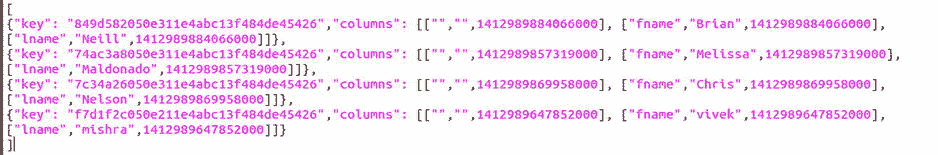
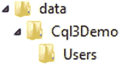
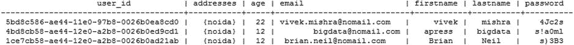
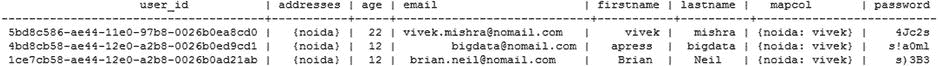

# 10. Cassandra 实用程序

到目前为止，本书已经涵盖了 Cassandra 的几乎所有方面，包括数据建模、图数据库、批量分析、性能调优，以及分析各种开源和商业工具。随着本书接近尾声，一个值得讨论的领域是各种内置实用程序，它们对于数据库管理、压力测试、数据迁移或批量加载非常有用。

其中一些主题已经在本书中讨论过。例如，第 8 章描述了用于基于命令行的压力测试工具，第 1 章描述了用于令牌分配的令牌生成器，第 3、4 和 5 章描述了一些 `nodetool` 选项。

在本章中，我们将专门讨论更多 Cassandra 实用程序，包括：
- `nodetool` 实用工具
- `sstable2json` 和 `json2sstable`
- Cassandra 批量加载（使用 CQL3 集合）

## Cassandra nodetool 实用工具

Cassandra 提供了多种操作，例如令牌分配、环管理、模式管理、节点管理与监控等。Cassandra 的 `nodetool` 实用工具是一个命令行接口，它通过简单的命令封装了所有这些操作。在本节中，我们将详细探讨其中的一些命令。

`nodetool` 实用工具是内置的，随 Cassandra 发行版一同提供（位于 `$CASSANDRA_HOME/bin` 文件夹中）。

在介绍命令之前，我们先打印一下 `nodetool` 的版本：

```
vivek@vivek-Vostro-3560:∼/software/apache-cassandra-2.0.4/bin$./nodetool version
```

```
ReleaseVersion: 2.0.4
```

上述命令的输出显示 `nodetool` 的发行版本是 2.0.4。

要打印该实用工具的所有可用命令，只需运行以下命令：

```
vivek@vivek-Vostro-3560:∼/software/apache-cassandra-2.0.4/bin$./nodetool
```

让我们从 Cassandra 的环管理开始，讨论 `nodetool` 实用工具的命令。

### 环管理

Cassandra 环路由各种数据节点组成。从环管理的角度来看，有两个重要的操作：
- 检查环状态
- 退役一个失效节点

#### 检查环状态

在第 1 章的“在单机上配置多节点”一节中，我们讨论了如何在本地机器上启动一个 Cassandra 集群。关于在单机上启动 Cassandra 集群的信息，请参考第 1 章。集群启动后，我们可以像这样打印 Cassandra 集群的环信息：

```
vivek@vivek-Vostro-3560:∼/software/local-cluster/node4$ bin/nodetool ring
```

运行上述命令会在控制台打印如下输出：

```
Datacenter: datacenter1
==========
Address      Rack      Status  State    Load         Owns           Token
127.0.0.4    rack1     Up      Normal   77.55 KB     66.67%         -3074457345618258604
127.0.0.1    rack1     Up      Normal   35.79 KB     66.67%         -9223372036854775808
127.0.0.2    rack1     Up      Normal   45.05 KB     33.33%         -3074457345618258603
127.0.0.3    rack1     Up      Normal   61.28 KB     33.33%          3074457345618258602
```

在这里，`ring` 命令打印了每个节点的状态以及分配给每个 Cassandra 节点的令牌。输出显示了数据节点的 IP 地址、它们的状态以及机架信息：
- `Address` 列显示了节点的 URL 或 IP 地址。
- `Rack` 列包含机架信息。
- 如果节点在线并且是集群环的一部分，它们的状态将是 `Up`；否则，将是 `Down`。
- `State` 的可能值为 `Normal`、`Leaving`、`Joining` 和 `Moving`。
- 如果一个数据节点是集群环的一部分，它将显示状态为 `Normal`。
- 如果一个节点正在退役，那么它将有一个中间状态 `Leaving`。
- 如果节点已被移动到另一个令牌值，状态将为 `Moving`。
- `Load` 列显示了每个节点当前的数据库负载。从管理角度来看，这些信息很重要，因为负载和所有权（`Owns` 列）信息显示了环是否处于平衡状态。
- `Token` 列显示了分配的令牌，它是一个令牌范围。

要获取更多关于 Cassandra 集群的信息，比如当前状态、负载和分配的令牌，我们可以运行 `status` 命令：

```
vivek@vivek-Vostro-3560:∼/software/local-cluster/node1$ bin/nodetool status
```

运行此命令会打印如下输出所示的数据：

```
Datacenter: datacenter1
=======================
Status=Up(U)/Down(D)
|/ State=Normal(N)/Leaving(L)/Joining(J)/Moving(M)
Status/  Address    Load      Tokens  Owns         Host ID                               Rack
State                                 (effective)
UN       127.0.0.1  59.82 KB  129     166.7%       718d384e-c8c2-4355-bf9b-1bfa60be2d99  Rack1
UN       127.0.0.2  66.54 KB  256     166.7%       cb9da211-6948-4c21-b5f5-5ee660cd9355  Rack1
UN       127.0.0.3  50.31 KB  256      66.7%       74ee5df6-d990-4deb-9144-501c349308d6  Rack1
```

上述输出与本节的第一个输出示例类似。唯一的区别是 `Tokens` 和 `Host ID` 字段。这里的 `Tokens` 列显示了为每个节点设置的令牌数量，而 `Host ID` 是数据节点的网络 ID。它是一个由 Cassandra 为每个节点分配的 UUID 值。

这就是我们如何监控集群环状态及其信息的方法。在下一节中，我们将讨论如何退役一个活跃的数据节点。

#### 停用节点

我们也可以使用 `nodetool` 工具来停用一个节点。在本练习中，我们将通过命令停用一个节点，然后通过检查集群环状态来验证该节点是否已停用。

假设所有三个节点都已启动并运行（参见上一节中显示的输出），让我们使用 `cqlsh` 命令行界面创建一个键空间 `twitter_keyspace` 和表 `twitter`：

```
cqlsh> create keyspace twitter_keyspace with replication = {'class':'SimpleStrategy', 'replication_factor':3};
```

```
cqlsh> use twitter_keyspace;
```

```
cqlsh:twitter_keyspace> create table twitter(tweeted_at text, screen_name text, body text, PRIMARY KEY (tweeted_at,screen_name));
```

让我们使用以下命令向 `twitter` 表中加载数据：

```
cqlsh:twitter_keyspace> copy twitter(tweeted_at,screen_name,body) from '/home/vivek/tweets_pipe' WITH DELIMITER = '|';
```

```
10020 rows imported in 12.457 seconds.
```

这里的 `/home/vivek/tweets_pipe` 是一个本地文件，其中所有列值使用“|”作为字段分隔符。你可以在本书的下载文件中找到此文件，或者你也可以使用以下数据和格式创建示例：

```
2014-08-02|mevivs|Working on Cassandra book
```

```
2014-08-04|chris_nelson|Cassandra book review in progress
```

现在，让我们尝试使用 `nodetool` 工具的命令来停用 IP 地址为 `127.0.0.1` 的节点：

```
vivek@vivek-Vostro-3560:∼/software/local-cluster/node1$ bin/nodetool decommission
```

请注意，我们只能停用正在运行的节点。停用节点将隐式启动向另一个节点的数据流传输。我们可以使用以下命令监控停用过程：

```
vivek@vivek-Vostro-3560:∼/software/local-cluster/node1$ bin/nodetool netstats
```

它将显示以下输出：

```
Mode: LEAVING

Not sending any streams.

Read Repair Statistics:
Attempted: 0
Mismatch (Blocking): 0
Mismatch (Background): 0

Pool Name                    Active   Pending      Completed
Commands                        n/a         0          20048
Responses                       n/a         0           4806
```

该输出表示节点仍在处理中，并处于 `LEAVING` 状态。这里的 `Attempted` 表示读取修复的尝试次数。`Mismatch (Blocking)` 和 `Mismatch (Background)` 分别指自服务器重启以来，阻塞了查询的读取修复次数，以及后台服务器重启的次数。这里的 `Commands` 保存了读/写操作数量的信息，而 `Responses` 保存了关于客户端读/写请求收到的响应信息。

在此状态下，如果我们检查集群状态，它将显示如下命令后的输出：

```
vivek@vivek-Vostro-3560:∼/software/local-cluster/node1$ bin/nodetool status
```

```
Datacenter: datacenter1
=======================
Status=Up(U)/Down(D)
|/ State=Normal(N)/Leaving(L)/Joining(J)/Moving(M)

Status/  Address    Load      Tokens  Owns         Host ID                               Rack
State                                 (effective)
UL       127.0.0.1  59.82 KB  129     166.7%       718d384e-c8c2-4355-bf9b-1bfa60be2d99  Rack1
UN       127.0.0.2  66.54 KB  256     166.7%       cb9da211-6948-4c21-b5f5-5ee660cd9355  Rack1
UN       127.0.0.3  50.31 KB  256     166.7%        74ee5df6-d990-4deb-9144-501c349308d6  Rack1
```

节点停用完成后，你可以使用以下命令进行验证，输出将如下所示：

```
vivek@vivek-Vostro-3560:∼/software/local-cluster/node1$ bin/nodetool netstats
```

```
Mode: DECOMMISSIONED

Not sending any streams.

Read Repair Statistics:
Attempted: 0
Mismatch (Blocking): 0
Mismatch (Background): 0

Pool Name                    Active   Pending      Completed
Commands                        n/a         0          20048
Responses                       n/a         0           4808
```

在这里你可以看到模式现在变成了 `DECOMMISSIONED`。

节点停用后，我们可以使用该命令进行验证。

```
vivek@vivek-Vostro-3560:∼/software/local-cluster/node1$ bin/nodetool status
```

```
Datacenter: datacenter1
=======================
Status=Up(U)/Down(D)
|/ State=Normal(N)/Leaving(L)/Joining(J)/Moving(M)

Status/  Address    Load      Tokens  Owns         Host ID                               Rack
State                                 (effective)
UN       127.0.0.2  66.54 KB  256     100%         cb9da211-6948-4c21-b5f5-5ee660cd9355  Rack1
UN       127.0.0.3  50.31 KB  256     100%         74ee5df6-d990-4deb-9144-501c349308d6  Rack1
```

### 模式管理

模式管理意味着分析键空间和表、执行修复、重建或清理数据，以及各种其他活动。使用 `nodetool` 工具，这些操作以简单命令的形式提供。使用它们，我们可以轻松管理模式级别的操作。让我们通过简单的例子讨论一些比较重要的命令。

### cfstats

使用该命令，我们可以收集关于键空间及其表的统计信息。这对于监控读/写延迟、压缩和 memtable 相关信息非常有用。

我们可以像这样收集某个键空间的信息：

```
vivek@vivek-Vostro-3560:∼/software/local-cluster/node4$ bin/nodetool cfstats twitter_keyspace
```

这里的 `twitter_keyspace` 是键空间名称。

我们也可以收集多个键空间的统计信息：

```
vivek@vivek-Vostro-3560:∼/software/local-cluster/node4$ bin/nodetool cfstats keyspace1 keyspace2
```

这里的 `keyspace1` 和 `keyspace2` 是那些键空间。

此外，我们可以捕获特定表的统计信息：

```
vivek@vivek-Vostro-3560:∼/software/local-cluster/node4$ bin/nodetool cfstats twitter_keyspace.twiiter
```

这里的 `twitter_keyspace` 是键空间，`twitter` 是表。

以下是对 `twitter` 表运行 `cfstats` 后的输出：

```
Keyspace: twitter_keyspace
Read Count: 0
Read Latency: NaN ms.
Write Count: 1
Write Latency: 1.314 ms.
Pending Tasks: 0

Table: twitter
SSTable count: 0
Space used (live), bytes: 0
Space used (total), bytes: 0
SSTable Compression Ratio: 0.0
Number of keys (estimate): 0
Memtable cell count: 3
Memtable data size, bytes: 590
Memtable switch count: 0
Local read count: 0
Local read latency: NaN ms
Local write count: 1
Local write latency: 1.314 ms
Pending tasks: 0
Bloom filter false positives: 0
Bloom filter false ratio: 0.00000
Bloom filter space used, bytes: 0
Compacted partition minimum bytes: 0
Compacted partition maximum bytes: 0
Compacted partition mean bytes: 0
Average live cells per slice (last five minutes): 0.0
Average tombstones per slice (last five minutes): 0.0
```

### cfhistogram

`cfhistogram` 命令提供了关于读写延迟（以微秒计）以及读写过程中涉及的 SSTable 数量的统计信息。以下命令显示了 `twitter_keyspace` 键空间中 `twitter` 表的列族直方图输出：

```
vivek@vivek-Vostro-3560:∼/software/local-cluster/node4$ bin/nodetool cfhistograms twitter_keyspace twiiter
```

```
twitter_keyspace/twiiter histograms

Offset      SSTables     Write     Read Latency    Partition  Cell Count
Latency                   size
(micros)  (micros)        (bytes)
1                  0            0             0            0           0
2                  0            0             0            0           0
3                234            0             0            0           0
4                  0            0             0            0           0
5                  0            0             0            0           0
6                  0            0             0            0           0
7                  0            0             0            0           0
8                  0            0             0            0           0
10                 0            0             0            0           0
12                 0            0             0            0           0
14                 0            0             0            0           0
17                 0            0             0            0           0
20                 0            0             0            0           0
24                 0            0             0            0           0
29                 0          127            86            0           0
35                 0          149             0            0           0
42                 0            0             0            0           0
50                 0            0             0            0           0
60                 0            0             0            0           0
```

这里，输出表的第三行显示，共进行了 3 次 SSTable 查找来处理 234 次读取请求。`SSTables` 列中的值表示读取请求的数量。此外，偏移量为 29 的行表示，86 次读取请求和 127 次写入请求的读取延迟在 24 到 29 微秒之间，而 149 次写入请求的写入延迟在 29 到 35 微秒之间。

当我们需要分析表在高负载读写下的性能时，这个功能非常有用。

### cleanup

我们可以运行 `cleanup` 命令来清理与数据节点无关的键空间和分区键，或者清理不属于该节点的数据。

通常，我们执行此命令是为了删除刚刚添加到集群中的节点上的数据。每当新节点加入环时，使用 `cleanup` 命令，我们可以移除与集群无关的过时数据。此外，当一个节点在被移除或从集群环中删除后重新变为活跃状态时，我们也会执行此命令。我们可以这样运行该命令：

```
vivek@vivek-Vostro-3560:∼/software/local-cluster/node4$bin/nodetool cleanup twitter_keyspace twiiter
```

这里，我们正在对 `twitter_keyspace` 键空间的 `twitter` 表执行清理。请注意，如果我们不指定键空间，它将清理所有可用的键空间。此外，我们可以通过提供表名列表来清理一个键空间中的多个表：

```
nodetool cleanup  <keyspace><table1><table2>
```

### clearsnapshot

快照目录通常用于备份和恢复过程。当某个键空间不再需要快照目录时，我们可以使用 `clearsnapshot` 命令清除它们：

```
vivek@vivek-Vostro-3560:∼/software/local-cluster/node4$ bin/nodetool clearsnapshot twitter_keyspace
```

运行上述命令会删除 `twitter_keyspace` 键空间的所有快照目录。我们还可以使用 `-f` 选项删除特定的快照目录，如下所示：

```
vivek@vivek-Vostro-3560:∼/software/local-cluster/node4$ bin/nodetool clearsnapshot twitter_keyspace –f 1412341689
```

通常，清除快照是备份过程的一部分。定期备份和删除快照目录会设置为后台的定时任务。定时任务是一个基于时间的调度器，可以作为备份过程的一个组件进行设置。

**注意**

有关数据备份和恢复的更多信息，请参考第 9 章中的“数据备份和恢复”部分。

### flush

Memtable 是一种数据行缓存，可以根据特定行键和数据进行查找。Cassandra 会根据 `cassandra.yaml` 中定义的 memtable 阈值和吞吐量配置，自动处理 memtable 的隐式刷新。使用 `nodetool flush` 命令，我们可以显式地刷新特定数据节点上的数据。进行显式刷新的原因包括：

*   节点空间不足，需要在服务器端释放一些空间。
*   正在进行数据备份，并且可能需要使用 SSTable 加载器将其恢复到另一个节点上。
*   需要将数据刷出到磁盘，以减少节点重启时的提交日志重放。

使用 `nodetool flush` 命令显式地将 memtable 刷新到磁盘，如下所示：

```
vivek@vivek-Vostro-3560:∼/software/local-cluster/node4$ bin/nodetool flush twitter_keyspace twitter
```

运行上述命令会显式地将数据从 memtable 中刷出，并为 `twitter_keyspace` 键空间和 `twitter` 表将其写入磁盘。

### repair

通常，在以下情况下你需要修复集群节点：

*   一个或多个节点处于恢复模式。
*   其中一个 Cassandra 节点不参与读取。
*   正在添加一个节点，并且需要在该节点上手动更新数据。

理想情况下，建议定期执行修复，以保持集群的一致性和平衡状态。

我们可以如下运行 `repair` 命令：

```
vivek@vivek-Vostro-3560:∼/software/local-cluster/node4$ bin/nodetool repair –dc DC1
```

运行上述命令会在数据中心 `DC1` 的多个节点上触发修复过程。请注意，修复是一个内存密集型过程，并且需要执行磁盘 I/O 以在副本节点之间复制快照。我们还可以使用 `–pr` 选项并行执行修复过程，该选项会启动跨副本节点的修复过程，从而减少停机时间。我们还可以将修复过程限制在本地数据中心的节点上，如下所示：

```
vivek@vivek-Vostro-3560:∼/software/local-cluster/node4$ bin/nodetool repair –local
```

### rebuild

当我们在 Cassandra 集群中添加一个新的数据中心，并且需要将数据从一个数据中心复制到新添加的数据中心时，我们会执行 `rebuild` 命令。执行此命令的方式如下：

```
vivek@vivek-Vostro-3560:∼/software/local-cluster/node4$ bin/nodetool rebuild - - DC2
```

这里，`DC2` 是一个新的数据中心。请确保包含了新添加的数据中心名称，否则命令会成功执行，但不会发生数据复制。

### rebuild_index

在第 2 章中，我们讨论过在模式变更期间（最常见的是在 Thrift 和 CQL3 交换时），模式和二级索引很有可能会损坏。我们可以使用 `rebuild_index` 命令重建这些索引：

```
vivek@vivek-Vostro-3560:∼/software/local-cluster/node4$ bin/nodetool rebuild_index twitter_keyspace twitter
```

运行上述命令会对键空间 `twitter_keyspace` 中 `twitter` 表的所有索引执行完整重建。我们也可以按如下方式重建特定索引：

```
vivek@vivek-Vostro-3560:∼/software/local-cluster/node4$ bin/nodetool rebuild_index twitter_keyspace twitter  screenname_idx
```

这里的 `screenname_idx` 是列 `screen_name` 上的索引。

重建索引不会删除索引，而是会根据该节点上现有的数据重新构建索引。`nodetool` 工具还有许多其他命令选项。此处我仅从数据管理和备份的角度介绍了其中最重要的几个。在接下来的章节中，我们还将讨论 `refresh`、`repair` 和 `sstablescrub` 命令。

## JSON 化数据

自诞生以来，Cassandra 发行版就自带了一些工具，用于将 JSON 格式的数据导入到 SSTable 中，以及将 SSTable 数据导出为 JSON 文件。这些工具最初是为调试目的而构建的，但当我们需要将数据从一个节点迁移到另一个节点时，它们也同样有用。

Cassandra 发行版自带的两个工具是 `sstabl2json` 和 `json2sstable`。我们可以在 `$CASSANDRA_HOME/bin` 目录下找到它们。下面让我们来探索这两者！

# Cassandra 数据导入导出与工具使用指南

## 使用 `sstable2json` 将数据导出为 JSON 文件

使用`sstable2json`命令，我们可以将磁盘上的SSTable数据导出为JSON文件。让我们通过以下练习来进行探索：

首先，使用CQL终端创建模式并填充数据。我们将创建一个键空间`twitterkeyspace`和表`user`：

```
create keyspace twitterkeyspace with replication = {'class':'SimpleStrategy','replication_factor':3};
use twitterkeyspace;
create table user(user_id timeuuid primary key, fname text,lname text);
```

让我们插入几条记录：

```
insert into user(user_id,fname,lname) values(now(),'vivek','mishra');
insert into user(user_id,fname,lname) values(now(),'Melissa','Maldonado');
insert into user(user_id,fname,lname) values(now(),'Chris','Nelson');
insert into user(user_id,fname,lname) values(now(),'Brian','Neill');
select * from user;
```

输出结果：

```
user_id                              | fname   | lname
--------------------------------------+---------+-----------
849d5820-50e3-11e4-abc1-3f484de45426 |   Brian |     Neill
74ac3a80-50e3-11e4-abc1-3f484de45426 | Melissa | Maldonado
7c34a260-50e3-11e4-abc1-3f484de45426 |   Chris |    Nelson
f7d1f2c0-50e2-11e4-abc1-3f484de45426 |   vivek |    mishra
```

接下来，使用`nodetool flush`将这些数据刷新到SSTable：

```
$CASSANDRA_HOME/bin/nodetool flush
```

最后，使用`sstable2json`将数据导出为JSON文件：

```
$CASSANDRA_HOME/bin/sstable2json /var/lib/cassandra/data/twitterkeyspace/user/twitterkeyspace-user-jb-1-Data.db > output.json
```

这里的`twitterkeyspace-user-jb-1-Data.db`是`data`目录下（本例中为`/var/lib/cassandra`）的一个`.db`数据文件。上述命令将创建一个JSON文件，其中的数据如图10-1所示。


`图 10-1。``output.json`文件中的数据

我们还可以分别使用`–k`和`–x`选项来包含或排除特定行。使用`–k`选项时，键必须采用十六进制格式。由于`user`表的主键类型是`timeuuid`，因此我们首先使用`timeuuidAsBlob`函数获取十六进制格式的键值，如下所示：

```
select timeuuidAsBlob(user_id),fname from user;
```

输出结果：

```
timeuuidAsBlob(user_id)                 | fname
-----------------------------------------+---------
0x849d582050e311e4abc13f484de45426      |   Brian
0x74ac3a8050e311e4abc13f484de45426      | Melissa
0x7c34a26050e311e4abc13f484de45426      |   Chris
0xf7d1f2c050e211e4abc13f484de45426      |   vivek
(4 rows)
```

这里的`timeuuidAsBlob(user_id)`是以十六进制格式表示的`user_id`键。现在，我们可以使用`–k`选项提取`fname`为`brian`和`vivek`的行：

```
$CASSANDRA_HOME/bin/sstable2json /var/lib/cassandra/data/twitterkeyspace/user/twitterkeyspace-user-jb-1-Data.db -k 849d582050e311e4abc13f484de45426 f7d1f2c050e211e4abc13f484de45426
```

输出结果：

```
[
{"key": "849d582050e311e4abc13f484de45426","columns": [["","",1412989884066000], ["fname","Brian",1412989884066000], ["lname","Neill",1412989884066000]]},
{"key": "f7d1f2c050e211e4abc13f484de45426","columns": [["","",1412989647852000], ["fname","vivek",1412989647852000], ["lname","mishra",1412989647852000]]}
]
```

`849d582050e311e4abc13f484de45426`和`f7d1f2c050e211e4abc13f484de45426`分别是`brian`和`vivek`的用户ID。

类似地，我们可以使用`–x`选项排除特定的键：

```
$CASSANDRA_HOME/bin/sstable2json /var/lib/cassandra/data/twitterkeyspace/user/twitterkeyspace-user-jb-1-Data.db -x 849d582050e311e4abc13f484de45426 f7d1f2c050e211e4abc13f484de45426
```

输出结果：

```
[
{"key": "74ac3a8050e311e4abc13f484de45426","columns": [["","",1412989857319000], ["fname","Melissa",1412989857319000], ["lname","Maldonado",1412989857319000]]},
{"key": "7c34a26050e311e4abc13f484de45426","columns": [["","",1412989869958000], ["fname","Chris",1412989869958000], ["lname","Nelson",1412989869958000]]}
]
```

## 使用 `json2sstable` 导入 JSON 数据

同样地，我们可以通过几个简单的步骤，使用`json2sstable`将JSON数据重新导入到SSTable中：

首先，在CQL Shell中为键空间`twitterkeyspace`创建表`dumpuser`：

```
use twitterkeyspace;
```

```
create table dumpuser(user_id timeuuid primary key, fname text, lname text);
```

接着，在`dumpuser`表中使用`json2sstable`从`output.json`导入数据：

```
$CASSANDRA_HOME/bin/json2sstable -K twitterkeyspace -c dumpuser output.json /var/lib/cassandra/data/twitterkeyspace/dumpuser/twitterkeyspace-dumpuser-jb-1-Data.db
```

```
正在导入 4 个键...
```

```
成功导入 4 个键。
```

然后，使用`nodetool refresh`命令刷新新加载的SSTable：

```
$CASSANDRA_HOME/bin/nodetool refresh twitterkeyspace dumpuser
```

`nodetool refresh`可以在不重启节点的情况下使数据可用。

现在，我们可以通过在CQL Shell中对`dumpuser`表运行`select`命令来验证加载的数据：

```
cqlsh:twitterkeyspace> select * from dumpuser;
```

```
user_id                              | fname   | lname
--------------------------------------+---------+-----------
849d5820-50e3-11e4-abc1-3f484de45426 |   Brian |     Neill
74ac3a80-50e3-11e4-abc1-3f484de45426 | Melissa | Maldonado
7c34a260-50e3-11e4-abc1-3f484de45426 |   Chris |    Nelson
f7d1f2c0-50e2-11e4-abc1-3f484de45426 |   vivek |    mishra
(4 行)
```

这里有一个建议：避免多次使用`json2sstable`向同一个表的SSTable中加载数据，因为这可能导致SSTable处于损坏状态。你可以在`server.log`（位于`log`目录下）中检查以下错误：

```
Caused by: org.apache.cassandra.io.compress.CorruptBlockException: (/var/lib/cassandra/data/twitterkeyspace/dumpuser/twitterkeyspace-dumpuser-jb-1-Data.db): corruption detected, chunk at 0 of length 210.
```

```
at org.apache.cassandra.io.compress.CompressedRandomAccessReader.decompressChunk
(CompressedRandomAccessReader.java:122)
```

```
at org.apache.cassandra.io.compress.CompressedRandomAccessReader.reBuffer
(CompressedRandomAccessReader.java:87)
```

```
... 还有 26 个
```

使用CQL Shell从损坏的表（本例中为`dumpuser`表）中获取数据会产生以下输出：

```
cqlsh:twitterkeyspace> select * from dumpuser;
```

```
请求未在 rpc_timeout 内完成。
```

在这种情况下，清理并移除损坏的数据是我们唯一的选择。

Cassandra发行版附带了`sstablescrub`工具，我们将在此使用它：

```
$CASSANDRA_HOME/bin/sstablescrub twitterkeyspace dumpuser
```

运行上述命令会产生以下输出：

```
预清理 sstable 的快照已置于快照目录 pre-scrub-1412993550669
```

```
正在清理 SSTableReader(path='/var/lib/cassandra/data/twitterkeyspace/dumpuser/twitterkeyspace-dumpuser-jb-1-Data.db') (218 字节)
```

```
清理 SSTableReader(path='/var/lib/cassandra/data/twitterkeyspace/dumpuser/
twitterkeyspace-dumpuser-jb-1-Data.db') 时出错: null
```

作为前置步骤，最好在运行`repair`命令之前进行备份。首先创建一个用于备份的快照目录。如上述输出所示，清理`.db`文件时发生错误；因此，我们需要手动删除`/twitterkeyspace-dumpuser-jb-1-Data.db`，并从快照目录中恢复其余数据。关于如何从快照目录恢复数据，请参阅第9章中的“数据备份与恢复”部分。此外，我们还需要运行`nodetool repair`命令来修复该表：

```
$CASSANDRA_HOME/bin/nodetool repair twitterkeyspace dumpuser
```

至此，我们已经了解了如何将JSON数据导入SSTable以及将数据导出为JSON文件，同时还学习了如何处理损坏的SSTable。

目前，社区正在讨论是否弃用或替换这些工具。更多详情请参考 [`https://issues.apache.org/jira/browse/CASSANDRA-7464`](https://issues.apache.org/jira/browse/CASSANDRA-7464)。

## Cassandra 批量加载

在“停用节点”一节中，我们了解到可以使用 `COPY` 命令将 `.csv` 文件中的数据复制到表中。在 CQL3 出现之前，早期版本的 Cassandra 发行版附带了一个名为 `sstableloader` 的工具，该工具可用于直接将 `.db` 文件加载到 SSTable 中。我们只需使用 `SSTableWriter` API 编写实现来生成 `.db` 文件即可。一个基于 Thrift 的此类实现可以从[`www.datastax.com/wp-content/uploads/2011/08/DataImportExample.java`](http://www.datastax.com/wp-content/uploads/2011/08/DataImportExample.java)下载。然而，自 CQL3 以来，CQL3 二进制协议将成为未来 Cassandra 开发的主要协议，另请注意，对 Thrift 的支持已停止。

在此，我将分享一个与 CQL3 兼容的实现，用于为 CQL3 表生成 `.db` 文件。这是前面共享链接中实现的扩展版本。

在本示例中，我们将创建一个包含集合类型列的表。让我们开始吧！

首先，我们需要创建键空间和表：

```
create keyspace "Cql3Demo"  with replication = { 'class' : 'SimpleStrategy', 'replication_factor':3};
```

```
use "Cql3Demo";
```

```
create table "Users"(user_id uuid PRIMARY KEY,firstname text,lastname text, password text,email text, age int, addresses set<text>);
```

创建一个包含用户 ID、名字、姓氏、密码、电子邮件地址和年龄的 `CSVInput.csv` 文件，内容如下：

```
5bd8c586-ae44-11e0-97b8-0026b0ea8cd0,vivek,mishra,4Jc2s,22,vivek.mishra@nomail.com
4bd8cb58-ae44-12e0-a2b8-0026b0ed9cd1,apress,bigdata,s!a0ml,12,bigdata@nomail.com
1ce7cb58-ae44-12e0-a2b8-0026b0ad21ab,Brian,Neil,s)3B3,12,brian.neil@nomail.com
```

现在，让我们来看看实现。这是一个基于 Maven 的项目，我们需要在 `pom.xml` 中添加以下依赖项：

```xml
<dependency>
  <groupId>org.apache.cassandra</groupId>
  <artifactId>cassandra-all</artifactId>
  <version>2.0.4</version>
</dependency>
<dependency>
  <groupId>org.apache.cassandra</groupId>
  <artifactId>cassandra-clientutil</artifactId>
  <version>2.0.4</version>
</dependency>
```

现在，让我们看看 Java 实现：

```java
if (args.length == 0)
{
    filename = "CSVInput.csv";
}
else
{
    filename = args[0];
}

BufferedReader reader = new BufferedReader(new FileReader(filename));
String keyspace = "Cql3Demo";
String columnFamily = "Users";

// create cassandra type structure default is data/KEYSPACE/users
File directory = new File("data");
if (!directory.exists())
{
    directory.mkdir();
}

directory = new File(directory.getPath() + "/" + keyspace);
if (!directory.exists())
    directory.mkdir();

directory = new File(directory.getPath() + "/" + columnFamily);
if (!directory.exists())
    directory.mkdir();
```

前面的代码片段显示，该程序将文件名作为输入参数。如果未提供，则使用默认文件（`CSVInput.csv`）。它还会在根文件夹中创建一个数据文件夹（参见图 10-2）。

接下来，我们需要实例化：



图 10-2. 创建的数据文件夹及其中的 .db 文件

```java
SSTableSimpleUnsortedWriter usersWriter = new SSTableSimpleUnsortedWriter(directory, new Murmur3Partitioner(),
    keyspace, "Users", AsciiType.instance, null, 64, new CompressionParameters(
    org.apache.cassandra.io.compress.SnappyCompressor.create(Collections.<String, String> emptyMap())));
```

现在，我们需要解析 `CSVInput.csv` 文件中的每个条目：

```java
static class CsvEntry
{
    UUID key;
    String firstname;
    String lastname;
    String password;
    int age;
    String email;

    boolean parse(String line, int lineNumber)
    {
        // Ghetto csv parsing
        String[] columns = line.split(",");
        if (columns.length != 6)
        {
```

`System.out.println(String.format("Invalid input '%s' at line %d of %s", line, lineNumber, filename));`

`return false;`

`}`

`try`

`{`

`key = UUID.fromString(columns[0].trim());`

`firstname = columns[1].trim();`

`lastname = columns[2].trim();`

`password = columns[3].trim();`

`age = Integer.parseInt(columns[4].trim());`

`email = columns[5].trim();`

`return true;`

`}`

`catch (NumberFormatException e)`

`{`

`System.out.println(String.format("Invalid number in input '%s' at line %d of %s", line, lineNumber,`

`filename));`

`return false;`

`}`

`}`

`}`

上述代码片段解析并设置每个单元格的值（`firstname`、`lastname` 等），并像这样从文件中读取每一行：

`CsvEntry entry = new CsvEntry();`

`while ((line = reader.readLine()) != null)`

`{`

`if (entry.parse(line, lineNumber))`

`{`

`...`

`}`

`}`

解析后，让我们为每个列值准备一个复合类型。由于我们为主键、名字、姓氏和年龄定义了 `uuid`、`int` 和 `text` 数据类型，我们需要按如下方式定义它们：

`ByteBuffer uuid = UUIDType.instance.decompose(entry.key);`

`usersWriter.newRow(uuid);`

`List types = newArrayList();`

`types.add(UTF8Type.instance);`

`CompositeType compositeType = CompositeType.getInstance(types);`

`List numericTypes = newArrayList();`

`numericTypes.add(IntegerType.instance);`

`CompositeType numericType = CompositeType.getInstance(numericTypes);`

接下来，我们来赋值：

`long timestamp = System.currentTimeMillis() * 1000; usersWriter.addColumn(compositeType.decompose("firstname"),`

`compositeType.decompose(bytes(entry.firstname)), timestamp);`

`usersWriter.addColumn(compositeType.decompose("lastname"),`

`compositeType.decompose(bytes(entry.lastname)), timestamp);`

`usersWriter.addColumn(compositeType.decompose("password"),`

`compositeType.decompose(bytes(entry.password)), timestamp);`

`usersWriter.addColumn(compositeType.decompose("age"), numericType.decompose(bytes(entry.age)),timestamp);`

`usersWriter.addColumn(compositeType.decompose("email"), compositeType.decompose(bytes(entry.email)),timestamp);`

现在，为了给 `addresses` 集合赋值，我们需要使用数据类型 `Set` 进行构造和赋值：

`SetType<String> addressType = newSetType<String>(UTF8Type.instance);`

`// 列名`

`ByteBuffer byteBuffer1 = compositeType.decompose("addresses");`

`// 集合值`

`ByteBuffer byteBuffer2 = compositeType.decompose("noida");`

我们需要创建一个 `ByteBuffer` 实例并添加一个列：

`ByteBuffer bb = ByteBuffer.allocate(byteBuffer2.capacity()+byteBuffer1.capacity());`

`bb.put(byteBuffer1);`

`bb.put(byteBuffer2);`

`bb.flip();`

`usersWriter.addColumn(bb,addressType.decompose(new HashSet<String>()),timestamp);`

接下来，我们可以保存它：

`usersWriter.close();`

上述命令会在 `data/Cql3Demo/Users` 文件夹下生成文件。

现在，我们需要使用 `sstableloader` 加载生成的 `.db` 文件：

`$CASSANDRA_HOME/bin/sstableloader -d localhost data/Cql3Demo/Users/`

我们可以通过使用 `cql` shell 执行 `select` 命令来验证输出（见图 10-3）。

`select * from "Users";`

我们还可以修改 `Users` 表，并添加一个数据类型为 `map` 的列：



**图 10-3.** 包含三行的 Users 表

`alter table "Users" add mapCol  map<text,text>;`

我们只需要为 `map` 添加类型，并将 `map` 作为一个列添加到前面的实现中，如下所示：

`// map 列名`

`byteBuffer1 = compositeType.decompose("mapcol");`

`// map 列键`

`byteBuffer2 = compositeType.decompose("noida");`

`bb =ByteBuffer.allocate(byteBuffer2.capacity()+byteBuffer1.capacity());`

`bb.put(byteBuffer1);`

`bb.put(byteBuffer2);`

`bb.flip();`

`// map 值`

`usersWriter.addColumn(bb,compositeType.decompose(bytes("vivek")),timestamp);`



**图 10-4.** `Users` 表中包含一个 `map` 列的输出

对 `Users` 执行 `select` 查询将产生图 10-4 所示的输出。

这就是我们如何以 `sstable` 格式直接将 `.db` 文件批量加载到磁盘上的方法。

## 总结

总结一下，在本章中，我们讨论了 `nodetool` 工具的用法以及用于环和模式管理的各种操作。我们还讨论了如何以 JSON 格式导入和导出数据。最后，我们讨论了如何批量加载 CQL3 格式的数据（包括集合）。

在下一章也是最后一章中，我们将总结我们的讨论，并探讨 Cassandra 版本升级以及其他论坛中常见的话题。