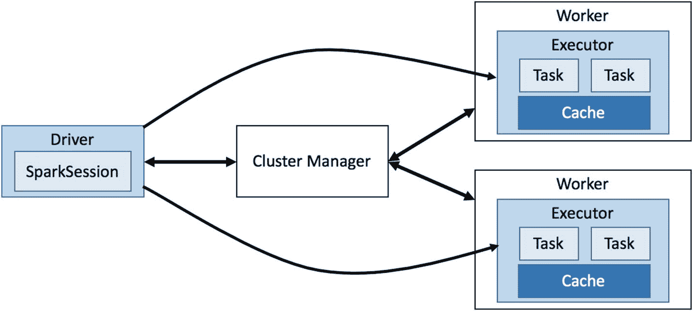
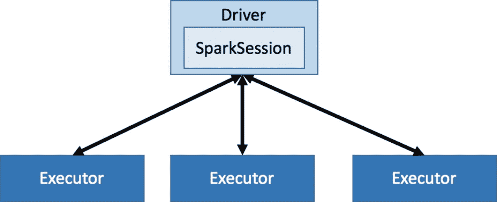
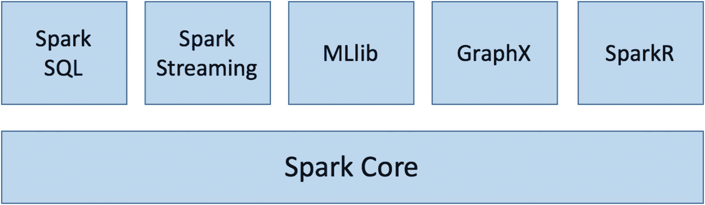

# 1. Apache Spark 简介

现在学习 Spark 正是最佳时机。`Spark` 因其易用性、速度和灵活性，已成为大数据堆栈中的关键组件之一。这个可扩展的数据处理系统正被众多小型和大型公司广泛采用，包括 `Facebook`、`Microsoft`、`Netflix` 和 `LinkedIn`。本章提供 `Spark` 的高级概述，包括核心概念、架构以及 `Apache Spark` 堆栈中的各种组件。

### 概述

`Spark` 是一个通用的分布式数据处理引擎，专为速度、易用性和灵活性而设计。这三项特性的结合使得 `Spark` 在业界如此受欢迎并被广泛采用。

`Apache Spark` 网站声称，它运行某些数据处理作业的速度比 `Hadoop MapReduce` 快 100 倍。事实上，在 2014 年，`Spark` 赢得了 `Daytona GraySort` 竞赛，这是对 100TB 数据（一万亿条记录）进行排序的行业基准测试。`Databricks` 提交的结果声称，`Spark` 能够以比 `Hadoop MapReduce` 之前保持的世界纪录快三倍的速度、使用少十倍的资源对 100TB 数据进行排序。

自 `Spark` 项目启动以来，易用性一直是 `Spark` 创建者的主要关注点之一。它提供了 80 多个高级、常用的数据处理操作符，使开发人员、数据科学家和数据分析师能够轻松构建各种有趣的数据应用程序。此外，这些操作符支持多种语言，即 `Scala`、`Java`、`Python` 和 `R`。软件工程师、数据科学家和数据分析师可以选择他们喜欢的语言，使用 `Spark` 解决大规模数据处理问题。

在灵活性方面，`Spark` 提供了一个单一统一的数据处理堆栈，可用于解决多种类型的数据处理工作负载，包括批处理、交互式查询、机器学习算法所需的迭代处理，以及用于近乎实时提取可操作洞察的实时流处理。在 `Spark` 出现之前，每种类型的工作负载都需要不同的解决方案和技术。现在，公司可以仅利用 `Spark` 来满足其大部分数据处理需求。使用单一技术堆栈将有助于大幅降低运营成本和资源。

大数据生态系统由多种技术组成，包括名为 `HDFS` 的分布式存储引擎、用于高效管理机器集群的集群管理系统，以及用于以二进制和列式格式高效存储大量数据的不同文件格式。`Spark` 与大数据生态系统集成得非常好。这是 `Spark` 采用率快速增长的另一原因。

关于 `Spark` 的另一件很酷的事情是它是开源的；因此，任何人都可以下载源代码来检查代码，了解某个功能是如何实现的，或扩展其功能。在某些情况下，这可以极大地帮助减少调试问题的时间。

## 历史

`Spark` 最初是 2009 年 `Berkeley AMPLab` 的一个研究项目。当时，该项目的研究人员观察到 `Hadoop MapReduce` 框架在处理交互式和迭代式数据处理用例时的低效性，因此他们通过引入诸如内存计算和高效处理故障恢复等想法，提出了克服这些低效性的方法。一旦这个研究项目被证明是一个优于 `MapReduce` 的可行解决方案，它就在 2010 年开源，并于 2013 年成为 `Apache` 顶级项目。从事该研究项目的一组研究人员共同创立了一家名为 `Databricks` 的公司；他们在 2013 年筹集了超过 4300 万美元。`Databricks` 是 `Spark` 背后的主要商业管理者。2015 年，`IBM` 宣布重大投资，建立一个 `Spark` 技术中心，通过与开源社区密切合作，将 `Spark` 构建到其公司分析和商业平台的核心，以推进 `Apache Spark`。

关于 `Spark` 的两篇热门研究论文是《Spark：使用工作集的集群计算》和《弹性分布式数据集：面向内存集群计算的容错抽象》。这些论文在学术会议上广受好评，并为任何想要学习和理解 `Spark` 的人提供了良好的基础。你可以分别在 [`http://people.csail.mit.edu/matei/papers/2010/hotcloud_spark.pdf`](http://people.csail.mit.edu/matei/papers/2010/hotcloud_spark.pdf) 和 [`http://people.csail.mit.edu/matei/papers/2012/nsdi_spark.pdf`](http://people.csail.mit.edu/matei/papers/2012/nsdi_spark.pdf) 找到它们。

自成立以来，`Spark` 开源项目一直是一个活跃的项目，拥有充满活力的社区。贡献者数量在 2016 年增加到超过 1000 人，并且有超过 20 万个 `Apache Spark` 聚会。事实上，`Apache Spark` 的贡献者数量已经超过了最流行的开源项目之一 `Apache Hadoop` 的贡献者数量。`Spark` 现在非常流行，以至于它有自己的峰会，称为 `Spark Summit`，每年在北美和欧洲举行。自成立以来，峰会的参会人数每年翻一番。

`Spark` 的创建者选择 `Scala` 编程语言用于他们的项目，是因为 `Scala` 兼具简洁性和静态类型。现在，`Spark` 被认为是使用 `Scala` 编写的最大的应用程序之一，它的流行无疑帮助 `Scala` 成为主流编程语言。

# Spark 核心概念与架构

在深入探讨 Spark 的细节之前，从宏观上理解 Spark 的核心概念及各种核心组件至关重要。本节将涵盖以下内容：

- Spark 集群
- 资源管理系统
- Spark 应用程序
- Spark 驱动器
- Spark 执行器

## Spark 集群与资源管理系统

Spark 本质上是一个分布式系统，旨在高效、快速地处理大量数据。这个分布式系统通常部署在一组机器上，这组机器被称为 Spark 集群。集群规模可以小至几台机器，也可以大至数千台机器。全球已公开的最大 Spark 集群拥有超过 8,000 台机器。为了高效且智能地管理一组机器，企业依赖于诸如 Apache YARN 或 Apache Mesos 之类的资源管理系统。一个典型的资源管理系统中的两个主要组件是集群管理器和工作节点。集群管理器知道工作节点位于何处、它们拥有多少内存以及每个节点有多少个 CPU 核心。集群管理器的主要职责之一是通过将工作分配给每个工作节点来协调工作。每个工作节点向集群管理器提供资源（内存、CPU 等）并执行分配的工作。此类工作的一个示例是启动特定进程并监控其健康状况。Spark 被设计为能够轻松地与这些系统互操作。近年来采用大数据技术的大多数公司通常已经拥有一个 YARN 集群来运行 MapReduce 作业或其他数据处理框架，例如 Apache Pig 或 Apache Hive。

完全采用 Spark 的初创公司可以直接使用开箱即用的 Spark 集群管理器来管理一组专用机器，以使用 Spark 执行数据处理。图 1-1 描述了这种设置类型。



图 1-1

Spark 应用程序与集群管理器之间的交互

## Spark 应用程序

一个 Spark 应用程序由两部分组成。第一部分是使用 Spark API 表达的应用程序数据处理逻辑，另一部分是 Spark 驱动器。应用程序数据处理逻辑可以简单到只需几行代码来执行几个数据处理操作，也可以复杂到训练一个需要多次迭代且可能运行数小时才能完成的大型机器学习模型。Spark 驱动器是 Spark 应用程序的中央协调器，它与集群管理器交互，以确定在哪些机器上运行数据处理逻辑。对于这些机器中的每一台，Spark 驱动器都会请求集群管理器启动一个称为 Spark 执行器的进程。Spark 驱动器的另一个重要工作是代表应用程序管理并将 Spark 任务分发到每个执行器上。如果数据处理逻辑要求 Spark 驱动器向用户显示计算结果，那么它将与每个 Spark 执行器协调，收集计算结果并将其合并。Spark 应用程序的入口点是通过一个名为 `SparkSession` 的类，它提供了设置配置的工具以及用于表达数据处理逻辑的 API。

## Spark 驱动器与执行器

每个 Spark 执行器都是一个 JVM 进程，并专门分配给一个特定的 Spark 应用程序。这是一个经过深思熟虑的设计决策，目的是避免在多个 Spark 应用程序之间共享一个 Spark 执行器，以便将它们彼此隔离，从而防止一个行为异常的 Spark 应用程序影响其他 Spark 应用程序。Spark 执行器的生命周期与 Spark 应用程序的持续时间相同，后者可能运行几分钟或几天。由于 Spark 应用程序在独立的 Spark 执行器中运行，因此在它们之间共享数据需要将数据写入外部存储系统，例如 HDFS。

如图 1-2 所示，Spark 采用主从架构，其中 Spark 驱动器是主节点，Spark 执行器是从节点。这些组件中的每一个都在 Spark 集群上作为独立进程运行。一个 Spark 应用程序包含且仅包含一个 Spark 驱动器和一个或多个 Spark 执行器。扮演从节点角色的每个 Spark 执行器执行其被指示的任务，即以任务的形式执行数据处理逻辑。每个任务在一个独立的 CPU 核心上执行。这就是 Spark 能够通过并行处理来加速处理大量数据的方式。除了执行分配的任务外，每个 Spark 执行器还负责在应用程序逻辑指示时，将部分数据缓存在内存和/或磁盘中。

在启动 Spark 应用程序时，您可以请求应用程序需要多少个 Spark 执行器，以及每个执行器应具有多少内存和 CPU 核心数。确定合适的 Spark 执行器数量、内存量和 CPU 核心数需要了解将要处理的数据量、数据处理逻辑的复杂性以及 Spark 应用程序完成处理逻辑所需的期望时长。



图 1-2

一个包含三个执行器的小型 Spark 集群

## Spark 统一栈

与其前身不同，Spark 提供了一个统一的数据处理引擎，称为 Spark 栈。与其他设计良好的系统类似，该栈构建在一个名为 Spark Core 的坚实基础之上，它提供了管理和运行分布式应用程序所需的所有必要功能，例如调度、协调和容错。此外，它还提供了一个强大且通用的数据处理编程抽象，称为弹性分布式数据集（RDD）。在这个坚实基础之上是一系列组件，每个组件都针对特定的数据处理工作负载而设计，如图 1-3 所示。Spark SQL 用于批处理和交互式数据处理。Spark Streaming 用于实时流数据处理。Spark GraphX 用于图处理。Spark MLlib 用于机器学习。Spark R 用于使用 R shell 运行机器学习任务。



图 1-3

Spark 统一栈

这个统一的引擎为构建可扩展且智能的大数据应用带来了几个重要的好处。首先，应用程序更易于开发和部署，因为它们使用统一的 API 集并在单个引擎上运行。其次，组合不同类型的数据处理（批处理、流处理等）效率更高，因为 Spark 可以在同一份数据上运行这些不同的 API 集，而无需将中间数据写入存储系统。最后，最令人兴奋的好处是，Spark 使得以前不可能实现的新应用成为可能，因为它能够轻松地在 Spark 应用程序内组合不同类型的数据处理。例如，它可以对实时数据流的机器学习预测结果运行交互式查询。一个大家都能理解的类比是智能手机，它集成了强大的相机、手机和 GPS 设备。通过组合这些组件的功能，智能手机实现了诸如 Waze（一款交通导航应用）之类的创新应用。

### Spark Core

Spark Core 是 Spark 分布式数据处理引擎的基石。它由两部分组成：分布式计算基础设施和 `RDD` 编程抽象。

分布式计算基础设施负责在集群中多台机器之间对计算任务进行分发、协调和调度。这使得能够在大型机器集群上高效、快速地并行处理大量数据。分布式计算基础设施的另外两个重要职责是处理计算任务失败，以及在机器间高效地移动数据，这被称为数据混洗。Spark 的高级用户需要深入了解 Spark 分布式计算基础设施，才能有效地设计出高性能的 Spark 应用程序。

Spark 中的关键编程抽象称为 `RDD`，每个 Spark 开发者都应该对其有所了解，尤其是它的 API 和主要概念。`RDD` 的技术定义是：它是一个跨集群分区的、不可变的、容错的对象集合，可以并行操作。本质上，它为 Spark 应用程序开发者提供了一套 API，使其能够轻松高效地执行大规模数据处理，而无需担心数据在集群中的存储位置或处理机器故障。例如，假设你有一个存储在 HDFS 上、大小为 1.5TB 的日志文件，你需要找出包含 Exception 一词的行数。你可以创建一个 `RDD` 实例来表示该日志文件中的所有日志语句，Spark 可以将其分区到集群中的各个节点上，从而可以并行执行过滤和计数逻辑，以加速搜索和计数过程。

`RDD` API 以多种编程语言（Scala、Java 和 Python）提供，允许用户传递本地函数到集群上运行，这既强大又独特。`RDD` 将在第 3 章中详细讨论。

Spark 技术栈中的其余组件都设计为在 Spark Core 之上运行。因此，Spark Core 在 Spark 各版本之间所做的任何改进或优化，都会自动惠及其他组件。

### Spark SQL

Spark SQL 是构建在 Spark Core 之上的一个组件，专为大规模结构化数据处理而设计。自诞生以来，它的受欢迎程度迅速飙升，因为它带来了更高层次的灵活性、易用性和性能。

结构化查询语言（SQL）一直是数据处理的通用语言，因为用户能相对容易地表达其意图，然后执行引擎会进行必要的智能优化。Spark SQL 将这一点带到了 PB 级数据处理的世界。Spark 用户现在可以发出 SQL 查询来执行数据处理，或者使用通过 `DataFrames` API 暴露的高级抽象。`DataFrame` 本质上是一个按命名列组织的数据的分布式集合。这并非一个新颖的想法；事实上，这个想法是受 R 语言和 Python 中的数据框启发而来。理解 `DataFrame` 的一个更简单的方式是，它在概念上等同于关系数据库中的一张表。

在幕后，Spark SQL 利用 Catalyst 优化器来执行许多分析数据库引擎中常见的优化。

Spark SQL 提供的另一个特性是能够从各种结构化格式和存储系统读取数据以及向其写入数据，例如 JavaScript 对象表示法（JSON）、逗号分隔值（CSV）文件、Parquet 或 ORC 文件、关系数据库、Hive 等。这个特性极大地提升了 Spark 的多功能性，因为 Spark SQL 可以作为一个数据转换工具，轻松地将数据从一种格式转换为另一种格式。

根据 2016 年的一项 Spark 调查，Spark SQL 是增长最快的组件。这很合理，因为 Spark SQL 使得更广泛的受众（即数据分析师或任何熟悉 SQL 的人）能够利用分布式数据处理的能力，而不仅仅是大数据工程师。

Spark SQL 的座右铭是：编写更少的代码，读取更少的数据，让优化器完成繁重的工作。

### Spark Structured Streaming 与 Streaming

有句话说：“运动中的数据与历史数据具有同等或更大的价值。”在竞争激烈的行业中，处理实时到达数据的能力正成为许多公司的竞争优势。Spark Streaming 模块能够以高吞吐量和容错的方式处理来自各种数据源的实时流数据。数据可以从 Kafka、Flume、Kinesis、Twitter、HDFS 或 TCP 套接字等源中摄取。

第一代 Spark Streaming 处理引擎中的主要抽象称为离散化流（`DStream`），它通过将输入数据分割成小批次（基于时间间隔）来实现增量流处理模型，这些小批次可以定期与当前处理状态结合以产生新结果。换句话说，一旦传入的数据被分割成小批次，每个批次就被视为一个 `RDD` 并复制到集群上，以便它们可以被相应地处理。

流处理有时需要与静态数据进行连接，而 Spark 使得这很容易做到。换句话说，由于统一的 Spark 技术栈，在 Spark 中可以轻松地将批处理和交互式查询与流处理结合起来。

Spark 2.1 中引入了一个名为 Structured Streaming 的新的可扩展且容错的流处理引擎，它构建在 Spark SQL 引擎之上。该引擎通过将流计算视为与在静态数据上表达批处理计算相同的方式，进一步简化了流处理应用程序开发者的工作。随着新的流数据不断到达，这个新引擎将自动增量且连续地执行流处理逻辑。Structured Streaming 提供的一个新的重要特性是能够基于事件时间处理传入的流数据，这对于许多新的流处理用例是必需的。Structured Streaming 引擎的另一个独特特性是端到端的精确一次语义保证，这将使大数据工程师在将数据保存到存储系统（如关系数据库或 NoSQL 数据库）时，工作比以往轻松得多。

随着这个新引擎的成熟，毫无疑问它将催生一类易于开发和维护的新型流处理应用程序。

根据 Databricks 首席架构师 Reynold Xin 的说法，执行流分析的最简单方法就是不必考虑流式处理。

### Spark MLlib

除了提供超过 50 种常见的机器学习算法外，Spark MLlib 库还提供了抽象来管理和简化许多机器学习模型构建任务，例如特征化、用于构建、评估和调优模型的流水线，以及模型的持久化，以帮助将模型从开发阶段迁移到生产环境。

从 Spark 2.0 开始，`MLlib` API 将基于 `DataFrames`，以利用 Spark SQL 引擎中 Catalyst 和 Tungsten 组件提供的用户友好性和众多优化。

机器学习算法本质上是迭代的，这意味着它们会运行多次迭代，直到达到期望的目标。Spark 使得实现这些算法并通过机器集群以可扩展的方式运行它们变得极其容易。常用的机器学习算法，如分类、回归、聚类和协同过滤，都开箱即用，可供数据科学家和工程师使用。

### Spark GraphX

图处理操作于由顶点和连接顶点的边所构成的数据结构之上。图数据结构常用于表示现实世界中相互连接的实体网络，包括领英上的职业社交网络、互联网上相互连接的网页网络等。Spark GraphX 是一个组件，它通过提供一种带有属性和边的有向多重图的抽象，实现了图并行计算。GraphX 组件包含一系列常见的图处理算法，包括网页排名、连通分量、最短路径等。

### SparkR

SparkR 是一个 R 语言包，它提供了一个轻量级的前端来使用 Apache Spark。R 是一种流行的统计编程语言，支持数据处理和机器学习任务。然而，R 并非为处理无法单机容纳的大数据集而设计。SparkR 利用 Spark 的分布式计算引擎，通过许多数据科学家喜爱的熟悉的 R shell 和流行 API，实现了大规模数据分析。

## Apache Spark 应用

Spark 是一个多功能、快速且可扩展的数据处理引擎。它从一开始就被设计成一个通用引擎，并已被证明可用于解决各种用例。许多不同行业的公司都在使用 Spark 解决现实世界中的用例。以下是使用 Spark 开发的应用的简短列表：

- 客户智能应用
- 数据仓库解决方案
- 实时流处理解决方案
- 推荐引擎
- 日志处理
- 面向用户的服务
- 欺诈检测

## Spark 应用示例

在大数据处理领域，经典的示例应用是单词计数应用。这一传统始于 MapReduce 框架的引入。自那时起，每一本大数据处理技术书籍都必须遵循这个不成文的传统，包含这个经典示例。单词计数示例应用中的问题空间对每个人来说都很容易理解，因为它所做的只是统计特定单词在一组给定文档中出现的次数，无论这些文档是一本书的章节还是来自互联网的数百 TB 的网页。清单 1-1 包含了使用 Scala API 在 Spark 中编写的单词计数示例。

```
val textFiles = sc.textFile("hdfs:// line.split(" "))
val wordTuples = words.map(word => (word, 1))
val wordCounts = wordTuples.reduceByKey(_ + _)
wordCounts.saveAsTextFile("hdfs://")
```
清单 1-1
使用 Scala 语言在 Spark 中的单词计数示例应用

这五行代码背后发生了很多事情。第一行负责读取指定文件夹中的文本文件。第二行遍历每个文件中的每一行，将每一行分词为一个单词数组，最后将每个数组扁平化为每行一个单词。为了统计所有文档中的单词数量，第三行为每个单词附加一个计数 1。第四行对每个单词的计数进行求和。最后，最后一行将结果保存到指定的文件夹中。理想情况下，这能让您大致了解使用 Spark 进行数据处理是多么容易。后续章节将更详细地介绍每一行代码的作用。

## 总结

在本章中，您学习了以下内容：

- Apache Spark 自诞生以来无疑产生了许多火花。它在大数据领域创造了许多兴奋点和机遇。更重要的是，它允许您创建许多新颖且创新的大数据应用，以解决各种不同的用例。
- Spark 需要关注的三个重要特性是易用性、速度和灵活性。
- Spark 分布式计算基础设施采用主从架构。每个 Spark 应用程序由一个扮演主角色（master）的驱动程序（driver）和一个或多个扮演从角色（slave）的执行器（executor）组成，以并行处理数据。
- Spark 提供了一个统一的、可扩展的分布式数据处理引擎，可用于批处理、交互式和探索性数据处理、实时流处理、训练机器学习模型和执行预测，以及图处理。
- Spark 应用程序可以使用多种编程语言编写，包括 Scala、Java、Python 和 R。

