# 2. 使用 Apache Spark

本章详细介绍了使用 Spark 的不同方式，包括使用 Spark shell、从命令行提交 Spark 应用程序，以及使用名为 Databricks 的托管云平台。本章的最后部分面向那些希望在本地机器上搭建 Apache Spark 源代码以检查 Spark 代码并了解某些特性是如何实现的软件工程师。

## 下载和安装 Spark

为了学习或试验 Spark，最好在本地计算机上安装 Spark。这样，您可以轻松尝试 Spark 特性或使用小数据集测试您的数据处理逻辑。通过在笔记本电脑上本地安装 Spark，您可以在任何地方学习 Spark，包括在舒适的客厅、海滩或墨西哥的酒吧里。

Spark 是用 Scala 编程语言编写的，并且其打包方式使其可以在 Windows 和类 Unix 系统（例如 Linux 和 macOS）上运行。所需要的只是在您的计算机上安装 Java。

搭建一个多租户的 Spark 生产集群需要更多的细节和资源，这超出了本书的范围。

### 下载 Spark

Apache Spark 网站的下载部分（[`http://spark.apache.org/downloads.html`](http://spark.apache.org/downloads.html)）提供了下载预打包 Spark 二进制文件的详细说明。在撰写本书时，最新版本是 2.3.0。在包类型方面，请选择具有最新版本 Hadoop 的那个。图 2-1 显示了下载 Spark 的各种选项。重要的是下载预打包的二进制文件，因为它包含了在您的计算机上运行 Spark 所需的 JAR 文件。点击第 4 行的链接将触发二进制文件下载过程。还有一种方法可以从源代码手动打包 Spark 二进制文件，如何操作的说明将在本章后面提供。


图 2-1

Apache Spark 下载选项

### 安装 Spark

一旦二进制文件成功下载到您的计算机上，下一步就是解压缩它。下载的文件 `spark-2.x.x-bin-hadoop2.7.tgz` 是一个 GZIP 压缩的 tar 归档文件，因此您需要使用正确的工具来解压缩它。

对于 Linux 或 Mac 计算机，`tar` 命令应该已经存在。因此，运行以下命令来解压缩下载的文件：

```
tar xvf spark-2.x.x-bin-hadoop2.7.tgz
```

对于 Windows 计算机，您可以使用 WinZip 或 7-zip 工具来解压缩下载的文件。

解压缩成功完成后，应该会有一个名为 `spark-2.x.x-bin-hadoop2.7` 的目录。从现在开始，该目录被称为 *Spark 目录*。


### 注意

如果下载了不同版本的 Spark，目录名称会略有不同。

Spark 目录下大约有十几个子目录。表 2-1 列出了你应该了解的几个目录。

**表 2-1** `spark-2.1.1-bin-hadoop2.7` 目录下的子目录

| 名称 | 描述 |
| --- | --- |
| `bin` | 包含用于启动 Scala 或 Python 的 Spark shell、提交 Spark 应用程序以及运行 Spark 示例的各种可执行文件 |
| `data` | 包含用于各种 Spark 示例的小型样本数据文件 |
| `examples` | 包含所有 Spark 示例的源代码和二进制文件 |
| `jars` | 包含运行 Spark 所需的必要二进制文件 |
| `sbin` | 包含用于管理 Spark 集群的可执行文件 |

解压完成后，下一步是通过启动 Spark shell 来测试安装。

Spark shell 类似于 Unix shell，但它是为 Spark 设计的。它提供了一个交互式环境，便于学习 Spark API 并进行交互式数据分析。很酷的一点是，它同时支持 Scala 和 Python。如果你是一名数据科学家，并且 Python 是你的首选工具，那么你会感到得心应手。以下部分将展示如何启动 Spark Scala shell 和 Spark Python shell。

### 注意

Scala 编程语言是一种 JVM 语言，因此 Scala 可以轻松使用现有的 Java 库。

### Spark Scala Shell

要启动 Spark Scala shell，请在 Spark 目录中输入以下命令：

```
./bin/spark-shell
```

几秒钟后，你应该会看到类似图 2-2 的内容。


**图 2-2** Scala Spark shell 输出

要退出 Scala Spark shell，请输入 `:quit` 或 `:q`。

### 注意

Spark Scala shell 要求你的机器上已安装 Java 1.8.*x*。

### Spark Python Shell

要启动 Spark Python shell，请在 Spark 目录中输入以下命令：

```
./bin/pyspark
```

几秒钟后，你应该会看到类似图 2-3 的内容。

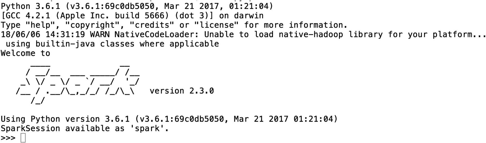

**图 2-3** Python Spark shell 的输出

要退出 Python Spark shell，请按 `Ctrl+D`。

### 注意

Spark Python shell 要求你的机器上已安装 Python 2.6.*x* 或更高版本。

Spark Scala shell 和 Spark Python shell 分别是 Scala REPL 和 Python REPL 的扩展。REPL 是 *read-eval-print loop*（读取-求值-打印循环）的缩写。它本质上是一个交互式计算机编程环境，接收用户输入，对其进行求值，并将结果返回给用户。一旦输入一行代码，REPL 会立即反馈是否存在语法错误。如果没有语法错误，该行代码将被求值，如果有输出，则会在 shell 中显示。这种交互式和即时反馈的环境使开发人员能够绕过正常软件开发过程中的代码编译步骤，从而高效工作。

就学习 Spark 而言，Spark shell 是一个方便的工具，可以随时随地在你本地计算机上使用。除了你想要处理的数据文件之外，它没有任何外部依赖。不过，如果你有网络连接，也可以访问远程数据文件，但速度会较慢。

本书的其余章节将使用 Spark Scala shell。

## 使用 Spark Scala Shell 的乐趣

本节将提供关于 Scala Spark shell 的详细信息，以及一组有用的命令，帮助你有效地使用它进行探索性数据分析或交互式构建 Spark 应用程序。

命令 `./bin/spark-shell` 实际上会启动一个 Spark 应用程序，并提供一个环境，让你可以交互式地调用 Spark Scala API，轻松执行探索性数据处理。由于 Spark Scala shell 是 Scala REPL 的扩展，因此它是同时学习 Scala 和 Spark 的绝佳方式。


### 实用的 Spark Scala Shell 命令与技巧

启动 Spark Scala Shell 后，您将进入一个交互式环境，可以在此输入 Shell 命令和 Scala 代码。本节将介绍各种实用命令以及使用该 Shell 的一些技巧。

进入 Spark Shell 后，输入以下命令可查看所有可用命令的完整列表：

```
scala>  :help
```

图 2-4 显示了上述命令的输出结果。

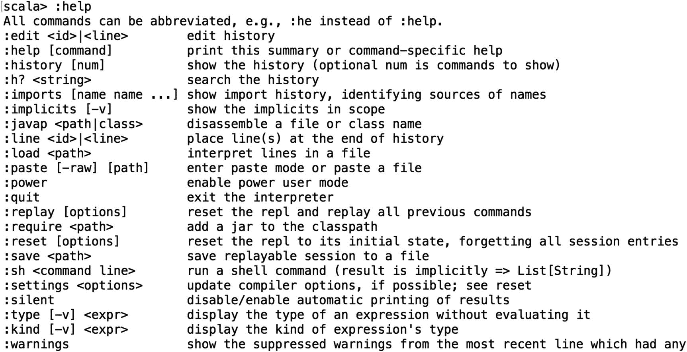

图 2-4

可用 Shell 命令列表

某些命令因其实用性而比其他命令更常用。表 2-2 描述了常用的命令。

表 2-2

需要了解的实用 Spark Shell 命令

| 名称 | 描述 |
| --- | --- |
| `:history` | 此命令显示之前 Spark Shell 会话以及当前会话中输入的内容。它对于复制操作非常有用。 |
| `:load` | 此命令加载并执行指定文件中的代码。当数据处理过程稍长时，此命令特别有用。相比在 Shell 中，在文件中跟踪逻辑和进展会更容易一些。 |
| `:reset` | 在使用各种 Scala 或 Spark API 一段时间后，您可能会忘记各个变量的值。此命令将 Shell 重置为干净状态，以便于推理。 |
| `:silent` | 此命令适用于高级用户，他们可能厌倦了查看在 Shell 中输入的每个 Scala 或 Spark API 的输出。该命令将阻止 Shell 在计算表达式后显示默认输出。要重新启用输出，只需再次输入 `:silent`。 |
| `:quit` | 这是一个不言自明的命令，但了解它很有用。人们常常尝试通过输入 `:exit` 来退出 Shell，但这并不起作用。 |
| `:type` | 此命令显示变量的类型，例如 `:type <变量名>`。 |

除了这些命令之外，一个有助于提高开发人员生产力的功能是代码补全功能。与 Eclipse 或 IntelliJ 等流行的集成开发环境 (IDE) 类似，代码补全功能通过探索可能的选项并减少输入错误来帮助开发人员。

在 Shell 中，输入 `spa`，然后按 Tab 键。环境将添加字符，将 `spa` 转换为 `spark`。此外，它还会显示 `spark` 的可能匹配项列表，如图 2-5 所示。


图 2-5

`spa` 的 Tab 补全输出

```
scala> spa 
```

除了补全部分输入的单词名称外，Tab 补全功能还可以显示对象的可用成员变量和函数。

在 Shell 中，输入 `spark.`，然后按 Tab 键。这将显示由 `spark` 变量表示的 Scala 对象的可用成员变量和函数列表，如图 2-6 所示。

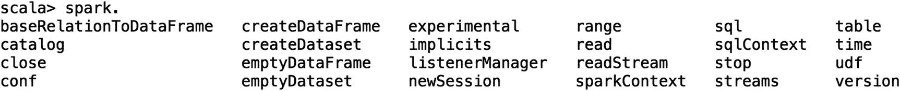

图 2-6

名为 `spark` 的对象的可用成员变量和函数列表

命令 `:history` 显示之前输入的命令或代码行。这表明 Spark Shell 会维护输入记录。快速显示或回忆最近输入内容的一种方法是按向上箭头键。一旦滚动到要执行的行，只需按 Enter 键即可执行。

### 与 Scala 和 Spark 的基本交互

现在您已经知道如何在 Spark Shell 中导航，本节将介绍在 Spark Shell 中使用 Scala 和 Spark 的一些基本方法。这些基础知识在后续章节中会非常有用，这些章节将深入探讨诸如 Spark RDD、Spark SQL 等主题。


### Scala 基本交互

让我们开始在 Spark Scala Shell 中操作 Scala，它提供了一个完整的学习 Scala 的环境。你可以将 Spark Scala Shell 视为一个具有空主体的 Scala 应用程序，而你的任务就是填充这个空主体。你需要用 Scala 函数和应用程序逻辑来填充这个空主体。本节旨在演示在 Spark Shell 中运行几个简单的 Scala 示例。Scala 是一种迷人且功能强大、简洁优雅的编程语言。（请参考 Scala 相关书籍以了解更多关于 Scala 编程语言的知识。）

让我们从一些基本的 Scala 开始。学习任何编程语言的经典示例都是“Hello World”示例，它需要打印一条消息，那么我们就来试试。在 Spark Scala Shell 中输入以下行；输出应类似于图 2-7：


**图 2-7** “Hello World”示例的输出

```
scala> println("Hello from Spark Scala shell")
```

下一个示例是定义一个年龄数组，并在 Spark Shell 中打印这些元素的值。此外，此示例还演示了上一节中提到的代码补全功能。

要定义一个年龄数组并将其赋值给一个不可变变量，请在 Spark Shell 中输入以下内容。评估输出见图 2-8。

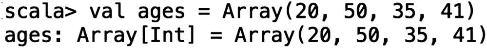

**图 2-8** 定义年龄数组的输出

```
scala> val ages = Array(20, 50, 35, 41)
```

现在你可以像下面这行代码一样引用变量 `ages`。假设你记不清 `Array` 类中用于遍历数组元素的函数名，但你知道它以 `fo` 开头。那么你可以输入以下内容并按 Tab 键，看看 Spark Shell 如何帮助你：

```
scala> ages.fo
```

按下 Tab 键后，Spark Shell 会显示如图 2-9 所示的输出。


**图 2-9** 代码补全的输出

啊哈——你需要的正是 `foreach` 函数来遍历数组中的元素。让我们用它来打印年龄。

```
scala> ages.foreach(println)
```

图 2-10 显示了预期的输出。

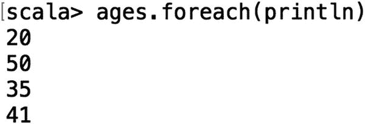

**图 2-10** 打印年龄的输出

对于 Scala 新手来说，上一行代码可能看起来有点神秘；不过，你可以凭直觉猜出它的作用。当 `foreach` 函数遍历 `ages` 数组中的每个元素时，它会将该元素传递给 `println` 函数，以便将值打印到控制台。在接下来的章节中，你会经常使用这种风格。

本节的最后一个示例是定义一个 Scala 函数来判断一个年龄是奇数还是偶数，然后你将使用它来找出数组中哪些是奇数年龄。

```
scala> def isOddAge(age:Int) : Boolean = {
(age % 2) == 1
}
```

如果你有 Java 编程背景，上面的函数签名可能看起来有点奇怪，但要解读这个函数的功能并不太难。注意，该函数没有使用 `return` 关键字来返回其主体中表达式的值。在 Scala 中，没有必要添加 `return` 关键字。函数体中最后一个语句的输出将被返回给调用者（如果该函数被定义为返回一个值）。Spark Shell 的输出见图 2-11。

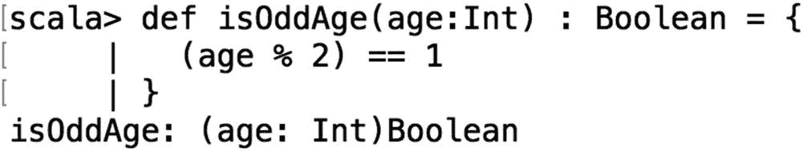

**图 2-11** 如果没有语法错误，Spark Shell 会返回函数签名

为了找出 `ages` 数组中的奇数年龄，你将利用 `Array` 类中的 `filter` 函数。

```
scala> ages.filter(age => isOddAge(age)).foreach(println)
```

上一行代码执行过滤，然后遍历结果以打印出奇数年龄。在 Scala 中，使用函数链式调用来使代码简洁是一种常见做法。Spark Shell 的输出见图 2-12。

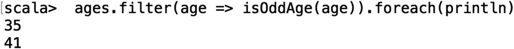

**图 2-12** 过滤并仅打印奇数年龄的输出

现在，让我们对之前定义的 Scala 变量和函数尝试使用名为 `:type` 的 Shell 命令。当你使用 Spark Shell 一段时间后，可能会忘记某个变量的数据类型或函数的返回类型，这时这个命令就派上用场了。使用 `:type` 命令的示例见图 2-13。


**图 2-13** `:type` 命令的输出

为了学习 Spark，并不一定要精通 Scala 编程语言。但是，你必须熟悉并能够运用 Scala 的基础知识。这里有一个很好的资源，教你学习刚好够用的 Scala 来学习 Spark：[`https://github.com/deanwampler/JustEnoughScalaForSpark`](https://github.com/deanwampler/JustEnoughScalaForSpark)。该资源曾在多个与 Spark 相关的会议上展示过。

### Spark UI 及与 Spark 的基本交互

在上一节中，我提到 Spark Shell 是一个 Scala 应用程序。这只说对了一部分。Spark Shell 实际上是一个用 Scala 编写的 Spark 应用程序。当 Spark Shell 启动时，会初始化并设置好一些供你使用的东西，包括 Spark UI 和一些重要的变量。


### Spark UI

如果你仔细查看图 2-2 或图 2-3 中 Spark shell 的输出，你会看到一行类似下面的内容。你的 Spark shell 中的 URL 可能略有不同，但重要的是这个 URL。

```
Spark context Web UI available at http://192.168.1.73:4042
```

如果你在 Spark shell 中将浏览器指向该 URL，浏览器将显示类似图 2-14 的内容。

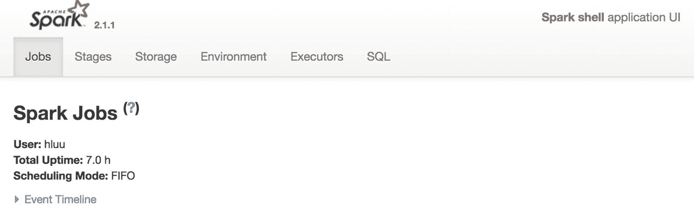

图 2-14

Spark UI

Spark UI 是一个旨在帮助监控和调试 Spark 应用程序的 Web 应用程序。它包含 Spark 应用程序的详细运行时信息和各种资源消耗情况。运行时信息包含各种指标，这些指标对于诊断 Spark 应用程序的性能问题非常有帮助。需要注意的一点是，Spark UI 仅在 Spark 应用程序运行时才可用。

Spark UI 顶部的导航栏包含指向各个选项卡的链接，包括 Jobs、Stages、Storage、Environment、Executors 和 SQL。现在，我将简要介绍 Environment 和 Executors 选项卡，并在后续章节中描述其余选项卡。

Environment 选项卡包含 Spark 应用程序运行环境的基本信息。其分区包括 Runtime Information、Spark Properties、System Properties 和 Classpath Entries。表 2-3 提供了关于这些区域的详细信息。

表 2-3

Environment 选项卡内各分区信息

| 名称 | 描述 |
| --- | --- |
| Runtime Information | 此部分包含 Spark 所依赖的各种组件的位置和版本，包括 Java 和 Scala。 |
| Spark Properties | 此区域包含在 Spark 应用程序中配置的基本属性和高级属性。基本属性包括应用程序的基本信息，例如应用程序 ID、名称等。高级属性用于开启或关闭 Spark 的某些功能，或以最适合特定应用程序的方式进行调整。有关可配置属性的完整列表，请参见 [`https://spark.apache.org/docs/latest/configuration.html`](https://spark.apache.org/docs/latest/configuration.html)。 |
| System Properties | 这些属性主要位于操作系统和 Java 层面，并非 Spark 特有。 |
| Classpath Entries | 此区域包含 Spark 应用程序中使用的类路径和 JAR 文件列表。 |

Executors 选项卡包含支持 Spark 应用程序的每个执行器的摘要和细分信息。这些信息包括某些资源的容量以及每个执行器中的使用量。资源包括内存、磁盘、CPU 等。Summary 部分提供了 Spark 应用程序中所有执行器资源消耗的概览。更多详情请参见图 2-15。


图 2-15

仅使用单个执行器的 Spark 应用程序的 Executors 选项卡

### Spark 的基本交互

一旦 Spark shell 成功启动，一个名为 `spark` 的显著变量就会被初始化，并可在 Spark shell 中使用。这个 `spark` 变量是名为 `SparkSession` 的类的一个实例。让我们使用 `:type` 命令来验证这一点。

```
scala>:type spark
```

Spark shell 会显示其类型，如图 2-16 所示。


图 2-16

显示 spark 变量的类型

`SparkSession` 类是在 Spark 2.0 中引入的，旨在提供与底层 Spark 功能交互的单一入口点。该类提供了用于从非结构化文本文件以及各种格式（包括 JSON、CSV、Parquet、ORC 等）的结构化和二进制数据中读取数据的 API。此外，`SparkSession` 还提供了检索和设置 Spark 相关配置的功能。

让我们开始在 Spark shell 中与 `spark` 变量交互，打印出一些有用的信息，例如版本和现有配置。在 Spark shell 中，输入以下代码以打印 Spark 版本（输出见图 2-17）：

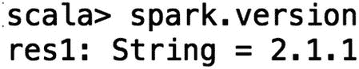

图 2-17

Spark 版本输出

```
scala> spark.version
```

为了更规范一些，你可以使用上一节学到的 `println` 函数来打印 Spark 版本，如图 2-18 所示。

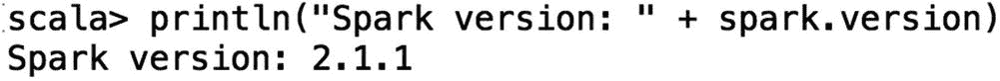

图 2-18

使用 println 函数显示 Spark 版本

```
scala> println("Spark version:" + spark.version)
```

要查看 Spark shell 中配置的默认配置，你可以访问 `spark` 的 `conf` 变量。以下是在 Spark shell 中显示默认配置的代码（输出如图 2-19 所示）：

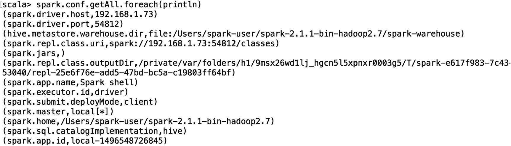

图 2-19

Spark shell 应用程序中的默认配置

```
scala> spark.conf.getAll.foreach(println)
```

要查看可以从 `spark` 访问的完整可用对象集，你可以利用 Spark shell 的代码补全功能。

```
scala> spark.
```

图 2-20 包含了上一条命令的结果。


图 2-20

可以从 spark 变量访问的完整变量列表

后续章节将提供更多使用 `spark` 与底层 Spark 功能交互的示例。


