# 2. 使用 Apache Spark

本章详细介绍了使用 Spark 的不同方式，包括使用 Spark shell、从命令行提交 Spark 应用程序，以及使用名为 Databricks 的托管云平台。本章的最后部分面向那些希望在本地机器上搭建 Apache Spark 源代码以检查 Spark 代码并了解某些特性是如何实现的软件工程师。

## 下载和安装 Spark

为了学习或试验 Spark，最好在本地计算机上安装 Spark。这样，您可以轻松尝试 Spark 特性或使用小数据集测试您的数据处理逻辑。通过在笔记本电脑上本地安装 Spark，您可以在任何地方学习 Spark，包括在舒适的客厅、海滩或墨西哥的酒吧里。

Spark 是用 Scala 编程语言编写的，并且其打包方式使其可以在 Windows 和类 Unix 系统（例如 Linux 和 macOS）上运行。所需要的只是在您的计算机上安装 Java。

搭建一个多租户的 Spark 生产集群需要更多的细节和资源，这超出了本书的范围。

### 下载 Spark

Apache Spark 网站的下载部分（[`http://spark.apache.org/downloads.html`](http://spark.apache.org/downloads.html)）提供了下载预打包 Spark 二进制文件的详细说明。在撰写本书时，最新版本是 2.3.0。在包类型方面，请选择具有最新版本 Hadoop 的那个。图 2-1 显示了下载 Spark 的各种选项。重要的是下载预打包的二进制文件，因为它包含了在您的计算机上运行 Spark 所需的 JAR 文件。点击第 4 行的链接将触发二进制文件下载过程。还有一种方法可以从源代码手动打包 Spark 二进制文件，如何操作的说明将在本章后面提供。

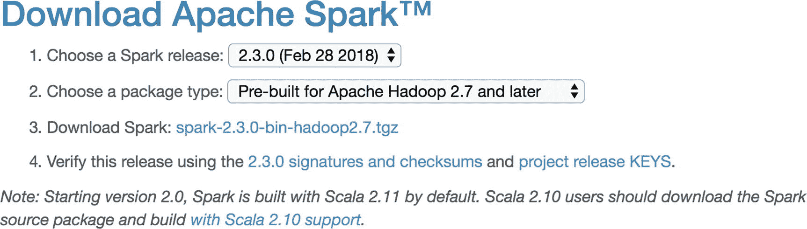

图 2-1：Apache Spark 下载选项

### 安装 Spark

一旦二进制文件成功下载到您的计算机上，下一步就是解压缩它。下载的文件 `spark-2.x.x-bin-hadoop2.7.tgz` 是一个 GZIP 压缩的 tar 归档文件，因此您需要使用正确的工具来解压缩它。

对于 Linux 或 Mac 计算机，`tar` 命令应该已经存在。因此，运行以下命令来解压缩下载的文件：

```
tar xvf spark-2.x.x-bin-hadoop2.7.tgz
```

对于 Windows 计算机，您可以使用 WinZip 或 7-zip 工具来解压缩下载的文件。

解压缩成功完成后，应该会有一个名为 `spark-2.x.x-bin-hadoop2.7` 的目录。从现在开始，该目录被称为 *Spark 目录*。

### 注意

如果下载了不同版本的 Spark，目录名称会略有不同。

Spark 目录下大约有十几个子目录。表 2-1 列出了你应该了解的几个目录。

**表 2-1** `spark-2.1.1-bin-hadoop2.7` 目录下的子目录

| 名称 | 描述 |
| --- | --- |
| `bin` | 包含用于启动 Scala 或 Python 的 Spark shell、提交 Spark 应用程序以及运行 Spark 示例的各种可执行文件 |
| `data` | 包含用于各种 Spark 示例的小型样本数据文件 |
| `examples` | 包含所有 Spark 示例的源代码和二进制文件 |
| `jars` | 包含运行 Spark 所需的必要二进制文件 |
| `sbin` | 包含用于管理 Spark 集群的可执行文件 |

解压完成后，下一步是通过启动 Spark shell 来测试安装。

Spark shell 类似于 Unix shell，但它是为 Spark 设计的。它提供了一个交互式环境，便于学习 Spark API 并进行交互式数据分析。很酷的一点是，它同时支持 Scala 和 Python。如果你是一名数据科学家，并且 Python 是你的首选工具，那么你会感到得心应手。以下部分将展示如何启动 Spark Scala shell 和 Spark Python shell。

### 注意

Scala 编程语言是一种 JVM 语言，因此 Scala 可以轻松使用现有的 Java 库。

### Spark Scala Shell

要启动 Spark Scala shell，请在 Spark 目录中输入以下命令：

```
./bin/spark-shell
```

几秒钟后，你应该会看到类似图 2-2 的内容。

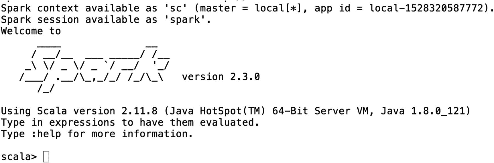

**图 2-2** Scala Spark shell 输出

要退出 Scala Spark shell，请输入 `:quit` 或 `:q`。

### 注意

Spark Scala shell 要求你的机器上已安装 Java 1.8.*x*。

### Spark Python Shell

要启动 Spark Python shell，请在 Spark 目录中输入以下命令：

```
./bin/pyspark
```

几秒钟后，你应该会看到类似图 2-3 的内容。


**图 2-3** Python Spark shell 的输出

要退出 Python Spark shell，请按 `Ctrl+D`。

### 注意

Spark Python shell 要求你的机器上已安装 Python 2.6.*x* 或更高版本。

Spark Scala shell 和 Spark Python shell 分别是 Scala REPL 和 Python REPL 的扩展。REPL 是 *read-eval-print loop*（读取-求值-打印循环）的缩写。它本质上是一个交互式计算机编程环境，接收用户输入，对其进行求值，并将结果返回给用户。一旦输入一行代码，REPL 会立即反馈是否存在语法错误。如果没有语法错误，该行代码将被求值，如果有输出，则会在 shell 中显示。这种交互式和即时反馈的环境使开发人员能够绕过正常软件开发过程中的代码编译步骤，从而高效工作。

就学习 Spark 而言，Spark shell 是一个方便的工具，可以随时随地在你本地计算机上使用。除了你想要处理的数据文件之外，它没有任何外部依赖。不过，如果你有网络连接，也可以访问远程数据文件，但速度会较慢。

本书的其余章节将使用 Spark Scala shell。

## 使用 Spark Scala Shell 的乐趣

本节将提供关于 Scala Spark shell 的详细信息，以及一组有用的命令，帮助你有效地使用它进行探索性数据分析或交互式构建 Spark 应用程序。

命令 `./bin/spark-shell` 实际上会启动一个 Spark 应用程序，并提供一个环境，让你可以交互式地调用 Spark Scala API，轻松执行探索性数据处理。由于 Spark Scala shell 是 Scala REPL 的扩展，因此它是同时学习 Scala 和 Spark 的绝佳方式。

### 实用的 Spark Scala Shell 命令与技巧

启动 Spark Scala Shell 后，您将进入一个交互式环境，可以在此输入 Shell 命令和 Scala 代码。本节将介绍各种实用命令以及使用该 Shell 的一些技巧。

进入 Spark Shell 后，输入以下命令可查看所有可用命令的完整列表：

```
scala>  :help
```

图 2-4 显示了上述命令的输出结果。


图 2-4：可用 Shell 命令列表

某些命令因其实用性而比其他命令更常用。表 2-2 描述了常用的命令。

**表 2-2** 需要了解的实用 Spark Shell 命令

| 名称 | 描述 |
| --- | --- |
| `:history` | 此命令显示之前 Spark Shell 会话以及当前会话中输入的内容。它对于复制操作非常有用。 |
| `:load` | 此命令加载并执行指定文件中的代码。当数据处理过程稍长时，此命令特别有用。相比在 Shell 中，在文件中跟踪逻辑和进展会更容易一些。 |
| `:reset` | 在使用各种 Scala 或 Spark API 一段时间后，您可能会忘记各个变量的值。此命令将 Shell 重置为干净状态，以便于推理。 |
| `:silent` | 此命令适用于高级用户，他们可能厌倦了查看在 Shell 中输入的每个 Scala 或 Spark API 的输出。该命令将阻止 Shell 在计算表达式后显示默认输出。要重新启用输出，只需再次输入 `:silent`。 |
| `:quit` | 这是一个不言自明的命令，但了解它很有用。人们常常尝试通过输入 `:exit` 来退出 Shell，但这并不起作用。 |
| `:type` | 此命令显示变量的类型，例如 `:type <变量名>`。 |

除了这些命令之外，一个有助于提高开发人员生产力的功能是代码补全功能。与 Eclipse 或 IntelliJ 等流行的集成开发环境 (IDE) 类似，代码补全功能通过探索可能的选项并减少输入错误来帮助开发人员。

在 Shell 中，输入 `spa`，然后按 Tab 键。环境将添加字符，将 `spa` 转换为 `spark`。此外，它还会显示 `spark` 的可能匹配项列表，如图 2-5 所示。


图 2-5：`spa` 的 Tab 补全输出

```
scala> spa 
```

除了补全部分输入的单词名称外，Tab 补全功能还可以显示对象的可用成员变量和函数。

在 Shell 中，输入 `spark.`，然后按 Tab 键。这将显示由 `spark` 变量表示的 Scala 对象的可用成员变量和函数列表，如图 2-6 所示。


图 2-6：名为 `spark` 的对象的可用成员变量和函数列表

命令 `:history` 显示之前输入的命令或代码行。这表明 Spark Shell 会维护输入记录。快速显示或回忆最近输入内容的一种方法是按向上箭头键。一旦滚动到要执行的行，只需按 Enter 键即可执行。

### 与 Scala 和 Spark 的基本交互

现在您已经知道如何在 Spark Shell 中导航，本节将介绍在 Spark Shell 中使用 Scala 和 Spark 的一些基本方法。这些基础知识在后续章节中会非常有用，这些章节将深入探讨诸如 Spark RDD、Spark SQL 等主题。

### Scala 基本交互

让我们开始在 Spark Scala Shell 中操作 Scala，它提供了一个完整的学习 Scala 的环境。你可以将 Spark Scala Shell 视为一个具有空主体的 Scala 应用程序，而你的任务就是填充这个空主体。你需要用 Scala 函数和应用程序逻辑来填充这个空主体。本节旨在演示在 Spark Shell 中运行几个简单的 Scala 示例。Scala 是一种迷人且功能强大、简洁优雅的编程语言。（请参考 Scala 相关书籍以了解更多关于 Scala 编程语言的知识。）

让我们从一些基本的 Scala 开始。学习任何编程语言的经典示例都是“Hello World”示例，它需要打印一条消息，那么我们就来试试。在 Spark Scala Shell 中输入以下行；输出应类似于`图 2-7`：

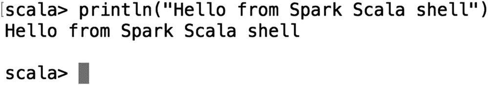

`图 2-7` “Hello World”示例的输出

```
scala> println("Hello from Spark Scala shell")
```

下一个示例是定义一个年龄数组，并在 Spark Shell 中打印这些元素的值。此外，此示例还演示了上一节中提到的代码补全功能。

要定义一个年龄数组并将其赋值给一个不可变变量，请在 Spark Shell 中输入以下内容。评估输出见`图 2-8`。


`图 2-8` 定义年龄数组的输出

```
scala> val ages = Array(20, 50, 35, 41)
```

现在你可以像下面这行代码一样引用变量`ages`。假设你记不清`Array`类中用于遍历数组元素的函数名，但你知道它以`fo`开头。那么你可以输入以下内容并按 Tab 键，看看 Spark Shell 如何帮助你：

```
scala> ages.fo
```

按下 Tab 键后，Spark Shell 会显示如`图 2-9`所示的输出。


`图 2-9` 代码补全的输出

啊哈——你需要的正是`foreach`函数来遍历数组中的元素。让我们用它来打印年龄。

```
scala> ages.foreach(println)
```

`图 2-10`显示了预期的输出。


`图 2-10` 打印年龄的输出

对于 Scala 新手来说，上一行代码可能看起来有点神秘；不过，你可以凭直觉猜出它的作用。当`foreach`函数遍历`ages`数组中的每个元素时，它会将该元素传递给`println`函数，以便将值打印到控制台。在接下来的章节中，你会经常使用这种风格。

本节的最后一个示例是定义一个 Scala 函数来判断一个年龄是奇数还是偶数，然后你将使用它来找出数组中哪些是奇数年龄。

```
scala> def isOddAge(age:Int) : Boolean = {
(age % 2) == 1
}
```

如果你有 Java 编程背景，上面的函数签名可能看起来有点奇怪，但要解读这个函数的功能并不太难。注意，该函数没有使用`return`关键字来返回其主体中表达式的值。在 Scala 中，没有必要添加`return`关键字。函数体中最后一个语句的输出将被返回给调用者（如果该函数被定义为返回一个值）。Spark Shell 的输出见`图 2-11`。


`图 2-11` 如果没有语法错误，Spark Shell 会返回函数签名

为了找出`ages`数组中的奇数年龄，你将利用`Array`类中的`filter`函数。

```
scala> ages.filter(age => isOddAge(age)).foreach(println)
```

上一行代码执行过滤，然后遍历结果以打印出奇数年龄。在 Scala 中，使用函数链式调用来使代码简洁是一种常见做法。Spark Shell 的输出见`图 2-12`。


`图 2-12` 过滤并仅打印奇数年龄的输出

现在，让我们对之前定义的 Scala 变量和函数尝试使用名为`:type`的 Shell 命令。当你使用 Spark Shell 一段时间后，可能会忘记某个变量的数据类型或函数的返回类型，这时这个命令就派上用场了。使用`:type`命令的示例见`图 2-13`。

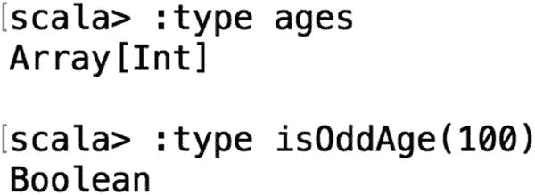

`图 2-13` `:type`命令的输出

为了学习 Spark，并不一定要精通 Scala 编程语言。但是，你必须熟悉并能够运用 Scala 的基础知识。这里有一个很好的资源，教你学习刚好够用的 Scala 来学习 Spark：[`https://github.com/deanwampler/JustEnoughScalaForSpark`](https://github.com/deanwampler/JustEnoughScalaForSpark)。该资源曾在多个与 Spark 相关的会议上展示过。

### Spark UI及与Spark的基本交互

在上一节中，我提到 Spark Shell 是一个 Scala 应用程序。这只说对了一部分。Spark Shell 实际上是一个用 Scala 编写的 Spark 应用程序。当 Spark Shell 启动时，会初始化并设置好一些供你使用的东西，包括 Spark UI 和一些重要的变量。

#### Spark UI

如果你仔细查看`图 2-2`或`图 2-3`中 Spark shell 的输出，你会看到一行类似下面的内容。你的 Spark shell 中的 URL 可能略有不同，但重要的是这个 URL。

```
Spark context Web UI available at http://192.168.1.73:4042
```

如果你在 Spark shell 中将浏览器指向该 URL，浏览器将显示类似`图 2-14`的内容。


`图 2-14` Spark UI

Spark UI 是一个旨在帮助监控和调试 Spark 应用程序的 Web 应用程序。它包含 Spark 应用程序的详细运行时信息和各种资源消耗情况。运行时信息包含各种指标，这些指标对于诊断 Spark 应用程序的性能问题非常有帮助。需要注意的一点是，Spark UI 仅在 Spark 应用程序运行时才可用。

Spark UI 顶部的导航栏包含指向各个选项卡的链接，包括 Jobs、Stages、Storage、Environment、Executors 和 SQL。现在，我将简要介绍 Environment 和 Executors 选项卡，并在后续章节中描述其余选项卡。

Environment 选项卡包含 Spark 应用程序运行环境的基本信息。其分区包括 Runtime Information、Spark Properties、System Properties 和 Classpath Entries。`表 2-3`提供了关于这些区域的详细信息。

`表 2-3` Environment 选项卡内各分区信息

| 名称 | 描述 |
| --- | --- |
| Runtime Information | 此部分包含 Spark 所依赖的各种组件的位置和版本，包括 Java 和 Scala。 |
| Spark Properties | 此区域包含在 Spark 应用程序中配置的基本属性和高级属性。基本属性包括应用程序的基本信息，例如应用程序 ID、名称等。高级属性用于开启或关闭 Spark 的某些功能，或以最适合特定应用程序的方式进行调整。有关可配置属性的完整列表，请参见[`https://spark.apache.org/docs/latest/configuration.html`](https://spark.apache.org/docs/latest/configuration.html)。 |
| System Properties | 这些属性主要位于操作系统和 Java 层面，并非 Spark 特有。 |
| Classpath Entries | 此区域包含 Spark 应用程序中使用的类路径和 JAR 文件列表。 |

Executors 选项卡包含支持 Spark 应用程序的每个执行器的摘要和细分信息。这些信息包括某些资源的容量以及每个执行器中的使用量。资源包括内存、磁盘、CPU 等。Summary 部分提供了 Spark 应用程序中所有执行器资源消耗的概览。更多详情请参见`图 2-15`。

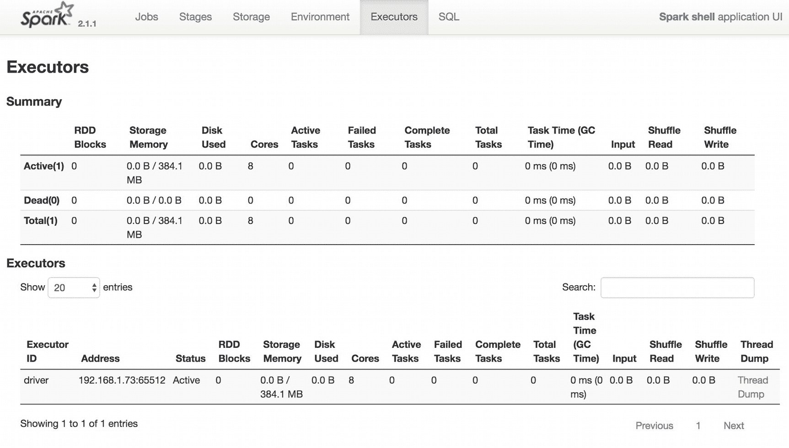

`图 2-15` 仅使用单个执行器的 Spark 应用程序的 Executors 选项卡

#### Spark 的基本交互

一旦 Spark shell 成功启动，一个名为`spark`的显著变量就会被初始化，并可在 Spark shell 中使用。这个`spark`变量是名为`SparkSession`的类的一个实例。让我们使用`:type`命令来验证这一点。

```
scala>:type spark
```

Spark shell 会显示其类型，如`图 2-16`所示。

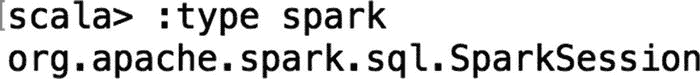

`图 2-16` 显示 spark 变量的类型

`SparkSession`类是在 Spark 2.0 中引入的，旨在提供与底层 Spark 功能交互的单一入口点。该类提供了用于从非结构化文本文件以及各种格式（包括 JSON、CSV、Parquet、ORC 等）的结构化和二进制数据中读取数据的 API。此外，`SparkSession`还提供了检索和设置 Spark 相关配置的功能。

让我们开始在 Spark shell 中与`spark`变量交互，打印出一些有用的信息，例如版本和现有配置。在 Spark shell 中，输入以下代码以打印 Spark 版本（输出见`图 2-17`）：


`图 2-17` Spark 版本输出

```
scala> spark.version
```

为了更规范一些，你可以使用上一节学到的`println`函数来打印 Spark 版本，如`图 2-18`所示。


`图 2-18` 使用 println 函数显示 Spark 版本

```
scala> println("Spark version:" + spark.version)
```

要查看 Spark shell 中配置的默认配置，你可以访问`spark`的`conf`变量。以下是在 Spark shell 中显示默认配置的代码（输出如`图 2-19`所示）：


`图 2-19` Spark shell 应用程序中的默认配置

```
scala> spark.conf.getAll.foreach(println)
```

要查看可以从`spark`访问的完整可用对象集，你可以利用 Spark shell 的代码补全功能。

```
scala> spark.
```

`图 2-20`包含了上一条命令的结果。

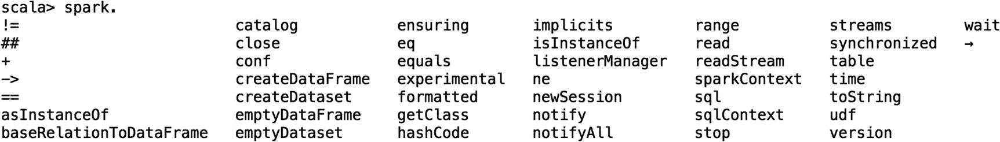

`图 2-20` 可以从 spark 变量访问的完整变量列表

后续章节将提供更多使用`spark`与底层 Spark 功能交互的示例。

# Databricks 简介

`Databricks` 是一款由名为 `Databricks` 的公司提供的商业产品，该公司是 `Apache Spark` 背后的主要推动力量。根据其产品文档，`Databricks` 是一个运行在云端的即时数据平台，并且是完全托管的。该平台的主要目标是简化大数据处理，让任何人都能轻松构建和部署高级分析解决方案。它围绕 `Apache Spark` 构建，并为全球客户提供四大核心价值主张。详情请参见图 2-21。

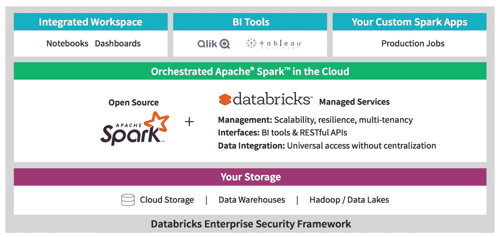
*图 2-21 Databricks 平台*

*   完全托管的 `Spark` 集群
*   用于探索和可视化的交互式工作区
*   生产流水线调度器
*   为您喜爱的基于 `Spark` 的应用提供支持的平台

`Databricks` 产品有两个版本：完整平台版和社区版。完整平台版是付费产品，供公司利用 `Databricks` 产品中的所有高级功能。社区版是免费的，非常适合那些想要试用 `Databricks` 并学习 `Apache Spark` 的用户。

下一节将介绍 `Databricks` 社区版的基本功能，以便您使用 `Databricks` 来学习 `Apache Spark`。一旦您熟悉了 `Databricks`，您会发现学习 `Spark`、执行数据分析或构建 `Spark` 应用程序变得简单直观。本节并非旨在成为 `Databricks` 产品的全面指南。未来的所有示例都将在 `Spark` shell 中完成。有关 `DataBricks` 的全面指南，请参阅 [https://docs.databricks.com/user-guide/index.html](https://docs.databricks.com/user-guide/index.html)。

使用 `Databricks` 的第一步是在 `Databricks` 社区版上注册一个免费账户，网址为 [https://accounts.cloud.databricks.com/registration.html#signup/community](https://accounts.cloud.databricks.com/registration.html#signup/community)。这个过程非常简单快捷，几分钟内即可创建账户。在注册表单中提供并提交必要信息后，您将收到一封来自 `Databricks` 的确认邮件，内容类似于图 2-22。


*图 2-22 Databricks 用于确认电子邮件地址的邮件*

点击上一封邮件中的链接，您将进入 `Databricks` 登录表单，如图 2-23 所示。


*图 2-23 Databricks 登录页面*

使用您在注册步骤中提供的电子邮件和密码成功登录后，您将看到 `Databricks` 欢迎页面，如图 2-24 所示。

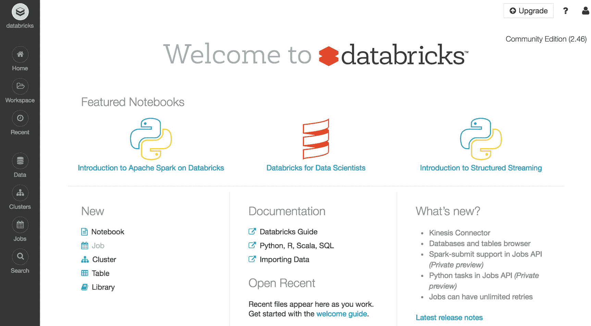
*图 2-24 Databricks 欢迎页面*

随着时间的推移，欢迎页面可能会发生变化，因此可能不完全像图 2-24 所示。您可以随意浏览页面顶部的那些特色笔记本。

本节的目标是在 `Databricks` 中创建一个笔记本，以便您可以学习上一节中介绍的命令。为此，您需要执行以下操作：

1.  创建一个集群。
2.  创建一个文件夹。
3.  创建一个笔记本。

## 创建集群

`Databricks` 社区版（`CE`）最酷的功能之一是它免费提供一个具有 `6GB` 内存的单节点 `Spark` 集群。在撰写本书时，此单节点集群托管在 `AWS` 云上。每个 `Databricks` `CE` 账户一次只能创建一个集群。只要集群正在使用，它就会保持运行状态。如果集群空闲一段时间（两小时），`Databricks` 会自动将其关闭。这意味着您可以自行关闭集群，也可以让 `Databricks` 代您关闭。

要创建集群，请单击页面左侧垂直导航栏中的 `Clusters` 图标。`Clusters` 页面如图 2-25 所示。

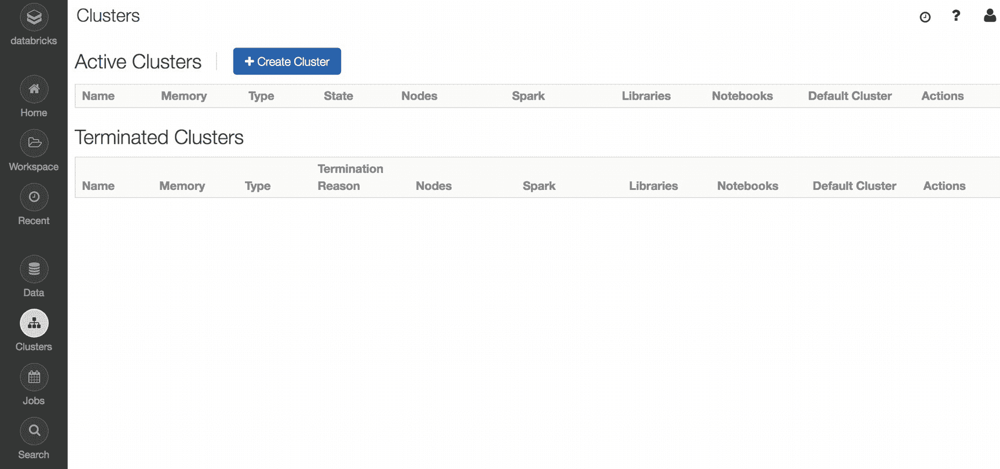
*图 2-25 无活动集群的 Databricks Clusters 页面*

现在单击 `Create Cluster` 按钮，调出 `New Cluster` 表单，如图 2-26 所示。


*图 2-26 创建集群表单*

此表单上唯一必填的字段是 `Cluster Name`。表 2-4 简要描述了所有字段。

**表 2-4 Databricks 新集群表单上的字段**

| 名称 | 描述 |
| --- | --- |
| `Cluster Name` | 这是用于标识集群的唯一名称。名称的每个单词之间可以有空格。例如，可以命名为“my spark cluster”。 |
| `Databricks Runtime Version` | `Databricks` 支持多个版本的 `Spark`。出于学习目的，请选择已为您自动填写的**最新版本**。每个版本都绑定到特定的 `AWS` 镜像。 |
| `Instance` | 对于 `CE` 版，没有其他选择可用。 |
| `AWS – Availability Zone` | 这允许您决定单节点集群将在哪个 `AWS` 可用区中运行。根据您的位置，选项可能有所不同。 |
| `Spark – Spark Config` | 这允许您指定启动 `Spark` 集群时应包含的任何特定于应用程序的配置。例如，包括 `JVM` 配置、启用某些 `Spark` 功能的能力等。 |

填写 `Cluster Name` 字段后，单击 `Create Cluster` 按钮。根据具体情况，创建单节点 `Spark` 集群可能需要一分钟到十分钟的时间。`Spark` 集群成功创建后，集群名称旁边会出现一个绿点，如图 2-27 所示。


*图 2-27 集群成功创建后*

您可以随意单击集群名称或此页面上的各种链接进行探索。请注意，如果您尝试按照前面的步骤创建另一个 `Spark` 集群，`Databricks` 将不允许您在已有正在运行的集群时执行此操作。

要停止活动的 `Spark` 集群，请单击 `Actions` 列中的方形按钮。

有关在 `Databricks` 上创建和管理 `Spark` 集群的更多信息，请参阅 [https://docs.databricks.com/user-guide/clusters/index.html](https://docs.databricks.com/user-guide/clusters/index.html)。

让我们继续下一步，即创建一个文件夹。

## 创建文件夹

在介绍如何创建文件夹之前，有必要先花点时间描述一下 `Databricks` 中的 `Workspace` 概念。理解 `Workspace` 最简单的方式是将其视为计算机上的根文件夹，这意味着你可以将文件放在其中，或创建文件夹来以特定方式组织文件。

要创建文件夹，请点击页面左侧垂直导航栏中的 `Workspace` 图标。`Workspace` 列将滑出，如图 2-28 所示。

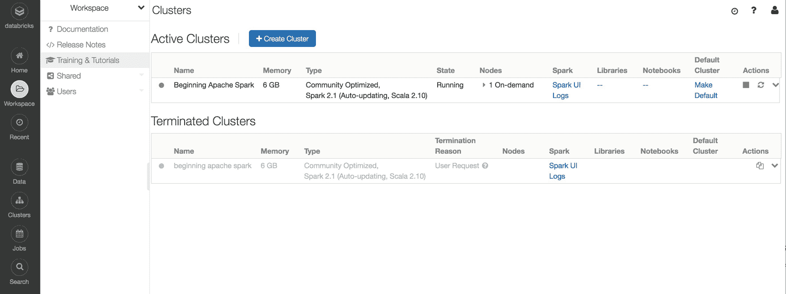
*图 2-28 工作区列*

现在点击 `Workspace` 列右上角的下拉箭头，将出现一个级联下拉菜单，如图 2-29 所示。

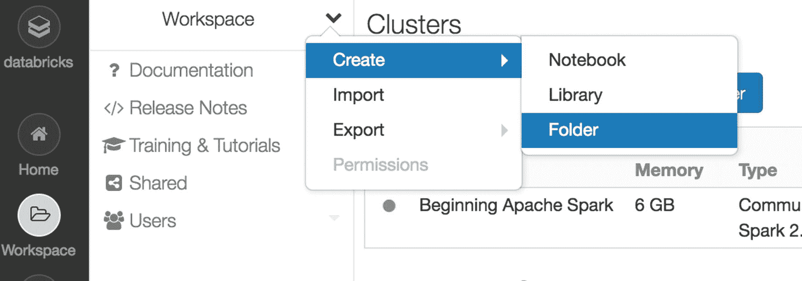
*图 2-29 用于创建文件夹的菜单项*

选择 `Folder` 菜单项将弹出 `New Folder Name` 对话框，如图 2-30 所示。

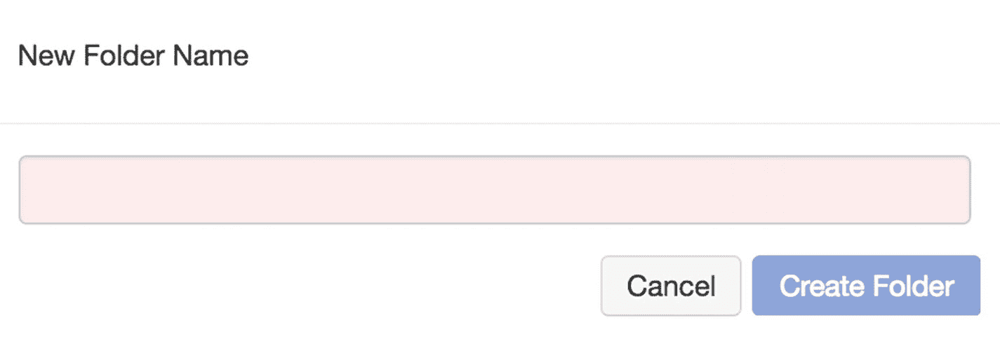
*图 2-30 新建文件夹名称对话框*

现在你可以输入一个文件夹名称，例如 `Chapter 2`，然后点击 `Create Folder` 按钮完成操作。`Chapter 2` 文件夹现在应该会出现在 `Workspace` 列中，如图 2-31 所示。

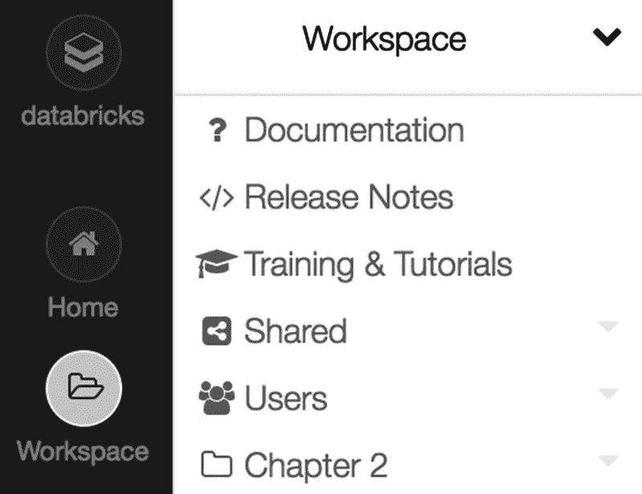
*图 2-31 `Chapter 2` 文件夹出现在 `Workspace` 列中*

在继续创建笔记本之前，值得一提的是还有另一种创建文件夹的方法：将鼠标指针放在 `Workspace` 列中的任意位置并右键单击，然后会出现相同的菜单选项。

有关使用 `Workspace` 和创建文件夹的更多详细信息，请查看 [https://docs.databricks.com/user-guide/workspace.html](https://docs.databricks.com/user-guide/workspace.html)。

## 创建笔记本

接下来，你需要在 `Chapter 2` 文件夹中创建一个 `Scala` 笔记本。首先在 `Workspace` 列中选择 `Chapter 2` 文件夹。`Chapter 2` 列会在 `Workspace` 列之后滑出，看起来如图 2-32 所示。


*图 2-32 `Chapter 2` 列出现在 `Workspace` 列的右侧*

现在，你可以点击 `Chapter 2` 列右上角的下拉箭头，或者在 `Chapter 2` 列中的任意位置右键单击，以调出菜单，如图 2-33 所示。


*图 2-33 创建笔记本菜单项*

选择 `Notebook` 菜单项将弹出 `Create Notebook` 对话框。为你的笔记本命名，并确保在 `Language` 字段中选择 `Scala` 选项。集群的值应自动填充，因为 `Databricks` `CE` 版本一次只能有一个集群。你的对话框应该看起来如图 2-34 所示。


*图 2-34 已选择 `Scala` 语言选项的 `Create Notebook` 对话框*

点击 `Create` 按钮后，将创建一个新的笔记本，如图 2-35 所示。

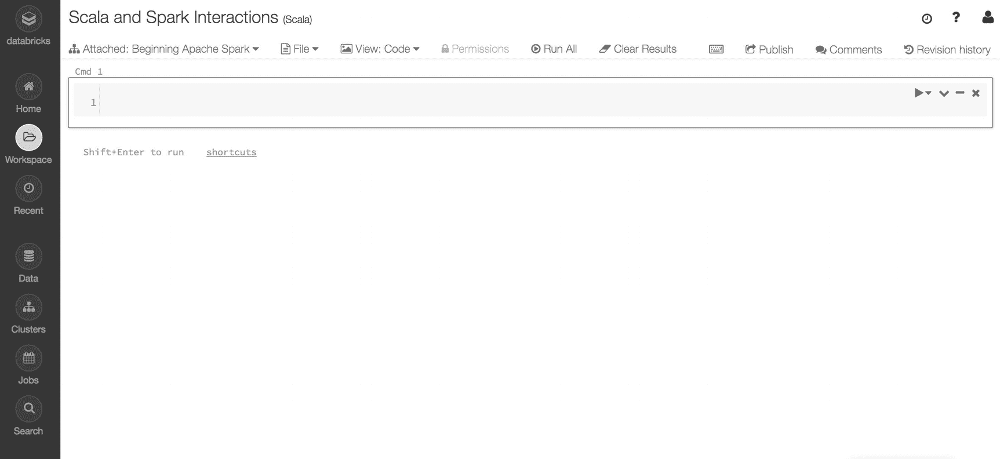
*图 2-35 新的 Scala 笔记本*

如果你从未使用过 `IPython Notebook`，笔记本的概念一开始可能看起来有点奇怪。不过，一旦你习惯了，你就会喜欢上它。

笔记本本质上是一个交互式计算环境（类似于 `Spark shell`，但要好得多），你可以在其中执行 `Spark` 代码，使用 `Markdown` 或 `HTML` 以富文本格式记录代码，并通过各种类型的图表和图形可视化数据分析结果。

下一节将仅介绍一些基本指令，以帮助你高效使用 `Spark` 笔记本。有关如何使用 `Databricks` 笔记本并进行交互的完整指令列表，请参阅 [https://docs.databricks.com/user-guide/notebooks/index.html](https://docs.databricks.com/user-guide/notebooks/index.html)。

一个 `Spark` 笔记本包含一组单元格，每个单元格包含一个代码块，用于执行或标记为文档用途。

### 注意

使用 Spark 笔记本的一个良好实践是将数据处理逻辑拆分为多个逻辑组，使每个组位于一个或多个单元格中。这与开发可维护软件应用程序的实践类似。

你需要将笔记本分为两部分。第一部分包含你在前面“Scala 基础交互”部分输入的代码片段，第二部分包含你在前面“Spark 基础交互”部分输入的代码片段。

首先，在笔记本的第一个单元格中添加一个 Markdown 语句，输入以下内容（见图 2-36）：


图 2-36 包含章节标题标记语句的单元格

```
%md #### Scala 基础交互
```

要执行该标记语句，首先确保鼠标光标位于单元格 1 中，然后按住 `Shift` 键并按下 `Enter` 键。这是在单元格中运行代码或标记语句的快捷键。结果应如图 2-37 所示。

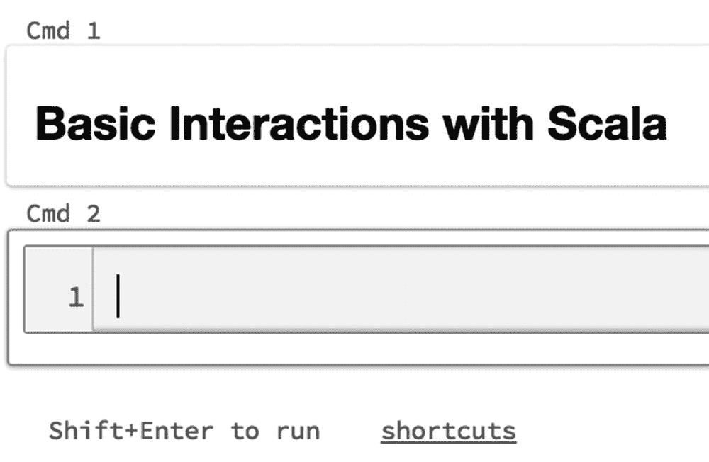

图 2-37 在单元格中执行标记语句的输出

请注意，`Shift+Enter` 组合键不仅执行了该单元格中的内容，还在其下方创建了一个新单元格。现在，将之前的“Hello World”示例输入到第二个单元格中并执行该单元格。输出应如图 2-38 所示。


图 2-38 执行 `println` 语句的输出

将“Scala 交互”部分中剩余的三个代码语句复制到笔记本中，如图 2-39 所示。

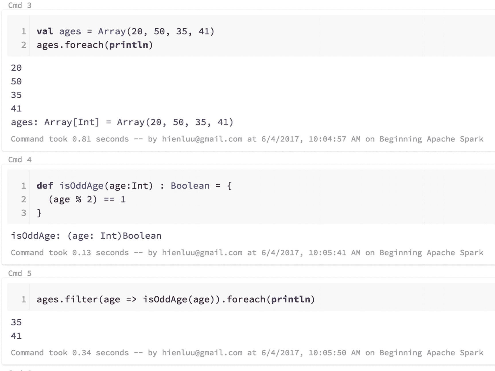

图 2-39 “Scala 交互”部分中剩余的代码语句

与 Spark Scala Shell 一样，Scala 笔记本是一个功能完整的 Scala 交互式环境，你可以在其中执行 Scala 代码。

现在，输入第二个标记语句以表示笔记本第二部分的开始，然后粘贴“Spark 交互”部分中剩余的代码片段。输出见图 2-40。

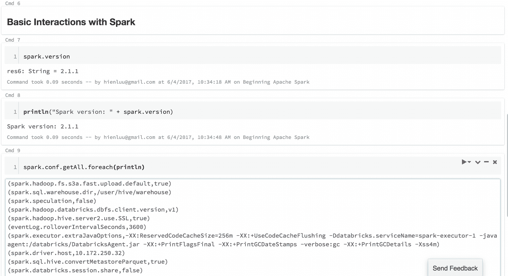

图 2-40 “Spark 交互”部分中代码片段的输出

```
%md #### Spark 基础交互
```

使用 Spark 笔记本时，有几个重要的注意事项需要了解。Spark 笔记本的便捷功能之一是自动保存。当你输入标记语句或代码片段时，笔记本的内容会自动保存。事实上，`文件` 菜单项下的可用菜单选项中甚至没有保存笔记本的选项。

有时需要在两个现有单元格之间创建一个新单元格。一种方法是将鼠标光标移动到两个现有单元格之间的空白处，然后点击出现的加号图标来创建新单元格。加号图标的外观见图 2-41。

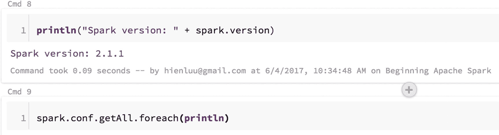

图 2-41 使用加号图标在两个现有单元格之间插入新单元格

有时，你可能希望与远程办公室的同事或其他协作者共享笔记本，以展示你出色的 Spark 知识，或获取他们对某些数据集分析的反饋。Databricks 让这变得很简单。只需点击 Spark 笔记本顶部的 `文件` 菜单项，然后选择 `发布` 子菜单项，如图 2-42 所示。


图 2-42 笔记本发布菜单项

点击 `发布` 子菜单项会弹出确认对话框（图 2-43），如果你继续操作，`笔记本已发布` 对话框（图 2-44）会提供一个 URL，你可以将其发送给世界上的任何人。通过该 URL，你的同事或协作者可以访问笔记本的只读视图，并可以选择将其导入到他们的 Databricks 账户中。


图 2-44 笔记本已发布的 URL


图 2-43 发布确认对话框

本节仅涵盖了使用 Databricks 的基本部分。还有其他高级功能使得 Databricks 成为执行交互式数据分析或构建高级数据解决方案的首选平台。

Databricks CE 使得学习 Spark 比以往任何时候都更加容易。我强烈建议你在学习 Spark 的旅程中尝试一下 Databricks。

## 设置 Spark 源代码

本节面向软件开发人员或任何有兴趣从代码层面了解 Spark 工作原理的人。由于 Apache Spark 是一个开源项目，其源代码是公开的，你可以下载、检查并研究某些功能是如何实现的。Spark 代码是由地球上最优秀的 Scala 程序员用 Scala 编写的，因此研究 Spark 代码是提升你 Scala 编程技能和知识的另一种方式。

有两种方法可以将 Apache Spark 源代码下载到你的计算机上。第一种方法是从 Spark 下载页面（`http://spark.apache.org/downloads.html`）下载，该页面与你之前下载 Spark 二进制文件时使用的页面相同。这次选择 `源代码` 包类型，如图 2-45 所示。


图 2-45 Apache Spark 源代码下载选项

要完成源代码下载过程，请点击第 4 行的链接下载压缩的源代码文件。最后一步是将该文件解压缩到你选择的目录中。

第二种下载 Apache Spark 源代码的方法是使用 `git clone` 命令。这需要在你的计算机上安装 `git`。你可以从 `https://git-scm.com/downloads` 下载 `git`；安装说明可在 `https://git-scm.com/book/en/v2/Getting-Started-Installing-Git` 找到。一旦 `git` 正确安装在你的计算机上，执行以下命令来克隆 GitHub 上的 Apache Spark `git` 仓库（`https://github.com/apache/spark`）：

```
git clone git://github.com/apache/spark.git
```

Spark 中大约有 2,600 个 Scala 文件，因此下载所有这些文件需要一两分钟。

一旦 Apache Spark 源代码下载到你的计算机上，请查看 `http://spark.apache.org/developer-tools.html` 了解如何将它们导入到你喜欢的 IDE 中的详细信息。

## 总结

在本章中，你学习了以下内容：

- 有几种工具可用于学习 Spark。你可以使用本地安装的 Spark，也可以使用 Databricks CE 账户。这些工具让任何人都能轻松学习 Spark。
- Spark Shell 是一个强大的交互式环境，可用于学习 Spark 或以交互方式分析数据。Spark Shell 有两种类型：Spark Scala Shell 和 Spark Python Shell。
- Spark Shell 提供了一组命令，帮助用户提高工作效率。
- Databricks 是一个完全托管的数据平台，旨在简化大数据处理，并赋能任何人轻松构建和部署高级分析解决方案。其交互式工作区可帮助你按文件夹组织笔记本。每个笔记本都包含标记语句和 Spark 代码片段的组合。与他人共享笔记本只需点击几下鼠标即可完成。
- 对于真正有兴趣了解 Spark 内部原理的软件开发人员来说，下载并研究 Apache Spark 源代码是满足这种好奇心的绝佳方式。

