# Databricks 简介

`Databricks` 是一款由名为 `Databricks` 的公司提供的商业产品，该公司是 `Apache Spark` 背后的主要推动力量。根据其产品文档，`Databricks` 是一个运行在云端的即时数据平台，并且是完全托管的。该平台的主要目标是简化大数据处理，让任何人都能轻松构建和部署高级分析解决方案。它围绕 `Apache Spark` 构建，并为全球客户提供四大核心价值主张。详情请参见图 2-21。

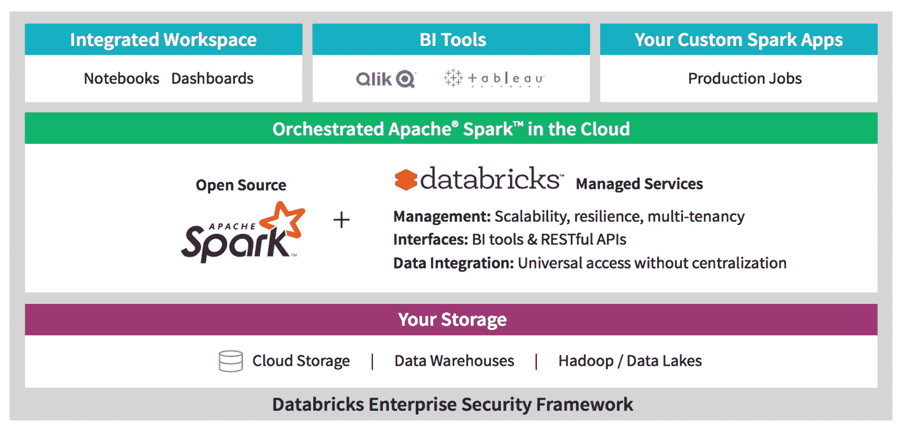

图 2-21

Databricks 平台

*   完全托管的 Spark 集群
*   用于探索和可视化的交互式工作区
*   生产流水线调度器
*   为您喜爱的基于 Spark 的应用提供支持的平台

`Databricks` 产品有两个版本：完整平台版和社区版。完整平台版是付费产品，供公司利用 `Databricks` 产品中的所有高级功能。社区版是免费的，非常适合那些想要试用 `Databricks` 并学习 `Apache Spark` 的用户。

下一节将介绍 `Databricks` 社区版的基本功能，以便您使用 `Databricks` 来学习 `Apache Spark`。一旦您熟悉了 `Databricks`，您会发现学习 `Spark`、执行数据分析或构建 `Spark` 应用程序变得简单直观。本节并非旨在成为 `Databricks` 产品的全面指南。未来的所有示例都将在 `Spark` shell 中完成。有关 `DataBricks` 的全面指南，请参阅 [`https://docs.databricks.com/user-guide/index.html`](https://docs.databricks.com/user-guide/index.html)。

使用 `Databricks` 的第一步是在 `Databricks` 社区版上注册一个免费账户，网址为 [`https://accounts.cloud.databricks.com/registration.html#signup/community`](https://accounts.cloud.databricks.com/registration.html#signup/community)。这个过程非常简单快捷，几分钟内即可创建账户。在注册表单中提供并提交必要信息后，您将收到一封来自 `Databricks` 的确认邮件，内容类似于图 2-22。

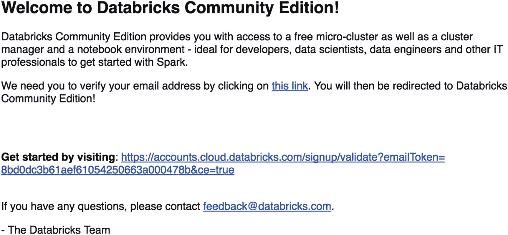

图 2-22

Databricks 用于确认电子邮件地址的邮件

点击上一封邮件中的链接，您将进入 `Databricks` 登录表单，如图 2-23 所示。

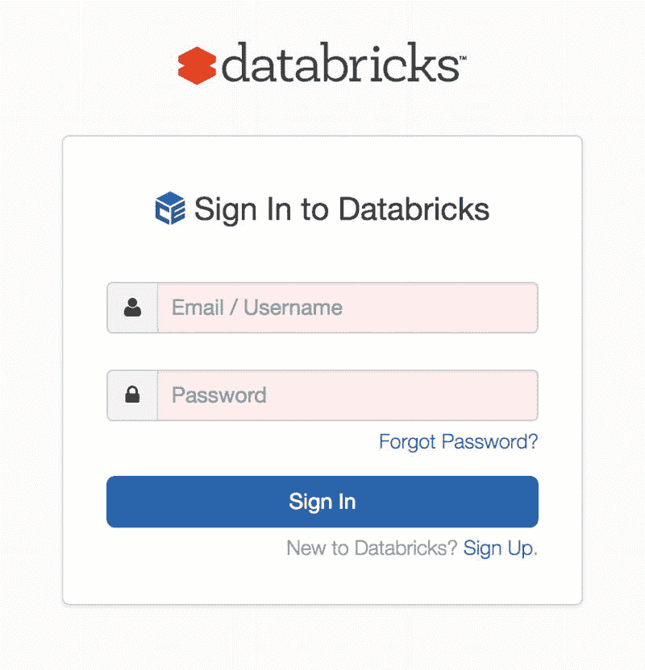

图 2-23

Databricks 登录页面

使用您在注册步骤中提供的电子邮件和密码成功登录后，您将看到 `Databricks` 欢迎页面，如图 2-24 所示。

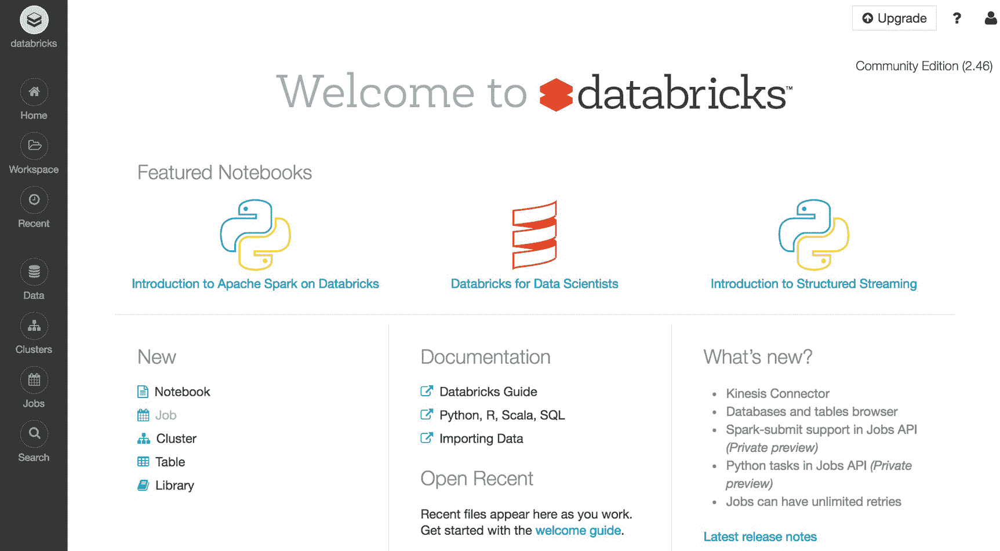

图 2-24

Databricks 欢迎页面

随着时间的推移，欢迎页面可能会发生变化，因此可能不完全像图 2-24 所示。您可以随意浏览页面顶部的那些特色笔记本。

本节的目标是在 `Databricks` 中创建一个笔记本，以便您可以学习上一节中介绍的命令。为此，您需要执行以下操作：

1.  创建一个集群。
2.  创建一个文件夹。
3.  创建一个笔记本。

## 创建集群

`Databricks` 社区版（CE）最酷的功能之一是它免费提供一个具有 6GB 内存的单节点 `Spark` 集群。在撰写本书时，此单节点集群托管在 `AWS` 云上。每个 `Databricks` CE 账户一次只能创建一个集群。只要集群正在使用，它就会保持运行状态。如果集群空闲一段时间（两小时），`Databricks` 会自动将其关闭。这意味着您可以自行关闭集群，也可以让 `Databricks` 代您关闭。

要创建集群，请单击页面左侧垂直导航栏中的 `Clusters` 图标。`Clusters` 页面如图 2-25 所示。

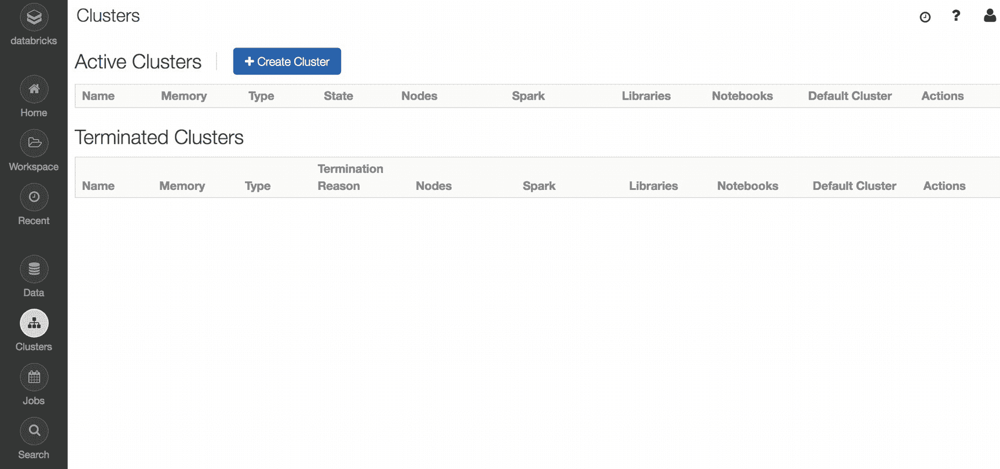

图 2-25

无活动集群的 Databricks Clusters 页面

现在单击 `Create Cluster` 按钮，调出 `New Cluster` 表单，如图 2-26 所示。

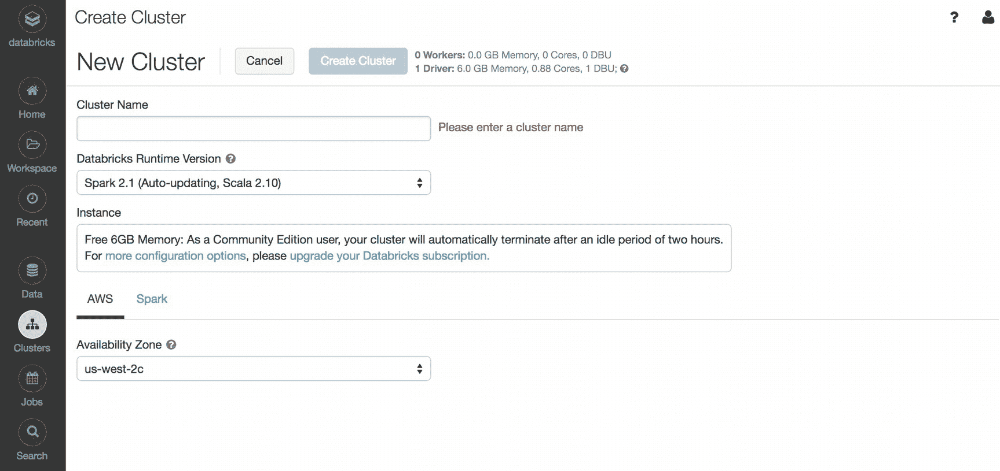

图 2-26

创建集群表单

此表单上唯一必填的字段是 `Cluster Name`。表 2-4 简要描述了所有字段。

表 2-4

Databricks 新集群表单上的字段

| 名称 | 描述 |
| --- | --- |
| 集群名称 | 这是用于标识集群的唯一名称。名称的每个单词之间可以有空格。例如，可以命名为“my spark cluster”。 |
| Databricks 运行时版本 | `Databricks` 支持多个版本的 `Spark`。出于学习目的，请选择已为您自动填写的**最新版本**。每个版本都绑定到特定的 `AWS` 镜像。 |
| 实例 | 对于 CE 版，没有其他选择可用。 |
| AWS – 可用区 | 这允许您决定单节点集群将在哪个 `AWS` 可用区中运行。根据您的位置，选项可能有所不同。 |
| Spark – Spark 配置 | 这允许您指定启动 `Spark` 集群时应包含的任何特定于应用程序的配置。例如，包括 `JVM` 配置、启用某些 `Spark` 功能的能力等。 |

填写 `Cluster Name` 字段后，单击 `Create Cluster` 按钮。根据具体情况，创建单节点 `Spark` 集群可能需要一分钟到十分钟的时间。`Spark` 集群成功创建后，集群名称旁边会出现一个绿点，如图 2-27 所示。

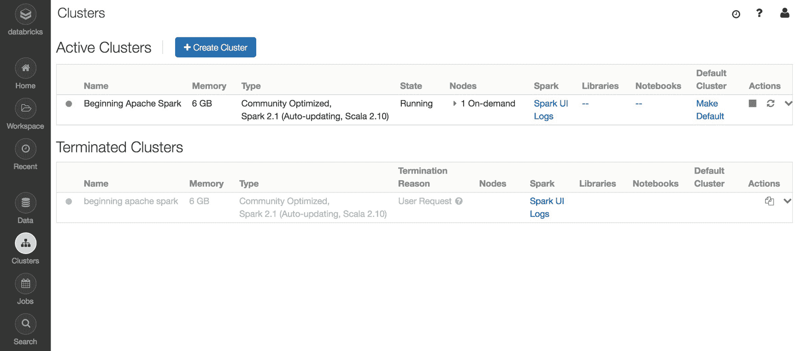

图 2-27

集群成功创建后

您可以随意单击集群名称或此页面上的各种链接进行探索。请注意，如果您尝试按照前面的步骤创建另一个 `Spark` 集群，`Databricks` 将不允许您在已有正在运行的集群时执行此操作。

要停止活动的 `Spark` 集群，请单击 `Actions` 列中的方形按钮。

有关在 `Databricks` 上创建和管理 `Spark` 集群的更多信息，请参阅 [`https://docs.databricks.com/user-guide/clusters/index.html`](https://docs.databricks.com/user-guide/clusters/index.html)。

让我们继续下一步，即创建一个文件夹。


### 创建文件夹

在介绍如何创建文件夹之前，有必要先花点时间描述一下 Databricks 中的工作区概念。理解工作区最简单的方式是将其视为计算机上的根文件夹，这意味着你可以将文件放在其中，或创建文件夹来以特定方式组织文件。

要创建文件夹，请点击页面左侧垂直导航栏中的 `Workspace` 图标。`Workspace` 列将滑出，如图 2-28 所示。

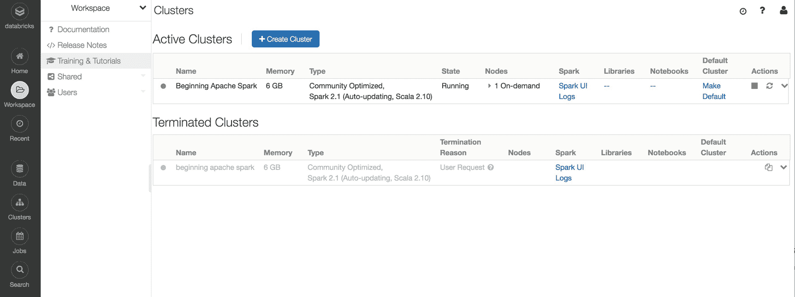

图 2-28

工作区列

现在点击 `Workspace` 列右上角的下拉箭头，将出现一个级联下拉菜单，如图 2-29 所示。

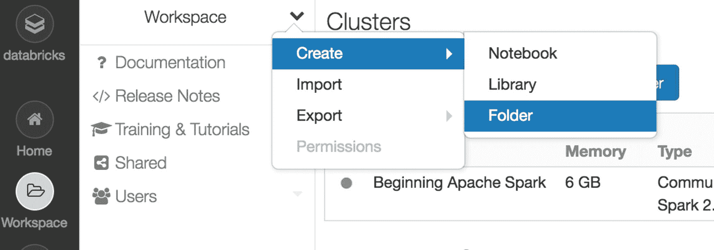

图 2-29

用于创建文件夹的菜单项

选择 `Folder` 菜单项将弹出 `New Folder Name` 对话框，如图 2-30 所示。

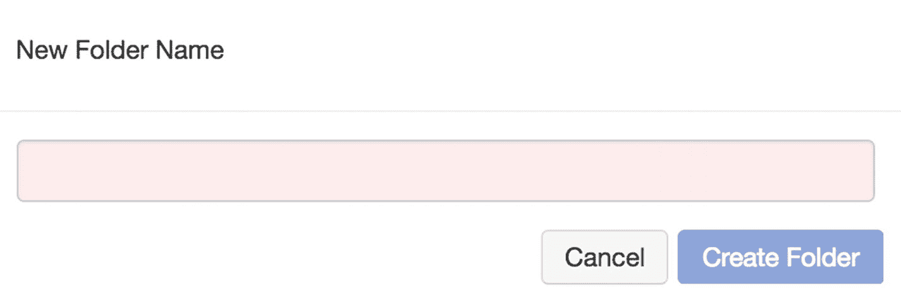

图 2-30

新建文件夹名称对话框

现在你可以输入一个文件夹名称，例如 `Chapter 2`，然后点击 `Create Folder` 按钮完成操作。`Chapter 2` 文件夹现在应该会出现在 `Workspace` 列中，如图 2-31 所示。

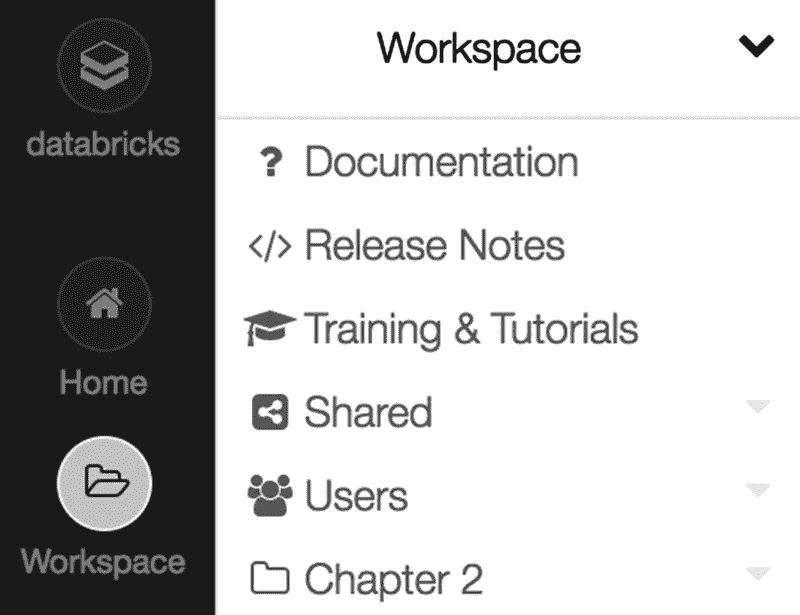

图 2-31

`Chapter 2` 文件夹出现在 `Workspace` 列中

在继续创建笔记本之前，值得一提的是还有另一种创建文件夹的方法：将鼠标指针放在 `Workspace` 列中的任意位置并右键单击，然后会出现相同的菜单选项。

有关使用工作区和创建文件夹的更多详细信息，请查看 [`https://docs.databricks.com/user-guide/workspace.html`](https://docs.databricks.com/user-guide/workspace.html)。

### 创建笔记本

接下来，你需要在 `Chapter 2` 文件夹中创建一个 Scala 笔记本。首先在 `Workspace` 列中选择 `Chapter 2` 文件夹。`Chapter 2` 列会在 `Workspace` 列之后滑出，看起来如图 2-32 所示。

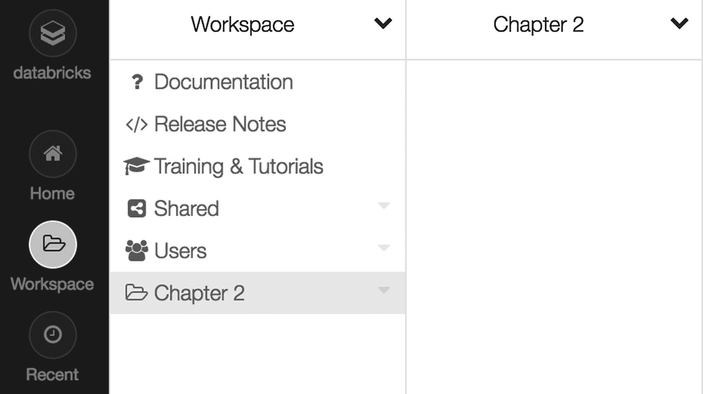

图 2-32

`Chapter 2` 列出现在 `Workspace` 列的右侧

现在，你可以点击 `Chapter 2` 列右上角的下拉箭头，或者在 `Chapter 2` 列中的任意位置右键单击，以调出菜单，如图 2-33 所示。

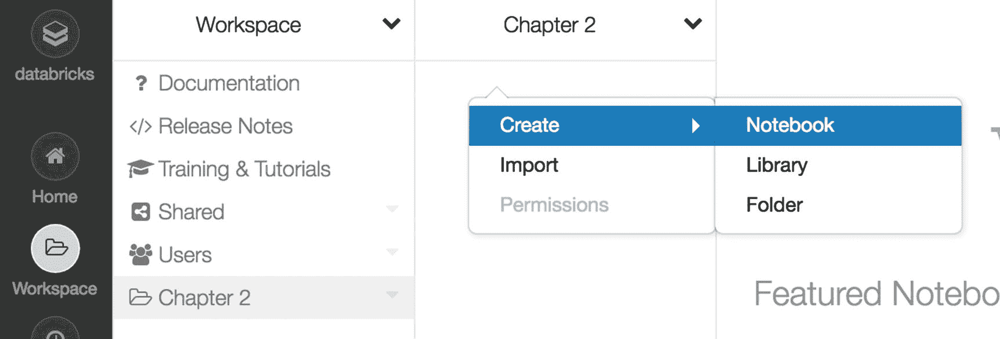

图 2-33

创建笔记本菜单项

选择 `Notebook` 菜单项将弹出 `Create Notebook` 对话框。为你的笔记本命名，并确保在 `Language` 字段中选择 `Scala` 选项。集群的值应自动填充，因为 Databricks CE 版本一次只能有一个集群。你的对话框应该看起来如图 2-34 所示。

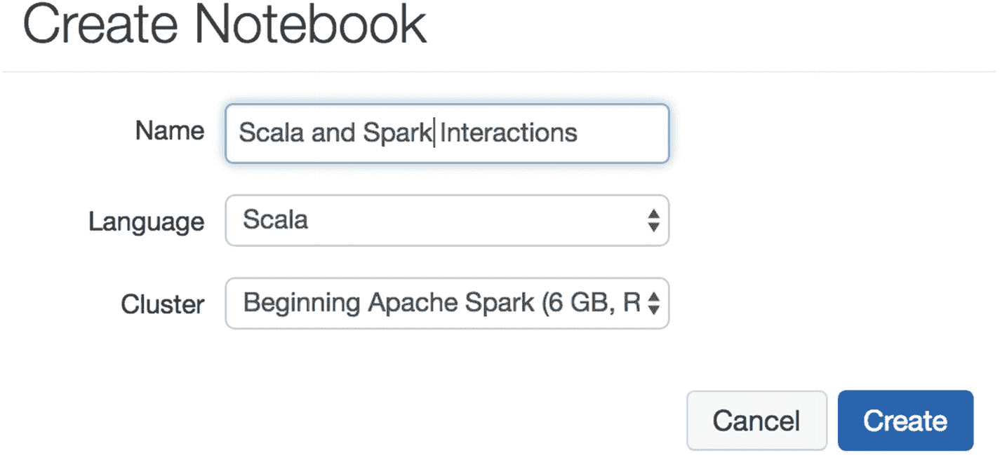

图 2-34

已选择 `Scala` 语言选项的 `Create Notebook` 对话框

点击 `Create` 按钮后，将创建一个新的笔记本，如图 2-35 所示。

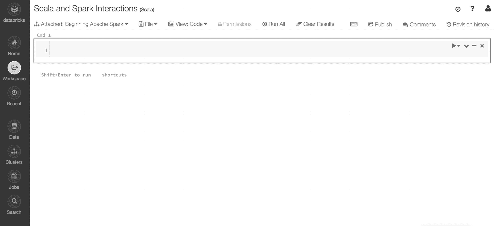

图 2-35

新的 Scala 笔记本

如果你从未使用过 IPython Notebook，笔记本的概念一开始可能看起来有点奇怪。不过，一旦你习惯了，你就会喜欢上它。

*笔记本*本质上是一个交互式计算环境（类似于 Spark shell，但要好得多），你可以在其中执行 Spark 代码，使用 Markdown 或 HTML 以富文本格式记录代码，并通过各种类型的图表和图形可视化数据分析结果。

下一节将仅介绍一些基本指令，以帮助你高效使用 Spark 笔记本。有关如何使用 Databricks 笔记本并进行交互的完整指令列表，请参阅 [`https://docs.databricks.com/user-guide/notebooks/index.html`](https://docs.databricks.com/user-guide/notebooks/index.html)。

一个 Spark 笔记本包含一组单元格，每个单元格包含一个代码块，用于执行或标记为文档用途。


### 注意

使用 Spark 笔记本的一个良好实践是将数据处理逻辑拆分为多个逻辑组，使每个组位于一个或多个单元格中。这与开发可维护软件应用程序的实践类似。

你需要将笔记本分为两部分。第一部分包含你在前面“Scala 基础交互”部分输入的代码片段，第二部分包含你在前面“Spark 基础交互”部分输入的代码片段。

首先，在笔记本的第一个单元格中添加一个 Markdown 语句，输入以下内容（见图 2-36）：

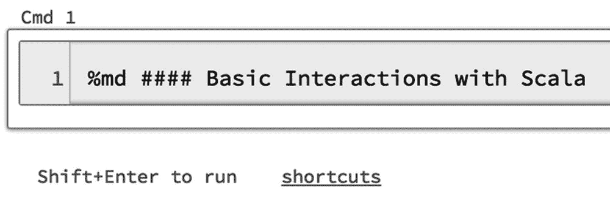

**图 2-36** 包含章节标题标记语句的单元格

```
%md #### Scala 基础交互
```

要执行该标记语句，首先确保鼠标光标位于单元格 1 中，然后按住 `Shift` 键并按下 `Enter` 键。这是在单元格中运行代码或标记语句的快捷键。结果应如图 2-37 所示。

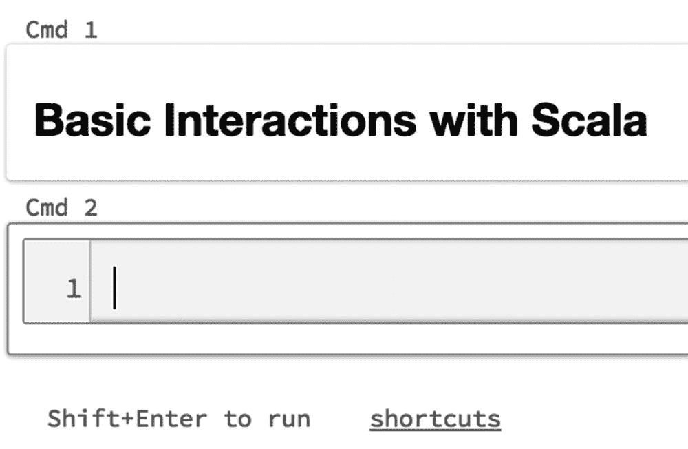

**图 2-37** 在单元格中执行标记语句的输出

请注意，`Shift+Enter` 组合键不仅执行了该单元格中的内容，还在其下方创建了一个新单元格。现在，将之前的“Hello World”示例输入到第二个单元格中并执行该单元格。输出应如图 2-38 所示。

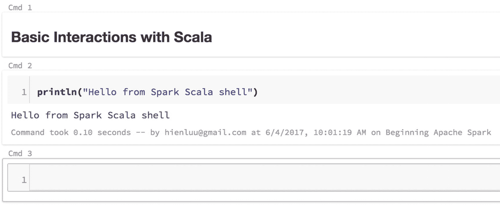

**图 2-38** 执行 `println` 语句的输出

将“Scala 交互”部分中剩余的三个代码语句复制到笔记本中，如图 2-39 所示。

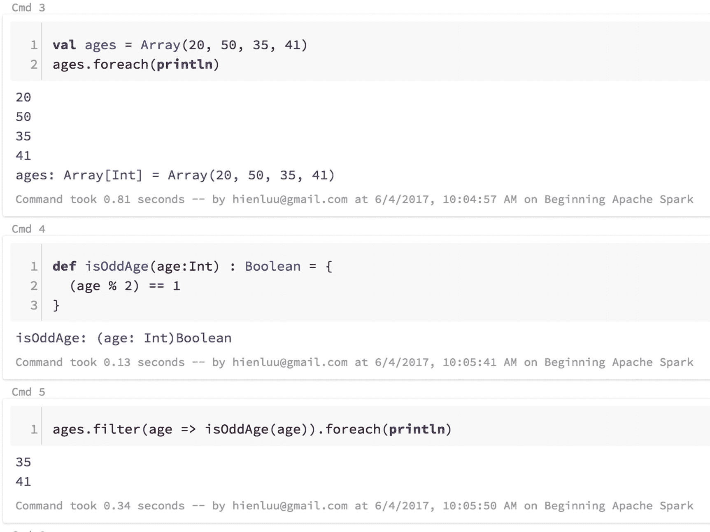

**图 2-39** “Scala 交互”部分中剩余的代码语句

与 Spark Scala Shell 一样，Scala 笔记本是一个功能完整的 Scala 交互式环境，你可以在其中执行 Scala 代码。

现在，输入第二个标记语句以表示笔记本第二部分的开始，然后粘贴“Spark 交互”部分中剩余的代码片段。输出见图 2-40。

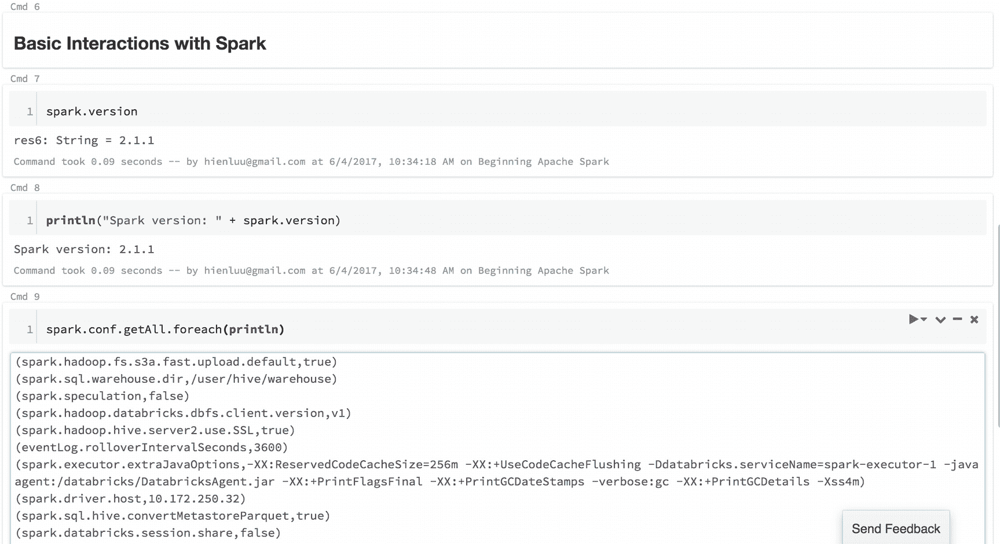

**图 2-40** “Spark 交互”部分中代码片段的输出

```
%md #### Spark 基础交互
```

使用 Spark 笔记本时，有几个重要的注意事项需要了解。Spark 笔记本的便捷功能之一是自动保存。当你输入标记语句或代码片段时，笔记本的内容会自动保存。事实上，`文件`菜单项下的可用菜单选项中甚至没有保存笔记本的选项。

有时需要在两个现有单元格之间创建一个新单元格。一种方法是将鼠标光标移动到两个现有单元格之间的空白处，然后点击出现的加号图标来创建新单元格。加号图标的外观见图 2-41。

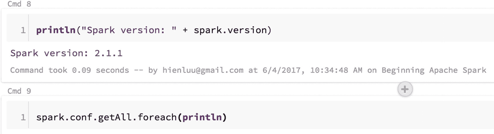

**图 2-41** 使用加号图标在两个现有单元格之间插入新单元格

有时，你可能希望与远程办公室的同事或其他协作者共享笔记本，以展示你出色的 Spark 知识，或获取他们对某些数据集分析的反饋。Databricks 让这变得很简单。只需点击 Spark 笔记本顶部的 `文件` 菜单项，然后选择 `发布` 子菜单项，如图 2-42 所示。

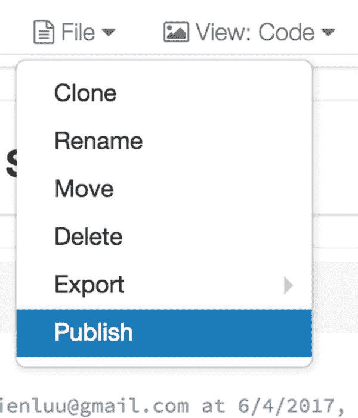

**图 2-42** 笔记本发布菜单项

点击 `发布` 子菜单项会弹出确认对话框（图 2-43），如果你继续操作，`笔记本已发布` 对话框（图 2-44）会提供一个 URL，你可以将其发送给世界上的任何人。通过该 URL，你的同事或协作者可以访问笔记本的只读视图，并可以选择将其导入到他们的 Databricks 账户中。

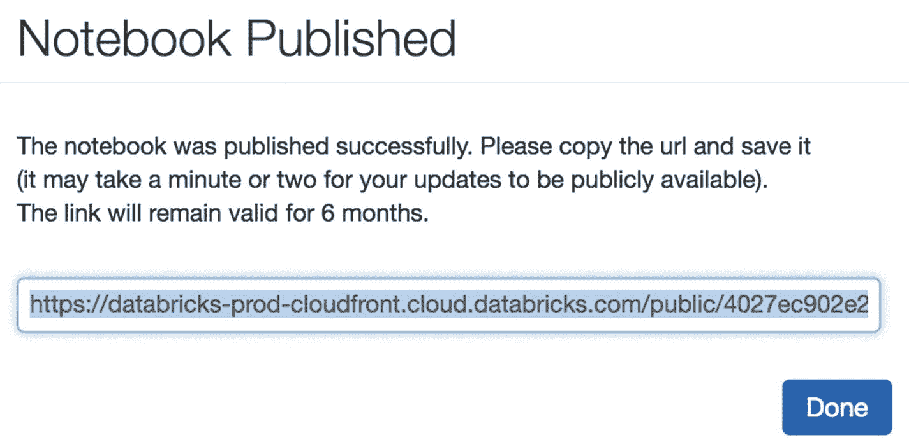

**图 2-44** 笔记本已发布的 URL

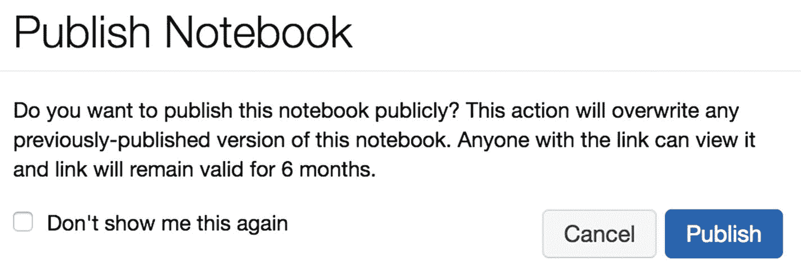

**图 2-43** 发布确认对话框

本节仅涵盖了使用 Databricks 的基本部分。还有其他高级功能使得 Databricks 成为执行交互式数据分析或构建高级数据解决方案的首选平台。

Databricks CE 使得学习 Spark 比以往任何时候都更加容易。我强烈建议你在学习 Spark 的旅程中尝试一下 Databricks。

## 设置 Spark 源代码

本节面向软件开发人员或任何有兴趣从代码层面了解 Spark 工作原理的人。由于 Apache Spark 是一个开源项目，其源代码是公开的，你可以下载、检查并研究某些功能是如何实现的。Spark 代码是由地球上最优秀的 Scala 程序员用 Scala 编写的，因此研究 Spark 代码是提升你 Scala 编程技能和知识的另一种方式。

有两种方法可以将 Apache Spark 源代码下载到你的计算机上。第一种方法是从 Spark 下载页面（`http://spark.apache.org/downloads.html`）下载，该页面与你之前下载 Spark 二进制文件时使用的页面相同。这次选择 `源代码` 包类型，如图 2-45 所示。

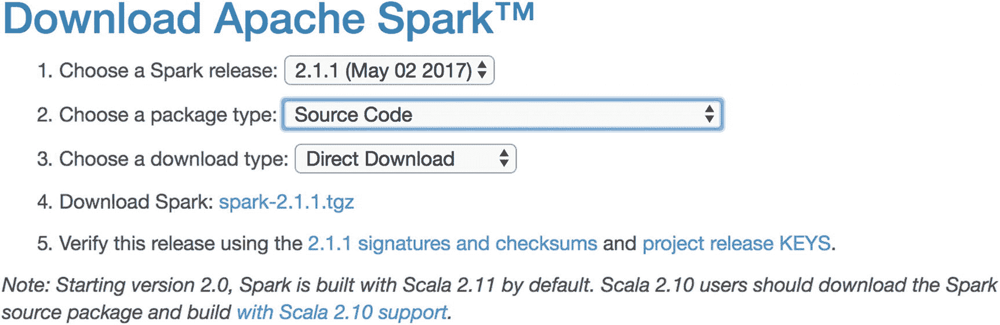

**图 2-45** Apache Spark 源代码下载选项

要完成源代码下载过程，请点击第 4 行的链接下载压缩的源代码文件。最后一步是将该文件解压缩到你选择的目录中。

第二种下载 Apache Spark 源代码的方法是使用 `git clone` 命令。这需要在你的计算机上安装 `git`。你可以从 `https://git-scm.com/downloads` 下载 `git`；安装说明可在 `https://git-scm.com/book/en/v2/Getting-Started-Installing-Git` 找到。一旦 `git` 正确安装在你的计算机上，执行以下命令来克隆 GitHub 上的 Apache Spark `git` 仓库（`https://github.com/apache/spark`）：

```
git clone git://github.com/apache/spark.git
```

Spark 中大约有 2,600 个 Scala 文件，因此下载所有这些文件需要一两分钟。

一旦 Apache Spark 源代码下载到你的计算机上，请查看 `http://spark.apache.org/developer-tools.html` 了解如何将它们导入到你喜欢的 IDE 中的详细信息。


## 总结

在本章中，你学习了以下内容：

- 有几种工具可用于学习 Spark。你可以使用本地安装的 Spark，也可以使用 Databricks CE 账户。这些工具让任何人都能轻松学习 Spark。
- Spark Shell 是一个强大的交互式环境，可用于学习 Spark 或以交互方式分析数据。Spark Shell 有两种类型：Spark Scala Shell 和 Spark Python Shell。
- Spark Shell 提供了一组命令，帮助用户提高工作效率。
- Databricks 是一个完全托管的数据平台，旨在简化大数据处理，并赋能任何人轻松构建和部署高级分析解决方案。其交互式工作区可帮助你按文件夹组织笔记本。每个笔记本都包含标记语句和 Spark 代码片段的组合。与他人共享笔记本只需点击几下鼠标即可完成。
- 对于真正有兴趣了解 Spark 内部原理的软件开发人员来说，下载并研究 Apache Spark 源代码是满足这种好奇心的绝佳方式。

