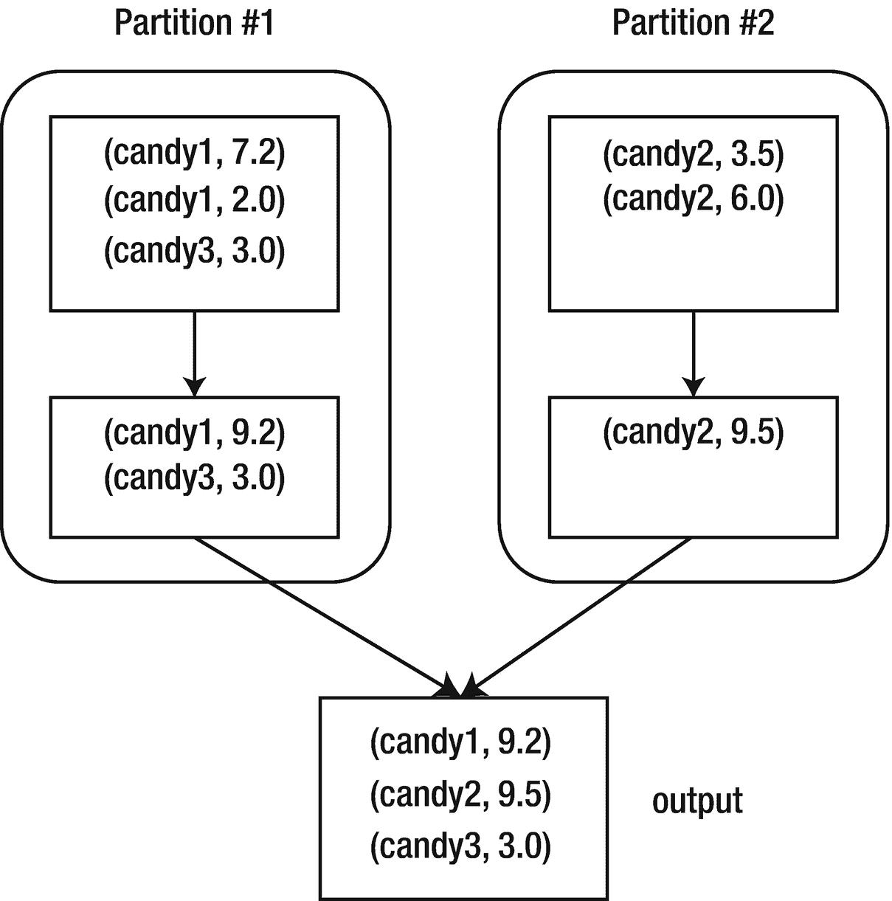

# 键/值对 RDD 转换操作

除了表 3-4 中列出的转换操作外，键/值对 RDD 还拥有一些专门针对键进行操作的额外转换操作。

**表 3-4** 配对 RDD 的常用转换操作

| 名称 | 描述 |
| --- | --- |
| `groupByKey([numTasks])` | 将相同键的所有值分组在一起。对于一个 `(K,V)` 对的数据集，返回的 RDD 类型为 `(K, Iterable<V>)`。 |
| `reduceByKey(func, [numTasks])` | 首先对具有相同键的值进行分组，然后应用指定的 `func` 将值列表缩减为单个值。对于一个 `(K,V)` 对的数据集，返回的 RDD 类型为 `(K, V)`。 |
| `sortByKey([ascending], [numTasks])` | 根据键对行进行排序。默认情况下，键按升序排序。 |
| `join(otherRDD, [numTasks])` | 通过匹配两个 RDD 中的键来连接它们的行。返回的 RDD 的每一行都包含一个元组，其中第一个元素是键，第二个元素是另一个包含两个 RDD 值的元组。 |

表 3-4 中列出的一些转换操作有一个可选的 `numTasks` 参数，该参数用于控制 Spark 在父 RDD 上执行转换操作时的并行度。默认情况下，并行度等于父 RDD 的分区数。在调优过程中，如果认为通过增加并行度可以更快地完成转换操作，那么你可以为 `numTasks` 指定一个大于父 RDD 分区数的值。

以下部分提供了使用表 3-4 中列出的配对 RDD 转换操作的示例。

## `groupByKey([numTasks])`

这个转换操作正如其名。它会将所有具有相同键的行分组到一行中。本质上，返回的 RDD 中的行数将与父 RDD 中唯一键的数量相同。返回的 RDD 中的每一行都包含一个唯一的键以及该键对应的值列表。请参阅清单 3-50 了解如何使用此转换操作；清单 3-51 显示了输出结果。

```
val rdd = sc.parallelize(List("Spark","is","an", "amazing", "piece", "of","technology"))
val pairRDD = rdd.map(w => (w.length,w))
val wordByLenRDD = pairRDD.groupByKey()
wordByLenRDD.collect().foreach(println)
清单 3-50
使用 groupByKey 转换操作按单词长度对单词进行分组
```

```
(10,CompactBuffer(technology))
(2,CompactBuffer(is, an, of))
(5,CompactBuffer(Spark, piece))
(7,CompactBuffer(amazing))
清单 3-51
使用 groupByKey 转换操作按单词长度分组后的输出结果
```

通常，在执行 `groupByKey` 转换操作后，需要对每个键的值列表进行一些处理。如果该处理是使用符合交换律和结合律的二元操作来完成的，那么最好使用 `reduceByKey` 转换操作来加速处理逻辑。你可以在下一节中找到更多关于此的详细信息。

## `reduceByKey(func, [numTasks])`

此转换操作通常用于将相同键的所有值缩减为单个值。该过程分两步进行，如图 3-1 所示。第一步是将相同键的值分组在一起，第二步是将给定的 `reduce` 函数应用于每个键的值列表。此转换操作的实现包含一个内置优化，可以在两个级别上执行此两步过程。第一个级别是在每个单独的分区内，第二个级别是在所有分区之间。通过首先在每个单独的分区内应用此转换操作，它将同一分区内具有相同键的所有行折叠为一行，从而显著减少了需要在多个分区之间移动的数据量。请参阅清单 3-52 了解如何使用此转换操作；清单 3-53 显示了输出结果。



**图 3-1** `reduceByKey` 转换操作中的两步过程

```
val candyTx = sc.parallelize(List(("candy1", 5.2), ("candy2", 3.5),
("candy1", 2.0), ("candy2", 6.0), ("candy3", 3.0))
val summaryTx = candyTx.reduceByKey((total, value) => total + value)
summaryTx.collect()
清单 3-52
使用 reduceByKey 转换操作计算总价
```

```
(candy1,7.2)
(candy2,9.5)
(candy3,3.0)
清单 3-53
计算总价后 reduceByKey 的输出结果
```

## `sortByKey([ascending],[numTasks])`

这个转换操作很容易理解。它根据键对行进行排序，并且可以选择指定结果是按升序（默认）还是降序排列。以清单 3-52 中的示例为基础，交换键和值，这样你就可以根据交易金额对行进行排序。请参阅清单 3-54 了解按交易金额排序的示例；清单 3-55 显示了输出结果。

```
val summaryByPrice = summaryTx.map(t => (t._2, t._1)).sortByKey()
summaryByPrice.collect
清单 3-54
使用 sortByKey 转换操作按价格排序
```

```
Array[(Double, String)] = Array((3.0,candy3), (7.2,candy1), (9.5,candy2))
清单 3-55
使用 sortByKey 转换操作按价格排序后的输出结果
```

如果你想按价格降序排序，只需将第一个参数的值设置为 `false`。请参阅清单 3-56 了解降序排序的示例，并参阅清单 3-57 查看输出结果。

```
val summaryByPrice = summaryTx.map(t => (t._2, t._1)).sortByKey(false)
summaryByPrice.collect
清单 3-56
使用 sortByKey 转换操作按价格降序排序
```

```
(9.5,candy2)
(7.2,candy1)
(3.0,candy3)
清单 3-57
使用 sortByKey 转换操作按价格降序排序后的输出结果
```


### `join(otherRDD)`

进行任何有意义的数据分析通常都涉及连接两个或多个数据集。`join` 转换用于合并两个数据集的信息，以实现丰富的数据分析或提取洞察。例如，如果一个数据集包含交易信息，其中包含会员 ID 和交易详情，而另一个数据集包含会员信息，那么通过连接这两个数据集，你可以回答诸如：按年龄组划分的交易分布情况如何，以及哪个年龄组的交易数量最多？

通过连接类型为 `(K,V)` 和 `(K,W)` 的数据集，连接后的数据集结果为 `(K,(V,W))`。连接两个数据集有几种变体，例如左外连接和右外连接。关于这些连接类型行为的更多详细信息，请参考 [`https://en.wikipedia.org/wiki/Join_(SQL)`](https://en.wikipedia.org/wiki/Join_(SQL))。

清单 3-58 中的示例有两个已设置为键/值对 RDD 的数据集。第一个包含会员交易信息。第二个包含每个会员 ID 的信息以及每个会员所属的组。

```
val memberTx = sc.parallelize(List((110, 50.35), (127, 305.2), (126, 211.0),
(105, 6.0),(165, 31.0), (110, 40.11)))
val memberInfo = sc.parallelize(List((110, "a"), (127, "b"), (126, "b"), (105, "a"),(165, "c")))
val memberTxInfo = memberTx.join(memberInfo)
memberTxInfo.collect().foreach(println)
清单 3-58
会员交易数据集与会员组数据集的连接
```

清单 3-58 中的连接是内连接类型，输出仅包含两个数据集中键匹配的行。输出见清单 3-59。

```
(105,(6.0,a))
(165,(31.0,c))
(110,(50.35,a))
(110,(40.11,a))
(126,(211.0,b))
(127,(305.2,b))
清单 3-59
连接转换的输出
```

### 键/值对 RDD 操作

除了表 3-5 中列出的操作外，对 RDD 还有一小部分操作。本节将提供这些操作的一些详细信息和实际示例。这些操作会将结果带回驱动程序端，因此请注意带回的数据量。

**表 3-5** 对 RDD 的操作

| 名称 | 描述 |
| --- | --- |
| `countByKey()` | 返回一个映射，其中每个条目包含键和值的计数 |
| `collectAsMap()` | 行为与 `collect` 操作类似；返回类型是一个映射 |
| `lookup(key)` | 按键执行查找，并返回所有具有相同指定键的值 |

以下部分为表 3-5 中列出的每个操作提供了一个示例。

#### `countByKey()`

对于给定的对 RDD，此操作会忽略每行的值，仅向驱动程序报告每个键具有相同键的值的数量。示例见清单 3-60，输出见清单 3-61。注意返回的数据是 Scala 映射数据结构。

```
val candyTx = sc.parallelize(List(("candy1", 5.2), ("candy2", 3.5), ("candy1", 2.0), ("candy3", 6.0)))
candyTx.countByKey()
清单 3-60
使用 countByKey 统计每个键的元素数量
```

```
scala.collection.Map[String,Long] = Map(candy1 -> 2, candy2 -> 1, candy3 -> 1)
清单 3-61
使用 countByKey
```

#### `collectAsMap()`

与 `collect` 操作类似，此操作会将整个数据集以映射形式带回驱动程序端，其中每个条目代表一行。示例见清单 3-62，输出见清单 3-63。

```
val candyTx = sc.parallelize(List(("candy1", 5.2), ("candy2", 3.5), ("candy1", 2.0), ("candy3", 6.0)))
candyTx.collectAsMap()
清单 3-62
使用 collectAsMap 操作
```

```
scala.collection.Map[String,Double] = Map(candy2 -> 3.5, candy1 -> 2.0, candy3 -> 6.0)
清单 3-63
collectAsMap 操作的输出
```

注意，如果数据集包含多个具有相同键的行，它们将被合并为映射中的一个条目。`candyTx` 对 RDD 中有四行；然而，输出中只有三行。两行 `candy1` 被合并为一行。

#### `lookup(key)`

此操作可用作快速验证 RDD 中是否存在特定键的方法。示例见清单 3-64，输出见清单 3-65。如果存在多个具有相同键的行，则将返回所有这些行的值。

```
val candyTx = sc.parallelize(List(("candy1", 5.2), ("candy2", 3.5), ("candy1", 2.0), ("candy3", 6.0)))
candyTx.lookup("candy1")
candyTx.lookup("candy2")
candyTx.lookup("candy5")
清单 3-64
使用 lookup 操作
```

```
Seq[Double] = WrappedArray(5.2, 2.0)
Seq[Double] = WrappedArray(3.5)
Seq[Double] = WrappedArray()
清单 3-65
清单 3-64 中 lookup 示例的输出
```

### 理解数据混洗

某些键/值转换和操作需要将数据从多个分区移动到其他分区，即跨执行器和机器移动。这个过程称为*混洗*，熟悉它非常重要，因为它是一项开销很大的操作。在混洗过程中，数据需要被序列化、写入磁盘、通过网络传输，最后反序列化。完全避免混洗是不可能的，但有一些技术或最佳实践可以最小化混洗数据的需求。混洗数据会增加 Spark 作业中数据处理完成的延迟。

让我们以 `reduceByKey` 转换为例来理解混洗。此转换需要读取所有分区的数据，以找到 RDD 中所有键的所有值，并且对于每个键，它将来自不同分区的所有值汇集在一起以计算最终值。为了准备混洗，每个分区根据目标分区对数据进行排序，然后将它们写入单个文件。在目标分区上，它将根据其分区索引读取此文件的相关块。

通常，任何执行某种按键分组、聚合或连接的转换或操作都需要执行数据混洗。以下是属于此类别的部分转换：`groupByKey`、`reduceByKey`、`aggregateByKey` 和 `join`。


