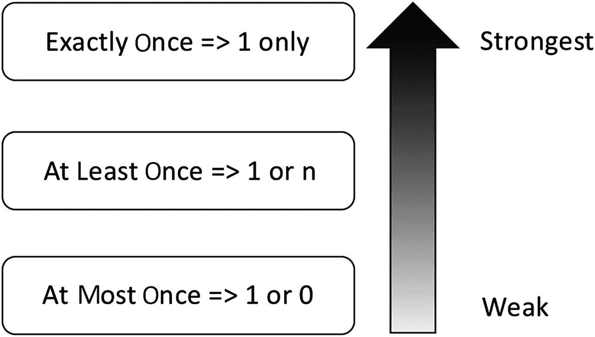
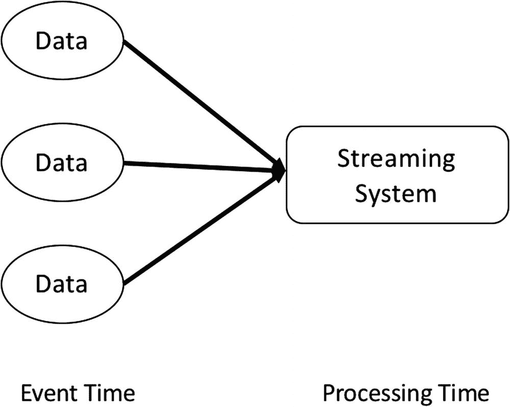
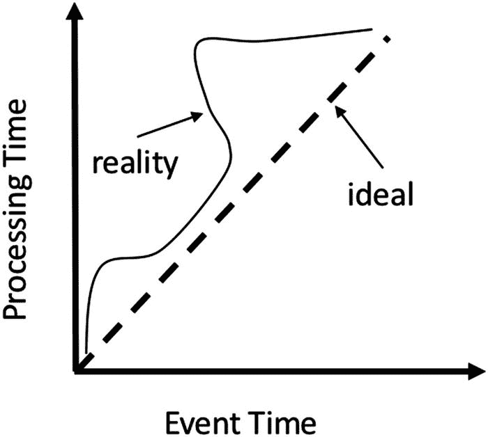
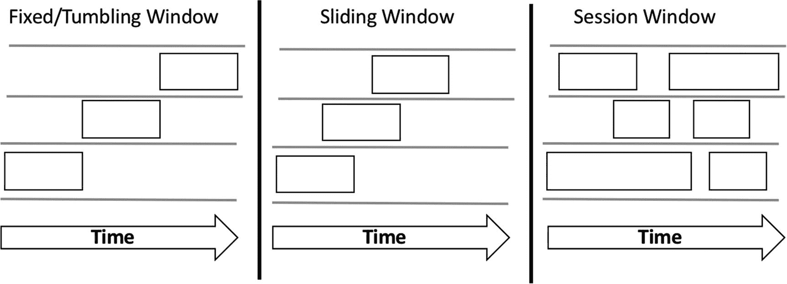
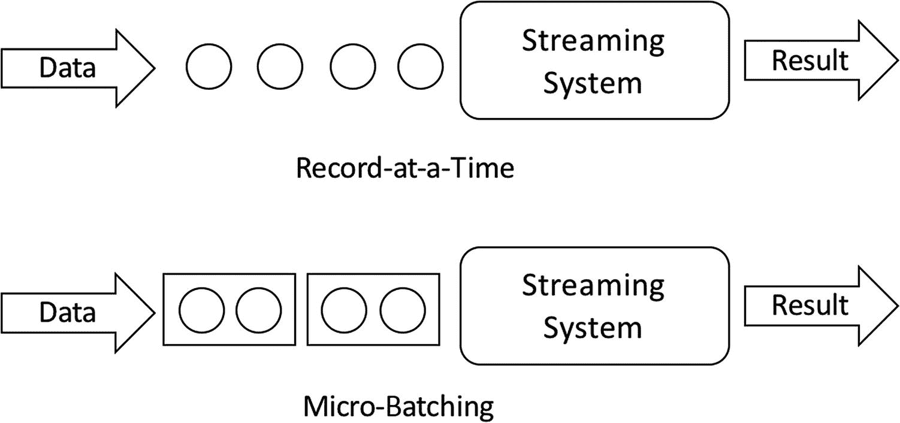
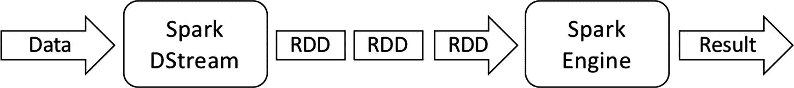
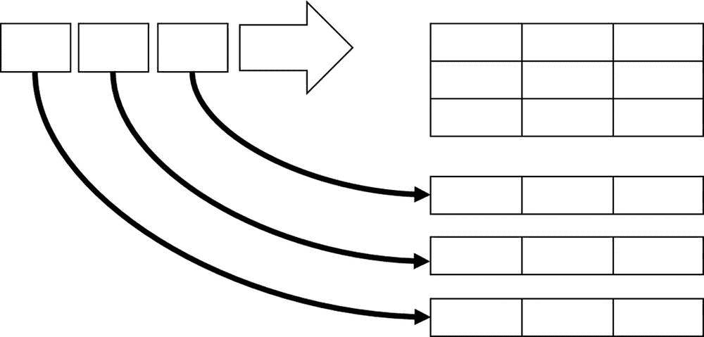
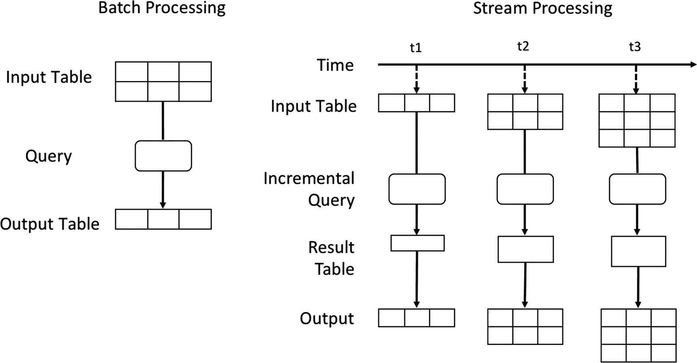
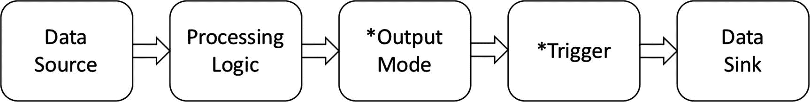
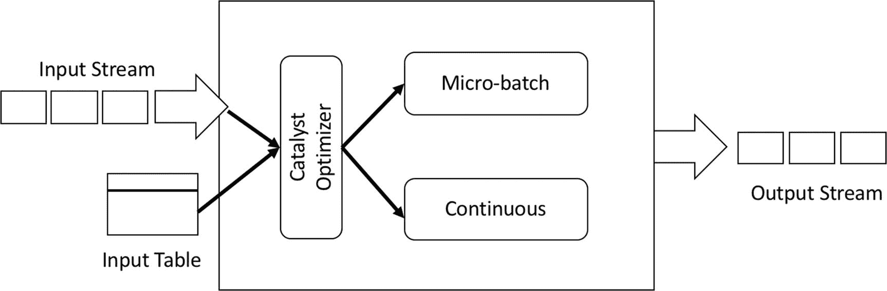

# 6. Spark Streaming

除了批数据处理之外，流数据处理已成为任何希望利用实时数据价值以增强竞争优势或改善用户体验的企业必备的能力。随着物联网的出现，实时数据的体量和速度比以往任何时候都增长得更快。对于 Facebook、LinkedIn 和 Twitter 等互联网公司而言，其平台上每秒发生的数百万次社交活动都以流数据的形式呈现。

从高层次来看，流处理是关于对无界数据流进行持续处理。以大规模、容错且一致的方式做到这一点是一项相当具有挑战性的任务。幸运的是，像 Spark、Flink、Samza、Heron 和 Kafka 这样的流处理引擎在过去几年中一直在稳步且显著地成熟，使企业能够构建和运营复杂的流处理应用程序。

随着社区对如何最好地将日益成熟的流处理引擎应用于其业务需求的理解加深，越来越多有趣的实时数据处理用例涌现出来。例如，Uber 利用流处理能力近乎实时地了解其平台上的乘客和司机数量，这些近乎实时的洞察影响着业务决策，例如将城市中低需求区域的过剩司机转移到高需求区域。大多数互联网公司在发布新功能或尝试新设计时，都会利用某种 A/B 实验系统进行 A/B 测试。流处理通过将了解实验效果所需的时间从几天缩短到几小时，从而能够更快地对实验做出反应。欺诈检测是一个拥抱流处理的领域，因为它能从对欺诈活动的即时洞察中获益，从而可以阻止或监控这些活动。对于拥有数百个在线服务的大型公司来说，一个常见需求是通过流数据处理近乎实时地处理生成的大量日志来监控其健康状况。还有更多有趣的实时数据处理用例，其中一些将在本章中分享。

本章首先描述一些有用的流处理概念，然后简要介绍流处理引擎的格局。接着，本章的其余部分将详细描述 Spark 流处理引擎及其提供的 API。

# 流处理

在大数据领域，随着 Hadoop 的引入，批数据处理广为人知。流行的 `MapReduce` 框架是 Hadoop 生态系统中的组件之一，它凭借其强大的能力和稳健性成为了批数据处理领域的王者。在批数据处理领域经历了一段创新期后，该领域的大部分挑战如今都已得到充分理解。自那以后，大数据开源社区已将关注点和创新方向转向了流数据处理领域。

批数据处理是指对固定的输入数据集运行计算逻辑，并在最后产生结果。这意味着当处理到数据集末尾时，处理过程就会停止。相比之下，流数据处理是对无界数据集运行计算逻辑，因此处理过程是持续且长期运行的。尽管批数据和流数据的主要区别在于数据的有界性，但由于数据无界的特性、实时数据的到达顺序、数据到达的不同速率，以及在机器故障情况下对正确性和低延迟的期望，流数据处理比批数据处理要复杂和具有挑战性得多。

在批数据处理领域，由于输入数据集规模庞大，一个复杂的批处理作业耗时数小时完成的情况并不少见。而在流数据处理领域，人们期望流处理引擎能够尽可能快速高效地处理传入的数据流，从而能够快速做出反应或提取洞察，以此提供低延迟和高吞吐量。执行任何有意义且有趣的流数据处理，通常都需要以容错的方式维护某种状态。例如，一个股票交易流处理应用希望维护并显示当天交易最活跃的前 10 或 20 只股票。为了实现这一目标，每只股票的实时计数必须由流处理引擎代表应用来维护，或者由应用自身来维护。通常，状态会保存在内存中，并由磁盘等弹性存储作为后盾，这样状态就能抵御机器故障。

流数据处理并非孤立运作。有时需要与批数据处理协同工作，以丰富传入的流数据。一个很好的例子是，当页面浏览流处理应用需要根据用户位置计算其页面浏览统计信息时，它就需要将用户点击和流数据与成员数据关联起来。一个好的流处理引擎应提供一种简便的方法，无需太多精力就能将批数据与流数据关联起来。

流数据处理的一个常见用例是对传入的数据执行某些聚合操作，然后将汇总后的数据写入外部数据接收端，供 Web 应用或数据分析引擎消费。这里的期望是，在面对故障（无论是机器故障还是数据处理应用中的某些错误）时，能够实现端到端、恰好一次的数据保证。关键在于流处理引擎如何处理故障，以确保传入数据既不丢失，也不会被重复计数。

随着流处理引擎的成熟，它们不仅提供了所需的分布式系统特性，如快速、可扩展和容错，还通过将抽象层次从低级 API 提升到高级声明式语言（如 `SQL`），提供了简单且对开发者友好的方式来执行数据流计算。借助这一进步，构建一个自助式流处理平台变得更加容易，使产品团队能够通过利用公司内各种产品生成的数据或事件，快速做出有意义的业务决策。请记住，数据流处理的目标之一就是及时提取业务洞察，以便企业能够快速做出反应或采取业务行动。

总而言之，流数据处理有其自身的一系列独特挑战，这些挑战源于处理连续且无界的数据。当你着手构建长期运行的流数据处理应用，或评估某个特定的流处理引擎时，务必留意这些挑战。这些挑战如下：

*   以可靠的方式为数据流应用维护可能很大的状态
*   高效快速地传递消息供应用处理
*   处理乱序到达的流数据
*   与批数据关联以丰富传入的流数据
*   即使在发生故障时，也能实现端到端、恰好一次的数据传递保证
*   处理不均匀的数据到达速率

## 概念

为了有效地进行流数据处理，理解以下核心且通用的概念至关重要。这些重要概念非常适用于在任何流处理引擎上开发流应用。了解这些概念在评估流处理引擎时会很有用；它们还能让你提出正确的问题，以了解特定流处理引擎在以下每个领域提供了多少支持：

*   数据传递语义
*   时间概念
*   窗口

# 数据投递语义

当一条数据进入流处理引擎时，引擎有责任将其投递给流应用程序进行处理。即使在故障场景下，流处理引擎也能提供三种类型的保障。

- **至多一次**：这意味着流处理引擎保证每条数据最多被投递给应用程序一次，但也可能为零次。换句话说，数据存在丢失的可能性，因此应用程序可能完全看不到该数据。对于某些用例来说，这是可以接受的，但对于其他用例则不然。其中一个例子是金融交易处理应用程序。数据丢失可能导致无法向客户收费，从而造成收入减少。
- **至少一次**：这意味着流处理引擎保证每条数据会被投递给应用程序一次或多次。在这种情况下不会丢失数据，但可能出现重复计数或三次计数的情况。以金融交易处理应用程序为例，这意味着同一笔交易会被多次执行，从而引发客户投诉。这种保障比"至多一次"更强，因为不会丢失任何数据。
- **恰好一次**：这意味着流处理引擎保证每条数据仅被投递给应用程序一次，不多也不少。在这种情况下，既不会丢失数据，也不会出现重复计数。大多数现代流行的流处理引擎都提供这种保障。在这三种保障中，这是构建关键业务流应用程序最理想的选择。

看待这些投递语义的一种方式是，它们构成了一个频谱，其中"至多一次"是最弱的保障，"恰好一次"是最强的保障，如图 6-1 所示。



图 6-1

投递语义频谱

在评估流处理引擎时，不仅要理解其提供的保障级别，还要理解该保障背后的实现方式。大多数现代流处理引擎结合使用检查点（check-pointing）和预写日志（write-ahead log）技术来提供"恰好一次"的保障。

# 时间概念

在流数据处理领域，时间概念非常重要，因为它能让你从时间维度理解正在发生的事情。例如，在实时异常检测应用程序中，时间概念能让你洞察过去五分钟内或一天中某个时段发生的可疑交易数量。

有两种重要的时间类型：`事件时间`和`处理时间`。如图 6-2 所示，`事件时间`代表数据被创建的时间，该信息通常编码在数据中。例如，对于测量世界某处海洋温度的物联网设备，`事件时间`就是温度被测量的时刻。温度数据的编码可能包含温度值本身和一个时间戳。`处理时间`则代表流处理引擎处理一条数据的时间。在海洋温度物联网设备的例子中，`处理时间`就是流处理引擎开始对温度数据执行转换或聚合操作时的时钟时间。



图 6-2

`事件时间`和`处理时间`

要真正理解传入数据流背后的情况，必须能够根据`事件时间`处理传入数据，因为`事件时间`代表了数据被创建的时间点。在理想状态下，数据会在创建后不久到达并被处理，因此`事件时间`和`处理时间`之间的差距很小。但在现实中，情况往往并非如此，因此延迟会根据阻碍数据在创建后立即到达的条件而随时间变化。延迟越大，就越需要能够使用`事件时间`而非`处理时间`来处理数据。图 6-3 说明了`事件时间`和`处理时间`之间的关系，并展示了现实中延迟可能呈现的样子。时间概念与接下来要描述的窗口概念密切相关。为了处理无界的传入数据流，流数据处理领域的一种常见做法是使用开始时间和结束时间作为边界，将传入数据划分为多个数据块。很明显，使用`事件时间`作为时间边界更为合理。



图 6-3

`事件时间`与`处理时间`之间的延迟

## 窗口化

鉴于流式数据的无界特性，对传入的流式数据拥有全局视图是不可行的。因此，为了从传入数据中提取任何有意义的价值，你需要将其分块处理。例如，假设一个交通流量传感器每 20 秒发出一次车辆计数，计算最终总和是不可行的。相反，更合理的做法是询问每分钟或每五分钟有多少辆车经过该传感器。在这种情况下，你需要将交通计数数据分别划分为一分钟或五分钟的块。每个块被称为一个`窗口`。

`窗口化`是一种常见的流式数据处理模式，它将无界的传入数据流根据时间边界划分为块，这些时间边界可以是`事件时间`或`处理时间`，尽管前者更常用于反映数据的实际状况。然而，由于数据可能不会按照其创建顺序到达，或者可能因网络拥塞而延迟，因此不可能始终拥有在该时间窗口内创建的所有数据。

有三种常用的`窗口化`模式，大多数现代流处理引擎都支持它们。图 6-4 展示了这三种模式。



图 6-4：三种常用的`窗口化`模式

`固定/滚动窗口`基本上将传入的数据流划分为固定大小的段，每个段都有一个窗口长度、一个开始时间和一个结束时间。每条传入的数据将被分配到一个且仅一个`固定/滚动窗口`中。有了每个窗口中的这一小批数据，在执行求和、最大值或平均值等聚合操作时就很容易进行推理。

`滑动窗口`是另一种将传入数据流划分为固定大小段的方式，每个段都有一个窗口长度和一个滑动间隔。如果滑动间隔与窗口长度相同，那么它就等同于`固定/滚动窗口`。图 6-4 中的示例显示滑动间隔小于窗口长度。这意味着一条或多条数据将被包含在多个`滑动窗口`中。由于窗口的重叠，聚合结果将比`固定/滚动窗口`更平滑。

`会话窗口`类型通常用于分析用户在网站上的行为。与`固定/滚动窗口`和`滑动窗口`不同，它没有预定的窗口长度。相反，它通常由一个超过某个阈值的不活动间隔来决定。例如，Facebook 上的`会话窗口`长度由用户执行的活动持续时间决定，例如浏览用户动态、发送消息等。

## 流处理引擎概览

开源社区在提出流式数据处理解决方案方面不乏创新。事实上，目前有多种流处理引擎。一些早期的流处理引擎是因需求而生，一些较晚的则源于研究项目，还有一些是从批处理引擎演变而来。本节介绍几个流行的流处理引擎：`Apache Storm`、`Apache Samza`、`Apache Flink`、`Apache Kafka Streams`、`Apache Apex` 和 `Apache Beam`。

`Apache Storm` 是流式数据处理领域的先驱之一，其流行主要与 Twitter 进行的大规模流处理有关。`Apache Storm` 于 2011 年首次发布，并于 2014 年成为 Apache 顶级项目。2015 年，Twitter 放弃了 `Apache Storm`，转而使用 `Heron`，后者是 `Apache Storm` 的下一代产品。`Heron` 比 `Apache Storm` 资源效率更高，吞吐量也更好。

`Apache Samza` 由 LinkedIn 创建，用于帮助解决其流处理需求，并于 2013 年开源。它被设计为与 `Kafka` 紧密协作，并运行在 `Hadoop YARN` 之上，以实现进程隔离、安全性和容错性。`Apache Samza` 被设计用于处理流，这些流由有序、可分区、可重放且容错的不可变消息集组成。

`Apache Flink` 最初是作为名为 Stratosphere: Information Management on the Cloud 的研究项目的一个分支开始的。它于 2015 年成为 Apache 顶级项目，此后作为高吞吐量、低延迟的流引擎稳步获得普及。`Apache Flink` 与 `Apache Storm` 和 `Apache Samza` 的一个关键区别在于，`Apache Flink` 在同一引擎中同时支持批处理和流处理。

`Apache Kafka` 已从分布式发布-订阅消息系统演变为分布式流平台。它由 LinkedIn 创建，并于 2012 年成为 Apache 顶级项目。与其他流处理引擎不同，`Kafka` 的流处理能力被打包成一个轻量级库，这使得编写实时流应用程序变得容易。

`Apache Apex` 是该领域相对较新的成员。它由一家名为 DataTorrent 的公司开发，该公司于 2016 年决定将其开源。`Apache Apex` 被认为是一个统一的流和批处理 `Hadoop YARN` 原生平台。

`Apache Beam` 是一个相当有趣的项目，于 2016 年出自 Google。该项目背后的主要思想是提供一个强大且易于使用的模型，用于流处理和批处理，并且该模型可跨多种运行时平台（如 `Apache Flink`、`Apache Spark` 和 Google Cloud DataFlow）移植。换句话说，可以将 `Apache Beam` 视为大数据的超级 API。

有两种标准的流处理模型，前面提到的每个流处理引擎（`Apache Beam` 除外）都采用其中一种。这两种模型称为`逐条记录`和`微批处理`，如图 6-5 所示。



图 6-5：两种不同的流处理模型

两种模型都有其固有的优缺点。`逐条记录`模型顾名思义；它会在每条输入数据到达时立即处理。因此，该模型提供了尽可能低的延迟。`微批处理`模型会等待并根据可配置的批处理间隔累积一小批输入数据，然后并行处理每个批次。很明显，`微批处理`模型无法提供与另一种模型相同的延迟水平。然而，在吞吐量方面，`微批处理`具有更高的速率，因为一批数据以优化的方式处理，因此与另一种模型相比，每条数据的成本较低。一个有趣的附带说明是，在`逐条记录`模型之上构建`微批处理`模型是相当容易的。

在列出的所有流处理引擎中，只有 `Apache Spark` 采用了`微批处理`模型；不过，已经有一些工作正在进行以支持`逐条记录`模型。

# Spark Streaming 概述

Apache Spark 统一数据处理平台之所以广受欢迎，其中一个因素便是它既能执行批处理，也能执行流处理。

在简要介绍了流处理的复杂性与挑战，以及几个核心概念之后，本章的剩余部分将聚焦于 Spark 流处理主题。首先，我们将对 Spark 第一代流处理引擎（称为 `DStream`）的部分功能进行简要且高层次的了解。然后，本章的大部分内容将详细介绍 Spark 的第二代流处理引擎，即 `Structured Streaming`。新的 Spark 流处理应用程序应基于 `Structured Streaming` 进行开发，以利用其提供的一些独特且高级的功能。

## Spark DStream

Spark 第一代流处理引擎于 2012 年推出，该引擎的主要编程抽象称为离散化流，即 `DStream`。其工作原理是采用微批处理模型，将传入的数据流划分为多个批次，然后由 Spark 批处理引擎进行处理。当 `RDD` 是主要的编程抽象模型时，这种方法非常合理。每个批次在内部由一个 `RDD` 表示。一个批次中的数据量是传入数据速率和批次间隔的函数。图 6-6 从高层次展示了 `DStream` 的工作方式。


**图 6-6** Spark DStream

可以从来自 Kafka、AWS Kinesis、文件或套接字等源头的输入数据流创建 `DStream`。创建 `DStream` 时需要的关键信息之一是批次间隔，该间隔可以以秒或毫秒为单位。使用 `DStream`，您可以对传入的数据流应用高级数据处理函数，例如 `map`、`filter`、`reduce` 或 `reduceByKey`。此外，您还可以通过提供窗口长度和滑动间隔，在固定/滚动窗口或滑动窗口上执行归约和计数等窗口操作。需要注意的一点是，窗口长度和滑动间隔必须是批次间隔的倍数。例如，如果批次间隔为三秒，并且使用固定/滚动间隔，则窗口长度和滑动间隔可以是六秒。`DStream` 支持在跨批次数据执行计算时维护任意状态，但这需要手动操作，且有些繁琐。使用 `DStream` 可以做的很酷的事情之一是将其与另一个 `DStream` 或表示静态数据的 `RDD` 进行连接。在所有处理逻辑完成后，您可以使用 `DStream` 将数据写入外部系统，例如数据库、文件系统或 HDFS。

任何新的 Spark 流处理应用程序都应基于第二代 Spark 流处理引擎 `Structured Streaming` 进行开发，这将在下一节中介绍。在本节的剩余部分，您将看到一个小的单词计数 Spark `DStream` 应用程序；目的是让您了解典型的 Spark `DStream` 应用程序是什么样的。清单 6-1 包含了单词计数应用程序的代码，这是 Apache Spark 的一个示例（参见 [`https://bit.ly/2G8N30G`](https://bit.ly/2G8N30G)）。

```
object NetworkWordCount {
def main(args: Array[String]) {
// 创建上下文，批次大小为 1 秒
val sparkConf = new SparkConf().setAppName("NetworkWordCount")
val ssc = new StreamingContext(sparkConf, Seconds(1))
val host = "localhost"
val port = 9999
val lines = ssc.socketTextStream(host, port, StorageLevel.MEMORY_AND_DISK_SER)
val words = lines.flatMap(_.split(" "))
val wordCounts = words.map(x => (x, 1)).reduceByKey(_ + _)
wordCounts.print()
ssc.start()
ssc.awaitTermination()
}
}
```
**清单 6-1** Apache Spark `DStream` 单词计数应用程序

在构建 `DStream` 应用程序时，有几个重要的步骤。`DStream` 应用程序的入口点是 `StreamingContext`，其中一个必需的输入是批次间隔，它定义了 Spark 用于将传入数据批处理到 `RDD` 中进行处理的时间段。它也代表了 Spark 何时应执行流应用程序计算逻辑的触发点。例如，如果批次间隔为三秒，那么 Spark 会将这三秒间隔内到达的所有数据分批；在该间隔结束后，它会将该批数据转换为 `RDD`，并根据您提供的处理逻辑进行处理。创建 `StreamingContext` 后，下一步是通过定义输入源来创建 `DStream` 实例。前面的示例将输入源定义为读取文本行的套接字。在此之后，您需要为新创建的 `DStream` 提供处理逻辑。前面示例中的处理逻辑并不复杂。一旦在一秒后获得了包含多行文本的 `RDD`，Spark 就会执行将每行拆分为单词、将每个单词转换为单词与计数 1 的元组，最后对相同单词的计数进行求和的逻辑。最后，计数结果会打印在控制台上。请记住，流应用程序是一个长期运行的应用程序；因此，它需要一个信号来启动接收和处理传入数据流的任务。该信号通过调用 `StreamingContext` 的 `start()` 函数发出，这通常放在文件的末尾。`awaitTermination()` 函数用于等待流应用程序的执行停止，同时也作为一种机制，防止驱动程序在流应用程序运行时退出。在典型的程序中，一旦最后一行代码执行完毕，程序就会退出。然而，一个长期运行的流应用程序一旦启动就需要持续运行，并且只有在您明确停止它时才会结束。

## Spark Structured Streaming

`Structured Streaming` 是 Spark 的第二代流处理引擎。它的设计目标是更快、更具可扩展性、更容错，并解决第一代流处理引擎的缺点。它旨在让开发人员能够构建端到端的流处理应用程序，这些应用程序可以使用简单的编程模型实时响应数据，该模型构建在 Spark SQL 引擎经过优化且坚实的基础上。`Structured Streaming` 的一个显著特点是它为工程师提供了一种独特且简单的方式来构建流处理应用程序。

构建生产级流处理应用程序需要克服许多挑战，基于此，`Structured Streaming` 引擎旨在帮助应对这些挑战：
*   处理端到端的可靠性并保证正确性
*   对各种传入数据执行复杂转换
*   基于事件时间处理数据，并轻松处理乱序数据
*   与各种数据源和数据接收器集成

以下各节将介绍 `Structured Streaming` 引擎的各个方面，以及它为应对这些挑战所提供的支持。

### 概述

结构化流有两个关键思想。第一个是将流式计算视为与批处理相同的方式，即将传入的数据流视为一张输入表，当新一批数据到达时，将其视为追加到输入表的一组新行，如图 6-7 所示。


**图 6-7** 将流式数据视为持续更新的表

另一种理解传入数据流的方式是，它不过是一张持续追加数据的表。这个简单但激进的想法有许多影响。其中之一是能够利用 Scala、Java 或 Python 中现有的 `DataFrame` 和 `Dataset` 结构化 API 来执行流式计算，并由结构化流引擎负责在新流式数据到达时增量且持续地运行它们。图 6-8 直观地比较了在 Spark 中执行批处理和流处理的过程。另一个影响是，前一章讨论的同一个 Catalyst 引擎被用于优化通过结构化 API 表达的流式计算。你从使用结构化 API 中获得的知识可以直接迁移到构建运行在 Spark 结构化流引擎上的流式应用程序。唯一需要额外学习的是流处理领域特有的部分，例如事件时间处理和维护状态。


**图 6-8** Spark 中批处理与流处理的比较

第二个关键思想是与存储系统的事务性集成，以提供端到端的精确一次（exactly once）保证。这里的目标是确保从存储系统读取数据的服务应用程序能够看到流式应用程序已处理数据的一致快照。传统上，开发人员有责任确保在将数据从流式应用程序发送到外部存储系统时没有重复数据或数据丢失。这是流式应用程序开发者提出的痛点之一。在内部，结构化流引擎已经提供了精确一次保证，现在，只要外部存储系统支持事务，同样的保证也扩展到了这些系统。

从 Apache Spark 2.3 开始，结构化流引擎的处理模型已扩展为支持一种称为连续处理的新模型。之前的处理模型是微批处理模型，这也是默认模型。鉴于微批处理模型的特性，它适用于能够容忍 100 毫秒级别端到端延迟的用例。对于需要低至 1 毫秒端到端延迟的其他用例，则应使用连续处理模型；然而，截至 Apache Spark 2.3，该模型仍处于实验状态，并且在允许的流式计算方面有一些限制。

### 核心概念

本节介绍在构建流式应用程序之前需要理解的一组核心概念。流式应用程序的主要部分包括：指定一个或多个流式数据源，以 `DataFrame` 转换的形式提供处理传入数据流的逻辑，定义输出模式和触发器，最后指定一个数据接收器来写入结果。由于输出模式和触发器都有默认值，如果它们的默认值满足你的用例，则它们是可选的。图 6-9 概述了前面提到的步骤。可选步骤用星号标记。


**图 6-9** 结构化流应用程序的核心组成部分

以下各节将详细描述这些概念中的每一个。

#### 数据源

让我们从数据源开始。对于批处理，数据源是驻留在某个存储系统（如本地文件系统、HDFS 或 S3）上的静态数据集。结构化流中的数据源则完全不同。它们产生的数据是连续的，可能永远不会结束，并且产生速率会随时间变化。结构化流提供了以下开箱即用的数据源：
*   **Kafka 数据源**：需要 Apache Kafka 0.10 或更高版本。这是生产环境中最流行的数据源。使用此数据源需要基本了解 Kafka 的工作原理。连接和读取 Kafka 主题的数据需要提供一组特定的设置。更多详细信息，请参阅 Spark 网站上的 Kafka 集成指南。
*   **文件数据源**：文件位于本地文件系统、HDFS 或 S3 上。当新文件被放入目录时，此数据源会拾取它们进行处理。支持常用的文件格式，例如文本、CSV、JSON、ORC 和 Parquet。有关支持的文件格式的最新列表，请参阅 `DataStreamReader` 接口。使用此数据源时的一个良好实践是，先将输入文件完整写入，然后再将它们移动到该数据源的路径中。
*   **Socket 数据源**：仅用于测试目的。它从监听特定主机和端口的套接字读取 UTF-8 数据。
*   **Rate 数据源**：仅用于测试和基准测试目的。此数据源可以配置为每秒生成一定数量的事件，每个事件包含一个时间戳和一个单调递增的值。这是学习结构化流时最容易使用的数据源。

数据源需要为结构化流提供的一个关键属性是能够跟踪流中的读取位置，以便实现端到端的精确一次保证。例如，Kafka 数据源提供 Kafka 偏移量来跟踪主题分区的读取位置。此属性决定了特定数据源是否具有容错能力。表 6-1 描述了每个开箱即用数据源的一些选项。

**表 6-1** 开箱即用的数据源

| 名称 | 容错 | 配置 |
| --- | --- | --- |
| 文件 | 是 | `path`：输入目录的路径<br>`maxFilesPerTrigger`：每个触发器读取的最大新文件数<br>`latestFirst`：是否优先处理最新文件（按修改时间） |
| Socket | 否 | 需要以下配置：<br>`host`：要连接的主机<br>`port`：要连接的端口 |
| Rate | 是 | `rowsPerSecond`：每秒生成的行数<br>`rampUpTime`：达到 `rowsPerSecond` 之前的启动时间（秒）<br>`numPartitions`：分区数 |
| Kafka | 是 | `kafka.bootstrap.servers`：Kafka 代理的 `host:port` 逗号分隔列表<br>`subscribe`：主题的逗号分隔列表<br>更多详细信息，请参阅 Spark 网站上的 Kafka 集成指南（`https://spark.apache.org/docs/latest/structured-streaming-kafka-integration.html`）。 |

Apache Spark 2.3 引入了 DataSource V2 API，这是一组官方支持的接口，供 Spark 开发者开发能够轻松与结构化流集成的自定义数据源。借助这套定义明确的 API，自定义结构化流数据源的数量将在不久的将来大幅增加。

### 输出模式

输出模式用于告知 Structured Streaming 如何将输出数据写入接收器。这一概念是 Spark 流式处理所独有的，共有三种选项。
- **追加模式**：若未指定输出模式，此为默认模式。在此模式下，仅结果表中新增的行会被发送至指定的输出接收器。
- **完整模式**：整个结果表都会被写入输出接收器。
- **更新模式**：仅结果表中被更新的行会被写入输出接收器。未发生变化的行则不会被写出。

输出模式是一个需要花些时间才能适应的概念，因为它涉及多个维度。面对这三种选项，人们自然会好奇在何种情况下应使用某一种输出模式而非其他模式。当你通过几个示例进行实践后，这一概念会变得更加清晰。

### 触发器类型

触发器是另一个需要理解的重要概念。Structured Streaming 引擎利用触发器信息来决定何时运行流式应用程序中提供的流式计算逻辑。表 6-2 描述了不同的触发器类型。

**表 6-2** 触发器类型

| 类型 | 描述 |
| --- | --- |
| 未指定（默认） | 对于此默认类型，Spark 将使用微批处理模式，并在上一批数据处理完成后立即处理下一批数据。 |
| 固定间隔 | 对于此类型，Spark 将使用微批处理模式，并根据用户提供的间隔时间处理数据批次。如果由于某种原因，上一批数据的处理时间超过了间隔时间，则下一批数据会在上一批处理完成后立即开始处理。换句话说，Spark 不会等待下一个间隔边界。 |
| 一次性 | 此触发器类型用于对当前可用的数据批次进行一次性处理，处理完成后 Spark 会立即停止流式应用程序。当数据量极低时，此触发器类型非常有用，因为每天仅启动集群处理几次数据更具成本效益。 |
| 连续 | 此触发器类型调用新的连续处理模式，该模式专为需要极低延迟的某些流式应用程序而设计。这是 Spark 2.3 中新增的实验性处理模式。 |

### 数据接收器

数据接收器与数据源相对，用于存储流式应用程序的输出。重要的是要了解哪些接收器支持哪种输出模式，以及它们是否具备容错能力。下文简要描述了每种接收器，表 6-3 则概述了每种接收器的各种选项。

**表 6-3** 开箱即用的数据接收器

| 名称 | 支持的输出模式 | 容错 | 配置 |
| --- | --- | --- | --- |
| 文件 | 追加 | 是 | `path`：输入目录的路径。支持所有常见的文件格式。更多详情请参阅 `DataFrameWriter`。 |
| Foreach | 追加、更新、完整 | 取决于实现 | 这是一个非常灵活的接收器，其实现方式特定。请参阅下文详情。 |
| 控制台 | 追加、更新、完整 | 否 | `numRows`：每次触发器打印的行数。默认值为 20 行。<br>`truncate`：指定当每行过长时是否截断。默认值为 true。 |
| 内存 | 追加、完整 | 否 | 无 |
| Kafka | 追加、更新、完整 | 是 | `kafka.bootstrap.servers`：Kafka 代理的 `host:port` 逗号分隔列表。<br>`topic`：要写入数据的 Kafka 主题。<br>更多详情请参阅 Spark 网站上的 Kafka 集成指南（`https://spark.apache.org/docs/latest/structured-streaming-kafka-integration.html`）。 |

- **Kafka 接收器**：需要 Apache Kafka 0.10 或更高版本。连接 Kafka 集群需要一组特定的设置。更多详情请参阅 Spark 网站上的 Kafka 集成指南。
- **文件接收器**：这是文件系统、HDFS 或 S3 上的目标位置。支持常用的文件格式，如文本、CSV、JSON、ORC 和 Parquet。有关支持的文件格式的最新列表，请参阅 `DataStreamReader` 接口。
- **Foreach 接收器**：用于对输出中的行执行任意计算。
- **控制台接收器**：仅用于测试和调试目的，且适用于低数据量场景。每次触发器时，输出会打印到控制台。
- **内存接收器**：仅用于处理低数据量时的测试和调试目的。它使用驱动程序的内存来存储输出。

为了使 Structured Streaming 能够提供端到端的精确一次保证，数据接收器必须支持的一个重要属性是幂等性，以处理重新处理的情况。换句话说，它必须能够处理对相同数据的多次写入（发生在不同时间），使得最终结果与仅写入一次相同。多次写入是故障场景下重新处理数据的结果。

为了帮助巩固对上述核心概念的理解，下一节将提供示例，展示在 Spark 中构建 Structured Streaming 应用程序时，各个部分如何协同工作。

### 水印

`Structured Streaming` 引擎中常用的一种技术是**水印**，用于处理那些比大约同时创建的其他数据晚到很多的数据。当流式计算逻辑需要维护某种状态时，延迟数据会给流式处理引擎带来挑战。例如，当存在聚合或连接操作时就会出现这种情况。流式应用程序开发者可以指定一个阈值，告知 `Structured Streaming` 引擎数据在事件时间上预计会延迟多久。有了这些信息，`Structured Streaming` 引擎可以决定是处理还是丢弃某条延迟数据。更重要的是，`Structured Streaming` 使用指定的阈值来决定何时可以丢弃旧状态。如果没有这些信息，`Structured Streaming` 将需要无限期地维护所有状态，这会导致流式应用程序出现内存不足的问题。任何执行某种聚合或连接操作的生产级 `Structured Streaming` 应用程序都需要指定水印。这是一个重要的概念，后续章节将对此主题进行更详细的讨论和说明。

### 注意

`Apache Kafka` 已成为大数据领域中最受欢迎的开源技术之一。它在大数据平台的架构中扮演着关键角色，充当着各种数据生产者和消费者之间的粘合剂。从高层来看，`Kafka` 是一个分布式、容错的发布-订阅消息系统，用于摄取实时数据流。`Kafka` 中的数据单元被称为 `消息`。消息被组织成 `主题（topic）`，主题又被分割成多个 `分区（partition）`，以便能够并行消费消息。每个分区的消息都存储在一个结构类似于提交日志的文件中。每个分区的数据文件包含一个有序的、不可变的消息序列。每条消息都会被分配一个顺序 ID，通常被称为 `偏移量`。当新消息到达一个分区时，它们会被简单地追加到分区文件的末尾。这一关键设计点使得 `Kafka` 能够处理高摄取率。每个分区都可以复制到多个副本。这种仅追加式的消息写入方式以及分区复制，是 `Kafka` 提供冗余和可扩展性的关键因素。每个主题都有一个基于大小或时间的保留期配置，超过保留期的消息会被标记为删除。有关 `Kafka` 的更多详细信息，请访问 [`https://kafka.apache.org/documentation/`](https://kafka.apache.org/documentation/)。

#### 结构化流应用程序

本节将通过一个 `Spark` 结构化流示例应用程序，来了解如何将上述概念映射到代码中。以下示例是关于处理来自文件数据源的一小组移动操作事件。每个事件包含三个字段：

*   `id`：表示手机的唯一 ID。在提供的示例数据集中，手机 ID 类似于 `phone1`、`phone2`、`phone3` 等。
*   `action`：表示用户执行的操作。操作的可能值为 `open` 和 `close`。
*   `ts`：表示用户执行操作时的时间戳。这是事件时间。

移动事件数据被分割成三个 JSON 文件，它们位于 `chapter6/data/mobile` 目录中。为了模拟数据流行为，这些 JSON 文件将按特定顺序复制到输入文件夹中，然后检查输出以验证你的理解。

让我们通过使用 `DataFrame` 读取数据来探索移动事件数据。参见清单 6-2。

```
val mobileDataDF = spark.read.json("/chapter6/data/mobile")
mobileDataDF.printSchema
|-- action: string (nullable = true)
|-- id: string (nullable = true)
|-- ts: string (nullable = true)
file1.json
{"id":"phone1","action":"open","ts":"2018-03-02T10:02:33"}
{"id":"phone2","action":"open","ts":"2018-03-02T10:03:35"}
{"id":"phone3","action":"open","ts":"2018-03-02T10:03:50"}
{"id":"phone1","action":"close","ts":"2018-03-02T10:04:35"}
file2.json
{"id":"phone3","action":"close","ts":"2018-03-02T10:07:35"}
{"id":"phone4","action":"open","ts":"2018-03-02T10:07:50"}
file3.json
{"id":"phone2","action":"close","ts":"2018-03-02T10:04:50"}
{"id":"phone5","action":"open","ts":"2018-03-02T10:10:50"}
清单 6-2
读取移动数据并打印其模式
```

默认情况下，结构化流在从基于文件的数据源读取数据时需要指定模式。这是合理的，因为最初目录可能为空，因此结构化流无法推断模式。但是，如果你确实希望它推断模式，可以将配置 `spark.sql.streaming.schemaInference` 设置为 `true`。在本示例中，你将显式创建一个模式。清单 6-3 包含一段用于创建移动事件数据模式的代码。

```
import org.apache.spark.sql.types._
import org.apache.spark.sql.functions._
val mobileDataSchema = new StructType().add("id", StringType, false)
.add("action", StringType, false)
.add("ts", TimestampType, false)
清单 6-3
为移动事件数据创建模式
```

让我们从一个处理移动事件数据的简单用例开始。目标是使用一个固定窗口（窗口长度为十秒）来生成每种操作类型的计数。清单 6-4 中的三行代码将有助于实现这一目标。第一行代码演示了如何使用基于文件的数据源，通过 `DataStreamReader` 从目录读取数据。预期的数据格式是 JSON，模式已在清单 6-3 中定义。返回的对象是一个 `DataFrame`，你在第 4 章中已经熟悉了它。然而，这个 `DataFrame` 是一个流式 `DataFrame`，因此当调用 `isStreaming` 函数时，返回值应为 `true`。这个简单应用程序中的流式计算逻辑在第二行代码中表达，它使用 `action` 列和基于 `ts` 列的固定窗口执行分组转换。敏锐的读者可能已经注意到了这一点，但为了强调事件时间这一点，分组转换中的固定窗口是基于移动事件数据中嵌入的时间戳的。第三行代码非常重要，因为它定义了输出模式和数据接收器，最重要的是，它告诉结构化流引擎开始增量地运行我们在第二行代码中表达的流式计算逻辑。更详细地说，第三行代码使用 `actionCountDF` `DataFrame` 的 `DataFrameWriter` 实例来指定控制台作为数据接收器，这意味着输出将被打印到控制台供你检查。然后它将输出模式定义为“complete”，以便你可以看到结果表中的所有记录。最后，它调用 `DataStreamWriter` 的 `start()` 函数来启动执行，这意味着基于文件的数据源将开始处理放入 `/<path>/chapter6/data/input` 目录的文件。另一个需要注意的重要事项是，`start` 函数将返回一个 `StreamingQuery` 类的实例，该实例代表一个查询的句柄，该查询在新数据到达时会在后台持续执行。你可以使用 `mobileConsoleSQ` 流式查询来检查流式应用程序中计算的状态和进度。

在输入清单 6-4 中的三行代码之前，请确保输入文件夹为空。

```
val mobileSSDF = spark.readStream.schema(mobileDataSchema).json("//chapter6/data/input")
mobileSSDF.isStreaming
val actionCountDF = mobileSSDF.groupBy(window($"ts", "10 minutes"), $"action").count
val mobileConsoleSQ = actionCountDF.writeStream
.format("console").option("truncate", "false")
.outputMode("complete")
.start()
清单 6-4
在十秒滑动窗口中生成每种操作类型的计数
```

要开始在控制台中看到如清单 6-5 所示的输出，请将 `file1.json` 从 `chapter6/data/mobile` 目录复制到 `chapter6/data/input` 目录。控制台中应显示以下输出。输出告诉你只有一个从 10:00 到 10:10 的窗口，并且在这个窗口中有一个关闭操作和三个打开操作，这与 `files1.json` 中的四行事件相匹配。现在对 `file2.json` 文件重复相同的过程，输出应与清单 6-6 匹配。数据文件 `file2.json` 包含一个打开操作事件和另一个关闭操作事件，并且两者都落入与之前相同的窗口。因此，对于该操作类型，计数分别更新为两个关闭操作和四个打开操作。

```
Batch: 0

+-------------------------------------------+-------+------+
|                                     window| action| count|
+-------------------------------------------+-------+------+
| [2018-03-02 10:00:00, 2018-03-02 10:10:00]|  close|     1|
| [2018-03-02 10:00:00, 2018-03-02 10:10:00]|   open|     3|
+-------------------------------------------+-------+------+
清单 6-5
处理 `file1.json` 的输出
```

```
Batch: 1

+------------------------------------------+-------+------+
|                                    window| action| count|
+------------------------------------------+-------+------+
|[2018-03-02 10:00:00, 2018-03-02 10:10:00]|  close|     2|
|[2018-03-02 10:00:00, 2018-03-02 10:10:00]|   open|     4|
+------------------------------------------+-------+------+
清单 6-6
处理 `file2.json` 的输出
```

此时，让我们调用查询流 `mobileConsoleSQ`（`StreamingQuery` 类的一个实例）的几个函数来检查状态和进度。`status()` 函数会告诉你查询流当前状态正在发生什么，可以是等待模式，也可以是正在处理当前批次事件。`lastProgress()` 函数提供了一些关于上一批次事件处理的指标，包括处理速率、延迟等。清单 6-7 包含了这两个函数的示例输出。

```
scala> mobileConsoleSQ.status
res14: org.apache.spark.sql.streaming.StreamingQueryStatus =
{
"message" : "Waiting for data to arrive",
"isDataAvailable" : false,
"isTriggerActive" : false
}
scala> mobileConsoleSQ.lastProgress
res17: org.apache.spark.sql.streaming.StreamingQueryProgress =
{
"id" : "2200bc3f-077c-4f6f-af54-8043f50f719c",
"runId" : "0ed4894c-1c76-4072-8252-264fe98cb856",
"name" : null,
"timestamp" : "2018-03-18T18:18:12.877Z",
"batchId" : 2,
"numInputRows" : 0,
"inputRowsPerSecond" : 0.0,
"processedRowsPerSecond" : 0.0,
"durationMs" : {
"getOffset" : 1,
"triggerExecution" : 1
},
"stateOperators" : [ {
"numRowsTotal" : 2,
"numRowsUpdated" : 0,
"memoryUsedBytes" : 17927
} ],
"sources" : [ {
"description" : "FileStreamSource[file:/chapter6/data/input]",
"startOffset" : {
"logOffset" : 1
},
"endOffset" : {
"logOffset" : 1
},
"numInputRows" : 0,
"inputRowsPerSecond" : 0.0,...
清单 6-7
调用 `status()` 和 `lastProgress()` 函数的输出
```

让我们完成移动事件数据最后一个文件的处理。它与 `file2.json` 相同。将 `file3.json` 复制到输入目录，输出应类似于清单 6-8。文件 `file3.json` 包含一个属于第一个窗口的关闭操作和一个落入 10:10 到 10:20 新窗口的打开操作。总共有八个操作。其中七个落入第一个窗口，一个操作落入第二个窗口。

```
Batch: 2

+------------------------------------------+-------+------+
|                                    window| action| count|
+------------------------------------------+-------+------+
|[2018-03-02 10:00:00, 2018-03-02 10:10:00]|  close|     3|
|[2018-03-02 10:00:00, 2018-03-02 10:10:00]|   open|     4|
|[2018-03-02 10:10:00, 2018-03-02 10:20:00]|   open|     1|
+------------------------------------------+-------+------+
清单 6-8
处理 `file3.json` 的输出
```

对于生产环境且长时间运行的流式应用程序，有必要调用 `StreamingQuery.awaitTermination()` 函数，这是一个阻塞调用，用于防止驱动程序进程退出，并让流式查询持续运行，处理数据源中新到达的数据。

在学习并尝试 `Structured Streaming` 时，有时你可能希望停止流式查询以更改输出模式、触发器或其他配置。你可以使用 `StreamingQuery.stop()` 函数来阻止数据源接收新数据，并停止流式查询中逻辑的持续执行。有关管理流式查询的示例，请参见清单 6-9。

```
// 这是一个阻塞调用
mobileSQ.awaitTermination()
// 停止一个流式查询
mobileSQ.stop
// 另一种停止 Spark 应用程序中所有流式查询的方法
for(qs <- spark.streams.active) {
println(s"停止流式查询: ${qs.name} - 活跃状态: ${qs.isActive}")
if (qs.isActive) {
qs.stop
}
}
清单 6-9
管理流式查询
```

### 流式 DataFrame 操作

前面的示例表明，一旦配置并定义了数据源，`DataStreamReader` 将返回一个 DataFrame 实例，这与你在第 4 章和第 5 章中熟悉的 DataFrame 类是同一个。这意味着你可以使用大多数熟悉的操作和 Spark SQL 函数来表达你的应用程序流式计算逻辑。然而，需要注意的是，并非 DataFrame 中的所有操作都支持流式 DataFrame。这是因为其中一些操作在流式数据处理上下文中不适用。此类操作的示例包括 `limit`、`distinct` 和 `sort`。

#### 选择、投影和聚合操作

Structured Streaming 的一个卖点是 Spark 中为批处理和流处理提供了一套统一的 API。对于流式 DataFrame，可以对其应用任何 `select` 和 `filter` 转换，以及任何对单个列进行操作的 Spark SQL 函数。此外，第 5 章中介绍的基本聚合和高级分析函数也可用于流式 DataFrame。为了完成两种 DataFrame 类型（静态和流式）的相似性比较，流式 DataFrame 可以注册为临时视图，然后对其应用 SQL 查询。清单 6-10 提供了一个示例，展示了如何在清单 6-4 中的 `mobileSSDF` DataFrame 上使用过滤和应用 Spark SQL 函数。

```
import org.apache.spark.sql.functions._
val cleanMobileSSDF = mobileSSDF.filter($"action" === "open" || $"action" === "close")
.select($"id", upper($"action"), $"ts")
// 创建一个视图以应用 SQL 查询
cleanMobileSSDF.createOrReplaceTempView("clean_mobile")
spark.sql("select count(*) from clean_mobile")
清单 6-10
在流式 DataFrame 上应用过滤和 Spark SQL 函数
```

需要注意的是，以下 DataFrame 转换在流式 DataFrame 中尚不支持，要么是因为它们维护状态过于复杂，要么是因为流式数据的无界性质。

*   对流式 DataFrame 进行多重聚合或聚合链。

*   `Limit` 和取前 N 行。

*   `Distinct` 转换。但是，有一种方法可以使用唯一标识符对数据进行去重。

*   在没有聚合的情况下对流式 DataFrame 进行排序。但是，在某种形式的聚合之后支持排序。

任何尝试使用不受支持的操作都将导致 `AnalysisException` 异常，并显示类似“操作 XYZ 不受流式 DataFrames/Datasets 支持”的消息。

# 连接操作

对流式数据帧（DataFrame）最酷的操作之一，就是将其与静态数据帧或另一个流式数据帧进行连接。然而，连接是一项复杂的操作，棘手之处在于，进行连接时，流式数据帧的所有数据并非全部可用。因此，连接的结果会在每个触发点增量生成，这与聚合结果的生成方式类似。

从 Spark 2.3 开始，Structured Streaming 支持连接两个流式数据帧。鉴于流式数据帧的无界特性，Structured Streaming 必须保留两个流式数据帧的过往数据，以便与未来尚未接收到的数据进行匹配。为了避免 Structured Streaming 必须维护的流式状态无限膨胀，可以为两个流式数据帧可选地提供水印（watermark），并且必须在连接条件中定义事件时间约束。让我们来看一个物联网用例，该用例连接了一个数据中心中两个与数据传感器相关的数据流。第一个数据流包含数据中心内各个位置的温度读数，第二个数据流包含同一数据中心内每台计算机的负载信息。这两个数据流的连接条件基于位置。清单 6-11 包含了在连接条件中提供水印和事件时间约束的代码。

```
import org.apache.spark.sql.functions.expr
// 在此示例中，具体的流式数据源信息并不重要
val tempDataDF = spark.readStream. ...
val loadDataDF = spark.readStream. ...
val tempDataWatermarkDF = tempDataDF.withWaterMark("temp_taken_time", "1 hour")
val loadDataWatermarkDF = loadDataDF.withWaterMark("load_taken_time", "2 hours")
// 基于位置 ID 以及事件时间约束进行连接
tempWithLoadDataDF = tempDataWatermarkDF.join(loadDataWatermarkDF,
expr(""" temp_location_id = load_location_id AND
load_taken_time >= temp_taken_time AND
load_taken_time <= temp_taken_time + interval 1 hour
""")
)
```
清单 6-11 连接两个流式数据帧

在连接静态数据帧和流式数据帧，以及连接两个流式数据帧时，对外连接有更多限制。表 6-4 提供了一些相关细节。

**表 6-4** 关于连接流式数据帧的一些细节

| 左侧 + 右侧 | 连接类型 | 备注 |
| --- | --- | --- |
| 静态 + 流式 | 内连接 | 支持。 |
| 静态 + 流式 | 左外连接 | 不支持。 |
| 静态 + 流式 | 右外连接 | 支持。 |
| 静态 + 流式 | 全外连接 | 不支持。 |
| 流式 + 流式 | 内连接 | 支持。 |
| 流式 + 流式 | 左外连接 | 有条件支持。必须在右侧指定水印和时间约束。 |
| 流式 + 流式 | 右外连接 | 有条件支持。必须在左侧指定水印和时间约束。 |
| 流式 + 流式 | 全外连接 | 不支持。 |

# 使用数据源

上一节描述了 Structured Streaming 提供的每个内置数据源。本节将更详细地介绍，并提供使用它们的示例代码。

`Socket` 和 `Rate` 数据源仅用于测试和学习目的，不应在生产环境中使用。

## 使用 Socket 数据源

`Socket` 数据源使用起来相当简单，只需要连接的主机和端口信息。在启动 `Socket` 数据源的流式查询之前，务必先使用网络命令行工具（如 Mac 上的 `nc` 或 Windows 上的 `netcat`）启动一个 Socket 服务器。在此示例中，使用了 `nc` 网络工具。你需要两个终端。第一个终端用于启动一个端口号为 9999 的 Socket 服务器；命令是 `nc -lk 9999`。第二个终端运行包含清单 6-12 中代码的 Spark shell。

```
val socketDF = spark.readStream.format("socket")
.option("host", "localhost")
.option("port", "9999").load()
val words = socketDF.as[String].flatMap(_.split(" "))
val wordCounts = words.groupBy("value").count()
val query = wordCounts.writeStream.format("console")
.outputMode("complete")
.start()
```
清单 6-12 从 Socket 数据源读取流式数据

现在回到第一个窗口，输入 `Spark is great`，然后按回车键。接着输入 `Spark is awesome`，再按回车键。按回车键会告诉 Netcat 服务器将输入的内容发送给 Socket 监听器。如果一切顺利，Spark shell 控制台中应该会输出两个批次，如清单 6-13 所示，每个批次都包含每个单词的计数。由于 Structured Streaming 会跨批次维护状态，因此它能够将 `Spark` 和 `is` 这两个单词的计数更新为 2。

```
批次: 0

+------+------+
| value| count|
+------+------+
| great|     1|
|    is|     1|
| Spark|     1|
+------+------+

批次: 1

+-------+------+
|  value| count|
+-------+------+
|  great|     1|
|     is|     2|
|awesome|     1|
|  Spark|     2|
+-------+------+
```
清单 6-13 Spark shell 控制台中 Socket 数据源的输出

当你完成对 Socket 数据源的测试后，可以通过调用 `stop` 函数来停止流式查询，如清单 6-14 所示。正如预期的那样，流式查询停止后，在第一个终端中输入任何内容都不会在 Spark shell 中显示任何结果。

```
query.stop
```
清单 6-14 停止 Socket 数据源的流式查询

## 使用 Rate 数据源

与 `Socket` 数据源类似，`Rate` 数据源仅用于测试和学习目的。它支持少量选项，其中之一是每秒生成的行数。如果该数值较高，则可以提供另一个可选配置，即达到每秒行数所需的预热时间。`Rate` 数据源生成的每条数据仅包含两列：时间戳和自增值。清单 6-15 包含了从 `Rate` 数据源打印数据的代码，以及控制台中第一批数据的显示效果。

```
// 配置为每秒生成 10 行数据
val rateSourceDF = spark.readStream.format("rate")
.option("rowsPerSecond","10")
.load()
val rateQuery = rateSourceDF.writeStream
.outputMode("update")
.format("console")
.option("truncate", "false")
.start()

Batch: 1

+-----------------------+------+
|              timestamp| value|
+-----------------------+------+
|2018-03-19 10:30:21.952|     0|
|2018-03-19 10:30:22.052|     1|
|2018-03-19 10:30:22.152|     2|
|2018-03-19 10:30:22.252|     3|
|2018-03-19 10:30:22.352|     4|
|2018-03-19 10:30:22.452|     5|
|2018-03-19 10:30:22.552|     6|
|2018-03-19 10:30:22.652|     7|
|2018-03-19 10:30:22.752|     8|
|2018-03-19 10:30:22.852|     9|
+-----------------------+------+
```
清单 6-15 使用 Rate 数据源

一个值得注意的有趣点是，`value` 列中的数字在所有分区中保证是连续的。清单 6-16 展示了三个分区时的输出效果。

```
import org.apache.spark.sql.functions._
// 使用 3 个分区
val rateSourceDF2 = spark.readStream.format("rate")
.option("rowsPerSecond","10")
.option("numPartitions",3).load()
// 添加分区 ID 列以便检查
val rateWithPartitionDF = rateSourceDF2.withColumn("partition_id", spark_partition_id())
val rateWithPartitionQuery = rateWithPartitionDF.writeStream
.outputMode("update")
.format("console")
.option("truncate", "false")
.start()
// 第一批的输出

Batch: 1

+-----------------------+------+-------------+
|              timestamp| value| partition_id|
+-----------------------+------+-------------+
|2018-03-24 08:46:43.412|     0|            0|
|2018-03-24 08:46:43.512|     1|            0|
|2018-03-24 08:46:43.612|     2|            0|
|2018-03-24 08:46:43.712|     3|            1|
|2018-03-24 08:46:43.812|     4|            1|
|2018-03-24 08:46:43.912|     5|            1|
|2018-03-24 08:46:44.012|     6|            2|
|2018-03-24 08:46:44.112|     7|            2|
|2018-03-24 08:46:44.212|     8|            2|
|2018-03-24 08:46:44.312|     9|            2|
+-----------------------+------+-------------+
```
清单 6-16 带有分区 ID 的 Rate 数据源输出

上述输出显示，这十行数据分布在三个分区中，但数值仍然是连续的，就像它们是为单个分区生成的一样。如果你对这个数据源的实现感到好奇，可以查看 [`https://github.com/apache/spark/blob/master/sql/core/src/main/scala/org/apache/spark/sql/execution/streaming/RateSourceProvider.scala`](https://github.com/apache/spark/blob/master/sql/core/src/main/scala/org/apache/spark/sql/execution/streaming/RateSourceProvider.scala)。

## 使用 File 数据源

`File` 数据源是最容易理解和使用的一种。假设需要处理定期复制到某个目录中的新文件，那么这将是该场景下的完美数据源。它开箱即用地支持所有常用的文件格式，包括文本、CSV、JSON、ORC 和 Parquet。有关支持的文件格式的完整列表，请查阅 `DataStreamReader` 接口。在 `File` 数据源支持的四个选项中，只有用于读取文件的输入目录是必需的。

当新文件被复制到指定目录时，`File` 数据源会拾取所有这些文件进行处理。也可以配置 `File` 数据源，使其仅选择性地拾取固定数量的新文件进行处理。用于指定文件数量的选项是 `maxFilesPerTrigger`。清单 6-17 提供了一个示例，演示如何从目录中读取 JSON 移动数据事件，并使用清单 6-3 中定义的相同模式。`File` 数据源支持的另一个有趣的可选选项是，是否在处理旧文件之前先处理最新文件。文件的最后时间戳用于判断哪个文件更新。默认行为是从最旧的文件开始处理到最新的文件。当有大量积压文件需要处理，并且你想优先处理新文件时，这个特定选项会非常有用。

```
val mobileSSDF = spark.readStream.schema(mobileDataSchema).json("")
// 如果我们想指定 maxFilesPerTrigger
val mobileSSDF =  spark.readStream.schema(mobileDataSchema).
option("maxFilesPerTrigger", 5).json("")
// 如果我们想先处理新文件
val mobileSSDF =  spark.readStream.schema(mobileDataSchema).
option("latestFirst", "true").json("")
```
清单 6-17 使用 File 数据源

### 使用 Kafka 数据源

Kafka 数据源可能是生产环境流式应用中最常用的数据源。要高效使用该数据源，你需要掌握一定的 Kafka 基础知识。从高层来看，该数据源扮演着 Kafka 消费者的角色；因此，它所需的信息与 Kafka 消费者所需的信息类似。其中包含两项必填信息和若干可选信息。

两项必填信息分别是：要连接的 Kafka 服务器列表，以及要读取数据的一个或多个主题信息。为了支持多种方式选择要读取数据的主题及主题分区，它提供了三种不同的方式来指定这些信息。你只需选择最适合自己用例的方式即可。表 6-5 详细说明了这两项必填选项。

#### 表 6-5 Kafka 数据源的必填选项

| 选项 | 值 | 描述 |
| --- | --- | --- |
| `kafka.bootstrap.servers` | `host1:port1`, `host2:port2` | 这是 Kafka 代理服务器列表，以逗号分隔。请咨询你的 Kafka 管理员以获取要使用的主机名和端口号。 |
| `subscribe` | `topic1`, `topic2` | 这是该数据源要读取数据的主题名称列表，以逗号分隔。 |
| `subscribePattern` | `topic.*` | 这是一个正则表达式模式，用于指定要读取数据的主题。这比 `subscribe` 选项更灵活一些。 |
| `assign` | `{ "topic1": [1,2], "topic2": [3,4] }` | 使用此选项，你可以指定要读取数据的具体主题分区列表。此信息必须以 JSON 格式提供。 |

指定这些必填选项后，你可以选择性地指定表 6-6 中的选项，该表仅包含一些常用选项。有关可选选项的完整列表，请参阅 Structured Streaming 和 Kafka 集成指南，网址为 [`https://spark.apache.org/docs/latest/structured-streaming-kafka-integration.html`](https://spark.apache.org/docs/latest/structured-streaming-kafka-integration.html)。这些选项之所以是可选的，是因为它们都有默认值。

`startingOffsets` 和 `endingOffsets` 选项允许你精细控制从特定主题的特定分区的特定点开始处理 Kafka 中的数据。这种灵活性在以下场景中极为有用：因故障或软件新版本引入的某些错误而需要重新处理数据时，或者重新训练机器学习模型时。能够重新处理 Kafka 中的数据是 Kafka 在大数据处理领域广受欢迎的原因之一。显而易见，Kafka 数据源使用 `startingOffsets` 来确定从 Kafka 中的何处开始读取数据，因此，一旦处理开始，该选项便不再使用。Kafka 数据源使用 `endingOffsets` 选项来确定何时停止从 Kafka 读取数据。例如，如果你希望流式应用从 Kafka 读取最新数据并继续处理新传入的数据，那么 `startingOffsets` 和 `endingOffsets` 的值都应为 `latest`。

#### 表 6-6 Kafka 数据源的可选选项

| 选项 | 默认值 | 值 | 描述 |
| --- | --- | --- | --- |
| `startingOffsets` | `latest` | `earliest`、`latest` 或每个主题起始偏移量的 JSON 字符串，例如 `{ "topic1": { "0":45, "1": -1}, "topic2": { "0":-2} }` | `earliest` 表示主题的开头。`latest` 表示主题中的最新数据。使用 JSON 字符串格式时，-2 表示特定分区中的最早偏移量，-1 表示特定分区中的最新偏移量。 |
| `endingOffsets` | `latest` | `latest` 或 JSON 字符串，例如 `{ "topic1": { "0":45, "1": -1}, "topic2": { "0":-2} }` | `latest` 表示主题中的最新数据。使用 JSON 字符串格式时，-1 表示特定分区中的最新偏移量。自然，-2 不适用于此选项。 |
| `maxOffsetsPerTrigger` | `none` | 长整型，例如 500 | 此选项是一种速率限制机制，用于控制每个触发间隔要处理的记录数。如果指定了值，它表示所有分区中的记录总数，而非每个分区。 |

默认情况下，Kafka 数据源不包含在 [`https://spark.apache.org/downloads.html`](https://spark.apache.org/downloads.html) 提供的 Apache Spark 二进制包中。如果你打算从 Spark shell 使用 Kafka 数据源，那么务必使用一个额外选项启动 Spark shell，以要求其下载并包含正确的 JAR 文件。Structured Streaming 和 Kafka 集成文档的部署部分（[`https://spark.apache.org/docs/latest/structured-streaming-kafka-integration.html`](https://spark.apache.org/docs/latest/structured-streaming-kafka-integration.html)）提供了关于该额外选项的信息。它类似于清单 6-18 所示。

```
./bin/spark-shell --packages org.apache.spark:spark-sql-kafka-0-10_2.11:2.3.0
// 如果未提供上述包，将遇到以下问题
java.lang.ClassNotFoundException: Failed to find data source: kafka. Please find packages at http://spark.apache.org/third-party-projects.html
at org.apache.spark.sql.execution.datasources.DataSource$.lookupDataSource(DataSource.scala:635)
at org.apache.spark.sql.streaming.DataStreamReader.load(DataStreamReader.scala:159)
```

#### 清单 6-18 使用 Kafka 数据源 JAR 文件启动 Spark Shell

让我们从一个简单示例开始，该示例从名为 `pageviews` 的 Kafka 主题的开头开始处理数据，并持续处理 Kafka 中到达的新数据。代码见清单 6-19。

```
import org.apache.spark.sql.functions._
val pvDF = spark.readStream.format("kafka")
.option("kafka.bootstrap.servers","localhost:9092")
.option("subscribe", "pageviews")
.option("startingOffsets", "earliest")
.load()
pvDF.printSchema
|-- key: binary (nullable = true)
|-- value: binary (nullable = true)
|-- topic: string (nullable = true)
|-- partition: integer (nullable = true)
|-- offset: long (nullable = true)
|-- timestamp: timestamp (nullable = true)
|-- timestampType: integer (nullable = true)
```

#### 清单 6-19 Kafka 数据源示例

# Kafka 数据源模式

Kafka 数据源的一个独特之处在于，它返回的流式 `DataFrame` 具有固定的模式，如清单 6-19 所示。`value` 列包含 Kafka 中每条消息的实际内容，列类型为二进制。Kafka 并不关心每条消息的具体内容，因此将其视为二进制数据块。模式中的其余列包含每条消息的元数据。如果消息在发送到 Kafka 时已采用某种二进制格式序列化，那么你需要一种方法，在 Spark 处理这些消息之前，使用 Spark SQL 函数或 UDF 对其进行反序列化。在以下示例中，内容是字符串，因此你只需将其转换为 `String` 类型。出于演示目的，清单 6-20 对 `value` 列进行了类型转换，并选择了一些与元数据相关的列进行显示。

```scala
val pvValueDF = pvDF.selectExpr("partition","offset","CAST(key AS STRING)", "CAST(value AS STRING)")
.as[(String, Long, String, String)]
```

清单 6-20 将消息内容转换为字符串类型。

清单 6-21 中的示例包含了几种指定 Kafka 主题、分区和偏移量以从 Kafka 读取消息的变体。

```scala
// 从多个主题读取，使用默认的 startingOffsets 和 endingOffsets
val kafkaDF = spark.readStream.format("kafka")
.option("kafka.bootstrap.servers","server1:9092,server2:9092")
.option("subscribe", "topic1,topic2")
.load()

// 使用 subscribePattern 从多个主题读取
val kafkaDF = spark.readStream.format("kafka")
.option("kafka.bootstrap.servers","server1:9092,server2:9092")
.option("subscribePattern", "topic*").load()

// 使用 JSON 格式从分区的特定偏移量读取
// Scala 中的三重引号格式用于转义 JSON 字符串中的双引号
Val kafkaDF = spark.readStream.format("kafka")
.option("kafka.bootstrap.servers","localhost:9092")
.option("subscribe", "topic1,topic2")
.option("startingOffsets", """ {"topic1": {"0":51} } """)
.load()
```

清单 6-21 指定 Kafka 主题、分区和偏移量的各种示例。

## 使用自定义数据源

在 Spark 2.3 之前，数据源 API 存在局限性且扩展性不强。因此，对于 Spark 开发者来说，构建自定义数据源颇具挑战性。从 Spark 2.3 开始，引入了数据源 V2 API，以解决 V1 中的问题，并提供一套清晰、可扩展且易于使用的新 API。数据源 V2 API 仅在 Scala 中可用。

本节旨在快速概述使用数据源 V2 API 构建自定义数据源所涉及的接口和主要 API。一些值得参考的优秀示例是内置数据源的实现，例如 `RateSourceProvider.scala`、`RateSourceProviderV2.scala` 和 `KafkaSourceProvider.scala` 类。

所有自定义数据源都必须实现一个名为 `DataSourceV2` 的标记接口，然后可以选择实现 `ContinuousReadSupport` 或 `MicroBatchReadSupport` 接口，或两者都实现。例如，`KafkaSourceProvider.scala` 实现了这两个接口，因为它允许用户根据用例选择使用哪种处理模式。这两个接口各自都有一个工厂方法，分别用于创建 `ContinuousReader` 或 `MicroBatchReader` 的实例。自定义数据源实现的大部分工作将在于实现这两个接口中定义的 API。

我实现了一个有趣且非容错的数据源，用于从 Wikipedia IRC 服务器读取维基编辑内容。使用 Spark Structured Streaming 分析各种 Wikipedia 站点的维基编辑内容相当容易。有关更多详细信息，请参阅 GitHub 仓库中的 `README.md` 文件（[`https://github.com/beginning-spark/book/tree/master/chapter6/custom-data-source`](https://github.com/beginning-spark/book/tree/master/chapter6/custom-data-source)）。要在 Spark shell 中使用此自定义数据源，第一步是从上述 GitHub 仓库下载 `streaming_sources-assembly-0.0.1.jar` JAR 文件。清单 6-22 描述了其余步骤。

```scala
// 启动 spark-shell 并加载 streaming_sources-assembly-0.0.1.jar
bin/spark-shell --jars /streaming_sources-assembly-0.0.1.jar

// 一旦 spark-shell 成功启动
// 定义数据源提供者名称
val provideClassName = "org.structured_streaming_sources.wikedit.WikiEditSourceV2"
// 使用自定义数据源并订阅英文 Wikipedia 编辑频道
val wikiEditDF = spark.readStream.format(provideClassName).option("channel", "#en.wikipedia").load()
// 检查 wikiEditDF 流式 DataFrame 的模式
wikiEditDF.printSchema
|-- timestamp: timestamp (nullable = true)
|-- channel: string (nullable = true)
|-- title: string (nullable = true)
|-- diffUrl: string (nullable = true)
|-- user: string (nullable = true)
|-- byteDiff: integer (nullable = true)
|-- summary: string (nullable = true)

// 仅选择几列进行分析
val wikiEditSmallDF = wikiEditDF.select("timestamp", "user", "channel", "title")
// 启动流式查询并将维基编辑内容输出到控制台
val wikiEditQS = wikiEditSmallDF.writeStream.format("console").option("truncate", "false").start()
// 等待几秒钟让数据流入，结果可能如下所示
+-----------------------+------------+--------------+-------------------------+
|          timestamp|            user|       channel|                    title|
+-----------------------+------------+--------------+-------------------------+
| 2018-03-24 15:36:39.409| 6.62.103.211| #en.wikipedia|       Thomas J.R. Hughes|
| 2018-03-24 15:36:39.412| .92.206.108| #en.wikipedia|List of international schools|
+-----------------------+------------+--------------+-------------------------+

// 停止查询流
wikiEditQS.stop
```

清单 6-22 使用自定义数据源分析维基编辑内容。

请注意，自定义数据源名称是数据源提供者的完全限定类名。它不像内置数据源那样简短，因为内置数据源已在名为 `org.apache.spark.sql.sources.DataSourceRegister` 的文件中注册了它们的短名称。

## 使用数据接收器

流式应用程序的最后一步通常涉及将计算结果写入某个外部系统或存储系统。Structured Streaming 提供了五个内置接收器。其中三个用于生产环境，另外两个用于测试目的。以下各节将详细介绍每个接收器，并提供使用它们的示例代码。

### 使用文件数据接收器

`File` 数据接收器是一个相当直观易懂且易于使用的数据接收器。你唯一需要提供的必要选项是输出目录。由于 `File` 数据接收器具有容错性，Structured Streaming 需要一个检查点位置来写入进度信息和其他元数据，以便在发生故障时帮助恢复。

清单 6-23 中的示例配置了 `Rate` 数据源，使其每秒生成十行数据，将生成的行发送到两个分区，并以 JSON 格式将数据写入指定目录。

```scala
val rateSourceDF = spark.readStream.format("rate")
.option("rowsPerSecond","10")
.option("numPartitions","2")
.load()
val rateSQ = rateSourceDF.writeStream.outputMode("append")
.format("json")
.option("path", "/tmp/output")
.option("checkpointLocation", "/tmp/ss/cp")
.start()
// 使用下面这行代码停止写入数据
rateSQ.stop
```

清单 6-23 将数据从 Rate 数据源写入文件接收器。

由于分区数配置为两个，每次 Structured Streaming 在触发点写入数据时，输出文件夹中都会写入两个文件。因此，如果你检查输出文件夹，会看到文件名以 `part-00000` 或 `part-00001` 开头的文件。`Rate` 数据源配置为每秒十行，并且有两个分区；因此，每个输出包含五行，如清单 6-24 所示。

```
{"timestamp":"2018-03-24T17:42:08.182-07:00","value":205}
{"timestamp":"2018-03-24T17:42:08.282-07:00","value":206}
{"timestamp":"2018-03-24T17:42:08.382-07:00","value":207}
{"timestamp":"2018-03-24T17:42:08.482-07:00","value":208}
{"timestamp":"2018-03-24T17:42:08.582-07:00","value":209}
```

清单 6-24 每个输出文件的内容。

### 使用 Kafka 数据接收器

在 Structured Streaming 中，将流式 `DataFrame` 的数据写入 `Kafka` 数据接收器比从 `Kafka` 数据源读取数据要简单一些。`Kafka` 数据接收器可以通过表 6-7 中列出的四个选项进行配置。其中三个选项是必需的。需要理解的重要选项是键和值，它们与 Kafka 消息的结构相关。如前所述，Kafka 中的数据单元是消息，本质上是一个键值对。值的作用相当明显，即保存消息的实际内容，它对 Kafka 来说没有意义。就 Kafka 而言，值只是一堆字节。然而，键被 Kafka 视为元数据的一部分，它与值一起保存在 Kafka 消息中。当消息发送到 Kafka 并提供了键时，Kafka 会利用它作为路由机制，通过对键进行哈希运算，并对主题的分区数取模，来确定特定 Kafka 消息应发送到哪个分区。这意味着所有具有相同键的消息将被路由到同一个分区。如果消息中没有提供键，那么 Kafka 无法保证该消息发送到哪个分区，并且 Kafka 会采用轮询算法来平衡各分区之间的消息。

**表 6-7** Kafka 数据接收器的选项

| 选项 | 值 | 描述 |
| --- | --- | --- |
| `kafka.bootstrap.servers` | `host1:port1`, `host2:port2` | 这是一个以逗号分隔的 Kafka 代理服务器列表。请咨询你的 Kafka 管理员以获取要使用的主机名和端口号。 |
| `topic` | `topic1` | 这是一个单一的主题名称。 |
| `key` | 字符串或二进制 | 此键用于确定 Kafka 消息应发送到哪个分区。所有具有相同键的 Kafka 消息将进入同一个分区。这是一个可选选项。 |
| `value` | 字符串或二进制 | 这是消息的内容。对 Kafka 来说，它仅仅是一个字节数组，对 Kafka 没有意义。 |

有两种提供主题名称的方法。第一种方法是在设置 `Kafka` 数据接收器时在配置中提供主题名称，第二种方法是在流式 `DataFrame` 中定义一个名为 `topic` 的列；该列的值将用作主题名称。

如果流式 `DataFrame` 中存在名为 `key` 的列，则该列的值将用作消息键。由于键是可选的元数据，因此流式 `DataFrame` 中并非绝对需要包含此列。另一方面，必须提供值，并且 `Kafka` 数据接收器期望流式 `DataFrame` 中有一个名为 `value` 的列。

清单 6-25 提供了一个设置 `Rate` 数据源，然后将数据写入名为 `rates` 的 Kafka 主题的示例。如果你打算使用 Spark shell 尝试以下代码，请确保按照前面所述，使用适当的参数启动 Spark shell，以包含 `org.apache.spark:spark-sql-kafka-0-10_2.11:2.3.0` JAR 文件及其依赖项。

### 注意

开始使用 Kafka 的最简单方法是下载 Confluent Platform 包，然后按照入门指南进行操作。更多信息请访问 [https://docs.confluent.io/current/getting-started.html](https://docs.confluent.io/current/getting-started.html)。下载完成后，将压缩的 TAR 文件解压到一个目录中。要启动服务器（Zookeeper、Kafka Broker、Schema Registry），请使用命令行 `./bin/confluent start`。每个服务器都监听在特定的端口上。所有命令行工具都位于 `bin` 目录中，并且几乎所有这些工具都需要 Zookeeper 或 Kafka Broker 的主机和端口。在运行清单 6-25 中的代码之前，请确保创建一个名为 `rates` 的主题。执行此操作的命令如下：`bin/kafka-topics --create --zookeeper localhost:2181 --replication-factor 1 --partitions 2 --topic rates`。要列出活动主题的列表，请使用此命令：`./bin/kafka-topics --zookeeper localhost:2181 --list`。

```scala
import org.apache.spark.sql.functions._
// 设置每秒 10 行的速率数据源，并使用两个分区
val ratesSinkDF = spark.readStream.format("rate")
.option("rowsPerSecond","10")
.option("numPartitions","2").load()
// 转换 ratesSinkDF 以创建名为 "key" 和 "value" 的列
// value 列包含一个 JSON 字符串，该字符串包含两个字段：timestamp 和 value
val ratesSinkForKafkaDF = ratesSinkDF.select($"value".cast("string") as "key",
to_json(struct("timestamp","value")) as "value")
// 设置一个流式查询，使用主题 "rates" 将数据写入 Kafka
val rateSinkSQ = ratesSinkForKafkaDF.writeStream
.outputMode("append")
.format("kafka")
.option("kafka.bootstrap.servers","localhost:9092")
.option("topic","rates")
.option("checkpointLocation", "/Users/hluu/tmp/ss/cp")
.start()
// 向 Kafka 写入大量消息不需要很长时间，因此几秒钟后，可以随时停止
// rateSinkSQL
rateSinkSQ.stop
```

**清单 6-25** 将数据从速率数据源写入文件接收器

要从 Kafka 中的 `rates` 主题读取数据，请使用清单 6-21 中列出的示例代码，并为 `kafka.bootstrap.servers` 和主题名称等选项替换适当的值。从 Kafka 的 `rates` 主题返回的数据将类似于清单 6-26。

```
+---------+-------+-------+-------------------------------------------------------------+
|partition| offset|    key|                                                        value|
+---------+-------+-------+-------------------------------------------------------------+
|        1|   9350| 583249| {"timestamp":"2018-03-25T09:53:52.582-07:00","value":583249}|
|        1|   9351| 583250| {"timestamp":"2018-03-25T09:53:52.682-07:00","value":583250}|
|        1|   9352| 583251| {"timestamp":"2018-03-25T09:53:52.782-07:00","value":583251}|
|        1|   9353| 583256| {"timestamp":"2018-03-25T09:53:53.282-07:00","value":583256}|
|        1|   9354| 583261| {"timestamp":"2018-03-25T09:53:53.782-07:00","value":583261}|
|        1|   9355| 583266| {"timestamp":"2018-03-25T09:53:54.282-07:00","value":583266}|
|        1|   9356| 583267| {"timestamp":"2018-03-25T09:53:54.382-07:00","value":583267}|
|        1|   9357| 583274| {"timestamp":"2018-03-25T09:53:55.082-07:00","value":583274}|
|        1|   9358| 583275| {"timestamp":"2018-03-25T09:53:55.182-07:00","value":583275}|
|        1|   9359| 583276| {"timestamp":"2018-03-25T09:53:55.282-07:00","value":583276}|
+--------+-------+------+--------------------------------------------------------+
```

**清单 6-26** 来自 Kafka 的数据示例

### 使用 Foreach 数据接收器

与 Structure Streaming 提供的其他内置数据接收器相比，Foreach 数据接收器是一个有趣的接收器，因为它在数据写入方式、写入时间以及写入位置方面提供了完全的灵活性。事实上，它被设计成一个可扩展且可插拔的数据接收器。这种灵活性和可扩展性也伴随着责任，因为在使用此数据接收器时，您需要负责写入数据的逻辑。此数据接收器对您施加的约定是 `ForeachWriter` 抽象类（[https://spark.apache.org/docs/latest/api/scala/index.html#org.apache.spark.sql.ForeachWriter](https://spark.apache.org/docs/latest/api/scala/index.html#org.apache.spark.sql.ForeachWriter)）。由于此抽象类是用 Scala 编写的，这意味着目前此数据接收器仅适用于 Scala 和 Java。简而言之，您需要提供 `ForeachWriter` 的实现，它由三个方法组成：`open`、`process` 和 `close`。每当触发器生成输出行列表时，就会调用这些方法。使用此数据接收器需要了解 Spark 如何工作的一些内部细节，以及双方之间的交互和各自的责任。

- `ForeachWriter` 抽象类实现的一个实例将在驱动程序端创建，并发送到 Spark 集群中的执行器上执行。这有两个含义。首先，`ForeachWriter` 的实现必须是可序列化的；否则，其实例无法通过网络传输到执行器。其次，如果在创建实现期间有任何初始化操作，它们将在驱动程序端发生。因此，如果您想打开数据库连接或套接字连接，这不应在类初始化期间发生，而应在其他地方进行。

- 流式 DataFrame 中的分区数决定了将创建多少个 `ForeachWriter` 实现的实例。这与 `Dataset.foreachPartition` 方法的行为类似。

- `ForeachWriter` 抽象类中定义的三个方法将在执行器上被调用。

- 执行初始化（例如打开数据库连接或套接字连接）的最佳位置是在 `open` 方法中。但是，每次有数据要写入时都会调用 `open` 方法；因此，该逻辑必须智能且高效。

- `open` 方法签名有两个输入参数：分区 ID 和版本。返回类型是 Boolean。这两个参数的组合唯一地表示一组需要写入的行。版本的值是一个单调递增的 ID，每次触发都会增加。基于分区 ID 和版本参数的值，`open` 方法需要决定是否需要写入行序列，并向 Structure Streaming 引擎返回适当的布尔值。

- 如果 `open` 方法返回 `true`，则对于触发器输出的每一行，都会调用 `process` 方法。

- 每当调用 `open` 方法时，无论其返回值如何，都会调用 `close` 方法。如果在调用 `process` 方法期间发生错误，该错误将被传递到 `close` 方法中。调用 `close` 方法的目的是让您有机会清理在调用 `open` 或 `process` 方法期间创建的任何必要状态。唯一不调用 `close` 方法的情况是执行器的 JVM 崩溃或 `open` 方法抛出 `Throwable` 异常。

简而言之，该数据接收器为您提供了将流式 DataFrame 数据写出时的终极灵活性。清单 6-27 中的示例代码包含一个 `ForeachWriter` 抽象类的简单实现，该实现通过将 `Rate` 数据源的数据写出到控制台来完成。

```scala
// 定义 ForeachWriter 抽象类的一个实现
import org.apache.spark.sql.{ForeachWriter,Row}
class ConsoleWriter(private var pId:Long = 0, private var ver:Long = 0) extends ForeachWriter[Row] {
def open(partitionId: Long, version: Long): Boolean = {
pId = partitionId
ver = version
println(s"open => ($partitionId, $version)")
true
}
def process(row: Row) = {
println(s"writing => $row")
}
def close(errorOrNull: Throwable): Unit = {
println(s"close => ($pId, $ver)")
}
}
// 设置 Rate 数据源
val ratesSourceDF = spark.readStream.format("rate")
.option("rowsPerSecond","10")
.option("numPartitions","2")
.load()
// 设置 Foreach 数据接收器
val rateSQ = ratesSourceDF.writeStream.foreach(new ConsoleWriter).start()
// 控制台输出示例
open => (1, 1)
writing => [2018-03-25 13:03:41.867,5]
writing => [2018-03-25 13:03:41.367,0]
writing => [2018-03-25 13:03:41.967,6]
writing => [2018-03-25 13:03:41.467,1]
writing => [2018-03-25 13:03:42.067,7]
writing => [2018-03-25 13:03:41.567,2]
writing => [2018-03-25 13:03:42.167,8]
writing => [2018-03-25 13:03:41.667,3]
writing => [2018-03-25 13:03:42.267,9]
close => (1, 1)
// 关闭 rateSQ 流式查询
rateSQ.stop
```

**清单 6-27** 使用 Foreach 数据接收器的示例代码

### 使用 Console 数据接收器

该数据接收器使用起来非常简单，并且它的功能正如其名。它不是一个容错的数据接收器，设计用于调试目的或学习 Structured Streaming 时使用。它只有两个选项：要显示的行数，以及如果输出过长是否截断。每个选项都有一个默认值，如表 6-8 所示。该数据接收器的底层实现使用与 `DataFrame.show` 方法相同的逻辑来显示流式 DataFrame 中的数据。

**表 6-8** Console 数据接收器的选项

| 选项 | 默认值 | 描述 |
| --- | --- | --- |
| `numRows` | 20 | 打印到控制台的行数 |
| `truncate` | true | 当每列内容长度超过 20 个字符时是否截断 |

清单 6-28 中的示例展示了 Console 数据接收器的实际使用，并且没有使用前述选项的默认值。

```scala
// 设置数据源
val ratesDF = spark.readStream.format("rate")
.option("rowsPerSecond","10")
.option("numPartitions","2")
.load()
Val ratesSQ = ratesDF.writeStream.outputMode("append")
.format("console")
.option("truncate",false)
.option("numRows",50)
.start()
```

**清单 6-28** 使用 Console 数据接收器的示例代码

### 使用 Memory 数据接收器

与 Console 数据接收器类似，该数据接收器易于理解和使用。事实上，它之所以如此简单，是因为它没有任何需要配置的选项。它不是一个容错的数据接收器，设计用于调试目的或学习 Structured Streaming 时使用。它收集的数据被发送到驱动程序，并作为内存表存储在驱动程序中。换句话说，您可以发送到 Memory 数据接收器的数据量受限于驱动程序 JVM 的内存量。您可能会想，数据在内存中，如何查询和查看它呢？在设置此数据接收器时，您可以指定一个查询名称作为 `DataStreamWriter.queryName` 函数的参数，然后您就可以针对该内存表发出 SQL 查询。与 Console 数据接收器不同，一旦数据被发送到内存表，您就可以使用 Spark SQL 组件中几乎所有可用的功能来进一步分析或处理数据。如果数据量很大且无法放入内存，那么次优选择是使用 File 数据接收器将数据以 Parquet 格式写出。

清单 6-29 中的示例代码将 Rate 数据源的数据写入一个内存表，然后您对其发出查询。

```scala
val ratesDF  = spark.readStream.format("rate")
.option("rowsPerSecond","10")
.option("numPartitions","2")
.load()
// 将数据写出到 Memory 数据接收器，内存表名为 "rates"
val ratesSQ = ratesDF.writeStream.outputMode("append")
.format("memory")
.queryName("rates").start()
// 我们对 "rates" 内存表发出 SQL 查询
spark.sql("select * from rates").show(10,false)
+------------------------+------+
|               timestamp| value|
+------------------------+------+
| 2018-03-25 14:02:59.461|     0|
| 2018-03-25 14:02:59.561|     1|
| 2018-03-25 14:02:59.661|     2|
| 2018-03-25 14:02:59.761|     3|
| 2018-03-25 14:02:59.861|     4|
| 2018-03-25 14:02:59.961|     5|
| 2018-03-25 14:03:00.061|     6|
| 2018-03-25 14:03:00.161|     7|
| 2018-03-25 14:03:00.261|     8|
| 2018-03-25 14:03:00.361|     9|
+------------------------+------+
// 统计 "rates" 内存表中的行数
spark.sql("select count(*) from rates").show
+---------+
| count(1)|
+---------+
|      100|
+---------+
// 停止 ratesSQ 查询流
ratesSQ.stop
```

`清单 6-29` 使用 Memory 数据接收器的示例代码

需要注意的一点是，即使流式查询 `ratesSQ` 停止后，内存中的 `rates` 表仍然存在。但是，一旦启动了一个同名的新流式查询，内存中的数据就会被截断。

在离开本节之前，了解每种类型的数据接收器支持哪些输出非常重要。`表 6-9` 提供了一个快速参考汇总表。关于输出模式的详细信息将在下一节中介绍。

`表 6-9` 数据接收器及其支持的输出模式

| 接收器 | 支持的输出模式 | 备注 |
| --- | --- | --- |
| File | `Append` | 仅支持写出新行，不支持更新 |
| Kafka | `Append`, `Update`, `Complete` |  |
| Foreach | `Append`, `Update`, `Complete` | 取决于 `ForeachWriter` 的实现 |
| Console | `Append`, `Update`, `Complete` |  |
| Memory | `Append`, `Complete` | 不支持原地更新 |

### 深入探讨输出模式

前面的“输出模式”部分对每种输出模式进行了基本描述。本节将提供更多关于它们的详细信息，以及如何理解哪种输出模式适用于哪种流式查询类型。

广义上讲，有两种类型的流式查询。第一种类型称为`无状态类型`，它仅对传入的流式数据执行基本转换，然后将数据写出到数据接收器。第二种类型称为`有状态类型`，它需要维护一定量的状态，无论这种维护是隐式的还是显式的。有状态类型通常执行某种聚合，或使用诸如 `mapGroupsWithState` 或 `flatMapGroupsWithState` 之类的结构化流式处理 API 来维护特定用例所需的任意状态，例如，维护用户会话数据。

让我们从简单的无状态流式查询类型开始。这种流式查询的一个典型用例是实时流式 ETL，它持续读取实时流式数据，例如由在线服务持续生成的页面浏览事件，以捕获哪些用户正在查看哪些页面。在这种用例中，它通常执行以下操作：

- 过滤、转换和清理
    - 真实世界的数据是杂乱且不干净的，其结构可能不太适合重复分析。
- 转换为更高效的存储格式
    - 诸如 CSV 和 JSON 之类的文本文件格式是人类可读的，但对于重复分析来说效率低下，尤其是在数据量很大（例如数百 TB）的情况下。通常使用更高效的二进制格式，如 ORC、Parquet 或 Avro，以减少文件大小并提高分析速度。
- 按特定列对数据进行分区
    - 在将数据写出到数据接收器时，可以根据常用列的值对数据进行分区，以加快组织内各个团队的重复分析速度。

如您所见，前面的任务不需要流式查询在将数据写出到数据接收器之前维护任何状态。随着新数据的到来，它会被清理、转换，可能还会重组，并立即写出。因此，这种无状态流式类型唯一适用的输出模式是 `Append`。`Complete` 输出模式不适用，因为这将要求结构化流式处理维护所有先前的数据，这可能过于庞大而无法维护。`Update` 输出模式不适用，因为只有新数据被写出。然而，当这种输出模式用于无状态流式查询时，结构化流式处理会识别到这一点，并将其视为与 `Append` 输出模式相同。很酷的一点是，当为流式查询使用了不合适的输出模式时，结构化流式处理引擎会通知您。清单 6-30 展示了使用不合适的输出模式时会发生什么。

```scala
val ratesDF  = spark.readStream.format("rate")
.option("rowsPerSecond","10")
.option("numPartitions","2")
.load()
// 简单转换
val ratesOddEvenDF = ratesDF.withColumn("even_odd", $"value" % 2 === 0)
// 使用 complete 输出模式写出到 Console 数据接收器
val ratesSQ = ratesOddEvenDF.writeStream.outputMode("complete")
.format("console")
.option("truncate",false)
.option("numRows",50)
.start()
// 结构化流式处理在分析阶段抛出的异常
org.apache.spark.sql.AnalysisException: Complete output mode not supported when there are no streaming aggregations on streaming DataFrames/Datasets;
```

`清单 6-30` 对无状态流式查询使用 Complete 输出模式

现在让我们继续讨论有状态流式查询类型。当有状态流式查询通过 `groupBy` 转换执行聚合时，该聚合的状态由结构化流式处理引擎隐式维护。随着更多数据的到来，新数据上的聚合结果会被更新到结果表中。在每个触发点，根据输出模式的不同，要么是更新后的数据，要么是结果表中的所有数据，会被写出到数据接收器。这意味着使用 `Append` 输出模式是不合适的，因为这违反了该输出模式的语义，该语义规定只有追加到结果表中的新行才会被发送到指定的输出接收器。换句话说，对于由结构化流式处理引擎隐式维护聚合状态的有状态查询类型，只有 `Complete` 和 `Update` 输出模式是合适的。使用 `Complete` 输出模式的流式查询的输出总是等于或大于使用 `Update` 输出模式的同一流式查询的输出。清单 6-31 包含说明输出差异的代码。

```scala
// import 语句
import org.apache.spark.sql.types._
import org.apache.spark.sql.functions._
val mobileDataSchema = new StructType().add("id", StringType, false)
.add("action", StringType, false)
.add("ts", TimestampType, false)
val mobileDF = spark.readStream.schema(mobileDataSchema)
.json("/chapter6/data/input")
val actionCountDF = mobileDF.groupBy($"action").count
val completeModeSQ = actionCountDF.writeStream.format("console")
.option("truncate", "false")
.outputMode("complete").start()
val updateModeSQ = actionCountDF.writeStream.format("console")
.option("truncate", "false")
.outputMode("complete").start()
// 此时将 file1.json, file2.json, file3.json 和 newaction.json 从
// mobile 目录复制到 input 目录
// 使用 complete 模式的流式查询的输出如下

Batch: 3

+-------+------+
| action| count|
+-------+------+
|  close|     3|
|  swipe|     1|
|  crash|     1|
|   open|     5|
+-------+------+
// 使用 update 模式的流式查询的输出如下

Batch: 3

+-------+------+
| action| count|
+-------+------+
|  swipe|     1|
|  crash|     1|
+-------+------+
```

`清单 6-31` Update 和 Complete 模式之间的输出差异

前面使用 `Complete` 输出模式的流式查询的输出包含了结果表中的所有操作类型。前面使用 `Update` 输出模式的流式查询的输出仅包含了结果表之前未见过的 `newaction.json` 文件中的操作。

同样，如果为有状态查询类型使用了不合适的输出模式，结构化流式处理引擎会通知您，如清单 6-32 所示。

```scala
// 为有状态流式查询使用不合适的输出模式，请参见下面的异常
val actionCountSQ = actionCountDF.writeStream.format("console").outputMode("append").start()
org.apache.spark.sql.AnalysisException: Append output mode not supported when there are streaming aggregations on streaming DataFrames/DataSets without watermark;
```

`清单 6-32` 对有状态流式查询使用不合适的 Append 输出模式

前面的逻辑有一个例外。如果为带有聚合的有状态流式查询提供了水印，那么所有输出模式都是适用的。`Append` 输出的语义不再被违反的原因是，结构化流式处理引擎会丢弃早于指定水印的旧聚合状态数据，这意味着一旦越过水印，新行就可以被添加到结果表中。

毫无疑问，输出模式是 Structured Streaming 中最难理解的概念之一，因为需要综合考虑多个维度才能确定哪些输出模式适合使用。Structured Streaming 编程指南提供了一个兼容性矩阵，可在 [`https://spark.apache.org/docs/latest/structured-streaming-programming-guide.html#output-modes`](https://spark.apache.org/docs/latest/structured-streaming-programming-guide.html#output-modes) 找到。

### 深入探讨触发器

触发器设置决定了 Structured Streaming 引擎何时执行流式查询中表达的流式计算逻辑，该逻辑包括所有转换操作以及将数据写入数据接收器。另一种理解方式是，触发器设置控制数据何时写入数据接收器，以及使用哪种处理模式。从 Spark 2.3 开始，引入了一种名为 Continuous 的新处理模式。

“触发器类型”部分描述了 Structured Streaming 支持的触发器类型。本节将更详细地介绍，并提供指定不同触发器类型的示例代码。

到目前为止，所有流式查询示例都使用了默认触发器类型，因为没有指定触发器类型。这种默认触发器类型选择微批模式作为处理模式，流式查询中的逻辑不是基于时间执行，而是在上一批数据处理完成后立即执行。这意味着数据写入的频率可预测性较低。

如果需要更高的可预测性，则可以指定固定间隔触发器，使流式查询中的逻辑根据用户提供的间隔（例如每 30 秒）在特定时间间隔执行。在处理模式方面，此触发器类型使用微批模式。间隔可以以字符串格式或 Scala `Duration` 或 Java `TimeUnit` 指定。清单 6-33 包含了使用固定间隔触发器的示例。

```scala
import org.apache.spark.sql.streaming.Trigger
// 设置每秒 3 行
val ratesDF  = spark.readStream.format("rate")
.option("rowsPerSecond","3")
.option("numPartitions","2")
.load()
// 每 3 秒触发一次流式查询执行并输出到控制台
val ratesSQ = ratesDF.writeStream.outputMode("append")
.format("console")
.option("numRows",50)
.option("truncate",false)
.trigger(Trigger.ProcessingTime("3 seconds"))
.start()
// 我们预计每 3 秒会看到大约 9 行
+-----------------------+---------+
|              timestamp|    value|
+-----------------------+---------+
|2018-03-26 07:14:11.176|        0|
|2018-03-26 07:14:11.509|        1|
|2018-03-26 07:14:11.843|        2|
|2018-03-26 07:14:12.176|        3|
|2018-03-26 07:14:12.509|        4|
|2018-03-26 07:14:12.843|        5|
|2018-03-26 07:14:13.176|        6|
|2018-03-26 07:14:13.509|        7|
|2018-03-26 07:14:13.843|        8|
+-----------------------+---------+
// 使用 Scala Duration 类型指定间隔
import scala.concurrent.duration._
val ratesSQ = ratesDF.writeStream.outputMode("append")
.format("console")
.option("numRows",50)
.option("truncate",false)
.trigger(Trigger.ProcessingTime(3.seconds))
.start()
清单 6-33
使用固定间隔触发器类型的示例
```

固定间隔触发器并不总能保证流式查询的执行恰好发生在每个用户指定的间隔。这有两个原因。第一个原因相当明显：如果没有数据到达进行处理，那么就没有什么可处理的，因此也不会向数据接收器写入任何内容。第二个原因是，当上一批的处理时间超过间隔时，流式查询的下一次执行将在处理完成后立即开始。换句话说，它不会等待下一个间隔边界。

一次性触发器顾名思义。它以微批模式执行流式查询中的逻辑，将数据写入数据接收器一次，然后处理停止。这种触发器类型的存在可能听起来有点傻；然而，它在开发和生成环境中都很有用。在开发阶段，流式计算逻辑通常以迭代方式开发，每次迭代你都希望测试逻辑。这种触发器类型稍微简化了开发-测试迭代。对于生成环境，此触发器类型适用于传入流数据量较低的使用场景，因此每天只需运行数据处理逻辑几次。无需启动 Spark 集群并让其一直运行，启动 Spark 并执行一次流式处理逻辑的频率基于该特定使用场景所需的处理频率。指定这种一次性触发器类型非常简单，清单 6-34 展示了如何操作。

```scala
import org.apache.spark.sql.streaming.Trigger
val mobileSQ =  mobileDF.writeStream.outputMode("append")
.format("console")
.trigger(Trigger.Once())
.start()
清单 6-34
使用一次性触发器类型的示例
```

最后一种触发器类型称为连续触发器类型。这种令人兴奋且实验性的新处理模式是在 Spark 2.3 中引入的，用于满足需要端到端毫秒级延迟的使用场景。在这种新的处理模式下，Structured Streaming 会启动长时间运行的任务，持续读取、处理数据并将其写入数据接收器。这意味着传入的数据一旦到达数据源就会被处理并写入数据接收器，端到端延迟仅为几毫秒。此外，还引入了一种异步检查点机制，用于记录流式查询的进度，以避免中断长时间运行的任务，从而提供一致的毫秒级延迟。利用这种连续触发器类型的一个很好的使用场景是信用卡欺诈交易检测。在高层面上，Structured Streaming 引擎根据触发器类型确定使用哪种处理模式，如图 6-10 所示。



图 6-10 Structured Streaming 支持两种不同的处理模式

截至 Spark 2.3，连续处理模式仅允许投影和选择操作，例如 `select`、`where`、`map`、`flatmap` 和 `filter`。在此处理模式下，除聚合函数外，所有 Spark SQL 函数都受支持。

要为流式查询使用连续处理模式，你只需像清单 6-35 中那样指定一个带有所需检查点间隔的连续触发器。

```scala
import org.apache.spark.sql.streaming.Trigger
// 设置一个包含两个分区的 Rate 数据源
val ratesDF  = spark.readStream.format("rate")
.option("numPartitions","2").load()
// 将数据输出到控制台，并使用间隔为 2 秒的连续触发器来写入进度
val rateSQ = ratesDF.writeStream.format("console")
.trigger(Trigger.Continuous("2 second"))
.start()
// 控制台输出示例
+--------------------+------+
|           timestamp| value|
+--------------------+------+
|2018-03-26 21:43:...|     0|
|2018-03-26 21:43:...|     2|
|2018-03-26 21:43:...|     4|
|2018-03-26 21:43:...|     6|
|2018-03-26 21:43:...|     1|
|2018-03-26 21:43:...|     3|
|2018-03-26 21:43:...|     5|
|2018-03-26 21:43:...|     7|
+--------------------+------+
清单 6-35
指定连续触发器类型的示例
```

`ratesDF` 流式 DataFrame 被设置为两个分区；因此，Structured Streaming 在连续处理模式下启动了两个运行中的任务，这就是输出中所有偶数一起出现、所有奇数一起出现的原因。

## 总结

Structured Streaming 是 Apache Spark 的第二代流处理引擎。它提供了一种简单的方法来构建和推理具有容错性和可扩展性的流式应用程序。本章涵盖了大量内容，包括流处理领域的核心概念以及 Structured Streaming 的核心部分。

- 流处理是一个令人兴奋的领域，可以帮助解决大数据时代许多新的、有趣的用例。
- 由于无界数据的本质以及数据到达速率和乱序数据的不可预测性，构建生产级流式数据应用程序比构建批处理数据应用程序更具挑战性。
- 要高效地构建流式数据应用程序，你必须熟练掌握流处理领域的三个核心概念：数据交付语义、时间概念和窗口操作。
- 流处理引擎在过去几年中取得了巨大且显著的成熟，现在有许多选择。流行的有 Apache Flink、Apache Samza、Apache Kafka 和 Apache Spark。
- Spark DStream 是 Apache Spark 的第一代流处理引擎，它构建在 RDD 编程模型之上。
- Structured Streaming 处理引擎旨在让开发者能够构建端到端的流式应用程序，这些应用程序可以使用基于 Spark SQL 引擎优化且稳固基础构建的简单编程模型，实时响应数据。
- Structured Streaming 的独特之处在于将流式数据视为一个无界的输入表，当新数据到达时，将其视为一组新行追加到输入表中。
- 流式查询的核心组件包括数据源、流式操作、输出模式、触发器和数据接收器。
- Structured Streaming 提供了一组内置的数据源和数据接收器。内置数据源包括 File、Kafka、Socket 和 Rate。内置数据接收器包括 File、Kafka、Console 和 Memory。
- 输出模式决定了数据如何输出到数据接收器，有三种选项：Append、Update 和 Complete。
- 触发器是 Structured Streaming 引擎用来决定何时运行流式计算的一种机制。有几种选项可供选择：微批处理、固定间隔微批处理、一次性微批处理和连续处理。最后一种适用于需要毫秒级延迟的用例，在 Spark 2.3 中仍处于实验状态。

