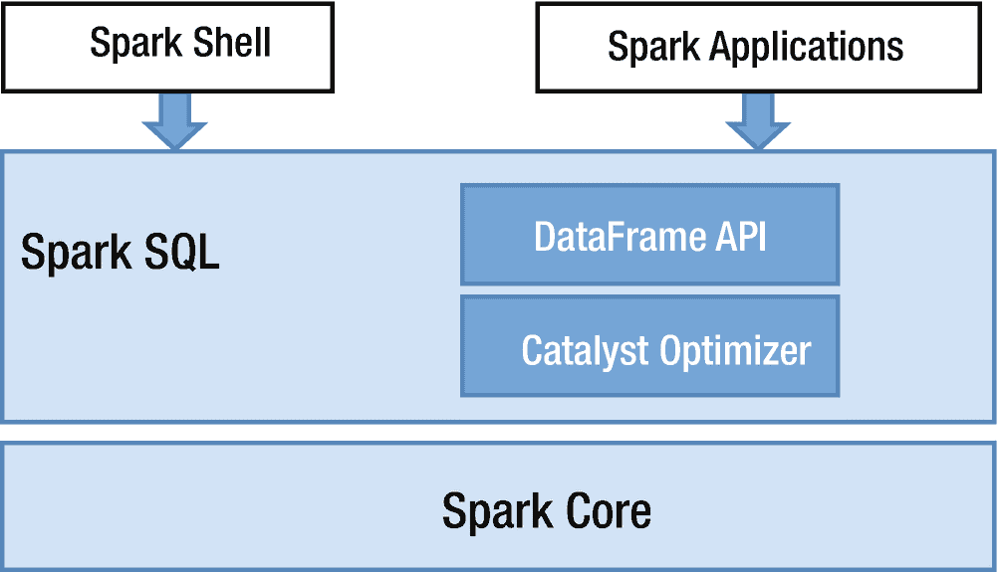

# 4. Spark SQL（基础）

随着 Spark 在每个新版本中不断演进为统一的数据处理引擎，其编程抽象也在不断发展。`RDD` 是 Spark 在 2012 年问世时最初的核心编程抽象。在 Spark 1.6 中，引入了一种名为结构化 API（Structured APIs）的新编程抽象。对于大多数用例而言，这是执行数据处理的首选方式。结构化 API 旨在通过易用、直观且富有表现力的 API 来提高开发者的生产力。在这种新的数据处理方式中，数据需要组织成结构化格式，数据计算逻辑也需要遵循特定的结构。有了这两点信息，Spark 就能执行优化，从而加速数据处理应用程序。

图 4-1 展示了 Spark SQL 组件是如何构建在可靠且久经考验的 Spark Core 组件之上的。这种分层架构意味着 Spark Core 组件中的任何改进都会自动应用于 Spark SQL 组件。



图 4-1 — Spark SQL 组件

本章将介绍 Spark SQL 模块，它能让您编写更少的代码来完成工作，并在底层智能地执行优化。Spark SQL 模块由两个主要部分组成。第一部分是结构化 API 的表示形式，称为 DataFrame 和 Dataset，它们定义了用于处理结构化数据的高级 API。`DataFrame` 的概念灵感来源于 Python 的 pandas DataFrame；主要区别在于 Spark 中的 `DataFrame` 可以处理分布在多台机器上的大量数据。Spark SQL 模块的第二部分是 Catalyst 优化器，它在幕后完成所有繁重的工作，让您的工作更轻松，并加速您的数据处理逻辑。Spark SQL 模块提供的一个很酷的功能是能够执行 SQL 查询来进行数据处理。凭借这一能力，Spark 得以吸引一群新的用户，即业务分析师，他们熟悉 SQL 语言，因为这是他们日常使用的主要工具之一。

区分结构化数据与非结构化数据的一个核心概念是模式（schema），它以列名和相关数据类型的形式定义数据的结构。模式概念是 Spark 结构化 API 不可或缺的一部分。

结构化数据通常以特定格式捕获。有些格式基于文本，有些则基于二进制。文本数据的常见格式有 CSV、XML 和 JSON，二进制数据的常见格式有 Avro、Parquet 和 ORC。开箱即用，Spark SQL 模块可以轻松地从这些格式中的任何一种读取数据以及将数据写入这些格式。这种多功能性带来的一个意想不到的好处是，Spark 可以用作数据格式转换工具。

## DataFrame 简介

`DataFrame` 是一个不可变的、分布式的数据集合，它被组织成行，每一行由一组列组成，每个列都有名称和关联的类型。换句话说，这个分布式数据集合具有由模式定义的结构。如果您熟悉关系数据库管理系统（RDBMS）中的表概念，那么您会发现 `DataFrame` 本质上与之等价。`DataFrame` 中的每一行都由一个通用的 `Row` 对象表示。与 RDD API 不同，DataFrame API 提供了一组特定于领域的操作，这些操作是关系型的，并且具有丰富的语义。API 的细节将在以下章节中介绍。与 RDD API 一样，DataFrame API 分为两类：转换（transformations）和动作（actions）。其求值语义与 RDD 相同。转换是惰性求值的，而动作是即时求值的。

可以通过从前面提到的多种结构化数据源读取数据，以及从 Hive 和数据库中的表读取数据来创建 `DataFrame`。此外，Spark SQL 模块通过提供 RDD 中数据的模式信息，可以轻松地将 RDD 转换为 `DataFrame`。DataFrame API 可用于 Scala、Java、Python 和 R。

## 创建 DataFrame

创建 DataFrame 的方法有很多种；它们的共同点是需要隐式或显式地提供模式。

### 从 RDD 创建 DataFrame

让我们从使用 RDD 创建 DataFrame 开始。清单 4-1 首先创建一个包含两列整数类型数据的 RDD，然后调用 `toDF` 隐式函数，使用指定的列名将 RDD 转换为 DataFrame。列类型是从 RDD 中的数据推断出来的。清单 4-2 展示了 DataFrame 中两个常用的函数：`printSchema` 和 `show`。`printSchema` 函数将列名及其关联类型打印到控制台。`show` 函数以表格格式打印 DataFrame 中的数据。默认情况下，它显示 20 行。要更改显示的默认行数，可以向 `show` 函数传递一个数字。有关指定显示行数的示例，请参见清单 4-3。

```scala
import scala.util.Random
val rdd = spark.sparkContext.parallelize(1 to 10).map(x => (x, Random.nextInt(100)* x))
val kvDF = rdd.toDF("key","value")
```

清单 4-1 — 从数字 RDD 创建 DataFrame

```
kvDF.printSchema
|-- key: integer (nullable = false)
|-- value: integer (nullable = false)
```

清单 4-2 — 打印 DataFrame 的模式并显示数据

```
kvDF.show
+---+-----+
|key|value|
+---+-----+
|  1|   58|
|  2|   18|
|  3|  237|
|  4|   32|
|  5|   80|
|  6|  210|
|  7|  567|
|  8|  360|
|  9|  288|
| 10|  260|
+---+-----+
```

```
kvDF.show(5)
+---+-----+
|key|value|
+---+-----+
|  1|   59|
|  2|   60|
|  3|   66|
|  4|  280|
|  5|   40|
+---+-----+
```

清单 4-3 — 调用 `show` 函数以表格格式显示五行数据

### 注意
`value` 列中的实际数字对你来说可能看起来不同，因为它们是通过调用 `Random.nextInt()` 函数随机生成的。

创建 DataFrame 的另一种方法是使用以编程方式创建的 schema 来指定一个 RDD。清单 4-4 首先使用一个 `Row` 对象数组创建一个 RDD，其中每个 `Row` 对象包含三列；然后以编程方式创建一个 schema。最后，它将 RDD 和 schema 提供给 `createDataFrame` 函数，以转换为 DataFrame。清单 4-5 展示了 `peopleDF` DataFrame 中的 schema 和数据。

```scala
import org.apache.spark.sql.Row
import org.apache.spark.sql.types._
val peopleRDD = spark.sparkContext.parallelize(Array(Row(1L, "John Doe",  30L),
Row(2L, "Mary Jane", 25L)))
val schema = StructType(Array(
StructField("id", LongType, true),
StructField("name", StringType, true),
StructField("age", LongType, true)
))
val peopleDF = spark.createDataFrame(peopleRDD, schema)
```

清单 4-4 — 从具有以编程方式创建的 Schema 的 RDD 创建 DataFrame

```
peopleDF.printSchema
|-- id: long (nullable = true)
|-- name: string (nullable = true)
|-- age: long (nullable = true)
peopleDF.show
+--+-----------+---+
|id|       name|age|
+--+-----------+---+
| 1|   John Doe| 30|
| 2|  Mary Jane| 25|
+--+-----------+---+
```

清单 4-5 — 显示 `peopleDF` 的 Schema 及其数据

以编程方式创建 schema 的能力使 Spark 应用程序能够灵活地根据某些外部配置调整 schema。

每个 `StructField` 对象包含三条信息：名称、类型以及该值是否可为空。

DataFrame 中每一列的类型都映射到一个内部的 Spark 类型，它可以是简单的标量类型或复杂类型。表 4-1 描述了可用的内部 Spark 数据类型及其关联的 Scala 类型。

**表 4-1** Spark Scala 类型

| 数据类型 | Scala 类型 |
| --- | --- |
| `BooleanType` | `Boolean` |
| `ByteType` | `Byte` |
| `ShortType` | `Short` |
| `IntegerType` | `Int` |
| `LongType` | `Long` |
| `FloatType` | `Float` |
| `DoubleType` | `Double` |
| `DecimalType` | `java.math.BigDecial` |
| `StringType` | `String` |
| `BinaryType` | `Array[Byte]` |
| `TimestampType` | `java.sql.Timestamp` |
| `DateType` | `java.sql.Date` |
| `ArrayType` | `scala.collection.Seq` |
| `MapType` | `scala.collection.Map` |
| `StructType` | `org.apache.spark.sql.Row` |

### 从数字范围创建 DataFrame

Spark 2.0 为 Spark 应用程序引入了一个新的入口点。它由一个名为 `SparkSession` 的类表示，该类有一个名为 `range` 的便捷函数，可以轻松创建一个只有一列（列名为 `id`，类型为 `LongType`）的 DataFrame。此函数有几种变体，可以接受额外的参数来指定范围的起始值、结束值以及步长。清单 4-6 提供了使用此函数创建 DataFrame 的示例。

```
val df1 = spark.range(5).toDF("num").show
+---+
|num|
+---+
|  0|
|  1|
|  2|
|  3|
|  4|
+---+
spark.range(5,10).toDF("num").show
+---+
|num|
+---+
|  5|
|  6|
|  7|
|  8|
|  9|
+---+
spark.range(5,15,2).toDF("num").show
+---+
|num|
+---+
|  5|
|  7|
|  9|
| 11|
| 13|
+---+
```

清单 4-6 — 使用 `SparkSession.range` 函数创建 DataFrame

`range` 函数的前一个版本接受三个参数。第一个参数表示起始值，第二个参数表示结束值（不包含），最后一个参数表示步长。请注意，`range` 函数只能创建单列 DataFrame。你知道如何创建包含多列的 DataFrame 吗？

创建多列 DataFrame 的一种方法是使用 Spark 的隐式转换，将 Scala `Seq` 集合中的元组集合进行转换。请参见清单 4-7 中关于使用 Spark 的 `toDF` 隐式转换的示例。

```scala
val movies = Seq(("Damon, Matt", "The Bourne Ultimatum", 2007L),
("Damon, Matt", "Good Will Hunting", 1997L))
val moviesDF = movies.toDF("actor", "title", "year")
moviesDF.printSchema
|-- actor: string (nullable = true)
|-- title: string (nullable = true)
|-- year: long (nullable = false)
moviesDF.show
+-----------+--------------------+----+
|      actor|               title|year|
+-----------+--------------------+----+
|Damon, Matt|The Bourne Ultimatum|2007|
|Damon, Matt|   Good Will Hunting|1997|
+-----------+--------------------+----+
```

清单 4-7 — 使用 Spark 的 `toDF` 隐式转换将集合元组转换为 DataFrame

这些创建 DataFrame 的有趣方式使得学习和使用 DataFrame API 变得容易，而无需从外部文件加载数据。然而，当你开始使用大型数据集进行严肃的数据分析时，了解如何从外部数据源加载数据就变得至关重要，这将在下一部分中介绍。

### 从数据源创建 DataFrame

Spark SQL 默认支持六种内置数据源，每种数据源对应一种数据格式。Spark SQL 模块中的数据源层设计为可扩展的，因此自定义数据源可以轻松集成到 DataFrame API 中。Spark 社区编写了数百种自定义数据源，实现起来也并不困难。

Spark SQL 中用于读取和写入数据的两个主要类分别是 `DataFrameReader` 和 `DataFrameWriter`。本节将详细介绍 `DataFrameReader` 类中 API 的使用细节，以及从特定数据源读取数据时可用的各种选项。

`DataFrameReader` 类的实例可通过 `SparkSession` 类的 `read` 变量获取。清单 4-8 提供了引用该变量的示例。

```
spark.read
```

清单 4-8 — 使用 `SparkSession` 的 `read` 变量

与 `DataFrameReader` 交互的常见模式如清单 4-9 所示。

```
spark.read.format(...).option("key", value").schema(...).load()
```

清单 4-9 — 与 `DataFrameReader` 交互的常见模式

表 4-2 描述了读取数据时使用的三个主要信息：格式（format）、选项（option）和模式（schema）。关于这三个信息的更具体细节将在后续章节中提供。

**表 4-2** `DataFrameReader` 的三个主要信息

| 名称 | 是否可选 | 说明 |
| --- | --- | --- |
| `format` | 否 | 可以是内置数据源之一，也可以是自定义格式。对于内置格式，可以使用短名称（`json`、`parquet`、`jdbc`、`orc`、`csv`、`text`）。对于自定义数据源，需要提供完全限定名称。详情和示例请参见清单 4-10。 |
| `option` | 是 | `DataFrameReader` 为每种数据源格式提供了一组默认选项。你可以通过向 `option` 函数提供值来覆盖这些默认值。 |
| `schema` | 是 | 某些数据源（如 Parquet 和 ORC）的模式嵌入在数据文件中。在这些情况下，模式会自动推断。对于其他情况，你可能需要提供模式。 |

```
spark.read.json("")
spark.read.format("json")
spark.read.parquet("")
spark.read.format("parquet")
spark.read.jdbc
spark.read.format("jdbc")
spark.read.orc("")
spark.read.format("orc")
spark.read.csv("")
spark.read.format("csv")
spark.read.text("")
spark.read.format("text")
// 自定义数据源 – 完全限定的包名
spark.read.format("org.example.mysource")
```

清单 4-10 — 指定数据源格式

表 4-3 描述了 Spark 的六种内置数据源，并提供了每种数据源的说明。

**表 4-3** Spark 的内置数据源

| 名称 | 数据格式 | 说明 |
| --- | --- | --- |
| 文本文件 | 文本 | 无结构。 |
| CSV | 文本 | 逗号分隔值。可用于指定其他分隔符。列名可从表头中引用。 |
| JSON | 文本 | 流行的半结构化格式。列名和数据类型自动推断。 |
| Parquet | 二进制 | （默认格式。）Hadoop 社区中流行的二进制格式。 |
| ORC | 二进制 | Hadoop 社区中另一种流行的二进制格式。 |
| JDBC | 二进制 | 用于读写关系型数据库的常见格式。 |

### 通过读取文本文件创建 DataFrame

文本文件包含非结构化数据。当它被读入 Spark 时，每一行成为 DataFrame 中的一行。在 [`www.gutenberg.org/`](http://www.gutenberg.org/) 上有许多纯文本格式的免费书籍可供下载。对于纯文本文件，一种常见的解析每行单词的方法是以空格作为分隔符进行拆分。这与典型的单词计数示例的工作方式类似。读取文本文件的示例请参见清单 4-11。

```scala
val textFile = spark.read.text("README.md")
textFile.printSchema
|-- value: string (nullable = true)
// 显示 5 行，不截断
textFile.show(5, false)
+-------------------------------------------------------------------------+
|value                                                                    |
+-------------------------------------------------------------------------+
|# Apache Spark                                                           |
|                                                                         |
|Spark is a fast and general cluster computing system for Big Data. It provides |
|high-level APIs in Scala, Java, Python, and R, and an optimized engine that    |
|supports general computation graphs for data analysis. It also supports a      |
+-------------------------------------------------------------------------+
```

清单 4-11 从 Spark Shell 中将 `README.md` 文件作为文本文件读取

如果文本文件包含可用于解析每行中列的分隔符，那么最好使用 CSV 格式读取它，这将在下一节中介绍。

### 通过读取 CSV 文件创建 DataFrame

一种流行的文本文件格式是 CSV，它代表`逗号分隔值`。诸如 Microsoft Excel 之类的流行工具可以轻松地以 CSV 格式导入和导出数据。Spark 中的 CSV 解析器设计得非常灵活，可以使用用户提供的分隔符来解析文本文件。逗号分隔符恰好是默认分隔符。这意味着你可以使用 CSV 格式来读取制表符分隔的文本文件或其他带有任意分隔符的文本文件。

有些 CSV 文件有表头，有些则没有。由于列值可能包含逗号，因此使用特殊字符对其进行转义是一种好做法。表 4-4 描述了使用 CSV 格式时的常用选项。有关完整的选项列表，请参阅 Spark GitHub 上的 `CSVOptions` 类（ [`https://github.com/apache/spark`](https://github.com/apache/spark) ）。

**表 4-4** CSV 常用选项

| 键 | 值 | 默认值 | 描述 |
| --- | --- | --- | --- |
| `sep` | 单个字符 | `,` | 这是一个用作每列分隔符的单个字符。 |
| `header` | true, false | `false` | 如果值为 true，则表示文件中的第一行代表列名。 |
| `escape` | 任意字符 | `\` | 用于转义列值中与 `sep` 相同的字符的字符。 |
| `inferSchema` | true, false | `false` | 指定 Spark 是否应尝试根据列值推断列类型。 |

将 `header` 和 `inferSchema` 选项指定为 true 则无需指定模式。否则，你需要手动定义模式，或以编程方式创建它并将其传递给 `schema` 函数。如果 `inferSchema` 选项为 false 且未提供模式，Spark 将假定所有列的数据类型为字符串类型。

你用作示例的数据文件位于 `data/chapter4` 文件夹中，名为 `movies.csv`。此文件包含每列的表头：`actor`、`title`、`year`。清单 4-12 提供了一些读取 CSV 文件的示例。

```scala
val movies = spark.read.option("header","true").csv("/book/chapter4/data/movies/movies.csv")
movies.printSchema
|-- actor: string (nullable = true)
|-- title: string (nullable = true)
|-- year: string (nullable = true)
// 现在尝试推断模式
val movies2 = spark.read.option("header","true").option("inferSchema","true")
.csv("/book/chapter4/data/movies/movies.csv")
movies2.printSchema
|-- actor: string (nullable = true)
|-- title: string (nullable = true)
|-- year: integer (nullable = true)
// 现在尝试手动提供模式
import org.apache.spark.sql.types._
val movieSchema = StructType(Array(StructField("actor_name", StringType, true),
StructField("movie_title", StringType, true),
StructField("produced_year", LongType, true)))
val movies3 = spark.read.option("header","true").schema(movieSchema)
.csv("/book/chapter4/data/movies/movies.csv")
movies3.printSchema
|-- actor_name: string (nullable = true)
|-- movie_title: string (nullable = true)
|-- produced_year: long (nullable = true)
movies3.show(5)
+-----------------+--------------+--------------+
|       actor_name|   movie_title| produced_year|
+-----------------+--------------+--------------+
|McClure, Marc (I)| Freaky Friday|          2003|
|McClure, Marc (I)|  Coach Carter|          2005|
|McClure, Marc (I)|   Superman II|          1980|
|McClure, Marc (I)|     Apollo 13|          1995|
|McClure, Marc (I)|      Superman|          1978|
+-----------------+--------------+--------------+
```

**清单 4-12** 使用各种选项读取 CSV 文件

第一个示例通过将第一行指定为表头来读取文件 `movies.csv`。Spark 能够识别列名。但是，由于你没有指定 `inferSchema` 选项，所有列的类型都是 `string`。第二个示例添加了 `inferSchema` 选项，Spark 能够识别列类型。第三个示例提供了一个模式，其列名与表头中的不同，因此 Spark 使用模式中的列名。

现在，让我们尝试读取一个使用不同分隔符（不是逗号）的文本文件。这次是制表符。在这种情况下，你需要为 Spark 将使用的 `sep` 选项指定一个值。请参阅清单 4-13，了解读取 `data/chapter4` 文件夹中名为 `movies.tsv` 的文件的示例。

```scala
val movies4 = spark.read.option("header","true").option("sep", "\t")
.schema(movieSchema).csv("/book/chapter4/data/movies/movies.tsv")
movies.printSchema
|-- actor_name: string (nullable = true)
|-- movie_title: string (nullable = true)
|-- produced_year: long (nullable = true)
```

**清单 4-13** 使用 CSV 格式读取 TSV 文件

如你所见，处理逗号分隔值以及其他分隔符的文本文件非常容易。

### 通过读取 JSON 文件创建 DataFrame

JSON 是 JavaScript 社区中一种广为人知的格式。它被认为是一种半结构化格式，因为每个对象（即行）都有结构，且每个列都有名称。在 Web 应用开发领域，JSON 是一种广泛使用的数据格式，用于在后端服务器和浏览器端之间传输数据。JSON 的优势之一在于它提供了一种灵活的格式，可以模拟任何用例；它还能支持嵌套结构。JSON 的一个缺点与冗余性有关。列名在数据文件的每一行中都会重复出现（想象一下你的数据文件有 100 万行）。

Spark 可以轻松读取 JSON 文件中的数据。然而，有一件事你需要特别注意。一个 JSON 对象可以表示为单行或多行，这一点你需要告知 Spark。鉴于 JSON 数据文件只包含列名而不包含数据类型，Spark 是如何得出模式（schema）的呢？Spark 会尽力通过解析一组样本记录来推断模式。用于采样的记录数量由 `samplingRatio` 选项决定，其默认值为 1.0。因此，读取大型 JSON 文件的代价相当高。在这种情况下，你可以降低 `samplingRatio` 的值来加快数据加载过程。表 4-5 描述了 JSON 格式的常用选项。

**表 4-5** JSON 常用选项

| 键 | 值 | 默认值 | 描述 |
| --- | --- | --- | --- |
| `allowComments` | true, false | false | 忽略 JSON 文件中的注释 |
| `multiLine` | true, false | false | 将整个文件视为一个跨越多行的大型 JSON 对象 |
| `samplingRatio` | 0.3 | 1.0 | 指定用于推断模式的采样大小 |

代码清单 4-14 展示了读取 JSON 文件的两个示例。第一个示例简单地读取一个 JSON 文件，没有覆盖任何选项值。注意，Spark 会根据 JSON 文件中的信息自动检测列名和数据类型。第二个示例则指定了一个模式。

```scala
val movies5 = spark.read.json("/book/chapter4/data/movies/movies.json")
movies.printSchema
|-- actor_name: string (nullable = true)
|-- movie_title: string (nullable = true)
|-- produced_year: long (nullable = true)
// 指定模式以覆盖 Spark 的推断模式。
// 将 producted_year 指定为整数类型
import org.apache.spark.sql.types._
val movieSchema2 = StructType(Array(StructField("actor_name", StringType, true),
StructField("movie_title", StringType, true),
StructField("produced_year", IntegerType, true)))
val movies6 = spark.read.option("inferSchema","true").schema(movieSchema2)
.json("/book/chapter4/data/movies/movies.json")
movies6.printSchema
|-- actor_name: string (nullable = true)
|-- movie_title: string (nullable = true)
|-- produced_year: integer (nullable = true)
```

代码清单 4-14 读取 JSON 文件的各种示例

当模式中指定的列数据类型与 JSON 文件中的值不匹配时会发生什么？默认情况下，当 Spark 遇到损坏的记录或解析错误时，它会将该行所有列的值设置为 null。除了得到 null 值，你也可以让 Spark 快速失败。代码清单 4-15 通过将 `mode` 选项指定为 `failFast`，告知 Spark 的解析逻辑快速失败。

```scala
// 将 actor_name 的数据类型设置为 BooleanType
import org.apache.spark.sql.types._
val badMovieSchema = StructType(Array(StructField("actor_name", BooleanType, true),
StructField("movie_title", StringType, true),
StructField("produced_year", IntegerType, true)))
val movies7 = spark.read.schema(badMovieSchema)
.json("/book/chapter4/data/movies/movies.json")
movies7.printSchema
|-- actor_name: boolean (nullable = true)
|-- movie_title: string (nullable = true)
|-- produced_year: integer (nullable = true)
movies7.show(5)
+----------+-----------+-------------+
|actor_name|movie_title|produced_year|
+----------+-----------+-------------+
|      null|       null|         null|
|      null|       null|         null|
|      null|       null|         null|
|      null|       null|         null|
|      null|       null|         null|
+----------+-----------+-------------+
// 告知 Spark 在遇到解析错误时快速失败
val movies8 = spark.read.option("mode","failFast").schema(badMovieSchema)
.json("/book/chapter4/data/movies/movies.json")
movies8.printSchema
|-- actor_name: boolean (nullable = true)
|-- movie_title: string (nullable = true)
|-- produced_year: integer (nullable = true)
// Spark 在执行操作时会抛出 RuntimeException
movies8.show(5)
ERROR Executor: Exception in task 0.0 in stage 3.0 (TID 3)
java.lang.RuntimeException: Failed to parse a value for data type BooleanType (current token: VALUE_STRING).
```

代码清单 4-15 解析错误以及如何让 Spark 快速失败

### 通过读取 Parquet 文件创建 DataFrame

Parquet 是 Hadoop 生态系统中最流行的开源列式存储格式之一，它诞生于 Twitter。它之所以流行，是因为它是一种自描述的数据格式，并且通过利用压缩技术以高度紧凑的结构存储数据。列式存储格式旨在很好地适应数据分析工作负载，在这种工作负载中，数据分析过程中只使用一小部分列。Parquet 将每列的数据存储在一个单独的文件中；因此，数据分析中不需要的列就不必被不必要地读取。在支持具有嵌套结构的复杂数据类型方面，它也非常灵活。像 CSV 和 JSON 这样的文本文件格式适用于小文件，并且它们是人类可读的。对于处理存储在长期存储中的大型数据集，`Parquet` 是一种更好的文件格式，可以降低存储成本并加快读取步骤。如果你查看一下 `chapter4/data/movies` 文件夹中的 `movies.parquet` 文件，你会发现它的大小大约是 `movies.csv` 的六分之一。

`Spark` 与 `Parquet` 文件格式配合得非常好，事实上 `Parquet` 是 `Spark` 中用于读取和写入数据的默认文件格式。由于 `Parquet` 文件是自包含的，即模式存储在 `Parquet` 数据文件内部，因此在 `Spark` 中使用 `Parquet` 很容易。代码清单 4-16 展示了一个读取 `Parquet` 文件的示例。注意，你不需要提供模式或要求 `Spark` 推断模式。`Spark` 可以从 `Parquet` 文件中检索模式。

`Spark` 在从 `Parquet` 读取数据时所做的很酷的优化之一是，它按列批次进行解压缩和解码。

```
// Parquet 是默认格式，因此读取时无需指定格式
val movies9 = spark.read.load("/book/chapter4/data/movies/movies.parquet")
movies9.printSchema
|-- actor_name: string (nullable = true)
|-- movie_title: string (nullable = true)
|-- produced_year: long (nullable = true)
// 如果我们想更明确一些，可以指定 parquet 函数的路径
val movies10 = spark.read.parquet("/book/chapter4/data/movies/movies.parquet")
movies10.printSchema
|-- actor_name: string (nullable = true)
|-- movie_title: string (nullable = true)
|-- produced_year: long (nullable = true)
代码清单 4-16
在 Spark 中读取 Parquet 文件
```

### 通过读取 ORC 文件创建 DataFrame

优化行列式（`ORC`）是 Hadoop 生态系统中另一种流行的开源自描述列式存储格式。它由一家名为 Cloudera 的公司创建，作为大幅加速 Hive 计划的一部分。它在效率和速度上与 `Parquet` 非常相似，专为分析工作负载而设计。处理 `ORC` 文件与处理 `Parquet` 文件一样简单。清单 4-17 展示了通过读取 `ORC` 文件创建 `DataFrame` 的示例。

```
val movies11 = spark.read.orc("/book/chapter4/data/movies/movies.orc")
movies11.printSchema
|-- actor_name: string (nullable = true)
|-- movie_title: string (nullable = true)
|-- produced_year: long (nullable = true)
movies11.show(5)
+--------------------------+-------------------+--------------+
|                actor_name|        movie_title| produced_year|
+--------------------------+-------------------+--------------+
|         McClure, Marc (I)|       Coach Carter|          2005|
|         McClure, Marc (I)|        Superman II|          1980|
|         McClure, Marc (I)|          Apollo 13|          1995|
|         McClure, Marc (I)|           Superman|          1978|
|         McClure, Marc (I)| Back to the Future|          1985|
+--------------------------+-------------------+--------------+
清单 4-17
在 Spark 中读取 ORC 文件
```

### 通过 JDBC 创建 DataFrame

`JDBC` 是一种标准的应用程序 API，用于从关系数据库管理系统读取数据以及向其写入数据。`Spark` 支持 `JDBC` 数据源，这意味着你可以使用 `Spark` 从任何现有的 `RDBMS`（例如 `MySQL`、`PostgreSQL`、`Oracle`、`SQLite` 等）读取数据以及向其写入数据。使用 `JDBC` 数据源时，你需要提供一些重要的信息：适用于你的 `RDBMS` 的 `JDBC` 驱动程序、连接 URL、身份验证信息以及表名。

为了让 `Spark` 连接到 `RDBMS`，它必须在运行时能够访问 `JDBC` 驱动程序的 `JAR` 文件。因此，你需要将 `JDBC` 驱动程序的位置添加到 `Spark` 的类路径中。清单 4-18 展示了如何从 `Spark shell` 连接到 `MySQL`。

```
./bin/spark-shell ../jdbc/mysql-connector-java-5.1.45/mysql-connector-java-5.1.45-bin.jar  --jars ../jdbc/mysql-connector-java-5.1.45/mysql-connector-java-5.1.45-bin.jar
清单 4-18
启动 Spark Shell 时指定 JDBC 驱动程序
```

一旦 `Spark shell` 成功启动，你可以使用 `java.sql.DriverManager` 类快速验证 `Spark` 是否能连接到 `RDBMS`，如清单 4-19 所示。此示例尝试测试与 `MySQL` 的连接。如果你的 `RDBMS` 不是 `MySQL`，`URL` 格式会略有不同，因此请查阅你所使用的 `JDBC` 驱动程序的文档。

```
import java.sql.DriverManager
val connectionURL = "jdbc:mysql://localhost:3306/?user=&password="
val connection = DriverManager.getConnection(connectionURL)
connection.isClosed()
connection close()
清单 4-19
在 Spark Shell 中测试与 MySQL 的连接
```

如果你没有收到任何与连接相关的异常，则说明 `Spark shell` 已成功连接到你的 `RDBMS`。

表 4-6 描述了使用 `JDBC` 数据源时需要指定的主要选项。有关完整的选项列表，请查阅 [spark.apache.org 文档](https://spark.apache.org/docs/latest/sql-programming-guide.html#jdbc-to-other-databases)。

**表 4-6** JDBC 数据源的主要选项

| 键 | 描述 |
| --- | --- |
| `url` | Spark 要连接的 JDBC URL。至少应包含主机、端口和数据库名称。对于 MySQL，它可能类似于：`jdbc:mysql://localhost:3306/sakila`。 |
| `dbtable` | Spark 要读取数据或写入数据的数据库表名。 |
| `driver` | Spark 将实例化以连接到上述 URL 的 JDBC 驱动程序的类名。请查阅你正在使用的 JDBC 驱动程序文档。对于 MySQL Connector/J 驱动程序，类名为 `com.mysql.jdbc.Driver`。 |

清单 4-20 展示了从运行在 `localhost` 端口 `3306` 的 `MySQL` 服务器上的 `sakila` 数据库中名为 `film` 的表读取数据的示例。

```
val mysqlURL= "jdbc:mysql://localhost:3306/sakila"
val filmDF = spark.read.format("jdbc").option("driver", "com.mysql.jdbc.Driver")
.option("url", mysqlURL)
.option("dbtable", "film")
.option("user", "")
.option("password","")
.load()
filmDF.printSchema
|-- film_id: integer (nullable = false)
|-- title: string (nullable = false)
|-- description: string (nullable = true)
|-- release_year: date (nullable = true)
|-- language_id: integer (nullable = false)
|-- original_language_id: integer (nullable = true)
|-- rental_duration: integer (nullable = false)
|-- rental_rate: decimal(4,2) (nullable = false)
|-- length: integer (nullable = true)
|-- replacement_cost: decimal(5,2) (nullable = false)
|-- rating: string (nullable = true)
|-- special_features: string (nullable = true)
|-- last_update: timestamp (nullable = false)
filmDF.select("film_id","title").show(5)
+-------+-----------------+
|film_id|            title|
+-------+-----------------+
|      1| ACADEMY DINOSAUR|
|      2|   ACE GOLDFINGER|
|      3| ADAPTATION HOLES|
|      4| AFFAIR PREJUDICE|
|      5|      AFRICAN EGG|
+-------+-----------------+
清单 4-20
从 MySQL 服务器中的表读取数据
```

使用 `JDBC` 数据源时，`Spark` 会尽可能将过滤条件下推到 `RDBMS`。通过这样做，大部分数据将在 `RDBMS` 层面被过滤掉，因此这不仅会加快数据过滤逻辑的速度，还会显著减少 `Spark` 需要读取的数据量。这种优化技术被称为`谓词下推`，当 `Spark` 知道某个数据源支持过滤功能时，它通常会执行此操作。`Parquet` 是另一个具有此功能的数据源。第 5 章中的“Catalyst 优化器”部分将提供一个示例来说明其工作原理。

### 使用结构化操作

现在你已经知道如何创建 `DataFrame`，下一步是学习如何使用提供的结构化操作来操作或转换它们。与 `RDD` 操作不同，结构化操作被设计为更具关系型特性，这意味着这些操作镜像了你在 `SQL` 中可以执行的各种表达式，例如投影、过滤、转换、连接等。与 `RDD` 操作类似，结构化操作也分为两类：转换（transformation）和动作（action）。结构化转换和动作的语义与 `RDD` 中的完全相同。换句话说，结构化转换是惰性求值的，而结构化动作是即时求值的。

结构化操作有时被描述为一种用于分布式数据操作的`领域特定语言`（DSL）。DSL 是一种专门针对特定应用领域的计算机语言。在这里，应用领域就是分布式数据操作。如果你曾经使用过 `SQL`，那么学习结构化操作会相当容易。

表 4-7 描述了常用的 `DataFrame` 结构化转换。提醒一下，`DataFrame` 是不可变的，其转换操作总是返回一个新的 `DataFrame`。

**表 4-7** 常用的 DataFrame 结构化转换

| 操作 | 描述 |
| --- | --- |
| `select` | 从 DataFrame 现有的列集合中选择一个或多个列。`select` 的一个更专业的术语是投影。在投影过程中，可以对列进行转换和操作。 |
| `selectExpr` | 支持在执行投影时使用强大的 SQL 表达式来转换列。 |
| `filter` / `where` | `filter` 和 `where` 具有相同的语义。`where` 比 `filter` 更具关系型特性，类似于 SQL 中的 `where` 条件。它们都用于根据给定的布尔条件过滤行。 |
| `distinct` / `dropDuplicates` | 从 DataFrame 中移除重复的行。 |
| `sort` / `orderBy` | 根据提供的列对 DataFrame 进行排序。 |
| `limit` | 通过获取前 `n` 行来返回一个新的 DataFrame。 |
| `union` | 合并两个 DataFrame 并将它们作为一个新的 DataFrame 返回。 |
| `withColumn` | 用于向 DataFrame 添加新列或替换现有列。 |
| `withColumnRenamed` | 重命名现有列。如果给定的列名在模式中不存在，则该操作无效。 |
| `drop` | 从 DataFrame 中删除一个或多个列。如果指定的列名不存在，此操作不执行任何操作。 |
| `sample` | 根据给定的分数参数、可选的种子值和可选的替换选项，随机选择一组行。 |
| `randomSplit` | 根据给定的权重将 DataFrame 拆分为一个或多个 DataFrame。它常用于在机器学习模型训练过程中将主数据集拆分为训练集和测试集。 |
| `join` | 连接两个 DataFrame。Spark 支持多种类型的连接。你可以在第 5 章找到更多细节。 |
| `groupBy` | 按一个或多个列对 DataFrame 进行分组。一种常见模式是在 `groupBy` 操作之后执行某种聚合。你可以在第 5 章找到更多细节。 |
| `describe` | 计算 DataFrame 中数值列和字符串列的常见统计信息。可用的统计信息包括计数、平均值、标准差、最小值、最大值以及任意近似百分位数。 |

### 使用列

表 4-7 中的大多数 `DataFrame` 结构化操作都需要你指定一个或多个列。对于其中一些操作，列以字符串形式指定；而对于另一些操作，列则需要指定为 `Column` 类的实例。完全有理由质疑为什么有两种选项，以及何时使用哪一种。要回答这些问题，你需要了解 `Column` 类提供的功能。从高层次来看，`Column` 类提供的功能可以分为以下几类：

*   数学运算，例如加法、乘法等
*   列值或字面量之间的逻辑比较，例如等于、大于、小于等
*   字符串模式匹配，例如 `like`、以...开头、以...结尾等

有关 `Column` 类中可用函数的完整列表，请参阅 Scala 文档：[`https://spark.apache.org/docs/latest/api/scala/index.html#org.apache.spark.sql.Column`](https://spark.apache.org/docs/latest/api/scala/index.html#org.apache.spark.sql.Column)。

了解了 `Column` 类提供的功能后，你可以得出结论：每当需要指定某种列表达式时，就必须将列指定为 `Column` 类的实例，而不是字符串。接下来的示例将使这一点更加清晰。

有多种引用列的方式，这在 Spark 用户社区中造成了困惑。一个常见的问题是何时使用哪一种，答案是“视情况而定”。表 4-8 描述了可用的选项。

**表 4-8** 引用列的不同方式

| 方式 | 示例 | 描述 |
| --- | --- | --- |
| `""` | `"columnName"` | 以字符串类型引用一个列。 |
| `col` | `col("columnName")` | `col` 函数返回一个 `Column` 类的实例。 |
| `column` | `column("columnName")` | 与 `col` 类似，此函数返回一个 `Column` 类的实例。 |
| `$` | `$"columnName"` | 这是在 Scala 中构造 `Column` 类的一种语法糖方式。 |
| `' (单引号)` | `'columnName` | 这是利用 Scala 符号字面量特性在 Scala 中构造 `Column` 类的一种语法糖方式。 |

`col` 和 `column` 函数是同义词，两者都在 Scala 和 Python 的 Spark API 中可用。如果你经常在 Spark Scala 和 Python API 之间切换，那么使用 `col` 函数是有意义的，这样你的代码可以保持一致性。如果你主要或专门使用 Spark Scala API，那么我建议使用 `'`（单引号），因为它只需要输入一个字符。`DataFrame` 类有自己的 `col` 函数，用于在执行连接时消除两个或多个 `DataFrame` 中同名列的歧义。代码清单 4-21 提供了引用列的不同方式的示例。

```
import org.apache.spark.sql.functions._
val kvDF = Seq((1,2),(2,3)).toDF("key","value")
// 要显示 DataFrame 中的列名，我们可以调用 columns 函数
kvDF.columns
Array[String] = Array(key, value)
kvDF.select("key")
kvDF.select(col("key"))
kvDF.select(column("key"))
kvDF.select($"key")
kvDF.select('key)
// 使用 DataFrame 的 col 函数
kvDF.select(kvDF.col("key"))
kvDF.select('key, 'key > 1).show
+---+----------+
|key| (key > 1)|
+---+----------+
|  1|     false|
|  2|      true|
+---+----------+
代码清单 4-21
引用列的不同方式
```

前面的示例演示了一个列表达式，因此需要将列指定为 `Column` 类的实例。如果列被指定为字符串，则会导致类型不匹配错误。在接下来的各种 `DataFrame` 结构化操作使用示例中，将展示更多列表达式的例子。

#### 使用结构化转换

本节提供使用表 4-7 中列出的结构化转换的示例。所有示例将统一使用 `'` 来引用 `DataFrame` 中的列。为减少重复，大多数示例将引用同一个 `movies` `DataFrame`，该 `DataFrame` 通过读取 Parquet 文件创建，如代码清单 4-22 所示。

```
val movies = spark.read.parquet("/chapter4/data/movies/movies.parquet")
代码清单 4-22
从 Parquet 文件创建 movies DataFrame
```

##### `select(columns)`

此转换通常用于执行投影，即从 `DataFrame` 中选择全部或部分列。在选择过程中，每个列都可以通过列表达式进行转换。此转换有两种变体：一种将列作为字符串接收，另一种将列作为 `Column` 类接收。使用这两种变体之一时，不允许混合列类型。有关这两种变体的示例，请参见代码清单 4-23。

```
movies.select("movie_title","produced_year").show(5)
+-------------------+--------------+
|        movie_title| produced_year|
+-------------------+--------------+
|       Coach Carter|          2005|
|        Superman II|          1980|
|          Apollo 13|          1995|
|           Superman|          1978|
| Back to the Future|          1985|
+-------------------+--------------+
// 使用列表达式将年份转换为十年
movies.select('movie_title,('produced_year - ('produced_year % 10)).as("produced_decade")).show(5)
+-------------------+----------------+
|        movie_title| produced_decade|
+-------------------+----------------+
|       Coach Carter|            2000|
|        Superman II|            1980|
|          Apollo 13|            1990|
|           Superman|            1970|
| Back to the Future|            1980|
+-------------------+----------------+
代码清单 4-23
select 转换的两种变体
```

第二个示例需要两个列表达式：取模和减法。两者均由 `Column` 类中的取模（`%`）和减法（`-`）函数实现（参见前面提到的 Scala 文档）。默认情况下，Spark 使用列表达式作为结果列的名称。为了使其更具可读性，通常使用 `as` 函数将其重命名为更易读的列名。作为细心的读者，您可能已经发现 `select` 转换可用于向 `DataFrame` 添加一个或多个列。

##### `selectExpr(expressions)`

此转换是 `select` 转换的一种变体。最大的区别在于它接受一个或多个 SQL 表达式，而不是列。然而，两者本质上执行相同的投影任务。SQL 表达式是强大且灵活的结构，允许您以自然的方式表达列转换逻辑，就像您思考的方式一样。您可以用字符串格式表达 SQL 表达式，Spark 会将其解析为逻辑树，以便按正确顺序求值。假设您想创建一个新的 `DataFrame`，其中包含 `movies` `DataFrame` 中的所有列，并引入一个新列来表示电影制作的十年；那么您可以像代码清单 4-24 那样操作。

```
movies.selectExpr("*","(produced_year - (produced_year % 10)) as decade").show(5)
+-----------------+-------------------+--------------+-------+
|       actor_name|        movie_title| produced_year| decade|
+-----------------+-------------------+--------------+-------+
|McClure, Marc (I)|       Coach Carter|          2005|   2000|
|McClure, Marc (I)|        Superman II|          1980|   1980|
|McClure, Marc (I)|          Apollo 13|          1995|   1990|
|McClure, Marc (I)|           Superman|          1978|   1970|
|McClure, Marc (I)| Back to the Future|          1985|   1980|
+-----------------+-------------------+--------------+-------+
代码清单 4-24
使用 SQL 表达式向 movies DataFrame 添加 decade 列
```

SQL 表达式与内置函数的结合使得执行某些数据分析变得简单，否则这些分析可能需要多个步骤。代码清单 4-25 展示了如何通过一条语句轻松确定 `movies` 数据集中唯一电影标题和唯一演员的数量。`count` 函数对整个 `DataFrame` 执行聚合操作。

```
movies.selectExpr("count(distinct(movie_title)) as movies","count(distinct(actor_name)) as actors").show
+-------+-------+
| movies| actors|
+-------+-------+
|   1409|   6527|
+-------+-------+
代码清单 4-25
使用 SQL 表达式和内置函数
```

##### `filter(condition)`, `where(condition)`

此转换相当直观。它用于过滤掉不满足给定条件的行，换句话说，即条件求值为 `false` 的行。另一种理解 `filter` 转换行为的方式是，它只返回满足指定条件的行。给定的条件可以简单，也可以根据需要变得复杂。使用此转换需要了解如何利用 `Column` 类中的一些逻辑比较函数，例如等于、小于、大于和不等于。`filter` 和 `where` 转换的行为相同，因此选择您最习惯使用的一个即可。后者只是比前者更具关系型风格。有关执行过滤的几个示例，请参见代码清单 4-26。

```
movies.filter('produced_year  2000)
movies.filter('produced_year >= 2000)
movies.where('produced_year >= 2000)
// 相等比较需要三个等号
movies.filter('produced_year === 2000).show(5)
+------------------+---------------------+--------------+
|        actor_name|          movie_title| produced_year|
+------------------+---------------------+--------------+
| Cooper, Chris (I)|   Me, Myself & Irene|          2000|
| Cooper, Chris (I)|          The Patriot|          2000|
|   Jolie, Angelina| Gone in Sixty Sec...|          2000|
|    Yip, Françoise|       Romeo Must Die|          2000|
|    Danner, Blythe|     Meet the Parents|          2000|
+------------------+---------------------+--------------+
// 不等比较使用一个看起来有趣的运算符 =!=
movies.select("movie_title","produced_year").filter('produced_year =!= 2000).show(5)
+-------------------+--------------+
|        movie_title| produced_year|
+-------------------+--------------+
|       Coach Carter|          2005|
|        Superman II|          1980|
|          Apollo 13|          1995|
|           Superman|          1978|
| Back to the Future|          1985|
+-------------------+--------------+
// 要组合一个或多个比较表达式，我们将使用 OR 和 AND 表达式运算符
movies.filter('produced_year >= 2000 && length('movie_title) = 2000).filter(length('movie_title) < 5).show(5)
代码清单 4-26
使用 Column 类中的逻辑比较函数过滤行
```

### `distinct`, `dropDuplicates`

这两个转换具有相同的行为。然而，`dropDuplicates`允许你控制应在去重逻辑中使用哪些列。如果未指定，去重逻辑将使用`DataFrame`中的所有列。清单 4-27 展示了计算`movies`数据集中电影数量的不同方法。

```
movies.select("movie_title").distinct.selectExpr("count(movie_title) as movies").show
movies.dropDuplicates("movie_title").selectExpr("count(movie_title) as movies").show
+------+
|movies|
+------+
|  1409|
+------+
清单 4-27
使用 distinct 和 dropDuplicates 实现相同目标
```

在性能方面，这两种方法没有区别，因为`Spark`会将它们转换为相同的逻辑计划。

### `sort(columns)`, `orderBy(columns)`

这两个转换具有相同的语义。`orderBy`转换比另一个更具关系型风格。默认情况下，排序是升序的，并且很容易将其更改为降序。当指定多个列时，可以为每个列设置不同的排序顺序。请参见清单 4-28 中的示例。

```
val movieTitles = movies.dropDuplicates("movie_title")
.selectExpr("movie_title", "length(movie_title) as title_length", , "produced_year")
movieTitles.sort('title_length).show(5)
+-----------+-------------+--------------+
|movie_title| title_length| produced_year|
+-----------+-------------+--------------+
|         RV|            2|          2006|
|         12|            2|          2007|
|         Up|            2|          2009|
|         X2|            2|          2003|
|         21|            2|          2008|
+-----------+-------------+--------------+
// 降序排序
movieTitles.orderBy('title_length.desc).show(5)
+---------------------+-------------+--------------+
|          movie_title| title_length| produced_year|
+---------------------+-------------+--------------+
| Borat: Cultural L...|           83|          2006|
| The Chronicles of...|           62|          2005|
| Hannah Montana & ...|           57|          2008|
| The Chronicles of...|           56|          2010|
| Istoriya pro Rich...|           56|          1997|
+---------------------+-------------+--------------+
// 按两列以不同顺序排序
movieTitles.orderBy('title_length.desc, 'produced_year).show(5)
+---------------------+-------------+--------------+
|          movie_title| title_length| produced_year|
+---------------------+-------------+--------------+
| Borat: Cultural L...|           83|          2006|
| The Chronicles of...|           62|          2005|
| Hannah Montana & ...|           57|          2008|
| Istoriya pro Rich...|           56|          1997|
| The Chronicles of...|           56|          2010|
+---------------------+-------------+--------------+
清单 4-28
按升序和降序对 DataFrame 进行排序
```

在前面的示例中，请注意最后两部电影的标题长度相同，但它们的年份按正确的升序排列。

### `limit(n)`

此转换通过获取前`n`行返回一个新的`DataFrame`。此转换通常在排序完成后使用，以根据排序顺序找出前`n`行或后`n`行。清单 4-29 展示了一个使用`limit`转换来找出名字最长的前十位演员的示例。

```
// 首先创建一个包含演员姓名及其长度的 DataFrame
val actorNameDF = movies.select("actor_name").distinct.selectExpr("*", "length(actor_name) as length")
// 按姓名长度排序并获取前 10 名
actorNameDF.orderBy('length.desc).limit(10).show
+-----------------------------+-------+
|                   actor_name| length|
+-----------------------------+-------+
| Driscoll, Timothy 'TJ' James|     28|
| Badalamenti II, Peter Donald|     28|
|  Shepard, Maridean Mansfield|     27|
|  Martino, Nicholas Alexander|     27|
|  Marshall-Fricker, Charlotte|     27|
|  Phillips, Christopher (III)|     27|
|  Pahlavi, Shah Mohammad Reza|     27|
|   Juan, The Bishop Don Magic|     26|
|   Van de Kamp Buchanan, Ryan|     26|
|   Lough Haggquist, Catherine|     26|
+-----------------------------+-------+
清单 4-29
使用 limit 转换找出名字最长的前十位演员
```

### `union(otherDataFrame)`

你之前了解到`DataFrame`是不可变的。因此，如果需要向现有`DataFrame`添加更多行，那么`union`转换对于此目的以及合并两个`DataFrame`的行都很有用。此转换要求两个`DataFrame`具有相同的模式，这意味着列名及其顺序必须完全匹配。假设`DataFrame`中的一部电影缺少一位演员，并且你想要修复该问题。请参见清单 4-30 了解如何使用`union`转换来执行此操作。

```
// 我们想为标题为 "12" 的电影添加一位缺失的演员
val shortNameMovieDF = movies.where('movie_title === "12")
shortNameMovieDF.show
+---------------------+------------+---------------+
|           actor_name| movie_title| produced_year |
+---------------------+------------+---------------+
|     Efremov, Mikhail|          12|           2007|
|      Stoyanov, Yuriy|          12|           2007|
|      Gazarov, Sergey|          12|           2007|
| Verzhbitskiy, Viktor|          12|           2007|
+---------------------+------------+---------------+
// 创建一个包含一行的 DataFrame
import org.apache.spark.sql.Row
val forgottenActor = Seq(Row("Brychta, Edita", "12", 2007L))
val forgottenActorRDD = spark.sparkContext.parallelize(forgottenActor)
val forgottenActorDF = spark.createDataFrame(forgottenActorRDD, shortNameMovieDF.schema)
// 现在添加缺失的演员
val completeShortNameMovieDF = shortNameMovieDF.union(forgottenActorDF)
completeShortNameMovieDF.union(forgottenActorDF).show
+---------------------+------------+--------------+
|           actor_name| movie_title| produced_year|
+---------------------+------------+--------------+
|     Efremov, Mikhail|          12|          2007|
|      Stoyanov, Yuriy|          12|          2007|
|      Gazarov, Sergey|          12|          2007|
| Verzhbitskiy, Viktor|          12|          2007|
|       Brychta, Edita|          12|          2007|
+---------------------+------------+--------------+
清单 4-30
向 movies DataFrame 添加缺失的演员
```

### `withColumn(colName, column)`

此转换用于向`DataFrame`添加新列。它需要两个输入参数：列名和列表达式形式的值。你也可以使用 `selectExpr` 转换来实现几乎相同的目标。但是，如果给定的列名与现有列名之一匹配，则该列将被给定的列表达式替换。清单 4-31 提供了添加新列以及替换现有列的示例。

```
// 基于某个列表达式添加新列
movies.withColumn("decade", ('produced_year - 'produced_year % 10)).show(5)
+------------------+-------------------+--------------+-------+
|        actor_name|        movie_title| produced_year| decade|
+------------------+-------------------+--------------+-------+
| McClure, Marc (I)|       Coach Carter|          2005|   2000|
| McClure, Marc (I)|        Superman II|          1980|   1980|
| McClure, Marc (I)|          Apollo 13|          1995|   1990|
| McClure, Marc (I)|           Superman|          1978|   1970|
| McClure, Marc (I)| Back to the Future|          1985|   1980|
+------------------+-------------------+--------------+-------+
// 现在用新值替换 produced_year
movies.withColumn("produced_year", ('produced_year - 'produced_year % 10)).show(5)
+------------------+-------------------+--------------+
|        actor_name|        movie_title| produced_year|
+------------------+-------------------+--------------+
| McClure, Marc (I)|       Coach Carter|          2000|
| McClure, Marc (I)|        Superman II|          1980|
| McClure, Marc (I)|          Apollo 13|          1990|
| McClure, Marc (I)|           Superman|          1970|
| McClure, Marc (I)| Back to the Future|          1980|
+------------------+-------------------+--------------+
清单 4-31
使用 withColumn 转换添加列以及替换列
```

### `withColumnRenamed(existingColName, newColName)`

此转换严格用于重命名`DataFrame`中的现有列名。人们自然会问，为什么 Spark 会提供这个转换。事实证明，此转换在以下情况下非常有用：

- 将晦涩难懂的列名重命名为更人性化的名称。晦涩的列名可能来自你无法控制的现有模式，例如，当你需要的 Parquet 文件中的列是由公司合作伙伴生成时。
- 在连接两个恰好有一个或多个相同列名的`DataFrame`之前。此转换可用于重命名其中一个`DataFrame`中的一个或多个列，以便在连接后可以轻松引用它们。

请注意，如果提供的 `existingColName` 在模式中不存在，Spark 不会抛出错误，而是静默地不执行任何操作。清单 4-32 将 `movies` `DataFrame` 中的一些列名重命名为短名称。顺便说一句，这也可以通过使用 `select` 或 `selectExpr` 转换来实现。我将把它留作练习供你完成。

```
movies.withColumnRenamed("actor_name", "actor")
.withColumnRenamed("movie_title", "title")
.withColumnRenamed("produced_year", "year").show(5)
+------------------+-------------------+-----+
|             actor|              title| year|
+------------------+-------------------+-----+
| McClure, Marc (I)|       Coach Carter| 2005|
| McClure, Marc (I)|        Superman II| 1980|
| McClure, Marc (I)|          Apollo 13| 1995|
| McClure, Marc (I)|           Superman| 1978|
| McClure, Marc (I)| Back to the Future| 1985|
+------------------+-------------------+-----+
清单 4-32
使用 withColumnRenamed 转换重命名部分列名
```

### `drop(columnName1, columnName2)`

此转换简单地删除`DataFrame`中指定的列。你可以指定一个或多个要删除的列名，但只有模式中存在的列才会被删除，不存在的列将被静默忽略。你可以使用 `select` 转换通过仅投影要保留的列来删除列。如果`DataFrame`有 100 列，而你只想删除几列，那么使用此转换比使用 `select` 转换更方便。清单 4-33 提供了删除列的示例。

```
movies.drop("actor_name", "me").printSchema
|-- movie_title: string (nullable = true)
|-- produced_year: long (nullable = true)
清单 4-33
删除两列：一列存在，另一列不存在
```

从前面的示例可以看出，第二列 `me` 在模式中不存在，因此 `drop` 转换会简单地忽略它。

### `sample(fraction)`, `sample(fraction, seed)`, `sample(fraction, seed, withReplacement)`

此转换从`DataFrame`中返回一组随机选择的行。返回的行数大约等于指定的分数（表示百分比），该值必须在0和1之间。种子用于初始化随机数生成器，该生成器用于生成要包含在结果中的行号。如果未指定种子，则使用随机生成的值。`withReplacement`选项用于确定随机选择的行是否会被放回选择池中。换句话说，当`withReplacement`为`true`时，某个特定的被选行有可能被多次选中。那么，什么时候需要使用此转换呢？当原始数据集很大，需要将其缩减到更小的规模以便快速迭代数据分析逻辑时，此转换非常有用。清单4-34提供了使用`sample`转换的示例。

```
// 不放回抽样，指定分数
movies.sample(false, 0.0003).show(3)
+---------------------+----------------------+--------------+
|           actor_name|           movie_title| produced_year|
+---------------------+----------------------+--------------+
|      Lewis, Clea (I)|  Ice Age: The Melt...|          2006|
|       Lohan, Lindsay|   Herbie Fully Loaded|          2005|
| Tagawa, Cary-Hiro...|       Licence to Kill|          1989|
+---------------------+----------------------+--------------+
// 放回抽样，指定分数和种子
movies.sample(true, 0.0003, 123456).show(3)
+---------------------+---------------+--------------+
|           actor_name|    movie_title| produced_year|
+---------------------+---------------+--------------+
| Panzarella, Russ (V)| Public Enemies|          2009|
|         Reed, Tanoai|      Daredevil|          2003|
|         Moyo, Masasa|   Spider-Man 3|          2007|
+---------------------+---------------+--------------+
清单 4-34
使用 sample 转换的不同方式
```

如你所见，返回的电影非常随机。

### `randomSplit(weights)`

该转换常用于准备训练机器学习模型的数据过程中。与之前的转换不同，此转换会返回一个或多个`DataFrame`。返回的`DataFrame`数量取决于你指定的权重数量。如果提供的权重总和不为1，它们将被归一化处理，使其总和为1。清单4-35提供了一个将`movies` DataFrame拆分为三个较小`DataFrame`的示例。

```
// 权重需要是一个数组
val smallerMovieDFs = movies.randomSplit(Array(0.6, 0.3, 0.1))
// 让我们检查计数是否与 movies DataFrame 的总数一致
movies.count
Long = 31393
smallerMovieDFs(0).count
Long = 18881
smallerMovieDFs(0).count + smallerMovieDFs(1).count + smallerMovieDFs(2).count
Long = 31393
清单 4-35
使用 randomSplit 将 movies DataFrame 拆分为三部分
```

### 处理缺失或错误数据

现实中，你经常处理的数据并不像你期望的那样干净。这可能是因为数据随时间演变，导致某些列有值而某些列没有。在数据处理逻辑的初期处理这类问题非常重要，以防止任何不愉快的意外导致你长时间运行的数据处理任务停止工作。

Spark社区认识到处理缺失数据是现实中的常见需求；因此，Spark提供了一个名为`DataFrameNaFunctions`的专用类来帮助处理这个棘手的问题。`DataFrameNaFunctions`的实例作为`DataFrame`类中的`na`成员变量提供。处理缺失或错误数据有三种常见方法。第一种方法是删除一个或多个列中存在缺失值的行。第二种方法是使用用户提供的值填充这些缺失值。第三种方法是将错误数据替换为你已知如何处理的内容。

让我们从删除包含缺失数据的行开始。你可以告诉Spark删除任何列或仅特定列存在缺失值的行。清单4-36展示了删除包含缺失数据的行的几种不同方式。

```
// 首先创建一个在一个或多个列中包含缺失值的 DataFrame
import org.apache.spark.sql.Row
val badMovies = Seq(Row(null, null, null),
Row(null, null, 2018L),
Row("John Doe", "Awesome Movie", null),
Row(null, "Awesome Movie", 2018L),
Row("Mary Jane", null, 2018L))
val badMoviesRDD = spark.sparkContext.parallelize(badMovies)
val badMoviesDF = spark.createDataFrame(badMoviesRDD, movies.schema)
badMoviesDF.show
+----------+--------------+--------------+
|actor_name|   movie_title| produced_year|
+----------+--------------+--------------+
|      null|          null|          null|
|      null|          null|          2018|
|  John Doe| Awesome Movie|          null|
|      null| Awesome Movie|          2018|
| Mary Jane|          null|          2018|
+----------+--------------+--------------+
// 删除任何列中存在缺失数据的行
// 下面两行代码将实现相同的目的
badMoviesDF.na.drop().show
badMoviesDF.na.drop("any").show
+----------+------------+--------------+
|actor_name| movie_title| produced_year|
+----------+------------+--------------+
+----------+------------+--------------+
// 删除每一列都存在缺失数据的行
badMoviesDF.na.drop("all").show
+----------+--------------+--------------+
|actor_name|   movie_title| produced_year|
+----------+--------------+--------------+
|      null|          null|          2018|
|  John Doe| Awesome Movie|          null|
|      null| Awesome Movie|          2018|
| Mary Jane|          null|          2018|
+----------+--------------+--------------+
// 当 actor_name 列存在缺失数据时删除该行
badMoviesDF.na.drop(Array("actor_name")).show
+----------+--------------+--------------+
|actor_name|   movie_title| produced_year|
+----------+--------------+--------------+
|  John Doe| Awesome Movie|          null|
| Mary Jane|          null|          2018|
+----------+--------------+--------------+
清单 4-36
删除包含缺失数据的行
```

### `describe(columnNames)`

有时，对你正在处理的数据的基本统计信息有一个总体了解是很有用的。此转换可以为字符串列和数值列计算的基本统计信息包括：计数、平均值、标准差、最小值和最大值。你可以选择要计算统计信息的字符串列或数值列。参见清单4-37的示例。

```
movies.describe("produced_year").show
+-------+-------------------+
|summary|      produced_year|
+-------+-------------------+
|  count|              31392|
|   mean| 2002.7964449541284|
| stddev|  6.377236851493877|
|    min|               1961|
|    max|               2012|
+-------+-------------------+
清单 4-37
使用 describe 转换显示 produced_year 列的统计信息
```

### 处理结构化动作

本节介绍结构化动作。它们与RDD动作具有相同的急切求值语义，因此它们会触发所有导致特定动作的转换的计算。表4-9描述了结构化动作。

**表 4-9** 常用的结构化动作

| 操作 | 描述 |
| --- | --- |
| `show()` `show(numRows)` `show(truncate)` `show(numRows, truncate)` | 以表格形式显示指定行数。如果未指定`numRows`，则显示前20行。`truncate`选项控制是否截断长度超过20个字符的字符串列。 |
| `head()` `first()` `head(n)` `take(n)` | 返回第一行。如果指定了`n`，则返回前`n`行。`first`是`head`的别名。`take(n)`是`first(n)`的别名。 |
| `takeAsList(n)` | 返回前`n`行作为Java列表。注意不要获取太多行；否则可能导致应用程序驱动进程内存不足错误。 |
| `collect` `collectAsList` | 返回所有行作为数组或Java列表。应用与`takeAsList`动作相同的注意事项。 |
| `count` | 返回`DataFrame`中的行数。 |

其中大多数操作都是不言自明的。`show`动作在本章前面的许多示例中已经使用过。一个有趣的动作叫做`describe`，接下来将对其进行描述。