# 8. 使用 Spark 进行机器学习

近年来，围绕人工智能（AI）、机器学习（ML）和深度学习（DL）的讨论异常热烈。AI 专家和研究人员预测，AI 将从根本上改变人类未来生活、工作和经商的方式。对于全球企业而言，AI 被视为其数字化转型旅程中的下一步，有些企业在将 AI 融入其业务战略方面走得更远。企业期望 AI 能够高效、快速地帮助解决业务问题，创造商业价值并提升竞争优势。谷歌、亚马逊、微软、苹果和 Facebook 等互联网巨头在投资、采用并将 AI 融入其产品组合方面处于领先地位。2017 年，全球超过 150 亿美元的风险投资（VC）流向了 AI 相关的初创公司，这一趋势预计将在 2018 年持续。

AI 是计算机科学的一个广阔领域，旨在让机器看起来拥有智能。这是一个旨在推动人类进步的雄心勃勃的目标。机器学习是 AI 的子领域之一，其重点在于教导计算机无需显式编程即可学习。学习过程涉及使用算法分析大量数据集，并构建一个模型来解释世界。这些算法可以根据其设计任务分为不同的类别。这些算法的一个共同点是，它们通过迭代优化内部参数的过程来学习，以达到最优结果。

深度学习（DL）是一种受人类大脑工作方式启发的机器学习方法，它已被证明非常擅长通过将数据表示为嵌套的概念层次结构来学习其中的复杂模式。结合大规模精选数据集的可用性以及图形处理单元（GPU）的进步，DL 已被证明在解决物体识别、图像识别、语音识别和机器翻译等领域的问题上非常有效。事实上，它在一个名为 ImageNet 的图像分类挑战中证明了自身实力，在该挑战中，使用 DL 方法训练的计算机系统在图像分类方面击败了人类。这一成就及其类似成就的意义在于，现在计算机系统能够像其创造者一样看、识别物体和听。图 8-1 展示了 AI、ML 和 DL 之间的关系及其时间线。

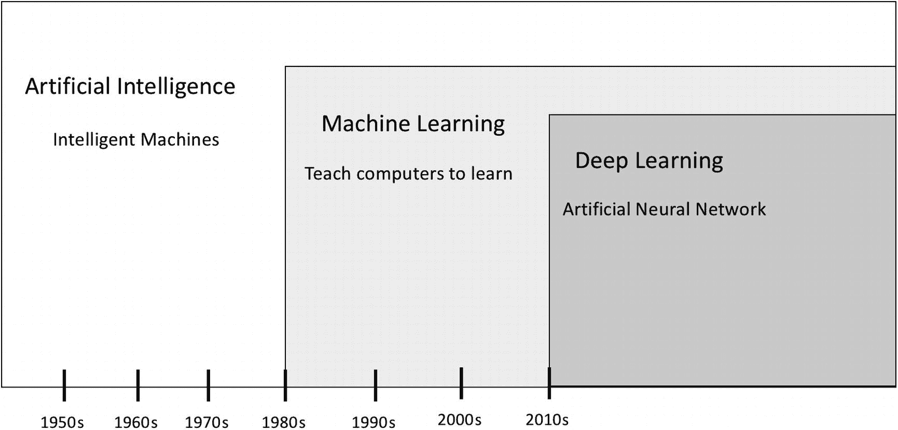

图 8-1：AI、ML 和 DL 之间的关系及其时间线

创建 Spark 的动机之一就是帮助应用程序高效地大规模运行迭代算法。在 Spark 的最近几个版本中，MLlib 库通过提供一组常用的 ML 算法和一套工具来促进 ML 模型的构建和评估过程，稳步增加了其功能，使 ML 变得可扩展且易于使用。

要理解 MLlib 库提供的功能，有必要对构建 ML 应用程序的过程有一个基本的了解。本章首先提供这些信息，然后介绍 MLlib 库中可用的功能和 API，以便您能够应用它们，使用机器学习构建智能应用程序。

## 机器学习概述

本节旨在简要介绍机器学习以及开发机器学习应用的典型流程。内容不求详尽；如果你已熟悉机器学习，可以跳过本节。

机器学习是一个广阔而迷人的研究领域，它融合了数学、统计学和计算机科学等其他学科的部分内容。它是一种教导计算机从历史数据中学习模式并获取洞察的方法，通常用于做出决策或预测。与传统硬编码的软件不同，机器学习仅根据你提供的不完美数据给出概率性输出。你提供给机器学习算法的数据越多，输出结果就越准确。机器学习能够解决比传统软件更有趣、更困难的问题，而且这些问题并不局限于任何特定行业或业务领域。相关应用示例包括图像识别、语音识别、语言翻译、欺诈检测、产品推荐、机器人技术、自动驾驶汽车、加速药物发现过程、医疗诊断、客户流失预测、推荐系统等等。

鉴于人工智能的目标是让机器看起来具有智能，衡量这一目标的最佳方法之一就是将机器智能与人类智能进行比较。近几十年来，有几次广为人知且被广泛报道的此类比较演示。第一次是名为 `Deep Blue` 的计算机系统，它在 1997 年严格的锦标赛规则下击败了国际象棋世界冠军。这个例子表明，在可能走法虽多但有限的游戏中，计算机可以比人类思考得更快、更好。第二次是名为 `Watson` 的计算机系统，它在 2011 年参加了《危险边缘》智力竞赛节目，与两位传奇冠军同台竞技，并赢得了 100 万美元的头奖。这个例子表明，计算机能够理解特定问答结构中的人类语言，然后利用其庞大的知识库得出概率性答案。第三次是关于名为 `AlphaGo` 的计算机程序，它在 2016 年一场历史性的对弈中击败了围棋世界冠军。这个例子展示了人工智能领域的巨大飞跃，因为围棋被认为是一种需要直觉、创造性和战略性思维的复杂棋盘游戏，并且由于其可能的走法数量比宇宙中的原子数还多，因此无法进行穷举搜索。

### 机器学习术语

在深入学习机器学习之前，了解机器学习语言中的几个基本术语非常重要。这将在后续章节提到这些术语时有所帮助。为了尽可能让这些术语更容易理解，解释将以经典的机器学习示例——垃圾邮件分类为例进行说明。

- **观测值**
  - 这个术语来自统计学领域。观测值是指用于学习的实体的一个实例。例如，电子邮件被视为观测值。

- **标签**
  - 用于标记观测值的值。例如，“垃圾邮件”或“非垃圾邮件”是用于标记电子邮件的两个可能值。

- **特征**
  - 这些是关于观测值的重要属性，很可能对预测输出有最强的影响。例如，邮件发送者的 IP 地址、单词数量、大写单词数量等等。

- **训练数据**
  - 这是观测值的一部分，用于训练选定的机器学习算法以生成模型。行业中的普遍做法是将收集到的数据分成三部分：训练数据、验证数据和测试数据。测试数据部分大约占原始数据集的 70%或 80%。

- **验证数据**
  - 这是观测值的一部分，用于在模型调优过程中评估机器学习模型的性能。

- **测试数据**
  - 这是观测值的一部分，用于在调优过程完成后评估机器学习模型的性能。

- **机器学习算法**
  - 这是一系列以迭代方式运行的步骤，用于从给定的测试数据中提取洞察或模式。机器学习算法的主要目标是学习从输入到输出的映射。目前已经有一套众所周知的机器学习算法可供选择。挑战在于选择正确的算法来解决特定的机器学习问题。对于电子邮件垃圾邮件检测问题，可能会选择朴素贝叶斯算法。

- **模型**
  - 当机器学习算法从给定的输入数据中学习后，它会生成一个模型，该模型用于对新数据进行预测或做出决策。模型由数学公式表示。目标是生成一个泛化模型，并在任何未见过的数据上表现良好。

机器学习算法、数据和模型之间的关系最好通过图 8-2 来说明。

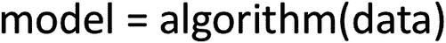

图 8-2：机器学习算法、数据和模型之间的关系

应用机器学习时需要注意的一个重要点是，永远不要用测试数据来训练机器学习算法，因为这会违背生成泛化机器学习模型的目的。另一个需要注意的重要点是，机器学习是一个广阔的领域，随着你深入研究，无疑会发现更多术语和概念。希望这套基本的术语能帮助你开启学习机器学习的旅程。

### 机器学习类型

如前所述，机器学习是关于教导机器从以往数据中学习模式，以便做出决策或预测。这些任务广泛适用于许多不同类型的问题，每种问题类型都需要不同的学习方式。广义上讲，有三种学习类型，如图 8-3 所示。

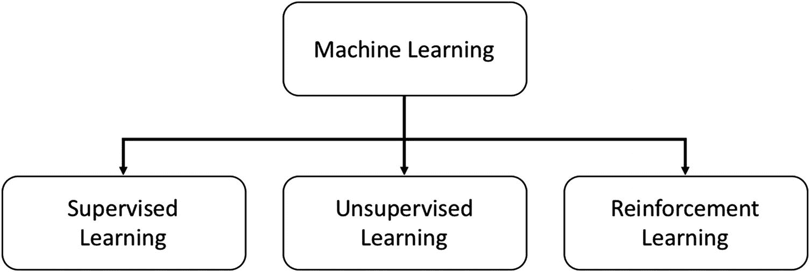

图 8-3：不同的机器学习类型

#### 监督学习

在各种学习类型中，这一种应用广泛且更为流行，因为它有助于解决分类和回归领域中的大量问题。

分类是将观测值归入离散或分类标签中的某一类。分类问题的例子包括：预测一封电子邮件是否为垃圾邮件；一条产品评论是正面还是负面；一张图片中是否包含狗、猫、海豚或鸟；一篇新闻文章的主题是关于体育、医学、政治还是宗教；某个手写数字是 1 还是 2；以及第四季度的收入是否达到预期。当分类结果只有两个离散值时，称为*二分类*；当结果有两个以上离散值时，称为*多分类*。

回归是根据观测值预测实数值。与分类不同，预测值不是离散的，而是连续的。回归问题的例子包括：根据房屋的位置和面积预测房价；预测一家公司的股票价格；根据一组人的背景和教育程度预测其收入，等等。

这种学习类型与其他类型的一个关键区别在于，训练数据中的每个观测值都必须包含一个标签，无论该标签是离散的还是连续的。换句话说，算法会获得正确答案，从而通过迭代并逐步改进对训练数据的预测来进行学习，一旦达到可接受的误差范围，学习便会停止。

区分分类与回归的一个简单心智模型是：分类是将数据分入不同的桶中，而回归是为数据拟合最佳直线。该心智模型的可视化表示见图 8-4。

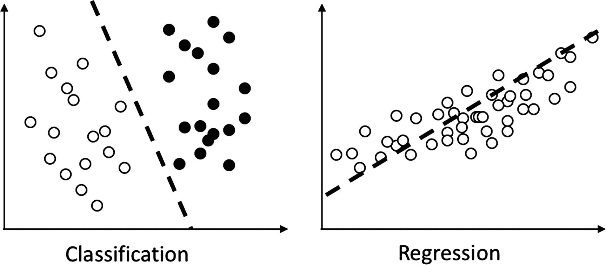

图 8-4：分类与回归的心智模型

有大量算法专为解决分类和回归的机器学习问题而设计。本章仅关注 Spark MLlib 组件中支持的算法，如表 8-1 所列。

表 8-1：MLlib 中的监督学习算法

| 任务 | 算法 |
| --- | --- |
| 分类 | 逻辑回归决策树随机森林梯度提升树线性支持向量机朴素贝叶斯 |
| 回归 | 线性回归广义线性回归决策树回归随机森林回归梯度提升回归 |

#### 无监督学习

这种学习方法的名称意味着没有监督；换句话说，用于训练机器学习算法的数据不包含标签，由学习算法自行发现结果。这种学习类型旨在解决另一类问题，即发现数据中隐藏的结构或模式，而由我们人类来解释这些洞察背后的含义。事实证明，一种称为*聚类*的隐藏结构（这是数据分析中的一种探索性分析技术）是组织信息以推导有意义的关系或发现聚类内观测值相似性的好方法。图 8-5 展示了聚类的示例。

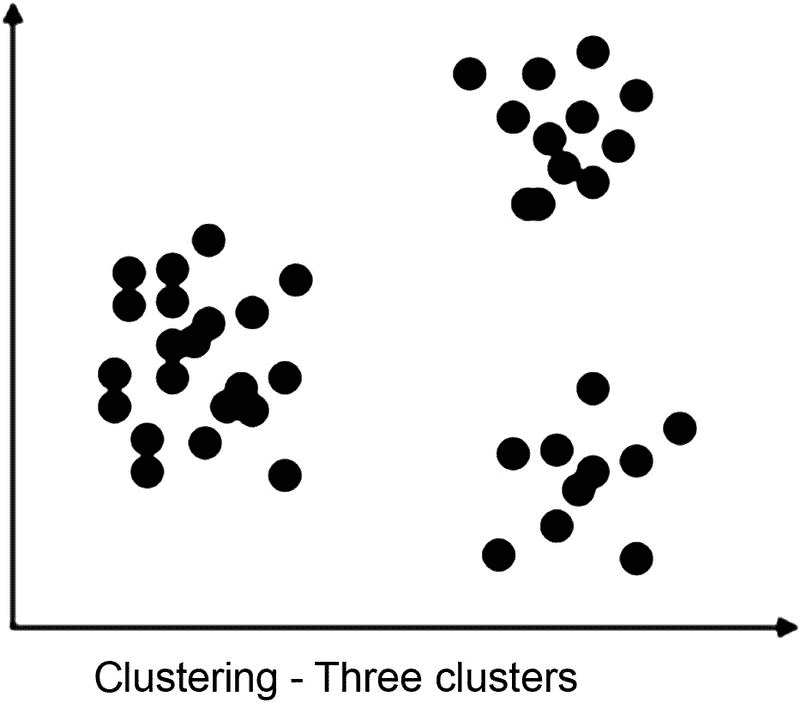

图 8-5：聚类的可视化

令人惊讶的是，许多实际问题都可以通过这种学习方法解决。假设有大量文档，且事先不知道某篇特定文档属于哪个主题；你可以使用无监督学习来发现相关文档的聚类，然后为每个聚类分配一个主题。无监督学习方法可以解决的另一个有趣且常见的问题是信用卡欺诈检测领域的问题，这是一种异常检测。将用户信用卡交易分组为聚类后，不难发现异常值，这些异常值可能代表信用卡被盗后出现的异常交易。

表 8-2 列出了无监督学习方法支持的算法。

表 8-2：MLlib 中的无监督学习算法

| 任务 | 算法 |
| --- | --- |
| 聚类 | K 均值潜在狄利克雷分配二分 K 均值高斯混合模型 |

#### 强化学习

与前两种学习类型不同，强化学习并非从数据中学习。相反，它通过与环境的交互（通过一系列动作）来学习，反馈循环提供信息，使其进行调整，以最大化某种奖励为目标。换句话说，它从自身经验中学习。

直到最近，这种学习类型受到的关注仍不如前两种，因为除了计算机游戏之外，它尚未取得显著的实践成功。2016 年，谷歌 DeepMind 成功地将这种学习类型应用于玩 Atari 游戏，随后又将其整合到 AlphaGo 程序中，该程序击败了一位围棋世界冠军。

目前，Spark MLlib 不包含任何强化学习算法。以下各节将重点介绍前两种学习类型。

### 注意

术语*监督*比喻性地指代一位教师（人类），他通过专门提供答案（标签）以及一组示例（训练数据）来“监督”学习者（即机器学习算法）。

### 机器学习流程

为了高效地将机器学习应用于智能应用的开发，你应当考虑学习并采纳大多数机器学习从业者遵循的一套最佳实践。人们常说，有效应用机器学习是一门手艺，半是科学，半是艺术。幸运的是，存在一个广为人知且结构化的流程，它由一系列步骤组成，有助于提供合理的可重复性和一致性，如图 8-6 所示。

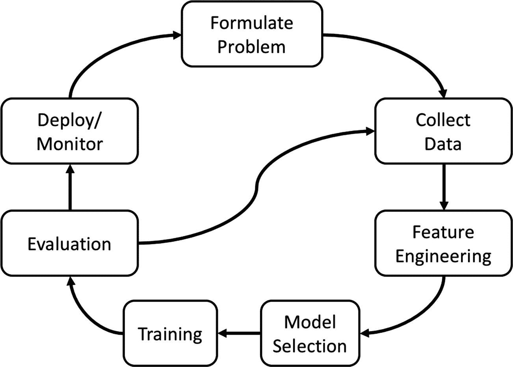

图 8-6：机器学习应用开发流程

显而易见，该流程的第一步是清晰理解你认为机器学习能助力的业务目标或挑战。评估机器学习的替代方案以了解其成本和权衡是很有益的。有时，先采用简单的基于规则的解决方案会更快。如果确信机器学习在无需人工干预的情况下，能够高效、快速且广泛地在多种场景中提供有价值的业务洞察，那么就可以进入下一步。在问题被清晰理解后，下一步是建立一套所有利益相关者都能认同的成功指标。

接下来的步骤是识别并收集必要类型和适当数量的数据，以支持当前的问题。所收集数据的质量和数量将直接影响训练出的机器学习模型的性能。需要牢记的一个重要点是，确保收集的数据尽可能代表你试图解决的问题。“垃圾进，垃圾出”这句话在描述机器学习的一个关键局限性时仍然非常适用。

特征工程是该流程中最重要且最耗时的步骤之一。这一步主要涉及数据清洗，并利用领域知识来识别关于观测数据的关键属性或特征，这些特征将有助于机器学习算法学习训练数据与提供的标签之间的直接关系。数据清洗任务通常使用探索性数据分析框架来完成，以便更好地理解数据在数据分布、相关性、异常值等方面的特征。特征工程是一个相当昂贵的步骤，因为它需要人工参与并运用其关于待解决问题的领域知识。深度学习已被证明是一种优于机器学习的卓越学习方法，因为它可以在无需人工干预的情况下自动提取特征。

特征工程之后的下一步是选择合适的机器学习模型或算法并进行训练。鉴于有许多可用的算法来解决类似的机器学习任务，问题在于，使用哪个或哪些模型最好？与大多数事情一样，决定最佳方案需要结合对当前问题的深入理解、对每种算法不同特性的良好工作知识，以及过去将其应用于类似问题的经验。换句话说，选择最佳算法是半科学、半艺术的过程。可能需要一些实验才能找到最佳算法。一旦选定了算法，就让它从特征工程步骤产生的数据中学习。预期的输出是一个模型，然后你继续进行模型评估，以了解其性能如何。前面所有步骤的目标是生成一个泛化能力强的模型，这意味着它在从未见过的数据上也能表现良好。

机器学习开发流程中的另一个重要步骤是模型评估任务。它既必要又具有挑战性。这一步的目标不仅是回答模型性能如何的问题，还要知道何时停止调整模型，因为其性能已达到第一步中设定的成功指标。评估过程可以离线进行，也可以在线进行。前者指使用训练数据评估模型，后者指使用实时或新数据评估模型。有一组常用的指标来了解模型性能，例如精确率、召回率、F1 分数、AUC 等。这一步的艺术在于理解哪些指标适用于特定的机器学习任务。模型性能的结果决定了是进入生产部署步骤，还是返回收集更多数据或不同类型数据的步骤。

这些信息旨在提供机器学习开发流程的概述，而非全面详尽的说明。要充分涵盖每个步骤的内部细节和最佳实践，很容易就需要整整一章的篇幅。

## Spark 机器学习库

本章的剩余部分将介绍 Spark MLlib 组件中的主要特性，并提供在 Spark 中将机器学习算法应用于以下机器学习任务的示例：分类、回归、聚类和推荐。

### 注意

在 Python 世界中，`scikit-learn` 是最受欢迎的开源机器学习库之一。它构建在 `NumPy`、`SciPy` 和 `matplotlib` 库之上，并提供了一套监督学习和无监督学习算法。它被设计成一个简单高效的工具；因此，它是在单机上学习和实践机器学习的完美工具。一旦数据大小超过单机的存储容量，就该切换到 Spark MLlib 了。

有许多机器学习库可供选择。在大数据时代，选择 Spark MLlib 而非其他选项有两个原因。第一个是易用性。Spark SQL 提供了一种用户友好的方式来执行数据探索性分析，而 MLlib 库则提供了一种构建、管理和持久化复杂机器学习流水线的方法。第二个原因是在大规模数据上执行机器学习。Spark 统一数据分析引擎与 MLlib 库的结合，可以支持训练具有数十亿观测数据和数千个特征的机器学习模型。

### 机器学习流水线

从前面的章节可以看出，机器学习流程本质上是一个流水线，由一系列按顺序运行的步骤组成，并且通常需要重复多次才能得到最优模型。为了与使实用机器学习变得简单的目标保持一致，Spark MLlib 提供了一套抽象，以帮助简化数据清洗、特征工程、模型训练、模型调优和评估等步骤，并将它们组织成流水线，使其易于理解、维护和重复。流水线的概念实际上源于前面提到的 `scikit-learn` 库。

形成端到端机器学习流水线有四个主要抽象：转换器、估计器、评估器和流水线。它们提供了一套标准接口，使理解他人的流水线变得容易。图 8-7 展示了机器学习流程中的核心步骤与 MLlib 提供的主要抽象之间的相似性。

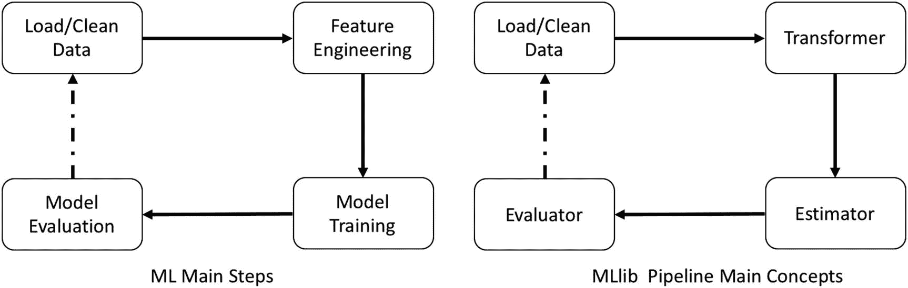

图 8-7：机器学习主要步骤与 MLlib 流水线主要概念之间的相似性

这些抽象的一个共同点是，它们的输入和输出大多是 `DataFrame`，这意味着需要将输入数据转换为 `DataFrame` 才能使用这些抽象。

### 注意

与 Spark 统一数据分析引擎中的其他组件一样，MLlib 正在转向基于 DataFrame 的 API，以提供更友好的用户接口，并利用 Spark SQL 引擎提供的优化功能。新的 API 位于 `org.apache.spark.ml` 包中。第一个 MLlib 版本基于 RDD 的 API 开发，该版本目前仍受支持，但仅处于维护模式。旧的 API 位于 `org.apache.spark.mllib` 包中。一旦功能对等实现，基于 RDD 的 API 将被弃用。

#### 转换器

转换器旨在通过特征工程步骤和模型评估步骤中操作一个或多个列来转换 DataFrame 中的数据。转换过程是在构建特征以供给 ML 算法学习的背景下进行的。此过程通常涉及添加或删除列（特征）、将列值从文本转换为数值，或对特定列的值进行归一化。

在 MLlib 中使用 ML 算法有一个严格的要求：它们要求所有特征（包括标签）都必须是 `Double` 数据类型。

从技术角度来看，转换器有一个名为 `transform` 的函数，该函数对输入列执行转换，并将结果存储在输出列中。输入列和输出列的名称可以在构造转换器时指定。如果未指定，则使用默认列名（`"inputCol"`、`"outputCol"`）。图 8-8 描述了转换器的外观；DF1 中的阴影列代表输入列，DF2 中颜色较深的阴影列代表输出列。

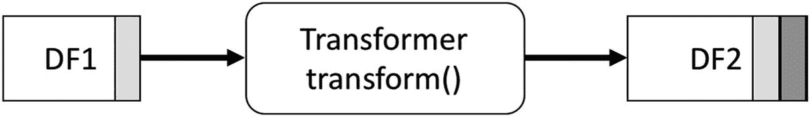

图 8-8

转换器的输入与输出

每种数据类型都有多种数据转换类型；因此，MLlib 中大约有 30 个转换器也就不足为奇了。表 8-3 展示了针对每种数据转换类型的各种转换器。

表 8-3

不同转换类型的转换器

| 类型 | 转换器 |
| --- | --- |
| 通用 | `SQLTransformer`、`VectorAssembler` |
| 数值数据 | `Bucketizer`、`QuantileDiscretizer`、`StandardScaler`、`MixMaxScaler`、`MaxAbsScaler`、`Normalizer` |
| 文本数据 | `IndexToString`、`OneHotEncoder`、`Tokenizer`、`RegexTokenizer`、`StopWordsRemover`、`NGram`、`HashingTF` |

以下部分将介绍几个常用的转换器。

`Binarizer` 转换器简单地将输入列的值转换为两组。第一组包含小于或等于指定阈值的值，输出列中的值为零。其他值在输出列中的值为 1。输入列必须是 `double` 或 `VectorUDT` 类型。清单 8-1 将温度列的值转换为两个桶。

```
import org.apache.spark.ml.feature.Binarizer
val arrival_data = spark.createDataFrame(Seq(("SFO", "B737", 18, 95.1, "late"),
("SEA", "A319", 5, 65.7, "ontime"),
("LAX", "B747", 15, 31.5, "late"),
("ATL", "A319", 14, 40.5, "late") ))
.toDF("origin", "model", "hour", "temperature", "arrival")
val binarizer = new Binarizer().setInputCol("temperature")
.setOutputCol("freezing")
.setThreshold(35.6)
binarizer.transform(arrival_data).show
// 显示 binarizer 转换器中参数的当前值
binarizer.explainParams
inputCol: 输入列名称 (当前值: temperature)
outputCol: 输出列名称 (默认值: binarizer_60430bb4e97f__output, 当前值: freezing)
threshold: 用于二值化连续特征的阈值 (默认值: 0.0, 当前值: 35.6)
// 显示转换结果
binarizer.transform(arrival_data).select("temperature", "freezing").show
+------------+---------+
| temperature| freezing|
+------------+---------+
|        95.1|      1.0|
|        65.7|      1.0|
|        31.5|      0.0|
|        40.5|      1.0|
+------------+---------+
清单 8-1
使用 Binarizer 转换器将温度转换为两个桶
```

`Bucketizer` 转换器是 `Binarizer` 的通用版本，它可以将列值转换为您选择的桶。控制桶的数量以及每个桶的值范围的方法是通过指定一个双精度值数组形式的桶边界列表。此转换器在列值为连续值，并且您希望将其转换为更易于理解的表示形式时非常有用。例如，您有一个包含特定州每位居民收入金额的列，并且您希望将他们的收入分桶为以下桶：高收入、中等收入、低收入等。

值桶边界数组必须是 `double` 类型，并且必须满足以下要求：

*   最小的桶边界值必须小于 DataFrame 中输入列的最小值。
*   最大的桶边界值必须大于 DataFrame 中输入列的最大值。
*   输入数组中必须至少有三个桶边界，这将创建两个桶。

对于个人收入的情况，很容易知道最小收入金额为 0；那么最小的桶边界值可以设置为小于 0 的值。如果无法预测列的最小值，则指定负无穷大。类似地，如果无法预测列的最大值，则指定正无穷大。请参见清单 8-2 了解使用此转换器将温度列分桶为三个桶的示例，这意味着桶边界数组必须至少包含四个值。输出按温度列排序，以便于查看。

```
import org.apache.spark.ml.feature.Bucketizer
val bucketBorders = Array(-1.0, 32.0, 70.0, 150.0)
val bucketer = new Bucketizer().setSplits(bucketBorders)
.setInputCol("temperature")
.setOutputCol("intensity")
val output = bucketer.transform(arrival_data)
output.select("temperature", "intensity")
.orderBy("temperature")
.show
+------------+----------+
| temperature| intensity|
+------------+----------+
|        31.5|       0.0|
|        40.5|       1.0|
|        65.7|       1.0|
|        95.1|       2.0|
+------------+----------+
清单 8-2
使用 Bucketizer 转换器将温度转换为三个桶
```

`OneHotEncoder` 转换器通常用于处理数值型分类值。如果分类值是字符串类型，则首先应用 `StringIndexer` 估计器将其转换为数值类型。`OneHotEncoder` 转换器本质上将数值型分类值映射为二进制向量，以有意消除数值型分类值的隐含排序。例如，以下数据表示学生专业，每个专业被分配一个序数值，这似乎暗示某个专业比其他专业更高。为了在 ML 训练步骤中消除这种无意的偏差，使用此转换器将序数值转换为向量。请参见清单 8-3 了解使用此转换器的示例。

```scala
import org.apache.spark.ml.feature.OneHotEncoder
val student_major_data = spark.createDataFrame(Seq(("John", "Math", 3),
("Mary", "Engineering", 2),
("Jeff", "Philosophy", 7),
("Jane", "Math", 3),
("Lyna", "Nursing", 4) ))
.toDF("user", "major", "majorIdx")
val oneHotEncoder = new OneHotEncoder().setInputCol("majorIdx")
.setOutputCol("majorVect")
oneHotEncoder.transform(student_major_data).show()
+----+------------+---------+---------------+
|user|       major| majorIdx|      majorVect|
+----+------------+---------+---------------+
|John|        Math|        3|  (7,[3],[1.0])|
|Mary| Engineering|        2|  (7,[2],[1.0])|
|Jeff|  Philosophy|        7|      (7,[],[])|
|Jane|        Math|        3|  (7,[3],[1.0])|
|Lyna|     Nursing|        4| ( 7,[4],[1.0])|
+----+------------+---------+---------------+
清单 8-3
使用 OneHotEncoder 转换器将分类值的序数值进行转换
```

处理字符串类型分类值时，另一个常见需求是将它们转换为序数值，这可以通过 `StringIndexer` 估计器来实现。该估计器将在“估计器”部分进行介绍。

在许多有趣的机器学习用例中，输入是自由格式的文本。这需要经过一些转换，才能将自由格式文本转换为机器学习算法可以处理的数值表示形式。其中就包括分词和词频统计。

你很可能已经猜到 `Tokenizer` 转换器的作用了。它对由空格分隔的单词字符串执行分词操作，并返回一个单词数组。如果需要使用不同的分隔符进行分词，则可以使用 `RegexTokenizer`。清单 8-4 展示了使用 `Tokenizer` 转换器的示例。

```scala
import org.apache.spark.ml.feature.Tokenizer
import org.apache.spark.sql.functions._
val text_data = spark.createDataFrame(Seq(
(1, "Spark is a unified data analytics engine"),
(2, "It is fun to work with Spark"),
(3, "There is a lot of exciting sessions at upcoming Spark summit"),
(4, "mllib transformer estimator evaluator and pipelines")  )
).toDF("id", "line")
val tokenizer = new Tokenizer().setInputCol("line").setOutputCol("words")
val tokenized = tokenizer.transform(text_data)
tokenized.select("words").withColumn("tokens", size(col("words"))).show(false)
+-------------------------------------------------------------------------+
|    words                                                        | tokens|
+-------------------------------------------------------------------------+
|[spark, is, a, unified, data, analytics, engine]                 |      7|
|[spark, is cool, and, it, is, fun, to, work, with,               |     11|
|[there, is, a, lot, of, exciting, sessions, at, upcoming, spark, summit]                                        |     11|
|[mllib, transformer, estimator, evaluator, and, pipelines]       |      6|
+-------------------------------------------------------------------------+
清单 8-4
使用 Tokenizer 转换器执行分词
```

停用词是一种语言中常用的词汇。在自然语言处理或机器学习的语境中，停用词往往只会增加不必要的噪声，而不会提供任何有意义的贡献。因此，通常在分词步骤之后立即进行停用词移除。`StopWordsRemover` 转换器正是为此步骤设计的。自 Spark 2.3 起，Spark 发行版中包含了以下语言的停用词供你使用：丹麦语、荷兰语、英语、芬兰语、法语、德语、匈牙利语、意大利语、挪威语、葡萄牙语、俄语、西班牙语、瑞典语和土耳其语。它的设计非常灵活，可以通过从提供的目录路径读取用户提供的停用词集来使用。要使用特定语言的停用词，首先调用 `StopWordsRemover.loadDefaultStopWords(<小写语言名称>)` 加载它们，然后将它们提供给 `StopWordsRemover` 的实例。此外，如有必要，你可以要求此转换器在停用词过滤时忽略大小写。清单 8-5 展示了使用 `StopWordsRemover` 转换器移除英语停用词的示例。

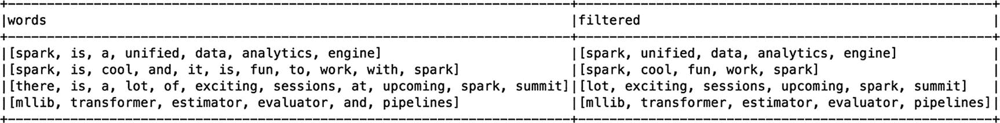

```scala
import org.apache.spark.ml.feature.StopWordsRemover
val enStopWords = StopWordsRemover.loadDefaultStopWords("english")
val remover = new StopWordsRemover().setStopWords(enStopWords)
.setInputCol("words")
.setOutputCol("filtered")
// 使用清单 8-5 示例中的 tokenized 结果
val cleanedTokens = remover.transform(tokenized)
cleanedTokens.select("words","filtered").show(false)
清单 8-5
使用 StopWordsRemover 转换器从分词示例的单词中移除英语停用词
```

`HashingTF` 转换器用于通过计算每行中每个单词的频率，将单词转换为数值表示。每个单词通过应用名为 `MurmurHash3` 的哈希函数映射到一个索引。这种方法效率很高，但存在潜在的哈希冲突问题，即多个单词可能映射到同一个索引。最小化冲突的一种方法是指定一个较大的桶数量（最好是 2 的幂），以帮助均匀分布单词。清单 8-6 中的示例将把清单 8-6 示例中的 `filtered` 列输入到 `HashingTF` 转换器中。

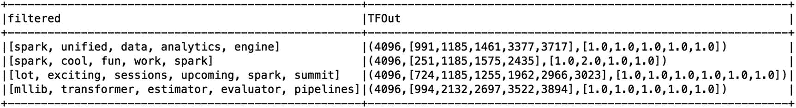

```scala
import org.apache.spark.ml.feature.HashingTF
val tf = new HashingTF().setInputCol("filtered")
.setOutputCol("TFOut")
.setNumFeatures(4096)
val tfResult = tf.transform(cleanedTokens)
tfResult.select("filtered", "TFOut").show(false)
清单 8-6
使用 HashingTF 转换器通过哈希和计数将单词转换为数值表示

```

本节介绍的最后一个转换器是`VectorAssembler`，它简单地将一组列合并成一个向量列。在机器学习术语中，这相当于将各个特征组合成单一向量特征，供机器学习算法学习。各个输入列的类型必须是以下类型之一：数值型、布尔型或向量型。输出向量列包含所有列的值，顺序与指定顺序一致。该转换器几乎用于每一个机器学习流水线中，其输出将传递给一个估计器。清单 8-7 展示了使用`VectorAssembler`转换器的示例。

```scala
import org.apache.spark.ml.feature.VectorAssembler
val arrival_features  = spark.createDataFrame(Seq(
(18, 95.1, true),
(5, 65.7, true), (15, 31.5, false),
(14, 40.5, false) ))
.toDF("hour", "temperature", "on_time")
val assembler = new VectorAssembler().setInputCols(Array("hour", "temperature", "on_time"))
.setOutputCol("features")
val output = assembler.transform(arrival_features)
output.show
+-----+------------+--------+----------------+
| hour| temperature| on_time|        features|
+-----+------------+--------+----------------+
|   18|        95.1|    true| [18.0,95.1,1.0]|
|    5|        65.7|    true|  [5.0,65.7,1.0]|
|   15|        31.5|   false| [15.0,31.5,0.0]|
|   14|        40.5|   false| [14.0,40.5,0.0]|
+-----+------------+--------+----------------+
清单 8-7
使用 VectorAssembler 转换器将特征组合成向量特征
```

了解转换器的工作原理以及 MLlib 中可用的转换器，在机器学习开发流程的特征工程步骤中扮演着重要角色。通常，`VectorAssembler`转换器的输出将由一个估计器（estimator）消费，这将在下一节中介绍。

## 估计器

下一个概念是估计器，它是对在数据上进行训练的机器学习算法或任何其他在数据上操作的算法的抽象。令人困惑的是，一个估计器可以是两种算法中的一种。第一种类型的例子是名为`LinearRegression`的机器学习算法，用于回归任务，例如预测房价。第二种算法的例子是`StringIndexer`，它将一列的分类值编码为索引，使得每个分类值的索引值基于它在 DataFrame 整个输入列中出现的频率。从高层次来看，这种估计器将一列的值转换为另一列；然而，它需要对整个 DataFrame 进行两次遍历才能产生预期的输出。

从技术角度来看，估计器有一个名为`fit`的函数，该函数将算法应用于输入列，结果封装在名为`Model`的对象类型中，而`Model`是一种`Transformer`类型。输入列和输出列的名称可以在构造估计器时指定。图 8-9 描述了估计器的外观及其输入和输出。

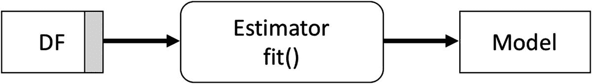

图 8-9

估计器及其输入和输出

为了了解这两种类型的估计器，表 8-4 列出了 MLlib 中可用估计器的一个子集。

表 8-4

MLlib 中可用的估计器示例

| 类型 | 估计器 |
| --- | --- |
| 机器学习算法 | `LogisticRegression` `DecisionTreeClassifier` `RandomForestClassifier` `LinearRegression` `RandomForestRegressor` `KMeans` `LDA` `BisectingKMeans` |
| 数据转换算法 | `IDF` `RFormula` `StringIndexer` `OneHotEncoderEstimator` `StandardScaler` `MixMaxScaler` `MaxAbsScaler` `Word2Vec` |

以下部分提供了在处理文本和数值数据时常用估计器的一些示例。

`RFormula`是一个有趣且通用的估计器，其转换逻辑以声明方式表达。它可以处理数值和分类值，其输出是一个特征向量。MLlib 从 R 语言中借鉴了这个估计器的思想，目前仅支持 R 中可用运算符的一个子集。基本且受支持的运算符列在表 8-5 中。需要花一点时间来理解这种转换语言，才能充分利用`RFormula`估计器的灵活性和强大功能。

表 8-5

`RFormula`转换器中支持的运算符

| 运算符 | 描述 |
| --- | --- |
| `~` | 分隔目标与项。 |
| `+` | 连接项。 |
| `-` | 移除一个项。 |
| `:` | 其他项之间的交互以创建新特征。对于数值类型将使用乘法，对于分类值则进行二值化。 |
| `.` | 除目标之外的所有列。 |

以下示例指定标签为到达列，并使用所有剩余列作为特征。此外，它还利用`hour`和`temperature`列之间的交互创建了一个新特征。由于这两列是数值类型，它们的值将被相乘。清单 8-8 包含了前面所述示例的代码。

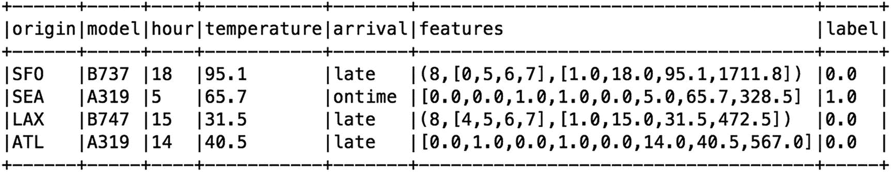

```scala
import org.apache.spark.ml.feature.RFormula
val arrival_data = spark.createDataFrame(Seq(("SFO", "B737", 18, 95.1, "late"),
("SEA", "A319", 5, 65.7, "ontime"),
("LAX", "B747", 15, 31.5, "late"),
("ATL", "A319", 14, 40.5, "late") ))
.toDF("origin", "model", "hour", "temperature", "arrival")
val formula = new RFormula().setFormula("arrival ~ . + hour:temperature")
.setFeaturesCol("features")
.setLabelCol("label")
// 先调用 fit 函数，返回一个模型（转换器类型），再调用 transform
val output = formula.fit(arrival_data).transform(arrival_data)
output.select("*").show(false)
```

清单 8-8 使用`RFormula`转换器创建特征向量

处理文本时常用的估计器之一是`IDF`估计器。其名称是逆文档频率（inverse document frequency）的缩写。该估计器通常在文本完成分词并计算词频后使用。其背后的思想是通过统计每个词出现在多少个文档中来计算其重要性或权重。其直觉是，出现频率高且范围广的词重要性较低，例如单词the。反之，出现频率高但仅出现在少数文档中的词则表明其重要性更高，例如单词classification。在 DataFrame 的上下文中，文档指的是每一行。细心的读者会发现，要计算每个词的重要性，需要遍历每一行，因此`IDF`是一个估计器，而不是转换器。清单 8-9 中的示例将`Tokenizer`和`HashingTF`转换器与`IDF`估计器串联起来。估计器的`fit`函数是一个急切求值函数，会触发作业执行。

```scala
import org.apache.spark.ml.feature.Tokenizer
import org.apache.spark.ml.feature.HashingTF
import org.apache.spark.ml.feature.IDF
val text_data = spark.createDataFrame(Seq(
(1, "Spark is a unified data analytics engine"),
(2, "Spark is cool and it is fun to work with Spark"),
(3, "There is a lot of exciting sessions at upcoming Spark summit"),
(4, "mllib transformer estimator evaluator and pipelines")  )
).toDF("id", "line")
val tokenizer = new Tokenizer().setInputCol("line")
.setOutputCol("words")
// Tokenizer 转换器的输出列是 HashingTF 的输入
val tf = new HashingTF().setInputCol("words")
.setOutputCol("wordFreqVect")
.setNumFeatures(4096)
val tfResult = tf.transform(tokenizer.transform(text_data))
// HashingTF 转换器的输出是 IDF 估计器的输入
val idf = new IDF().setInputCol("wordFreqVect")
.setOutputCol("features")
// 由于 IDF 是估计器，调用 fit 函数
val idfModel = idf.fit(tfResult)
// 返回的对象是一个模型，属于 Transformer 类型
val weightedWords = idfModel.transform(tfResult)
weightedWords.select("label", "features").show(false)
weightedWords.printSchema
|-- id: integer (nullable = false)
|-- line: string (nullable = true)
|-- words: array (nullable = true)
|    |-- element: string (containsNull = true)
|-- wordFreqVect: vector (nullable = true)
|-- features: vector (nullable = true)
// 特征列包含每个词权重的向量，由于内容较长，以下未包含输出
weightedWords.select("wordFreqVect", "features").show(false)
```

清单 8-9 使用`IDF`估计器计算每个词的权重

处理包含分类值的文本数据时，一个值得了解的优秀估计器是`StringIndexer`估计器。它根据分类值的频率将其编码为索引，使得最频繁的分类值获得索引值 0，依此类推。为了让该估计器为分类值生成索引值，它首先必须统计每个分类值的频率，最后再分配索引值；换句话说，它必须看到 DataFrame 中输入列的所有值。如果输入列是数值型的，该估计器会在计算频率之前将其转换为字符串类型。清单 8-10 提供了一个使用`StringIndexer`估计器对电影类型进行编码的示例。

```scala
import org.apache.spark.ml.feature.StringIndexer
val movie_data = spark.createDataFrame(Seq(
(1, "Comedy"),
(2, "Action"),
(3, "Comedy"),
(4, "Horror"),
(5, "Action"),
(6, "Comedy")  )
).toDF("id", "genre")
val movieIndexer = new StringIndexer().setInputCol("genre")
.setOutputCol("genreIdx")
// 首先拟合数据
val movieIndexModel = movieIndexer.fit(movie_data)
// 使用返回的转换器转换数据
val indexedMovie = movieIndexModel.transform(movie_data)
indexedMovie.orderBy("genreIdx").show()
+---+-------+---------+
| id|  genre| genreIdx|
+---+-------+---------+
|  3| Comedy|      0.0|
|  6| Comedy|      0.0|
|  1| Comedy|      0.0|
|  5| Action|      1.0|
|  2| Action|      1.0|
|  4| Horror|      2.0|
+---+-------+---------+
```

清单 8-10 使用`StringIndexer`估计器对电影类型进行编码

如上所示，该估计器根据频率降序分配索引。这种默认行为可以轻松更改为频率升序；事实上，它还支持另外两种排序类型：字母降序和字母升序。要更改默认排序类型，只需调用`setStringOrderType("<排序类型>")`函数，并传入以下值之一：`frequencyDesc`、`frequencyAsc`、`alphabetDesc`、`alphabetAsc`。

另一个处理分类值的有用估计器是`OneHotEncoderEstimator`，它将分类值的索引编码为二进制向量。从 Spark 2.3.0 开始，`OneHotEncoder`转换器已被弃用，因为它无状态，导致无法用于新测试数据（其类别数量可能与训练数据不同）。该估计器通常与`StringIndexer`估计器结合使用，其中`StringIndexer`的输出成为该估计器的输入。清单 8-11 演示了如何一起使用`StringIndexer`和`OneHotEncoderEstimator`。

```scala
import org.apache.spark.ml.feature.OneHotEncoderEstimator
// 输入列 genreIdx 是清单 8-9 中 StringIndex 的输出列
val oneHotEncoderEst = new OneHotEncoderEstimator().setInputCols(Array("genreIdx"))
.setOutputCols(Array("genreIdxVector"))
// 拟合清单 8-10 中生成的 indexedMovie 数据
val oneHotEncoderModel = oneHotEncoderEst.fit(indexedMovie)
val oneHotEncoderVect = oneHotEncoderModel.transform(indexedMovie)
oneHotEncoderVect .orderBy("genre").show()
+---+-------+---------+---------------+
| id| genre | genreIdx| genreIdxVector|
+---+-------+---------+---------------+
|  5| Action|      1.0|  (2,[1],[1.0])|
|  2| Action|      1.0|  (2,[1],[1.0])|
|  3| Comedy|      2.0|      (2,[],[])|
|  6| Comedy|      2.0|      (2,[],[])|
|  1| Comedy|      2.0|      (2,[],[])|
|  4| Horror|      0.0|  (2,[0],[1.0])|
+---+--------+--------+---------------+
```

清单 8-11 `OneHotEncoderEstimator`消费`StringIndexer`估计器的输出

## Word2Vec 估计器

在处理自由文本时，另一个值得了解的估计器是`Word2Vec`估计器，其名称意为词转向量。该估计器利用一种名为词嵌入的著名技术，将词元转换为数值向量表示，使得语义相似的词被映射到邻近的点。这项技术背后的直觉是，相似的词往往共同出现并具有相似的上下文。换句话说，两个具有相似相邻词的不同词，其含义很可能相似或相关。该技术已被证明在诸多自然语言处理应用中相当有效，例如词语类比、词语相似度、实体识别和机器翻译。

`Word2Vec` 估计器有几个重要的配置项，需要提供适当的值来控制基于输入的输出。表 8-6 描述了这些配置。

**表 8-6** `Word2Vec` 配置项

| 名称 | 默认值 | 描述 |
| --- | --- | --- |
| `vectorSize` | 100 | 输出向量的大小。 |
| `windowSize` | 5 | 用作上下文的词的数量。 |
| `minCount` | 5 | 一个词元必须出现的最小次数，才能被包含在输出中。 |
| `maxSentenceLength` | 1000 | 指定与其他项交互以创建新特征。数值型将使用乘法，类别型将使用二值化。 |

清单 8-12 中的示例演示了如何使用 `Word2Vec` 估计器，并展示了如何查找相似词。

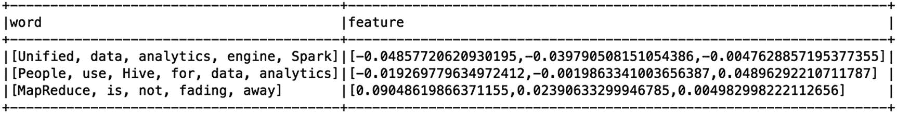

```scala
import org.apache.spark.ml.feature.Word2Vec

val documentDF = spark.createDataFrame(Seq(
  "Unified data analytics engine Spark".split(" "),
  "People use Hive for data analytics".split(" "),
  "MapReduce is not fading away".split(" ")
).map(Tuple1.apply)).toDF("word")

val word2Vec = new Word2Vec().setInputCol("word")
  .setOutputCol("feature") .setVectorSize(3).setMinCount(0)

val model = word2Vec.fit(documentDF)
val result = model.transform(documentDF)
result.show(false)
```

**清单 8-12** 使用 `Word2Vec` 估计器计算词嵌入并查找相似词

```scala
// 查找与 Spark 相似的词，结果显示 Hive 和 MapReduce 都相似。
model.findSynonyms("Spark", 3).show
+----------+-------------------+
|      word|         similarity|
+----------+-------------------+
|    engine| 0.9133241772651672|
| MapReduce| 0.7623026967048645|
|      Hive| 0.7179173827171326|
+----------+-------------------+

// 查找与 Hive 相似的词，结果显示 Spark 是相似的
model.findSynonyms("Hive", 3).show
+-------+--------------------+
|   word|          similarity|
+-------+--------------------+
|  Spark|  0.7179174423217773|
| fading|  0.5859972238540649|
| engine| 0.43200281262397766|
+-------+--------------------+
```

# 数值数据的归一化与标准化

接下来的估计器是关于数值数据的归一化和标准化。使用这些估计器的原因是确保使用距离作为度量的学习算法不会对具有较大值的特征赋予比具有较小值的特征更多的权重。

数值数据归一化是将其原始范围映射到零到一之间的过程。当观测值具有多个不同范围的属性时，这尤其有用。例如，假设你有员工的薪水及其身高。薪水的数值是数千，而身高的数值是个位数。这就是 `MinMaxScaler` 估计器的设计目的。该估计器使用列摘要统计信息，将每个特征（列）单独线性重新缩放到一个共同的、由最小值和最大值指定的值范围。如果最小值是 0.0，最大值是 3.0，那么所有值都将落在这个范围内。清单 8-13 提供了一个使用 `MinMaxScaler` 处理包含薪水和身高信息的 `employee_data` 数据集的示例。这两个特征值之间的幅度差异很大，但经过 `MinMaxScaler` 处理后，情况就不再如此了。

```scala
import org.apache.spark.ml.feature.MinMaxScaler
import org.apache.spark.ml.linalg.Vectors

val employee_data = spark.createDataFrame(Seq(
  (1, Vectors.dense(125400, 5.3)),
  (2, Vectors.dense(179100, 6.9)),
  (3, Vectors.dense(154770, 5.2)),
  (4, Vectors.dense(199650, 4.11))))
  .toDF("empId", "features")

val minMaxScaler = new MinMaxScaler().setMin(0.0)
  .setMax(5.0)
  .setInputCol("features")
  .setOutputCol("scaledFeatures")

val scalerModel = minMaxScaler.fit(employee_data)
val scaledData = scalerModel.transform(employee_data)

println(s"Features scaled to range: [${minMaxScaler.getMin}, ${minMaxScaler.getMax}]")
// Features scaled to range: [0.0, 5.0]
scaledData.select("features", "scaledFeatures").show(false)
+----------------+----------------------------------------+
|        features|                          scaledFeatures|
+----------------+----------------------------------------+
|  [125400.0,5.3]|                [0.0,2.1326164874551963]|
|  [179100.0,6.9]|                 [3.616161616161616,5.0]|
|  [154770.0,5.2]| [1.9777777777777779,1.9534050179211468]|
| [199650.0,4.11]|                               [5.0,0.0]|
+----------------+----------------------------------------+
```

**清单 8-13** 使用 `MinMaxScaler` 重新缩放特征

除了数值数据归一化之外，另一种常用于处理数值数据的操作称为*标准化*。当数值数据的分布接近钟形曲线时，此操作尤其适用。标准化操作有助于将数据转换为归一化形式，使数据落在 -1 到 1 的范围内，均值为 0。这样做的原因是，当数据围绕均值 0 有良好分布时，有助于某些机器学习算法更好地工作。`StandardScaler` 估计器专为标准化操作而设计。清单 8-14 中的示例使用了与清单 8-13 相同的输入数据集。输出显示特征值现在以 0 为中心，标准差为 1 个单位。

```scala
import org.apache.spark.ml.feature.StandardScaler
import org.apache.spark.ml.linalg.Vectors

val employee_data = spark.createDataFrame(Seq(
  (1, Vectors.dense(125400, 5.3)),
  (2, Vectors.dense(179100, 6.9)),
  (3, Vectors.dense(154770, 5.2)),
  (4, Vectors.dense(199650, 4.11))))
  .toDF("empId", "features")

// 设置单位标准差为 true，并以均值为中心
val standardScaler = new StandardScaler().setWithStd(true)
  .setWithMean(true)
  .setInputCol("features")
  .setOutputCol("scaledFeatures")

val standardMode = standardScaler.fit(employee_data)
val standardData = standardMode.transform(employee_data)
standardData.show(false)
+------+----------------+-------------------------------------------+
| empId|        features|                             scaledFeatures|
+------+----------------+-------------------------------------------+
|     1|  [125400.0,5.3]| [-1.2290717420781212,-0.06743742573177587]|
|     2|  [179100.0,6.9]|    [0.4490658767775897,1.3248191055048935]|
|     3|  [154770.0,5.2]| [-0.3112523404805006,-0.15445345893406737]|
|     4| [199650.0,4.11]|     [1.091258205781032,-1.102928220839048]|
+------+----------------+-------------------------------------------+
```

**清单 8-14** 使用 `StandardScaler` 将特征标准化到均值为零

MLlib 中还有更多的估计器可用于执行多种数据转换和映射，它们都遵循一个标准的抽象：拟合输入数据并生成一个模型实例。前面的示例旨在说明如何使用这些估计器。第二类估计器（涉及机器学习算法）的示例将在后续章节中介绍。

### 管道

在机器学习中，通常需要按顺序执行一系列步骤来清洗和转换数据，然后训练一个或多个机器学习算法从数据中学习，最后调整模型以达到最佳性能。MLlib 中的管道抽象旨在使这一工作流程更易于开发和维护。从技术角度来看，MLlib 有一个名为 `Pipeline` 的类，它被设计用于管理一系列阶段，每个阶段由 `PipelineStage` 表示。一个 `PipelineStage` 可以是转换器或估计器。`Pipeline` 抽象本身是一种估计器。

设置管道的第一个步骤是创建一系列阶段，然后创建一个 `Pipeline` 类的实例，并用一个阶段数组对其进行配置。`Pipeline` 将按指定顺序运行这些阶段。如果某个阶段是转换器，则会调用 `transform()` 函数。如果某个阶段是估计器，则会调用 `fit()` 函数来生成一个转换器，然后再调用其 `transform()` 函数。让我们通过一个小型工作流程来演示如何使用前面章节介绍的转换器和估计器处理文本。图 8-10 中描绘的小型管道由两个转换器和一个估计器组成。当调用 `Pipeline.fit()` 函数时，包含原始文本的输入 DataFrame 将被传入 `Tokenizer` 转换器，其输出将被传入 `HashingTF` 转换器，该转换器将单词转换为特征。`Pipeline` 识别出 `LogisticRegression` 是一个估计器，因此它将使用计算出的特征调用 `fit` 函数，以生成一个 `LogisticRegressionModel`。

图 8-10 中描绘的 `Pipeline` 的代码见清单 8-15。请记住，`Pipeline` 抽象是一种估计器。因此，一旦创建并配置了 `Pipeline` 的实例，就必须以训练数据作为输入调用 `fit()` 函数来触发各阶段的执行，这将生成一个 `PipelineModel` 实例，它是一种转换器。此时，你可以使用测试数据调用 `transform()` 函数来执行预测。

MLlib 提供了一项名为 *ML 持久化* 的功能，它可以轻松地将管道或模型持久化到磁盘，并在之后加载使用。很酷的一点是，持久化功能被设计为以语言无关的格式保存信息，因此，在 Scala 中持久化的管道或模型可以在 Java 或 Python 中读回，反之亦然。

实际的生产管道包含许多阶段。当阶段数量增多时，理解流程会变得困难，维护也颇具挑战。MLlib 的管道抽象确实能在这些方面提供帮助。另一个需要重点注意的关键点是，`Pipeline` 和 `PipelineModel` 对象都被设计为有助于确保训练数据和测试数据流经相同的特征处理步骤。

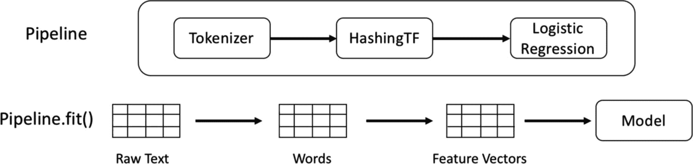

图 8-10 一个小型管道的示例

```scala
import org.apache.spark.ml.{Pipeline, PipelineModel}
import org.apache.spark.ml.classification.LogisticRegression
import org.apache.spark.ml.feature.{HashingTF, Tokenizer}

val text_data = spark.createDataFrame(Seq(
  (1, "Spark is a unified data analytics engine", 0.0),
  (2, "Spark is cool and it is fun to work with Spark", 0.0),
  (3, "There is a lot of exciting sessions at upcoming Spark summit", 0.0),
  (4, "signup to win a million dollars", 0.0)  )
).toDF("id", "line", "label")

val tokenizer = new Tokenizer().setInputCol("line").setOutputCol("words")
val hashingTF = new HashingTF().setInputCol(tokenizer.getOutputCol)
  .setOutputCol("features")
  .setNumFeatures(4096)
val logisticReg = new LogisticRegression().setMaxIter(5)
  .setRegParam(0.01)

val pipeline = new Pipeline().setStages(Array(tokenizer, hashingTF, logisticReg))
val logisticRegModel = pipeline.fit(text_data)

// 持久化模型和管道
logisticRegModel.write.overwrite().save("/tmp/logistic-regression-model")
pipeline.write.overwrite().save("/tmp/logistic-regression-pipeline")

// 加载模型和管道
val prevModel = PipelineModel.load("/tmp/spark-logistic-regression-model")
val prevPipeline = Pipeline.load("/tmp/logistic-regression-pipeline")
```

**清单 8-15** 使用管道创建一个小型工作流程

# 模型调优

模型调优步骤的目标是训练一个具有正确参数集的模型，以实现最佳性能，从而满足机器学习开发流程第一步中定义的目标。这一步通常繁琐、重复且耗时，因为它可能涉及尝试不同的机器学习算法或几组参数。本节旨在介绍`MLlib`提供的几种工具，以帮助完成模型调优步骤中繁重的工作。本节并非旨在展示如何执行模型调优。

在深入探讨`MLlib`提供的两种工具的细节之前，让我们先明确理解以下术语，其中一个是模型调优过程的输入。

- 模型超参数是
  - 用于控制机器学习算法训练过程的配置
  - 模型外部且无法从训练数据中学习到的配置
  - 由机器学习从业者在训练过程开始前提供的配置
  - 通过迭代方式为给定机器学习任务调整的配置
- 模型参数是
  - 并非由机器学习从业者提供的属性
  - 在训练过程中从训练数据中学习到的属性
  - 在训练过程中会被优化的属性
  - 用于执行预测的模型属性

模型超参数的示例包括 K-means 聚类算法中的聚类数量、逻辑回归算法中应用的正则化量或学习率。

模型参数的示例包括线性回归模型中的系数或决策树模型中的分支位置。

`MLlib`中用于帮助模型调优的两个常用类是`CrossValidator`和`TrainValidationSplit`，它们都属于`Estimator`类型。这些类也被称为验证器。它们都需要以下输入才能正常工作：

- 第一个输入是指定需要调优的内容，可以是机器学习算法或`Pipeline`的实例。换句话说，它必须是`Estimator`类型。
- 第二个输入是一组用于调优所提供估计器的参数。这些参数也被称为参数网格，用于搜索以找到最佳模型。有一个名为`ParagramGridBuilder`的便捷工具可用于构建参数网格。
- 最后一个输入是一个评估器，用于根据保留的测试数据评估模型的性能。对于每种不同的机器学习任务，`MLlib`都提供了特定的评估器，它可以生成一个或多个评估指标，供你了解模型性能。支持常用的机器学习指标，例如均方根误差、精确率、召回率和准确率。

从高层次来看，上述验证器将使用给定的输入执行以下步骤：

1. 包含特征的数据根据指定的比例被分割为训练集和测试集。
2. 对于每一对训练集和测试集，对每一对应用以下步骤。
   - 对于“参数网格”中的每种组合，使用训练数据和该参数组合来拟合给定的估计器。然后，由指定的评估器根据测试数据对输出模型进行评估。记录性能指标并进行比较。
3. 返回产生最佳性能的模型及其使用的参数集。

前面的步骤在图 8-11 中进行了说明，这使得更容易可视化验证器内部发生的事情。

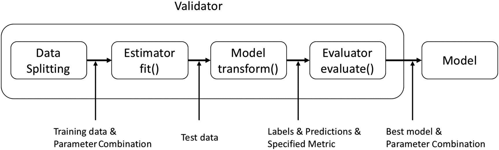

图 8-11 验证器内部

我要讨论的第一个验证器是`TrainValidationSplit`，它根据指定的比例将给定的输入数据分割成一对训练集和验证集，然后针对每个参数组合训练和评估这对数据集。例如，如果给定的参数集有六种组合，那么给定的估计器将被训练和评估六次，每次使用不同的参数组合。清单 8-16 提供了一个使用`TrainValidationSplit`来调优线性回归估计器的示例，其参数网格包含六种参数组合。由于此示例的重点是`TrainValidationSplit`，因此假设输入数据的特征工程已经完成，并且它有一个名为`features`的列。

```scala
import org.apache.spark.ml.{Pipeline, PipelineModel}
import org.apache.spark.ml.classification.LogisticRegression
import org.apache.spark.ml.feature.{HashingTF, Tokenizer}
import org.apache.spark.ml.tuning.{ParamGridBuilder, TrainValidationSplit}
import org.apache.spark.ml.evaluation.BinaryClassificationEvaluator
val text_data = spark.createDataFrame(Seq(
(1, "Spark is a unified data analytics engine", 0.0),
(2, "Spark is cool and it is fun to work with Spark", 0.0),
(3, "There is a lot of exciting sessions at upcoming Spark summit", 0.0),
(4, "signup to win a million dollars", 0.0)  )
).toDF("id", "line", "label")
val tokenizer = new Tokenizer().setInputCol("line").setOutputCol("words")
val hashingTF = new HashingTF().setInputCol(tokenizer.getOutputCol)
.setOutputCol("features")
val logisticReg = new LogisticRegression().setMaxIter(5)
val pipeline = new Pipeline().setStages(Array(tokenizer, hashingTF, logisticReg))
// 第一个参数有 3 个值，第二个参数有 2 个值，
// 因此总参数组合数为 6
val paramGrid = new ParamGridBuilder().addGrid(hashingTF.numFeatures, Array(10, 100, 250))
.addGrid(logisticReg.regParam, Array(0.1, 0.05))
.build()
// 使用所需输入设置验证器 - 估计器、评估器、参数网格和训练比例
val trainValidationSplit = new TrainValidationSplit().setEstimator(pipeline)
.setEvaluator(new BinaryClassificationEvaluator)
.setEstimatorParamMaps(paramGrid)
.setTrainRatio(0.8)
// 训练线性回归估计器
val model = trainValidationSplit.fit(training)
```

清单 8-16 `TrainValidationSplit`示例

我要讨论的下一个验证器是`CrossValidator`，它是机器学习从业者社区中广泛使用的一种技术的实现，用于帮助模型调优步骤。该技术通过将观测值随机分成大致相等的 k 组（或称折）来最大化用于训练和验证的数据量。第一折用于验证目的，其余折用于训练目的。此过程重复 k 次，每次针对随机划分的训练折和验证折对估计器进行训练和评估。图 8-12 说明了此过程。选择 k 值时要确保每个训练组和验证组在统计上能代表可用的观测值，并且每折的样本数据量大致相同。

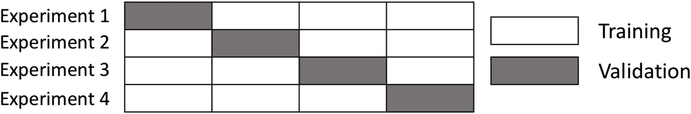

图 8-12 k=4 的 K 折示例

## 关于使用验证器的注意事项

使用此验证器处理大量参数组合时，必须注意其高昂的计算成本。这是因为图 8-12 中描述的每个实验都会针对每个参数组合执行。例如，如果`k`为 4，参数组合数量为 6，则估计器将被训练和评估的总次数为 24。清单 8-17 将 8-16 中的`TrainValidationSplit`替换为配置了`k`值为 2 的`CrossValidator`实例。在实践中，`k`的值通常为 10 或更高。清单 8-17 中的示例最终对估计器进行了 12 次训练和评估。

```scala
import org.apache.spark.ml.tuning.CrossValidator
val crossValidator = new CrossValidator().setEstimator(pipeline)
.setEvaluator(new BinaryClassificationEvaluator)
.setEstimatorParamMaps(paramGrid)
.setNumFolds(2)
val model = crossValidator.fit(text_data)
```

清单 8-17 `CrossValidator`示例

## 机器学习任务实战

本节尝试将`MLlib`提供的所有概念和工具整合在一起，并通过以下机器学习任务进行实践：分类、回归和推荐。通过使用真实数据集完成机器学习开发过程，理想情况下，各部分如何协同工作将变得更加清晰，并且看到可运行的代码总是有益的。

本节并非旨在全面涵盖每个机器学习算法的超参数，模型调优步骤将作为练习留给您。

### 分类

分类是研究最广泛、使用最多的机器学习任务之一，因为它能够帮助解决许多现实生活中的分类相关问题。例如：这是一笔欺诈性信用卡交易吗？这封邮件是垃圾邮件吗？这张图片是猫、狗还是鸟？

分类有三种类型。

*   **二分类**：待预测的标签只有两个可能的类别（例如，欺诈或非欺诈、会议论文被接受或不被接受、肿瘤是良性还是恶性）。
*   **多分类**：待预测的标签有两个以上可能的类别（例如，图像是狗、猫还是鸟）。
*   **多标签分类**：每个观测值可以属于多个类别。电影类型就是一个很好的例子。一部电影可以同时被归类为动作片和喜剧片。`MLlib`原生不支持这种分类类型。

`MLlib`为分类任务提供了几种机器学习算法。它们列举如下：

*   逻辑回归
*   决策树
*   随机森林
*   梯度提升树
*   线性支持向量机
*   一对多
*   朴素贝叶斯

#### 模型超参数

以下示例将使用逻辑回归算法，以下是其模型超参数的一个子集。每个模型超参数都有一个默认值。

*   `family`：可能的值为`auto`、`binomial`和`multinomial`。默认值为`auto`，这意味着算法将根据`label`列中的值自动选择`binomial`或`multinomial`。`binomial`用于二分类。`multinomial`用于多分类。
*   `regParam`：这是用于控制过拟合的正则化参数。默认值为 0.0。

#### 示例

以下示例尝试预测泰坦尼克号事故中哪些乘客幸存。这是一个二分类机器学习问题，作为起点，选择了逻辑回归算法。此示例基于 kaggle.com 上的一个竞赛，信息和数据可在[https://www.kaggle.com/c/titanic](https://www.kaggle.com/c/titanic)获取。数据以 CSV 格式提供，包含两个文件：`train.csv`和`test.csv`。`train.csv`文件包含`label`列。

提供的数据包含许多有趣的特征；然而，清单 8-18 中的代码将仅使用`age`、`gender`和`ticket_class`作为特征。

```scala
import org.apache.spark.ml.Pipeline
import org.apache.spark.ml.feature.StringIndexer
import org.apache.spark.ml.feature.VectorAssembler
import org.apache.spark.ml.classification.LogisticRegression
import org.apache.spark.ml.evaluation.BinaryClassificationEvaluator
val titanic_data = spark.read.format("csv").option("header", "true")
.option("inferSchema","true")
.load("//train.csv")
// explore the schema
titanic_data.printSchema
|-- PassengerId: integer (nullable = true)
|-- Survived: integer (nullable = true)
|-- Pclass: integer (nullable = true)
|-- Name: string (nullable = true)
|-- Sex: string (nullable = true)
|-- Age: double (nullable = true)
|-- SibSp: integer (nullable = true)
|-- Parch: integer (nullable = true)
|-- Ticket: string (nullable = true)
|-- Fare: double (nullable = true)
|-- Cabin: string (nullable = true)
|-- Embarked: string (nullable = true)
// to start out with, we will use only three features
// filter out rows where age is null
val titanic_data1 = titanic_data.select('Survived.as("label"), 'Pclass.as("ticket_class"),
'Sex.as("gender"), 'Age.as("age"))
.filter('age.isNotNull)
// split the data into training and test with 80% and 20% split
val Array(training, test) = titanic_data1.randomSplit(Array(0.8, 0.2))
println(s"training count: ${training.count}, test count: ${test.count}")
// estimator:  to convert gender string to numbers
val genderIndxr = new StringIndexer().setInputCol("gender").setOutputCol("genderIdx")
// transfomer: assemble the features into a vector
val assembler = new VectorAssembler().setInputCols(Array("ticket_class", "genderIdx", "age"))
.setOutputCol("features")
// estimator: the algorithm
val logisticRegression = new LogisticRegression().setFamily("binomial")
// set up the pipeline with three stages
val pipeline = new Pipeline().setStages(Array(genderIndxr, assembler, logisticRegression))
// train the algorithm with the training data
val model = pipeline.fit(traininng)
// perform the predictions
val predictions = model.transform(test)
// perform the evaluation of the model performance, the default metric is the area under the ROC
val evaluator = new BinaryClassificationEvaluator()
evaluator.evaluate(predictions)
res10: Double = 0.8746657754010692
evaluator.getMetricName
res11: String = areaUnderROC
```

清单 8-18 使用逻辑回归算法预测泰坦尼克号乘客的生存情况

`BinaryClassificationEvaluator`产生的指标值为 0.87，这对于仅使用三个特征来说是不错的性能。前面的示例没有探索各种超参数和训练参数。

### 回归

另一个流行的机器学习任务称为**回归**，它旨在预测一个实数或连续值。例如，您想预测下一季度的销售收入、某个群体的收入金额或世界某个地区的降雨量。

`MLlib`为回归任务提供了几种机器学习算法。它们列举如下：

*   线性回归
*   广义线性回归
*   决策树
*   随机森林
*   梯度提升树
*   保序回归

#### 模型超参数

以下示例将使用`LinearRegression`算法，其模型超参数的一个子集如下所示：

*   `regParam`：这是用于控制过拟合的正则化参数。默认值为 0.0。
*   `fitIntercept`：此参数用于确定是否拟合截距。默认值为`true`。

#### 示例

以下示例将尝试根据一组房屋信息来预测房价。详细信息和数据可在 kaggle.com 的[https://www.kaggle.com/c/house-prices-advanced-regression-techniques/data](https://www.kaggle.com/c/house-prices-advanced-regression-techniques/data)上获取。数据以 CSV 格式提供，包含两个文件：`train.csv`和`test.csv`。`train.csv`文件中的标签列名为`SalePrice`。

提供的数据包含许多有趣的特征；然而，清单 8-19 中的代码将仅使用其中的一部分。


```scala
import org.apache.spark.sql.functions._
import org.apache.spark.ml.Pipeline
import org.apache.spark.ml.feature.StringIndexer
import org.apache.spark.ml.feature.VectorAssembler
import org.apache.spark.ml.regression.LinearRegression
import org.apache.spark.ml.feature.RFormula
import org.apache.spark.ml.evaluation.RegressionEvaluator
import org.apache.spark.mllib.evaluation.RegressionMetrics

val house_data = spark.read.format("csv").option("header", "true")
    .option("inferSchema","true")
    .load("/train.csv")

// 选择用作特征的列
val cols = SeqString
val colNames = cols.map(n => col(n))

// 仅选择需要的列
val skinny_house_data = house_data.select(colNames:_*)

// 通过将 "1stFlrSF" 和 "2ndFlrSF" 列的值相加，创建一个名为 "TotalSF" 的新列
// 将 "SalePrice" 列转换为 double 类型
val skinny_house_data1 = skinny_house_data.withColumn("TotalSF", col("1stFlrSF") +
    col("2ndFlrSF"))
    .drop("1stFlrSF", "2ndFlrSF")
    .withColumn("SalePrice", $"SalePrice".cast("double"))

// 检查名为 "SalePrice" 的标签列的统计信息
skinny_house_data1.describe("SalePrice").show
// +--------+-------------------+
// | summary|          SalePrice|
// +--------+-------------------+
// |   count|               1460|
// |    mean| 180921.19589041095|
// |  stddev|  79442.50288288663|
// |     min|            34900.0|
// |     max|           755000.0|
// +--------+-------------------+

// 创建估计器和转换器以设置管道
// 将无效分类值的处理策略设置为跳过，以避免在评估时出错
val roofStyleIndxr = new StringIndexer().setInputCol("RoofStyle")
    .setOutputCol("RoofStyleIdx")
    .setHandleInvalid("skip")
val heatingIndxr = new StringIndexer().setInputCol("Heating")
    .setOutputCol("HeatingIdx")
    .setHandleInvalid("skip")
val linearRegression = new LinearRegression().setLabelCol("SalePrice")

// 组装器，用于将特征组装成特征向量
val assembler = new VectorAssembler().setInputCols(
    Array("LotArea", "RoofStyleIdx", "HeatingIdx",
    "LotArea", "BedroomAbvGr", "KitchenAbvGr", "GarageCars",
    "TotRmsAbvGrd", "YearBuilt", "TotalSF"))
    .setOutputCol("features")

// 设置管道
val pipeline = new Pipeline().setStages(Array(roofStyleIndxr, heatingIndxr, assembler, linearRegression))

// 将数据拆分为训练集和测试集
val Array(training, test) = skinny_house_data1.randomSplit(Array(0.8, 0.2))

// 训练管道
val model = pipeline.fit(training)

// 执行预测
val predictions = model.transform(test)
val evaluator = new RegressionEvaluator().setLabelCol("SalePrice")
    .setPredictionCol("prediction")
    .setMetricName("rmse")
val rmse = evaluator.evaluate(predictions)
// rmse: Double = 37579.253919082395
```

清单 8-19
使用线性回归算法预测房价

`RMSE` 代表均方根误差。在此例中，`RMSE` 值约为 37,000 美元，这表明还有很大的改进空间。

### 推荐

推荐系统是最直观、最著名的机器学习应用之一。这大概是因为几乎每个人都曾在亚马逊和 Netflix 等热门网站上看到过推荐系统的实际应用。事实上，互联网上几乎每一个热门网站都有一个或多个推荐系统的实例。常见的推荐系统例子包括 Spotify 上你可能喜欢的歌曲、Twitter 上你可能想关注的人、Coursera 或 Udacity 上你可能喜欢的课程等等。很酷的一点是，推荐系统对用户和网站背后的公司都有好处。用户无需花费太多精力就能愉快地找到或发现他们喜欢的物品。公司则会因为用户参与度和忠诚度的提高以及利润的增长而感到满意。如果一个推荐系统设计得当且性能良好，那将是一个双赢的局面。

构建推荐系统的常见方法包括基于内容的过滤、协同过滤以及两者的混合。第一种方法需要收集被推荐物品的信息以及每个用户的画像。第二种方法则需要通过显式或隐式方式仅收集用户的活动或行为。显式行为的例子包括在亚马逊上对电影或物品进行评分。隐式行为的例子包括观看电影预告片或描述。第二种方法背后的直觉是“群体智慧”的概念，即过去意见一致的人在未来也倾向于意见一致。

本节将重点介绍协同过滤方法，其中一种流行的算法叫做 `ALS`，它代表交替最小二乘法。该算法所需的唯一输入是用户-物品评分矩阵，通过一个称为矩阵分解的过程来发现用户偏好和物品属性。一旦找到这两部分信息，就可以用来预测用户对未曾见过的物品的偏好。MLlib 提供了 `ALS` 算法的实现。

#### 模型超参数

MLlib 中实现的 `ALS` 算法有几个你需要了解的重要超参数。以下部分仅包含其中一部分。请查阅 [https://spark.apache.org/docs/latest/ml-collaborative-filtering.html](https://spark.apache.org/docs/latest/ml-collaborative-filtering.html) 上的文档。

*   `rank`：此参数指定在训练过程中将要学习的关于用户和物品的潜在因子或属性的数量。`rank` 的最优值通常通过实验以及对准确描述一个物品所需属性数量的直觉来确定。默认值为 10。
*   `regParam`：这是用于处理过拟合的正则化量。此参数的最优值通常通过实验确定。默认值为 0.1。
*   `implicitPrefs`：`ALS` 算法同时支持显式和隐式的用户活动或行为。此参数用于指示输入数据代表哪一种。默认值为 false，表示活动或行为是显式的。

#### 示例

你将通过一个示例来构建电影推荐系统，该示例使用来自 `grouplens.com` 的电影评分数据集，数据地址为 [https://grouplens.org/datasets/movielens/](https://grouplens.org/datasets/movielens/)。具体使用的数据集是最新的 MovieLens 100k 数据集，下载地址为 [http://files.grouplens.org/datasets/movielens/ml-latest-small.zip](http://files.grouplens.org/datasets/movielens/ml-latest-small.zip)。该数据集包含约 700 名用户对 9000 部电影的大约 100,000 条评分。压缩包中包含四个文件：`links.csv`、`movies.csv`、`ratings.csv` 和 `tags.csv`。文件 `ratings.csv` 中的每一行代表一位用户对一部电影的一条评分，格式如下：`userId`、`movieId`、`rating`、`timestamp`。评分范围为 0 到 5，以半星为增量。

清单 8-20 中的代码使用一组参数训练 ALS 算法，然后基于 RMSE 指标评估模型性能。此外，它还会调用 `ALSModel` 类中一些有趣的 API 来获取针对电影和用户的推荐。

```scala
import org.apache.spark.mllib.evaluation.RankingMetrics
import org.apache.spark.ml.evaluation.RegressionEvaluator
import org.apache.spark.ml.recommendation.ALS
import org.apache.spark.ml.tuning.{ParamGridBuilder, CrossValidator}
import org.apache.spark.sql.functions._

// 我们不需要时间戳列，因此立即删除它
val ratingsDF = spark.read.option("header", "true")
    .option("inferSchema", "true")
    .csv("/ratings.csv").drop("timestamp")

// 快速检查评分数量
ratingsDF.count
// res14: Long = 100004

// 快速查看哪些是活跃的电影评分者
val ratingsByUserDF = ratingsDF.groupBy("userId").count()
ratingsByUserDF.orderBy($"count".desc).show(10)
// +-------+------+
// | userId| count|
// +-------+------+
// |    547|  2391|
// |    564|  1868|
// |    624|  1735|
// |     15|  1700|
// |     73|  1610|
// |    452|  1340|
// |    468|  1291|
// |    380|  1063|
// |    311|  1019|
// |     30|  1011|
// +-------+------+

println("# of rated movies: " + ratingsDF.select("movieId").distinct().count)
```


# of rated movies: 9066
```
println("# of users: " + ratingsByUserDF.count)
```

# of users: 671

```scala
// 分析评分数量最多的电影
val ratingsByMovieDF = ratingsDF.groupBy("movieId").count()
ratingsByMovieDF.orderBy($"count".desc).show(10)
```

```
+--------+------+
| movieId| count|
+--------+------+
|     356|   341|
|     296|   324|
|     318|   311|
|     593|   304|
|     260|   291|
|     480|   274|
|    2571|   259|
|       1|   247|
|     527|   244|
|     589|   237|
+--------+------+
```

```scala
// 准备训练和测试数据
val Array(trainingData, testData) = ratingsByUserDF.randomSplit(Array(0.8, 0.2))
// 设置 ALS 实例
val als = new ALS().setRank(12)
.setMaxIter(10)
.setRegParam(0.03)
.setUserCol("userId")
.setItemCol("movieId")
.setRatingCol("rating")
// 训练模型
val model = als.fit(trainingData)
// 执行预测
val predictions = model.transform(testData).na.drop
// 设置评估器以计算 RMSE 指标
val evaluator = new RegressionEvaluator().setMetricName("rmse")
.setLabelCol("rating")
.setPredictionCol("prediction")
val rmse = evaluator.evaluate(predictions)
println(s"Root-mean-square error = $rmse")
```

```
Root-mean-square error = 1.06027809686058
```

## 清单 8-20 使用 MLlib 中的 ALS 算法实现构建推荐系统

`ALSModel` 类提供了两组有用的函数来执行推荐。第一组用于向所有用户或特定用户集推荐前 `n` 个项目。第二组用于向所有项目或特定项目集推荐前 `n` 个用户。清单 8-21 提供了调用这些函数的示例。

```scala
// 为所有用户推荐前 5 部电影
model.recommendForAllUsers(5).show(false)
// 活跃评分者
val activeMovieRaters = Seq((547), (564), (624), (15), (73)).toDF("userId")
model.recommendForUserSubset(activeMovieRaters, 5).show(false)
```

```
+------+------------------------------------------------------------------+
|userId|    recommendations                                               |
+------+------------------------------------------------------------------+
|    15| [[363, 5.4706035], [422, 5.4109325], [1192, 5.3407555], [1030, 5.329553], [2467, 5.214414]]                              |
|   547| [[1298, 5.752393], [1235, 5.4936843], [994, 5.426885], [926, 5.28749], [3910, 5.2009006]]                               |
|   564| [[121231, 6.199452], [2454, 5.4714866], [3569, 5.4276495], [1096, 5.4212027], [1292, 5.4203687]]                            |
|   624| [[1960, 5.4001703], [1411, 5.2505665], [3083, 5.1079946], [3030, 5.0170803], [132333, 5.0165534]]                          |
|    73| [[2068, 5.0426316], [5244, 5.004793], [923, 4.992707], [85342, 4.979018], [1411, 4.9703207]]                            |
+------+------------------------------------------------------------------+
```

```scala
// 为每部电影推荐前 3 名用户
val recMovies = model.recommendForAllItems(3)
// 读取电影数据集，以便查看电影标题
val moviesDF = spark.read.option("header", "true")
.option("inferSchema", "true")
.csv("/movies.csv")
val recMoviesWithInfoDF = recMovies.join(moviesDF, "movieId")
recMoviesWithInfoDF.select("movieId", "title", "recommendations").show(5, false)
```

```
+-------+---------------------------------+-------------------------------+
|movieId|                            title|                recommendations|
+-------+---------------------------------+-------------------------------+
|   1580| Men in Black (a.k.a. MIB) (1997)|  [[46, 5.6861496], [113, 5.6780157], [145, 5.3410296]]|
|   5300|              3:10 to Yuma (1957)|  [[545, 5.475599], [354, 5.2230153], [257, 5.0623646]]|
|   6620|         American Splendor (2003)|  [[156, 5.9004226], [83, 5.699677], [112, 5.6194253]] |
|   7340|      Just One of the Guys (1985)|  [[621, 4.5778027], [451, 3.9995837], [565, 3.6733315]]|
|  32460| Knockin' on Heaven's Door (1997)|  [[565, 5.5728054], [298, 5.00507], [476, 4.805148]]   |
+-------+---------------------------------+-------------------------------+
```

```scala
// 评分最高的电影
val topRatedMovies = Seq((356), (296), (318), (593)).toDF("movieId")
// 为 topRatedMovies 中的每部电影推荐前 3 名用户
val recUsers =  model.recommendForItemSubset(topRatedMovies, 3)
recUsers.join(moviesDF, "movieId").select("movieId", "title", "recommendations").show(false)
```

```
+-------+---------------------------------+-------------------------------+
|movieId|                            title|                recommendations|
+-------+---------------------------------+-------------------------------+
|    296|              Pulp Fiction (1994)| [[4, 5.8505774], [473, 5.81865], [631, 5.588397]]    |
|    593| Silence of the Lambs, The (1991)| [[153, 5.839533], [586, 5.8279104], [473, 5.5933723]] |
|    318| Shawshank Redemption, The (1994)| [[112, 5.8578305], [656, 5.8488774], [473, 5.795221]]  |
|    356|              Forrest Gump (1994)| [[464, 5.6555476], [58, 5.6497917], [656, 5.625555]]|
+-------+---------------------------------+-------------------------------+
```

## 清单 8-21 使用 ALSModel 执行推荐

在 `Listing [8-20]` 中，使用一组参数训练了 `ALS` 算法的一个实例，得到的 `RSME` 约为 1.06。让我们尝试使用 `CrossValidator`，通过一组参数组合重新训练该 `ALS` 算法实例，看看能否降低 `RSME` 值。`Listing [8-22]` 中的代码为两个模型超参数（`als.regParam` 和 `als.rank`）设置了总共 4 种参数组合的网格搜索，以及一个包含 3 折的 `CrossValidator`。这意味着 `ALS` 算法将被训练和评估 12 次，因此在笔记本电脑上大约需要一两分钟才能完成。

```
val paramGrid = new ParamGridBuilder().addGrid(als.regParam, Array(0.05, 0.15))
    .addGrid(als.rank, Array(12,20))
    .build
val crossValidator = new CrossValidator().setEstimator(als)
    .setEvaluator(evaluator)
    .setEstimatorParamMaps(paramGrid)
    .setNumFolds(3)
// print out the 4 hyperparameter combinations
crossValidator.getEstimatorParamMaps.foreach(println)
{
  als_d2ec698bdd1a-rank: 12,
  als_d2ec698bdd1a-regParam: 0.05
}
{
  als_d2ec698bdd1a-rank: 20,
  als_d2ec698bdd1a-regParam: 0.05
}
{
  als_d2ec698bdd1a-rank: 12,
  als_d2ec698bdd1a-regParam: 0.15
}
{
  als_d2ec698bdd1a-rank: 20,
  als_d2ec698bdd1a-regParam: 0.15
}
// this will take a while to run through more than 10 experiments
val cvModel = crossValidator.fit(trainingData)
// perform the predictions and drop the
val predictions2 = cvModel.transform(testData).na.drop
val evaluator2 = new RegressionEvaluator().setMetricName("rmse")
    .setLabelCol("rating")
    .setPredictionCol("prediction")
val rmse2 = evaluator2.evaluate(predictions2)
rmse2: Double = 0.9881840432547675
```
Listing 8-22
Using CrossValidator to Tune the ALS Model

您已成功通过利用`CrossValidator`帮助调整模型，降低了`RMSE`。训练最佳模型可能需要一些时间，但`MLlib`使得尝试一组参数组合变得容易。

## 深度学习管道

如果本章没有提及深度学习这一主题，那将是不完整的，深度学习是人工智能和机器学习领域最热门的话题之一。已经有大量的书籍、博客、课程和研究论文等资源来解释深度学习的各个方面。在技术方面，来自开源社区、大学以及谷歌、Facebook、微软等大公司的大量创新正在涌现出深度学习框架。以下是当前的深度学习框架列表：

*   `TensorFlow`是由谷歌创建的开源框架。
*   `MXNet`是由一组大学和公司开发的深度学习框架。
*   `Caffe`是由加州大学伯克利分校开发的深度学习框架。
*   `CNTK`是由微软开发的开源深度学习框架。
*   `Theano`是由蒙特利尔大学开发的开源深度学习框架。
*   `PyTorch`是由 Facebook 开发的开源深度学习框架。
*   `BigDL`是由英特尔开发的开源深度学习框架。

从 Apache Spark 方面来看，Databricks 正在推动一个名为`Deep Learning Pipelines`的项目开发，这并非另一个深度学习框架，而是设计为在先前列出的现有流行深度学习框架之上工作。秉承 Spark 和`MLlib`的精神，`Deep Learning Pipelines`项目提供了高级且易于使用的`API`，用于使用 Apache Spark 在 Python 中构建可扩展的深度学习应用程序。该项目目前正在 Apache Spark 开源项目之外进行开发，最终将被纳入主干。在撰写本文时，`Deep Learning Pipelines`项目提供以下功能：

*   仅需几行代码即可实现常见的深度学习用例
*   在 Spark 中处理图像
*   应用预训练的深度学习模型进行可扩展的预测
*   能够进行迁移学习，将针对类似任务训练的模型适应当前任务
*   分布式超参数调优
*   轻松公开深度学习模型，以便其他人可以在 SQL 中将其用作函数进行预测

您可以在[`https://github.com/databricks/spark-deep-learning`](https://github.com/databricks/spark-deep-learning)找到有关令人兴奋的`Deep Learning Pipelines`项目的更多详细信息。

## 总结

人工智能和机器学习的采用正在稳步增长，未来几年将有许多激动人心的突破。建立在 Spark 强大基础之上，`MLlib`组件旨在帮助以简单且可扩展的方式构建智能应用程序。

*   人工智能是一个广泛的领域，其目标是让机器看起来具有智能。机器学习是其子领域之一；它专注于通过用数据训练机器来教会它们学习。
*   构建机器学习应用程序的过程是迭代的，并涉及通常按特定顺序执行的几个步骤。
*   Spark `MLlib`组件包括用于特征工程、构建、评估和调优机器学习管道的工具，以及一组众所周知的机器学习算法，如分类、回归、聚类和协同过滤。
*   `MLlib`组件引入的用于帮助构建和维护复杂管道的核心概念是转换器、评估器和管道。管道是一个编排器，确保训练数据和测试数据都流经相同的特征处理步骤。
*   模型调优是机器学习应用程序开发过程中的关键步骤。它繁琐且耗时，因为涉及在一组参数组合上训练和评估一个或多个模型。结合管道抽象，`MLlib`提供了两个工具来帮助：`CrossValidator`和`TrainValidationSplit`。

### 索引

### A

`聚合` `立方体` `航班摘要数据集` `函数` `approx_count_distinct (col)` `avg(col)` `count(col)` `countDistinct(col)` `描述` `min(col), max(col)` `Scala 语言` `skewness(col), kurtosis(col)` `sum(col)` `sumDistinct(col)` `variance(col), stddev(col)` `分组` `分类值` `集合` `分组值` `多重聚合` `origin_airport 和计数聚合` `origin_state 和 origin_city, 计数聚合` `RelationalGroupedDataset` `层级` `操作` `透视` `上卷` `状态` `时间窗口` `AlphaGo` `交替最小二乘 (ALS) 算法` `分析函数` `任意有状态处理` `动作` `flatMapGroupsWithState` `处理状态超时` `mapGroupsWithState` `结构化流` `人工智能 (AI)`

### B

`批量数据处理` `Binarizer 转换器` `BinaryClassificationEvaluator` `广播哈希连接` `Bucketizer 转换器` `内置函数` `类别` `集合` `日期时间` `数学` `杂项` `Spark API` `Scala 文档` `字符串` `业务分析师`

### C

`Catalyst 优化器` `动作` `数据处理应用程序` `逻辑计划` `物理计划` `用户表达式` `可视化表示` `集群形式` `聚类` `集合函数` `逗号分隔值 (CSV)` `社区版 (CE)` `控制台数据接收器` `连续处理模式` `交叉连接` `CrossValidator`

### D

`Databricks` `DataFrames` `CSV 文件数据源` `DataFrameReader` `DataFrameWriter` `格式` `Spark 内置定义` `DSL` `JDBC 连接操作` `JSON 文件` `缺失数据` `ORC 文件` `Parquet 文件` `持久化` `range 函数` `RDBMS` `RDDs` `保存模式` `选择、投影和聚合操作` `Spark Scala 类型` `SparkSession.range 函数` `SQL 和数据集` `结构化操作` `结构化转换` `描述` `distinct、dropDuplicates` `drop(columnName1, columnName2)` `filler(condition)、where(condition)` `limit(n)` `randomSplit(weights)` `sample 转换` `select(columns)` `selectExpr(expressions)` `sort(columns)、orderBy(columns)` `union(otherDataFrame)` `withColumn(colName, column)` `withColumnRenamed(existingColName, newColName)` `文本文件` `处理列` `数据集` `创建 *vs.*` `DataFrame 风格` `局限性` `操作` `Python 和 R 语言` `数据混洗` `数据接收器` `控制台` `文件` `foreach` `Kafka` `内存` `日期时间函数` `深蓝` `深入探究` `追加输出模式` `完整输出模式` `输出模式` `触发器` `参见触发器` `更新输出模式` `深度学习 (DL)` `AL 和 ML 关系` `BigDL` `Caffe` `CNTK` `深度学习流水线项目` `MXNet` `PyTorch` `资源` `TensorFlow` `Theano` `离散化流 (DStream)` `awaitTermination() 函数` `批次间隔` `数据源` `start() 函数` `StreamingContext` `单词计数应用` `领域特定语言 (DSL)` `数据重复`

### E

`估计器` `IDF` `输入和输出` `LinearRegression` `MinMaxScaler` `OneHotEncoderEstimator` `RFormula` `StandardScaler` `StringIndexer` `类型` `Word2Vec` `事件时间处理` `聚合` `状态` `固定窗口` `移动数据` `事件模式` `滑动窗口` `聚合` `水印`

### F

`文件数据接收器` `文件数据源` `固定窗口操作` `聚合逻辑` `移动数据` `事件` `窗口和动作类型` `flatMapGroupsWithState` `Foreach 数据接收器` `函数` `高级分析` `参见聚合` `UDFs` `窗口` `参见窗口函数`

### G

`Google DeepMind`

### H

`HashingTF 转换器` `HyperLogLog`

### I

`内连接` `集成开发环境 (IDEs)` `逆文档频率 (IDF)` `估计器`

### J

`JavaScript 对象表示法 (JSON)` `JDBC 数据源` `连接` `广播哈希` `交叉` `DataFrames` `描述` `表达式` `内连接` `连接列名` `连接后的 DataFrame` `dupNameDF DataFrame` `多列名` `原始 DataFrame` `左反连接` `左外连接` `左半连接` `操作` `外连接` `重命名列` `右外连接` `混洗哈希` `类型`

### K

`Kafka 数据接收器` `Kafka 数据源` `Kaggle` `键值对 RDD 操作` `collectAsMap()` `countByKey()` `lookup(key)`

### L

`lastProgress() 函数` `左反连接` `左外连接` `左半连接` `LinearRegression 算法` `LinkedIn` `LogisticRegression 算法`

### M, N

`机器学习 (ML)` `AL 和 DL 关系` `分类` `二分类` `MLlib` `多分类` `多标签` `定义` `开发流程` `LinearRegression 算法` `logisticRegression 算法` `推荐` `ALS 算法` `Amazon 和 Netflix` `协同过滤` `强化学习` `Spark MLlib` `参见 Spark 机器学习库 (Spark MLlib)` `监督学习` `术语` `特征` `标签` `ML 算法` `模型` `观测值` `垃圾邮件分类` `测试数据` `训练数据` `验证数据` `类型` `无监督学习` `mapGroupsWithState` `数学函数` `矩阵分解` `内存数据接收器` `MinMaxScaler 估计器` `杂项函数` `监控流式查询`

### O

`OneHotEncoderEstimator` `OneHotEncoder 转换器` `一次性处理` `在线分析处理 (OLAP)` `在线事务处理 (OLTP)` `优化的行列式 (ORC)` `外连接`

### P, Q

`ParagramGridBuilder` `Parquet 文件` `流水线` `数据透视` `谓词下推` `生产环境流式应用` `Project Tungsten`

### R

`排名函数` `速率数据源` `强化学习` `关系型数据库管理系统 (RDBMS)` `弹性分布式数据集 (RDDs)` `操作` `collect()` `count()` `first()` `reduce(func)` `saveAsTextFile(path)` `take(n)` `takeOrdered` `takeSample` `top 操作` `创建` `数据分区与放置` `数据集` `数据混洗` `容错` `不可变` `内存计算` `键值对` `创建` `groupByKey` `join` `reduceByKey` `sortByKey` `机器学习算法` `操作` `并行数据结构` `丰富的存储选项` `转换` `参见转换` `RFormula 转换器` `右外连接`

### S
```

# 混洗哈希连接、滑动窗口聚合与 Spark 生态系统

混洗哈希连接 滑动窗口聚合 `avg()` 函数 `groupBy` 转换 重叠 温度数据 窗口化类型 Socket 数据源 Spark 应用 集群与资源管理系统 概念与架构 Databricks 数据处理 Daytona GraySort 下载选项 下载流程 驱动器和执行器 Graphx Hadoop MapReduce 历史 安装 二进制文件 Linux/Mac 计算机 Python Shell Scala Shell Spark 目录 MLlib 笔记本创建 “与 Spark 交互” 章节 IPython Markdown 语句 标记语句 菜单项 加号图标 `println` 语句 发布确认对话框 发布菜单项 Scala 语言选项 工作区列 Spark Core SparkR SQL 流处理 统一栈 Spark GraphX `Spark MLlib` `DataFrames` 端到端 ML 流水线 估计器 参见估计器 特征 ML 流程与主要抽象 模型调优 `CrossValidator` 模型超参数 模型参数 `TrainValidationSplit` 验证器 流水线 Spark SQL `转换器` 参见转换器 Spark Scala Shell 命令 Databricks 默认配置 变量列表 成员变量与函数 Spark UI `spark` 变量 版本 `println` 函数 Spark Scala 类型 Spark SQL `聚合` 参见聚合 业务分析师 组件 `DataFrames` 参见 `DataFrames` `数据集` 参见数据集 运行 SQL 存储系统 结构化 API Spark 流处理 任意状态处理 操作 `flatMapGroupsWithState` 处理状态超时 `mapGroupsWithState` 结构化流 核心概念 核心组件 数据接收器 数据源 偏移量 开箱即用数据源 输出模式 触发器类型 水印 `DataFrames` 参见 `DataFrames` 数据源 类型转换 消息内容 自定义 文件 Kafka 速率 Socket `startingOffsets` 和 `endingOffsets` 选项 深入探究 参见深入探究 `DStream` 参见离散化流 (`DStream`) 数据重复 事件时间 参见事件时间处理 容错 `checkpointLocation` 选项 `spark.sql.streaming.checkpointLocation` Spark 运行时 流式应用代码 特性 消息 监控流式查询 概述 查询指标 接收器 参见数据接收器 结构化流 参见结构化流 标准化 `StandardScaler` 估计器 有状态类型 无状态类型 `status()` 函数 `StopWordsRemover` 转换器 存储系统 存储选项卡 `StreamingQueryListener` 接口 流式查询指标 流处理 批处理数据 挑战 核心与通用概念 数据交付语义 引擎 Apache Apex Apache Beam Apache Flink Apache Kafka Apache Samza Apache Storm 逐条记录与微批次 事件时间与处理时间 时间概念 Spark 参见 Spark 流处理 系统属性 窗口化模式 `StreamQueryManager` 字符串函数 `StringIndexer` 估计器 结构化查询语言 (`SQL`) 结构化流 批处理与流处理挑战 连续处理 `DataFrame` 和 `Dataset` 事件时间处理与状态维护 `file1.json` `file2.json` `file3.json` 文件数据源 `isStreaming` 函数 管理流式查询 移动事件数据 概述 `start()` 函数 `status()` 和 `lastProgress()` 函数 十秒滑动窗口 事务性集成 将流数据视为表 监督学习 分类与回归 `MLlib`

## T

时间窗口  
分词器  
`Transformer`  
`TrainValidationSplit`  
转换操作  
`distinct()`  
`filter(func)`  
`flatMap(func)`  
`intersection`  
`list`  
`map(func)`  
`mapPartitions`  
`mapPartitionsWithIndex`  
`sampling`  
`substract`  
`union`  
转换器  
`Binarizer`  
`Bucketizer`  
`HashingTF`  
`input` 和 `output`  
`OneHotEncoder`  
`process`  
`StopWordsRemover`  
`Tokenizer`  
`types`  
`VectorAssembler`  
触发器  
`continuous processing mode`  
`fixed interval type`  
`micro-batch mode`  
`one-time trigger type`  
`processing modes`  
`Tumbling window operation`  
`SeeFixed window operation`

## U

无监督学习  
`clustering`  
`MLlib`  
用户自定义函数（`UDFs`）  
用户购物交易

## V

`VectorAssembler` 转换器

## W, X, Y, Z

水印  
`groupBy` 转换  
处理延迟数据  
`input directory`  
`JSON files`  
`output mode`  
水印 API 视角  
窗口函数  
`analytic functions`  
`avg`  
`components`  
`concat/round`  
`frame`  
`max`  
`rank`  
`ranking functions`  
`shopping transaction data`  
`specification`  
`SQL`  
`sum`  
`types`  
`Word2Vec` 估计器