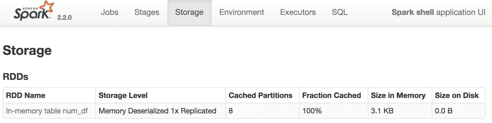

# 将数据写入存储系统

至此，您已经了解了如何使用 `DataFrameReader` 从各种文件格式或数据库服务器读取数据，也了解了如何使用 SQL 或结构化 API 的转换和操作来操纵数据。在某些时候，您需要将 DataFrame 中的数据写入外部存储系统，例如本地文件系统、HDFS 或 Amazon S3。在典型的 ETL 数据处理任务中，结果很可能需要写入某个存储系统。

在 Spark SQL 中，`DataFrameWriter` 类负责将 DataFrame 中的数据写入外部存储系统的逻辑和复杂性。您可以通过 DataFrame 类中的 `write` 变量来获取 `DataFrameWriter` 类的实例。与 `DataFrameWriter` 交互的模式与 `DataFrameReader` 的交互模式有些相似。在 Spark shell 或 Spark 应用程序中，您可以像清单 4-43 所示那样引用它。

```
movies.write
```

清单 4-44 描述了与 `DataFrameWriter` 交互的常见模式。

```
movies.write.format(...).mode(...).option(...).partitionBy(...).bucketBy(...).sortBy(...).save(path)
```

与 `DataFrameReader` 类似，默认格式是 Parquet；因此，在以 Parquet 格式写入数据时，无需指定格式。`partitionBy`、`bucketBy` 和 `sortBy` 函数用于控制基于文件的数据源中输出文件的目录结构。通过根据读取模式来组织目录布局，可以显著减少分析时需要读取的数据量。您将在本章后面部分了解更多相关信息。`save` 函数的输入是一个目录名，而不是文件名。

`DataFrameWriter` 类中的一个重要选项是保存模式，它控制 Spark 如何处理指定输出文件夹已存在的情况。表 4-11 列出了各种支持的保存模式。

**表 4-11** 保存模式

| 模式 | 描述 |
| --- | --- |
| `append` | 将 DataFrame 数据追加到指定目标位置已存在的文件列表中。 |
| `overwrite` | 用 DataFrame 中的数据完全覆盖指定目标位置已存在的任何数据文件。 |
| `error` / `errorIfExists` / `default` | 这是默认模式。如果指定的目标位置已存在，则 `DataFrameWriter` 会抛出错误。 |
| `ignore` | 如果指定的目标位置已存在，则什么也不做。换句话说，静默地不写入 DataFrame 中的数据。 |

清单 4-45 展示了一些使用不同格式和模式组合的示例。

```
// 以 CSV 格式写入数据，但使用 '#' 作为分隔符
movies.write.format("csv").option("sep", "#").save("/tmp/output/csv")
// 使用覆盖保存模式写入数据
movies.write.format("csv").mode("overwrite").option("sep", "#").save("/tmp/output/csv")
```

写入输出目录的文件数量对应于 DataFrame 的分区数。清单 4-46 展示了如何查找 DataFrame 的分区数。

```
movies.rdd.getNumPartitions
Int = 1
```

在某些情况下，DataFrame 的内容不大，并且需要写入单个文件。实现此目标的一个小技巧是将 DataFrame 中的分区数减少到一个，然后将其写出。清单 4-47 展示了一个如何执行此操作的示例。

```
val singlePartitionDF = movies.coalesce(1)
```

使用分区和分桶写入数据的想法源自 Apache Hive 用户社区。根据一般经验法则，用于分区的列应具有较低的基数。在 `movies` DataFrame 中，`produced_year` 列是分区列的一个不错选择。假设您要按 `produced_year` 列对 `movies` DataFrame 进行分区写入。`DataFrameWriter` 会将所有具有相同 `produced_year` 的电影写入单个目录。输出文件夹中的目录数量将对应于 `movies` DataFrame 中的年份数量。有关使用 `partitionBy` 函数的示例，请参见清单 4-48。

```
movies.write.partitionBy("produced_year").save("/tmp/output/movies")
// /tmp/output/movies 目录将包含以下子目录
produced_year=1961 到 produced_year=2012
```

由 `partitionBy` 选项生成的目录名称看起来有些奇怪，因为每个目录名称都由分区列名称和关联值组成。这两条信息在数据读取时用于根据数据访问模式选择要读取的目录，因此最终读取的数据量远少于其他情况。

## 三剑客：DataFrames、Datasets 和 SQL

现在您知道了在 Spark SQL 模块中有三种不同的方式来操作结构化数据。表 4-12 显示了每种选项在语法和分析方面的定位。

这里的要点是，您越早能够捕获错误，工作效率就越高，数据处理应用程序也就越稳定。

**表 4-12** 语法和分析错误谱系

| | SQL | DataFrame | Dataset |
| --- | --- | --- | --- |
| 系统错误 | 运行时 | 编译时 | 编译时 |
| 分析错误 | 运行时 | 运行时 | 编译时 |

## DataFrame 持久化

DataFrames 可以像 RDD 一样在内存中持久化/缓存。DataFrame 类中提供了同样熟悉的持久化 API（`persist` 和 `unpersist`）。但是，在缓存 DataFrame 时有一个很大的区别。Spark SQL 知道 DataFrame 内部数据的模式，因此它按列格式组织数据，并应用任何适用的压缩以最小化空间使用。最终结果是，当两者都基于相同的数据文件时，在内存中存储 DataFrame 所需的空间远小于存储 RDD。表 3-5 中描述的所有不同存储选项都适用于持久化 DataFrame。清单 4-49 演示了使用人类可读的名称持久化 DataFrame，以便在 Spark UI 中易于识别。

```
val numDF = spark.range(1000).toDF("id")
// 注册为视图
numDF.createOrReplaceTempView("num_df")
// 使用 Spark catalog 以名称 "num_df" 缓存 numDF
spark.catalog.cacheTable("num_df")
// 通过执行 count 操作强制进行持久化
numDF.count
```

此时，将浏览器指向 Spark UI（运行 Spark shell 时为 `http://localhost:4040`），然后单击“存储”选项卡。示例请参见图 4-2。



**图 4-2** 存储选项卡

## 总结

在本章中，您学习了以下内容：

- Spark SQL 模块为结构化分布式数据操作提供了一种新颖且强大的抽象。结构化数据具有已定义的 schema，其中包含列名和列数据类型。
- Spark SQL 中的主要编程抽象是 `Dataset`，它有两种 API 风格：强类型 API 和弱类型 API。对于强类型 API，每一行由一个领域特定对象表示。对于弱类型 API，每一行由一个 `Row` 对象表示。`DataFrame` 现在只是 `Dataset[Row]` 的别名。强类型 API 提供静态类型和编译时检查；因此，它们仅在强类型语言（Scala 和 Java）中可用。
- Spark SQL 支持多种流行的数据源，`DataFrameReader` 类负责通过从这些数据源中的任何一个读取数据来创建 `DataFrame`。
- 与 `RDD` 类似，`Dataset` 有两种类型的结构化操作。它们是转换和动作。前者是惰性求值的，而后者是急切求值的。
- Spark SQL 支持使用 SQL 对大型数据集进行查询的能力。这为数据分析师和非程序员打开了 Spark 的大门。
- 从 `Dataset` 或 `DataFrame` 写出数据是通过一个名为 `DataFrameWriter` 的类完成的。

## Spark SQL 练习

以下问题与第 3 章中的问题相同。这里您应该使用 Spark SQL 结构化 API 或 SQL 来解决这些问题。

1. 计算每年制作的电影数量。输出应包含两列：year 和 count。输出应按 count 降序排列。
2. 计算每位演员参演的电影数量。输出应包含两列：actor 和 count。输出应按 count 降序排列。
3. 计算每年评分最高的电影，并列出该电影的所有演员。输出每年应只有一部电影，并包含四列：year、movie title、rating 以及一个以分号分隔的演员姓名列表。此问题需要连接 `movies.tsv` 和 `movie-ratings.tsv` 文件。解决此问题有两种方法。第一种是先找出每年评分最高的电影，然后与演员列表连接。第二种是先执行连接，然后找出每年评分最高的电影及其演员列表。每种方法的结果都不同。您认为这是为什么？
4. 确定哪对演员合作最多。合作定义为出现在同一部电影中。输出应包含三列：actor 1、actor 2 和 count。输出应按 count 降序排列。此问题的解决方案需要自连接。