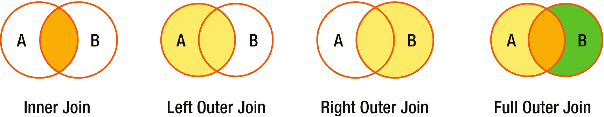
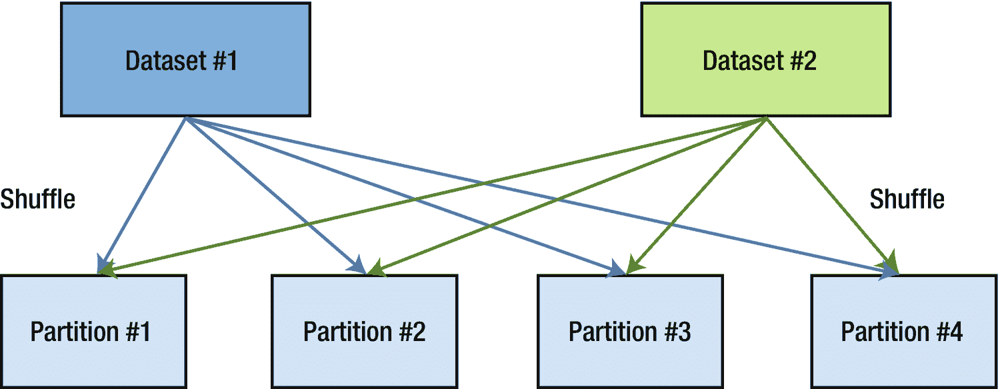
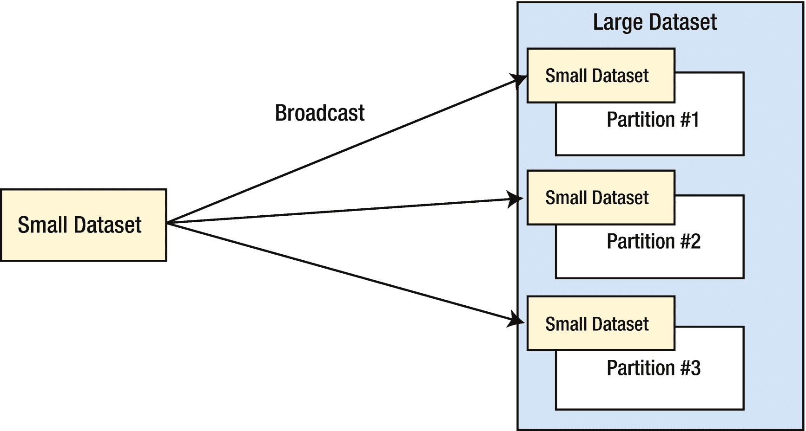

# Spark SQL（高级）

第 4 章介绍了 Spark SQL 模块的基本元素，包括核心抽象、用于操作结构化数据的结构化操作，以及对从各种数据源读取数据和向各种数据源写入数据的支持。在此基础之上，本章将介绍 Spark SQL 模块的一些高级功能，并深入幕后，解释 Catalyst 优化器和 Tungsten 引擎提供的优化和执行效率。为了帮助您执行复杂的分析，Spark SQL 提供了一组强大且灵活的聚合能力、连接多个数据集的能力、大量内置的高性能函数以及一组高级分析函数。本章将详细讨论这些主题。

## 聚合

对大数据执行任何有意义的分析通常都涉及某种聚合，以汇总数据，从而提取模式或洞察，或生成汇总报告。聚合通常需要对整个数据集或一个或多个列进行某种形式的分组，然后对每个组应用聚合函数，例如求和、计数或求平均值。Spark 提供了许多常用的聚合函数，以及将值聚合到一个集合中的能力，然后可以进一步分析该集合。行的分组可以在不同级别进行，Spark 支持以下级别：

- 将 `DataFrame` 视为一个组。
- 使用一个或多个列将 `DataFrame` 分成多个组，并对每个组执行一个或多个聚合。
- 将 `DataFrame` 分成多个窗口，并执行移动平均、累积求和或排名。如果窗口基于时间，则可以使用滚动窗口或滑动窗口进行聚合。

### 聚合函数

在 Spark 中，所有聚合都是通过函数完成的。聚合函数旨在对一组行执行聚合，无论这组行是 `DataFrame` 中的所有行还是子组行。Scala 语言聚合函数的完整列表文档可在 `http://spark.apache.org/docs/latest/api/scala/index.html#org.apache.spark.sql.functions$` 找到。对于 Spark Python API，有时某些函数的可用性存在差距。


### 常用聚合函数

本节介绍一组常用的聚合函数，并提供使用示例。表 5-1 描述了这些聚合函数。完整列表请参见前文提到的网址。

**表 5-1** 常用聚合函数

| 操作 | 描述 |
| --- | --- |
| `count(col)` | 返回每组中的项目数量。 |
| `countDistinct(col)` | 返回每组中不重复的项目数量。 |
| `approx_count_distinct(col)` | 返回每组中不重复项目的近似数量。 |
| `min(col)` | 返回每组中指定列的最小值。 |
| `max(col)` | 返回每组中指定列的最大值。 |
| `sum(col)` | 返回每组中指定列值的总和。 |
| `sumDistinct(col)` | 返回每组中指定列不重复值的总和。 |
| `avg(col)` | 返回每组中指定列值的平均值。 |
| `skewness(col)` | 返回每组中指定列值分布的偏度。 |
| `kurtosis(col)` | 返回每组中指定列值分布的峰度。 |
| `variance(col)` | 返回每组中指定列值的无偏方差。 |
| `stddev(col)` | 返回每组中指定列值的标准差。 |
| `collect_list(col)` | 返回每组中指定列值的集合。返回的集合可能包含重复值。 |
| `collect_set(col)` | 返回每组中不重复值的集合。 |

为了演示这些函数的用法，我们将使用航班摘要数据集，该数据集源自 Kaggle 网站（[`https://www.kaggle.com/usdot/flight-delays/data`](https://www.kaggle.com/usdot/flight-delays/data)）上提供的数据文件。该数据集包含 2015 年美国国内航班的延误和取消情况。代码清单 5-1 包含了通过读取该数据集创建 DataFrame 的代码。

```
val flight_summary = spark.read.format("csv")
.option("header", "true")
.option("inferSchema","true")
.load("/chapter5/data/flights/flight-summary.csv")
// 使用 count 动作来找出该数据集中的行数
flight_summary.count()
Long = 4693
代码清单 5-1
通过读取航班摘要数据集创建 DataFrame
```

请记住，DataFrame 的 `count()` 函数是一个动作（action），因此它会立即返回一个值。表 5-1 中列出的所有函数都是惰性求值函数。

以下是 `flight_summary` 数据集的模式（schema）：

```
|-- origin_code: string (nullable = true)
|-- origin_airport: string (nullable = true)
|-- origin_city: string (nullable = true)
|-- origin_state: string (nullable = true)
|-- dest_code: string (nullable = true)
|-- dest_airport: string (nullable = true)
|-- dest_city: string (nullable = true)
|-- dest_state: string (nullable = true)
|-- count: integer (nullable = true)
```

每一行代表从 `origin_airport` 到 `dest_airport` 的航班。`count` 列包含航班数量。

以下所有示例都是在整个 DataFrame 级别执行聚合。在子组级别执行聚合的示例将在本章后面给出。

#### `count(col)`

计数是一种常用的聚合操作，用于找出组中的项目数量。代码清单 5-2 计算了 `origin_airport` 和 `dest_airport` 两列的计数，正如预期，计数结果相同。为了提高结果列的可读性，你可以使用 `as` 函数为其指定一个更友好的列名。请注意，你需要调用 `show` 动作才能看到结果。

```
flight_summary.select(count("origin_airport"), count("dest_airport").as("dest_count")).show
+----------------------+-----------+
| count(origin_airport)| dest_count|
+----------------------+-----------+
|                  4693|       4693|
+----------------------+-----------+
代码清单 5-2
计算 flight_summary DataFrame 中不同列的计数
```

在计算列中项目数量时，`count(col)` 函数不会将空值计入计数。若要包含空值，应将列名替换为 `*`。代码清单 5-3 通过创建一个在几列中包含空值的小型 DataFrame 来演示此行为。

```
import org.apache.spark.sql.Row
case class Movie(actor_name:String, movie_title:String, produced_year:Long)
val badMoviesDF = Seq( Movie(null, null, 2018L),
Movie("John Doe", "Awesome Movie", 2018L),
Movie(null, "Awesome Movie", 2018L),
Movie("Mary Jane", "Awesome Movie", 2018L)).toDF
badMoviesDF.show
+----------+--------------+--------------+
|actor_name|   movie_title| produced_year|
+----------+--------------+--------------+
|      null|          null|          2018|
|  John Doe| Awesome Movie|          2018|
|      null| Awesome Movie|          2018|
| Mary Jane| Awesome Movie|          2018|
+----------+--------------+--------------+
// 现在对不同列执行计数聚合
badMoviesDF.select(count("actor_name"), count("movie_title"), count("produced_year"), count("*")).show
+------------------+-------------------+---------------------+---------+
| count(actor_name)| count(movie_title)| count(produced_year)| count(1)|
+------------------+-------------------+---------------------+---------+
|                 2|                  3|                    4|        4|
+------------------+-------------------+---------------------+---------+
代码清单 5-3
对包含空值的项目进行计数
```

上述输出表证实了 `count(col)` 函数在最终计数中不包含空值。

#### `countDistinct(col)`

这个函数顾名思义。它只计算每组中不重复的项目。代码清单 5-4 中的输出显示了 `countDistinct` 函数与 `count` 函数在计数结果上的差异。结果表明，`flight_summary` 数据集中有 322 个不重复的机场。

```
flight_summary.select(countDistinct("origin_airport"), countDistinct("dest_airport"), count("*")).show
+-------------------------------+-----------------------------+---------+
| count(DISTINCT origin_airport)| count(DISTINCT dest_airport)| count(1)|
+-------------------------------+-----------------------------+---------+
|                            322|                          322|     4693|
+-------------------------------+-----------------------------+---------+
代码清单 5-4
计算组中的不重复项目
```


好的，作为一名高级文档工程师和翻译员，我将严格遵循您提供的注意事项和示例格式，将给定的英文文本翻译成中文。


### `approx_count_distinct(col, max_estimated_error=0.05)`

在大数据集中精确计算每个组中唯一项的数量是一项昂贵且耗时的操作。在某些用例中，使用近似唯一计数就足够了。其中一个用例是在在线广告业务中，每小时有数亿次广告展示，并且需要生成一份报告来显示每个特定成员细分类型的唯一访客数量。近似计算不同项的数量是计算机科学领域中一个众所周知的问题，也被称为*基数估计问题*。幸运的是，已经有一个著名的算法叫做 HyperLogLog（`https://en.wikipedia.org/wiki/HyperLogLog`）可以用来解决这个问题，Spark 在 `approx_count_distinct` 函数内部实现了该算法的一个版本。由于唯一计数是一个近似值，因此会存在一定的误差。此函数允许您为此用例指定一个可接受的估计误差值。清单 5-5 演示了 `approx_count_distinct` 函数的用法和行为。当您调低估计误差时，该函数完成并返回结果所需的时间会越来越长。

```
// 让我们对 flight_summary DataFrame 的 "count" 列进行计数。
// 默认估计误差为 0.05 (5%)
flight_summary.select(count("count"),countDistinct("count"), approx_count_distinct("count", 0.05)).show
+--------------+----------------------+-----------------------------+
| count(count) | count(DISTINCT count)| approx_count_distinct(count)|
+--------------+----------------------+-----------------------------+
|          4693|                  2033|                         2252|
+--------------+----------------------+-----------------------------+
// 为了了解 approx_count_distinct 函数比 countDistinct 函数快多少，
// 尝试分别调用它们
flight_summary.select(countDistinct("count")).show
// 指定 1% 的估计误差
flight_summary.select(approx_count_distinct("count", 0.01)).show
清单 5-5
计算组中的唯一项
```

在我的 Mac 笔记本电脑上，`approx_count_distinct` 函数耗时约 0.1 秒，而 `countDistinct` 函数耗时 0.6 秒。近似估计误差越大，`approx_count_distinct` 函数完成所需的时间就越短。

### `min(col)`, `max(col)`

组中项的最小值和最大值是范围的两端。这两个函数非常容易理解和使用。清单 5-6 从 `count` 列中提取了这两个值。

```
flight_summary.select(min("count"), max("count")).show
+-----------+-----------+
| min(count)| max(count)|
+-----------+-----------+
|          1|      13744|
+-----------+-----------+
// 看起来有一个非常繁忙的机场，有 13744 个来自另一个机场的入境航班。找出是哪个机场会很有趣。
清单 5-6
获取 count 列的最小值和最大值
```

### `sum(col)`

此函数计算数值列中值的总和。清单 5-7 对 `flight_summary` 数据集中的所有航班执行求和操作。

```
flight_summary.select(sum("count")).show
+-----------+
| sum(count)|
+-----------+
|    5332914|
+-----------+
清单 5-7
使用 sum 函数对 count 值求和
```

### `sumDistinct(col)`

这个函数顾名思义。它只对数值列中的不同值进行求和。`flight_summary` DataFrame 中不同计数的总和应小于清单 5-7 中显示的总和。请参阅清单 5-8 以计算不同值的总和。

```
flight_summary.select(sumDistinct("count")).show
+--------------------+
| sum(DISTINCT count)|
+--------------------+
|             3612257|
+--------------------+
清单 5-8
使用 sumDistinct 函数对不同 count 值求和
```

### `avg(col)`

此函数计算数值列的平均值。这个便捷的函数简单地取总和并除以项数。让我们看看清单 5-8 是否能验证这个假设。

```
flight_summary.select(avg("count"), (sum("count") / count("count"))).show
+-------------------+----------------------------+
|         avg(count)| (sum(count) / count(count))|
+-------------------+----------------------------+
| 1136.3549968037503|          1136.3549968037503|
+-------------------+----------------------------+
清单 5-9
使用两种不同方式计算 count 列的平均值
```

### `skewness(col)`, `kurtosis(col)`

在统计学领域，数据集中值的分布揭示了数据集背后的许多信息。*偏度*是衡量数据集中值分布对称性的指标。在正态分布或钟形分布中，偏度值为 0。正偏度表示右侧的尾部比左侧更长或更胖。负偏度则表示相反的情况，即左侧的尾部比右侧更长或更胖。当偏度为 0 时，两侧的尾部是均匀的。

峰度是衡量分布曲线形状的指标，即曲线是正常的、平坦的还是尖锐的。正峰度表示曲线细长而尖锐，负峰度表示曲线宽而平坦。清单 5-10 计算了 `flight_summary` 数据集中 count 分布的偏度和峰度。

```
flight_summary.select(skewness("count"), kurtosis("count")).show
+------------------+------------------+
|   skewness(count)|   kurtosis(count)|
+------------------+------------------+
| 2.682183800064101| 10.51726963017102|
+------------------+------------------+
清单 5-10
计算 count 列的偏度和峰度
```

结果似乎表明计数的分布不对称，并且右侧的尾部比左侧更长或更胖。峰度值表明分布曲线是尖锐的。

### `variance(col)`, `stddev(col)`

在统计学中，方差和标准差用于衡量数据的离散程度或分散程度。换句话说，它们用于表示数值与平均值的平均距离。当方差值较低时，意味着数值接近平均值。方差和标准差是相关的；后者是前者的平方根。

`variance` 和 `stddev` 函数分别用于计算方差和标准差。Spark 提供了这些函数的两种不同实现；一种使用抽样来加速计算，另一种使用整个总体。清单 5-11 显示了 `flight_summary` DataFrame 中 `count` 列的方差和标准差。

```
// 使用方差和标准差的两种变体
flight_summary.select(variance("count"), var_pop("count"), stddev("count"), stddev_pop("count")).show
+-----------------+------------------+------------------+-----------------+
|  var_samp(count)|    var_pop(count)|stddev_samp(count)|stddev_pop(count)|
+-----------------+------------------+------------------+-----------------+
|1879037.7571558713|1878637.3655604832|  1370.779981308405| 1370.633928355957|
+-----------------+------------------+------------------+-----------------+
清单 5-11
使用 variance 和 stddev 函数计算方差和标准差
```

看起来 `flight_summary` DataFrame 中的 `count` 值分布相当分散。


### 分组聚合

本节介绍对一个或多个列进行分组聚合。聚合操作通常应用于包含一个或多个低基数分类列的数据集。分类值的示例包括性别、年龄、城市名称或国家名称。聚合将通过类似于前面提到的函数来完成。不过，聚合操作不是在`DataFrame`的全局组上执行，而是对`DataFrame`内的每个子组分别执行。

执行分组聚合是一个两步过程。第一步是使用`groupBy(col1,col2,...)`转换进行分组，在此指定按哪些列对行进行分组。与其他返回`DataFrame`的转换不同，`groupBy`转换返回的是`RelationalGroupedDataset`类的实例，然后你可以对其应用一个或多个聚合函数。代码清单 5-12 演示了使用一个列和一个聚合函数进行简单分组的过程。请注意，`groupBy`的列将自动包含在输出中。

```
flight_summary.groupBy("origin_airport").count().show(5, false)
+--------------------------------------------------+------+
|                      origin_airport              | count|
+--------------------------------------------------+------+
|Melbourne International Airport                   |     1|
|San Diego International Airport (Lindbergh Field) |    46|
|Eppley Airfield                                   |    21|
|Kahului Airport                                   |    18|
|Austin-Bergstrom International Airport            |    41|
+--------------------------------------------------+------+
代码清单 5-12
按 origin_airport 分组并执行计数聚合
```

上述结果表告诉我们，从墨尔本国际机场（佛罗里达州）出发的航班仅飞往另一个机场。然而，从卡胡卢伊机场出发的航班可以降落在其他 18 个机场中的任意一个。

为了让情况更有趣一些，我们尝试按两列分组，以在城市级别计算相同的指标。代码清单 5-13 展示了如何实现这一点。

```
flight_summary.groupBy('origin_state, 'origin_city).count
.where('origin_state === "CA").orderBy('count.desc).show(5)
+-------------+-----------------+-------+
| origin_state|      origin_city|  count|
+-------------+-----------------+-------+
|           CA|    San Francisco|     80|
|           CA|      Los Angeles|     80|
|           CA|        San Diego|     47|
|           CA|          Oakland|     35|
|           CA|       Sacramento|     27|
+-------------+-----------------+-------+
代码清单 5-13
按 origin_state 和 origin_city 分组并执行计数聚合
```

除了按两列分组外，上述语句还过滤了行，仅保留`CA`州的数据。使用`orderBy`转换可以更容易地识别哪个城市在目的地机场方面拥有最多的选择。加州旧金山和洛杉矶拥有最多的可飞往目的地机场数量，这合乎情理。

`RelationalGroupedDataset`类提供了一组标准的聚合函数，你可以将其应用于每个子组。这些函数包括`avg(cols)`、`count()`、`mean(cols)`、`min(cols)`、`max(cols)`和`sum(cols)`。除了`count()`函数外，其余所有函数都作用于数值列。

#### 每组的多重聚合

有时需要同时对每组执行多个聚合操作。例如，除了计数之外，你可能还想知道最小值和最大值。`RelationalGroupedDataset`类提供了一个名为`agg`的强大函数，它可以接受一个或多个列表达式，这意味着你可以使用任何聚合函数，包括表 5-1 中列出的那些。一个很酷的地方是，这些聚合函数返回`Column`类的实例，因此你可以使用提供的函数应用任何列表达式。一个常见需求是在聚合完成后重命名列，使其更短、更易读且更易于引用。代码清单 5-14 演示了如何实现上述所有操作。

```
import org.apache.spark.sql.functions._
flight_summary.groupBy("origin_airport")
.agg(
count("count").as("count"),
min("count"), max("count"),
sum("count")
).show(5)
+--------------------+------+-----------+-----------+-----------+
|      origin_airport| count| min(count)| max(count)| sum(count)|
+--------------------+------+-----------+-----------+-----------+
|Melbourne Interna...|     1|       1332|       1332|       1332|
|San Diego Interna...|    46|          4|       6942|      70207|
|     Eppley Airfield|    21|          1|       2083|      16753|
|     Kahului Airport|    18|         67|       8313|      20627|
|Austin-Bergstrom ...|    41|          8|       4674|      42067|
+--------------------+------+-----------+-----------+-----------+
代码清单 5-14
按 origin_airport 分组后的多重聚合
```

默认情况下，聚合列名就是聚合表达式，这使得列名有点长且不易引用。一种常见模式是使用`Column.as`函数将列重命名为更合适的名称。

多功能的`agg`函数还提供了另一种通过基于字符串的键值映射来表达列表达式的方式。键是列名，值是聚合函数，可以是`avg`、`max`、`min`、`sum`或`count`。代码清单 5-15 展示了这种方法的示例。

```
flight_summary.groupBy("origin_airport")
.agg(
"count" -> "count",
"count" -> "min",
"count" -> "max",
"count" -> "sum")
.show(5)
代码清单 5-15
使用键值映射指定多重聚合
```

结果与代码清单 5-14 相同。请注意，这种方法没有简便的方法来重命名聚合结果列名。与第一种方法相比，这种方法的一个优势是映射可以通过编程方式生成。在编写生产环境 ETL 作业或进行探索性分析时，第一种方法比第二种方法更常用。


#### 收集组值

函数`collect_list(col)`和`collect_set(col)`用于在分组后收集特定组的所有值。将每个组的值收集到集合中后，就可以自由地以任何方式对它们进行操作。这两个函数返回的集合之间有一个小区别，即唯一性。`collection_list`函数返回的集合可能包含重复值，而`collection_set`函数返回的集合仅包含唯一值。清单 5-16 展示了使用`collection_list`函数收集从每个出发州到达的航班数超过 5500 的目的地城市。

```
val highCountDestCities = flight_summary.where('count > 5500)
.groupBy("origin_state")
.agg(collect_list("dest_city").as("dest_cities"))
highCountDestCities.withColumn("dest_city_count", size('dest_cities)).show(5, false)
+-------------+--------------------------------------+----------------+
| origin_state|             dest_cities              | dest_city_count|
+-------------+--------------------------------------+----------------+
|           AZ| [Seattle, Denver, Los Angeles]       |               3|
|           LA| [Atlanta]                            |               1|
|           MN| [Denver, Chicago]                    |               2|
|           VA| [Chicago, Boston, Atlanta]           |               3|
|           NV| [Denver, Los Angeles, San Francisco] |               3|
+-------------+--------------------------------------+----------------+
Listing 5-16
Using collection_list to Collect High-Traffic Destination Cities per Origin State
```

### 数据透视聚合

数据透视是一种通过指定一个分类列，然后对另一列执行聚合，从而将分类值从行转置为单独列来汇总数据的方法。另一种理解数据透视的方式是，它是一种在应用一个或多个聚合的同时将行转换为列的方法。此技术常用于数据分析或报表中。数据透视过程首先对一个或多个列进行分组，然后对某一列进行透视，最后对一个或多个列应用一个或多个聚合。清单 5-17 展示了一个关于小型学生数据集的数据透视示例，其中每一行包含学生姓名、性别、体重和毕业年份。您希望了解每个毕业年份中每种性别的平均体重。

```
import org.apache.spark.sql.Row
case class Student(name:String, gender:String, weight:Int, graduation_year:Int)
val studentsDF = Seq(Student("John", "M", 180, 2015),
Student("Mary", "F", 110, 2015),
Student("Derek", "M", 200, 2015),
Student("Julie", "F", 109, 2015),
Student("Allison", "F", 105, 2015),
Student("kirby", "F", 115, 2016),
Student("Jeff", "M", 195, 2016)).toDF
// calculating the average weight for each gender per graduation year
studentsDF.groupBy("graduation_year").pivot("gender").avg("weight").show()
+----------------+------+------+
| graduation_year|     F|     M|
+----------------+------+------+
|            2015| 108.0| 190.0|
|            2016| 115.0| 195.0|
+----------------+------+------+
Listing 5-17
Pivoting on a Small Dataset
```

前面的示例只有一个聚合，并且性别分类列只有两个可能的唯一值；因此，结果表只有两列。如果`gender`列有三个可能的唯一值，那么结果表中将有三列。您可以利用`agg`函数执行多个聚合，这将在结果表中创建更多列。请参见清单 5-18，了解对与清单 5-17 相同的`DataFrame`执行多个聚合的示例。

```
studentsDF.groupBy("graduation_year").pivot("gender")
.agg(
min("weight").as("min"),
max("weight").as("max"),
avg("weight").as("avg")
).show()
+---------------+------+------+------+------+------+------+
|graduation_year| F_min| F_max| F_avg| M_min| M_max| M_avg|
+---------------+------+------+------+------+------+------+
|           2015|   105|   110| 108.0|   180|   200| 190.0|
|           2016|   115|   115| 115.0|   195|   195| 195.0|
+---------------+------+------+------+------+------+------+
Listing 5-18
Multiple Aggregations After Pivoting
```

结果表中分组列之后添加的列数是透视列的唯一值数量与聚合数量的乘积。

如果透视列有大量不同的值，您可以选择性地指定要为其生成聚合的值。清单 5-19 展示了如何向透视函数指定值。

```
studentsDF.groupBy("graduation_year").pivot("gender", Seq("M"))
.agg(
min("weight").as("min"),
max("weight").as("max"),
avg("weight").as("avg")
).show()
+----------------+------+------+------+
| graduation_year| M_min| M_max| M_avg|
+----------------+------+------+------+
|            2015|   180|   200| 190.0|
|            2016|   195|   195| 195.0|
+----------------+------+------+------+
Listing 5-19
Selecting Which Values of Pivoting Columns to Generate the Aggregations For
```

为透视列指定一个不同的值列表实际上会加快数据透视过程。否则，Spark 将花费一些精力自行找出不同的值列表。

## 连接

为了执行任何复杂且有趣的数据分析或操作，您通常需要通过*连接*的过程将来自多个数据集的数据整合在一起。这是 SQL 术语中众所周知的技术。执行连接将合并两个数据集（可以不同或相同）的列，合并后的`DataFrame`将包含两侧的列。这将使您能够以仅凭单个数据集无法做到的方式进一步分析合并后的数据集。让我们以来自一家在线电子商务公司的两个数据集为例。一个表示包含哪些客户购买了哪些产品信息的交易数据（即事实表）。另一个表示每个客户的详细信息（即维度表）。通过连接这两个数据集，您可以提取关于哪些产品在特定客户群体（按年龄或位置划分）中更受欢迎的见解。

本节介绍如何使用`join`转换在 Spark SQL 中执行连接，以及它支持的各种连接类型。本节的最后一部分描述了 Spark SQL 内部如何执行连接的一些细节。

### 注意

在使用 SQL 进行数据分析的世界中，连接是一种经常使用的技术。如果您是 SQL 新手，强烈建议您学习基本概念和不同类型的连接，请访问[`https://en.wikipedia.org/wiki/Join_(SQL`](https://en.wikipedia.org/wiki/Join_(SQL) `)`。关于连接的一些教程可在[`https://www.w3schools.com/sql/sql_join.asp`](https://www.w3schools.com/sql/sql_join.asp)找到。


### 连接表达式与连接类型

对两个数据集执行连接操作需要指定两项信息。第一项是连接表达式，用于指定应使用每个数据集中的哪些列来确定两个数据集中的哪些行将包含在连接后的数据集中。第二项是连接类型，用于决定连接后的数据集中应包含哪些内容。表 5-2 描述了 Spark SQL 支持的连接类型。

**表 5-2** 连接类型

| 类型 | 描述 |
| --- | --- |
| 内连接（又称等值连接） | 当连接表达式计算结果为 true 时，返回两个数据集中的行。 |
| 左外连接 | 即使连接表达式计算结果为 false，也返回左侧数据集中的行。 |
| 右外连接 | 即使连接表达式计算结果为 false，也返回右侧数据集中的行。 |
| 全外连接 | 即使连接表达式计算结果为 false，也返回两个数据集中的行。 |
| 左反连接 | 仅当连接表达式计算结果为 false 时，返回左侧数据集中的行。 |
| 左半连接 | 仅当连接表达式计算结果为 true 时，返回左侧数据集中的行。 |
| 交叉连接（又称笛卡尔积） | 通过将左侧数据集中的每一行与右侧数据集中的每一行组合来返回行。行数将是每个数据集大小的乘积。 |

为了帮助直观理解某些连接类型，图 5-1 展示了一组常见连接类型的维恩图（来源：[`https://en.wikipedia.org/wiki/Join_(SQL)#Outer_join`](https://en.wikipedia.org/wiki/Join_(SQL)#Outer_join)）。



**图 5-1** 常见连接类型的维恩图

### 使用连接操作

为了演示如何在 Spark SQL 中执行连接操作，我将使用两个小型 DataFrame。第一个代表员工列表，每行包含员工姓名及其所属部门。第二个包含部门列表，每行包含部门 ID 和部门名称。代码清单 5-20 包含了创建这两个 DataFrame 的代码片段。

```
case class Employee(first_name:String, dept_no:Long)
val employeeDF = Seq( Employee("John", 31),
Employee("Jeff", 33),
Employee("Mary", 33),
Employee("Mandy", 34),
Employee("Julie", 34),
Employee("Kurt", null.asInstanceOf[Int])
).toDF
case class Dept(id:Long, name:String)
val deptDF = Seq( Dept(31, "Sales"),
Dept(33, "Engineering"),
Dept(34, "Finance"),
Dept(35, "Marketing")
).toDF
// 将它们注册为视图，以便使用 SQL 执行连接操作
employeeDF.createOrReplaceTempView("employees")
deptDF.createOrReplaceTempView("departments")
```

**代码清单 5-20** 创建两个小型 DataFrame，用于后续的连接类型示例

#### 内连接

这是最常用的连接类型，其连接表达式包含对两个数据集列进行相等性比较。仅当连接表达式计算结果为 true 时，连接后的数据集才会包含这些行，换句话说，即当两个数据集中的连接列值相同时。不匹配列值的行将从连接后的数据集中排除。如果连接表达式使用相等性比较，则连接后的表中的行数最多与较小数据集的大小相同。在 Spark SQL 中，内连接是默认的连接类型，因此在连接转换中指定它是可选的。代码清单 5-21 提供了执行内连接的示例。

```
// 定义相等性比较的连接表达式
val deptJoinExpression = employeeDF.col("dept_no") === deptDF.col("id")
// 执行连接
employeeDF.join(deptDF, joinExpression, "inner").show
// 无需指定连接类型，因为 "inner" 是默认值
employeeDF.join(deptDF, joinExpression).show
+----------+--------+---+------------+
|first_name| dept_no| id|        name|
+----------+--------+---+------------+
|      John|      31| 31|       Sales|
|      Jeff|      33| 33| Engineering|
|      Mary|      33| 33| Engineering|
|     Mandy|      34| 34|     Finance|
|     Julie|      34| 34|     Finance|
+----------+--------+---+------------+
// 使用 SQL
spark.sql("select * from employees JOIN departments on dept_no == id").show
```

**代码清单 5-21** 按部门 ID 执行内连接

正如预期，连接后的数据集仅包含员工和部门数据集中部门 ID 匹配的行，以及两个数据集的所有列。输出结果明确显示了每个员工所属的部门。

连接表达式可以在 `join` 转换内部指定，也可以使用 `where` 转换。如果列名唯一，则可以使用简写形式引用连接表达式中的列。如果不唯一，则需要使用 `col` 函数指定特定列来自哪个 DataFrame。代码清单 5-22 展示了表达连接表达式的不同方式。

```
// 连接表达式的简写版本
employeeDF.join(deptDF, 'dept_no === 'id).show
// 在 join 转换内部指定连接表达式
employeeDF.join(deptDF, employeeDF.col("dept_no") === deptDF.col("id")).show
// 使用 where 转换指定连接表达式
employeeDF.join(deptDF).where('dept_no === 'id).show
```

**代码清单 5-22** 表达连接表达式的不同方式

连接表达式本质上是一个布尔谓词，因此它可以简单到比较两个列，也可以复杂到链接多个列对的逻辑比较。

#### 左外连接

此连接类型的连接数据集包含内连接的所有行，以及连接表达式计算结果为 false 的左侧数据集中的所有行。对于这些不匹配的行，它将在右侧数据集的列中填充 `NULL` 值。参见代码清单 5-23 中的左外连接示例。

```
// 连接类型可以是 "left_outer" 或 "leftouter"
employeeDF.join(deptDF, 'dept_no === 'id, "left_outer").show
// 使用 SQL
spark.sql("select * from employees LEFT OUTER JOIN departments on dept_no == id").show
+-----------+--------+-----+------------+
| first_name| dept_no|   id|        name|
+-----------+--------+-----+------------+
|       John|      31|   31|       Sales|
|       Jeff|      33|   33| Engineering|
|       Mary|      33|   33| Engineering|
|      Mandy|      34|   34|     Finance|
|      Julie|      34|   34|     Finance|
|       Kurt|       0| null|        null|
+-----------+--------+-----+------------+
```

**代码清单 5-23** 执行左外连接

正如预期，连接后数据集中的行数与 `employee` DataFrame 中的行数相同。由于没有 ID 值为 0 的匹配部门，因此该行填充了 `NULL` 值。此特定左外连接的结果使您能够了解每个员工被分配到了哪个部门，以及哪些员工尚未分配到部门。


### 右外连接

此连接类型的行为与左外连接类似，区别在于相同的处理逻辑应用于右侧数据集。换句话说，连接后的数据集包含内连接的所有行，以及连接表达式计算结果为 false 的右侧数据集中的所有行。对于这些不匹配的行，左侧数据集的列将填充 `NULL` 值。有关执行右外连接的示例，请参见清单 5-24。

```
employeeDF.join(deptDF, 'dept_no === 'id, "right_outer").show
// 使用 SQL
spark.sql("select * from employees RIGHT OUTER JOIN departments on dept_no == id").show
+-----------+--------+----+------------+
| first_name| dept_no|  id|        name|
+-----------+--------+----+------------+
|       John|      31|  31|       Sales|
|       Mary|      33|  33| Engineering|
|       Jeff|      33|  33| Engineering|
|      Julie|      34|  34|     Finance|
|      Mandy|      34|  34|     Finance|
|       null|    null|  35|   Marketing|
+-----------+--------+----+------------+
清单 5-24
执行右外连接
```

正如预期，市场部门在员工数据集中没有任何匹配的行。连接后的数据集既显示了员工所属的部门，也显示了哪些部门没有员工。

### 外连接（又称全外连接）

此连接类型的行为实际上等同于左外连接和右外连接结果的组合。有关执行外连接的示例，请参见清单 5-25。

```
employeeDF.join(deptDF, 'dept_no === 'id, "outer").show
// 使用 SQL
spark.sql("select * from employees FULL OUTER JOIN departments on dept_no == id").show
+-----------+--------+-----+------------+
| first_name| dept_no|   id|        name|
+-----------+--------+-----+------------+
|       Kurt|       0| null|        null|
|      Mandy|      34|   34|     Finance|
|      Julie|      34|   34|     Finance|
|       John|      31|   31|       Sales|
|       Jeff|      33|   33| Engineering|
|       Mary|      33|   33| Engineering|
|       null|    null|   35|   Marketing|
+-----------+--------+-----+------------+
清单 5-25
执行外连接
```

外连接的结果不仅让你看到员工所属的部门以及哪些部门有员工，还能看到哪些员工未分配到部门，以及哪些部门没有任何员工。

### 左反连接

此连接类型使你能够找出左侧数据集中哪些行在右侧数据集中没有匹配行，并且连接后的数据集仅包含左侧数据集的列。有关执行左反连接的示例以及连接后数据集的样子，请参见清单 5-26。

```
employeeDF.join(deptDF, 'dept_no === 'id, "left_anti").show
// 使用 SQL
spark.sql("select * from employees LEFT ANTI JOIN departments on dept_no == id").show
+----------+--------+
|first_name| dept_no|
+----------+--------+
|      Kurt|       0|
+----------+--------+
清单 5-26
执行左反连接
```

左反连接的结果可以轻松告诉你哪些员工未分配到部门。请注意，不存在右反连接类型；但是，你可以轻松地交换数据集来达到相同的目的。

### 左半连接

此连接类型的行为与内连接类似，区别在于连接后的数据集不包含右侧数据集的列。另一种理解此连接类型的方式是，其行为与左反连接相反，连接后的数据集仅包含匹配的行。有关执行左半连接的示例以及连接后数据集的样子，请参见清单 5-27。

```
employeeDF.join(deptDF, 'dept_no === 'id, "left_semi").show
// 使用 SQL
spark.sql("select * from employees LEFT SEMI JOIN departments on dept_no == id").show
+-----------+--------+
| first_name| dept_no|
+-----------+--------+
|       John|      31|
|       Jeff|      33|
|       Mary|      33|
|      Mandy|      34|
|      Julie|      34|
+-----------+--------+
清单 5-27
执行左半连接
```

### 交叉连接（又称笛卡尔连接）

就使用而言，此连接类型是最简单的，因为不需要连接表达式。但其行为可能有点危险，因为它会将左侧数据集中的每一行与右侧数据集中的每一行进行连接。连接后数据集的大小是两个数据集大小的乘积。例如，如果每个数据集的大小为 1024，那么连接后数据集的大小将超过一百万行。因此，使用此连接类型的方式是在 DataFrame 中显式使用专用的转换方法，而不是将此连接类型指定为字符串。有关执行交叉连接的示例以及连接后数据集的样子，请参见清单 5-28。

```
// 使用 crossJoin 转换并显示计数
employeeDF.crossJoin(deptDF).count
Long = 24
// 使用 SQL 并显示最多 30 行以查看连接数据集中的所有行
spark.sql("select * from employees CROSS JOIN departments").show(30)
+----------+--------+----+------------+
|first_name| dept_no|  id|        name|
+----------+--------+----+------------+
|      John|      31|  31|       Sales|
|      John|      31|  33| Engineering|
|      John|      31|  34|     Finance|
|      John|      31|  35|   Marketing|
|      Jeff|      33|  31|       Sales|
|      Jeff|      33|  33| Engineering|
|      Jeff|      33|  34|     Finance|
|      Jeff|      33|  35|   Marketing|
|      Mary|      33|  31|       Sales|
|      Mary|      33|  33| Engineering|
|      Mary|      33|  34|     Finance|
|      Mary|      33|  35|   Marketing|
|     Mandy|      34|  31|       Sales|
|     Mandy|      34|  33| Engineering|
|     Mandy|      34|  34|     Finance|
|     Mandy|      34|  35|   Marketing|
|     Julie|      34|  31|       Sales|
|     Julie|      34|  33| Engineering|
|     Julie|      34|  34|     Finance|
|     Julie|      34|  35|   Marketing|
|      Kurt|       0|  31|       Sales|
|      Kurt|       0|  33| Engineering|
|      Kurt|       0|  34|     Finance|
|      Kurt|       0|  35|   Marketing|
+----------+--------+----+------------+
清单 5-28
执行交叉连接
```


### 处理重复的列名

有时，在连接两个具有一个或多个相同名称列的数据框后，会出现一个意想不到的问题。当这种情况发生时，连接后的数据框会有多个同名列。在这种情况下，在对连接后的数据框执行某种转换时，很难引用其中的某一列。清单 5-29 模拟了这种情况。

```
// 向 deptDF 添加一个名为 dept_no 的新列
val deptDF2 = deptDF.withColumn("dept_no", 'id)
deptDF2.printSchema
|-- id: long (nullable = false)
|-- name: string (nullable = true)
|-- dept_no: long (nullable = false)
// 现在将 employeeDF 与 deptDF2 使用 dept_no 列进行连接
val dupNameDF = employeeDF.join(deptDF2, employeeDF.col("dept_no") === deptDF2.col("dept_no"))
dupNameDF.printSchema
|-- first_name: string (nullable = true)
|-- dept_no: long (nullable = false)
|-- id: long (nullable = false)
|-- name: string (nullable = true)
|-- dept_no: long (nullable = false)
清单 5-29
模拟一个包含多个同名列的连接后数据框
```

注意，`dupNameDF` 数据框现在有两个同名的列，即 `dept_no`。当你在清单 5-30 中尝试使用 `dept_no` 对 `dupNameDF` 数据框进行投影时，Spark 会抛出一个错误。

```
dupNameDF.select("dept_no")
org.apache.spark.sql.AnalysisException: Reference 'dept_no' is ambiguous, could be: dept_no#30L, dept_no#1050L.;
清单 5-30
在 dupNameDF 数据框中投影 dept_no 列
```

事实证明，有几种方法可以处理这个问题。

#### 使用原始数据框

连接后的数据框会记住在连接过程中哪些列来自哪个原始数据框。为了消除特定列来自哪个数据框的歧义，你可以告诉 Spark 用其原始数据框名称作为前缀。请参阅清单 5-31 了解如何操作。

```
dupNameDF.select(deptDF2.col("dept_no"))
清单 5-31
使用原始数据框 deptDF2 来引用连接后数据框中的 dept_no 列
```

#### 在连接前重命名列

为了避免之前的列名歧义问题，另一种方法是使用 `withColumnRenamed` 转换来重命名其中一个数据框中的列。由于这很简单，我将把它留作练习给你。

#### 使用连接列名

如果两个数据框中的连接列名相同，你可以利用一种连接转换的变体，它会自动从连接后的数据框中移除重复的列名。但是，如果是自连接（即数据框与自身连接），则无法引用其他重复的列名。在这种情况下，你需要使用第一种技术来重命名其中一个数据框的列。清单 5-32 展示了一个使用连接列名执行连接的示例。

```
val noDupNameDF = employeeDF.join(deptDF2, "dept_no")
noDupNameDF.printSchema
|-- dept_no: long (nullable = false)
|-- first_name: string (nullable = true)
|-- id: long (nullable = false)
|-- name: string (nullable = true)
清单 5-32
使用连接列名执行连接
```

注意，`noDupNameDF` 数据框中只有一个 `dept_no` 列。

### 连接实现概述

连接是 Spark 中最昂贵的操作之一。从高层次来看，Spark 使用两种不同的策略来连接两个数据集。它们是 **Shuffle 哈希连接**和**广播连接**。选择特定策略的主要标准基于两个数据集的大小。当两个数据集都很大时，使用 Shuffle 哈希连接策略。当其中一个数据集的大小足够小，可以放入执行器的内存时，则使用广播连接策略。以下各节详细介绍了每种连接策略的工作原理。

#### Shuffle 哈希连接

从概念上讲，连接是将两个数据集中满足连接表达式指定条件的行的列组合起来。为此，那些具有相同列值的行需要被放置在同一分区上。Shuffle 哈希连接实现包含两个步骤。第一步是计算每个数据集中每行在连接表达式中的列的哈希值，然后将具有相同哈希值的行 Shuffle 到同一分区。为了确定特定行将被移动到哪个分区，Spark 执行一个简单的算术运算，即计算哈希值对分区数取模。一旦第一步完成，第二步就将那些具有相同列哈希值的行的列组合起来。从高层次来看，这两个步骤类似于 MapReduce 编程模型中的步骤。

图 5-2 展示了 Shuffle 哈希连接中发生的 Shuffle 过程。如前所述，这是一个昂贵的操作，因为它需要通过网络在众多机器之间移动大量数据。当通过网络移动数据时，数据通常会经历数据序列化和反序列化过程。想象一下对两个大型数据集执行连接，每个数据集的大小为 100GB。在这种情况下，需要移动大约 200GB 的数据。在连接两个大型数据集时，完全避免 Shuffle 哈希连接是不可能的，但重要的是要时刻注意尽可能减少连接它们的频率。



图 5-2

Shuffle 哈希连接

#### 广播哈希连接

此连接策略仅适用于其中一个数据集足够小，可以放入内存的情况。知道 Shuffle 哈希连接是一种昂贵的操作后，广播哈希连接避免了 Shuffle 两个数据集，而只 Shuffle 较小的那个。与 Shuffle 哈希连接策略类似，该策略也包含两个步骤。第一步是将整个较小数据集的副本广播到较大数据集的每个分区。第二步是遍历较大数据集中的每一行，并在较小数据集中查找具有匹配列值的对应行。图 5-3 展示了较小数据集的广播过程。



图 5-3

广播哈希连接

很容易理解，在可能的情况下，广播哈希连接是首选。Spark SQL 在大多数情况下，可以根据读取数据集时获得的一些统计信息，自动判断是使用广播哈希连接还是 Shuffle 哈希连接。但是，在使用 `join` 转换时，可以向 Spark SQL 提供提示以使用广播哈希连接。清单 5-33 提供了一个示例。

```
import org.apache.spark.sql.functions.broadcast
// 打印执行计划以验证是否使用了广播哈希连接策略
employeeDF.join(broadcast(deptDF), employeeDF.col("dept_no") === deptDF.col("id")).explain()
// 使用 SQL
spark.sql("select /*+ MAPJOIN(departments) */ * from employees JOIN departments on dept_no == id").explain()
== Physical Plan ==
*BroadcastHashJoin [dept_no#30L], [id#41L], Inner, BuildRight
:- LocalTableScan [first_name#29, dept_no#30L]
+- BroadcastExchange HashedRelationBroadcastMode(List(input[0, bigint, false]))
+- LocalTableScan [id#41L, name#42]
清单 5-33
提供提示以对广播的 deptDF 使用广播哈希连接
```


