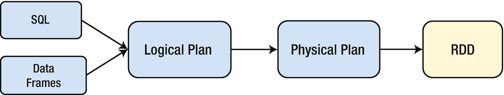

# Catalyst 优化器

编写高效数据处理应用最简单的方法就是无需操心，让应用自动获得优化。这正是 Spark Catalyst 的承诺——它是一个查询优化器，也是 Spark SQL 模块中的第二个主要组件。它在确保使用 DataFrame API 或 SQL 编写的数据处理逻辑能够高效、快速地运行方面发挥着重要作用。它旨在最小化端到端的查询响应时间，同时具备可扩展性，使得 Spark 用户能够将用户代码注入优化器以执行自定义优化。从高层来看，Spark Catalyst 将用户编写的数据处理逻辑转换为逻辑计划，然后使用启发式方法对其进行优化，最后将逻辑计划转换为物理计划。最后一步是基于物理计划生成代码。图 5-4 直观地展示了这些步骤。

将用户对所需操作的表达转化为执行这些步骤的最高效方法，这一理念在关系数据库管理系统（RDBMS）领域早已存在。然而，Spark Catalyst 的创新之处在于其可扩展性以及使用 Scala 函数式编程结构进行开发的方式。这两项创新使得 Spark Catalyst 能够通过 Spark 用户社区的贡献迅速成熟。

以下各节将简要介绍 Catalyst 优化过程中每个步骤的细节，并展示一些生成的查询计划示例。



**图 5-4** Catalyst 优化器

## 逻辑计划

Catalyst 优化过程的第一步是从 DataFrame 对象或解析后的 SQL 查询的抽象语法树创建逻辑计划。逻辑计划是用户数据处理逻辑的内部表示，形式为操作符和表达式的树。接下来，Catalyst 分析逻辑计划以解析引用，确保其有效。然后，它对逻辑计划应用一组基于规则和基于成本的优化。这两种优化都遵循尽早修剪不必要数据并最小化每个操作符成本的原则。

基于规则的优化包括常量折叠、投影修剪、谓词下推等。例如，在此优化阶段，Catalyst 可能会决定在执行连接之前移动过滤条件。对于好奇的读者，基于规则的优化列表定义在 `org.apache.spark.sql.catalyst.optimizer.Optimizer` 类中。

基于成本的优化在 Spark 2.2 中引入，使 Catalyst 能够根据正在处理的数据的统计信息更智能地选择正确的连接类型。基于成本的优化依赖于参与过滤或连接条件的列的详细统计信息，这就是引入统计信息收集框架的原因。统计信息的示例包括基数、不同值的数量、最大值/最小值、平均值/最大长度等。

## 物理计划

逻辑计划优化完成后，Catalyst 将使用与 Spark 执行引擎匹配的物理操作符生成一个或多个物理计划。除了在逻辑计划阶段执行的优化外，物理计划阶段还会执行其自身的基于规则的优化，包括将投影和过滤合并为单个操作，以及将投影或过滤谓词一直下推到支持此功能的数据源（例如 Parquet）。同样，这些优化遵循前面描述的数据修剪原则。Catalyst 执行的最后一步是生成成本最低的物理计划的 Java 字节码。

## Catalyst 实战

本节展示如何使用 DataFrame 类的 `explain` 函数来显示逻辑计划和物理计划。

要同时查看逻辑计划和物理计划，你可以调用 `explain` 函数并将 `extended` 参数设置为布尔值 `true`。否则，此函数仅显示物理计划。

下面这个简单甚至有点傻的例子首先以 Parquet 格式读取电影数据，然后根据 `produced_year` 进行过滤，接着添加一个名为 `produced_decade` 的列，并投影 `movie_title` 和 `produced_decade` 列，最后根据 `produced_decade` 过滤行。这里的目标是证明 Catalyst 执行了谓词下推和过滤条件优化。请参阅清单 5-57 了解如何生成逻辑计划和物理计划。

```
// 以 Parquet 格式读取电影数据
val moviesDF = spark.read.load("/book/chapter4/data/movies/movies.parquet")
// 执行两个过滤条件
val newMoviesDF = moviesDF.filter('produced_year > 1970)
.withColumn("produced_decade", 'produced_year + 'produced_year % 10)
.select('movie_title, 'produced_decade).where('produced_decade > 2010)
// 显示逻辑计划和物理计划
newMoviesDF.explain(true)
== 解析后的逻辑计划 ==
'Filter ('produced_decade > 2010)
+- Project [movie_title#408, produced_decade#415L]
+- Project [actor_name#407, movie_title#408, produced_year#409L, (produced_year#409L + (produced_year#409L % cast(10 as bigint))) AS produced_decade#415L]
+- Filter (produced_year#409L > cast(1970 as bigint))
+- Relation[actor_name#407,movie_title#408,produced_year#409L] parquet
== 分析后的逻辑计划 ==
movie_title: string, produced_decade: bigint
Filter (produced_decade#415L > cast(2010 as bigint))
+- Project [movie_title#408, produced_decade#415L]
+- Project [actor_name#407, movie_title#408, produced_year#409L, (produced_year#409L + (produced_year#409L % cast(10 as bigint))) AS produced_decade#415L]
+- Filter (produced_year#409L > cast(1970 as bigint))
+- Relation[actor_name#407,movie_title#408,produced_year#409L] parquet
== 优化后的逻辑计划 ==
Project [movie_title#408, (produced_year#409L + (produced_year#409L % 10)) AS produced_decade#415L]
+- Filter ((isnotnull(produced_year#409L) && (produced_year#409L > 1970)) && ((produced_year#409L + (produced_year#409L % 10)) > 2010))
+- Relation[actor_name#407,movie_title#408,produced_year#409L] parquet
== 物理计划 ==
*Project [movie_title#408, (produced_year#409L + (produced_year#409L % 10)) AS produced_decade#415L]
+- *Filter ((isnotnull(produced_year#409L) && (produced_year#409L > 1970)) && ((produced_year#409L + (produced_year#409L % 10)) > 2010))
+- *FileScan parquet [movie_title#408,produced_year#409L] Batched: true, Format: Parquet, Location: InMemoryFileIndex[file:/book/chapter4/data/movies/movies.pa..., PartitionFilters: [], PushedFilters: [IsNotNull(produced_year), GreaterThan(produced_year,1970)], ReadSchema: struct
```

**清单 5-57** 使用 `explain` 函数生成逻辑计划和物理计划

如果你仔细分析优化后的逻辑计划，你会发现它将两个过滤条件合并为一个过滤器。物理计划显示，Catalyst 既下推了 `produced_year` 的过滤，又将投影修剪操作执行到了 `FileScan` 步骤。


