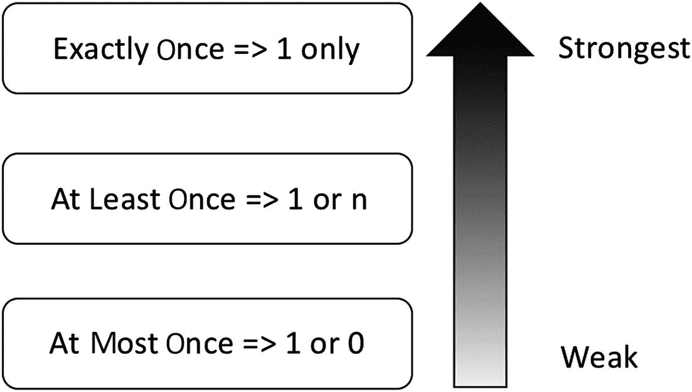

# 数据投递语义

当一条数据进入流处理引擎时，引擎有责任将其投递给流应用程序进行处理。即使在故障场景下，流处理引擎也能提供三种类型的保障。

- **至多一次**：这意味着流处理引擎保证每条数据最多被投递给应用程序一次，但也可能为零次。换句话说，数据存在丢失的可能性，因此应用程序可能完全看不到该数据。对于某些用例来说，这是可以接受的，但对于其他用例则不然。其中一个例子是金融交易处理应用程序。数据丢失可能导致无法向客户收费，从而造成收入减少。

- **至少一次**：这意味着流处理引擎保证每条数据会被投递给应用程序一次或多次。在这种情况下不会丢失数据，但可能出现重复计数或三次计数的情况。以金融交易处理应用程序为例，这意味着同一笔交易会被多次执行，从而引发客户投诉。这种保障比"至多一次"更强，因为不会丢失任何数据。

- **恰好一次**：这意味着流处理引擎保证每条数据仅被投递给应用程序一次，不多也不少。在这种情况下，既不会丢失数据，也不会出现重复计数。大多数现代流行的流处理引擎都提供这种保障。在这三种保障中，这是构建关键业务流应用程序最理想的选择。

看待这些投递语义的一种方式是，它们构成了一个频谱，其中"至多一次"是最弱的保障，"恰好一次"是最强的保障，如图 6-1 所示。

图 6-1

投递语义频谱

在评估流处理引擎时，不仅要理解其提供的保障级别，还要理解该保障背后的实现方式。大多数现代流处理引擎结合使用检查点（check-pointing）和预写日志（write-ahead log）技术来提供"恰好一次"的保障。

