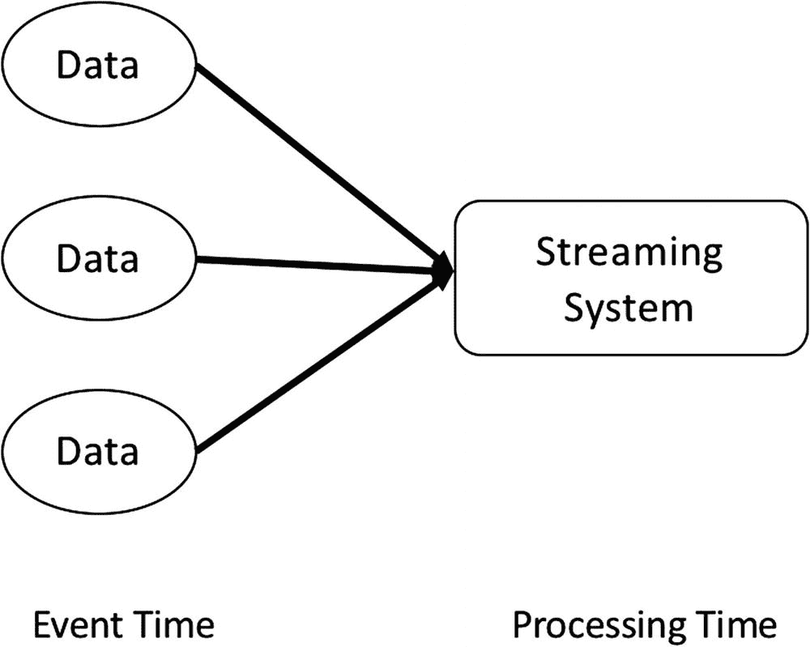
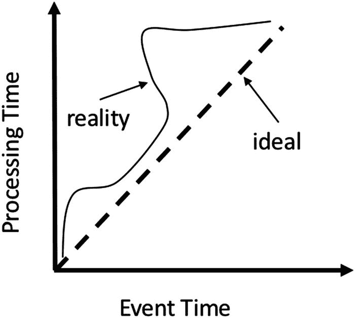
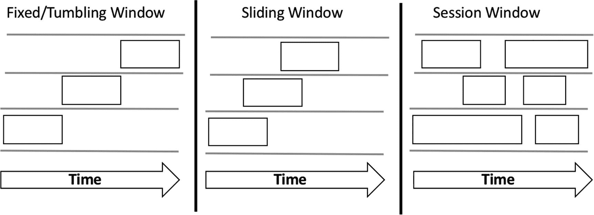
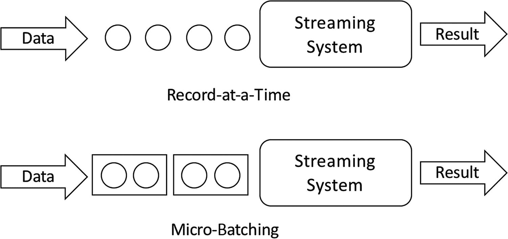

# 时间概念

在流数据处理领域，时间概念非常重要，因为它能让你从时间维度理解正在发生的事情。例如，在实时异常检测应用程序中，时间概念能让你洞察过去五分钟内或一天中某个时段发生的可疑交易数量。

有两种重要的时间类型：`事件时间`和`处理时间`。如图 6-2 所示，`事件时间`代表数据被创建的时间，该信息通常编码在数据中。例如，对于测量世界某处海洋温度的物联网设备，`事件时间`就是温度被测量的时刻。温度数据的编码可能包含温度值本身和一个时间戳。`处理时间`则代表流处理引擎处理一条数据的时间。在海洋温度物联网设备的例子中，`处理时间`就是流处理引擎开始对温度数据执行转换或聚合操作时的时钟时间。

图 6-2

`事件时间`和`处理时间`

要真正理解传入数据流背后的情况，必须能够根据`事件时间`处理传入数据，因为`事件时间`代表了数据被创建的时间点。在理想状态下，数据会在创建后不久到达并被处理，因此`事件时间`和`处理时间`之间的差距很小。但在现实中，情况往往并非如此，因此延迟会根据阻碍数据在创建后立即到达的条件而随时间变化。延迟越大，就越需要能够使用`事件时间`而非`处理时间`来处理数据。图 6-3 说明了`事件时间`和`处理时间`之间的关系，并展示了现实中延迟可能呈现的样子。时间概念与接下来要描述的窗口概念密切相关。为了处理无界的传入数据流，流数据处理领域的一种常见做法是使用开始时间和结束时间作为边界，将传入数据划分为多个数据块。很明显，使用`事件时间`作为时间边界更为合理。

图 6-3

`事件时间`与`处理时间`之间的延迟

## 窗口化

鉴于流式数据的无界特性，对传入的流式数据拥有全局视图是不可行的。因此，为了从传入数据中提取任何有意义的价值，你需要将其分块处理。例如，假设一个交通流量传感器每 20 秒发出一次车辆计数，计算最终总和是不可行的。相反，更合理的做法是询问每分钟或每五分钟有多少辆车经过该传感器。在这种情况下，你需要将交通计数数据分别划分为一分钟或五分钟的块。每个块被称为一个`窗口`。

`窗口化`是一种常见的流式数据处理模式，它将无界的传入数据流根据时间边界划分为块，这些时间边界可以是`事件时间`或`处理时间`，尽管前者更常用于反映数据的实际状况。然而，由于数据可能不会按照其创建顺序到达，或者可能因网络拥塞而延迟，因此不可能始终拥有在该时间窗口内创建的所有数据。

有三种常用的`窗口化`模式，大多数现代流处理引擎都支持它们。图 6-4 展示了这三种模式。

图 6-4：三种常用的`窗口化`模式

`固定/滚动窗口`基本上将传入的数据流划分为固定大小的段，每个段都有一个窗口长度、一个开始时间和一个结束时间。每条传入的数据将被分配到一个且仅一个`固定/滚动窗口`中。有了每个窗口中的这一小批数据，在执行求和、最大值或平均值等聚合操作时就很容易进行推理。

`滑动窗口`是另一种将传入数据流划分为固定大小段的方式，每个段都有一个窗口长度和一个滑动间隔。如果滑动间隔与窗口长度相同，那么它就等同于`固定/滚动窗口`。图 6-4 中的示例显示滑动间隔小于窗口长度。这意味着一条或多条数据将被包含在多个`滑动窗口`中。由于窗口的重叠，聚合结果将比`固定/滚动窗口`更平滑。

`会话窗口`类型通常用于分析用户在网站上的行为。与`固定/滚动窗口`和`滑动窗口`不同，它没有预定的窗口长度。相反，它通常由一个超过某个阈值的不活动间隔来决定。例如，Facebook 上的`会话窗口`长度由用户执行的活动持续时间决定，例如浏览用户动态、发送消息等。

## 流处理引擎概览

开源社区在提出流式数据处理解决方案方面不乏创新。事实上，目前有多种流处理引擎。一些早期的流处理引擎是因需求而生，一些较晚的则源于研究项目，还有一些是从批处理引擎演变而来。本节介绍几个流行的流处理引擎：`Apache Storm`、`Apache Samza`、`Apache Flink`、`Apache Kafka Streams`、`Apache Apex` 和 `Apache Beam`。

`Apache Storm` 是流式数据处理领域的先驱之一，其流行主要与 Twitter 进行的大规模流处理有关。`Apache Storm` 于 2011 年首次发布，并于 2014 年成为 Apache 顶级项目。2015 年，Twitter 放弃了 `Apache Storm`，转而使用 `Heron`，后者是 `Apache Storm` 的下一代产品。`Heron` 比 `Apache Storm` 资源效率更高，吞吐量也更好。

`Apache Samza` 由 LinkedIn 创建，用于帮助解决其流处理需求，并于 2013 年开源。它被设计为与 `Kafka` 紧密协作，并运行在 `Hadoop YARN` 之上，以实现进程隔离、安全性和容错性。`Apache Samza` 被设计用于处理流，这些流由有序、可分区、可重放且容错的不可变消息集组成。

`Apache Flink` 最初是作为名为 Stratosphere: Information Management on the Cloud 的研究项目的一个分支开始的。它于 2015 年成为 Apache 顶级项目，此后作为高吞吐量、低延迟的流引擎稳步获得普及。`Apache Flink` 与 `Apache Storm` 和 `Apache Samza` 的一个关键区别在于，`Apache Flink` 在同一引擎中同时支持批处理和流处理。

`Apache Kafka` 已从分布式发布-订阅消息系统演变为分布式流平台。它由 LinkedIn 创建，并于 2012 年成为 Apache 顶级项目。与其他流处理引擎不同，`Kafka` 的流处理能力被打包成一个轻量级库，这使得编写实时流应用程序变得容易。

`Apache Apex` 是该领域相对较新的成员。它由一家名为 DataTorrent 的公司开发，该公司于 2016 年决定将其开源。`Apache Apex` 被认为是一个统一的流和批处理 `Hadoop YARN` 原生平台。

`Apache Beam` 是一个相当有趣的项目，于 2016 年出自 Google。该项目背后的主要思想是提供一个强大且易于使用的模型，用于流处理和批处理，并且该模型可跨多种运行时平台（如 `Apache Flink`、`Apache Spark` 和 Google Cloud DataFlow）移植。换句话说，可以将 `Apache Beam` 视为大数据的超级 API。

有两种标准的流处理模型，前面提到的每个流处理引擎（`Apache Beam` 除外）都采用其中一种。这两种模型称为`逐条记录`和`微批处理`，如图 6-5 所示。

图 6-5：两种不同的流处理模型

两种模型都有其固有的优缺点。`逐条记录`模型顾名思义；它会在每条输入数据到达时立即处理。因此，该模型提供了尽可能低的延迟。`微批处理`模型会等待并根据可配置的批处理间隔累积一小批输入数据，然后并行处理每个批次。很明显，`微批处理`模型无法提供与另一种模型相同的延迟水平。然而，在吞吐量方面，`微批处理`具有更高的速率，因为一批数据以优化的方式处理，因此与另一种模型相比，每条数据的成本较低。一个有趣的附带说明是，在`逐条记录`模型之上构建`微批处理`模型是相当容易的。

在列出的所有流处理引擎中，只有 `Apache Spark` 采用了`微批处理`模型；不过，已经有一些工作正在进行以支持`逐条记录`模型。