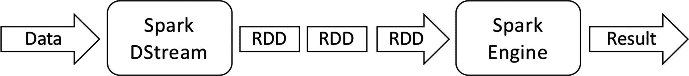
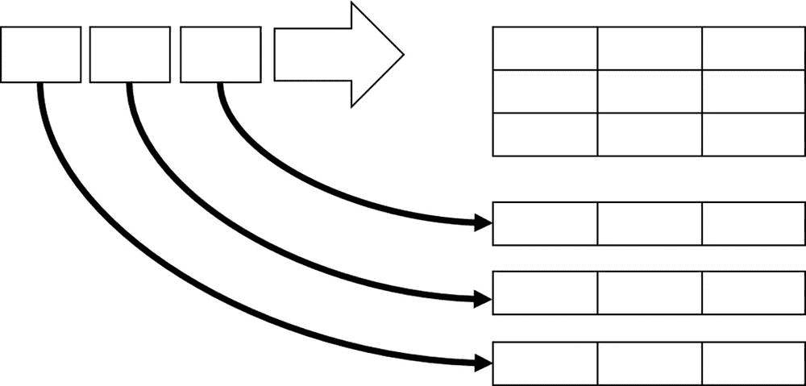
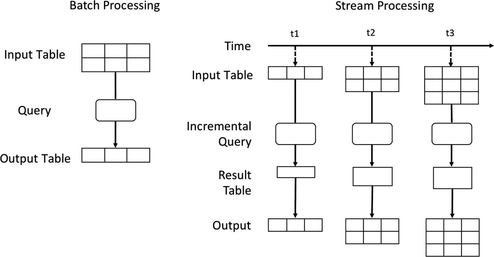
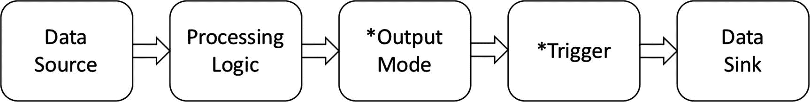

# Spark Streaming 概述

Apache Spark 统一数据处理平台之所以广受欢迎，其中一个因素便是它既能执行批处理，也能执行流处理。

在简要介绍了流处理的复杂性与挑战，以及几个核心概念之后，本章的剩余部分将聚焦于 Spark 流处理主题。首先，我们将对 Spark 第一代流处理引擎（称为 `DStream`）的部分功能进行简要且高层次的了解。然后，本章的大部分内容将详细介绍 Spark 的第二代流处理引擎，即 `Structured Streaming`。新的 Spark 流处理应用程序应基于 `Structured Streaming` 进行开发，以利用其提供的一些独特且高级的功能。

## Spark DStream

Spark 第一代流处理引擎于 2012 年推出，该引擎的主要编程抽象称为*离散化流*，即 `DStream`。其工作原理是采用微批处理模型，将传入的数据流划分为多个批次，然后由 Spark 批处理引擎进行处理。当 `RDD` 是主要的编程抽象模型时，这种方法非常合理。每个批次在内部由一个 `RDD` 表示。一个批次中的数据量是传入数据速率和批次间隔的函数。图 6-6 从高层次展示了 `DStream` 的工作方式。



**图 6-6** Spark DStream

可以从来自 Kafka、AWS Kinesis、文件或套接字等源头的输入数据流创建 `DStream`。创建 `DStream` 时需要的关键信息之一是批次间隔，该间隔可以以秒或毫秒为单位。使用 `DStream`，您可以对传入的数据流应用高级数据处理函数，例如 `map`、`filter`、`reduce` 或 `reduceByKey`。此外，您还可以通过提供窗口长度和滑动间隔，在固定/滚动窗口或滑动窗口上执行归约和计数等窗口操作。需要注意的一点是，窗口长度和滑动间隔必须是批次间隔的倍数。例如，如果批次间隔为三秒，并且使用固定/滚动间隔，则窗口长度和滑动间隔可以是六秒。`DStream` 支持在跨批次数据执行计算时维护任意状态，但这需要手动操作，且有些繁琐。使用 `DStream` 可以做的很酷的事情之一是将其与另一个 `DStream` 或表示静态数据的 `RDD` 进行连接。在所有处理逻辑完成后，您可以使用 `DStream` 将数据写入外部系统，例如数据库、文件系统或 HDFS。

任何新的 Spark 流处理应用程序都应基于第二代 Spark 流处理引擎 `Structured Streaming` 进行开发，这将在下一节中介绍。在本节的剩余部分，您将看到一个小的单词计数 Spark `DStream` 应用程序；目的是让您了解典型的 Spark `DStream` 应用程序是什么样的。清单 6-1 包含了单词计数应用程序的代码，这是 Apache Spark 的一个示例（参见 [`https://bit.ly/2G8N30G`](https://bit.ly/2G8N30G)）。

```
object NetworkWordCount {
def main(args: Array[String]) {
// 创建上下文，批次大小为 1 秒
val sparkConf = new SparkConf().setAppName("NetworkWordCount")
val ssc = new StreamingContext(sparkConf, Seconds(1))
val host = "localhost"
val port = 9999
val lines = ssc.socketTextStream(host, port, StorageLevel.MEMORY_AND_DISK_SER)
val words = lines.flatMap(_.split(" "))
val wordCounts = words.map(x => (x, 1)).reduceByKey(_ + _)
wordCounts.print()
ssc.start()
ssc.awaitTermination()
}
}
```

**清单 6-1** Apache Spark DStream 单词计数应用程序

在构建 `DStream` 应用程序时，有几个重要的步骤。`DStream` 应用程序的入口点是 `StreamingContext`，其中一个必需的输入是批次间隔，它定义了 Spark 用于将传入数据批处理到 `RDD` 中进行处理的时间段。它也代表了 Spark 何时应执行流应用程序计算逻辑的触发点。例如，如果批次间隔为三秒，那么 Spark 会将这三秒间隔内到达的所有数据分批；在该间隔结束后，它会将该批数据转换为 `RDD`，并根据您提供的处理逻辑进行处理。创建 `StreamingContext` 后，下一步是通过定义输入源来创建 `DStream` 实例。前面的示例将输入源定义为读取文本行的套接字。在此之后，您需要为新创建的 `DStream` 提供处理逻辑。前面示例中的处理逻辑并不复杂。一旦在一秒后获得了包含多行文本的 `RDD`，Spark 就会执行将每行拆分为单词、将每个单词转换为单词与计数 1 的元组，最后对相同单词的计数进行求和的逻辑。最后，计数结果会打印在控制台上。请记住，流应用程序是一个长期运行的应用程序；因此，它需要一个信号来启动接收和处理传入数据流的任务。该信号通过调用 `StreamingContext` 的 `start()` 函数发出，这通常放在文件的末尾。`awaitTermination()` 函数用于等待流应用程序的执行停止，同时也作为一种机制，防止驱动程序在流应用程序运行时退出。在典型的程序中，一旦最后一行代码执行完毕，程序就会退出。然而，一个长期运行的流应用程序一旦启动就需要持续运行，并且只有在您明确停止它时才会结束。

## Spark Structured Streaming

`Structured Streaming` 是 Spark 的第二代流处理引擎。它的设计目标是更快、更具可扩展性、更容错，并解决第一代流处理引擎的缺点。它旨在让开发人员能够构建端到端的流处理应用程序，这些应用程序可以使用简单的编程模型实时响应数据，该模型构建在 Spark SQL 引擎经过优化且坚实的基础上。`Structured Streaming` 的一个显著特点是它为工程师提供了一种独特且简单的方式来构建流处理应用程序。

构建生产级流处理应用程序需要克服许多挑战，基于此，`Structured Streaming` 引擎旨在帮助应对这些挑战：

*   处理端到端的可靠性并保证正确性
*   对各种传入数据执行复杂转换
*   基于事件时间处理数据，并轻松处理乱序数据
*   与各种数据源和数据接收器集成

以下各节将介绍 `Structured Streaming` 引擎的各个方面，以及它为应对这些挑战所提供的支持。


### 概述

结构化流有两个关键思想。第一个是将流式计算视为与批处理相同的方式，即将传入的数据流视为一张输入表，当新一批数据到达时，将其视为追加到输入表的一组新行，如图 6-7 所示。



图 6-7

将流式数据视为持续更新的表

另一种理解传入数据流的方式是，它不过是一张持续追加数据的表。这个简单但激进的想法有许多影响。其中之一是能够利用 Scala、Java 或 Python 中现有的 `DataFrame` 和 `Dataset` 结构化 API 来执行流式计算，并由结构化流引擎负责在新流式数据到达时增量且持续地运行它们。图 6-8 直观地比较了在 Spark 中执行批处理和流处理的过程。另一个影响是，前一章讨论的同一个 Catalyst 引擎被用于优化通过结构化 API 表达的流式计算。你从使用结构化 API 中获得的知识可以直接迁移到构建运行在 Spark 结构化流引擎上的流式应用程序。唯一需要额外学习的是流处理领域特有的部分，例如事件时间处理和维护状态。



图 6-8

Spark 中批处理与流处理的比较

第二个关键思想是与存储系统的事务性集成，以提供端到端的精确一次（exactly once）保证。这里的目标是确保从存储系统读取数据的服务应用程序能够看到流式应用程序已处理数据的一致快照。传统上，开发人员有责任确保在将数据从流式应用程序发送到外部存储系统时没有重复数据或数据丢失。这是流式应用程序开发者提出的痛点之一。在内部，结构化流引擎已经提供了精确一次保证，现在，只要外部存储系统支持事务，同样的保证也扩展到了这些系统。

从 Apache Spark 2.3 开始，结构化流引擎的处理模型已扩展为支持一种称为*连续处理*的新模型。之前的处理模型是微批处理模型，这也是默认模型。鉴于微批处理模型的特性，它适用于能够容忍 100 毫秒级别端到端延迟的用例。对于需要低至 1 毫秒端到端延迟的其他用例，则应使用连续处理模型；然而，截至 Apache Spark 2.3，该模型仍处于实验状态，并且在允许的流式计算方面有一些限制。

### 核心概念

本节介绍在构建流式应用程序之前需要理解的一组核心概念。流式应用程序的主要部分包括：指定一个或多个流式数据源，以 `DataFrame` 转换的形式提供处理传入数据流的逻辑，定义输出模式和触发器，最后指定一个数据接收器来写入结果。由于输出模式和触发器都有默认值，如果它们的默认值满足你的用例，则它们是可选的。图 6-9 概述了前面提到的步骤。可选步骤用星号标记。



图 6-9

结构化流应用程序的核心组成部分

以下各节将详细描述这些概念中的每一个。

#### 数据源

让我们从数据源开始。对于批处理，数据源是驻留在某个存储系统（如本地文件系统、HDFS 或 S3）上的静态数据集。结构化流中的数据源则完全不同。它们产生的数据是连续的，可能永远不会结束，并且产生速率会随时间变化。结构化流提供了以下开箱即用的数据源：

*   *Kafka 数据源*：需要 Apache Kafka 0.10 或更高版本。这是生产环境中最流行的数据源。使用此数据源需要基本了解 Kafka 的工作原理。连接和读取 Kafka 主题的数据需要提供一组特定的设置。更多详细信息，请参阅 Spark 网站上的 Kafka 集成指南。

*   *文件数据源*：文件位于本地文件系统、HDFS 或 S3 上。当新文件被放入目录时，此数据源会拾取它们进行处理。支持常用的文件格式，例如文本、CSV、JSON、ORC 和 Parquet。有关支持的文件格式的最新列表，请参阅 `DataStreamReader` 接口。使用此数据源时的一个良好实践是，先将输入文件完整写入，然后再将它们移动到该数据源的路径中。

*   *Socket 数据源*：仅用于测试目的。它从监听特定主机和端口的套接字读取 UTF-8 数据。

*   *Rate 数据源*：仅用于测试和基准测试目的。此数据源可以配置为每秒生成一定数量的事件，每个事件包含一个时间戳和一个单调递增的值。这是学习结构化流时最容易使用的数据源。

数据源需要为结构化流提供的一个关键属性是能够跟踪流中的读取位置，以便实现端到端的精确一次保证。例如，Kafka 数据源提供 Kafka 偏移量来跟踪主题分区的读取位置。此属性决定了特定数据源是否具有容错能力。表 6-1 描述了每个开箱即用数据源的一些选项。

表 6-1

开箱即用的数据源

| 名称 | 容错 | 配置 |
| --- | --- | --- |
| 文件 | 是 | `path`：输入目录的路径`maxFilesPerTrigger`：每个触发器读取的最大新文件数`latestFirst`：是否优先处理最新文件（按修改时间） |
| Socket | 否 | 需要以下配置：`host`：要连接的主机`port`：要连接的端口 |
| Rate | 是 | `rowsPerSecond`：每秒生成的行数`rampUpTime`：达到 `rowsPerSecond` 之前的启动时间（秒）`numPartitions`：分区数 |
| Kafka | 是 | `kafka.bootstrap.servers`：Kafka 代理的 `host:port` 逗号分隔列表`subscribe`：主题的逗号分隔列表更多详细信息，请参阅 Spark 网站上的 Kafka 集成指南（`https://spark.apache.org/docs/latest/structured-streaming-kafka-integration.html`）。 |

Apache Spark 2.3 引入了 DataSource V2 API，这是一组官方支持的接口，供 Spark 开发者开发能够轻松与结构化流集成的自定义数据源。借助这套定义明确的 API，自定义结构化流数据源的数量将在不久的将来大幅增加。


### 输出模式

输出模式用于告知 Structured Streaming 如何将输出数据写入接收器。这一概念是 Spark 流式处理所独有的，共有三种选项。

- **追加模式**：若未指定输出模式，此为默认模式。在此模式下，仅结果表中新增的行会被发送至指定的输出接收器。
- **完整模式**：整个结果表都会被写入输出接收器。
- **更新模式**：仅结果表中被更新的行会被写入输出接收器。未发生变化的行则不会被写出。

输出模式是一个需要花些时间才能适应的概念，因为它涉及多个维度。面对这三种选项，人们自然会好奇在何种情况下应使用某一种输出模式而非其他模式。当你通过几个示例进行实践后，这一概念会变得更加清晰。

### 触发器类型

触发器是另一个需要理解的重要概念。Structured Streaming 引擎利用触发器信息来决定何时运行流式应用程序中提供的流式计算逻辑。表 6-2 描述了不同的触发器类型。

**表 6-2** 触发器类型

| 类型 | 描述 |
| --- | --- |
| 未指定（默认） | 对于此默认类型，Spark 将使用微批处理模式，并在上一批数据处理完成后立即处理下一批数据。 |
| 固定间隔 | 对于此类型，Spark 将使用微批处理模式，并根据用户提供的间隔时间处理数据批次。如果由于某种原因，上一批数据的处理时间超过了间隔时间，则下一批数据会在上一批处理完成后立即开始处理。换句话说，Spark 不会等待下一个间隔边界。 |
| 一次性 | 此触发器类型用于对当前可用的数据批次进行一次性处理，处理完成后 Spark 会立即停止流式应用程序。当数据量极低时，此触发器类型非常有用，因为每天仅启动集群处理几次数据更具成本效益。 |
| 连续 | 此触发器类型调用新的连续处理模式，该模式专为需要极低延迟的某些流式应用程序而设计。这是 Spark 2.3 中新增的实验性处理模式。 |

### 数据接收器

数据接收器与数据源相对，用于存储流式应用程序的输出。重要的是要了解哪些接收器支持哪种输出模式，以及它们是否具备容错能力。下文简要描述了每种接收器，表 6-3 则概述了每种接收器的各种选项。

**表 6-3** 开箱即用的数据接收器

| 名称 | 支持的输出模式 | 容错 | 配置 |
| --- | --- | --- | --- |
| 文件 | 追加 | 是 | `path`：输入目录的路径。支持所有常见的文件格式。更多详情请参阅 `DataFrameWriter`。 |
| Foreach | 追加、更新、完整 | 取决于实现 | 这是一个非常灵活的接收器，其实现方式特定。请参阅下文详情。 |
| 控制台 | 追加、更新、完整 | 否 | `numRows`：每次触发器打印的行数。默认值为 20 行。`truncate`：指定当每行过长时是否截断。默认值为 true。 |
| 内存 | 追加、完整 | 否 | 无 |
| Kafka | 追加、更新、完整 | 是 | `kafka.bootstrap.servers`：Kafka 代理的 `host:port` 逗号分隔列表。`topic`：要写入数据的 Kafka 主题。更多详情请参阅 Spark 网站上的 Kafka 集成指南（`https://spark.apache.org/docs/latest/structured-streaming-kafka-integration.html`）。 |

- **Kafka 接收器**：需要 Apache Kafka 0.10 或更高版本。连接 Kafka 集群需要一组特定的设置。更多详情请参阅 Spark 网站上的 Kafka 集成指南。
- **文件接收器**：这是文件系统、HDFS 或 S3 上的目标位置。支持常用的文件格式，如文本、CSV、JSON、ORC 和 Parquet。有关支持的文件格式的最新列表，请参阅 `DataStreamReader` 接口。
- **Foreach 接收器**：用于对输出中的行执行任意计算。
- **控制台接收器**：仅用于测试和调试目的，且适用于低数据量场景。每次触发器时，输出会打印到控制台。
- **内存接收器**：仅用于处理低数据量时的测试和调试目的。它使用驱动程序的内存来存储输出。

为了使 Structured Streaming 能够提供端到端的精确一次保证，数据接收器必须支持的一个重要属性是幂等性，以处理重新处理的情况。换句话说，它必须能够处理对相同数据的多次写入（发生在不同时间），使得最终结果与仅写入一次相同。多次写入是故障场景下重新处理数据的结果。

为了帮助巩固对上述核心概念的理解，下一节将提供示例，展示在 Spark 中构建 Structured Streaming 应用程序时，各个部分如何协同工作。

### 水印

**水印**是流式处理引擎中常用的一种技术，用于处理那些比大约同时创建的其他数据晚到很多的数据。当流式计算逻辑需要维护某种状态时，延迟数据会给流式处理引擎带来挑战。例如，当存在聚合或连接操作时就会出现这种情况。流式应用程序开发者可以指定一个阈值，告知 Structured Streaming 引擎数据在事件时间上预计会延迟多久。有了这些信息，Structured Streaming 引擎可以决定是处理还是丢弃某条延迟数据。更重要的是，Structured Streaming 使用指定的阈值来决定何时可以丢弃旧状态。如果没有这些信息，Structured Streaming 将需要无限期地维护所有状态，这会导致流式应用程序出现内存不足的问题。任何执行某种聚合或连接操作的生产级 Structured Streaming 应用程序都需要指定水印。这是一个重要的概念，后续章节将对此主题进行更详细的讨论和说明。


### 注意

Apache Kafka 已成为大数据领域中最受欢迎的开源技术之一。它在大数据平台的架构中扮演着关键角色，充当着各种数据生产者和消费者之间的粘合剂。从高层来看，Kafka 是一个分布式、容错的发布-订阅消息系统，用于摄取实时数据流。Kafka 中的数据单元被称为*消息*。消息被组织成主题（topic），主题又被分割成多个分区（partition），以便能够并行消费消息。每个分区的消息都存储在一个结构类似于提交日志的文件中。每个分区的数据文件包含一个有序的、不可变的消息序列。每条消息都会被分配一个顺序 ID，通常被称为*偏移量*。当新消息到达一个分区时，它们会被简单地追加到分区文件的末尾。这一关键设计点使得 Kafka 能够处理高摄取率。每个分区都可以复制到多个副本。这种仅追加式的消息写入方式以及分区复制，是 Kafka 提供冗余和可扩展性的关键因素。每个主题都有一个基于大小或时间的保留期配置，超过保留期的消息会被标记为删除。有关 Kafka 的更多详细信息，请访问[`https://kafka.apache.org/documentation/`](https://kafka.apache.org/documentation/)。

### 结构化流应用程序

本节将通过一个 Spark 结构化流示例应用程序，来了解如何将上述概念映射到代码中。以下示例是关于处理来自文件数据源的一小组移动操作事件。每个事件包含三个字段：

*   *id*：表示手机的唯一 ID。在提供的示例数据集中，手机 ID 类似于`phone1`、`phone2`、`phone3`等。
*   *action*：表示用户执行的操作。操作的可能值为`open`和`close`。
*   *ts*：表示用户执行操作时的时间戳。这是事件时间。

移动事件数据被分割成三个 JSON 文件，它们位于`chapter6/data/mobile`目录中。为了模拟数据流行为，这些 JSON 文件将按特定顺序复制到输入文件夹中，然后检查输出以验证你的理解。

让我们通过使用 DataFrame 读取数据来探索移动事件数据。参见清单 6-2。

```
val mobileDataDF = spark.read.json("/chapter6/data/mobile")
mobileDataDF.printSchema
|-- action: string (nullable = true)
|-- id: string (nullable = true)
|-- ts: string (nullable = true)
file1.json
{"id":"phone1","action":"open","ts":"2018-03-02T10:02:33"}
{"id":"phone2","action":"open","ts":"2018-03-02T10:03:35"}
{"id":"phone3","action":"open","ts":"2018-03-02T10:03:50"}
{"id":"phone1","action":"close","ts":"2018-03-02T10:04:35"}
file2.json
{"id":"phone3","action":"close","ts":"2018-03-02T10:07:35"}
{"id":"phone4","action":"open","ts":"2018-03-02T10:07:50"}
file3.json
{"id":"phone2","action":"close","ts":"2018-03-02T10:04:50"}
{"id":"phone5","action":"open","ts":"2018-03-02T10:10:50"}
清单 6-2
读取移动数据并打印其模式
```

默认情况下，结构化流在从基于文件的数据源读取数据时需要指定模式。这是合理的，因为最初目录可能为空，因此结构化流无法推断模式。但是，如果你确实希望它推断模式，可以将配置`spark.sql.streaming.schemaInference`设置为 true。在本示例中，你将显式创建一个模式。清单 6-3 包含一段用于创建移动事件数据模式的代码。

```
import org.apache.spark.sql.types._
import org.apache.spark.sql.functions._
val mobileDataSchema = new StructType().add("id", StringType, false)
.add("action", StringType, false)
.add("ts", TimestampType, false)
清单 6-3
为移动事件数据创建模式
```

让我们从一个处理移动事件数据的简单用例开始。目标是使用一个固定窗口（窗口长度为十秒）来生成每种操作类型的计数。清单 6-4 中的三行代码将有助于实现这一目标。第一行代码演示了如何使用基于文件的数据源，通过`DataStreamReader`从目录读取数据。预期的数据格式是 JSON，模式已在清单 6-3 中定义。返回的对象是一个 DataFrame，你在第 4 章中已经熟悉了它。然而，这个 DataFrame 是一个流式 DataFrame，因此当调用`isStreaming`函数时，返回值应为 true。这个简单应用程序中的流式计算逻辑在第二行代码中表达，它使用`action`列和基于`ts`列的固定窗口执行分组转换。敏锐的读者可能已经注意到了这一点，但为了强调事件时间这一点，分组转换中的固定窗口是基于移动事件数据中嵌入的时间戳的。第三行代码非常重要，因为它定义了输出模式和数据接收器，最重要的是，它告诉结构化流引擎开始增量地运行我们在第二行代码中表达的流式计算逻辑。更详细地说，第三行代码使用`actionCountDF` DataFrame 的`DataFrameWriter`实例来指定控制台作为数据接收器，这意味着输出将被打印到控制台供你检查。然后它将输出模式定义为“complete”，以便你可以看到结果表中的所有记录。最后，它调用`DataStreamWriter`的`start()`函数来启动执行，这意味着基于文件的数据源将开始处理放入`/<path>/chapter6/data/input`目录的文件。另一个需要注意的重要事项是，`start`函数将返回一个`StreamingQuery`类的实例，该实例代表一个查询的句柄，该查询在新数据到达时会在后台持续执行。你可以使用`mobileConsoleSQ`流式查询来检查流式应用程序中计算的状态和进度。

在输入清单 6-4 中的三行代码之前，请确保输入文件夹为空。

```
val mobileSSDF = spark.readStream.schema(mobileDataSchema).json("//chapter6/data/input")
mobileSSDF.isStreaming
val actionCountDF = mobileSSDF.groupBy(window($"ts", "10 minutes"), $"action").count
val mobileConsoleSQ = actionCountDF.writeStream
.format("console").option("truncate", "false")
.outputMode("complete")
.start()
清单 6-4
在十秒滑动窗口中生成每种操作类型的计数
```

要开始在控制台中看到如清单 6-5 所示的输出，请将`file1.json`从`chapter6/data/mobile`目录复制到`chapter6/data/input`目录。控制台中应显示以下输出。输出告诉你只有一个从 10:00 到 10:10 的窗口，并且在这个窗口中有一个关闭操作和三个打开操作，这与`files1.json`中的四行事件相匹配。现在对`file2.json`文件重复相同的过程，输出应与清单 6-6 匹配。数据文件`file2.json`包含一个打开操作事件和另一个关闭操作事件，并且两者都落入与之前相同的窗口。因此，对于该操作类型，计数分别更新为两个关闭操作和四个打开操作。

```
Batch: 0
```


+-------------------------------------------+-------+------+
|                                     window| action| count|
+-------------------------------------------+-------+------+
| [2018-03-02 10:00:00, 2018-03-02 10:10:00]|  close|     1|
| [2018-03-02 10:00:00, 2018-03-02 10:10:00]|   open|     3|
+-------------------------------------------+-------+------+
清单 6-5
处理 `file1.json` 的输出

```
Batch: 1

+------------------------------------------+-------+------+
|                                    window| action| count|
+------------------------------------------+-------+------+
|[2018-03-02 10:00:00, 2018-03-02 10:10:00]|  close|     2|
|[2018-03-02 10:00:00, 2018-03-02 10:10:00]|   open|     4|
+------------------------------------------+-------+------+
清单 6-6
处理 `file2.json` 的输出
```

此时，让我们调用查询流 `mobileConsoleSQ`（`StreamingQuery` 类的一个实例）的几个函数来检查状态和进度。`status()` 函数会告诉你查询流当前状态正在发生什么，可以是等待模式，也可以是正在处理当前批次事件。`lastProgress()` 函数提供了一些关于上一批次事件处理的指标，包括处理速率、延迟等。清单 6-7 包含了这两个函数的示例输出。

```
scala> mobileConsoleSQ.status
res14: org.apache.spark.sql.streaming.StreamingQueryStatus =
{
"message" : "Waiting for data to arrive",
"isDataAvailable" : false,
"isTriggerActive" : false
}
scala> mobileConsoleSQ.lastProgress
res17: org.apache.spark.sql.streaming.StreamingQueryProgress =
{
"id" : "2200bc3f-077c-4f6f-af54-8043f50f719c",
"runId" : "0ed4894c-1c76-4072-8252-264fe98cb856",
"name" : null,
"timestamp" : "2018-03-18T18:18:12.877Z",
"batchId" : 2,
"numInputRows" : 0,
"inputRowsPerSecond" : 0.0,
"processedRowsPerSecond" : 0.0,
"durationMs" : {
"getOffset" : 1,
"triggerExecution" : 1
},
"stateOperators" : [ {
"numRowsTotal" : 2,
"numRowsUpdated" : 0,
"memoryUsedBytes" : 17927
} ],
"sources" : [ {
"description" : "FileStreamSource[file:/chapter6/data/input]",
"startOffset" : {
"logOffset" : 1
},
"endOffset" : {
"logOffset" : 1
},
"numInputRows" : 0,
"inputRowsPerSecond" : 0.0,...
清单 6-7
调用 `status()` 和 `lastProgress()` 函数的输出
```

让我们完成移动事件数据最后一个文件的处理。它与 `file2.json` 相同。将 `file3.json` 复制到输入目录，输出应类似于清单 6-8。文件 `file3.json` 包含一个属于第一个窗口的关闭操作和一个落入 10:10 到 10:20 新窗口的打开操作。总共有八个操作。其中七个落入第一个窗口，一个操作落入第二个窗口。

```
Batch: 2

+------------------------------------------+-------+------+
|                                    window| action| count|
+------------------------------------------+-------+------+
|[2018-03-02 10:00:00, 2018-03-02 10:10:00]|  close|     3|
|[2018-03-02 10:00:00, 2018-03-02 10:10:00]|   open|     4|
|[2018-03-02 10:10:00, 2018-03-02 10:20:00]|   open|     1|
+------------------------------------------+-------+------+
清单 6-8
处理 `file3.json` 的输出
```

对于生产环境且长时间运行的流式应用程序，有必要调用 `StreamingQuery.awaitTermination()` 函数，这是一个阻塞调用，用于防止驱动程序进程退出，并让流式查询持续运行，处理数据源中新到达的数据。

在学习并尝试 Structured Streaming 时，有时你可能希望停止流式查询以更改输出模式、触发器或其他配置。你可以使用 `StreamingQuery.stop()` 函数来阻止数据源接收新数据，并停止流式查询中逻辑的持续执行。有关管理流式查询的示例，请参见清单 6-9。

```
// 这是一个阻塞调用
mobileSQ.awaitTermination()
// 停止一个流式查询
mobileSQ.stop
// 另一种停止 Spark 应用程序中所有流式查询的方法
for(qs <- spark.streams.active) {
println(s"停止流式查询: ${qs.name} - 活跃状态: ${qs.isActive}")
if (qs.isActive) {
qs.stop
}
}
清单 6-9
管理流式查询
```

### 流式 DataFrame 操作

前面的示例表明，一旦配置并定义了数据源，`DataStreamReader` 将返回一个 DataFrame 实例，这与你在第 4 章和第 5 章中熟悉的 DataFrame 类是同一个。这意味着你可以使用大多数熟悉的操作和 Spark SQL 函数来表达你的应用程序流式计算逻辑。然而，需要注意的是，并非 DataFrame 中的所有操作都支持流式 DataFrame。这是因为其中一些操作在流式数据处理上下文中不适用。此类操作的示例包括 `limit`、`distinct` 和 `sort`。

#### 选择、投影和聚合操作

Structured Streaming 的一个卖点是 Spark 中为批处理和流处理提供了一套统一的 API。对于流式 DataFrame，可以对其应用任何 `select` 和 `filter` 转换，以及任何对单个列进行操作的 Spark SQL 函数。此外，第 5 章中介绍的基本聚合和高级分析函数也可用于流式 DataFrame。为了完成两种 DataFrame 类型（静态和流式）的相似性比较，流式 DataFrame 可以注册为临时视图，然后对其应用 SQL 查询。清单 6-10 提供了一个示例，展示了如何在清单 6-4 中的 `mobileSSDF` DataFrame 上使用过滤和应用 Spark SQL 函数。

```
import org.apache.spark.sql.functions._
val cleanMobileSSDF = mobileSSDF.filter($"action" === "open" || $"action" === "close")
.select($"id", upper($"action"), $"ts")
// 创建一个视图以应用 SQL 查询
cleanMobileSSDF.createOrReplaceTempView("clean_mobile")
spark.sql("select count(*) from clean_mobile")
清单 6-10
在流式 DataFrame 上应用过滤和 Spark SQL 函数
```

需要注意的是，以下 DataFrame 转换在流式 DataFrame 中尚不支持，要么是因为它们维护状态过于复杂，要么是因为流式数据的无界性质。

*   对流式 DataFrame 进行多重聚合或聚合链。

*   `Limit` 和取前 N 行。

*   `Distinct` 转换。但是，有一种方法可以使用唯一标识符对数据进行去重。

*   在没有聚合的情况下对流式 DataFrame 进行排序。但是，在某种形式的聚合之后支持排序。

任何尝试使用不受支持的操作都将导致 `AnalysisException` 异常，并显示类似“操作 XYZ 不受流式 DataFrames/Datasets 支持”的消息。


