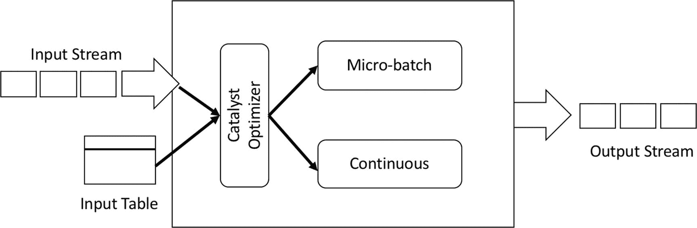

# Kafka 数据源模式

Kafka 数据源的一个独特之处在于，它返回的流式 `DataFrame` 具有固定的模式，如清单 6-19 所示。`value` 列包含 Kafka 中每条消息的实际内容，列类型为二进制。Kafka 并不关心每条消息的具体内容，因此将其视为二进制数据块。模式中的其余列包含每条消息的元数据。如果消息在发送到 Kafka 时已采用某种二进制格式序列化，那么你需要一种方法，在 Spark 处理这些消息之前，使用 Spark SQL 函数或 UDF 对其进行反序列化。在以下示例中，内容是字符串，因此你只需将其转换为 `String` 类型。出于演示目的，清单 6-20 对 `value` 列进行了类型转换，并选择了一些与元数据相关的列进行显示。

```scala
val pvValueDF = pvDF.selectExpr("partition","offset","CAST(key AS STRING)", "CAST(value AS STRING)")
.as[(String, Long, String, String)]
```

清单 6-20 将消息内容转换为字符串类型。

清单 6-21 中的示例包含了几种指定 Kafka 主题、分区和偏移量以从 Kafka 读取消息的变体。

```scala
// 从多个主题读取，使用默认的 startingOffsets 和 endingOffsets
val kafkaDF = spark.readStream.format("kafka")
.option("kafka.bootstrap.servers","server1:9092,server2:9092")
.option("subscribe", "topic1,topic2")
.load()

// 使用 subscribePattern 从多个主题读取
val kafkaDF = spark.readStream.format("kafka")
.option("kafka.bootstrap.servers","server1:9092,server2:9092")
.option("subscribePattern", "topic*").load()

// 使用 JSON 格式从分区的特定偏移量读取
// Scala 中的三重引号格式用于转义 JSON 字符串中的双引号
Val kafkaDF = spark.readStream.format("kafka")
.option("kafka.bootstrap.servers","localhost:9092")
.option("subscribe", "topic1,topic2")
.option("startingOffsets", """ {"topic1": {"0":51} } """)
.load()
```

清单 6-21 指定 Kafka 主题、分区和偏移量的各种示例。

## 使用自定义数据源

在 Spark 2.3 之前，数据源 API 存在局限性且扩展性不强。因此，对于 Spark 开发者来说，构建自定义数据源颇具挑战性。从 Spark 2.3 开始，引入了数据源 V2 API，以解决 V1 中的问题，并提供一套清晰、可扩展且易于使用的新 API。数据源 V2 API 仅在 Scala 中可用。

本节旨在快速概述使用数据源 V2 API 构建自定义数据源所涉及的接口和主要 API。一些值得参考的优秀示例是内置数据源的实现，例如 `RateSourceProvider.scala`、`RateSourceProviderV2.scala` 和 `KafkaSourceProvider.scala` 类。

所有自定义数据源都必须实现一个名为 `DataSourceV2` 的标记接口，然后可以选择实现 `ContinuousReadSupport` 或 `MicroBatchReadSupport` 接口，或两者都实现。例如，`KafkaSourceProvider.scala` 实现了这两个接口，因为它允许用户根据用例选择使用哪种处理模式。这两个接口各自都有一个工厂方法，分别用于创建 `ContinuousReader` 或 `MicroBatchReader` 的实例。自定义数据源实现的大部分工作将在于实现这两个接口中定义的 API。

我实现了一个有趣且非容错的数据源，用于从 Wikipedia IRC 服务器读取维基编辑内容。使用 Spark Structured Streaming 分析各种 Wikipedia 站点的维基编辑内容相当容易。有关更多详细信息，请参阅 GitHub 仓库中的 `README.md` 文件（[`https://github.com/beginning-spark/book/tree/master/chapter6/custom-data-source`](https://github.com/beginning-spark/book/tree/master/chapter6/custom-data-source)）。要在 Spark shell 中使用此自定义数据源，第一步是从上述 GitHub 仓库下载 `streaming_sources-assembly-0.0.1.jar` JAR 文件。清单 6-22 描述了其余步骤。

```scala
// 启动 spark-shell 并加载 streaming_sources-assembly-0.0.1.jar
bin/spark-shell --jars /streaming_sources-assembly-0.0.1.jar

// 一旦 spark-shell 成功启动
// 定义数据源提供者名称
val provideClassName = "org.structured_streaming_sources.wikedit.WikiEditSourceV2"
// 使用自定义数据源并订阅英文 Wikipedia 编辑频道
val wikiEditDF = spark.readStream.format(provideClassName).option("channel", "#en.wikipedia").load()
// 检查 wikiEditDF 流式 DataFrame 的模式
wikiEditDF.printSchema
|-- timestamp: timestamp (nullable = true)
|-- channel: string (nullable = true)
|-- title: string (nullable = true)
|-- diffUrl: string (nullable = true)
|-- user: string (nullable = true)
|-- byteDiff: integer (nullable = true)
|-- summary: string (nullable = true)

// 仅选择几列进行分析
val wikiEditSmallDF = wikiEditDF.select("timestamp", "user", "channel", "title")
// 启动流式查询并将维基编辑内容输出到控制台
val wikiEditQS = wikiEditSmallDF.writeStream.format("console").option("truncate", "false").start()
// 等待几秒钟让数据流入，结果可能如下所示
+-----------------------+------------+--------------+-------------------------+
|          timestamp|            user|       channel|                    title|
+-----------------------+------------+--------------+-------------------------+
| 2018-03-24 15:36:39.409| 6.62.103.211| #en.wikipedia|       Thomas J.R. Hughes|
| 2018-03-24 15:36:39.412| .92.206.108| #en.wikipedia|List of international schools|
+-----------------------+------------+--------------+-------------------------+

// 停止查询流
wikiEditQS.stop
```

清单 6-22 使用自定义数据源分析维基编辑内容。

请注意，自定义数据源名称是数据源提供者的完全限定类名。它不像内置数据源那样简短，因为内置数据源已在名为 `org.apache.spark.sql.sources.DataSourceRegister` 的文件中注册了它们的短名称。

## 使用数据接收器

流式应用程序的最后一步通常涉及将计算结果写入某个外部系统或存储系统。Structured Streaming 提供了五个内置接收器。其中三个用于生产环境，另外两个用于测试目的。以下各节将详细介绍每个接收器，并提供使用它们的示例代码。

### 使用文件数据接收器

`File` 数据接收器是一个相当直观易懂且易于使用的数据接收器。你唯一需要提供的必要选项是输出目录。由于 `File` 数据接收器具有容错性，Structured Streaming 需要一个检查点位置来写入进度信息和其他元数据，以便在发生故障时帮助恢复。

清单 6-23 中的示例配置了 `Rate` 数据源，使其每秒生成十行数据，将生成的行发送到两个分区，并以 JSON 格式将数据写入指定目录。

```scala
val rateSourceDF = spark.readStream.format("rate")
.option("rowsPerSecond","10")
.option("numPartitions","2")
.load()
val rateSQ = rateSourceDF.writeStream.outputMode("append")
.format("json")
.option("path", "/tmp/output")
.option("checkpointLocation", "/tmp/ss/cp")
.start()
// 使用下面这行代码停止写入数据
rateSQ.stop
```

清单 6-23 将数据从 Rate 数据源写入文件接收器。

由于分区数配置为两个，每次 Structured Streaming 在触发点写入数据时，输出文件夹中都会写入两个文件。因此，如果你检查输出文件夹，会看到文件名以 `part-00000` 或 `part-00001` 开头的文件。`Rate` 数据源配置为每秒十行，并且有两个分区；因此，每个输出包含五行，如清单 6-24 所示。

```
{"timestamp":"2018-03-24T17:42:08.182-07:00","value":205}
{"timestamp":"2018-03-24T17:42:08.282-07:00","value":206}
{"timestamp":"2018-03-24T17:42:08.382-07:00","value":207}
{"timestamp":"2018-03-24T17:42:08.482-07:00","value":208}
{"timestamp":"2018-03-24T17:42:08.582-07:00","value":209}
```

清单 6-24 每个输出文件的内容。

### 使用 Kafka 数据接收器

在 Structured Streaming 中，将流式 `DataFrame` 的数据写入 `Kafka` 数据接收器比从 `Kafka` 数据源读取数据要简单一些。`Kafka` 数据接收器可以通过表 6-7 中列出的四个选项进行配置。其中三个选项是必需的。需要理解的重要选项是键和值，它们与 Kafka 消息的结构相关。如前所述，Kafka 中的数据单元是消息，本质上是一个键值对。值的作用相当明显，即保存消息的实际内容，它对 Kafka 来说没有意义。就 Kafka 而言，值只是一堆字节。然而，键被 Kafka 视为元数据的一部分，它与值一起保存在 Kafka 消息中。当消息发送到 Kafka 并提供了键时，Kafka 会利用它作为路由机制，通过对键进行哈希运算，并对主题的分区数取模，来确定特定 Kafka 消息应发送到哪个分区。这意味着所有具有相同键的消息将被路由到同一个分区。如果消息中没有提供键，那么 Kafka 无法保证该消息发送到哪个分区，并且 Kafka 会采用轮询算法来平衡各分区之间的消息。

**表 6-7** Kafka 数据接收器的选项

| 选项 | 值 | 描述 |
| --- | --- | --- |
| `kafka.bootstrap.servers` | `host1:port1`, `host2:port2` | 这是一个以逗号分隔的 Kafka 代理服务器列表。请咨询你的 Kafka 管理员以获取要使用的主机名和端口号。 |
| `topic` | `topic1` | 这是一个单一的主题名称。 |
| `key` | 字符串或二进制 | 此键用于确定 Kafka 消息应发送到哪个分区。所有具有相同键的 Kafka 消息将进入同一个分区。这是一个可选选项。 |
| `value` | 字符串或二进制 | 这是消息的内容。对 Kafka 来说，它仅仅是一个字节数组，对 Kafka 没有意义。 |

有两种提供主题名称的方法。第一种方法是在设置 `Kafka` 数据接收器时在配置中提供主题名称，第二种方法是在流式 `DataFrame` 中定义一个名为 `topic` 的列；该列的值将用作主题名称。

如果流式 `DataFrame` 中存在名为 `key` 的列，则该列的值将用作消息键。由于键是可选的元数据，因此流式 `DataFrame` 中并非绝对需要包含此列。另一方面，必须提供值，并且 `Kafka` 数据接收器期望流式 `DataFrame` 中有一个名为 `value` 的列。

清单 6-25 提供了一个设置 `Rate` 数据源，然后将数据写入名为 `rates` 的 Kafka 主题的示例。如果你打算使用 Spark shell 尝试以下代码，请确保按照前面所述，使用适当的参数启动 Spark shell，以包含 `org.apache.spark:spark-sql-kafka-0-10_2.11:2.3.0` JAR 文件及其依赖项。

### 注意

开始使用 Kafka 的最简单方法是下载 Confluent Platform 包，然后按照入门指南进行操作。更多信息请访问 [https://docs.confluent.io/current/getting-started.html](https://docs.confluent.io/current/getting-started.html)。下载完成后，将压缩的 TAR 文件解压到一个目录中。要启动服务器（Zookeeper、Kafka Broker、Schema Registry），请使用命令行 `./bin/confluent start`。每个服务器都监听在特定的端口上。所有命令行工具都位于 `bin` 目录中，并且几乎所有这些工具都需要 Zookeeper 或 Kafka Broker 的主机和端口。在运行清单 6-25 中的代码之前，请确保创建一个名为 `rates` 的主题。执行此操作的命令如下：`bin/kafka-topics --create --zookeeper localhost:2181 --replication-factor 1 --partitions 2 --topic rates`。要列出活动主题的列表，请使用此命令：`./bin/kafka-topics --zookeeper localhost:2181 --list`。

```scala
import org.apache.spark.sql.functions._
// 设置每秒 10 行的速率数据源，并使用两个分区
val ratesSinkDF = spark.readStream.format("rate")
.option("rowsPerSecond","10")
.option("numPartitions","2").load()
// 转换 ratesSinkDF 以创建名为 "key" 和 "value" 的列
// value 列包含一个 JSON 字符串，该字符串包含两个字段：timestamp 和 value
val ratesSinkForKafkaDF = ratesSinkDF.select($"value".cast("string") as "key",
to_json(struct("timestamp","value")) as "value")
// 设置一个流式查询，使用主题 "rates" 将数据写入 Kafka
val rateSinkSQ = ratesSinkForKafkaDF.writeStream
.outputMode("append")
.format("kafka")
.option("kafka.bootstrap.servers","localhost:9092")
.option("topic","rates")
.option("checkpointLocation", "/Users/hluu/tmp/ss/cp")
.start()
// 向 Kafka 写入大量消息不需要很长时间，因此几秒钟后，可以随时停止
// rateSinkSQL
rateSinkSQ.stop
```

**清单 6-25** 将数据从速率数据源写入文件接收器

要从 Kafka 中的 `rates` 主题读取数据，请使用清单 6-21 中列出的示例代码，并为 `kafka.bootstrap.servers` 和主题名称等选项替换适当的值。从 Kafka 的 `rates` 主题返回的数据将类似于清单 6-26。

```
+---------+-------+-------+-------------------------------------------------------------+
|partition| offset|    key|                                                        value|
+---------+-------+-------+-------------------------------------------------------------+
|        1|   9350| 583249| {"timestamp":"2018-03-25T09:53:52.582-07:00","value":583249}|
|        1|   9351| 583250| {"timestamp":"2018-03-25T09:53:52.682-07:00","value":583250}|
|        1|   9352| 583251| {"timestamp":"2018-03-25T09:53:52.782-07:00","value":583251}|
|        1|   9353| 583256| {"timestamp":"2018-03-25T09:53:53.282-07:00","value":583256}|
|        1|   9354| 583261| {"timestamp":"2018-03-25T09:53:53.782-07:00","value":583261}|
|        1|   9355| 583266| {"timestamp":"2018-03-25T09:53:54.282-07:00","value":583266}|
|        1|   9356| 583267| {"timestamp":"2018-03-25T09:53:54.382-07:00","value":583267}|
|        1|   9357| 583274| {"timestamp":"2018-03-25T09:53:55.082-07:00","value":583274}|
|        1|   9358| 583275| {"timestamp":"2018-03-25T09:53:55.182-07:00","value":583275}|
|        1|   9359| 583276| {"timestamp":"2018-03-25T09:53:55.282-07:00","value":583276}|
+--------+-------+------+--------------------------------------------------------+
```

**清单 6-26** 来自 Kafka 的数据示例

### 使用 Foreach 数据接收器

与 Structure Streaming 提供的其他内置数据接收器相比，Foreach 数据接收器是一个有趣的接收器，因为它在数据写入方式、写入时间以及写入位置方面提供了完全的灵活性。事实上，它被设计成一个可扩展且可插拔的数据接收器。这种灵活性和可扩展性也伴随着责任，因为在使用此数据接收器时，您需要负责写入数据的逻辑。此数据接收器对您施加的约定是 `ForeachWriter` 抽象类（[https://spark.apache.org/docs/latest/api/scala/index.html#org.apache.spark.sql.ForeachWriter](https://spark.apache.org/docs/latest/api/scala/index.html#org.apache.spark.sql.ForeachWriter)）。由于此抽象类是用 Scala 编写的，这意味着目前此数据接收器仅适用于 Scala 和 Java。简而言之，您需要提供 `ForeachWriter` 的实现，它由三个方法组成：`open`、`process` 和 `close`。每当触发器生成输出行列表时，就会调用这些方法。使用此数据接收器需要了解 Spark 如何工作的一些内部细节，以及双方之间的交互和各自的责任。

- `ForeachWriter` 抽象类实现的一个实例将在驱动程序端创建，并发送到 Spark 集群中的执行器上执行。这有两个含义。首先，`ForeachWriter` 的实现必须是可序列化的；否则，其实例无法通过网络传输到执行器。其次，如果在创建实现期间有任何初始化操作，它们将在驱动程序端发生。因此，如果您想打开数据库连接或套接字连接，这不应在类初始化期间发生，而应在其他地方进行。

- 流式 DataFrame 中的分区数决定了将创建多少个 `ForeachWriter` 实现的实例。这与 `Dataset.foreachPartition` 方法的行为类似。

- `ForeachWriter` 抽象类中定义的三个方法将在执行器上被调用。

- 执行初始化（例如打开数据库连接或套接字连接）的最佳位置是在 `open` 方法中。但是，每次有数据要写入时都会调用 `open` 方法；因此，该逻辑必须智能且高效。

- `open` 方法签名有两个输入参数：分区 ID 和版本。返回类型是 Boolean。这两个参数的组合唯一地表示一组需要写入的行。版本的值是一个单调递增的 ID，每次触发都会增加。基于分区 ID 和版本参数的值，`open` 方法需要决定是否需要写入行序列，并向 Structure Streaming 引擎返回适当的布尔值。

- 如果 `open` 方法返回 `true`，则对于触发器输出的每一行，都会调用 `process` 方法。

- 每当调用 `open` 方法时，无论其返回值如何，都会调用 `close` 方法。如果在调用 `process` 方法期间发生错误，该错误将被传递到 `close` 方法中。调用 `close` 方法的目的是让您有机会清理在调用 `open` 或 `process` 方法期间创建的任何必要状态。唯一不调用 `close` 方法的情况是执行器的 JVM 崩溃或 `open` 方法抛出 `Throwable` 异常。

简而言之，该数据接收器为您提供了将流式 DataFrame 数据写出时的终极灵活性。清单 6-27 中的示例代码包含一个 `ForeachWriter` 抽象类的简单实现，该实现通过将 `Rate` 数据源的数据写出到控制台来完成。

```scala
// 定义 ForeachWriter 抽象类的一个实现
import org.apache.spark.sql.{ForeachWriter,Row}
class ConsoleWriter(private var pId:Long = 0, private var ver:Long = 0) extends ForeachWriter[Row] {
def open(partitionId: Long, version: Long): Boolean = {
pId = partitionId
ver = version
println(s"open => ($partitionId, $version)")
true
}
def process(row: Row) = {
println(s"writing => $row")
}
def close(errorOrNull: Throwable): Unit = {
println(s"close => ($pId, $ver)")
}
}
// 设置 Rate 数据源
val ratesSourceDF = spark.readStream.format("rate")
.option("rowsPerSecond","10")
.option("numPartitions","2")
.load()
// 设置 Foreach 数据接收器
val rateSQ = ratesSourceDF.writeStream.foreach(new ConsoleWriter).start()
// 控制台输出示例
open => (1, 1)
writing => [2018-03-25 13:03:41.867,5]
writing => [2018-03-25 13:03:41.367,0]
writing => [2018-03-25 13:03:41.967,6]
writing => [2018-03-25 13:03:41.467,1]
writing => [2018-03-25 13:03:42.067,7]
writing => [2018-03-25 13:03:41.567,2]
writing => [2018-03-25 13:03:42.167,8]
writing => [2018-03-25 13:03:41.667,3]
writing => [2018-03-25 13:03:42.267,9]
close => (1, 1)
// 关闭 rateSQ 流式查询
rateSQ.stop
```

**清单 6-27** 使用 Foreach 数据接收器的示例代码

### 使用 Console 数据接收器

该数据接收器使用起来非常简单，并且它的功能正如其名。它不是一个容错的数据接收器，设计用于调试目的或学习 Structured Streaming 时使用。它只有两个选项：要显示的行数，以及如果输出过长是否截断。每个选项都有一个默认值，如表 6-8 所示。该数据接收器的底层实现使用与 `DataFrame.show` 方法相同的逻辑来显示流式 DataFrame 中的数据。

**表 6-8** Console 数据接收器的选项

| 选项 | 默认值 | 描述 |
| --- | --- | --- |
| `numRows` | 20 | 打印到控制台的行数 |
| `truncate` | true | 当每列内容长度超过 20 个字符时是否截断 |

清单 6-28 中的示例展示了 Console 数据接收器的实际使用，并且没有使用前述选项的默认值。

```scala
// 设置数据源
val ratesDF = spark.readStream.format("rate")
.option("rowsPerSecond","10")
.option("numPartitions","2")
.load()
Val ratesSQ = ratesDF.writeStream.outputMode("append")
.format("console")
.option("truncate",false)
.option("numRows",50)
.start()
```

**清单 6-28** 使用 Console 数据接收器的示例代码

### 使用 Memory 数据接收器

与 Console 数据接收器类似，该数据接收器易于理解和使用。事实上，它之所以如此简单，是因为它没有任何需要配置的选项。它不是一个容错的数据接收器，设计用于调试目的或学习 Structured Streaming 时使用。它收集的数据被发送到驱动程序，并作为内存表存储在驱动程序中。换句话说，您可以发送到 Memory 数据接收器的数据量受限于驱动程序 JVM 的内存量。您可能会想，数据在内存中，如何查询和查看它呢？在设置此数据接收器时，您可以指定一个查询名称作为 `DataStreamWriter.queryName` 函数的参数，然后您就可以针对该内存表发出 SQL 查询。与 Console 数据接收器不同，一旦数据被发送到内存表，您就可以使用 Spark SQL 组件中几乎所有可用的功能来进一步分析或处理数据。如果数据量很大且无法放入内存，那么次优选择是使用 File 数据接收器将数据以 Parquet 格式写出。

清单 6-29 中的示例代码将 Rate 数据源的数据写入一个内存表，然后您对其发出查询。

```scala
val ratesDF  = spark.readStream.format("rate")
.option("rowsPerSecond","10")
.option("numPartitions","2")
.load()
// 将数据写出到 Memory 数据接收器，内存表名为 "rates"
val ratesSQ = ratesDF.writeStream.outputMode("append")
.format("memory")
.queryName("rates").start()
// 我们对 "rates" 内存表发出 SQL 查询
spark.sql("select * from rates").show(10,false)
+------------------------+------+
|               timestamp| value|
+------------------------+------+
| 2018-03-25 14:02:59.461|     0|
| 2018-03-25 14:02:59.561|     1|
| 2018-03-25 14:02:59.661|     2|
| 2018-03-25 14:02:59.761|     3|
| 2018-03-25 14:02:59.861|     4|
| 2018-03-25 14:02:59.961|     5|
| 2018-03-25 14:03:00.061|     6|
| 2018-03-25 14:03:00.161|     7|
| 2018-03-25 14:03:00.261|     8|
| 2018-03-25 14:03:00.361|     9|
+------------------------+------+
// 统计 "rates" 内存表中的行数
spark.sql("select count(*) from rates").show
+---------+
| count(1)|
+---------+
|      100|
+---------+
// 停止 ratesSQ 查询流
ratesSQ.stop
```

`清单 6-29` 使用 Memory 数据接收器的示例代码

需要注意的一点是，即使流式查询 `ratesSQ` 停止后，内存中的 `rates` 表仍然存在。但是，一旦启动了一个同名的新流式查询，内存中的数据就会被截断。

在离开本节之前，了解每种类型的数据接收器支持哪些输出非常重要。`表 6-9` 提供了一个快速参考汇总表。关于输出模式的详细信息将在下一节中介绍。

`表 6-9` 数据接收器及其支持的输出模式

| 接收器 | 支持的输出模式 | 备注 |
| --- | --- | --- |
| File | `Append` | 仅支持写出新行，不支持更新 |
| Kafka | `Append`, `Update`, `Complete` |  |
| Foreach | `Append`, `Update`, `Complete` | 取决于 `ForeachWriter` 的实现 |
| Console | `Append`, `Update`, `Complete` |  |
| Memory | `Append`, `Complete` | 不支持原地更新 |

### 深入探讨输出模式

前面的“输出模式”部分对每种输出模式进行了基本描述。本节将提供更多关于它们的详细信息，以及如何理解哪种输出模式适用于哪种流式查询类型。

广义上讲，有两种类型的流式查询。第一种类型称为`无状态类型`，它仅对传入的流式数据执行基本转换，然后将数据写出到数据接收器。第二种类型称为`有状态类型`，它需要维护一定量的状态，无论这种维护是隐式的还是显式的。有状态类型通常执行某种聚合，或使用诸如 `mapGroupsWithState` 或 `flatMapGroupsWithState` 之类的结构化流式处理 API 来维护特定用例所需的任意状态，例如，维护用户会话数据。

让我们从简单的无状态流式查询类型开始。这种流式查询的一个典型用例是实时流式 ETL，它持续读取实时流式数据，例如由在线服务持续生成的页面浏览事件，以捕获哪些用户正在查看哪些页面。在这种用例中，它通常执行以下操作：

- 过滤、转换和清理
    - 真实世界的数据是杂乱且不干净的，其结构可能不太适合重复分析。
- 转换为更高效的存储格式
    - 诸如 CSV 和 JSON 之类的文本文件格式是人类可读的，但对于重复分析来说效率低下，尤其是在数据量很大（例如数百 TB）的情况下。通常使用更高效的二进制格式，如 ORC、Parquet 或 Avro，以减少文件大小并提高分析速度。
- 按特定列对数据进行分区
    - 在将数据写出到数据接收器时，可以根据常用列的值对数据进行分区，以加快组织内各个团队的重复分析速度。

如您所见，前面的任务不需要流式查询在将数据写出到数据接收器之前维护任何状态。随着新数据的到来，它会被清理、转换，可能还会重组，并立即写出。因此，这种无状态流式类型唯一适用的输出模式是 `Append`。`Complete` 输出模式不适用，因为这将要求结构化流式处理维护所有先前的数据，这可能过于庞大而无法维护。`Update` 输出模式不适用，因为只有新数据被写出。然而，当这种输出模式用于无状态流式查询时，结构化流式处理会识别到这一点，并将其视为与 `Append` 输出模式相同。很酷的一点是，当为流式查询使用了不合适的输出模式时，结构化流式处理引擎会通知您。清单 6-30 展示了使用不合适的输出模式时会发生什么。

```scala
val ratesDF  = spark.readStream.format("rate")
.option("rowsPerSecond","10")
.option("numPartitions","2")
.load()
// 简单转换
val ratesOddEvenDF = ratesDF.withColumn("even_odd", $"value" % 2 === 0)
// 使用 complete 输出模式写出到 Console 数据接收器
val ratesSQ = ratesOddEvenDF.writeStream.outputMode("complete")
.format("console")
.option("truncate",false)
.option("numRows",50)
.start()
// 结构化流式处理在分析阶段抛出的异常
org.apache.spark.sql.AnalysisException: Complete output mode not supported when there are no streaming aggregations on streaming DataFrames/Datasets;
```

`清单 6-30` 对无状态流式查询使用 Complete 输出模式

现在让我们继续讨论有状态流式查询类型。当有状态流式查询通过 `groupBy` 转换执行聚合时，该聚合的状态由结构化流式处理引擎隐式维护。随着更多数据的到来，新数据上的聚合结果会被更新到结果表中。在每个触发点，根据输出模式的不同，要么是更新后的数据，要么是结果表中的所有数据，会被写出到数据接收器。这意味着使用 `Append` 输出模式是不合适的，因为这违反了该输出模式的语义，该语义规定只有追加到结果表中的新行才会被发送到指定的输出接收器。换句话说，对于由结构化流式处理引擎隐式维护聚合状态的有状态查询类型，只有 `Complete` 和 `Update` 输出模式是合适的。使用 `Complete` 输出模式的流式查询的输出总是等于或大于使用 `Update` 输出模式的同一流式查询的输出。清单 6-31 包含说明输出差异的代码。

```scala
// import 语句
import org.apache.spark.sql.types._
import org.apache.spark.sql.functions._
val mobileDataSchema = new StructType().add("id", StringType, false)
.add("action", StringType, false)
.add("ts", TimestampType, false)
val mobileDF = spark.readStream.schema(mobileDataSchema)
.json("/chapter6/data/input")
val actionCountDF = mobileDF.groupBy($"action").count
val completeModeSQ = actionCountDF.writeStream.format("console")
.option("truncate", "false")
.outputMode("complete").start()
val updateModeSQ = actionCountDF.writeStream.format("console")
.option("truncate", "false")
.outputMode("complete").start()
// 此时将 file1.json, file2.json, file3.json 和 newaction.json 从
// mobile 目录复制到 input 目录
// 使用 complete 模式的流式查询的输出如下

Batch: 3

+-------+------+
| action| count|
+-------+------+
|  close|     3|
|  swipe|     1|
|  crash|     1|
|   open|     5|
+-------+------+
// 使用 update 模式的流式查询的输出如下

Batch: 3

+-------+------+
| action| count|
+-------+------+
|  swipe|     1|
|  crash|     1|
+-------+------+
```

`清单 6-31` Update 和 Complete 模式之间的输出差异

前面使用 `Complete` 输出模式的流式查询的输出包含了结果表中的所有操作类型。前面使用 `Update` 输出模式的流式查询的输出仅包含了结果表之前未见过的 `newaction.json` 文件中的操作。

同样，如果为有状态查询类型使用了不合适的输出模式，结构化流式处理引擎会通知您，如清单 6-32 所示。

```scala
// 为有状态流式查询使用不合适的输出模式，请参见下面的异常
val actionCountSQ = actionCountDF.writeStream.format("console").outputMode("append").start()
org.apache.spark.sql.AnalysisException: Append output mode not supported when there are streaming aggregations on streaming DataFrames/DataSets without watermark;
```

`清单 6-32` 对有状态流式查询使用不合适的 Append 输出模式

前面的逻辑有一个例外。如果为带有聚合的有状态流式查询提供了水印，那么所有输出模式都是适用的。`Append` 输出的语义不再被违反的原因是，结构化流式处理引擎会丢弃早于指定水印的旧聚合状态数据，这意味着一旦越过水印，新行就可以被添加到结果表中。

毫无疑问，输出模式是 Structured Streaming 中最难理解的概念之一，因为需要综合考虑多个维度才能确定哪些输出模式适合使用。Structured Streaming 编程指南提供了一个兼容性矩阵，可在 [`https://spark.apache.org/docs/latest/structured-streaming-programming-guide.html#output-modes`](https://spark.apache.org/docs/latest/structured-streaming-programming-guide.html#output-modes) 找到。

### 深入探讨触发器

触发器设置决定了 Structured Streaming 引擎何时执行流式查询中表达的流式计算逻辑，该逻辑包括所有转换操作以及将数据写入数据接收器。另一种理解方式是，触发器设置控制数据何时写入数据接收器，以及使用哪种处理模式。从 Spark 2.3 开始，引入了一种名为 Continuous 的新处理模式。

“触发器类型”部分描述了 Structured Streaming 支持的触发器类型。本节将更详细地介绍，并提供指定不同触发器类型的示例代码。

到目前为止，所有流式查询示例都使用了默认触发器类型，因为没有指定触发器类型。这种默认触发器类型选择微批模式作为处理模式，流式查询中的逻辑不是基于时间执行，而是在上一批数据处理完成后立即执行。这意味着数据写入的频率可预测性较低。

如果需要更高的可预测性，则可以指定固定间隔触发器，使流式查询中的逻辑根据用户提供的间隔（例如每 30 秒）在特定时间间隔执行。在处理模式方面，此触发器类型使用微批模式。间隔可以以字符串格式或 Scala `Duration` 或 Java `TimeUnit` 指定。清单 6-33 包含了使用固定间隔触发器的示例。

```scala
import org.apache.spark.sql.streaming.Trigger
// 设置每秒 3 行
val ratesDF  = spark.readStream.format("rate")
.option("rowsPerSecond","3")
.option("numPartitions","2")
.load()
// 每 3 秒触发一次流式查询执行并输出到控制台
val ratesSQ = ratesDF.writeStream.outputMode("append")
.format("console")
.option("numRows",50)
.option("truncate",false)
.trigger(Trigger.ProcessingTime("3 seconds"))
.start()
// 我们预计每 3 秒会看到大约 9 行
+-----------------------+---------+
|              timestamp|    value|
+-----------------------+---------+
|2018-03-26 07:14:11.176|        0|
|2018-03-26 07:14:11.509|        1|
|2018-03-26 07:14:11.843|        2|
|2018-03-26 07:14:12.176|        3|
|2018-03-26 07:14:12.509|        4|
|2018-03-26 07:14:12.843|        5|
|2018-03-26 07:14:13.176|        6|
|2018-03-26 07:14:13.509|        7|
|2018-03-26 07:14:13.843|        8|
+-----------------------+---------+
// 使用 Scala Duration 类型指定间隔
import scala.concurrent.duration._
val ratesSQ = ratesDF.writeStream.outputMode("append")
.format("console")
.option("numRows",50)
.option("truncate",false)
.trigger(Trigger.ProcessingTime(3.seconds))
.start()
清单 6-33
使用固定间隔触发器类型的示例
```

固定间隔触发器并不总能保证流式查询的执行恰好发生在每个用户指定的间隔。这有两个原因。第一个原因相当明显：如果没有数据到达进行处理，那么就没有什么可处理的，因此也不会向数据接收器写入任何内容。第二个原因是，当上一批的处理时间超过间隔时，流式查询的下一次执行将在处理完成后立即开始。换句话说，它不会等待下一个间隔边界。

一次性触发器顾名思义。它以微批模式执行流式查询中的逻辑，将数据写入数据接收器一次，然后处理停止。这种触发器类型的存在可能听起来有点傻；然而，它在开发和生成环境中都很有用。在开发阶段，流式计算逻辑通常以迭代方式开发，每次迭代你都希望测试逻辑。这种触发器类型稍微简化了开发-测试迭代。对于生成环境，此触发器类型适用于传入流数据量较低的使用场景，因此每天只需运行数据处理逻辑几次。无需启动 Spark 集群并让其一直运行，启动 Spark 并执行一次流式处理逻辑的频率基于该特定使用场景所需的处理频率。指定这种一次性触发器类型非常简单，清单 6-34 展示了如何操作。

```scala
import org.apache.spark.sql.streaming.Trigger
val mobileSQ =  mobileDF.writeStream.outputMode("append")
.format("console")
.trigger(Trigger.Once())
.start()
清单 6-34
使用一次性触发器类型的示例
```

最后一种触发器类型称为连续触发器类型。这种令人兴奋且实验性的新处理模式是在 Spark 2.3 中引入的，用于满足需要端到端毫秒级延迟的使用场景。在这种新的处理模式下，Structured Streaming 会启动长时间运行的任务，持续读取、处理数据并将其写入数据接收器。这意味着传入的数据一旦到达数据源就会被处理并写入数据接收器，端到端延迟仅为几毫秒。此外，还引入了一种异步检查点机制，用于记录流式查询的进度，以避免中断长时间运行的任务，从而提供一致的毫秒级延迟。利用这种连续触发器类型的一个很好的使用场景是信用卡欺诈交易检测。在高层面上，Structured Streaming 引擎根据触发器类型确定使用哪种处理模式，如图 6-10 所示。



图 6-10 Structured Streaming 支持两种不同的处理模式

截至 Spark 2.3，连续处理模式仅允许投影和选择操作，例如 `select`、`where`、`map`、`flatmap` 和 `filter`。在此处理模式下，除聚合函数外，所有 Spark SQL 函数都受支持。

要为流式查询使用连续处理模式，你只需像清单 6-35 中那样指定一个带有所需检查点间隔的连续触发器。

```scala
import org.apache.spark.sql.streaming.Trigger
// 设置一个包含两个分区的 Rate 数据源
val ratesDF  = spark.readStream.format("rate")
.option("numPartitions","2").load()
// 将数据输出到控制台，并使用间隔为 2 秒的连续触发器来写入进度
val rateSQ = ratesDF.writeStream.format("console")
.trigger(Trigger.Continuous("2 second"))
.start()
// 控制台输出示例
+--------------------+------+
|           timestamp| value|
+--------------------+------+
|2018-03-26 21:43:...|     0|
|2018-03-26 21:43:...|     2|
|2018-03-26 21:43:...|     4|
|2018-03-26 21:43:...|     6|
|2018-03-26 21:43:...|     1|
|2018-03-26 21:43:...|     3|
|2018-03-26 21:43:...|     5|
|2018-03-26 21:43:...|     7|
+--------------------+------+
清单 6-35
指定连续触发器类型的示例
```

`ratesDF` 流式 DataFrame 被设置为两个分区；因此，Structured Streaming 在连续处理模式下启动了两个运行中的任务，这就是输出中所有偶数一起出现、所有奇数一起出现的原因。

## 总结

Structured Streaming 是 Apache Spark 的第二代流处理引擎。它提供了一种简单的方法来构建和推理具有容错性和可扩展性的流式应用程序。本章涵盖了大量内容，包括流处理领域的核心概念以及 Structured Streaming 的核心部分。

- 流处理是一个令人兴奋的领域，可以帮助解决大数据时代许多新的、有趣的用例。
- 由于无界数据的本质以及数据到达速率和乱序数据的不可预测性，构建生产级流式数据应用程序比构建批处理数据应用程序更具挑战性。
- 要高效地构建流式数据应用程序，你必须熟练掌握流处理领域的三个核心概念：数据交付语义、时间概念和窗口操作。
- 流处理引擎在过去几年中取得了巨大且显著的成熟，现在有许多选择。流行的有 Apache Flink、Apache Samza、Apache Kafka 和 Apache Spark。
- Spark DStream 是 Apache Spark 的第一代流处理引擎，它构建在 RDD 编程模型之上。
- Structured Streaming 处理引擎旨在让开发者能够构建端到端的流式应用程序，这些应用程序可以使用基于 Spark SQL 引擎优化且稳固基础构建的简单编程模型，实时响应数据。
- Structured Streaming 的独特之处在于将流式数据视为一个无界的输入表，当新数据到达时，将其视为一组新行追加到输入表中。
- 流式查询的核心组件包括数据源、流式操作、输出模式、触发器和数据接收器。
- Structured Streaming 提供了一组内置的数据源和数据接收器。内置数据源包括 File、Kafka、Socket 和 Rate。内置数据接收器包括 File、Kafka、Console 和 Memory。
- 输出模式决定了数据如何输出到数据接收器，有三种选项：Append、Update 和 Complete。
- 触发器是 Structured Streaming 引擎用来决定何时运行流式计算的一种机制。有几种选项可供选择：微批处理、固定间隔微批处理、一次性微批处理和连续处理。最后一种适用于需要毫秒级延迟的用例，在 Spark 2.3 中仍处于实验状态。