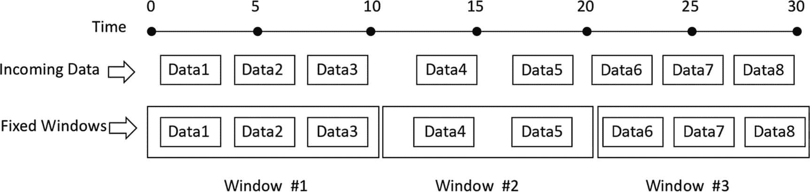
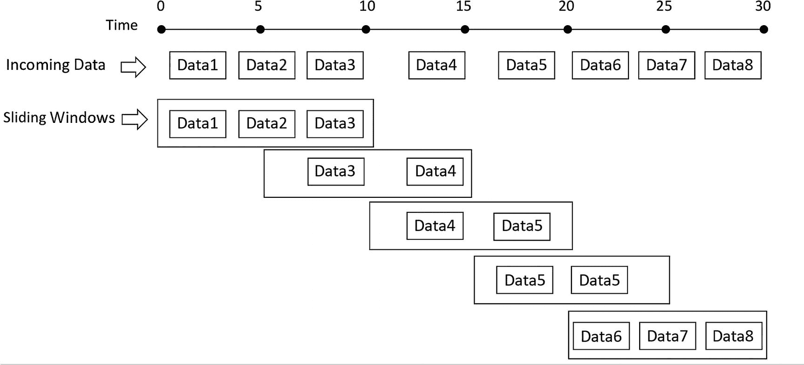
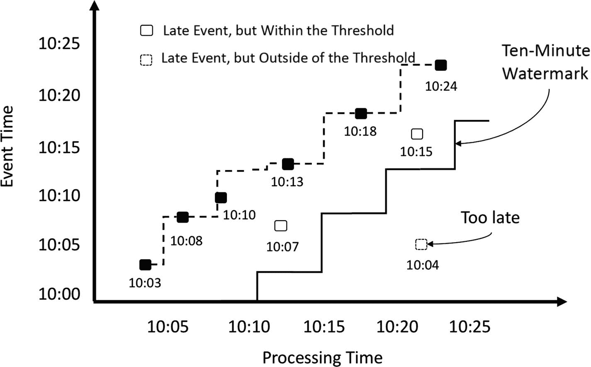
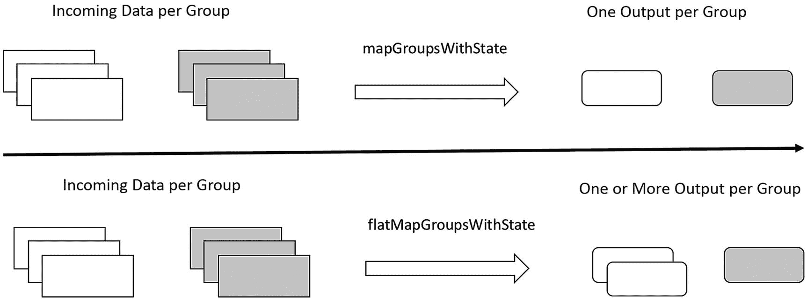

# 7. Spark Streaming（进阶）

前一章介绍了流处理的核心概念、Spark Structured Streaming 处理引擎提供的功能，以及构建流式应用程序的基本步骤。现实世界中的流式应用程序通常需要从大规模传入的实时数据中提取洞察或模式，并将这些信息馈送到下游应用程序以做出业务决策，或将其保存在某个存储系统中以供进一步分析或可视化。现实世界流式应用程序的另一个方面是，它们需要持续运行以处理实时到达的数据。因此，它们必须能够抵御故障。本章前半部分涵盖了 Structured Streaming 中的事件时间处理和状态处理功能，以及它们如何帮助从传入的实时数据中提取洞察或模式。本章后半部分解释了 Structured Streaming 提供的支持，以帮助流式应用程序实现容错，并监控流式应用程序的状态和进度。

## 事件时间

基于数据创建时间处理传入实时数据的能力，是任何严肃流处理引擎必备的功能。这一点很重要，因为要真正理解并从流式数据中准确提取洞察或模式，你需要能够根据数据或事件发生的时间（而非处理时间）来处理它们。通常，事件时间处理是在某种聚合的上下文中进行的，这包括事件时间以及关于该事件的零个或多个附加信息。

让我们以第 6 章中描述的移动操作事件为例。你可以将聚合应用于时间窗口（可以是固定窗口或滑动窗口类型，如第 6 章所述），而不是仅按操作类型进行聚合。此外，你可以轻松地将操作类型添加到分组键中，以按时间桶和操作类型进一步对移动操作事件进行分组。

以下示例将处理移动数据事件；清单 7-1 显示了其模式。`ts`列表示事件创建的时间，换句话说，即用户打开或关闭应用程序的时间。移动事件数据位于`<path>/chapter6/data/mobile`目录中，该目录包含`file1.json`、`file2.json`、`file3.json`和`newaction.json`。清单 7-2 显示了每个文件中的行。

```
mobileDataDF.printSchema
|-- action: string (nullable = true)
|-- id: string (nullable = true)
|-- ts: timestamp (nullable = true)
Listing 7-1
Mobile Data Event Schema
```

```
// file1.json
{"id":"phone1","action":"open","ts":"2018-03-02T10:02:33"}
{"id":"phone2","action":"open","ts":"2018-03-02T10:03:35"}
{"id":"phone3","action":"open","ts":"2018-03-02T10:03:50"}
{"id":"phone1","action":"close","ts":"2018-03-02T10:04:35"}
// file2.json
{"id":"phone3","action":"close","ts":"2018-03-02T10:07:35"}
{"id":"phone4","action":"open","ts":"2018-03-02T10:07:50"}
// file3.json
{"id":"phone2","action":"close","ts":"2018-03-02T10:04:50"}
{"id":"phone5","action":"open","ts":"2018-03-02T10:10:50"}
// newaction.json
{"id":"phone2","action":"crash","ts":"2018-03-02T11:09:13"}
{"id":"phone5","action":"swipe","ts":"2018-03-02T11:17:29"}
Listing 7-2
Mobile Event Data in file1.json, file2.json, file3.json, newaction.json
```


### 基于事件时间的固定窗口聚合

固定窗口（也称为滚动窗口）操作本质上会根据固定的窗口长度，将传入的数据流离散化为不重叠的桶。每条传入数据都会根据其事件时间被放入其中一个桶中。执行聚合只需遍历每个桶并应用聚合逻辑，无论是进行计数还是求和。图 7-1 展示了固定窗口聚合的逻辑。



**图 7-1** 固定窗口操作

固定窗口聚合的一个示例是，对每十分钟的固定窗口内的移动事件数量执行计数聚合。窗口长度通常由特定用例的需求以及数据量决定。该聚合的结果能让你从宏观上了解每个窗口内生成的移动事件速率。如果你对全天及每小时的移动使用情况感兴趣，那么 60 分钟的窗口长度可能更合适。清单 7-3 包含了执行计数聚合的代码以及聚合结果。正如预期，列出的所有四个文件中总共只有十个移动数据事件，输出中的总计数也与该数字相符。

```
import org.apache.spark.sql.types._
import org.apache.spark.sql.functions._
val mobileDataSchema = new StructType() .add("id", StringType, false)
.add("action", StringType, false)
.add("ts", TimestampType, false)
val mobileSSDF = spark.readStream.schema(mobileDataSchema)
.json("/chapter6/data/input")
val windowCountDF = mobileSSDF.groupBy(window($"ts", "10 minutes")).count
val mobileConsoleSQ = windowCountDF.writeStream.format("console")
.option("truncate", "false")
.outputMode("complete")
.start()
// 停止流式查询
mobileConsoleSQ.stop
// 输出
+-------------------------------------------+------+
|                                     window| count|
+-------------------------------------------+------+
| [2018-03-02 10:00:00, 2018-03-02 10:10:00]|     7|
| [2018-03-02 10:10:00, 2018-03-02 10:20:00]|     1|
| [2018-03-02 11:00:00, 2018-03-02 11:10:00]|     1|
| [2018-03-02 11:10:00, 2018-03-02 11:20:00]|     1|
+-------------------------------------------+------+
windowCountDF.printSchema
|-- window: struct (nullable = false)
|    |-- start: timestamp (nullable = true)
|    |-- end: timestamp (nullable = true)
|-- count: long (nullable = false)
```

**清单 7-3** 使用十分钟窗口处理移动事件数据

当使用窗口执行聚合时，输出的窗口实际上是一个结构体类型，其中包含开始时间和结束时间。

除了在 `groupBy` 转换中指定窗口外，你还可以指定事件本身的其他列。以下示例将使用窗口和操作类型执行聚合。这能让你更深入地了解每个窗口和操作类型的计数情况。只需对之前的示例稍作修改即可实现。清单 7-4 仅包含需要修改的行。

```
val windowActionCountDF= mobileSSDF.groupBy(window($"ts", "10 minutes"), $"action").count
val windowActionCountSQ = windowActionCountDF.writeStream.format("console")
.option("truncate", "false")
.outputMode("complete")
.start()
// 结果
+-------------------------------------------+-------+------+
|                                     window| action| count|
+-------------------------------------------+-------+------+
| [2018-03-02 10:00:00, 2018-03-02 10:10:00]| close |     3|
| [2018-03-02 11:00:00, 2018-03-02 11:10:00]| crash |     1|
| [2018-03-02 11:10:00, 2018-03-02 11:20:00]| swipe |     1|
| [2018-03-02 10:00:00, 2018-03-02 10:10:00]| open  |     4|
| [2018-03-02 10:10:00, 2018-03-02 10:20:00]| open  |     1|
+-------------------------------------------+-------+------+
// 停止查询流
windowActionCountSQ.stop()
```

**清单 7-4** 使用十分钟窗口和操作类型处理移动事件数据

上表结果中的每一行都包含了每个十分钟窗口内每种操作类型的计数信息。如果某个窗口附近出现了大量崩溃操作，这一信息有助于判断该时间段内是否发布了新版本。


### 基于事件时间的滑动窗口聚合

除了固定窗口类型外，还有另一种称为*滑动窗口*的窗口类型。定义滑动窗口需要两个信息：窗口长度和滑动间隔，滑动间隔通常小于窗口长度。由于聚合计算是在传入的数据流上滑动进行的，其结果通常比固定窗口类型的结果更平滑。因此，这种窗口类型常用于计算移动平均值。关于滑动窗口需要注意的一点是，由于窗口重叠，一条数据可能落入多个窗口，如图 7-2 所示。



图 7-2 固定窗口操作

为了说明对传入数据的滑动窗口聚合，你将使用一个关于数据中心计算机机架温度的小型合成数据集。假设每个计算机机架按一定间隔发出其温度，你希望生成一份报告，显示所有计算机机架的平均温度以及每个机架在窗口长度为十分钟、滑动间隔为五分钟内的平均温度。该数据集位于 `<path>/chapter7/data/iot` 目录中，包含 `file1.json` 和 `file2.json`。清单 7-5 展示了温度数据。

```
// file1.json
{"rack":"rack1","temperature":99.5,"ts":"2017-06-02T08:01:01"}
{"rack":"rack1","temperature":100.5,"ts":"2017-06-02T08:06:02"}
{"rack":"rack1","temperature":101.0,"ts":"2017-06-02T08:11:03"}
{"rack":"rack1","temperature":102.0,"ts":"2017-06-02T08:16:04"}
// file2.json
{"rack":"rack2","temperature":99.5,"ts":"2017-06-02T08:01:02"}
{"rack":"rack2","temperature":105.5,"ts":"2017-06-02T08:06:04"}
{"rack":"rack2","temperature":104.0,"ts":"2017-06-02T08:11:06"}
{"rack":"rack2","temperature":108.0,"ts":"2017-06-02T08:16:08"}
清单 7-5 两个机架的温度数据
```

清单 7-6 中的代码首先读取温度数据，然后在 `ts` 列上对滑动窗口执行 `groupBy` 转换。对于每个滑动窗口，对温度列应用 `avg()` 函数。为了方便检查输出，它将数据写入一个查询名为 `iot` 的内存数据接收器。然后你可以针对这个临时表发出 SQL 查询。

```
import org.apache.spark.sql.types._
import org.apache.spark.sql.functions._
// 定义模式
val iotDataSchema = new StructType().add("rack", StringType, false)
.add("temperature", DoubleType, false)
.add("ts", TimestampType, false)
val iotSSDF = spark.readStream.schema(iotDataSchema).json("/chapter7/data/iot")
// 按滑动窗口分组并对温度列执行平均值计算
val iotAvgDF = iotSSDF.groupBy(window($"ts", "10 minutes", "5 minutes"))
.agg(avg("temperature") as "avg_temp")
// 将数据写入查询名为 iot 的内存接收器
val iotMemorySQ = iotAvgDF.writeStream.format("memory")
.queryName("iot")
.outputMode("complete")
.start()
// 按开始时间顺序显示数据
spark.sql("select * from iot").orderBy($"window.start").show(false)
// 输出
+-------------------------------------------+---------+
|                                     window| avg_temp|
+-------------------------------------------+---------+
| [2017-06-02 07:55:00, 2017-06-02 08:05:00]|  99.5   |
| [2017-06-02 08:00:00, 2017-06-02 08:10:00]| 101.25  |
| [2017-06-02 08:05:00, 2017-06-02 08:15:00]| 102.75  |
| [2017-06-02 08:10:00, 2017-06-02 08:20:00]| 103.75  |
| [2017-06-02 08:15:00, 2017-06-02 08:25:00]| 105.0   |
+-------------------------------------------+---------+
// 停止流式查询
iotMemorySQ.stop
清单 7-6 所有计算机机架在滑动窗口上的平均温度
```

上述输出显示合成数据集中有五个窗口。注意每个窗口的开始时间相隔五分钟，这是因为之前在 `groupBy` 转换中指定的滑动间隔长度。温度列显示平均温度在上升，这令人担忧。此时，尚不清楚是所有计算机机架的温度都在上升，还是只有某些机架。为了帮助识别哪些计算机机架，清单 7-7 将 `rack` 列添加到 `groupBy` 转换中，并且只显示与清单 7-6 不同的行。

```
// 按滑动窗口和机架列分组
val iotAvgByRackDF = iotSSDF.groupBy(window($"ts", "10 minutes", "5 minutes"), $"rack")
.agg(avg("temperature") as "avg_temp")
// 写入查询名为 iot_rack 的内存数据接收器
val iotByRackConsoleSQ = iotAvgByRackDF.writeStream
.format("memory")
.queryName("iot_rack")
.outputMode("complete")
.start()
spark.sql("select * from iot_rack").orderBy($"rack", $"window.start").show(false)
+-------------------------------------------+------+---------+
|                                     window| rack | avg_temp|
+-------------------------------------------+------+---------+
| [2017-06-02 07:55:00, 2017-06-02 08:05:00]| rack1|  99.5   |
| [2017-06-02 08:00:00, 2017-06-02 08:10:00]| rack1| 100.0   |
| [2017-06-02 08:05:00, 2017-06-02 08:15:00]| rack1| 100.75  |
| [2017-06-02 08:10:00, 2017-06-02 08:20:00]| rack1| 101.5   |
| [2017-06-02 08:15:00, 2017-06-02 08:25:00]| rack1| 102.0   |
| [2017-06-02 07:55:00, 2017-06-02 08:05:00]| rack2|  99.5   |
| [2017-06-02 08:00:00, 2017-06-02 08:10:00]| rack2| 102.5   |
| [2017-06-02 08:05:00, 2017-06-02 08:15:00]| rack2| 104.75  |
| [2017-06-02 08:10:00, 2017-06-02 08:20:00]| rack2| 106.0   |
| [2017-06-02 08:15:00, 2017-06-02 08:25:00]| rack2| 108.0   |
+-------------------------------------------+------+---------+
// 停止查询流
iotByRackConsoleSQ.stop()
清单 7-7 每个机架在滑动窗口上的平均温度
```

输出表清晰地显示机架 1 的平均温度低于 103，而你应该关注的是机架 2。


### 聚合状态

前面关于在固定窗口或滑动窗口上，结合事件时间和附加信息执行聚合操作的示例，展示了在 Spark Structured Streaming 中执行常用且复杂的流处理操作是多么简单。虽然从外部看起来很简单，但在内部，Structured Streaming 引擎和 Spark SQL 引擎协同工作，以容错的方式维护中间聚合结果，同时执行流式聚合。事实上，只要对流式查询执行聚合操作，就必须维护中间聚合状态。该状态以键值对结构维护，类似于哈希映射，其中键是分组名称，值是中间聚合值。在前面的滑动窗口和机架 ID 聚合示例中，键将是窗口开始时间和结束时间以及机架名称的组合值，而值将是平均温度。

中间状态存储在 Spark 执行器上的内存中、带版本控制的键值“状态存储”中，并写入预写日志，该日志应配置为驻留在 HDFS 等稳定存储系统中。在每个触发点，状态会在内存状态存储中被读取和更新，然后写入预写日志。在发生故障并且 Spark Structured Streaming 应用程序重新启动时，状态会从预写日志中恢复，并从该点继续执行。这种容错状态管理显然会在 Structured Streaming 引擎中产生一些资源和处理开销。开销的大小与需要维护的状态量成正比。因此，将状态量保持在可接受的大小非常重要；换句话说，状态的大小不应无限增长。

鉴于滑动窗口的特性，窗口的数量会无限增长。这意味着执行滑动窗口聚合将需要中间状态无限增长，除非有一种方法可以丢弃不再更新的旧状态。这可以通过一种称为*水印*的技术来实现。

### 水印：限制状态并处理延迟数据

水印是流处理引擎中常用的一种技术，用于处理延迟数据以及限制需要维护的状态量。现实世界中的流式数据通常是无序到达的，并且由于网络拥塞、网络中断或数据生成器（如移动设备）未在线等原因而延迟到达。作为实时流式应用程序的开发人员，了解如何处理晚于特定阈值到达的数据非常重要。换句话说，相对于其他数据，您期望大部分数据到达的可接受时间是多少？很可能，这个问题的答案取决于具体的用例。延迟数据将被丢弃，不会被处理。

从 Structured Streaming 的角度来看，水印是事件时间中的一个移动阈值，它落后于迄今为止看到的最大事件时间。随着具有更新事件时间的新数据到达，最大事件时间会更新，这也会导致水印移动。图 7-3 展示了一个示例，其中水印被定义为十分钟。水印线由实线表示，它落后于由虚线表示的最大事件时间线。每个矩形框代表一条数据，其事件时间就在框的下方。事件时间为 10:07 的数据到达时间稍晚，大约在 10:12；然而，它仍然落在 10:03 到 10:13 之间的阈值内。因此，它将照常处理。事件时间为 10:15 的数据属于同一类别。但是，事件时间为 10:04 的数据到达时间非常晚，大约在 10:22，这落在了水印线以下，因此它将被忽略且不被处理。



图 7-3 使用水印处理延迟数据

指定水印的最大好处之一是使 Structured Streaming 引擎能够安全地移除早于水印的窗口的聚合状态。执行任何类型聚合的生产级流式应用程序都应指定水印，以避免内存不足问题。毫无疑问，水印是处理实时流式数据混乱部分的基本工具。

Structured Streaming 使得将水印指定为流式 DataFrame 的一部分变得简单。您只需向 Watermark API 提供两条信息：事件时间列和阈值（可以是秒、分钟或小时）。为了演示水印的实际应用，您可以处理 `<path>/chapter7/data/mobile` 目录中的两个 JSON 文件，并指定一个十分钟的水印。清单 7-8 显示了这两个文件中的数据。数据的设置方式是，`file1.json` 文件中的每一行都落入其自己的十分钟窗口内。`file2.json` 文件中的第一行落入 10:20:00 到 10:30:00 窗口，尽管它到达较晚，但其时间戳仍在可接受的阈值内，因此它将被处理。`file2.json` 的最后一行模拟了延迟数据，其时间戳位于 10:10:00 到 10:20:00 窗口，由于这超出了水印阈值，它将被忽略且不被处理。

```
// file1.json
{"id":"phone1","action":"open","ts":"2018-03-02T10:15:33"}
{"id":"phone2","action":"open","ts":"2018-03-02T10:22:35"}
{"id":"phone3","action":"open","ts":"2018-03-02T10:33:50"}
// file2.json
{"id":"phone4","action":"open","ts":"2018-03-02T10:29:35"}
{"id":"phone5","action":"open","ts":"2018-03-02T10:11:35"}
清单 7-8
两个 JSON 文件中的移动事件数据
```


为了模拟处理过程，首先在目录 `<path>/chapter7/data` 下创建一个名为 `input` 的目录。然后运行代码清单 7-9 中的代码。下一步是将 `file1.json` 文件复制到 input 目录并检查输出。最后一步是将 `file2.json` 文件复制到 input 目录并检查输出。

```
import org.apache.spark.sql.types._
import org.apache.spark.sql.functions._
val mobileDataSchema = new StructType().add("id", StringType, false)
.add("action", StringType, false)
.add("ts", TimestampType, false)
val mobileSSDF = spark.readStream.schema(mobileDataSchema).json("/book/chapter7/data/input")
//设置一个带有水印的流式 DataFrame，并按 ts 和 action 列进行分组。
val windowCountDF = mobileSSDF.withWatermark("ts", "10 minutes")
.groupBy(window($"ts", "10 minutes"), $"action")
.count
val mobileMemorySQ = windowCountDF.writeStream
.format("console")
.option("truncate", "false")
.outputMode("update")
.start()
// 处理 file1.json 后的输出
// 如预期，每一行都落入其自身的窗口
+-------------------------------------------+-------+------+
|                                     window| action| count|
+-------------------------------------------+-------+------+
| [2018-03-02 10:20:00, 2018-03-02 10:30:00]| open  |   1  |
| [2018-03-02 10:30:00, 2018-03-02 10:40:00]| open  |   1  |
| [2018-03-02 10:10:00, 2018-03-02 10:20:00]| open  |   1  |
+-------------------------------------------+-------+------+
// 处理 file2.json 后的输出
// 注意，窗口 10:20 到 10:30 的计数现在更新为 2
// 而窗口 10:10:00 和 10:20:00 没有变化
+-------------------------------------------+-------+------+
|                                     window| action| count|
+-------------------------------------------+-------+------+
| [2018-03-02 10:20:00, 2018-03-02 10:30:00]| open  |   2  |
+-------------------------------------------+-------+------+
代码清单 7-9
处理包含延迟到达数据的移动数据事件的代码
```

如前所述，由于 `file2.json` 文件中最后一行的时间戳超出了十分钟的水印阈值，因此它根本没有被处理。如果移除对 Watermark API 的调用，那么输出将类似于代码清单 7-10。窗口 10:10 到 10:20 的计数更新为 2。

```
+-------------------------------------------+-------+------+
|                                     window| action| count|
+-------------------------------------------+-------+------+
| [2018-03-02 10:20:00, 2018-03-02 10:30:00]| open  |  2   |
| [2018-03-02 10:10:00, 2018-03-02 10:20:00]| open  |  2   |
+-------------------------------------------+-------+------+
代码清单 7-10
移除对 Watermark API 调用的输出
```

水印是一个有用的特性，因此理解聚合状态被正确清理的条件非常重要。

* 输出模式不能是 complete 模式，必须是 update 或 append 模式。原因是 complete 模式的语义要求必须维护所有聚合数据，为了不违反这些语义，水印不能丢弃任何中间状态。
* 通过 `groupBy` 转换进行的聚合必须直接作用于事件时间列，或者作用于事件时间列的窗口。
* 在 Watermark API 和 `groupBy` 转换中指定的事件时间列必须是同一个。
* 在设置流式 DataFrame 时，必须在调用 `groupBy` 转换之前调用 Watermark API；否则，水印将被忽略。

## 任意状态处理

如前所述，按键或事件窗口进行聚合的中间状态由 Structured Streaming 自动维护。然而，并非所有的事件时间处理都能通过简单地对一个或多个列进行聚合（无论是否使用窗口）来满足。例如，当在 IoT 温度数据集中连续三次读取到大于 100 度的温度值时，你想要发送警报、电子邮件或寻呼机通知。另一个例子是关于维护用户会话，其中每个会话的长度不是由固定的时间量决定，而是由用户的活动及其缺失来决定。为了解决这两个例子及类似的用例，你需要能够对每组数据应用任意处理逻辑，控制每组数据的窗口长度，并在多个触发点之间维护任意状态。这就是 Structured Streaming 任意状态处理发挥作用的地方。


### 使用 Structured Streaming 进行任意有状态处理

Structured Streaming 为流式应用程序提供了一种回调机制，用于执行任意有状态处理，并且它会负责确保中间状态得以维护并以容错方式存储。这种处理方式本质上可以归结为执行以下任务之一，如图 7-4 所示：

-   对数据组进行映射，对每组数据应用任意处理，然后每组仅输出一行。
-   对数据组进行映射，对每组数据应用任意处理，然后每组输出任意数量的行（包括零行）。

对于这些任务中的每一个，Structured Streaming 都提供了一个特定的 API 来处理。对于第一种任务，API 称为 `mapGroupsWithState`；对于第二种任务，API 称为 `flatMapGroupsWithState`。这些 API 从 Spark 2.2 开始可用，并且仅适用于 Scala 和 Java。



**图 7-4** 两种任意有状态处理任务的直观描述

在使用任何类型的回调机制时，清楚地理解框架与回调函数之间的约定至关重要，包括回调函数被调用的时机和频率，以及输入参数的细节。在这种特定情况下，流程大致如下：

-   要对流式 DataFrame 执行任意有状态处理，必须首先通过调用 `groupByKey` 转换来指定分组，并提供一个用于分组的列；然后它会返回一个 `KeyValueGroupedDataset` 类的实例。
-   从 `KeyValueGroupedDataset` 类的实例中，可以调用 `mapGroupsWithState` 或 `flatMapGroupsWithState` 函数。这两个 API 各自需要一组不同的输入参数。
-   调用 `mapGroupsWithState` 函数时，需要提供超时类型和一个用户定义的回调函数。超时部分稍后会解释。
-   调用 `flatMapGroupsWithState` 函数时，需要提供输出模式、超时类型和一个用户定义的回调函数。输出模式和超时部分稍后都会解释。

以下是 Structured Streaming 与前面提到的用户定义回调函数之间的约定：

-   用户定义的回调函数将在每个触发器中为每个组重复调用。每次调用都针对在该触发器中有数据的组。如果某个特定组在触发器中没有任何数据，那么该组将不会被调用。因此，不应假设此函数在每个触发器中都会为每个组调用。
-   每次调用用户定义的回调函数时，都会传入以下信息：
    -   组键的值。
    -   一个组的所有数据。不保证它们有任何特定的顺序。
    -   一个组的先前状态，该状态由同一组的上一次调用返回。组状态由一个名为 `GroupState` 的状态持有者类管理。当需要更新组的状态时，必须使用新状态调用此类的 `update` 函数。每个组的状态信息由用户定义的类定义。调用 `update` 函数时，提供的用户定义状态不能为 null。

正如你在上一章所学到的，每当需要维护中间状态时，只允许某些输出模式。截至 Spark 2.3，调用 `mapGroupsWithState` API 时仅支持更新输出模式；然而，调用 `flatMapGroupsWithState` API 时，追加和更新模式都支持。

### 处理状态超时

在使用水印进行事件时间聚合的情况下，中间状态的超时由 Structured Streaming 内部管理，并且无法影响它。另一方面，Structured Streaming 的任意有状态处理提供了控制中间状态超时的灵活性。由于你能够维护任意状态，因此针对这种特定用例控制中间状态超时是合理的。

Structured Streaming 有状态处理提供了三种不同的超时类型。第一种基于处理时间，另一种基于事件时间。超时类型在全局级别配置，这意味着它适用于特定流式 DataFrame 内的所有组。超时时间量可以为每个单独的组配置，并且可以随意更改。如果中间状态配置了超时，那么在回调函数中处理给定的值列表之前，检查它是否已超时非常重要。在某些用例中，不需要超时，第三种超时类型就是为此场景设计的。超时类型在类 `GroupStateTimeout` 内部定义，在调用 `mapGroupsWithState` 或 `flatMapGroupsWithState` 函数时指定类型。超时持续时间分别使用 `GroupState.setTimeoutDuration` 或 `GroupState.setTimeoutTimeStamp` 函数来指定，用于处理超时和事件超时。

敏锐的读者可能想知道，当特定组的中间状态超时时会发生什么。Structured Streaming 针对这种情况提供的约定是，它将使用一个空的值列表调用用户定义的回调函数，并将标志 `GroupState.hasTimedOut` 设置为 true。

在这三种不同的超时类型中，事件时间超时是最复杂的，将首先介绍。事件时间超时意味着它基于事件中的时间，因此对于此超时类型，需要通过 `DataFrame.withWatermark` 在流式 DataFrame 中设置水印。要控制每个组的超时，需要在处理特定组期间向 `GroupState.setTimeoutTimestamp` 函数提供一个时间戳值。当水印超过提供的时间戳时，组的中间状态就会超时。在用户会话化用例中，当用户与网站交互时，只需根据用户的最新交互时间加上某个阈值来更新超时时间戳，即可延长用户会话。这是为了确保只要用户与网站交互，用户会话就保持活动状态，并且中间数据不会超时。

处理超时类型的工作方式与事件时间超时类型类似；然而，区别在于它基于服务器的系统时钟，该时钟不断向前推进。要控制每个组的超时，需要在处理特定组期间向 `GroupState.setTimeoutDuration` 函数提供一个持续时间。持续时间可以是类似 `1 minute`、`1 hour` 或 `2 days` 这样的值。当时钟超过提供的持续时间时，组的中间状态就会超时。由于此超时类型依赖于系统时钟，因此考虑时区变化或时钟偏差的情况非常重要。

这对敏锐的读者来说可能显而易见，但重要的是要认识到，如果流中有一段时间没有数据，就不会有任何触发器，因此用户定义的回调函数将不会被调用。此外，水印不会推进，超时函数调用也不会发生。

至此，你应该对 Structured Streaming 中的任意状态处理如何工作以及涉及哪些 API 有了很好的理解。下一节将通过几个示例来演示如何实现任意状态处理。


### 实际操作中的任意状态处理

本节将通过两个用例演示结构化流中的任意状态处理。

- 第一个用例是从数据中心机架温度数据中提取模式，并在中间状态中维护每个机架的状态。每当检测到连续三次温度达到或超过 100 度时，该机架状态将升级为警告级别。此示例将使用 `mapGroupsWithState` API。
- 第二个示例是关于用户会话化，它将根据用户与网站的交互来跟踪用户状态。此示例将使用 `flatMapGroupsWithState` API。

无论使用哪种 API 来为你的用例执行任意状态处理，都需要遵循一组通用步骤，包括以下内容：

- 定义几个类来表示输入数据、中间状态和输出。
- 定义两个函数。第一个是供结构化流调用的回调函数。第二个函数包含对每个分组数据执行任意状态处理的逻辑，以及维护状态的逻辑。
- 决定超时类型及其合适的值。

#### 使用 `mapGroupsWithState` 提取模式

此用例的目标是识别数据中心机架温度数据中的特定模式。关注的模式是同一机架连续三次温度读数达到或超过 100 度，且两次连续高温读数之间的时间差必须在 60 秒以内。当检测到这种模式时，该特定机架的状态将升级为警告状态。如果下一个传入的温度读数低于 100 度阈值，则机架状态将降级为正常。

此示例的数据位于目录 `<path>/chapter7/data/iot_pattern` 中，包含三个文件；其内容如清单 7-11 所示。`file1.json` 的内容显示 `rack1` 的温度在略低于和略高于 100 度之间交替变化。文件 `file2.json` 显示 `rack2` 的温度正在升高。在 `file3.json` 中，`rack3` 的温度也在升高，但温度读数之间的间隔超过了一分钟。

```
// file1.json
{"rack":"rack1","temperature":99.5,"ts":"2017-06-02T08:01:01"}
{"rack":"rack1","temperature":100.5,"ts":"2017-06-02T08:02:02"}
{"rack":"rack1","temperature":98.3,"ts":"2017-06-02T08:02:29"}
{"rack":"rack1","temperature":102.0,"ts":"2017-06-02T08:02:44"}
// file2.json
{"rack":"rack1","temperature":97.5,"ts":"2017-06-02T08:02:59"}
{"rack":"rack2","temperature":99.5,"ts":"2017-06-02T08:03:02"}
{"rack":"rack2","temperature":105.5,"ts":"2017-06-02T08:03:44"}
{"rack":"rack2","temperature":104.0,"ts":"2017-06-02T08:04:06"}
{"rack":"rack2","temperature":108.0,"ts":"2017-06-02T08:04:49"}
// file3.json
{"rack":"rack2","temperature":108.0,"ts":"2017-06-02T08:06:40"}
{"rack":"rack3","temperature":100.5,"ts":"2017-06-02T08:06:20"}
{"rack":"rack3","temperature":103.7,"ts":"2017-06-02T08:07:35"}
{"rack":"rack3","temperature":105.3,"ts":"2017-06-02T08:08:53"}
清单 7-11
file1.json、file2.json 和 file3.json 中的温度数据
```

接下来，你将准备几个类和两个函数，以将模式检测逻辑应用于上述数据。对于此用例，机架温度输入数据由类 `RackInfo` 表示，中间状态和输出均由同一个名为 `RackState` 的类表示。清单 7-12 显示了代码。

```
case class RackInfo(rack:String, temperature:Double, ts:java.sql.Timestamp)
// 注意构造函数参数被定义为可修改，以便我们可以更新它们
// lastTS 变量用于比较前一次和当前温度读数之间的时间
case class RackState(var rackId:String, var highTempCount:Int,
var status:String, var lastTS:java.sql.Timestamp)
清单 7-12
输入和中间状态的 Scala Case 类
```

接下来定义两个函数。第一个函数名为 `updateRackState`，它包含检测连续三次高温读数（彼此间隔在 60 秒内）模式的核心逻辑。第二个函数名为 `updateAcrossAllRackStatus`，它是将传递给 `mapGroupsWithState` API 的回调函数。该函数确保机架温度读数按其事件时间的顺序进行处理。代码见清单 7-13。

```
import org.apache.spark.sql.streaming.GroupState
// 包含检测上述温度模式的主要逻辑
def updateRackState(rackState:RackState, rackInfo:RackInfo) : RackState = {
// 设置条件以决定是否更新机架状态
val lastTS = Option(rackState.lastTS).getOrElse(rackInfo.ts)
val withinTimeThreshold = (rackInfo.ts.getTime - lastTS.getTime) = 100.0
(greaterThanEqualTo100, meetCondition) match {
case (true, true) => {
rackState.highTempCount = rackState.highTempCount + 1
rackState.status = if (rackState.highTempCount >= 3) "Warning" else "Normal"
}
case _ => {
rackState.highTempCount = 0
rackState.status = "Normal"
}
}
rackState.lastTS = rackInfo.ts
rackState
}
// 为 mapGroupsWithState API 提供的回调函数
def updateAcrossAllRackStatus(rackId:String, inputs:Iterator[RackInfo],
oldState: GroupState[RackState]) : RackState = {
// 如果存在先前状态则初始化 rackState，否则创建新状态
var rackState = if (oldState.exists) oldState.get else RackState(rackId, 5, "", null)
// 按时间戳升序对输入进行排序
inputs.toList.sortBy(_.ts.getTime).foreach( input => {
rackState = updateRackState(rackState, input)
// 非常重要的是在状态持有类 GroupState 中更新 rackState
oldState.update(rackState)
})
rackState
}
清单 7-13
用于执行模式检测的函数
```

设置步骤现已完成，接下来你将把回调函数接入清单 7-14 中结构化流应用程序的 `mapGroupsWithState`。模拟流数据的步骤与之前的某个示例类似，如下所示：

- 在目录 `<path>/chapter7/data` 下创建一个名为 `input` 的目录。如果该目录已存在，则删除其中的所有文件。
- 运行清单 7-14 中的代码。
- 将 `file1.json` 复制到 input 目录，然后观察输出。对 `file2.json` 和 `file3.json` 重复此步骤。


```scala
import org.apache.spark.sql.streaming.{GroupStateTimeout, OutputMode}
import org.apache.spark.sql.types._
import org.apache.spark.sql.functions._
// 物联网数据的模式（schema）
val iotDataSchema = new StructType().add("rack", StringType, false)
.add("temperature", DoubleType, false)
.add("ts", TimestampType, false)
val iotSSDF = spark.readStream.schema(iotDataSchema).json("/chapter7/data/input")
val iotPatternDF = iotSSDF.as[RackInfo]
.groupByKey(_.rack)
.mapGroupsWithState[RackState,RackState]
(GroupStateTimeout.NoTimeout)(updateAcrossAllRackStatus)
// 设置输出并启动流式查询
val iotPatternSQ = iotPatternDF.writeStream
.format("console")
.outputMode("update")
.start()
// 将 file3.json 复制到 "input" 目录后，运行下面这行代码停止流式查询
iotPatternSQ.stop
// 处理 file1.json 后的输出
+-------+--------------+-------+--------------------+
| rackId| highTempCount| status|              lastTS|
+-------+--------------+-------+--------------------+
|  rack1|             1| Normal| 2017-06-02 08:02:44|
+-------+--------------+-------+--------------------+
// 处理 file2.json 后的输出
+-------+--------------+--------+--------------------+
| rackId| highTempCount|  status|              lastTS|
+-------+--------------+--------+--------------------+
|  rack1|             0|  Normal| 2017-06-02 08:02:59|
|  rack2|             3| Warning| 2017-06-02 08:04:49|
+-------+--------------+--------+--------------------+
// 处理 file3.json 后的输出
+-------+--------------+-------+--------------------+
| rackId| highTempCount| status|              lastTS|
+-------+--------------+-------+--------------------+
|  rack3|             1| Normal| 2017-06-02 08:08:53|
|  rack2|             0| Normal| 2017-06-02 08:06:40|
+-------+--------------+-------+--------------------+
清单 7-14
使用任意状态处理来检测流式应用程序中的模式
```

`rack1` 有几次温度读数超过 100 度；然而，它们不是连续的，因此输出状态为正常级别。在文件 `file2.json` 中，`rack2` 有三次连续的温度读数超过 100 度，且每次读数与前一次读数的时间间隔小于 60 秒；因此，`rack2` 的状态为警告级别。`rack3` 有三次连续的温度读数超过 100 度；然而，每次读数与前一次读数的时间间隔大于 60 秒。因此，其状态为正常级别。

## 使用 flatMapGroupsWithState 进行用户会话化

本用例使用 `flatMapGroupsWithState` API 执行用户会话化，该 API 支持每个组输出多行。在此示例中，会话化处理逻辑基于用户活动。当执行 `login` 操作时创建会话，当执行 `logout` 操作时结束会话。如果用户在 30 分钟内没有活动，会话将自动结束。您将利用前面描述的超时功能来执行此检测。在输出方面，每当会话开始或结束时，该信息将被发送到输出。输出信息包括用户 ID、会话开始和结束时间以及访问的页面数。

本用例的数据位于目录 `<path>/chapter7/data/sessionization` 中，该目录包含三个文件。其内容如清单 7-15 所示。文件 `file1.json` 包含 `user1` 的活动，其中包括一个 `login` 操作，但没有 `logout` 操作。文件 `file2.json` 包含 `user2` 的所有活动，包括 `login` 和 `logout` 操作。文件 `file3.json` 仅包含 `user3` 的 `login` 操作。三个文件中用户活动的时间戳设置方式使得在处理 `file3.json` 时，`user1` 的会话将超时。这是因为到那时，`user1` 的空闲时间已超过 30 分钟。

```
// file1.json
{"user":"user1","action":"login","page":"page1", "ts":"2017-09-06T08:08:53"}
{"user":"user1","action":"click","page":"page2", "ts":"2017-09-06T08:10:11"}
{"user":"user1","action":"send","page":"page3", "ts":"2017-09-06T08:11:10"}
// file2.json
{"user":"user2","action":"login", "page":"page1", "ts":"2017-09-06T08:44:12"}
{"user":"user2","action":"view", "page":"page7", "ts":"2017-09-06T08:45:33"}
{"user":"user2","action":"view", "page":"page8", "ts":"2017-09-06T08:55:58"}
{"user":"user2","action":"view", "page":"page6", "ts":"2017-09-06T09:10:58"}
{"user":"user2","action":"logout","page":"page9", "ts":"2017-09-06T09:16:19"}
// file3.json
{"user":"user3","action":"login", "page":"page4", "ts":"2017-09-06T09:17:11"}
清单 7-15
用户活动数据
```

接下来，您将准备几个类和两个函数，以将用户会话化逻辑应用于上述数据。对于此用例，用户活动输入数据由类 `UserActivity` 表示。用户会话数据的中间状态由类 `UserSessionState` 表示，用户会话输出由类 `UserSessionInfo` 表示。清单 7-16 显示了这三个类的代码。

```
case class UserActivity(user:String, action:String, page:String, ts:java.sql.Timestamp)
// lastTS 字段用于存储最大的用户活动时间戳，该信息用于
// 设置每个用户会话的超时值
case class UserSessionState(var user:String, var status:String, var startTS:java.sql.Timestamp,
var endTS:java.sql.Timestamp, var lastTS:java.sql.Timestamp,
var numPage:Int)
// 结束时间戳在会话结束时填充。
case class UserSessionInfo(userId:String, start:java.sql.Timestamp, end:java.sql.Timestamp,  numPage:Int)
清单 7-16
用于输入、中间状态和输出的 Scala 样例类
```


接下来定义两个函数。第一个函数名为`updateUserActivity`，负责根据单个用户活动更新用户会话状态。它会根据用户执行的操作适当更新会话开始或结束时间，同时更新最新活动时间戳。第二个函数名为`updateAcrossAllUserActivities`，是作为回调函数传入`flatMapGroupsWithState`的函数。该函数有两个主要职责：一是处理中间会话状态的超时，并在出现此类情况时更新用户会话结束时间；二是确定何时以及向输出发送什么内容。期望的输出是在用户会话开始时输出一行，在用户会话结束时输出另一行。这两个函数的逻辑见清单 7-17。

```scala
import org.apache.spark.sql.streaming.GroupState
import scala.collection.mutable.ListBuffer

def updateUserActivity(userSessionState:UserSessionState, userActivity:UserActivity) : UserSessionState = {
  userActivity.action match {
    case "login" => {
      userSessionState.startTS = userActivity.ts
      userSessionState.status = "Online"
    }
    case "logout" => {
      userSessionState.endTS = userActivity.ts
      userSessionState.status = "Offline"
    }
    case _ => {
      userSessionState.numPage += 1
      userSessionState.status = "Active"
    }
  }
  userSessionState.lastTS = userActivity.ts
  userSessionState
}

def updateAcrossAllUserActivities(user:String, inputs:Iterator[UserActivity],
    oldState: GroupState[UserSessionState]) : Iterator[UserSessionInfo] = {
  var userSessionState = if (oldState.exists) oldState.get else UserSessionState(user, "",
    new java.sql.Timestamp(System.currentTimeMillis), null, null, 0)
  var output = ListBuffer[UserSessionInfo]()
  inputs.toList.sortBy(_.ts.getTime).foreach( userActivity => {
    userSessionState = updateUserActivity(userSessionState, userActivity)
    oldState.update(userSessionState)
    if (userActivity.action == "login") {
      output += UserSessionInfo(user, userSessionState.startTS,
        userSessionState.endTS, 0)
    }
  })
  val sessionTimedOut = oldState.hasTimedOut
  val sessionEnded = !Option(userSessionState.endTS).isEmpty
  val shouldOutput = sessionTimedOut || sessionEnded
  shouldOutput match {
    case true => {
      if (sessionTimedOut) {
        userSessionState.endTS = new java.sql.Timestamp(oldState.getCurrentWatermarkMs)
      }
      oldState.remove()
      output += UserSessionInfo(user, userSessionState.startTS,
        userSessionState.endTS, userSessionState.numPage)
    }
    case _ => {
      // extend session
      oldState.update(userSessionState)
      oldState.setTimeoutTimestamp(userSessionState.lastTS.getTime,"30 minutes")
    }
  }
  output.iterator
}
```
*清单 7-17 执行用户会话化的函数*

设置步骤现已完成，接下来将在清单 7-18 的结构化流应用程序中将回调函数接入`flatMapGroupsWithState`函数。在此示例中，它将利用超时功能，因此需要设置水印和事件时间超时类型。模拟流数据的步骤与之前的某个示例类似，如下所示：

1. 在目录`<path>/chapter7/data`下创建一个名为`input`的目录。如果该目录已存在，则删除其中的所有文件。
2. 运行清单 7-18 中的代码。
3. 将`file1.json`复制到`input`目录，然后观察输出。对`file2.json`和`file3.json`重复此步骤。

```scala
import org.apache.spark.sql.streaming.{GroupStateTimeout, OutputMode}
import org.apache.spark.sql.types._
import org.apache.spark.sql.functions._

val userActivitySchema = new StructType().add("user", StringType, false)
  .add("action", StringType, false)
  .add("page", StringType, false)
  .add("ts", TimestampType, false)

val userActivityDF = spark.readStream.schema(userActivitySchema).json("/chapter7/data/input")

// convert to DataSet of type UserActivity
val userActivityDS = userActivityDF.withWatermark("ts", "30 minutes").as[UserActivity]

// specify the event-time timeout type and wire in the call-back function
val userSessionDS = userActivityDS.groupByKey(_.user)
  .flatMapGroupsWithState[UserSessionState,UserSessionInfo]
    (OutputMode.Append,GroupStateTimeout.EventTimeTimeout)
    (updateAcrossAllUserActivities)

// setup the output and start the streaming query
val userSessionSQ = userSessionDS.writeStream
  .format("console")
  .option("truncate",false)
  .outputMode("append")
  .start()

// only run this line of code below after done copying over file3.json
userSessionSQ.stop

// the output after processing file1.json
+-------+--------------------+-----+--------+
| userId|               start| end | numPage|
+-------+--------------------+-----+--------+
| user1 | 2017-09-06 08:08:53| null|    0   |
+-------+--------------------+-----+--------+

// the output after processing file2.json
+-------+--------------------+--------------------+--------+
| userId|               start|                 end| numPage|
+-------+--------------------+--------------------+--------+
| user2 | 2017-09-06 08:44:12|                null|       0|
| user2 | 2017-09-06 08:44:12| 2017-09-06 09:16:19|       3|
+-------+--------------------+--------------------+--------+

// the output after processing file3.json
+-------+--------------------+--------------------+--------+
| userId|               start|                 end| numPage|
+-------+--------------------+--------------------+--------+
| user1 | 2017-09-06 08:08:53| 2017-09-06 08:46:19|       2|
| user3 | 2017-09-06 09:17:11|                null|       0|
+-------+--------------------+--------------------+--------+
```
*清单 7-18 在流式应用程序中使用任意状态处理执行用户会话化*

处理`file1.json`中的用户活动后，输出中只有一行。这是符合预期的，因为每当函数`updateAcrossAllUserActivities`在用户活动中看到`login`操作时，它都会向输出`ListBuffer`中添加一个`UserSessionInfo`类的实例。处理`file2.json`后，输出中有两行：一行对应`login`操作，另一行对应`logout`操作。现在`file3.json`只包含`user3`的一个用户活动（操作为`login`），但输出中包含两行。`user1`的那一行是检测到`user1`会话已超时的结果，这意味着由于`user1`缺乏活动，水印已超过该特定会话的超时值。

如前两个用例所示，结构化流中的任意状态处理功能提供了一种灵活且强大的方式，可以在每个分组上应用用户定义的处理逻辑，并完全控制向输出发送的内容和时机。


