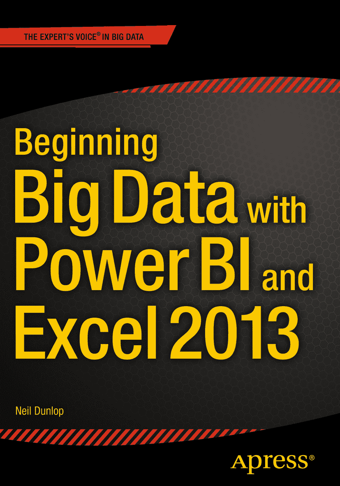

 尼尔·邓洛普《使用 Power BI 与 Excel 2013 入门大数据》

作者在本文中引用的任何源代码或其他补充材料，读者均可访问[`www.apress.com`](http://www.apress.com/)获取。有关如何查找和下载本书源代码的更多信息，请访问[`www.apress.com/source-code/`](http://www.apress.com/source-code/)。ISBN 978-1-4842-0530-3 e-ISBN 978-1-4842-0529-7 DOI 10.1007/978-1-4842-0529-7 © Apress 2015 《使用 Power BI 与 Excel 2013 入门大数据》 董事总经理：Welmoed Spahr 首席编辑：Jonathan Gennick 开发编辑：Douglas Pundick 技术审阅：Kathi Kellenberger 编辑委员会：Steve Anglin, Mark Beckner, Gary Cornell, Louise Corrigan, Jim DeWolf, Jonathan Gennick, Robert Hutchinson, Michelle Lowman, James Markham, Susan McDermott, Matthew Moodie, Jeffrey Pepper, Douglas Pundick, Ben Renow-Clarke, Gwenan Spearing, Matt Wade, Steve Weiss 统筹编辑：Jill Balzano 文字编辑：Michael G. Laraque 排版：SPi Global 索引编制：SPi Global 美术：SPi Global 封面设计：Anna Ishchenko 如需了解翻译相关信息，请发送电子邮件至`rights@apress.com`，或访问[`www.apress.com`](http://www.apress.com/)。Apress 及 friends of ED 书籍可批量购买，用于学术、企业或促销用途。大多数图书也提供电子书版本和许可。更多信息，请参考我们的特殊批量销售–电子书许可网页：[`www.apress.com/bulk-sales`](http://www.apress.com/bulk-sales)。本作品受版权保护。出版商保留所有权利，涉及全部或部分材料，特别是翻译权、重印权、插图再利用权、朗诵权、广播权、微缩胶片复制权或任何其他物理形式复制权，以及电子传输或信息存储与检索、电子改编、计算机软件，或使用现在已知或未来开发的类似或不同方法。免除此法律保留的是与评论或学术分析相关的简短摘录，或专为在计算机系统上输入和执行而提供的材料，仅供购买者专用。仅允许根据出版商所在地现行版权法的规定，复制本出版物或其部分内容，且必须始终从 Springer 获取使用许可。使用许可可通过 Copyright Clearance Center 的 RightsLink 获取。违反规定者将根据相应版权法受到起诉。本书中可能出现商标名称、标志和图像。对于每次出现的商标名称、标志或图像，我们并非都使用商标符号，而是仅以编辑方式使用这些名称、标志和图像，以维护商标所有者的利益，并无意侵犯商标权。本出版物中对商业名称、商标、服务标志及类似术语的使用（即使未明确标识）不应被视为对这些术语是否受所有权保护的看法。尽管本书中的建议和信息在出版时被认为是真实准确的，但作者、编辑或出版商均不对可能出现的任何错误或遗漏承担法律责任。出版商对本书所含内容不作任何明示或暗示的保证。本书在全球图书贸易中由 Springer Science+Business Media New York 发行，地址：233 Spring Street, 6th Floor, New York, NY 10013。电话：1-800-SPRINGER，传真：(201) 348-4505，电子邮件：`orders-ny@springer-sbm.com`，或访问 `www.springeronline.com`。Apress Media, LLC 是加利福尼亚州有限责任公司，其唯一成员（所有者）是 Springer Science + Business Media Finance Inc (SSBM Finance Inc)。SSBM Finance Inc 是特拉华州的一家公司。

## 引言

本书面向任何具备 Excel 基础知识、希望通过分析和可视化数据来获取成果的读者。它侧重于理解数据的底层结构，以便使用最合适的工具进行分析。本书早期的暂定书名是《大众大数据》，意指这些工具能让希望利用 Excel 技能分析大型数据集的普通用户，更轻松地使用商业智能（BI）。

正如第 1 章所讨论的，大数据更多关乎数量和速度，而非内在复杂性。本书基于这样一个前提：许多中小型组织可以借助 Excel 和 Power BI 满足其大部分数据处理需求。本书演示了如何导入诸如 `JSON`、`XML` 和 `HDFS` 这样的大数据文件格式，以及如何将较大的数据集过滤到数千或数百万行，而非数十亿行。

本书首先展示如何将各种数据格式导入 Excel（第 2 章），以及如何使用数据透视表从单个表格中提取汇总数据（第 3 章）。第 5 章演示了如何在 Excel 中使用结构化查询语言（SQL）。第 10 章简要介绍了 Excel 中的统计分析。

本书主要介绍微软的自助式 BI 工具——Power BI，它包含以下 Excel 加载项：

- **PowerPivot**。提供数据存储库（见第 4 章）和 `DAX` 公式语言（见第 7 章）。第 4 章提供了一个在多个表中处理数百万行数据的示例。
- **Power View**。一个用于提取有意义的报告和创建仪表盘某些元素的报告工具（见第 6 章）
- **Power Query**。一个用于从各种来源提取、转换和加载（ETL）数据的工具（见第 8 章）
- **Power Map**。一个用于地图数据可视化的工具（见第 9 章）

第 11 章演示了如何使用 `HDInsight`（微软在其 Azure 云平台上运行的 Hadoop 实现）将大数据导入 Excel。

本书是为 Excel 2013 编写的，但书中的大部分示例，如果从微软下载了 `PowerPivot`、`Power View`、`Power Query` 和 `Power Map` 加载项，同样适用于 Excel 2010。只需搜索下载即可找到相应加载项的下载链接。

## 免责声明

所有链接和截图在撰写时均为最新，但出版后可能已发生变化。作者已尽一切努力描述撰写时准确无误的流程，但作者和出版商均不对因提供或执行任何信息或程序而导致的间接或附带损害承担责任。

## 致谢

我要感谢 Apress 的每一位员工，感谢他们帮助我学习 Apress 的系统，并协助我克服了撰写本书过程中的种种障碍。我还要感谢我在伯克利城市学院的同事们，感谢他们理解并支持我抽时间进行写作。

