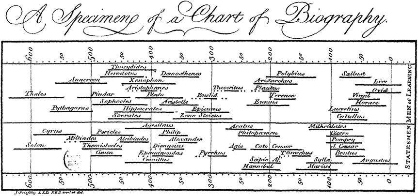
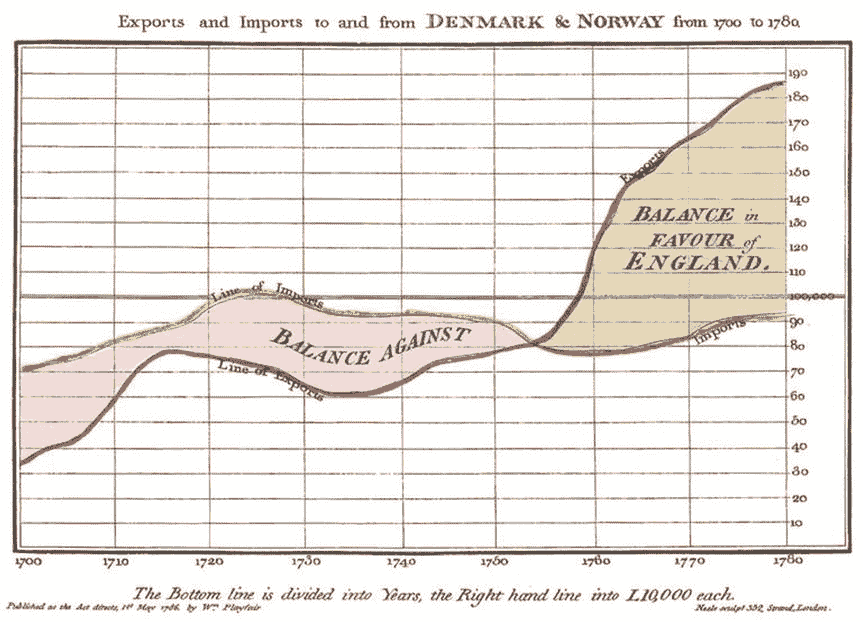
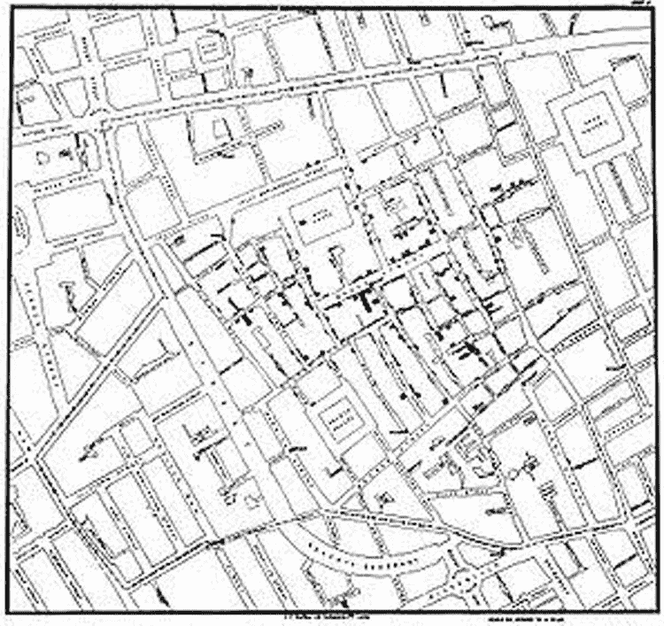

# 1. 大数据

电子补充材料 本章的在线版本（`doi:10.1007/978-1-4842-0529-7_1`）包含补充材料，可供授权用户使用。

当今商业的目标是从数据中解锁智慧。我们正目睹诸多趋势的融合，导致可用数据呈指数级增长，其中包括廉价的存储设备以及用于采集数据的传感器的普及。此外，物联网——物体之间相互交互——将产生海量数据。

各类组织正试图从非结构化数据中提取智慧。他们致力于打破数据孤岛之间的壁垒。大数据和 NoSQL 工具正被用于分析这些海量数据。

大数据有多种定义，但其核心在于从大量数据中提取洞察——这些洞察基于较小的数据集可能并不明显。通过分析购买习惯来预测客户想要购买的产品，大数据可用于确定应销售哪些产品。本章将涵盖数据分析工具从早期原始的地图和图表到当今大数据工具的演变历程。

## 大数据作为第四生产要素

基于工业经济的传统经济学教导我们，存在三种生产要素：土地、劳动力和资本。2012 年 12 月 27 日的《金融时报》刊登了一篇题为“为何‘大数据’是第四生产要素”的文章，该文探讨了大数据在决策中的作用。文章指出：“随着大数据的普及，高管们越来越依赖数字洞察。但大数据的美妙之处在于，它既能让直觉型思考者也能让分析型思考者脱颖而出。更具创业精神、富有创造力的领导者能在不同数据源之间发现意想不到的模式（这或许符合他们的直觉天性），并最终利用这些信息来改变业务走向。”

## 大数据作为自然资源

IBM 首席执行官弗吉尼亚·罗梅蒂曾说过：“大数据是下个世纪世界的自然资源。”她还补充道，数据需要经过提炼才能发挥效用。IBM 已从硬件制造转型，并投入了 300 亿美元来增强其大数据能力。

IBM 在大数据领域的投资很大部分用于开发沃森——一种自然语言问答计算机。沃森于 2011 年以《危险边缘！》参赛者的身份亮相，并击败了往届冠军。它拥有每秒搜索 100 万本书的计算能力，还能处理口语化的英语。

沃森最实用的用途之一是与医生合作制定癌症治疗方案。为此，沃森接收了来自 200 万页医学期刊和 60 万份临床记录的数据输入。当医生输入患者症状时，沃森可以生成一份按成功置信度排序的推荐列表。

## 数据作为中层管理者

2015 年 4 月 30 日，《华尔街日报》刊登了克里斯托弗·米姆斯的一篇文章，题为“数据现在是新的中层管理者”，该文描述了一些初创公司如何用数据取代中层管理者。文章指出：“得益于一种根本不同的管理结构，初创公司比以往任何时候都更加灵活。这种结构将决策权下放到组织外围，下放到实际负责执行公司业务的人员手中。使这种相对扁平化的层级结构成为可能的是，一线员工可以基本上无限制地访问过去难以获取或需要更高级管理层才能解读的数据。”文章进一步阐述道，当数据库非常昂贵且商业智能软件耗资数百万美元时，限制高层管理者访问数据是合理的。但如今情况已非如此。需要数据科学家来验证数据的准确性以及数据的呈现方式。米姆斯总结道：“既然每个员工都能拥有监控任何目标进度的工具，那么中层管理者作为信息收集和决策者的传统角色，在许多初创公司中已不再适用。”

## 早期数据分析

数据分析并非从一开始就复杂精妙。它经过了多年的演变，从非常原始的形式发展到现今的状态。

### 第一条时间线

1765 年，神学家兼科学家约瑟夫·普里斯特利创建了最早的时间线图表，其中用单独的条形来比较多个人的寿命，如图`1-1`所示。

图 1-1. 早期的时间线图表

### 第一张条形图和时间序列图

苏格兰工程师威廉·普莱费尔被公认为发明了折线图、条形图和饼图。他的时间序列图至今仍被视为清晰的典范。普莱费尔于 1786 年在伦敦首次出版了《商业与政治地图集》。该图集包含了 43 幅时间序列图和一幅条形图，被描述为第一部包含统计图表的重要著作。普莱费尔于 1801 年在伦敦出版的《统计简编》中包含了通常被认为是第一张饼图的内容。图`1-2`展示了普莱费尔绘制的一张显示贸易收支的时间序列图。

图 1-2. 普莱费尔的贸易收支时间序列图

### 霍乱地图

1854 年，医生约翰·斯诺绘制了伦敦霍乱病例的分布图，以确定其与单个水泵污染水源的关联，如图`1-3`所示。在那次分析之前，无人知晓霍乱的病因。这被认为是首次使用地图来分析疾病如何传播。

图 1-3. 霍乱地图

## 现代数据分析

互联网开启了海量数据的大门。谷歌及其他互联网公司设计了访问这些数据并使其广泛可用的工具。

### 谷歌流感趋势

2009 年，谷歌建立了一个基于流感相关搜索来追踪流感爆发的系统。当 2009 年 H1N1 危机袭来时，事实证明，与存在自然报告滞后的政府统计数据相比，谷歌的系统是一个更有用、更及时的指标（来源：《大数据时代》，维克托·迈尔-舍恩伯格、肯尼斯·库克耶著，Mariner Books，2013 年）。然而，在 2012 年，该系统高估了流感病例数量，这可能是由于媒体对流感的关注所致。因此，谷歌调整了其算法。

### 谷歌地球

谷歌地球的前身是由电脑程序员丽贝卡·摩尔于 2005 年开发的。她住在加利福尼亚州圣克鲁斯山脉，当地一家木材公司提议进行一项以防火为名的伐木作业。摩尔利用谷歌地球证明了该伐木计划将移除房屋和学校附近的森林，并威胁到饮用水源。

### 追踪疟疾

2014 年 9 月 10 日，《旧金山纪事报》的一篇文章报道，加利福尼亚大学旧金山分校（UCSF）的一个团队正在使用谷歌地球追踪非洲的疟疾情况，并监测可能面临爆发风险的区域。文章指出：“加州大学旧金山分校团队希望聚焦于促使疟疾传播的因素：近期降雨、植被丰富、低海拔、温暖气温、靠近河流、人口密集。”基于这些因素，可以识别出潜在的疟疾热点区域。

### 大数据成本节约

根据《华尔街日报》2014 年 7 月 1 日一篇题为《大数据削减成本》的文章，咨询公司高德纳（Gartner Inc.）研究总监克里斯·伊尔沃利诺（Chris Iervolino）援引道：“会计师和财务主管通常关注销售额和支出等细项，而非研究各类数据之间的关系。但那些成功整合这些信息流的公司已从大数据中获得了丰厚回报。”

文中列举的实例如下：

- 近期，通用汽车（General Motors）基于一项仅需数天而非数周的分析，比较成本与预期销售数据后，决定停止在欧洲销售雪佛兰汽车。
-  Planet Fitness 能够根据跑步机在健身俱乐部高流量区域的摆放位置分析其使用情况，并进行轮换以均匀磨损。

## 大数据与政府

政府正面临资金和人员有限但数据丰富的困境。不幸的是，大多数政府机构不知道如何利用现有数据，在恰当的时间将资源分配给合适的人。

美国政府曾尝试通过网站 `USAspending.gov` 公开资金去向。位于硅谷中心的加利福尼亚州帕洛阿尔托市，则通过其网站 `data.cityofpaloalto.org` 公开数据。该市利用数据的目标是打造敏捷、高效的政府。该网站提供城市运营的基本数据，包括树木的种植和修剪时间。

### 预测性警务

预测性警务利用数据预测犯罪可能发生的地点，从而以最高效的方式分配警力资源。其目标是识别犯罪风险较高的人员和地点。

### 节约成本的成功案例

2011 年 1 月 24 日《纽约客》杂志的一篇文章描述，三十多岁的医生杰弗里·布伦纳（Jeffrey Brenner）如何不顾警方反对，绘制新泽西州卡姆登市的犯罪和医疗急救统计数据，设计出一套节约成本的系统。他从三家主要医院获取了医疗账单记录，并收集了犯罪统计数据。他绘制了该市逐街区的彩色编码地图，根据居民产生的医院费用进行标注。他发现费用最高的两个街区包括一家大型疗养院和一个低收入住宅区。文章指出：“他发现，从 2002 年 1 月到 2008 年 6 月，这两栋楼里的约 900 人累计产生了超过 4000 次医院就诊记录，以及约两亿美元的医疗账单。一位患者在五年内住院 324 次。费用最高的患者给保险公司造成了 350 万美元的损失。” 他确定 1%的患者占了 30%的费用。

布伦纳的目标是在削减成本的同时，最有效地帮助患者。他尝试锁定病情最严重的患者，提供预防性护理和健康监测，以及物质滥用的治疗，以尽量减少急诊就诊和住院。他建立了一个由执业护士和社会工作者组成的支持系统，为病情最严重的患者提供帮助。该方法的早期结果显示成本降低了 56%。

## 物联网或工业互联网

物联网指的是设备之间的机器对机器（M2M）通信，涉及网络连接，例如家庭照明和恒温器。思科系统公司则使用“万物互联”这一术语。

《快公司》杂志 2014 年 7/8 月刊的一篇文章描述了通用电气公司（GE）如何使用“工业互联网”这一术语，其核心是将智能植入机器，收集并分析其数据以预测故障，从而实现问题的预判与纠正。一个例子是 GE 的喷气发动机。GE 计划利用发动机产生的数据来预测何时需要维修某个部件，以便在故障发生前解决问题。GE 的假设是，生产率和可靠性的小幅提升可以带来巨大的经济效益。

GE 还在研发 `trip-optimizer`——一种用于机车的智能巡航控制系统，它利用火车的地理位置、重量、速度、燃料消耗和地形来计算最佳速度，从而最大限度地减少燃料消耗。

### 麻省理工学院削减能源成本

《华尔街日报》2014 年 9 月 28 日一篇题为《大数据降低建筑能耗》的文章描述了廉价传感器如何使实时收集能耗数据成为可能。例如，麻省理工学院（MIT）设有能源作战室，用于监控校园建筑的能源使用情况。能源泄漏可以被发现并纠正。

## 大数据革命与医疗保健

麦肯锡公司 2013 年 4 月的一份题为《美国医疗保健的大数据革命：加速价值与创新》的报告描述了大数据的革命如何在医疗保健领域发生，其基础是制药公司将多年研究数据整合到医疗数据库中，以及医疗服务提供者将患者记录数字化。基于数据的循证医学正成为一种趋势。大数据算法正被用于提供最佳证据。

医疗支出目前占美国国内生产总值（GDP）的 17%以上。麦肯锡估计，在医疗保健领域实施这些大数据策略可以使美国医疗费用降低 12%至 17%，每年节省 3000 亿至 4500 亿美元。

风险投资家维诺德·科斯拉（Vinod Khosla）在斯坦福大学医学院的生物医学大数据会议上发言时表示：“生物研究固然重要，但感觉数据科学对医学的贡献将超过所有生物科学的总和。”（引自 2014 年 5 月 24 日《旧金山纪事报》）他接着说，人类的判断无法与能从数百万数据点中得出预测的机器学习系统相抗衡。他进一步预测，技术将取代医生 80%至 90%的决策角色。

### 医疗化的智能手机

2015 年 1 月 10 日，《华尔街日报》一篇文章报道称，“医疗化的智能手机将颠覆医疗保健的方方面面。”智能手机的配件正在开发中，能够测量血压甚至进行心电图检查。可穿戴无线传感器可以追踪血氧和血糖水平、血压以及心律。即将推出的手表能够持续捕捉血压和其他生命体征。这将产生更多的数据，并有可能用虚拟医生就诊取代实体门诊。

2013 年 12 月，`IDC Health Insights` 发布了一份题为“美国互联健康 2014 年十大预测：新型医疗交付模式”的报告，该报告预测了一种涉及移动医疗应用、远程医疗和社交网络的新型医疗交付模式，这种模式将“在传统医疗机构四壁之外提供更高效、更具成本效益的医疗保健方式”。报告称，这些变化将依赖于四项变革性技术：

移动 | 大数据分析 | 社交 | 云计算

报告引用了约翰·霍普金斯大学的“智能手机体检”项目。该项目使用“多种基于智能手机的医疗设备，能够收集与体检相关的定量或定性数据，例如体重、血压、心率、血氧饱和度、视力、视盘和鼓膜图像、肺功能数值、心电图、心肺音以及超声影像（如颈动脉成像）。”

报告指出：“随着消费者对移动健康、个人健康、健身建模以及社交技术的接受度提高，来自不同数据源的消费者数据将大量涌现，从而提供关于消费者的丰富信息。”

麦肯锡公司 2011 年 5 月发表的一篇题为“大数据：创新、竞争和生产力下一个前沿”的论文提出了利用大数据创造价值的五种方式，具体如下：

- 通过以更高频率实现信息的透明化和可用性，大数据可以释放巨大价值。
- 随着组织创建和存储更多数字化交易数据，他们可以收集关于从产品库存到病假等一切事务的更准确、更详细的绩效信息，从而提升绩效。
- 大数据允许对客户进行更精细的细分，从而能够提供更精准定制的产品或服务。
- 复杂的分析可以显著改善决策。
- 大数据可用于改进下一代产品和服务的开发。

## 提高工业设备的可靠性

通用电气已将实施工业互联网作为重中之重，以提高喷气发动机等工业设备的可靠性。该公司现在每天从 140 万台医疗设备和 28,000 台喷气发动机中收集 5000 万个数据点。目标是提高设备的可靠性。通用电气开发了 `Predix`，可用于分析其他公司生成的数据，以构建和部署软件应用程序。

## 大数据与农业

精准农业的目标是提高农业生产力，以在世界人口增长的情况下生产足够的粮食。收集的数据包括土壤和空气质量、海拔、土壤氮含量、作物成熟度、天气预报、设备和劳动力成本。这些数据用于确定何时种植、灌溉、施肥和收获。这是通过安装传感器来测量土壤温度和湿度来实现的。对田地拍摄照片以显示作物成熟度。使用预测性天气模型来规划灌溉和收获时间。目标是提高作物产量、降低成本、节省时间并减少用水量。

## 廉价的存储

在 20 世纪 40 年代初，物理计算机普及之前，“计算机”是一个职位头衔。第一波计算浪潮是关于加速计算。1946 年，电子数值积分器和计算机——第一台通用电子计算机——安装在宾夕法尼亚大学。这台 `ENIAC` 占据了整个房间，重达 30 吨，使用了超过 18,000 个真空管，最初设计用于计算炮弹轨迹。然而，二战在 1946 年已经结束，因此该计算机随后被用于和平应用。

### 个人计算机与存储成本

个人计算机出现在 20 世纪 70 年代，采用英特尔芯片和软盘驱动器进行存储，主要由爱好者使用。1981 年 8 月，`IBM PC` 发布，配备 5.25 英寸软盘驱动器，可存储 360 千字节数据。全球最大的计算机公司 IBM 推出个人计算机这一事实，向其他公司发出了一个信号：个人计算机是办公室的严肃工具。1983 年，`IBM` 发布了 `IBM-XT`，配备了一个 10 兆字节的硬盘，成本高达数百美元。如今，一个太字节的硬盘售价不到 100 美元。多个吉字节的闪存盘售价不到 10 美元。

### 文件大小回顾

在个人计算机的发展历史中，随着存储需求呈指数级增长，我们经历了从千字节到兆字节、吉字节，再到现在的太字节甚至更大。早期的个人计算机拥有 640 千字节的随机存取存储器。据报道，微软公司的联合创始人比尔·盖茨曾说过，没有人会需要超过 640 千字节的内存。20 世纪 80 年代发布的微软操作系统 `MS-DOS` 的各个版本只能寻址 640 千字节的随机存取存储器。Windows 的卖点之一就是它可以寻址超过 640 千字节的内存。表 1-1 显示了数据的度量方式。

**表 1-1. 存储容量度量**

| 单位 | 2 的幂 | 近似数量级 |
| --- | --- | --- |
| 千字节 | `2¹⁰` | 千 |
| 兆字节 | `2²⁰` | 百万 |
| 吉字节 | `2³⁰` | 十亿 |
| 太字节 | `2⁴⁰` | 万亿 |
| 拍字节 | `2⁵⁰` | 千万亿 |
| 艾字节 | `2⁶⁰` | 百亿亿 |
| 泽字节 | `2⁷⁰` | 千亿亿 |

### 数据持续膨胀

纽约证券交易所每天产生 4 到 5 太字节的数据。IDC 估计，数字宇宙在 2013 年为 4.4 拍字节，并预测到 2920 年将增长十倍，达到 44 泽字节。

我们还面临着互联网连接的指数级增长。根据思科系统的数据，目前全球有 150 亿个网络连接，预计到 2020 年将增长到 500 亿个。

