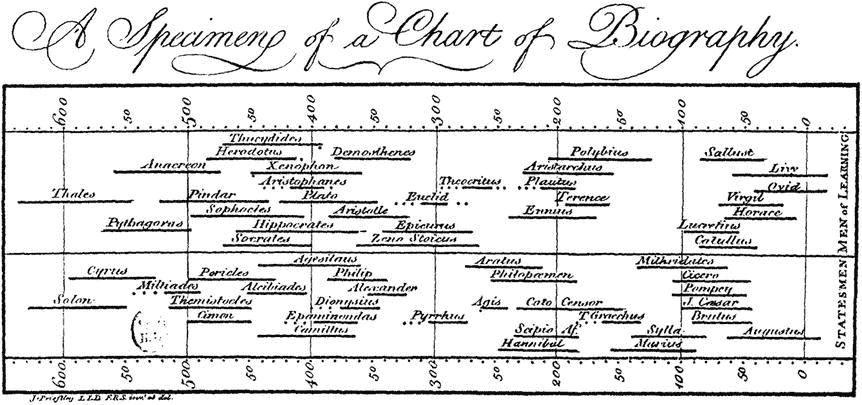
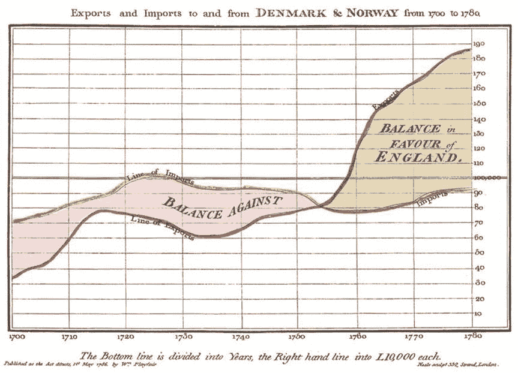
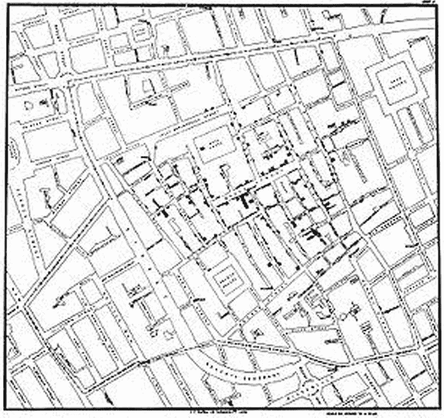
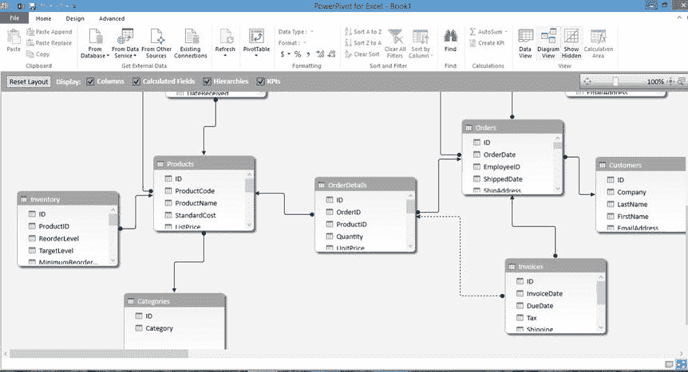

# 1. 大数据

电子补充材料 本章的在线版本（doi:[10.​1007/​978-1-4842-0529-7_​1](http://dx.doi.org/10.1007/978-1-4842-0529-7_1)）包含补充材料，可供授权用户使用。

当今商业的目标是挖掘数据中蕴藏的智能。我们正目睹多种趋势的汇聚，导致可用数据呈指数级增长，其中包括廉价的存储设备和用于收集数据的传感器的普及。此外，使物体相互交互的物联网也将产生海量数据。

各类组织正试图从非结构化数据中提取智能。他们努力打破不同数据孤岛之间的壁垒。大数据和 NoSQL 工具正被用于分析这股数据洪流。

大数据有许多定义，但其核心在于从大量数据中提取可能无法基于较小数据集发现的洞察。通过分析购买习惯来预测客户想要购买的产品，可用于确定销售哪些商品。本章将涵盖数据分析工具从早期原始地图和图表到当今大数据工具的演变历程。

## 大数据作为第四生产要素

基于工业经济的传统经济学认为，存在三个生产要素：土地、劳动力和资本。2012 年 12 月 27 日的《金融时报》刊登了一篇题为《为何“大数据”是第四生产要素》的文章，探讨了大数据在决策中的作用。文章指出：“随着大数据的普及，高管们越来越依赖数字洞察。但大数据的魅力在于，它能让直觉型和分析型思考者都发挥出色。更具创业精神和创造力的领导者可以在不同的数据源中发现意想不到的模式（这可能会吸引他们直觉型的天性），并最终利用这些信息改变企业的方向。”

## 大数据作为自然资源

IBM 首席执行官弗吉尼亚·罗梅蒂曾表示：“大数据是下个世纪世界的自然资源。”她还补充说，数据需要经过提炼才能发挥作用。IBM 已从硬件制造转型，并投资了 300 亿美元用于增强其大数据能力。

IBM 在大数据方面的投资很大一部分用于开发 `Watson`——一种自然语言问答计算机。`Watson` 于 2011 年作为《危险边缘！》的参赛者首次亮相，并击败了前任冠军。它具有每秒搜索 100 万本书的计算能力，还能处理口语化的英语。

`Watson` 更实际的应用之一是与医生合作制定癌症治疗方案。为此，`Watson` 接收了来自 200 万页医学期刊和 60 万份临床记录的信息。当医生输入患者的症状时，`Watson` 可以生成一份按成功置信度排序的建议列表。

## 数据作为中层管理者

2015 年 4 月 30 日，克里斯托弗·米姆斯在《华尔街日报》上发表了一篇题为《数据是新任中层管理者》的文章，描述了一些初创公司如何用数据取代中层管理者。文章指出：“初创公司比以往任何时候都更加灵活，这要归功于一种根本不同的管理结构，这种结构将决策权下放到组织的外围，即实际负责执行公司具体业务的人员手中。这种相对扁平化的层级结构之所以成为可能，是因为一线员工基本上可以无限制地访问过去难以获取或需要更高级管理层解读的数据。”文章进一步阐述，当数据库非常昂贵且商业智能软件耗资数百万美元时，限制只有高层管理者才能访问是有道理的。但如今情况已非如此。需要数据科学家来验证数据的准确性及其呈现方式。米姆斯总结道：“既然每位员工都能拥有监控任何目标进度的工具，那么中层管理者作为信息收集和决策者的旧角色，在许多初创公司中已不再适用。”

## 早期数据分析

数据分析并非一开始就如此复杂。它历经多年，从非常原始的形式演变到今天的水平。

### 第一条时间线

1765 年，神学家兼科学家约瑟夫·普里斯特利创建了第一条时间线图表，其中使用单个条形图来比较多位人物的寿命，如图 1-1 所示。

图 1-1. 早期的时间线图表

### 第一个条形图和时间序列

苏格兰工程师威廉·普莱费尔被誉为折线图、条形图和饼图的发明者。他的时间序列图至今仍被视为清晰的典范。普莱费尔于 1786 年在伦敦首次出版了《商业与政治地图集》。该地图集包含 43 个时间序列图和一个条形图，被描述为第一部包含统计图表的重要著作。普莱费尔于 1801 年在伦敦出版的《统计概览》中包含了被普遍认为是第一个饼图的图表。图 1-2 展示了普莱费尔绘制的一个显示贸易差额的时间序列图。

图 1-2. 普莱费尔的贸易差额时间序列图

### 霍乱地图

1854 年，医生约翰·斯诺绘制了伦敦霍乱病例的分布图，以确定其与单个水泵受污染水源之间的关联，如图 1-3 所示。在此分析之前，无人知晓霍乱的病因。这被认为是首次使用地图来分析疾病传播方式。

图 1-3. 霍乱地图

## 现代数据分析

互联网释放了海量数据。谷歌和其他互联网公司设计了访问这些数据并使其广泛可用的工具。

### 谷歌流感趋势

2009 年，谷歌建立了一个系统，基于与流感相关的搜索来追踪流感爆发。当 2009 年 H1N1 危机爆发时，谷歌的系统被证明比存在自然报告滞后的政府统计数据更具实用性和及时性（《大数据》作者：维克托·迈尔-舍恩伯格和肯尼思·库克耶，Mariner Books, 2013 年）。然而，在 2012 年，该系统高估了流感病例的数量，推测是由于媒体对流感的关注所致。为此，谷歌调整了其算法。

### 谷歌地球

谷歌地球的前身由计算机程序员丽贝卡·摩尔于 2005 年开发。她住在加利福尼亚州的圣克鲁斯山脉，那里一家木材公司提议开展一项以防火为名的伐木作业。摩尔使用谷歌地球来证明该伐木计划将清除住宅和学校附近的森林，并威胁到饮用水源。

### 追踪疟疾

2014 年 9 月 10 日，《旧金山纪事报》的一篇文章报道，加州大学旧金山分校的一个团队正在使用谷歌地球追踪非洲的疟疾情况，并监测可能面临爆发风险的区域。文章称：“加州大学旧金山分校团队希望聚焦于促使疟疾传播的因素：近期降雨、植被茂密、低海拔、温暖气温、靠近河流、人口密集。”基于这些因素，可以识别出潜在的疟疾热点区域。

## 大数据成本节约

根据 2014 年 7 月 1 日《华尔街日报》一篇题为"大数据削减成本"的文章，咨询公司高德纳研究总监克里斯·伊尔沃利诺表示："会计师和财务高管通常关注销售和支出等单项指标，而非研究不同数据集之间的关系。但那些成功整合这些信息流的公司，已从大数据中获得了巨大收益。"

文中列举的案例如下：

- 近期，通用汽车基于成本与预期销售额的分析，决定停止在欧洲销售雪佛兰品牌。这项分析仅用了**几天**时间，而非数周。
- `Planet Fitness` 能够根据跑步机在健身俱乐部高流量区域的位置来分析其使用情况，并轮换它们以平衡机器磨损。

## 大数据与政府

政府资金和人力有限，但却拥有海量数据。遗憾的是，大多数政府机构不知道如何利用所掌握的数据，在正确的时间将资源分配给正确的人。

美国政府曾试图通过网站 `USAspending.gov` 公开资金流向。位于硅谷中心的加利福尼亚州帕洛阿尔托市，则通过其网站 `data.cityofpaloalto.org` 提供数据。该市利用数据的目标是实现敏捷、高效的政府运作。该网站提供城市运营的基本数据，包括树木的种植和修剪时间。

### 预测性警务

预测性警务利用数据预测犯罪可能发生的地点，从而实现警力资源的高效配置。其目标是识别犯罪风险较高的人员和地点。

### 一个节约成本的成功案例

2011 年 1 月 24 日《纽约客》杂志的一篇文章描述了一位三十多岁的医生杰弗里·布伦纳如何不顾警方反对，绘制新泽西州卡姆登市的犯罪和医疗急救统计数据，设计出一套能削减成本的系统。他获取了三家主要医院的医疗账单记录以及犯罪统计数据。他绘制了一幅幅逐街区的地图，并根据居民的住院费用进行颜色编码。他发现，费用最高的两个街区包括一家大型疗养院和一处低收入住宅区。据文章描述："他发现，从 2002 年 1 月到 2008 年 6 月，这两栋楼里约 900 人产生了超过 4000 次就诊记录和约 2 亿美元的医疗账单。其中一名患者在五年内住院 324 次。费用最高的患者给保险公司造成了 350 万美元的损失。"他确定，1%的患者承担了 30%的费用。

布伦纳的目标是在削减成本的同时，最有效地帮助患者。他尝试锁定病情最严重的患者，提供预防性护理和健康监测，以及针对药物滥用的治疗，以最大限度地减少急诊就诊和住院次数。他建立了一个由执业护士和社会工作者组成的支持系统，来照护病情最严重的患者。这种方法的早期结果显示成本降低了 56%。

## 物联网或工业互联网

物联网指的是设备之间的机器对机器通信，涉及家庭照明、恒温器等设备间的网络连接。思科系统公司则使用"万物互联"这一术语。

2014 年 7/8 月刊《快公司》杂志的一篇文章描述了通用电气公司如何使用"工业互联网"这一术语。这涉及将智能嵌入机器，以收集和分析其数据，从而预测故障，使问题得以预见和纠正。通用电气的喷气发动机就是一个例子。通用电气计划利用发动机产生的数据来预测发动机部件何时需要维修，从而在故障发生前解决问题。通用电气的设想是，生产力和可靠性方面的小幅提升也能带来巨大的经济效益。

通用电气还在研发一款用于机车的智能巡航控制系统"行程优化器"。该系统利用火车的地理位置、重量、速度、燃油消耗和地形数据，计算出最佳速度，以最大限度地减少燃油消耗。

### 麻省理工学院削减能源成本

2014 年 9 月 28 日《华尔街日报》一篇题为"大数据降低建筑能耗"的文章描述了廉价的传感器如何能够实时收集能源消耗数据。例如，麻省理工学院设立了一个能源作战室，用于监控校园建筑的能源使用情况。能源泄漏可以被发现并得到纠正。

## 大数据革命与医疗保健

麦肯锡公司 2013 年 4 月一份题为"美国医疗保健行业的大数据革命：加速价值与创新"的报告指出，基于制药公司将多年研究成果整合到医学数据库中，以及医疗保健提供者将患者记录数字化，医疗保健领域正在经历一场大数据革命。基于数据的循证医学正成为一种趋势。大数据算法正被用来提供最佳证据。

目前，医疗保健支出占美国国内生产总值的 17%以上。麦肯锡估计，在医疗保健领域实施这些大数据策略，可以使美国的医疗费用降低 12%至 17%，每年节省 3000 亿至 4500 亿美元。

"生物学研究固然重要，但感觉数据科学对医学的贡献将超过所有生物科学的总和。"风险投资家维诺德·科斯拉在斯坦福大学医学院生物医学大数据会议上如是说（引自 2014 年 5 月 24 日《旧金山纪事报》）。他进一步表示，人类判断力无法与从数百万个数据点中得出预测的机器学习系统相抗衡。他还预测，技术将取代医生在决策中 80%–90%的角色。

### 医疗化智能手机

2015 年 1 月 10 日，《**华尔街日报**》的一篇文章报道称，“医疗化智能手机将颠覆医疗保健的方方面面”。人们正在开发可测量血压甚至进行心电图的智能手机配件。可穿戴无线传感器能够追踪血氧和血糖水平、血压以及心律。即将推出的手表可持续采集血压和其他生命体征数据。其结果将是数据量大幅增加，并有可能用虚拟医生问诊取代实体门诊。

2013 年 12 月，`IDC Health Insights` 发布了一份题为“美国互联健康 2014 年十大预测：新型护理交付模式”的报告。该报告预测了一种涉及移动医疗应用、远程医疗和社交网络的新型医疗保健交付模式，这种模式将“在传统医疗机构之外提供更高效、更具成本效益的医疗保健方式”。根据该报告，这些变革将依赖于四种变革性技术：移动、大数据分析、社交、云。

该报告引用了**约翰·霍普金斯大学**的“智能手机体检”项目。该项目“使用一系列基于智能手机的医疗设备，来收集对体检具有临床意义的定量或定性数据，例如体重、血压、心率、血氧饱和度、视力、视盘和鼓膜图像、肺功能值、心电图、心音和肺音以及超声可视化图像（如颈动脉成像）。”

根据该报告，“随着消费者更多地采用移动健康、个人健康和健身建模以及社交技术，来自不同数据源的消费者数据将激增，从而产生关于消费者的丰富信息。”

**麦肯锡公司**2011 年 5 月发表了一篇题为“大数据：创新、竞争与生产力的下一个前沿”的论文，提出了利用大数据创造价值的五种方式，具体如下：

- 大数据可以通过提高信息的透明度和使用频率来释放巨大价值。
- 随着组织以数字形式创建和存储更多交易数据，它们可以收集从产品库存到病假天数等所有方面更准确、更详细的绩效信息，从而提升绩效。
- 大数据允许对客户进行更精细的细分，从而实现更精准定制的产品或服务。
- 复杂的分析可以显著改善决策。
- 大数据可用于改进下一代产品和服务的开发。

## 提高工业设备的可靠性

为了提高喷气发动机等工业设备的可靠性，通用电气（`GE`）已将实施工业互联网作为首要任务。该公司现在每天从 140 万件医疗设备和 28,000 台喷气发动机中收集 5000 万个数据点。目标是提高设备的可靠性。`GE` 开发了 `Predix`，可用于分析其他公司生成的数据，以构建和部署软件应用程序。

## 大数据与农业

精准农业的目标是提高农业生产力，以便在世界人口增长的情况下生产足够的粮食。收集的数据包括土壤和空气质量、海拔、土壤氮含量、作物成熟度、天气预报、设备和劳动力成本。这些数据用于确定何时种植、灌溉、施肥和收获。这是通过安装传感器来测量土壤温度和湿度来实现的。拍摄农田图像以显示作物成熟度。使用预测性天气模型来规划灌溉和收获时间。目标是提高作物产量、降低成本、节省时间和减少用水量。

## 廉价存储

在 20 世纪 40 年代初期，物理计算机普及之前，“计算机”是一个工作岗位的名称。计算机的第一波浪潮是关于加速计算。1946 年，第一台通用电子计算机——电子数字积分器与计算机（`ENIAC`）——在宾夕法尼亚大学安装。`ENIAC` 占据了一整个房间，重达 30 吨，使用了超过 18,000 个真空管，最初设计用于计算弹道轨迹。然而，到 1946 年二战已经结束，因此这台计算机被转而用于和平应用。

### 个人计算机与存储成本

个人计算机诞生于 20 世纪 70 年代，采用英特尔芯片和软盘驱动器进行存储，主要供爱好者使用。1981 年 8 月，`IBM PC` 发布，配备了存储 360 千字节数据的 5.25 英寸软盘驱动器。全球最大的计算机公司`IBM` 推出个人电脑这一事实向其他公司发出了一个信号：个人电脑是一种严肃的办公工具。1983 年，`IBM` 发布了 `IBM-XT`，它配备了一个 10 兆字节的硬盘，售价数百美元。如今，一个太字节的硬盘可以以不到 100 美元的价格购得。多个吉字节的闪存盘只需不到 10 美元即可买到。

### 文件大小回顾

在个人计算机的发展历程中，随着存储需求的指数级增长，我们经历了从千字节到兆字节、吉字节，再到现在的太字节及更高容量。早期的个人计算机有 640 千字节的内存。据报道，**微软公司**联合创始人比尔·盖茨曾说过，没有人会需要超过 640 千字节的内存。20 世纪 80 年代发布的**微软**操作系统 `MS-DOS` 的各个版本只能寻址 640 千字节的内存。`Windows` 的一个卖点就是它能寻址超过 640 千字节的内存。表 [1-1] 显示了数据是如何衡量的。

**表 1-1.** 存储容量测量

| 单位 | 2 的幂次 | 近似数量 |
| --- | --- | --- |
| 千字节 (Kilobytes) | 2¹⁰ | 千级 |
| 兆字节 (Megabytes) | 2²⁰ | 百万级 |
| 吉字节 (Gigabytes) | 2³⁰ | 十亿级 |
| 太字节 (Terabytes) | 2⁴⁰ | 万亿级 |
| 拍字节 (Petabytes) | 2⁵⁰ | 千万亿级 |
| 艾字节 (Exabytes) | 2⁶⁰ | 百万亿亿级 (Sextillions) |
| 泽字节 (Zettabytes) | 2⁷⁰ | 千的七次方级 (Septillions) |

### 数据持续膨胀

纽约证券交易所每天产生 4 到 5 太字节的数据。`IDC` 估计，2013 年的数字宇宙为 4.4 泽字节，并预测到 2920 年将增长十倍，达到 44 泽字节。

互联网连接数也在呈指数级增长。根据`思科系统`的数据，目前全球有 150 亿个网络连接，预计到 2020 年将增长到 500 亿个。

## 关系型数据库

随着计算机的普及，存储的数据量日益增长，因而需要软件来组织这些数据。关系型数据库管理系统（RDBMS）基于 `E. F. 科德` 于 20 世纪 70 年代初在 `IBM` 开发的关系模型。尽管早期工作由 `IBM` 完成，但首个商业化的关系型数据库管理系统是由甲骨文公司于 1979 年发布的。

关系型数据库将数据组织成包含行和列的表，每一行都有一个唯一的键，称为主键。一个数据库由多个表组成。数据库中的每个实体都拥有自己的表，表中的行代表该实体的实例。列则存储属性或字段的值。

关系代数由科德在 `IBM` 首次提出，为建模关系型数据库中存储的数据以及定义查询提供了理论基础。关系型数据库支持选择、投影和连接操作。选择是指根据条件选取表中的特定行。投影是指选取特定的列或属性。连接是指根据条件将两个或多个表关联起来。

正如第 5 章所讨论的，结构化查询语言（`SQL`）最初由 `IBM` 在 20 世纪 70 年代初开发，用于操作和检索 `IBM` 早期关系型数据库管理系统中的数据。后来，甲骨文公司以及微软公司也陆续在其关系型数据库管理系统中实现了该语言。

### 规范化

规范化是按照以下目标来组织数据库中数据的过程：

- 避免重复字段（用于连接表的关键字段除外）。
- 避免多重依赖，即避免依赖于主键之外任何内容的字段。

存在多种范式，最常见的是第三范式（`3NF`），它基于消除传递依赖，也就是消除不依赖于主键的字段。换句话说，当每个字段都依赖于主键、整个主键、并且仅依赖于主键时，数据就符合第三范式。

图 1-4（与图 4-11 相同）展示了多个表之间的关系。带箭头的线条表示表之间的关系。主要有三种关系类型。

- **一对一（`1-1`）** 表示字段之间具有一一对应的关系。通常，具有一一对应关系的字段会位于同一个表中。
- **一对多** 表示对于一个表中的每条记录，在对应表中有多条记录与之关联。“多”由线条末端的箭头表示。“多”意味着从零到 `n`。例如，如图 1-4 所示，对于“产品表”中的每个产品代码，在“订单明细表”中可能存在多个产品 ID 实例，但每个产品 ID 在“产品表”中只关联一个产品代码。
- **多对多** 表示一个实体的多个实例与另一个实体的多个实例之间的关系。例如，作者与书籍：每位作者可以有多本书，每本书也可以有多位作者。“多”意味着从零到 `n`。

*图 1-4. 显示表之间的关系*

### 个人计算机的数据库软件

20 世纪 80 年代，随着个人计算机的普及，专门为其开发的数据库程序应运而生。`dBASE II` 是首批用于个人计算机的可编程关系型数据库系统之一，由加州帕萨迪纳市喷气推进实验室（`JPL`）的韦恩·拉特利夫开发。20 世纪 80 年代初，他与乔治·泰特合作成立了 `Ashton-Tate` 公司来销售 `dBASE II`，该系统大获成功。20 世纪 80 年代中期，发布了功能增强的 `dBASE III`。

`dBASE` 程序是解释执行的，这意味着它比将所有指令一次性翻译成机器语言的编译型程序运行得更慢。1985 年，`Clipper` 作为 `dBASE` 的编译版本发布，并变得非常流行。几年后，`FoxBase`（后来更名为 `FoxPro`）发布，并增添了更多增强功能。

## 大数据与 NoSQL 的诞生

互联网在 20 世纪 90 年代得到普及，这在一定程度上要归功于万维网，它使互联网的使用变得更加简单。相互竞争的搜索引擎让用户能够轻松找到数据。谷歌成立于 1996 年，并彻底改变了搜索方式。随着越来越多数据的出现，试图将所有数据都塞进矩形表格的关系型数据库的局限性变得日益明显。

1998 年，卡洛·斯特罗齐使用了术语 `NoSQL`。据报道，他后来对这个术语感到后悔，并认为 `NoRel`（即非关系型）或许是一个更好的选择。

### Hadoop 分布式文件系统（HDFS）

大数据技术的许多成果都源于搜索引擎公司。`Hadoop` 起源于 2002 年启动的开源网络搜索引擎 `Apple Nutch`。它包含一个网络爬虫和搜索引擎，但无法扩展以处理数十亿个网页。

2003 年，一篇描述谷歌分布式文件系统（`GFS`）架构的论文发表，该系统被谷歌用于存储网络爬取和索引过程中生成的大文件。2004 年，一个名为 `Nutch` 分布式文件系统（`NDFS`）的开源版本发布。

2004 年，谷歌发表了一篇关于 `MapReduce` 的论文。到 2005 年，`MapReduce` 已被整合到 `Nutch` 中。`MapReduce` 是一种批处理查询过程，能够对大型数据集运行临时查询。它解锁了以前被归档的数据。运行查询可能需要几分钟甚至更长时间。

2006 年 2 月，`Hadoop` 作为一个独立的子项目建立。基于他与迈克·卡法雷拉的先前工作，道格·卡廷加入了雅虎公司，雅虎提供了资源，使 `Hadoop` 成为对互联网有用的工具。到 2008 年，雅虎将其搜索索引建立在 `Hadoop` 集群之上。`Hadoop` 这个名字源于道格·卡廷的孩子给一只黄色填充大象起的名字。`Hadoop` 提供了一个运行在廉价商用硬件上、可靠且可扩展的存储和分析平台。`Hadoop` 是开源的。

## 大数据

大数据没有一个统一的定义，但目前围绕它有许多炒作，这可能导致其含义被稀释。普遍认为，它指的是具有不规则结构、数据量巨大（从数百 `TB` 到 `PB` 乃至更高）的数据。它可以包括来自金融交易、传感器、网络日志和社交媒体等的数据。一个更具操作性的定义是：当组织的数据处理需求超出传统关系型数据库的能力范围时，它们就必须使用大数据。

大数据基于反馈经济，物联网将传感器安装在越来越多的设备上。随着医疗记录数字化、更多商店通过会员卡追踪消费者购买行为、以及人们佩戴健康追踪设备，越来越多的数据正在被生成。通常，大数据更关注分析行为，而非监控事务——后者是传统关系型数据库的领域。随着存储成本的下降，企业追踪越来越多的数据以寻找模式并构建预测模型。

### 三个 V

一种描述大数据特征的方式是通过三个 V：

- **体量（Volume）**：涉及多少数据？
- **速度（Velocity）**：数据产生得有多快？
- **多样性（Variety）**：数据是否具有不规则的结构和格式？

另外两个有时会提到的 V 是：

- **易变性（Variability）**：是否涉及多种不同格式且解释各异的数据？
- **准确性（Veracity）**：数据有多准确？

### 数据生命周期

数据生命周期包括收集和分析数据以构建预测模型，遵循以下步骤：收集数据。存储数据。查询数据以识别模式并理解数据。使用可视化工具发现商业价值。基于数据预测未来消费者行为。

### Apache Hadoop

`Hadoop` 是一个用 `Java` 编写的开源软件框架，用于对存储在商用服务器上的超大数据集进行分布式存储和处理。它具有内置的冗余机制来处理硬件故障。`Hadoop` 基于两大核心技术：`MapReduce` 和 `Hadoop` 分布式文件系统（`HDFS`）。`Hadoop` 由 `Doug Cutting` 和 `Mike Cafarella` 于 2005 年创建。

#### `MapReduce` 算法

`MapReduce` 由 `Google` 开发，并通过 2004 年的一篇论文发布，该论文描述了如何使用并行处理来处理大量数据。随后它被发布到公共领域，涉及一个两步批处理过程。首先，数据被分区并发送给映射器（`mapper`），映射器生成键值对。然后对这些键值对进行整理，使得每个键对应的值聚合在一起，之后归约器（`reducer`）处理这些键值对，为每个键计算一个值。一个经常被引用的例子是单词计数。它涉及扫描一份文稿并统计每个单词出现的次数。在这个例子中，每个单词是一个键，每个单词被使用的次数就是值。

#### `Hadoop` 分布式文件系统 (`HDFS`)

`HDFS` 是一个运行在商用服务器上的分布式文件系统。它基于 `Google` 文件系统（`GFS`）。它将文件分割成块并分布到集群的各个节点中。数据会被复制，这样即使一台服务器宕机，也不会丢失数据。数据是不可变的，这意味着表不能被编辑；它只能被写入一次，就像 `CD-R` 一样，基于一次写入多次读取。新数据可以追加到现有文件中，或者可以删除旧文件并将新数据写入新文件中。`HDFS` 具有很强的可扩展性，可以通过添加更多服务器来处理更多数据。`HDFS` 的某些实现是仅追加的，这意味着底层表不可编辑。相反，写入操作会被记录日志，然后文件会被重新创建。

#### `Hadoop` 的商业化实现

`Hadoop` 是一个开源的 `Apache` 项目，但有几家公司开发了自己的商业化实现。由 `Doug Cutting` 和其他前雅虎员工创立的 `Hortonworks` 是提供商业化实现的公司之一。其他此类公司包括 `Cloudera` 和 `MapR`。另一个 `Hadoop` 实现是微软的 `HD Insight`，它运行在 `Azure` 云平台上。第 11 章中的一个示例展示了如何将 `HD Insight` 数据库导入到 `Power Query` 中。

### `CAP` 定理

一种理解 `NoSQL` 数据库的学术方式包括 `CAP` 定理。`CAP` 是 `Consistency`（一致性）、`Availability`（可用性）和 `Partition Tolerance`（分区容错性）的首字母缩写。根据该定理，任何数据库只能同时具备其中两个属性。关系型数据库具备一致性和分区容错性。大型关系型数据库在可用性方面较弱，因为在数据量大时延迟较高。`NoSQL` 数据库提供可用性和分区容错性，但在一致性方面较弱，因为缺乏固定的结构。

## `NoSQL`

正如本书其他地方所述，`NoSQL` 这个称谓其实是个误称。它并不意味着“不使用 `SQL`”。对这种类型的数据库，一个更好的术语可能是非关系型。`NoSQL` 设计用于访问没有关系结构、几乎没有或根本没有模式的数据。早期的 `NoSQL` 版本要求程序员编写自定义程序来检索数据。如今，越来越多的 `NoSQL` 数据库实现采用某种形式的 `SQL` 来检索数据。2015 年 5 月 29 日，`Timothy Stephan` 在 `Data Informed` 上发表了一篇题为“`NoSQL` 最需要的就是 `SQL`”（ [`http://data-informed.com/what-nosql-needs-most-is-sql/`](http://data-informed.com/what-nosql-needs-most-is-sql/) ）的文章，主张为 `NoSQL` 数据库提供更多的 `SQL` 访问方式。`NoSQL` 适用于“网络规模”的数据，这类数据的特点是数据量大且拥有数百万并发用户。

#### `NoSQL` 数据的特征

`NoSQL` 数据库用于访问不适合关系型表的非关系型数据。通常，关系型数据库用于关键业务的事务数据。`NoSQL` 数据库则通常用于分析非关键业务数据，如日志文件。

#### `NoSQL` 的实现

`NoSQL` 数据库有几种分类：
*   **键值存储**：这种类型的数据库以行存储数据，但不同行的模式可能不同。此类 `NoSQL` 数据库的例子有 `Couchbase`、`Redis` 和 `Riak`。
*   **文档存储**：这种类型的数据库处理作为 `JSON` 对象的文档。每个文档都有属性和值。一些例子包括 `CouchDB`、`Cloudant` 和 `MongoDB`。
*   **宽列存储**：这种类型的数据库拥有列族，列族由键值对的单个列组成。此类数据库的例子有 `HBase` 和 `Cassandra`。
*   **图数据库**：图数据库非常适合社交网络应用。它们拥有类似于表中行的节点。`Neo4j` 是此类数据库的一个例子。

一种允许访问 `Hadoop` 数据的产品是 `Hive`，它提供了一种类似 `SQL` 的语言 `HiveQL` 来查询 `Hadoop`。另一种产品是 `Pig`，它使用 `Pig Latin` 进行查询。有一种说法是，10 行 `Pig Latin` 代码可以完成 200 行 `Java` 代码的工作量。

### `Spark`

另一个备受关注的技术是 `Apache Spark`——一个最初于 2009 年在 `UC Berkeley` 开发的开源集群计算框架。它使用一种内存技术，据称性能比 `Hadoop` 快 100 倍。它提供用于查询的 `Spark SQL`。`IBM` 最近宣布将投入大量资源用于 `Spark` 的开发。

## 微软自助式 `BI`

这些大数据和 `NoSQL` 技术大多源自处理海量数据的搜索引擎和在线零售商。对于处理数千行或数百万行数据的中小型组织来说，本书将展示如何利用微软在 `Excel` 之上的 `Power BI` 功能。关于可以加载到 `PowerPivot` 中的最大行数，已有大量讨论。下面链接到 `Microsoft Trends` 的一篇博客文章，其中记录了加载 1.22 亿条记录的过程：[`www.microsofttrends.com/2014/02/09/how-much-data-can-powerpivot-really-manage-how-about-122-million-records`](http://www.microsofttrends.com/2014/02/09/how-much-data-can-powerpivot-really-manage-how-about-122-million-records)。

## 总结

本章简要介绍了数据分析的演变历史，最终介绍到当今的大数据工具。它涵盖了数据结构的演变，从关系型数据库到 `NoSQL` 所处理的非结构化程度更高的数据。