# 2. 作为数据库和数据聚合器的 Excel

电子表格在使普通人能够访问数据方面有着悠久的历史。本章将记述 Excel 从电子表格演变为强大数据库的过程。然后展示如何从各种来源导入数据。后续章节将演示 Excel 配合 Power BI 如何成为一个强大的商业智能工具。


## 从电子表格到数据库

第一款电子表格程序`VisiCalc`（“可视计算器”的缩写）于 1979 年为苹果 II 型电脑发布。它是第一款“杀手级应用”。当时有种说法是“`VisiCalc`卖出的苹果电脑比苹果公司自己卖的还多”。`VisiCalc`由丹·布里克林和鲍勃·弗兰克斯顿开发。当时布里克林正在哈佛商学院就读，当他看到一位教授手动编写财务模型时，便萌生了开发该程序的想法。每当教授想要修改数据，就得擦掉旧数据重新写。布里克林意识到，这个过程可以通过在个人电脑上运行电子表格来自动化完成。

在那个年代，大多数会计数据都困在需要程序员才能修改或访问的大型主机程序中。因此，程序员被称为计算机领域的“大祭司”，这意味着最终用户几乎无法控制程序的工作方式。对于当时来说，`VisiCalc`非常易于使用。但与今天的电子表格相比，它也非常原始。例如，在`VisiCalc`的早期版本中，所有列宽都必须相同。

成功会招致竞争。`VisiCalc`无法在当时的商用计算机——CP/M 电脑上运行。CP/M 最初是 Control Program/Monitor（控制程序/监控器）的缩写，后来演变为“Control Program for Microcomputers”（微型计算机控制程序），是 20 世纪 70 年代末 80 年代初使用的一种操作系统。1980 年，Sorcim 推出了`SuperCalc`，作为 CP/M 电脑的电子表格程序。微软于 1982 年发布了`Multiplan`。当时所有的电子表格程序都是菜单驱动的。

1981 年 8 月，IBM PC 的发布向其他大公司传递了一个信号：个人电脑是处理大型业务的重要工具。`VisiCalc`被移植到 IBM PC 上运行，但并未充分利用新电脑增强的硬件功能。

企业家米奇·卡普尔（`VisiCalc`开发者的朋友）看到了机会，创立了莲花发展公司（Lotus Development），专门为 IBM PC 编写电子表格程序。他将自己的电子表格程序命名为`Lotus 1-2-3`。`1-2-3`这个名称表明，它在原始电子表格功能的基础上，增加了创建图表和执行简单排序等有限数据库功能的能力。

`Lotus 1-2-3`是第一款通过电视广告推广的软件程序。它与 IBM PC 相辅相成，变得广受欢迎，并在整个 20 世纪 90 年代初期一直处于领先地位。

微软的`Excel`是第一款使用图形用户界面的电子表格程序，该界面因苹果麦金塔电脑而普及。`Excel`于 1987 年在麦金塔电脑上发布，后来移植到了 Windows 系统。20 世纪 90 年代初，随着 Windows 的普及，微软将 Word 和`Excel`打包成 Microsoft Office，并采取了激进的定价策略。结果，`Excel`取代了`Lotus 1-2-3`，成为领先的电子表格程序。如今，`Excel`是全球使用最广泛的电子表格程序。

越来越多的分析功能（如数据透视表）被逐步引入`Excel`，可处理的最大行数也得到了增加。利用`VLOOKUP`，可以在表格之间建立简单的关联。对于`Excel 2010`，微软推出了可单独下载的`PowerPivot`，它允许基于多个表构建数据模型。`PowerPivot`随`Excel 2013`一起提供。第 4 章将讨论如何使用`PowerPivot`构建数据模型。

### 解读文件扩展名

文件扩展名指示了文件中存储的数据类型。本章将展示如何将多种格式的数据导入到 Excel 的原生`.xlsx`格式中，这是在后续章节中使用 Power BI 高级功能所必需的。本章将处理具有以下扩展名的文件：

- `.xls`：Excel 2007 之前的 Excel 工作簿
- `.xlsx`：Excel 2007 及更高版本的 Excel 工作簿；添加的第二个 x 表示数据以 XML 格式存储
- `.xlsm`：包含宏的 Excel 工作簿
- `.xltm`：Excel 工作簿模板
- `.txt`：包含文本的文件
- `.xml`：XML 格式的文本文件

### 将 Excel 用作数据库

默认情况下，Excel 使用由行和列组成的表格。每一行是一条记录，包含单个项目的所有属性。每一列是一个字段或属性。

表格应在第一行显示字段名称，并且其周围应有空白区域——每侧有一个空白列，上下各有一个空白行，除非第一行就是第 1 行或第一列就是 A 列。单击表格中的任意位置，然后按`Ctrl` + `T`将其定义为表格，如图 2-1 所示。请注意每列顶部带有箭头的标题。单击箭头会弹出一个菜单，提供排序和筛选选项。

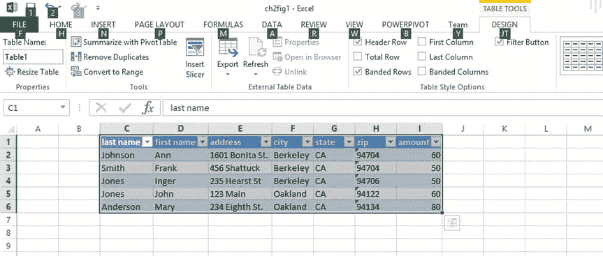

图 2-1.

一个 Excel 表格

请注意，使用当前版本的 Excel 时，如果对某个字段进行排序，它会智能地同时移动相关字段（只要区域内没有空白列），如图 2-2 所示，这里按姓氏进行了排序。要按名和姓排序，可以先按名排序，再按姓排序。

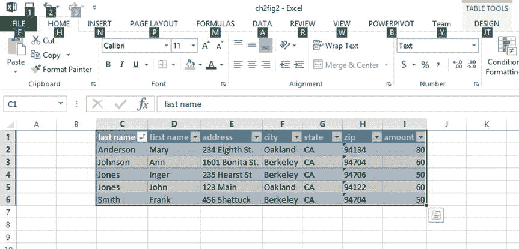

图 2-2.

按名和姓排序后的 Excel 表格

### 从其他格式导入

Excel 可用于从多种来源导入数据，包括文本文件中的文本、网站上的表格数据、XML 文件中的数据以及 JSON 格式的数据。本章将向您展示如何导入一些更常见的格式。第 4 章将介绍如何使用 Power BI 连接多个表。

#### 在 Excel 中打开文本文件

Excel 可以打开逗号分隔、制表符分隔、固定长度字段和 XML 格式的文本文件，以及图 2-3 中显示的文件格式。当这些格式的文件在 Excel 中打开时，它们会自动转换为电子表格。

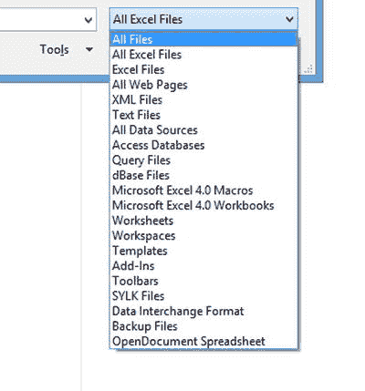

图 2-3.

可以导入 Excel 的文件格式

导入文件时，最好对文件的副本进行操作，这样即使导入时文件损坏，原始文件也能保持不变。

图 2-4 显示了记事本中的一个逗号分隔文件。请注意，第一行由字段名称组成。所有字段都用逗号分隔。Excel 知道如何将这种类型的文件读入电子表格。如果用 Excel 打开这种格式的文本文件，它将显示为电子表格，如图 2-1 所示。


图 2-4.

逗号分隔值格式


#### 从 XML 导入数据

可扩展标记语言（XML）是一种广为流行的数据存储格式。与 HTML 类似，它使用成对标签来定义每个元素。图 2-5 展示了我们一直操作的数据的 XML 格式。第一行是指明 XML 版本、UTF 编码及其他信息的声明。请注意包裹所有其他标签的 `donors` 根标签。

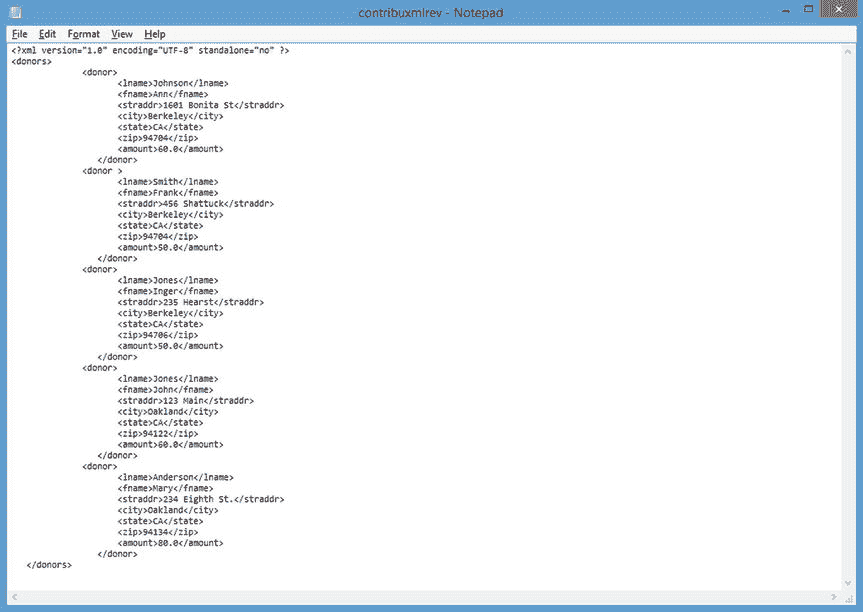

图 2-5. XML 格式

这些数据是自描述的。在本示例中，每条记录（即每一行）都被一个 `donor` 标签包裹。每个字段的名称在开始和结束标签中各出现一次。该文件将保存为带有 `.xml` 扩展名的文本文件。

XML 文件可以直接用 Excel 打开。打开后弹出的第一个窗口中选择“作为 XML 表格”。然后在下一个弹出的窗口中，点击“是”以确认“Excel 将创建架构”。

如图 2-6 所示，XML 文件可以在诸如 Internet Explorer 之类的网页浏览器中显示。请注意 `donor` 标签左侧的加号和减号。点击减号可隐藏每条记录中的详细信息，点击加号则可显示详细信息。

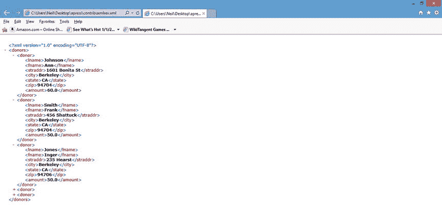

图 2-6. 在网页浏览器中显示的 XML 文件

#### 导入包含属性的 XML

与 HTML 类似，XML 也可以包含属性。图 2-7 展示了一个将 `gender` 属性作为 `donor` 标签一部分的示例。

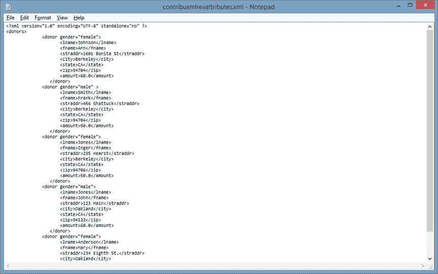

图 2-7. 包含属性的 XML

```
<donor gender = "female">
...
</donor>
```

关于属性的使用，存在两种观点。一些人认为应避免使用属性，所有值都应以成对标签呈现。然而，我们仍可能会遇到包含属性的 XML。Excel 能够解释这两种格式。图 2-8 展示了打开图 2-7 中所示 XML 文件后显示的 Excel 电子表格。

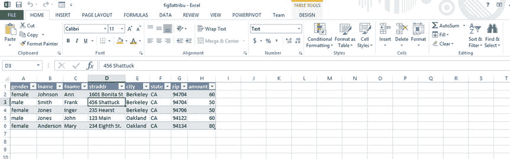

图 2-8. 包含属性并导入 Excel 的 XML

#### 导入 JSON 格式

许多 NoSQL 数据以 JavaScript 对象表示法（JSON）格式存储。遗憾的是，Excel 无法直接读取 JSON 文件，因此需要借助一种中间格式将其导入 Excel。图 2-9 展示了我们的示例文件以 JSON 格式呈现的样子。请注意其中的名称-值对，每当出现某个字段的实例时，该字段名称就会重复出现。

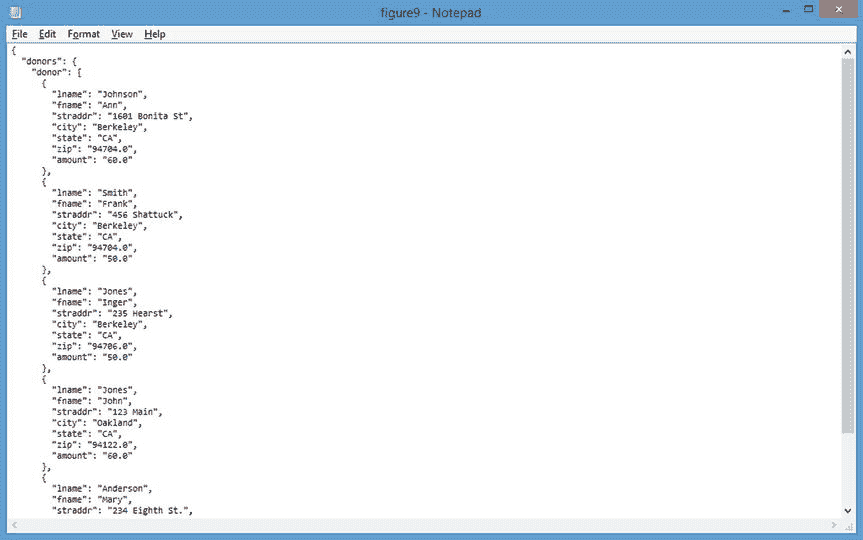

图 2-9. JSON 格式

由于 Excel 无法直接读取 JSON 文件，你必须将这种 JSON 格式的数据转换为 Excel 能够读取的格式（如 XML）。网上有许多免费的转换工具，例如 [`http://bit.ly/1s2Oi6L`](http://bit.ly/1s2Oi6L) 上的那个。

该转换器的界面如图 2-10 所示。（请记住对文件的副本进行操作，以免损坏原始文件。）可以将 JSON 文件内容粘贴到 JSON 窗口中，然后点击箭头将其转换为 XML。结果是一个同名的 XML 文件，你可以直接从 Excel 中打开它。

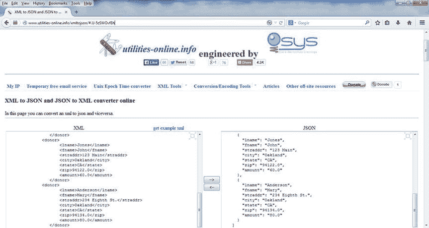

图 2-10. XML 与 JSON

### 使用“数据”选项卡导入数据

到目前为止，我们一直在将数据从文本文件直接导入 Excel 以创建新的电子表格。“数据”选项卡上的选项可用于将多种格式的数据导入到现有电子表格中。

#### 从网站上的表格导入数据

作为示例，我们来看一下从网站上的表格导入数据。

要从网站上的表格导入数据，请执行以下操作：

1.  单击“数据”选项卡以显示“数据”功能区。
2.  单击“自网站”。
3.  将会出现一个浏览器窗口。输入你要访问的网站地址。我们将访问一个劳工统计局关于按教育程度划分就业情况的示例。在本示例中，我们将使用[`http://www.bls.gov/emp/ep_table_education_summary.htm`](http://www.bls.gov/emp/ep_table_education_summary.htm)。
4.  如图 2-11 所示，每个表格旁边会出现一个黄色小方框中的黑色箭头。点击表格左上角黄色小方框中的黑色箭头，它将变为绿色方框中的对勾。
5.  单击“导入”。此时将出现“导入数据”对话框，如图 2-12 所示。

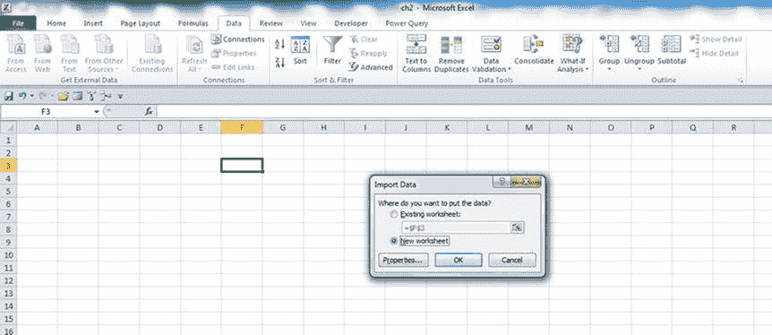

图 2-12. “导入数据”对话框

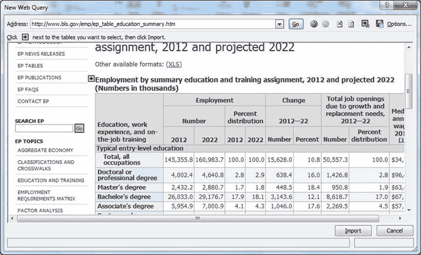

图 2-11. 从网页导入数据

6.  选择“新工作表”，然后点击“确定”。表格将被导入，如图 2-13 所示。可能需要在 Excel 中进行一些格式设置，才能使表格完全符合后续分析的要求。

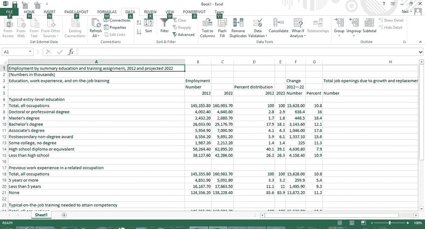

图 2-13. 从网页导入到 Excel 的数据

### 数据整理与数据清洗

导入的数据很少是直接可用的形式。数据可能存在以下问题：

-   不完整。
-   不一致。
-   格式错误。

数据整理涉及将原始数据转换为可用格式。数据清洗是指纠正错误和不一致性。Excel 提供了清洗和格式化数据的工具。

#### 修正大小写

Excel 提供的用于修正大小写的函数之一是 `Proper()` 函数。它会将每个单词的首字母大写，并将其余字母转换为小写。图 2-14 展示了一些文本在执行该函数前后的对比。要使用 `Proper()` 函数（如图 2-14 所示），请执行以下步骤：

1.  在新的一列中，输入“`=Proper(`”。
2.  单击要应用此函数的第一个单元格，然后输入右括号 (`)`)。接着按 Enter 键。
3.  单击刚才输入公式的单元格，然后拖动该单元格右下角的填充柄，将公式复制到整列。
4.  将单元格的内容从公式转换为值。对于少量单元格，可以通过选中每个单元格，按 `F2` 进行编辑，再按 `F9` 转换为值，最后按 Enter 键来实现。
5.  对于大量单元格，选择该列，右键单击，选择“复制”。然后选择要粘贴区域的最顶端的单元格，按 `Ctrl + Alt + V` 打开“选择性粘贴”对话框，选择“数值”，点击“确定”。
6.  之后，你可以通过右键单击该列的任意位置，选择“删除” ➤ “整列”来删除原始列。

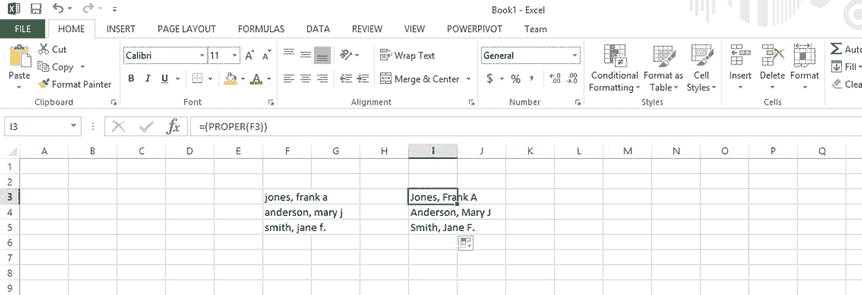

图 2-14. `Proper()` 函数的使用


好的，作为一名高级文档工程师和翻译员，我将严格按照您提供的注意事项和示例格式，将给定的英文文本翻译成中文。


#### 拆分分隔字段

在某些情况下，名字和姓氏包含在同一个字段中，并用逗号分隔。这些字段以及类似的字段，可以使用“数据”选项卡上的“分列”选项进行拆分。

选中要转换的单元格区域。单击“数据”选项卡上的“分列”。在弹出的窗口中，选择“分隔符号”，如图 2-15 所示。然后点击“下一步”。

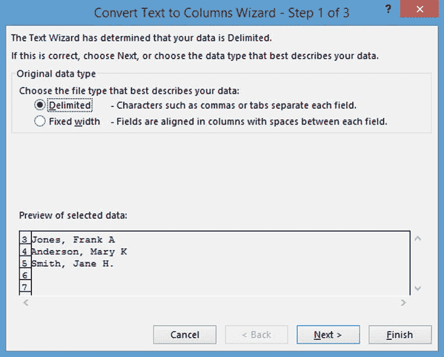

图 2-15.

“文本分列向导”对话框

在下一个弹出窗口中，如图 2-16 所示，选择“逗号”和“空格”作为分隔符，并预览结果。如果预览正确，点击“下一步”。将空格作为分隔符包含进来，是为了处理中间名缩写的情况，在本例中，中间名缩写与其各自的名字之间是用空格分隔的。

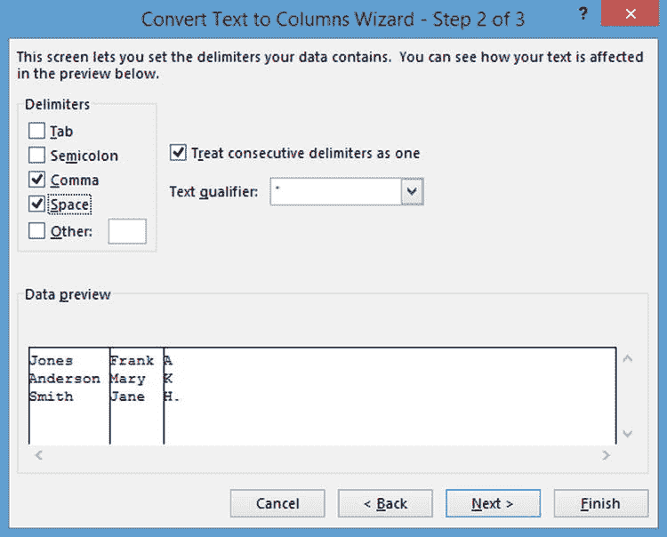

图 2-16.

“文本分列”的数据预览

在下一个弹出窗口中，在“数据预览”窗口中选择每一列，并选择“文本”作为该列的格式，如图 2-17 所示。输入结果要放置的目标位置，然后点击“完成”。

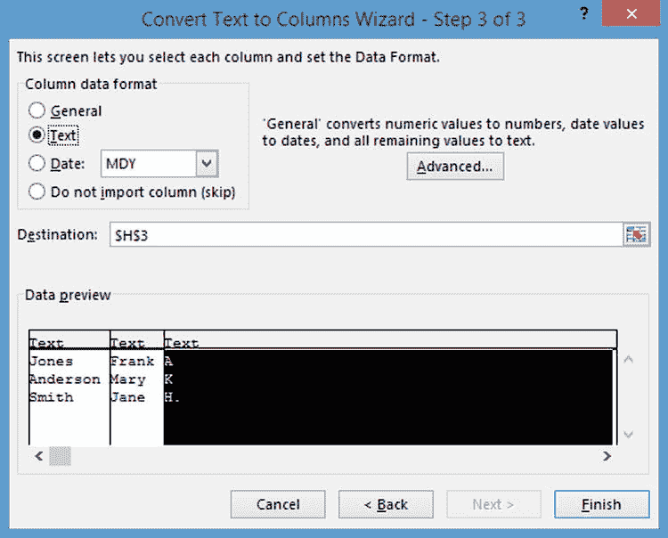

图 2-17.

“文本分列向导”的最后一步

#### 拆分复杂的分隔字段

更复杂的情况（涉及单个字段中的多个数据元素）通常可以通过使用 Excel 的内置函数来解决。表 2-1 显示了可用于字符串操作的一些函数。

表 2-1.

可用于字符串操作的函数

| 函数 | 说明 |
| --- | --- |
| `LEN(text)` | 返回文本字符串中的字符数 |
| `LEFT(text,num_chars)` | 返回由 `num_chars` 指定的最左侧字符数 |
| `RIGHT(text,num_chars)` | 返回由 `num_chars` 指定的最右侧字符数 |
| `MID(text,start,num_chars)` | 从 `start` 指定的位置开始，返回由 `num_chars` 指定的字符数 |
| `SEARCH(find_text,within_text,start_num)` | 从左到右读取时，返回指定的 `find_text` 在 `within_text` 中开始的位置。不区分大小写。`start_num` 指定要查找的文本的出现次数。默认值为 1。 |
| `TRIM(text)` | 删除文本字符串中所有前导和尾随空格，单词之间的单个空格除外 |
| `CLEAN(text)` | 删除文本字符串中所有不可打印字符 |
| `LOWER(text)` | 返回将所有字符转换为小写的字符串 |
| `UPPER(text)` | 返回将所有字符转换为大写的字符串 |
| `PROPER(text)` | 返回将每个单词的首字母转换为大写的字符串 |

函数可以嵌套。例如，我们可以使用以下公式提取姓氏：

`=LEFT(F7,SEARCH(",",F7)-1)`

此函数将提取从最左侧到逗号位置的字符。要提取名字和中间名缩写，请使用以下公式：

`=RIGHT(F7,SEARCH(", ",F7)+1)`

#### 删除重复项

导入的数据包含重复记录的情况并不少见。可以使用“数据”选项卡上的“删除重复项”选项来删除重复记录。

为了不误删有效数据，最好始终使用原始文件的副本进行操作。要删除重复项，只需选中包含重复值的列，然后单击“删除重复项”，如图 2-18 所示。确认包含重复项的列，然后点击“确定”。只有所有值都相同的行才会被删除。

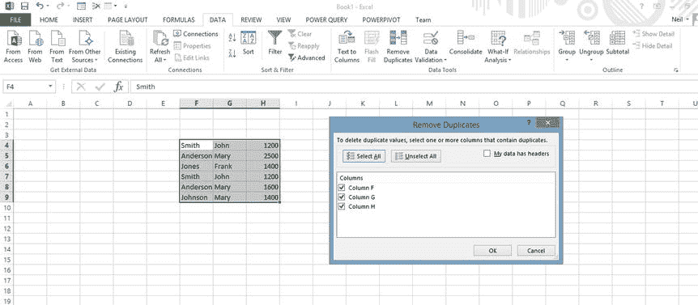

图 2-18.

删除重复项

### 输入验证

Excel 提供了检查有效输入的工具。如果数据无效，结果可能会是“垃圾进，垃圾出”（GIGO）。Excel 提供了通常与数据输入相关的数据验证工具；但是，它们也可以用于标记已输入数据中的单元格。在图 2-19 所示的示例中，通过“数据”选项卡上的“数据验证”选项，销售数据的有效范围定义为 0 到 $20,000。

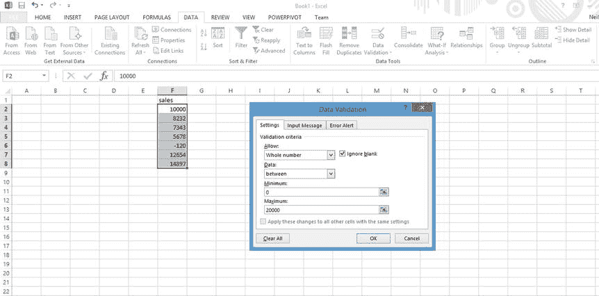

图 2-19.

“数据验证”对话框

任何超出此范围的值都可以通过选择“数据”选项卡上“数据验证”下的“圈释无效数据”选项来突出显示。结果如图 2-20 所示。

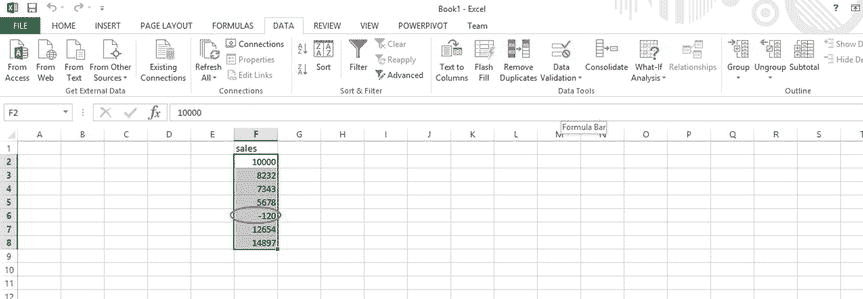

图 2-20.

用红色圆圈标记的无效数据

### 使用数据记录单

Excel 中一个隐藏且文档记录较少的功能是“数据记录单”。有时，将每条记录显示为表单形式而不是单纯的表格格式，更便于阅读数据。默认情况下，工具栏上没有“数据记录单”图标。可以通过单击包含行标题的表格中的单元格，然后依次按下 `Alt`+`D` 和 `O` 键来访问“数据记录单”。也可以将“数据记录单”添加到“快速访问工具栏”。这可以通过以下步骤完成：

单击“快速访问工具栏”（位于屏幕左上角）最右侧的向下箭头，然后单击“其他命令”，如图 2-21 所示。

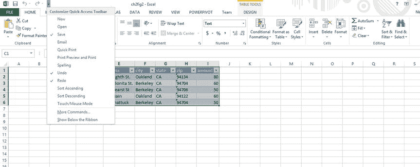

图 2-21.

自定义“快速访问工具栏”菜单

点击“其他命令”后，在屏幕顶部选择“不在功能区中的命令”。将出现如图 2-22 所示的屏幕。找到并选择表单图标，然后按中间的“添加”按钮，将其放到“快速访问工具栏”上。

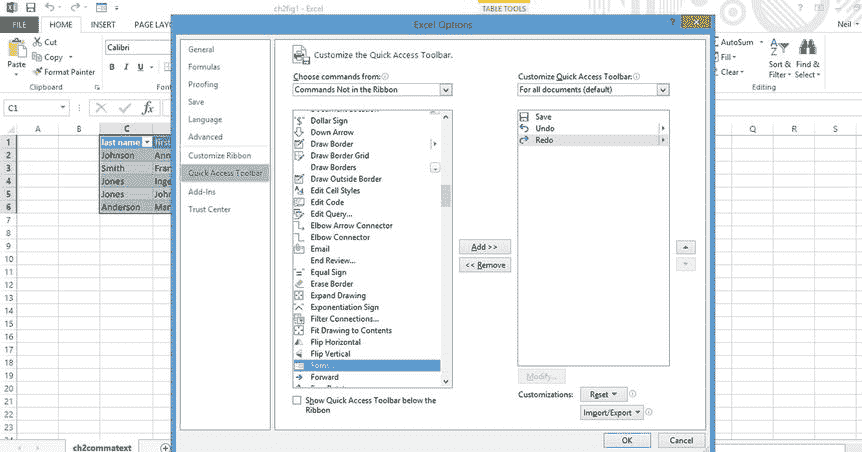

图 2-22.

自定义“快速访问工具栏”菜单

要使用数据记录单，请单击包含要查看数据的行。然后，单击“快速访问工具栏”中的“记录单”图标，即可看到如图 2-23 所示的显示。可以在数据记录单中编辑字段。单击“下一条”和“上一条”按钮可以浏览记录。

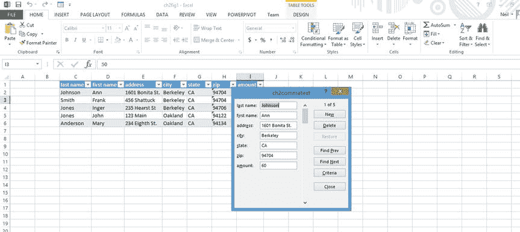

图 2-23.

使用数据记录单

### 选择记录

数据记录单可用于根据条件有选择地查看某些记录，步骤如下：

1.  单击表格中的某个单元格。
2.  单击“快速访问工具栏”中的“记录单”图标，或依次按 `Alt`+`D` 和 `O` 键。
3.  在记录单中，单击“条件”并输入要使用的条件，例如 `城市=奥克兰`，如图 2-24 所示。

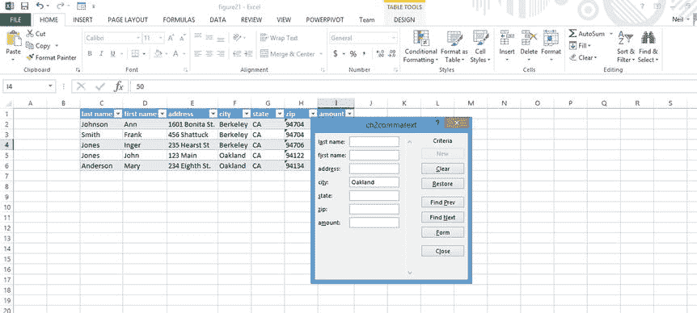

图 2-24.

使用数据记录单根据条件选择记录

然后，单击“下一条”和“上一条”将仅显示符合指定条件的行。


## 总结

本章展示了如何将数据导入 Excel。图 2-1、2-2、2-4、2-5、2-6、2-7、2-9 和 2-10 展示了表示相同数据的不同方式。Excel 可以读取所有这些格式，但 JSON 格式除外，JSON 可以通过先将其转换为 XML 作为中间步骤来导入。您还了解了如何将 Excel 中的表格用作平面文件。第 3 章将演示如何使用数据透视表从大型数据集中提取汇总数据。第 4 章将向您展示如何设置关系数据模型。

