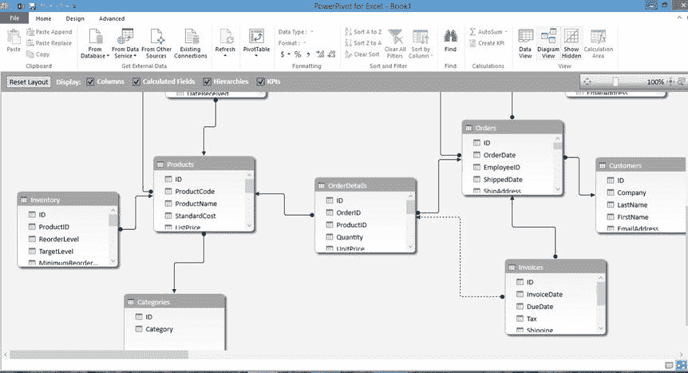

# 关系型数据库

随着计算机的普及，存储的数据量日益增长，需要软件来组织这些数据。关系型数据库管理系统（`RDBMS`）基于 IBM 的 E. F. Codd 在 20 世纪 70 年代初提出的关系模型。尽管早期工作由 IBM 完成，但第一个商业化的 `RDBMS` 是由 Oracle 公司在 1979 年发布的。

关系型数据库将数据组织成由行和列组成的表，每一行都有一个唯一的键，称为主键。数据库是表的集合。数据库中的每个实体都有自己的表，行代表该实体的实例。列则存储属性或字段的值。

关系代数由 IBM 的 Codd 首先提出，它为关系型数据库中存储的数据建模和定义查询提供了理论基础。关系型数据库支持选择、投影和连接。选择是指根据条件选取表中指定的行。投影是指选取特定的列或属性。连接是指根据条件将两个或多个表连接起来。

正如第 5 章所讨论的，结构化查询语言（`SQL`）最初由 IBM 在 20 世纪 70 年代初开发。它用于操作和检索早期 IBM 关系型数据库管理系统（`RDBMS`）中的数据。后来，Oracle 和微软也将其实现到各自的关系型数据库管理系统中。

## 规范化

规范化是在数据库中组织数据的过程，主要目标如下：

-   避免重复字段（除用于连接表的键字段外）。
-   避免多重依赖，即避免依赖于主键以外的任何其他字段。

存在多种范式，最常见的是第三范式（`3NF`），它基于消除传递依赖，也就是说，消除不依赖于主键的字段。换句话说，当每个字段都依赖于主键、整个主键、并且仅依赖于主键时，数据就符合 `3NF`。

图 1-4（与图 4-11 相同）展示了多个表之间的关系。带有箭头的线表示表之间的关系。主要有三种关系类型。

-   **一对一**（`1-1`）：表示字段之间存在一一对应关系。通常，具有一一对应关系的字段应放在同一个表中。
-   **一对多**：表示对于一个表中的每条记录，在对应表中存在多条记录。“多”由线条末端的箭头表示。“多”表示零到 n 个。例如，如图 1-4 所示，对于产品表中的每个产品代码，订单详情表中可能存在多个产品 ID 实例，但每个产品 ID 仅与产品表中的一个产品代码相关联。
-   **多对多**：表示一个实体的多个实例与另一个实体的多个实例之间的关系。例如，作者和书籍：每位作者可以有多本书，每本书也可以有多个作者。“多”表示零到 n 个。

图 1-4. 展示表之间的关系

## 个人电脑数据库软件

20 世纪 80 年代，随着个人电脑的广泛使用，针对个人电脑的数据库程序被开发出来。`dBASE II` 是首批用于个人电脑的可编程关系型数据库系统之一，由加州帕萨迪纳喷气推进实验室（`JPL`）的 Wayne Ratliff 开发。20 世纪 80 年代初，他与 George Tate 合作成立了 Ashton-Tate 公司来销售 `dBASE II`，并取得了巨大成功。20 世纪 80 年代中期，功能增强的 `dBASE III` 发布。

`dBASE` 程序是解释型执行的，这意味着它们比编译型程序（所有指令一次性翻译成机器语言）运行速度要慢。`Clipper` 于 1985 年作为 `dBASE` 的编译版本发布，并变得非常流行。几年后，`FoxBase`（后来更名为 `FoxPro`）发布，并增加了更多增强功能。

