# 3. 数据透视表和数据透视图

本章介绍如何使用数据透视表和数据透视图从单个表中提取汇总数据。本章还描述了如何使用数据透视表从 Azure 数据市场导入数据。第 4 章将展示如何使用 Excel 数据模型从多个表中提取汇总数据。

## Excel 2013 中推荐的数据透视表

Excel 2013 尝试通过推荐条件格式、图表、工具和数据透视表来预测您的需求。当数据被高亮显示，或者在选择数据范围内的任意单元格时按下 `Ctrl+Q`，在该范围的右下角会显示一个快速分析透镜按钮。点击该透镜将显示分析工具窗口，其中显示各种条件格式选项，如图 3-1 所示。将光标移动到某个条件格式选项上，将在数据中预览该条件格式的效果。单击分析工具窗口右上角的“表格”选项卡，将显示几个建议的数据透视表。将鼠标悬停在每个数据透视表上，会出现预览，如图 3-2 所示。

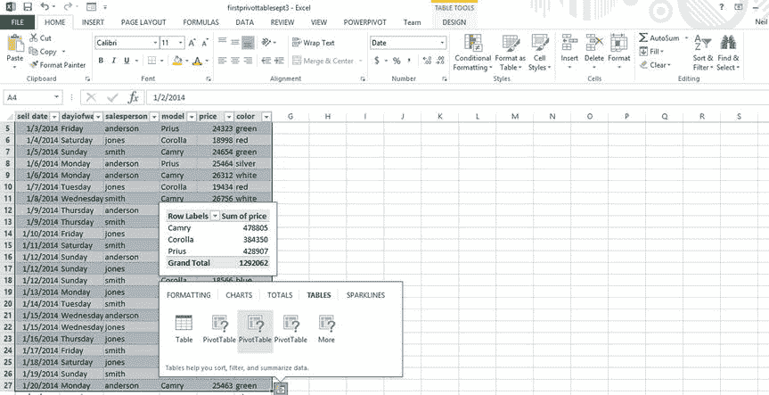
图 3-2. 数据透视表预览

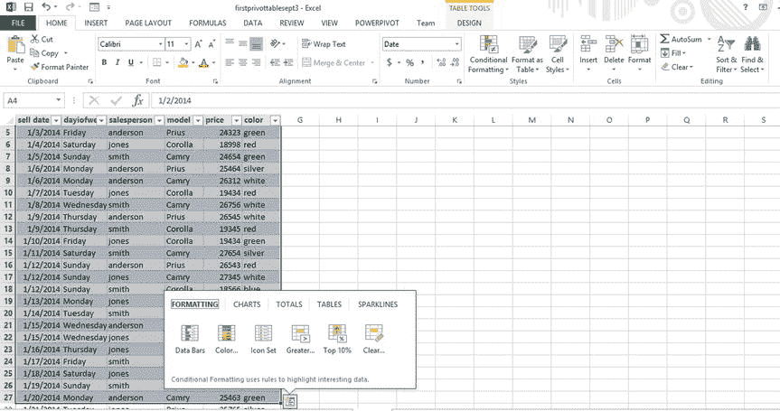
图 3-1. 分析工具窗口

## 定义数据透视表

本节介绍如何基于一个假设的丰田汽车销售数据的简单交易表来定义数据透视表，该表列出了交易记录，包括销售日期、型号、销售人员、颜色和售价，如图 3-3 所示。作为数据透视表基础的表应同时包含数值数据和类别字段，以便能够按类别对数值数据进行各种维度的切分和汇总。

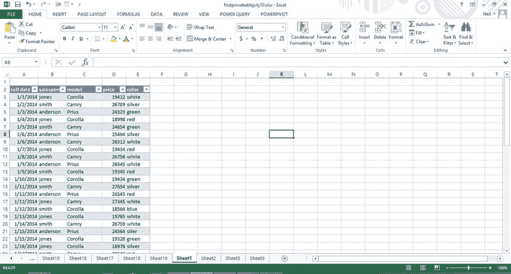
图 3-3. 汽车销售交易表

创建数据透视表不会更改基础数据；它只是对数据拍摄了一个快照。当基础数据发生更改时，数据透视表不会自动刷新。若要刷新，请单击数据透视表内的任意位置以高亮显示“数据透视表工具 分析”选项卡，然后单击“刷新”。

### 定义问题

预先思考您希望通过数据透视表回答哪些问题是一种良好的实践。一些典型的问题如下：

- 每日平均销售额是多少？
- 表现最佳的销售人员是谁？
- 一周中的哪几天的销售额最高？
- 哪几个月的销售额最高？

### 创建数据透视表

定义数据透视表的步骤如下：

确保基础数据采用表格格式，第一行显示字段名称，并且数据周围有空白行和列，或者从第 1 行或 A 列开始。按下 `Ctrl+T` 将数据定义为表格，如图 3-3 所示。单击表格内的任意位置并突出显示“插入”选项卡。单击 `数据透视表`。将出现如图 3-4 所示的屏幕。请注意，已选中当前表格，并且默认情况下，数据透视表将被放置在一个新工作表中。单击 `确定`。

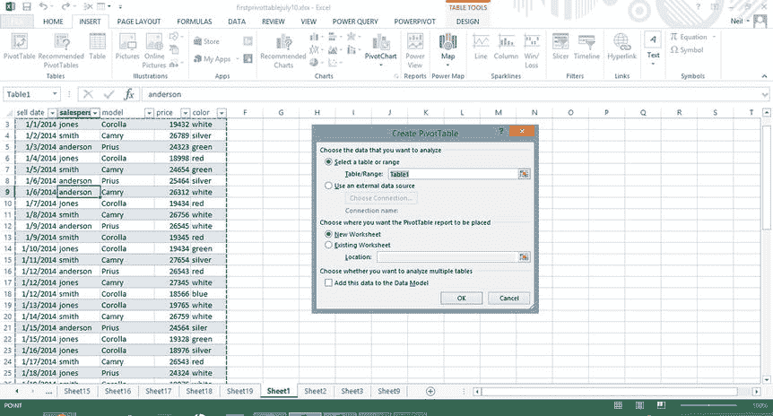
图 3-4. 创建数据透视表对话框

此时，您需要考虑要提取哪种类型的数据。我们将从每日销售额的汇总开始，细分出每日售出的型号。我们将通过将 `销售日期` 拖到“列”框，将 `型号` 拖到“行”，并将 `价格` 拖到“值”来实现，如图 3-5 所示。请注意，默认显示的是“价格之和”。

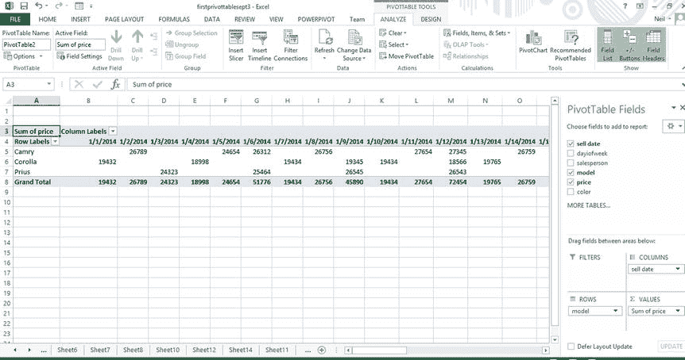
图 3-5. 显示按型号统计的汽车销售数量的基本数据透视表

要将“价格之和”更改为“价格计数”，请右键单击单元格 `A3`，或下拉“值”下“价格计数”旁边的箭头，选择“值字段设置”和“计数”。结果如图 3-6 所示。

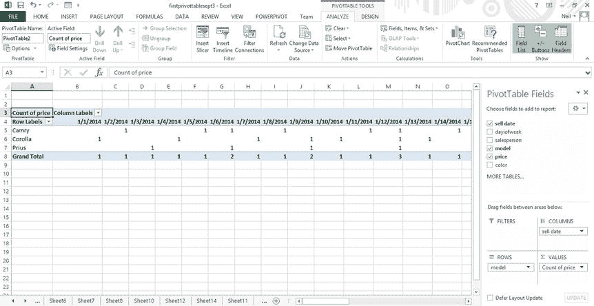
图 3-6. 显示按型号统计的汽车销售价值的数据透视表

### 更改数据透视表

更改数据透视表非常容易。要将水平轴从日期更改为销售人员，只需单击“列”框中的 `销售日期` 并将其拖回，然后选择“删除字段”。接着从“字段”列表中将 `销售人员` 拖到“列”框。结果如图 3-7 所示。

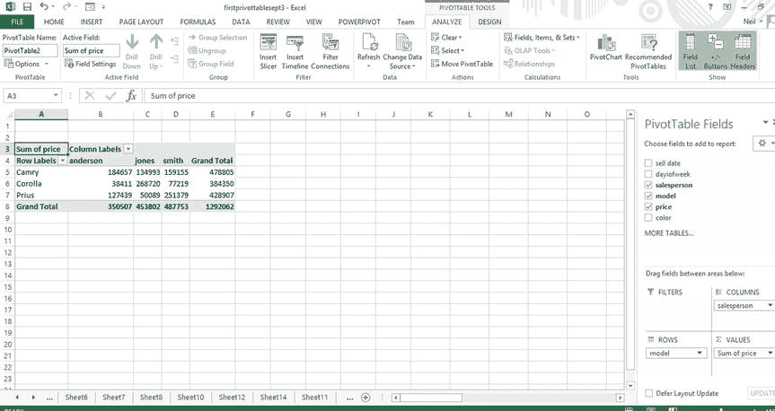
图 3-7. 显示按型号和销售人员统计的销售额的数据透视表

### 创建每日每位销售人员的销售额细分

可以修改数据透视表以显示每天的销售额（按销售人员和型号划分）。只需将 `型号` 字段拖到“列”框，并将 `销售人员` 和 `销售日期` 字段拖到“行”框，以便在“行”框中同时显示 `销售日期` 和 `销售人员`。结果如图 3-8 所示。

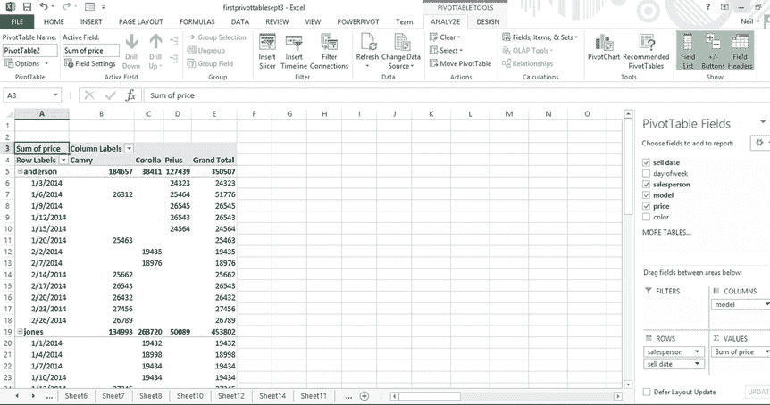
图 3-8. 显示每日按销售人员和型号细分的销售额的数据透视表

### 按月显示销售额

要按月显示销售报告，请右键单击 `销售日期` 列中的任意单元格，并从“组合”窗口中选择“月”，如图 3-9 所示，然后单击 `确定`。

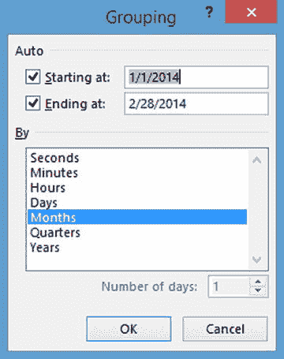
图 3-9. 选择按月分组的对话框

生成的数据透视表如图 3-10 所示。

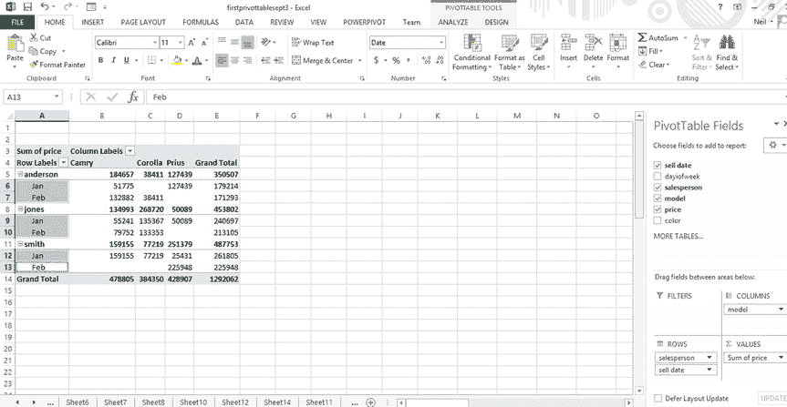
图 3-10. 显示按月统计的销售人员及型号销售额的数据透视表

## 创建数据透视图

要从数据透视表创建数据透视图，请在屏幕上显示数据透视表，然后执行以下操作：

转到“数据透视表工具 分析”选项卡并选择 `数据透视图`。从图 3-11 所示的“插入图表”弹出窗口中选择所需的图表类型，然后单击 `确定`。在此示例中，我们将使用堆积柱形图。

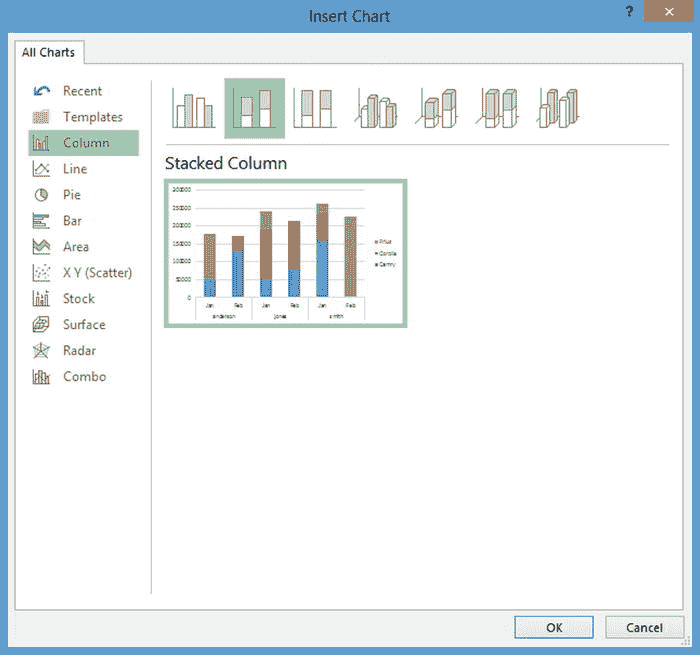
图 3-11. 插入图表对话框

结果将显示如图 3-12 所示。

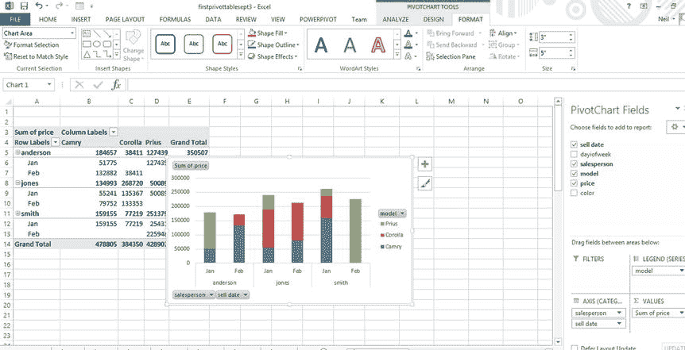
图 3-12. 带有数据透视表的数据透视图

## 调整分类汇总与总计

可以在“数据透视表工具”的“设计”选项卡中调整分类汇总。单击 `Subtotals` 查看选项。

- 不显示分类汇总
- 在组的底部显示所有分类汇总
- 在组的顶部显示所有分类汇总

单击 `Grand Totals` 查看以下选项：

- 对行和列禁用
- 对行和列启用
- 仅对行启用
- 仅对列启用

## 按星期几分析销售额

按星期几分析销售额会非常有用。在以下示例中，我们按照以下步骤添加了星期几列：

由于这是一个表格，公式将自动向下填充到该列。结果如图 3-13 所示。

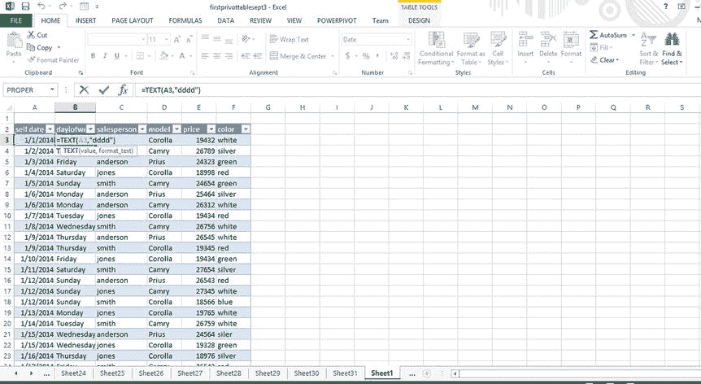
图 3-13. 提取星期几

保存电子表格。在“插入”选项卡上，单击 `PivotTable`。在“创建数据透视表”弹出窗口中单击“确定”以接受默认设置。在销售员列的左侧插入一列。将新列命名为“星期几”。在单元格 `B3` 中输入以下公式以提取星期几：`=TEXT(A3,"dddd")`。如有必要，请在“数据透视表分析”选项卡上单击“刷新”以显示新列。在“数据透视表字段”选项卡上，将“型号”拖到“列”框，将“星期几”拖到“行”框，将“价格 求和”拖到“值”框，以获取如图 3-14 所示的数据透视表。

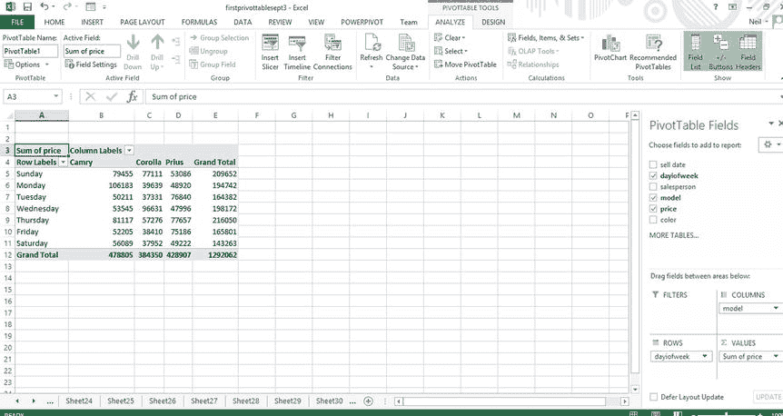
图 3-14. 按星期几和型号划分的销售额数据透视表

## 创建按星期几划分的销售额数据透视图

要获得按星期几划分的销售额的可视化表示，请从数据透视表创建数据透视图。在屏幕上显示数据透视表的情况下，执行以下操作：

转到“数据透视表工具分析”选项卡，然后选择 `Pivot Chart`。从图 3-15 所示的“插入图表”弹出窗口中，选择所需的图表类型。

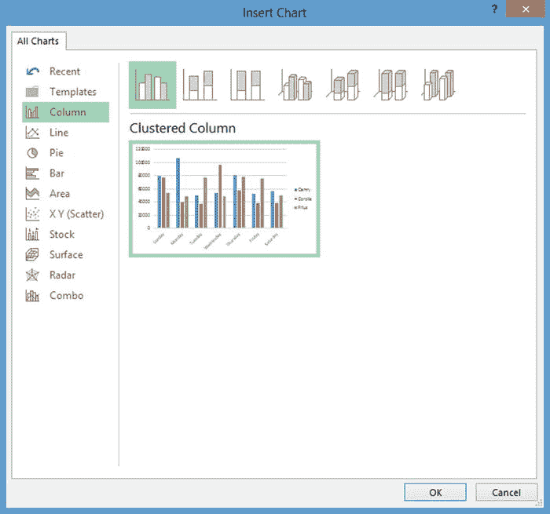
图 3-15. 插入图表对话框

如果选择了簇状柱形图，结果将如图 3-16 所示。

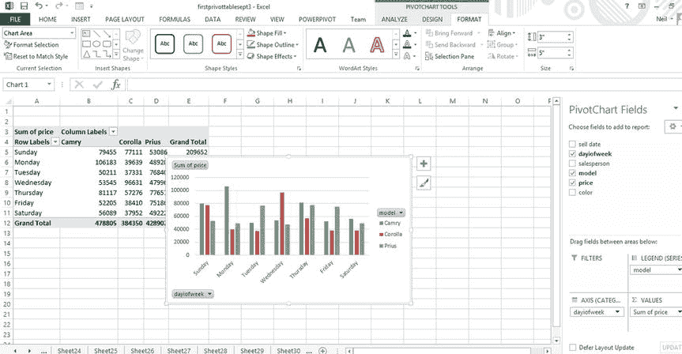
图 3-16. 按星期几划分的销售额数据透视图

## 使用切片器

切片器可用于筛选数据以及放大数据透视表中的特定字段值。要设置切片器，请执行以下操作：

转到“数据透视表工具分析”选项卡，然后选择 `Insert Slicer`。在“插入切片器”弹出窗口中，选择要切片（筛选）的字段，例如“销售员”和“日期”，然后单击“确定”。结果如图 3-17 所示，该图显示了每个型号和日期的每位销售员的销售额……可以选择特定的销售员，也可以选择切片器菜单来查看该销售员的销售额。

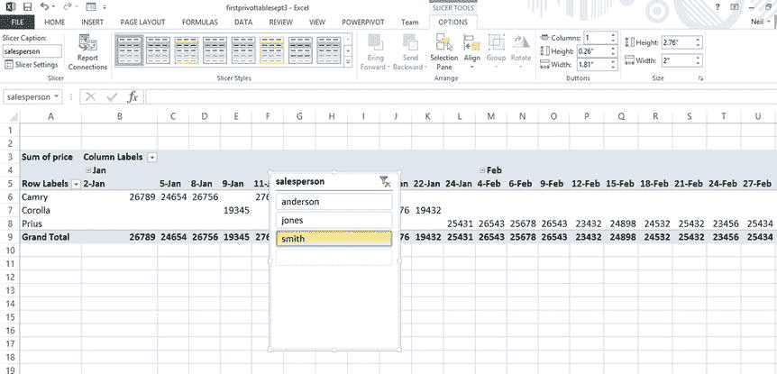
图 3-17. 使用销售员切片器筛选结果

## 添加时间线

可以添加时间线以按时间间隔进行切片（筛选）。要添加时间线，请执行以下操作：

在“数据透视表工具分析”选项卡上，选择 `Insert Timeline`。在“插入时间线”窗口中选择“销售日期”，然后单击“确定”。可以通过单击时间线窗口右上角的下拉箭头来选择年、季度、月或日，从而确定时间线的时间段。如图 3-18 所示，时间线和切片器协同工作。可以选择特定的销售员和日期，以查看该销售员在该日期的销售额。

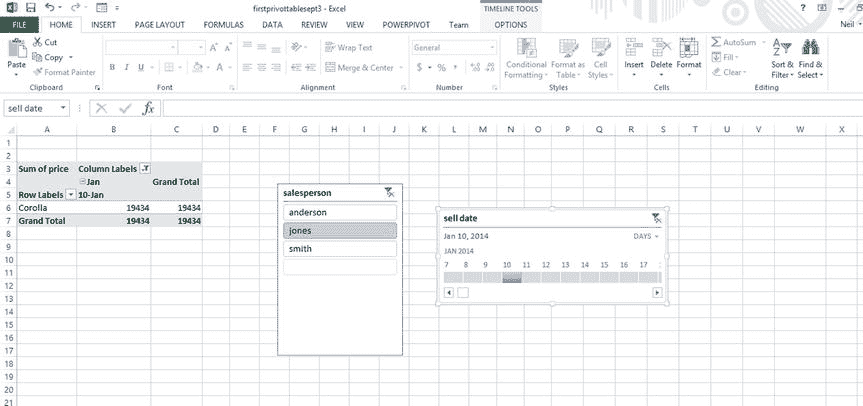
图 3-18. 使用时间线加销售员切片器筛选数据

## 从 Azure 市场导入数据透视表数据

可以从 Azure 市场将数据导入数据透视表，Azure 市场包含各种数据，例如人口统计数据、环境数据、财务数据、零售数据和体育数据。部分数据免费，部分不免费。以下示例演示了如何访问免费数据。

访问 Azure 市场网站 `datamarket.azure.com/browse/data`。截至 2015 年 8 月，将显示如图 3-19 所示的屏幕。

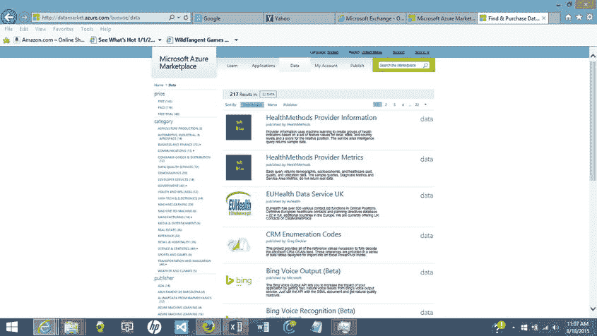
图 3-19. Azure 数据市场浏览界面

首次使用该网站时，可能会要求您填写帐户信息并创建一个免费帐户 ID。如果您已有免费的 Microsoft 帐户，例如 `Hotmail.com` 或 `Outlook.com` 帐户，则可以使用该帐户。单击屏幕顶部的“数据”。将显示如图 3-20 所示的屏幕。

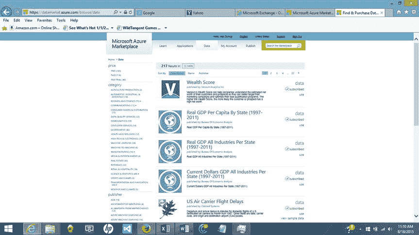
图 3-20. Azure 市场

浏览数据源。您可能需要经过额外的注册过程才能使用免费数据。在本示例中，我们将使用“各州实际人均 GDP (1997–2011)”，如图 3-21 所示。如果出现提示，请输入您的 Microsoft ID 并同意使用条款。

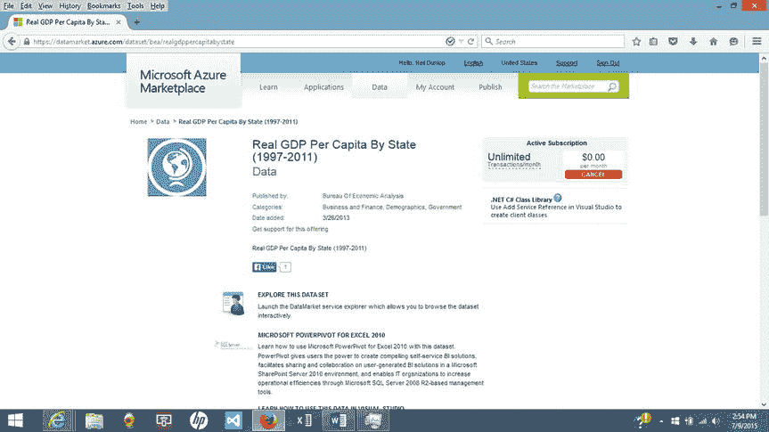
图 3-21. 各州所有行业实际人均 GDP 数据库

单击屏幕中央的 `Explore this Dataset`（“探索此数据集”）。将显示数据，如图 3-22 所示。请注意屏幕右上角的下载选项：Excel (CSV)、PowerPivot 2010 和 PowerPivot 2013。选择 PowerPivot 2013。

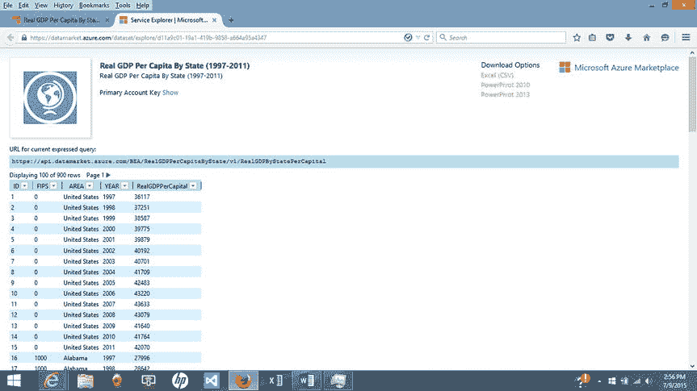
图 3-22. 实际人均 GDP 记录显示

系统会提示您保存文件。单击“确定”。该文件将出现在网络浏览器的下载部分。您现在看到的内容取决于您使用的网络浏览器。要保存文件并在 Excel 中打开，请单击出现的任何提示。如果使用 Firefox，请双击文件名开始该过程。如果系统提示您选择用于打开该文件的程序，请选择 Excel。将出现一个弹出窗口，如图 3-23 所示，询问您想要如何查看数据。选择 `Pivot Table Report`（“数据透视表报告”），单击“确定”，然后等待数据下载。

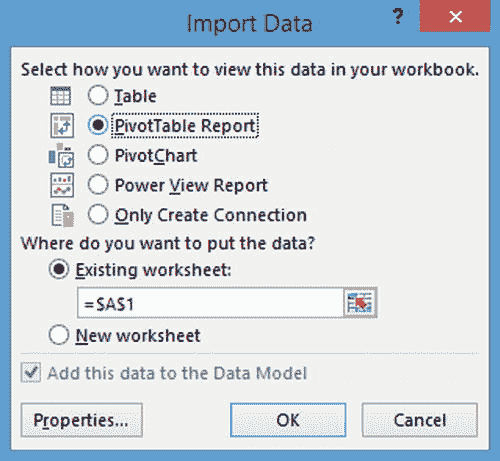
图 3-23. 导入数据对话框

如果出现要求输入帐户密钥的弹出窗口，请输入您的 Microsoft 用户名（例如，Hotmail 或 Outlook.com 电子邮件地址）。开始设计数据透视表。将“年份”拖到“列”框，将“区域”拖到“行”框，将“实际 GDP”拖到“值”框，如图 3-24 所示。

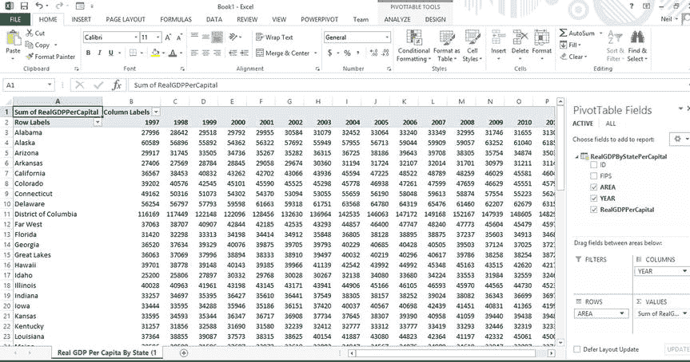
图 3-24. 导入 Excel 的实际 GDP 数据

要使用切片器筛选数据，请在“数据透视表工具分析”选项卡上单击 `Insert Slicer`。选择“区域”字段并单击“确定”。在切片器菜单上，选择一个州，例如“加利福尼亚”，以查看其实际人均 GDP，如图 3-25 所示。

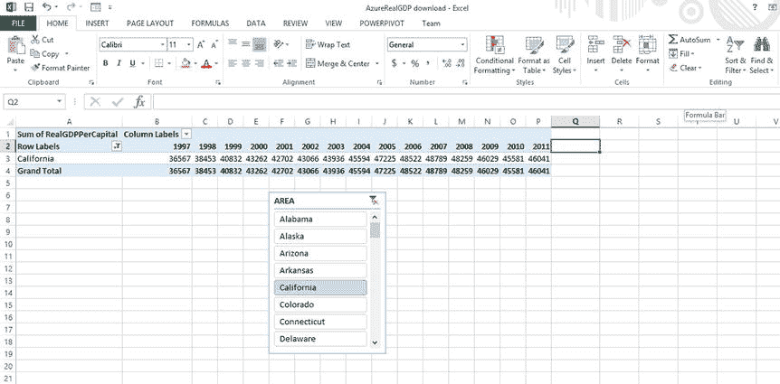
图 3-25. 按切片器筛选后的实际 GDP 数据

## 总结

本章展示了如何基于单个表使用数据透视表和数据透视图，以及如何从 Microsoft Azure 市场导入数据。第 4 章将展示如何使用 Excel 数据模型从多个表中提取数据。