# 4. 构建数据模型

本章将介绍 Excel 数据模型，也称为 PowerPivot 数据模型。Excel 2013 的 `PowerPivot` 基于在 Excel 内部运行的 SQL Server Analysis Services 2012 表格引擎。数据模型允许关联多个表格。它完全在内存中运行并压缩数据，从而能够处理数百万行数据。

Excel 数据模型是表格的集合，包括它们之间的关系。该数据模型为 Power BI 提供了结构基础。本章将演示如何使用数据透视表从数据模型中的多个表格中提取汇总信息。所使用的示例将从简单逐步过渡到复杂。

## 启用 PowerPivot

`PowerPivot` 包含在 Excel 2013 中，但默认情况下未启用。要启用 `PowerPivot`，请按照以下步骤操作：

单击 `文件` 选项卡以查看 Backstage 视图。单击左窗格底部的 `选项`。在左窗格中选择 `加载项`。在窗口底部，下拉 `管理` 后的箭头，选择 `COM 加载项`，然后单击 `转到`，如图 4-1 所示。

图 4-1.

Excel 选项屏幕 勾选 `Microsoft Office PowerPivot for Excel 2013`、`Microsoft Power Map for Excel` 和 `Power View`，如图 4-2 所示，然后单击 `确定`。

图 4-2.

COM 加载项对话框

## 关系数据库

直到几年前，关系数据库还是使用最广泛的数据库类型。在过去几年中，`NoSQL`（或非关系型）数据库已变得流行，用于处理日志数据和其他类型的大数据。`NoSQL` 数据库将在后续章节中进行更详细的介绍。尽管如此，今天大多数事务性业务数据仍然存储在关系数据库中。

关系数据库设计的原则之一是避免重复字段。如果遇到重复字段，则通过创建其他表来对数据进行规范化，如第 1 章所述。例如，在一个人事示例中，员工表的主键是员工的社会保险号，因为它是唯一的，并且在财务报告中是必需的。员工会被分配到一个部门，但员工表中只存储部门代码。部门代码是一个外键，指向部门表中的相应记录，部门表包含其他信息，例如部门办公室、部门经理和电话号码。这样，部门信息就不必为每个员工记录重复存储。

## 数据库术语

以下术语常用于描述关系数据库以及数据库中表之间的关系。

- **字段**是表中最小的数据单元。字段存储在 Excel 表的列中。
- **记录**是关于一个人或一件事的全部数据或信息。在 Excel 中，记录是表中的一行。
- **表**是在数据库中以结构化格式存储的相关数据的集合。它由字段（列）和记录（行）组成。
- **数据库**是表的集合。
- **关系表的主键**是一个字段（或多个字段），用于唯一标识表中的每条记录。对于涉及人员的数据，尤其是需要税务报告的数据，最常见的主键是社会保险号。当然，在处理社会保险号等个人数据时，确保适当的安全性非常重要。
- **外键**是一个表中的一个字段或多个字段，用于唯一标识另一表中的一行。
- **候选键**是表中的一个字段或多个字段，可以在不引用任何其他数据的情况下唯一标识任何记录。每个表可能有一个或多个候选键，但其中一个候选键被选为主键。这通常是候选键中最好的一个。
- 当键由多个列组成时，称为**复合键**。
- **关系**允许基于关键字段从多个表中访问数据。
- **规范化**是组织关系数据库中的表以最小化冗余的过程。规范化通常涉及将大表划分为小表，并定义它们之间的关系。
- **第三范式 (3NF)**，由关系数据库模型发明者 E. F. Codd 定义，消除了不依赖于主键的字段。要符合第三范式，表中的每个字段必须依赖于该表的主键，并且仅依赖于主键。这被称为消除传递依赖，即一个字段依赖于另一个非主键字段的情况。
- **源表**是关系起始的表。在下一节的示例中，员工表是源表。
- **相关表**是包含要查找的值的表。在下面的示例中，部门表是相关表。

好的，作为一名高级文档工程师和翻译员，我将严格遵循您提供的注意事项和示例格式，将给定的英文文本翻译成高质量的中文。

## 从 Excel 表创建数据模型

本节将以一个简单的示例开始，说明关联表的原则。在此示例中，将从两个小表 `employee` 和 `department` 创建一个数据模型。这些表是规范化的，意味着重复字段已被消除。不在员工记录中记录某个部门的所有信息，而仅使用一个部门代码。然后在 `employee` 表和 `department` 表之间定义一个关系，以便可以从 `department` 表中提取部门信息。

可以使用数据透视表从数据模型中提取有意义的信息。要创建一个利用两个表中的数据来显示按部门划分的平均薪资的数据透视表，请执行以下操作：

通过单击表格内部并按 `Ctrl+T`，将每组数据定义为一个表。单击表中的任意位置，然后点击 `表工具` `设计` 选项卡。在功能区的左侧，键入表名称，在本例中为 `employees`，如图 4-3 所示。另外，重命名 `departments` 表。

图 4-3. 员工表和部门表

选中 `employee` 表。转到 `插入` 选项卡，选择 `数据透视表`。在 `创建数据透视表` 对话框中，选择 `将此数据添加到数据模型`，然后点击 `确定`，如图 4-4 所示。

图 4-4. 创建数据透视表对话框

在 `数据透视表字段` 窗格中，点击 `全部`（位于右上角），以查看两个表，如图 4-5 所示。将 `deptname` 字段从 `department` 表拖到 `列` 框中。将 `Sum of salary` 从 `employees` 表拖到 `值` 框中。注意提示“可能需要表之间的关系”，点击 `创建`。

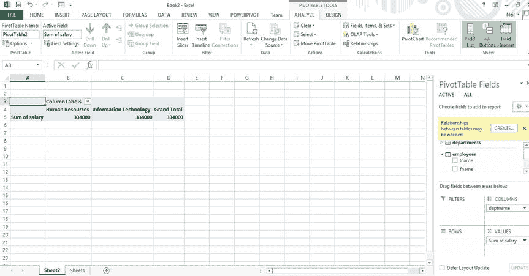

图 4-5. 显示按部门划分的薪资总额的数据透视表

如图 4-6 所示，选择 `employees` 作为第一个表，`dept` 作为外键。选择 `departments` 作为第二个表，`deptcode` 作为主键。点击 `确定`。请注意，由列标题定义的字段名称不必相同。

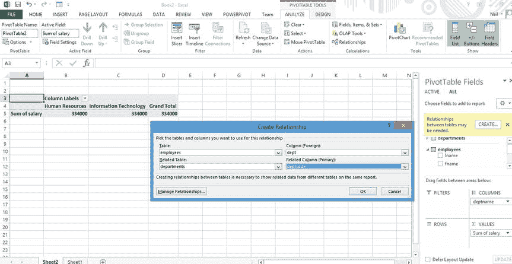

图 4-6. 创建关系对话框

将 `lname` 拖到 `行` 框中。生成的数据透视表将显示按部门划分的薪资总额，如图 4-7 所示。

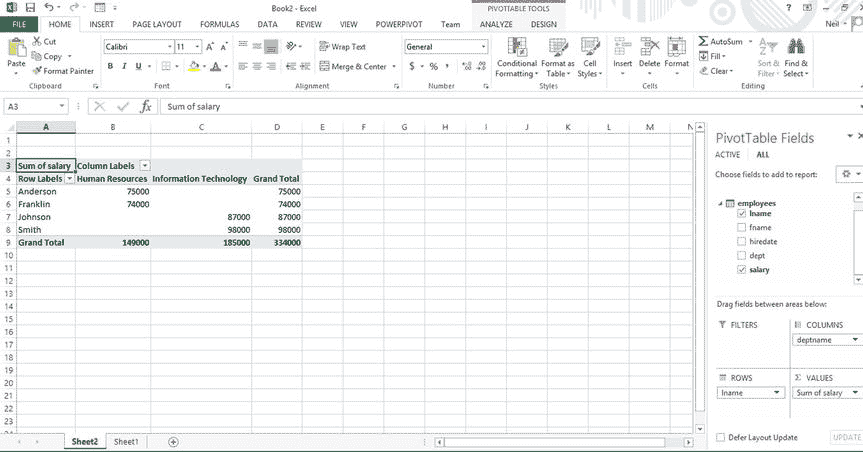

图 4-7. 显示按部门划分的员工薪资的数据透视表

若要改为显示按部门划分的平均薪资，首先从 `行` 框中移除 `lname` 字段，然后在 `数据透视表字段` 窗格中，点击 `值` 框中 `Sum of salary` 旁边的下拉箭头。选择 `值字段设置`，然后选择 `平均值`，以查看按部门划分的平均薪资，如图 4-8 所示。

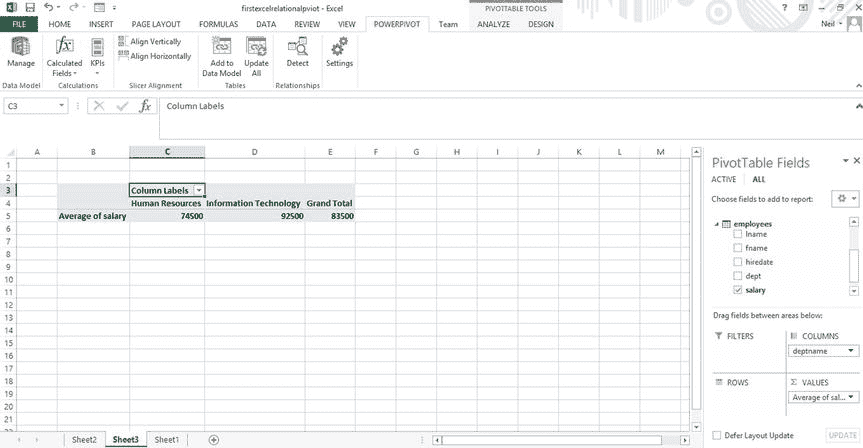

图 4-8. 显示按部门划分的平均薪资的数据透视表

此示例展示了如何使用部门代码关联两个表 `employees` 和 `departments`。`dept` 是 `employees` 表中的外键，而 `deptcode` 是 `departments` 表的主键。数据透视表将这两者关联起来。

## 直接将数据加载到数据模型中

在此示例中，将使用来自 Microsoft Northwind Access 数据库的示例，将数据直接加载到数据模型中。此示例演示了在 Excel 之上运行 PowerPivot。

要将数据直接加载到数据模型中，请执行以下操作：

点击 `PowerPivot` 选项卡以打开功能区。点击功能区左上角的 `管理` 按钮。打开 PowerPivot 窗口后，您可以通过点击 `获取外部数据` 组中的 `从数据库` 来加载数据。这将提供数据库源的选择，如图 4-9 所示。在此示例中，将选择 `从 Access`。

图 4-9. PowerPivot 获取外部数据组

在 `表导入向导` 对话框中，点击 `浏览` 按钮以找到要导入的 Access 文件。在此示例中，将选择文档文件夹中的 `Database1`。该文件可从 Apress 网站获取。点击 `测试连接`。如果测试成功，点击 `下一步`。

PowerPivot 将打开 `表导入向导`，如图 4-10 所示，引导您完成加载数据的过程。选择 `从表和视图列表中选择` 以选择要导入的数据。点击 `下一步`。

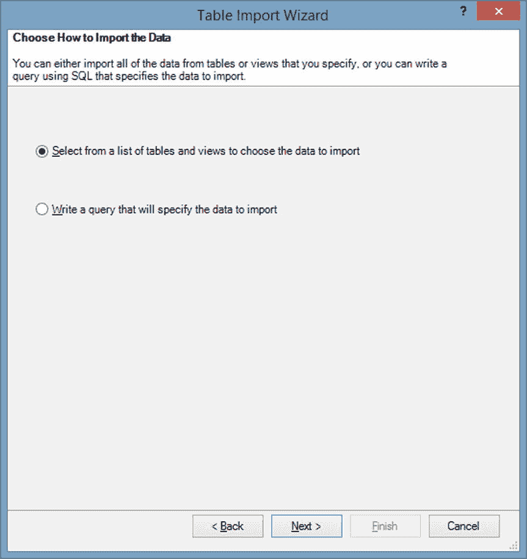

图 4-10. 表导入向导

点击左上角的框以选择所有表，如图 4-11 所示。请注意，在对话框的右下角，有一个 `预览和筛选` 选项。此选项可用于从非常大的数据集中选择数据子集。在此示例中，将导入所有表中的所有行。点击 `完成` 以完成导入。

图 4-11. 表导入向导 — 选择表和视图

如果导入的数据中存在关系，这些关系将自动加载到数据模型中。请注意，PowerPivot 表是只读的，因此无法更改数据。

若要查看关系，请转到 `PowerPivot` 选项卡并选择 `管理` 以打开 PowerPivot 窗口。然后点击功能区右侧的 `PowerPivot 关系图视图`，以查看表之间的关系，并点击 `完成` 以完成导入，如图 4-12 所示。

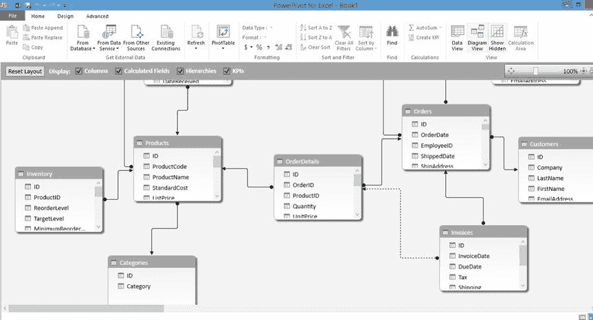

图 4-12. 关系图视图

## 从两个表创建数据透视表

在此示例中，将基于 `inventory` 和 `products` 表创建一个数据透视表。请注意在图 4-12 中，这两个表是基于产品代码链接的。`Inventory` 表包含库存中每个项目的现有数据，其主键为 `ProductCode`。要查找完整的产品名称，必须根据产品 ID 在 `product` 表中执行查找。要基于这两个表创建数据透视表，请执行以下操作：

在 PowerPivot 窗口的 `文件` 选项卡上点击 `数据透视表`，然后从菜单中选择 `数据透视表`。点击 `确定` 将数据透视表放置在新工作表中。在 `数据透视表字段` 窗格中点击 `products` 表旁边的箭头，然后将 `ProductName` 字段拖到 `行` 框中。然后向上滚动到 `inventory` 表，点击左箭头显示字段，并将 `OnHand` 拖到 `值` 框中。结果如图 4-13 所示，该图显示了每个产品的现有值总和。

图 4-13. 显示产品名称和现有数量的数据透视表

## 从多个表创建数据透视表

本示例将演示如何基于表之间的关系，从两个以上的表创建数据透视表。它将使用 Contoso 数据库中的 `PowerPivotTutorialSample` 电子表格，该表格可从以下 URL 下载：`Tinyurl.com/PowerPivotSamples`。

可通过以下步骤创建访问多个相关表字段的数据透视表：

从上述 URL 下载 `PowerPivotTutorialSample` 电子表格。点击 **PowerPivot** 选项卡上的 **管理** 图标，打开 PowerPivot 窗口。然后点击 **关系图视图** 查看关系图，如图 4-14 所示。请注意，箭头以某种不精确的方式显示关系：使用滚动条滚动字段名称并不会改变箭头的位置。查看关系更清晰的方法是：最小化 PowerPivot 窗口，然后点击 **数据** 选项卡上的 **关系**，即可在 **管理关系** 屏幕中查看实际链接的字段名称，如图 4-15 所示。请注意，您也可以通过在 PowerPivot 窗口的 **设计** 选项卡上点击 **管理关系** 来查看类似的视图。

图 4-15. 管理关系屏幕

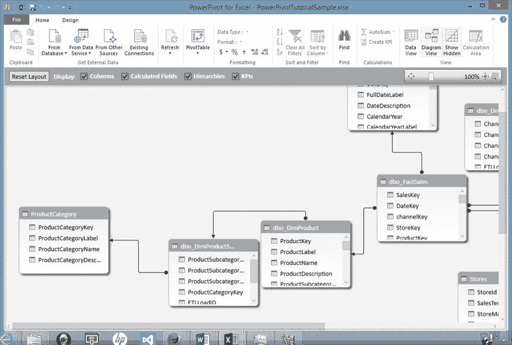

图 4-14. 关系图视图

要创建基于相关字段的数据透视表，请选择 **PowerPivot** 选项卡并点击 **管理**。如果仍显示 **关系图视图**，请点击 **数据视图**。注意屏幕底部的选项卡，这些选项卡显示了本示例中包含的表。将创建一个链接 `dbo_FactSales` 表、`dbo_DimProduct` 表和 `dbo_DimDate` 表的数据透视表。该数据透视表的目的是按日期分析产品销售情况。

点击 **数据透视表**，然后从下拉菜单中选择 **数据透视表**。在 **创建数据透视表** 对话框中，点击 **确定** 接受默认的 **新工作表**。

在 **数据透视表字段** 窗格中，表前面会显示一个向右箭头。点击向右箭头可查看该表中的字段。滚动到 `dbo_DimProduct` 表并点击箭头。将 `ProductName` 字段拖到 **行** 框中。点击 `dbo_DimProduct` 表左侧的箭头以隐藏字段显示。滚动到 `dbo_DimDate` 表并点击箭头以查看字段。将 `FullDateLabel` 字段拖到 **列** 框中。点击箭头以隐藏字段。滚动到 `dbo_FactSales` 表并点击箭头以查看字段。将 `SalesQuantity` 字段拖到 **值** 框中。结果将显示在图 4-16 中。由于图 4-15 中显示的关系，可以链接多个表中的字段。

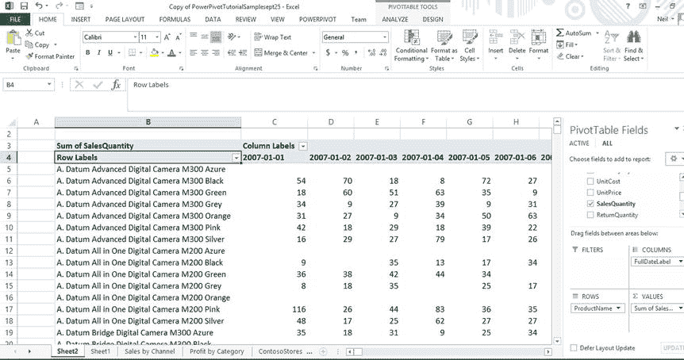

图 4-16. 按产品和日期显示销售额的数据透视表

要进一步修改数据透视表以按年份查看销售额，请从 **列** 框中移除 `FullDateLabel`，并将其替换为 `DimDate` 表中的 `CalenderYear`。结果如图 4-17 所示。

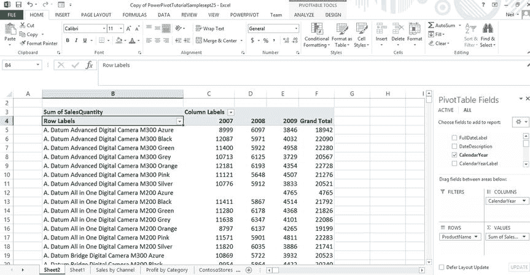

图 4-17. 按产品和年份显示销售额的数据透视表

### 添加计算列

可以使用数据分析表达式 (DAX) 在 PowerPivot 中为表添加计算列。常规的 Excel 公式基于单元格。相比之下，DAX 公式基于列。DAX 将在后续章节中更深入地介绍。本示例将演示如何设置计算列。要添加计算列，请执行以下步骤：

选择 **PowerPivot** 选项卡并点击 **管理**。通过点击显示区域底部的选项卡，选择 `dbo_FactSales` 表。向右滚动到 `TotalProfit` 列。请注意，在其右侧，列标题是 **添加列**。选择该列中的任意单元格，然后键入 `=` 开始一个公式。

创建一个扩展价格列，即单价乘以数量。为此，在键入 `=` 后，点击 `SalesQuantity` 列，键入 `*`，然后点击 `unit price` 数量。公式显示在图 4-18 的公式栏中：`=[SalesQuantity]*[UnitPrice]`

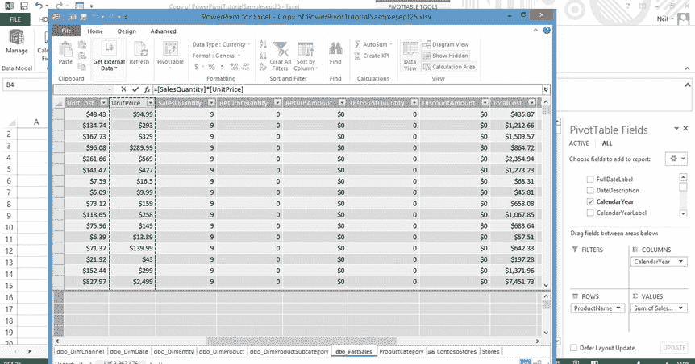

图 4-18. 添加计算列

然后按 **Enter** 键完成公式。要重命名该列，请右键点击列标题，选择 **重命名列**，并将其命名为 "extended price"。结果如图 4-19 所示。请注意，新列中的值与 `TotalSales` 相同，但基于一个公式。

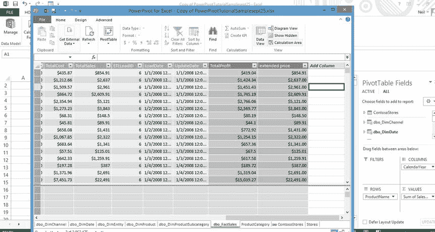

图 4-19. 重命名为 "extended price" 的列

使用 PowerPivot 计算列时，所有单元格共享相同的公式。不可能使用涉及单个单元格的公式。聚合函数（如 `SUM()`、`Average()` 和 `COUNT()`）可以应用于整个列，以提取汇总数据。

### 向数据模型添加计算字段

本示例将演示如何使用计算字段设计一个按月份显示产品销售额的数据透视表。为此，请执行以下步骤：

点击 **数据透视表** 图标并接受默认的新工作表。从 `dbo_DimDate` 表中，将 `CalenderMonthLabel` 字段拖到 **行** 框中。从 `ProductCategory` 表中，将 `ProductCategoryName` 字段拖到 **列** 框中。从 `dbo_FactSales` 表中，将 `SalesQuantity` 字段拖到 **值** 框中。

要向数据模型添加计算字段，请执行以下步骤：

在 **PowerPivot** 选项卡上，点击 **计算字段**。点击 **新建计算字段**。从下拉菜单中，选择计算字段将基于的表，在本例中为 `dbo_FactSales`。将计算字段命名为 "profitability"。点击 **Fx** 图标以查看函数。许多函数与基本的 Excel 函数类似。向下滚动到 `SUM()`，如图 4-20 所示，然后点击 **确定**。

图 4-20. 计算字段对话框

在左括号后，开始键入要使用的表的名称，在本例中为 `dbo_FactSales`。然后会显示该表的字段。向下滚动到 `dbo_FactSales[totalprofit]` 并双击。键入右括号。然后键入 `/` 和 `sum(dbo_FactsSales[totalsales])` 并闭合括号。然后点击 **检查公式**。如果公式测试通过，点击 **确定**。

计算字段列将显示，如图 4-21 所示。

图 4-21. 显示按月份划分的利润率和销售额的数据透视表

## 总结

本章介绍了在 PowerPivot 中构建数据模型的基础知识。在后续章节中，将探讨数据模型的更高级功能。图 4-22 显示了为每个表下载的行数。请注意，`dbo_FactSales` 表有近 400 万行。PowerPivot 支持此数量级的行数，但 Excel 不支持。

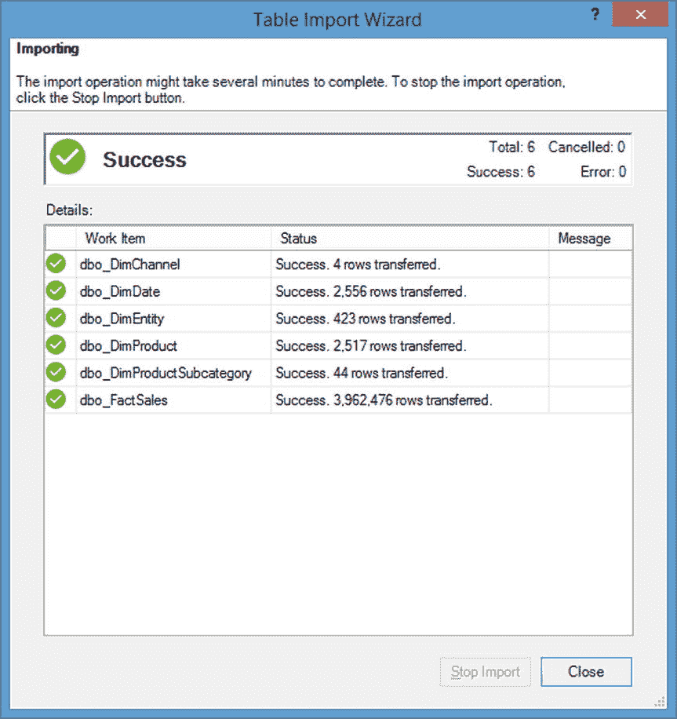

图 4-22. 显示导入行数的表导入向导

