# 2. Excel 作为数据库和数据聚合器

电子表格在让普通民众访问数据方面有着悠久的历史。本章将追溯 Excel 从电子表格演变为强大数据库的历程。然后展示如何从各种来源导入数据。后续章节将演示 Excel 结合 `Power BI` 如何成为强大的商业智能工具。


## 从电子表格到数据库

首款电子表格程序`VisiCalc`（即“可视化计算器”的缩写）于 1979 年发布，专为 Apple II 计算机设计。它是第一款“杀手级应用”。当时有种说法是：“`VisiCalc` 卖出的苹果电脑比苹果公司自己卖得还多。”`VisiCalc`由丹·布里克林和鲍勃·弗兰克斯顿开发。布里克林当时就读于哈佛商学院，在看到一位教授手动编写财务模型后，他萌生了开发该程序的想法。每当教授想要修改时，都必须擦除旧数据并重新写入新数据。布里克林意识到，这一过程可以通过在个人计算机上运行的电子表格实现自动化。

在那个年代，大多数会计数据都困在主程序之中，需要程序员才能修改或访问。正因如此，程序员被称为计算机领域的“高级祭司”，这意味着最终用户对程序的运行方式几乎毫无控制权。就当时而言，`VisiCalc`非常易于使用。但与今天的电子表格相比，它仍然非常原始。例如，在`VisiCalc`的早期版本中，所有列都必须具有相同的宽度。

成功必然引来竞争。`VisiCalc`无法在当时的商用计算机——CP/M 计算机上运行。CP/M 最初是“控制程序/监控器”的缩写，后来演变为“微型计算机控制程序”，是 20 世纪 70 年代末至 80 年代初使用的一种操作系统。1980 年，Sorcim 公司推出了`SuperCalc`，作为 CP/M 计算机的电子表格程序。微软于 1982 年发布了`Multiplan`。当时所有的电子表格程序都是菜单驱动的。

1981 年 8 月，IBM PC 的发布向其他大公司释放了一个信号：个人计算机是大型企业的严肃工具。`VisiCalc`被移植到 IBM PC 上运行，但并未充分利用新计算机增强的硬件能力。

看到这一机遇后，企业家米奇·卡普尔（`VisiCalc`开发者的朋友）创立了莲花发展公司（Lotus Development），专门为 IBM PC 编写了一款电子表格程序。他将这款程序命名为`Lotus 1-2-3`。名称中的`1-2-3`表示它在原始电子表格功能的基础上，增加了创建图表以及执行简单排序等有限数据库功能的能力。

`Lotus 1-2-3`是第一款通过电视广告推广的软件程序。它随 IBM PC 的流行而风靡一时，并在 20 世纪 90 年代初期一直保持领先地位。

Microsoft Excel 是首款利用 Apple Macintosh 普及的图形用户界面的电子表格程序。Excel 于 1987 年发布，最初面向 Macintosh 系统，随后被移植到 Windows 平台。20 世纪 90 年代初期，随着 Windows 的普及，微软将 Word 和 Excel 打包成 Microsoft Office，并采取了激进的定价策略。最终，Excel 取代了`Lotus 1-2-3`成为领先的电子表格程序。如今，Excel 是全球使用最广泛的电子表格程序。

越来越多的分析功能（如数据透视表）被逐步引入 Excel，同时可处理的最大行数也不断增加。利用`VLOOKUP`函数，可以在表格之间建立简单的关系。对于 Excel 2010，微软推出了可作为独立下载的`PowerPivot`，它允许基于多个表构建数据模型。`PowerPivot`随 Excel 2013 一同发布。第 4 章将讨论如何使用`PowerPivot`构建数据模型。

### 解释文件扩展名

文件扩展名指示了文件中存储的数据类型。本章将展示如何将各种格式的数据导入到 Excel 的原生`.xlsx`格式中，这是使用后续章节讨论的 Power BI 高级功能所必需的。本章将处理具有以下扩展名的文件：

- `.xls`：Excel 2007 之前的 Excel 工作簿
- `.xlsx`：Excel 2007 及更高版本的 Excel 工作簿；添加第二个 `x` 表示数据以 XML 格式存储
- `.xlsm`：包含宏的 Excel 工作簿
- `.xltm`：Excel 工作簿模板
- `.txt`：包含文本的文件
- `.xml`：XML 格式的文本文件

### 将 Excel 用作数据库

默认情况下，Excel 处理由行和列组成的表格。每一行是一条记录，包含单个项目的所有属性。每一列是一个字段或属性。

一个表格应在第一行显示字段名称，并在其周围留出空白区域——两侧各一个空白列，上下各一个空白行（除非第一行是第 1 行或第一列是 A 列）。单击表格内的任意位置，然后按`Ctrl + T`将其定义为表格，如图 2-1 所示。注意每列顶部带有箭头的标题。单击箭头会弹出一个菜单，提供排序和筛选选项。

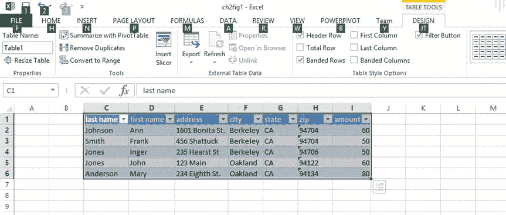

图 2-1. 一个 Excel 表格

请注意，在当前版本的 Excel 中，如果你按某个字段排序，它会智能地带动相关字段（只要区域内没有空白列），如图 2-2 所示，这里按姓氏排序。若要按名和姓排序，则应先按名排序，再按姓氏排序。

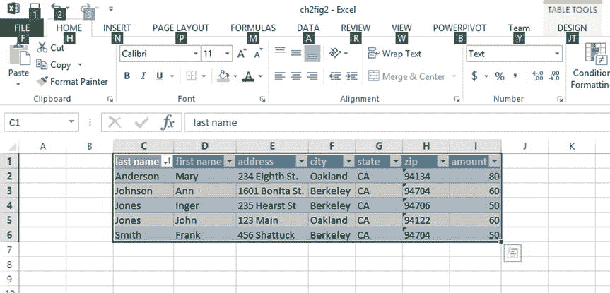

图 2-2. 按名和姓氏排序的 Excel 表格

### 从其他格式导入

Excel 可用于从多种来源导入数据，包括存储在文本文件中的数据、网站表格中的数据、XML 文件中的数据以及 JSON 格式的数据。本章将向你展示如何导入一些较为常见的格式。第 4 章将介绍如何使用 Power BI 关联多个表格。

#### 在 Excel 中打开文本文件

Excel 可以打开逗号分隔、制表符分隔、固定长度字段和 XML 格式的文本文件，以及图 2-3 所示的文件格式。当以这些格式中的任何一种打开文件时，它们会自动转换为电子表格。

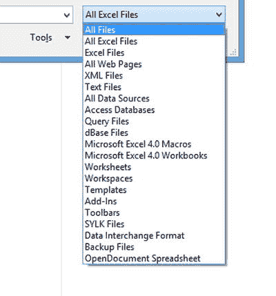

图 2-3. 可导入 Excel 的文件格式

导入文件时，最好使用文件的副本进行操作，这样原始文件保持不变，以防导入过程中文件损坏。

图 2-4 展示了记事本中的一个逗号分隔文件。请注意，第一行由字段名称组成。所有字段由逗号分隔。Excel 知道如何将这种类型的文件读取到电子表格中。如果用 Excel 打开这种格式的文本文件，它将显示为一个电子表格，如图 2-1 所示。


图 2-4. 逗号分隔值格式


### 从 XML 导入数据

可扩展标记语言（XML）是一种流行的数据存储格式。与 HTML 类似，它使用成对标签来定义每个元素。图 2-5 显示了 XML 格式下我们一直处理的数据。第一行是声明，指定了 XML 版本、UTF 编码及其他信息。请注意将所有其他标签包围起来的 `donors` 根标签。

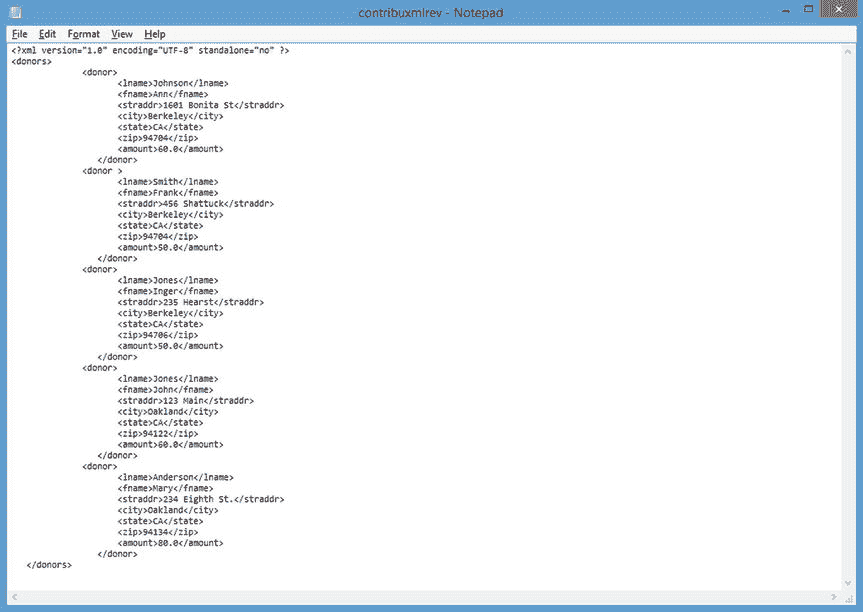

图 2-5. XML 格式

这些数据是自描述的。本例中的每一行或每一条记录都被一个 `donor` 标签包围。字段名称在开标签和闭标签中为每个字段重复出现了两次。该文件将作为扩展名为 `.xml` 的文本文件保存。

Excel 可以直接打开 XML 文件。在打开后弹出的第一个对话框中选择“作为 XML 表”。然后在下一个弹出的对话框中点击“是”，“Excel 将创建架构。”

如图 2-6 所示，XML 文件可以在诸如 Internet Explorer 之类的网页浏览器中显示。请注意 `donor` 标签左侧的小加号和减号。点击减号可隐藏每条记录中的详细信息，点击加号则可显示详细信息。

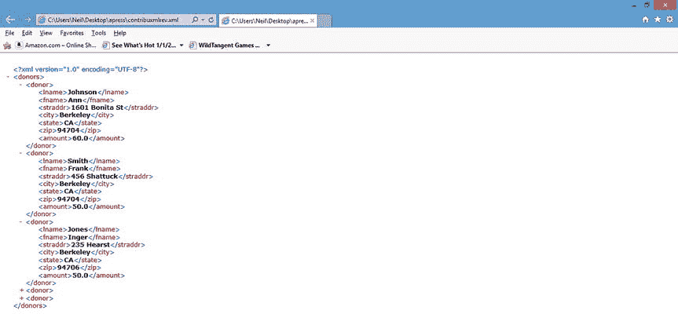

图 2-6. 在网页浏览器中显示的 XML 文件

#### 导入带属性的 XML

与 HTML 一样，XML 也可以包含属性。图 2-7 展示了一个将 `gender` 属性添加为 `donor` 标签一部分的例子。

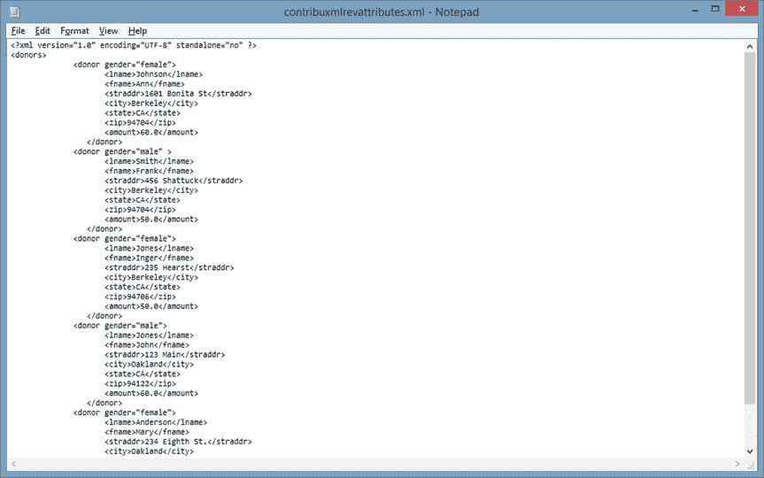

图 2-7. 带属性的 XML

```
<donor gender = "female">
...
</donor>
```

关于属性的使用有两种不同的观点。一些人认为应该避免使用属性，所有值都应该以成对标签形式呈现。然而，也可能会遇到带属性的 XML。Excel 可以解释这两种格式。图 2-8 显示了打开图 2-7 中的 XML 文件后，Excel 电子表格所显示的内容。

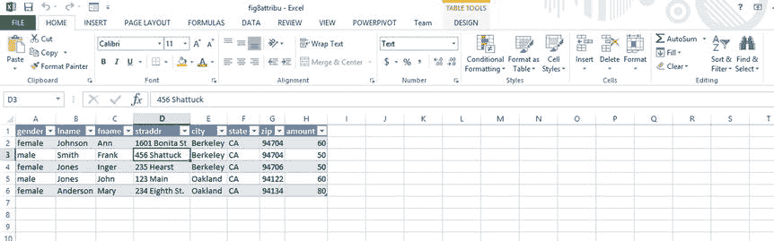

图 2-8. 导入到 Excel 中的带属性 XML

### 导入 JSON 格式

许多 NoSQL 数据以 JavaScript 对象表示法 (JSON) 格式存储。遗憾的是，Excel 不能直接读取 JSON 文件，因此必须使用一种中间格式才能将其导入 Excel。图 2-9 以 JSON 格式展示了我们的示例文件。请注意其中的“名称-值”对，每当出现该字段的一个实例时，字段名称都会重复出现。

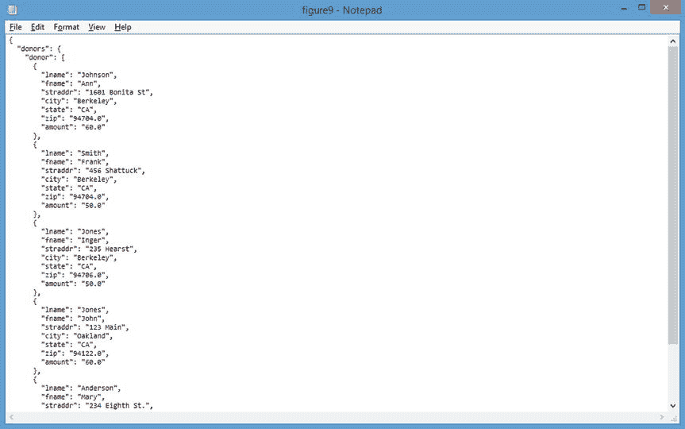

图 2-9. JSON 格式

由于 Excel 无法直接读取 JSON 文件，您必须将此 JSON 格式的数据转换成诸如 XML 之类的 Excel 可读格式。网络上有许多免费转换器可用，例如 [`http://bit.ly/1s2Oi6L`](http://bit.ly/1s2Oi6L) 上的这个。

该转换器的界面如图 2-10 所示。（请记住使用文件的副本进行操作，这样原始文件就不会被损坏。）可以将 JSON 文件粘贴到 JSON 窗口中，然后通过点击箭头将其转换为 XML。结果会得到一个同名的 XML 文件，您可以直接从 Excel 中打开它。

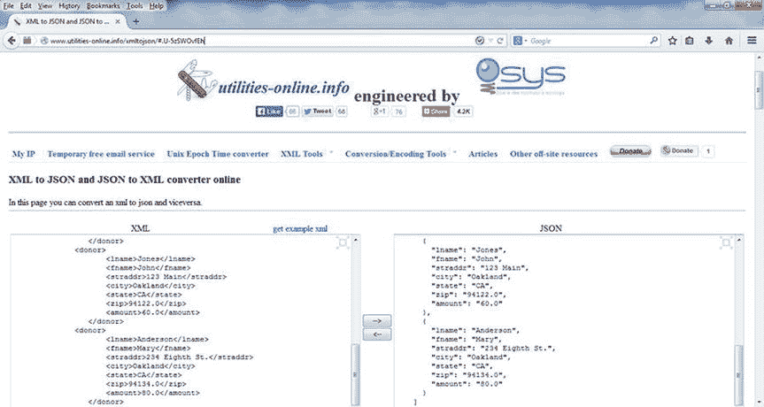

图 2-10. XML 与 JSON

### 使用“数据”选项卡导入数据

到目前为止，我们一直通过将文本文件直接导入 Excel 来创建新的电子表格。“数据”选项卡上的选项可用于从多种格式导入数据，并将其作为现有电子表格的一部分。

#### 从网站上的表格导入数据

例如，让我们看看如何从网站上的表格导入数据。

要从网站上的表格导入数据，请执行以下操作：

1. 点击“数据”选项卡以显示“数据”功能区。
2. 点击`自网站`。
3. 将出现一个浏览器窗口。输入您要访问的网站地址。我们将访问一个劳工统计局关于基于受教育程度的就业示例。本例中，我们将使用 [`http://www.bls.gov/emp/ep_table_education_summary.htm`](http://www.bls.gov/emp/ep_table_education_summary.htm)。
4. 如图 2-11 所示，每个表格旁边会出现一个位于黄色小框中的黑色箭头。点击表格左上角黄色小框中的黑色箭头，它将变为绿色框中的对勾。点击`导入`。将出现如图 2-12 所示的“导入数据”对话框。

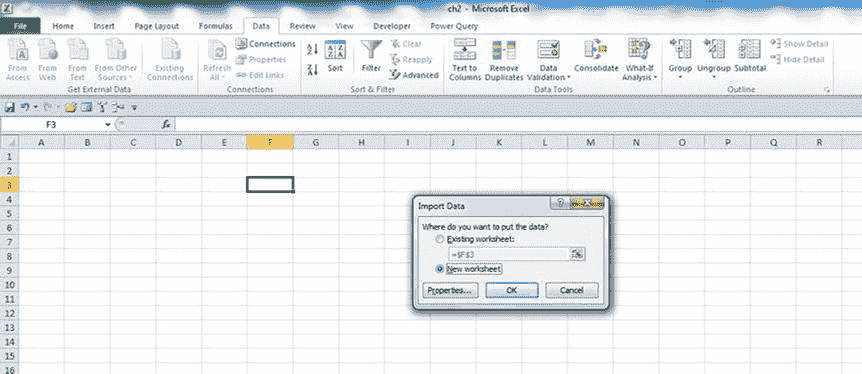

图 2-12. “导入数据”对话框

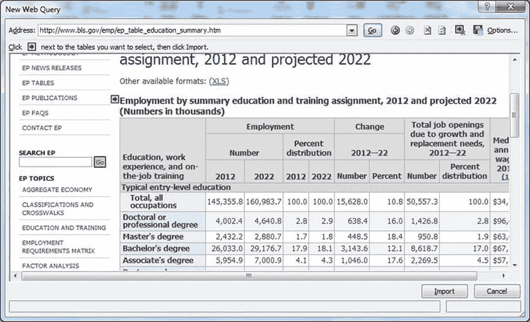

图 2-11. 从网页导入数据

5. 选择“新建工作表”，然后点击“确定”。该表格将被导入，如图 2-13 所示。可能需要在 Excel 中进行一些格式化，才能使表格完全符合您做进一步分析的要求。

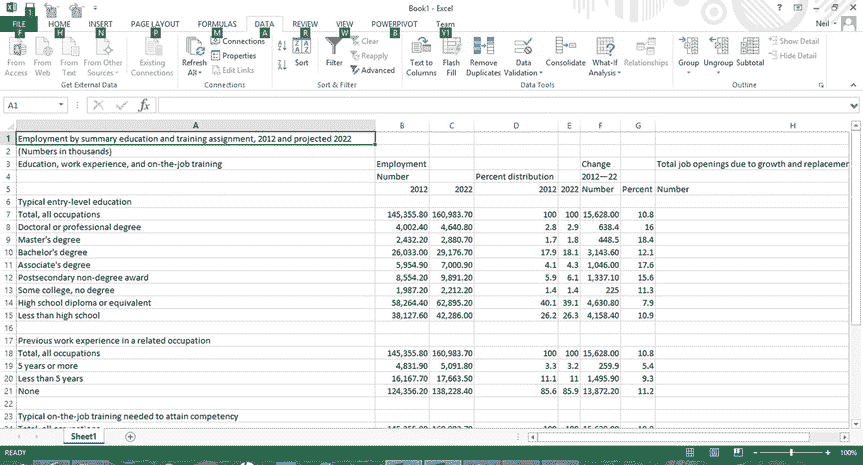

图 2-13. 从网页导入 Excel 的数据

## 数据整理与数据清洗

导入的数据很少直接是我们所需的格式。数据可能因以下原因而产生问题：

- 数据不完整。
- 数据不一致。
- 数据格式错误。

数据整理涉及将原始数据转换为可用格式。数据清洗意味着修正错误和不一致之处。Excel 提供了用于清洗和格式化数据的工具。

### 更正大小写

Excel 提供的用于更正大小写的函数之一是 `Proper()` 函数。它会将每个单词的首字母大写，其余字母小写。图 2-14 显示了一些文本在执行该函数前后的样子。要使用 `Proper()` 函数，如图 2-14 所示，请执行以下步骤：

1. 在新的一列中，输入 `=Proper(`。
2. 点击您要应用该函数的第一个单元格，然后输入右括号 (`)`)。接着按 Enter 键。
3. 点击您刚刚输入公式的单元格，然后拖动该单元格右下角的填充柄，将公式复制到整列。
4. 将单元格内容从公式转换为数值。对于少量单元格，可以通过选择每个单元格，按 F2 进行编辑，然后按 F9 转换为数值，最后按 Enter 键来完成。
5. 对于大量单元格，请选择该列，右键点击，选择“复制”。然后选择要复制到的目标区域中的第一个单元格，按 `Ctrl` + `Alt` + `V` 打开“选择性粘贴”对话框，选择“数值”，然后点击“确定”。
6. 然后您可以删除原始列：在该列任意位置右键点击，选择`删除` ➤ `整列`。

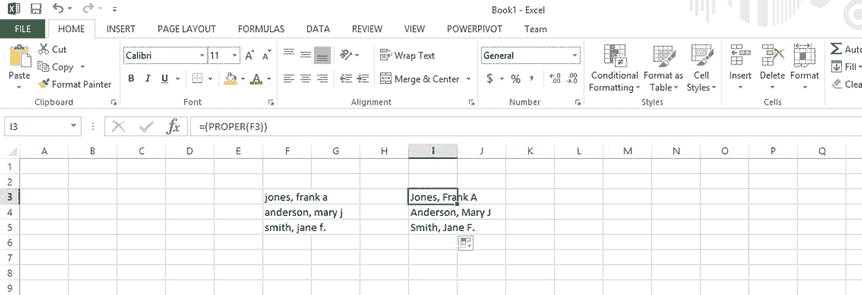

图 2-14. `Proper()` 函数的使用


## 分割分隔字段

在某些情况下，名字和姓氏包含在同一字段中，并用逗号分隔。可以使用“数据”选项卡上的“分列”选项来拆分这些字段及类似字段。

选中要转换的单元格区域。单击“数据”选项卡上的“分列”。在弹出的窗口中，选择“分隔符号”，如图 2-15 所示。然后点击“下一步”。

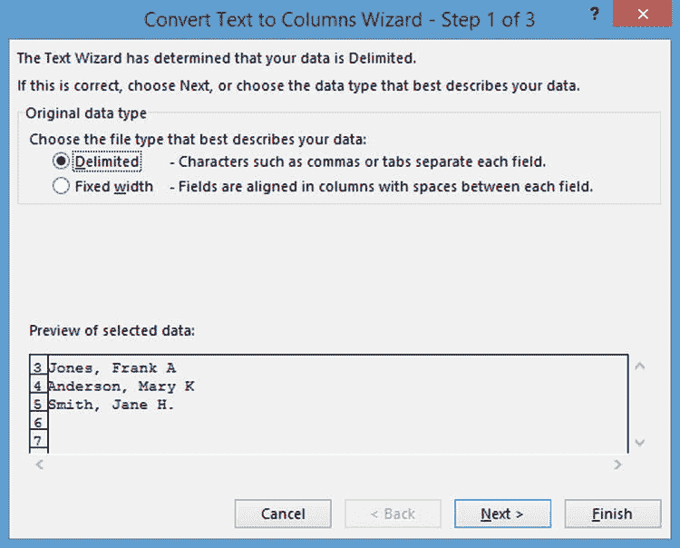

图 2-15. “文本分列”对话框

在下一个弹出的窗口（如图 2-16 所示）中，勾选“逗号”和“空格”作为分隔符，并预览结果。如果预览结果无误，点击“下一步”。将空格作为分隔符加入的原因是为了处理中间名缩写，在本例中，中间名缩写与其对应的名字之间是用空格分隔的。

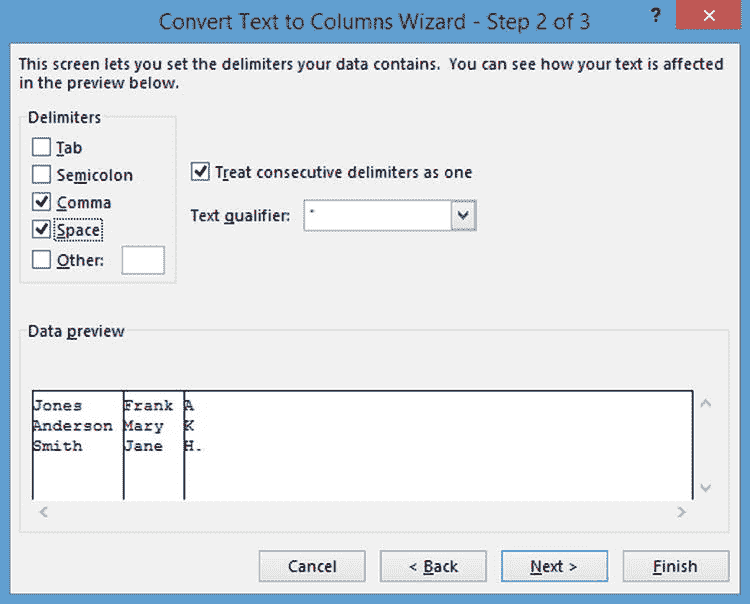

图 2-16. “文本分列”的数据预览

在下一个弹出的窗口中，在“数据预览”区域选择每一列，并点击“文本”作为列数据格式，如图 2-17 所示。输入希望结果放置的目标位置，然后点击“完成”。

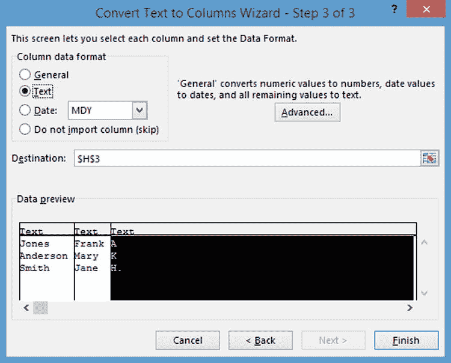

图 2-17. “文本分列”的最后一步

## 分割复杂的分隔字段

对于单个字段中包含多个数据元素的更复杂情况，通常可以通过使用 Excel 的内置函数来解决。表 2-1 展示了一些可用于字符串操作的函数。

表 2-1. 可用于字符串操作的函数

| 函数 | 说明 |
| --- | --- |
| `LEN(text)` | 返回文本字符串中的字符数 |
| `LEFT(text,num_chars)` | 返回由 `num_chars` 指定的最左边字符数 |
| `RIGHT(text,num_chars)` | 返回由 `num_chars` 指定的最右边字符数 |
| `MID(text,start,num_chars)` | 返回从 `start` 指定位置开始、由 `num_chars` 指定数量的字符 |
| `SEARCH(find_text,within_text,start_num)` | 返回从左向右读取时，指定的 `find_text` 在 `within_text` 中首次出现的位置。不区分大小写。`start_num` 指定要查找第几次出现的文本。默认值为 1。 |
| `TRIM(text)` | 删除文本字符串中所有前导和尾随空格，但单词之间的单个空格除外 |
| `CLEAN(text)` | 删除文本字符串中的所有非打印字符 |
| `LOWER(text)` | 返回将所有字符转换为小写的字符串 |
| `UPPER(text)` | 返回将所有字符转换为大写的字符串 |
| `PROPER(text)` | 返回将每个单词首字母转换为大写的字符串 |

函数可以嵌套。例如，我们可以使用以下公式提取姓氏：

```
=LEFT(F7,SEARCH(",",F7)-1)
```

此函数将提取从最左边到逗号位置的字符。要提取名字和中间名缩写，请使用以下公式：

```
=RIGHT(F7,SEARCH(", ",F7)+1)
```

## 删除重复项

导入的数据中包含重复记录的情况并不少见。可以使用“数据”选项卡上的“删除重复项”选项来删除重复记录。

最佳做法是始终使用原始文件的副本进行操作，以防止有效数据被误删。要删除重复项，只需选中包含重复值的列，然后点击“删除重复项”，如图 2-18 所示。确认包含重复项的列，然后点击“确定”。只有所有值都完全相同的行才会被删除。

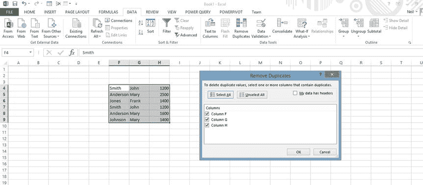

图 2-18. 删除重复项

## 输入验证

Excel 提供了检查有效输入的工具。如果数据无效，结果可能是“垃圾进，垃圾出 (GIGO)”。Excel 提供了通常与数据录入相关联的数据验证工具；但是，它们也可用于标记已录入数据中的单元格。在图 2-19 所示的示例中，销售数字的有效范围是 0 到 20,000 美元，这是通过“数据”选项卡上的“数据验证”选项定义的。

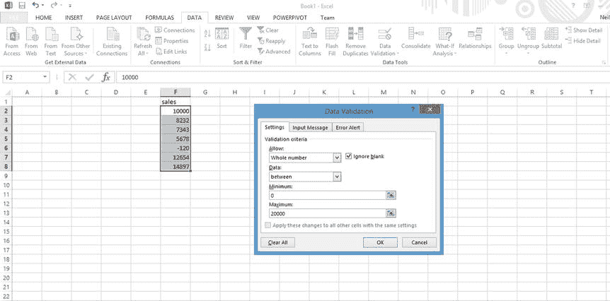

图 2-19. “数据验证”对话框

任何超出此范围的值都可以通过在“数据”选项卡上“数据验证”下的“圈释无效数据”选项来突出显示。结果如图 2-20 所示。

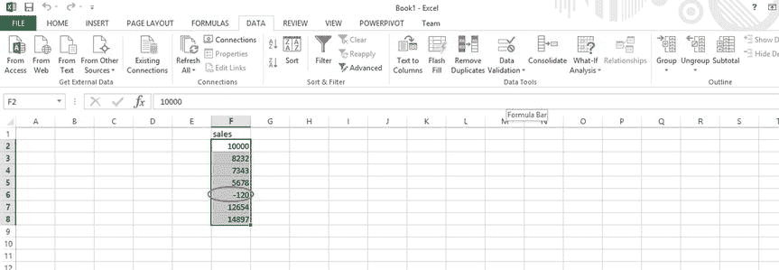

图 2-20. 以红色圆圈标记的无效数据

## 使用数据记录单

Excel 中一个隐藏且文档记录较少的功能是数据记录单功能。有时，以记录单形式（而非单纯的表格格式）显示每条记录的数据更易于阅读。默认情况下，工具栏上没有数据记录单图标。可以通过单击具有行标题的表格中的某个单元格，然后按 `Alt`+`D`，再按 `O` 来访问数据记录单。也可以将数据记录单添加到快速访问工具栏。可通过以下步骤完成：

单击快速访问工具栏（位于屏幕左上角）最右端的下拉箭头，然后点击“其他命令”，如图 2-21 所示。

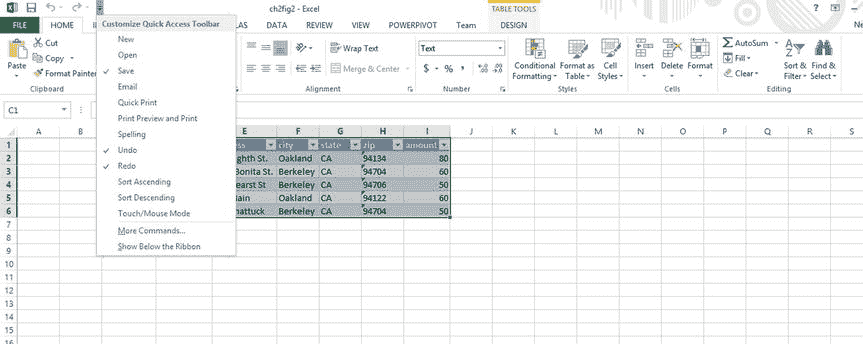

图 2-21. “自定义快速访问工具栏”菜单

点击“其他命令”后，在屏幕顶部选择“不在功能区中的命令”。将出现如图 2-22 所示的屏幕。找到并选中“记录单”图标，然后按下中间的“添加” ➤ 按钮，将其添加到快速访问工具栏。

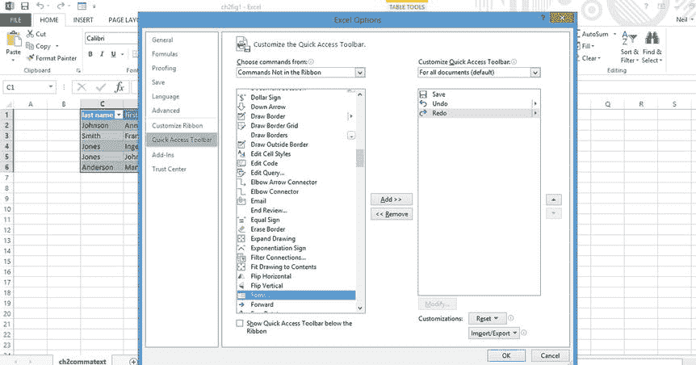

图 2-22. 自定义快速访问工具栏菜单

要使用数据记录单，请单击包含要在记录单中查看的数据的行。然后点击快速访问工具栏中的“记录单”图标，即可看到如图 2-23 所示的显示。可以在数据记录单中编辑字段。点击“下一条”和“上一条”按钮在记录间移动。

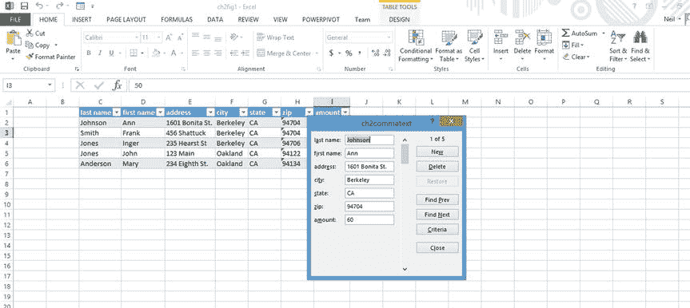

图 2-23. 使用数据记录单

## 选择记录

可以使用数据记录单根据条件有选择地查看特定记录，步骤如下：

1. 单击表格中的一个单元格。
2. 单击快速访问工具栏中的“记录单”图标，或按 `Alt`+`D`，然后按 `O`。
3. 在记录单中，点击“条件”，然后输入要使用的条件，例如 `城市=奥克兰`，如图 2-24 所示。

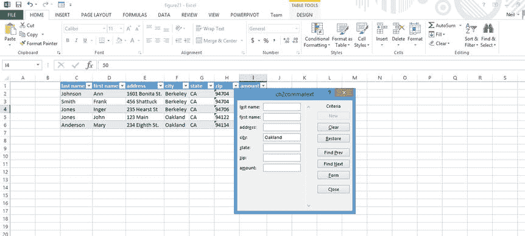

图 2-24. 使用数据记录单根据条件选择记录

然后点击“下一条”，“上一条”将仅显示满足指定条件的行。


## 摘要

本章介绍了如何将数据导入 Excel。图 2-1、2-2、2-4、2-5、2-6、2-7、2-9 和图 2-10 展示了表示相同数据的多种方式。Excel 可以读取所有这些格式，但 JSON 除外，后者可以通过先将其转换为 XML 作为中间步骤来导入。你还学习了如何将 Excel 中的表格用作平面文件。第 3 章将演示如何使用数据透视表从大型数据集中提取汇总数据。第 4 章将介绍如何设置关系数据模型。

