# 在 Excel 中使用 SQL

本章介绍如何在 Excel 中使用 SQL（结构化查询语言）来导入和操作大型数据文件的子集，以及提取汇总统计信息。


## SQL 历史

SQL 最早由 IBM 在 20 世纪 70 年代初开发，当时命名为 `SEQUEL`（结构化英语查询语言）。它用于操作和检索早期 IBM 关系数据库管理系统（RDBMS）中的数据。由于商标冲突，`SEQUEL` 被简称为 `SQL`。随后，Oracle 和后来的 Microsoft 将其实现到其他关系数据库管理系统中。1986 年，美国国家标准协会（ANSI）发布了 SQL 标准。在我看来，正确的发音是 `S-Q-L`，但有些人仍然将其读作 `Sequel`。

SQL 是一种声明式语言，这意味着它指定了需要什么结果，而无需定义`如何`获取。SQL 由数据定义语言和数据操作语言组成。在 Excel 中，主要使用数据操作语言的查询功能，因为数据定义是通过 Excel 从其他源导入表来完成的。SQL 最初基于关系模型，这意味着数据根据固定结构存储在多个表中。

## NoSQL

如第 1 章所述，术语 `NoSQL` 是用词不当，因为某些 `NoSQL` 系统具有 SQL 接口。更准确的术语应该是*非关系型*，或*不仅仅是 SQL*。关系数据库具有固定的模式，必须在输入任何数据之前定义该模式。相比之下，`NoSQL` 数据库可以访问具有不同模式的数据。这有时被称为*读取时定义模式*。

## NewSQL

`NewSQL` 试图在关系型系统和 `NoSQL` 系统之间取得折衷。这些系统使用关系架构，并以 SQL 作为其主要接口，但力求拥有与 `NoSQL` 系统相同的可扩展性和灵活性。

## SQL++

`SQL++` 是该语言的一种新形式，它增强了传统 SQL，并基于一种半结构化数据模型，该模型可以访问 JSON 数据以及传统的关系数据。它通常向后兼容传统 SQL。

`SQL++` 的一种实现是 `N1QL`（发音为“Nickel”），由 Couchbase 基于 Kian Win Ong、Yannis Papakonstantinou 和 Romain Vernoux 在 2014 年发表的论文《The SQL++ Unifying Semi-structured Query Language, and an Expressiveness Benchmark of SQL-on-Hadoop, NoSQL and NewSQL Databases》进行开发。

## SQL 语法

SQL 查询语言的核心是 `SELECT` 命令。该命令的语法如下所示。请注意，方括号内的子句是可选的。

```
SELECT [DISTINCT] <列列表>
[AS <返回列的可选别名>]
FROM <表名>
[WHERE <条件>]
[GROUP BY <用于计算聚合的列表达式>]
[HAVING <组级过滤条件>]
[ORDER BY <结果表的排序顺序>]
```

`SELECT` 子句指定要显示的列或列表达式。可以使用星号来指定所有列。`FROM` 子句列出要访问的表。`WHERE` 子句用于提供关联多个表的条件，和/或提供行级过滤器，用于排除不符合所需条件的行。`GROUP BY` 用于将结果表按组排列以进行数据聚合，例如小计。`HAVING` 子句为结果集提供组级过滤器。`ORDER BY` 子句用于按指定顺序排列结果表。在 PowerPivot 和 Excel 中执行此操作的方法将在本章中演示。

当使用 `SELECT` 语句时，应解决以下问题：

- `SELECT`：要显示哪些所需的列或列表达式？
- `FROM`：这些列位于哪些表中？
- `WHERE`：关联表的条件是什么？消除不需要的行的选择标准是什么？
- `GROUP BY`：哪些值需要被聚合，例如用于小计目的？
- `HAVING`：在使用聚合时，结果表中的每条记录必须满足哪些条件才能被包含？
- `ORDER BY`：结果应以什么顺序呈现？

例如，以下 SQL `SELECT` 语句从 `addrlist` 表中提取邮政编码等于“94704”的 name 和 address 字段。

```
SELECT name, address FROM addrlist WHERE zip="94704"
```

## SQL 聚合函数

SQL 包含各种聚合函数，允许根据 `WHERE` 子句中的条件计算小计、子平均值、子计数等。

这些函数包括：

- `COUNT()`：返回满足指定条件的非空行数
- `SUM()`：返回指定列中所有值的总和
- `MIN()`：返回指定列中的最小值
- `MAX()`：返回指定列中的最大值
- `AVG()`：返回指定列的平均值

这些函数可以应用于整个表，也可以应用于由 `WHERE` 条件定义的子集。例如，查看以下语句：

- `SELECT COUNT(*) FROM offices`：将返回 `offices` 表中的行数
- `SELECT COUNT(*) FROM office WHERE region="CH"`：将返回芝加哥地区的办公室数量
- `SELECT SUM(sales) FROM offices`：将返回 `offices` 表中所有行的销售额总和
- `SELECT SUM(sales) FROM offices where region="CH"`：将返回芝加哥地区所有办公室 `sales` 字段的总和

## 小计

可以使用以下语句显示每个地区的办公室总数：

```
SELECT region, COUNT(*) FROM offices GROUP BY region
```

可以使用以下语句生成所有地区的销售额小计：

```
SELECT region, SUM(sales) FROM offices GROUP BY region
```

## 连接表

在查询多个表时，最好使用 `WHERE` 子句来指定连接表的条件。这被称为*等值连接*，因为它基于相等性测试。如果省略 `WHERE` 子句，则第一个表中的每一行将与第二个表中的每一行配对。这被称为两个表的*笛卡尔积*，或*外连接*。


## 导入外部数据库

本示例将使用 Access Northwind 示例数据库。若要执行此示例，请执行以下步骤：

点击 `Test Connection`。如果连接测试成功，点击 `Next`。选择第二个选项，“编写一个指定要导入数据的查询”，如图 5-2 所示。点击 `Next`。

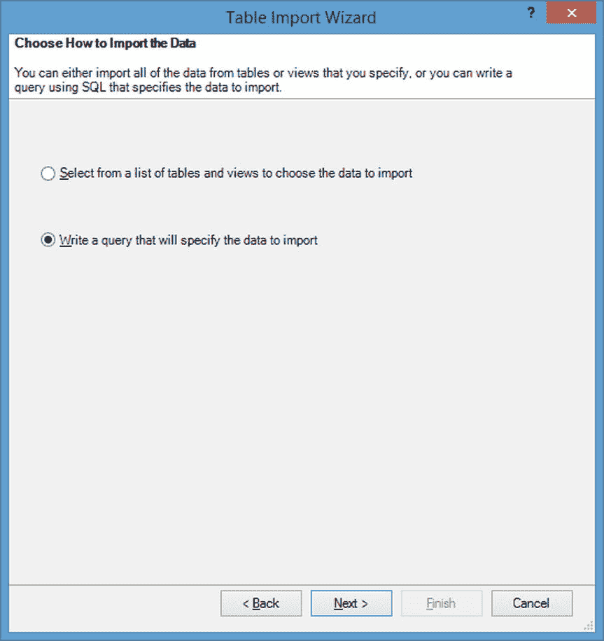

图 5-2. 选择“编写一个指定要导入数据的查询”

点击 `PowerPivot` 选项卡以打开功能区。点击 `Manage` 按钮。在 `PowerPivot` 选项卡上，点击“获取外部数据”和“从数据库获取”。选择“从 Access 获取”。点击 `Browse` 并选择先前从 Northwind 数据库网站下载的 `Database2`，如图 5-1 所示。该文件也可从 Apress 书籍页面的 Source Code/Downloads 选项卡下载，网址为 [`www.apress.com/9781484205303`](http://www.apress.com/9781484205303)。

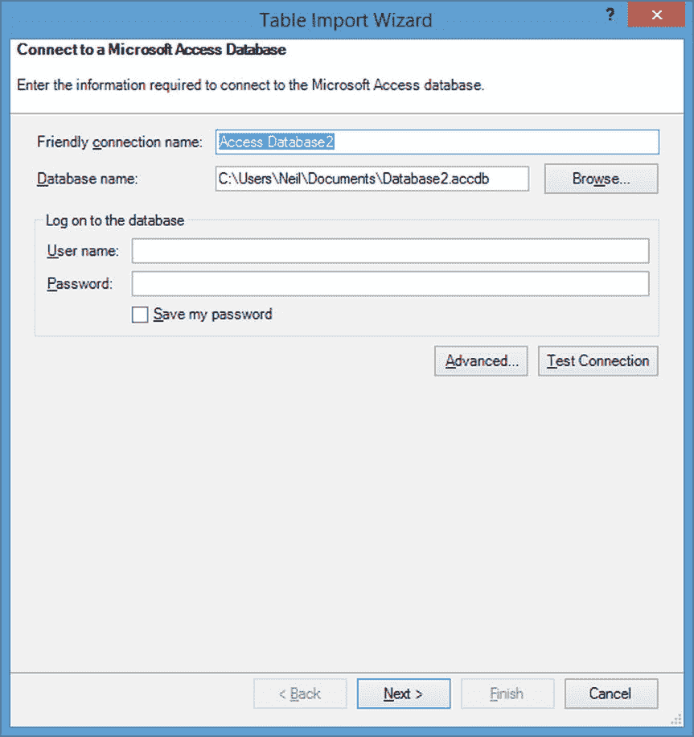

图 5-1. 使用表导入向导导入数据库

在编写查询之前，了解数据库中定义的结构和关系会很有帮助。导入 Access 数据库时，Access 中定义的关系也会被导入，如图 5-3 所示。

第一个查询将根据图 5-3 所示的关系，导入 `orders` 和 `employees` 表中的所有字段，其中 `Orders` 表中的 `EmployeeId` 字段链接到 `Employees` 表中的 `ID` 字段。在 SQL 语句窗口中，输入以下 SQL 语句：

```
SELECT * from orders, employees
```

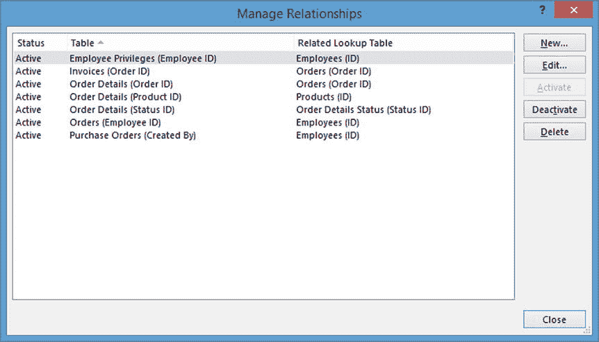

图 5-3. 现有关系

点击 `Finish` 查看结果，结果如图 5-5 所示。点击 `Close` 以访问数据。

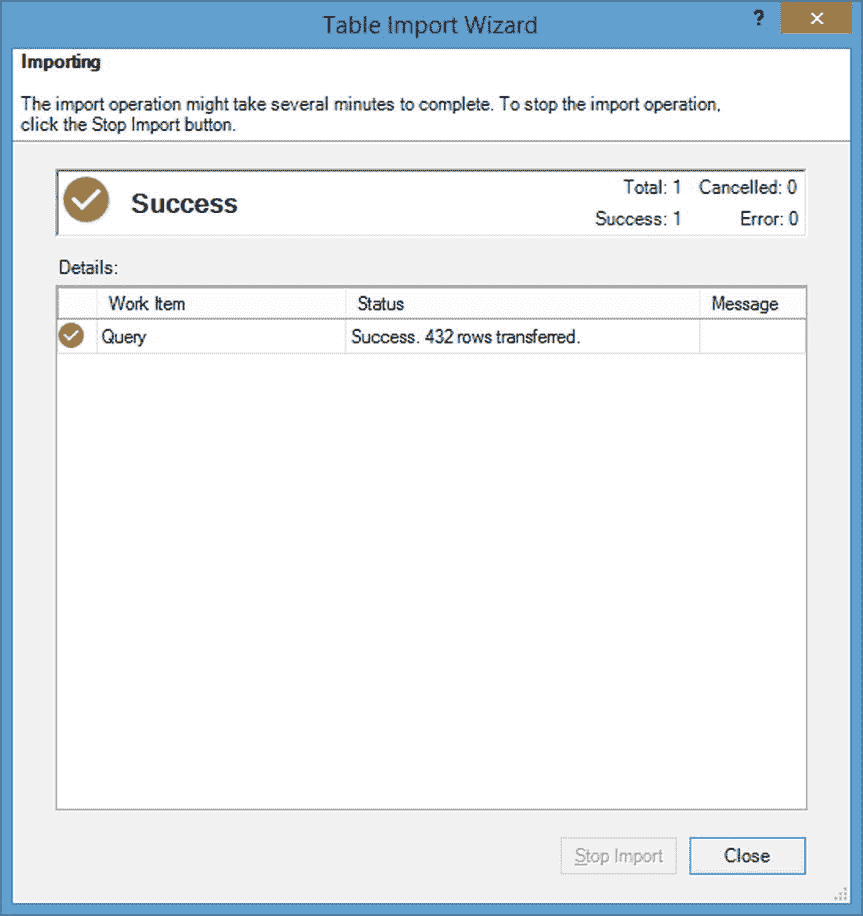

图 5-5. 成功屏幕显示已导入 432 行

然后点击 `Validate`。如果 SQL 输入正确，窗口将如图 5-4 所示。

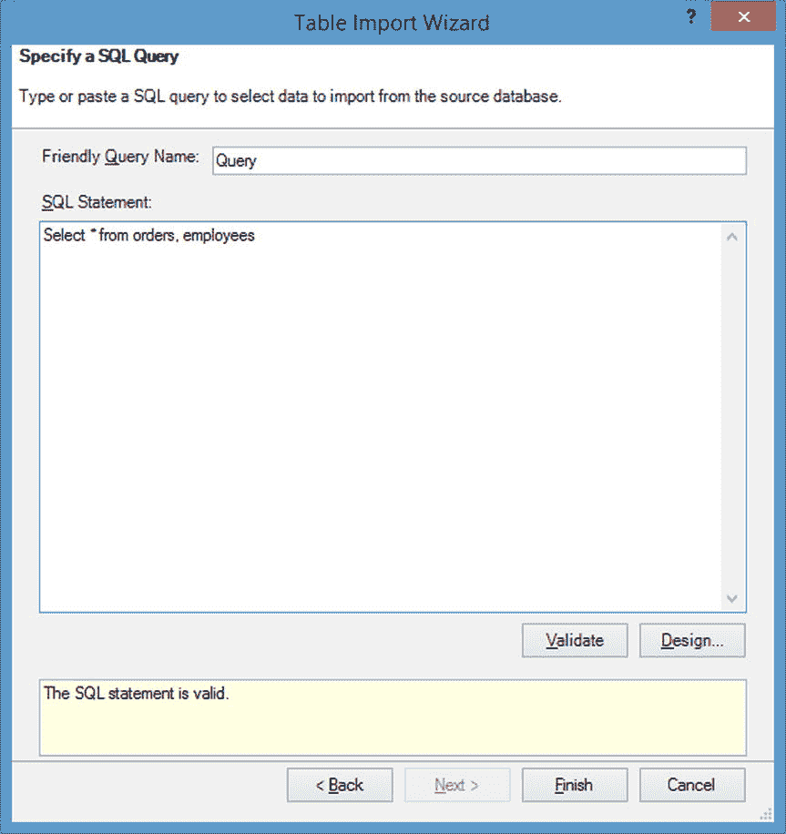

图 5-4. SQL select 语句

点击 `Close` 后检索到的实际数据如图 5-6 所示。请注意，导入了 432 行，因为表之间未指定任何关系，所以第一个表中的每一行都与第二个表中的每一行配对。请注意，432 是 `employees` 表中的 9 行与 `orders` 表中的 48 行的乘积。

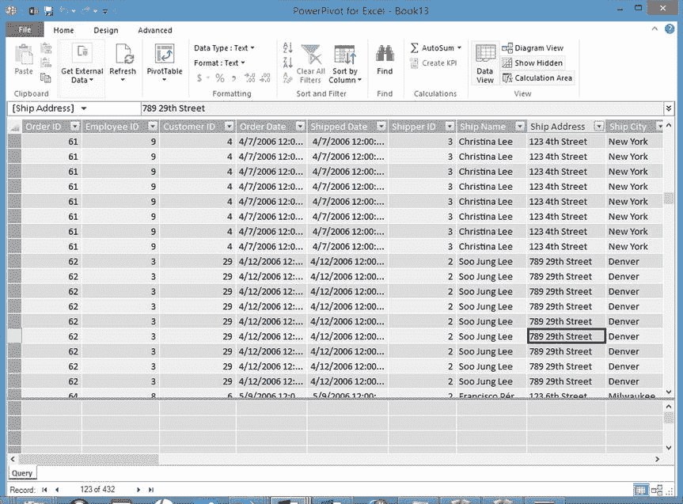

图 5-6. SQL 查询的结果表

## 指定 JOIN 条件和选定字段

在此示例中，将指定一个 JOIN 条件，以便只为每位员工导入一个订单。本示例将演示如何仅导入选定的字段。请注意，包含空格的字段必须用方括号括起来。当从多个表导入字段时，字段名称指定为 `tablename.fieldname`。

对于此示例，请遵循前面“导入外部数据库”部分示例中的步骤 1-6，然后完成以下步骤：

输入 SQL 语句，如图 5-7 所示。请注意，指定了 `WHERE` 条件，基于 `employees.id=orders.[employee id]` 链接两个表。将显示来自 `employees` 表的员工姓氏。同时显示来自 `employees` 表和 `orders` 表的员工 ID，以证明两者相同。

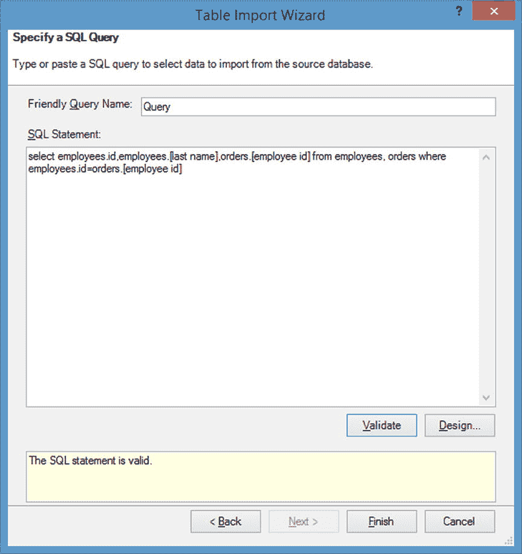

图 5-7. SQL 查询

```
Select employees.id, employees.[last name], orders.[employee id] from employees, orders where employees.id=orders.[employee id]
```

点击 `Close` 完成操作。结果如图 5-9 所示，其中显示了来自 `employees` 表的员工姓氏以及来自 `employees` 和 `orders` 表的员工 ID。

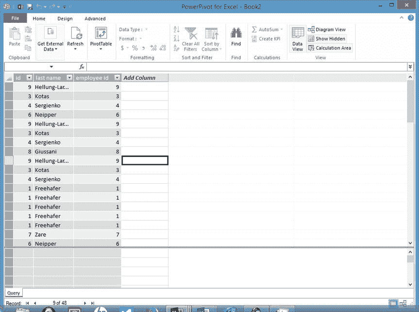

图 5-9. SQL 查询的结果表

现在，点击 `Finish`。请注意，由于指定了条件，仅导入了 48 行（`orders` 表中的记录数），如图 5-8 所示。

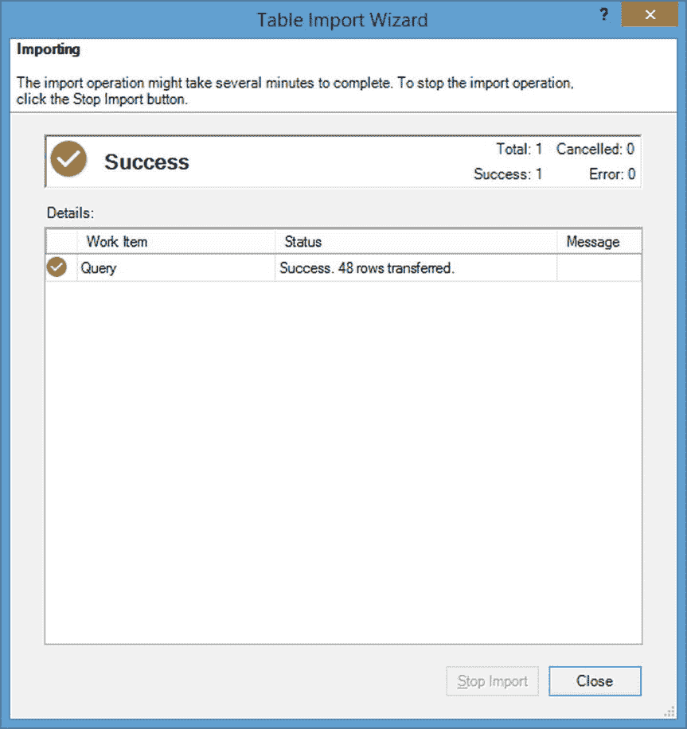

图 5-8. 成功屏幕显示已导入 48 行

点击 `Validate` 以确保查询有效，也如图 5-7 所示。

## 使用 SQL 提取汇总统计信息

SQL 可用于通过聚合函数从一个或多个表中提取汇总统计信息。此示例将提取一个单一数字——来自 `orders` 和 `orders detail` 表的单价乘以数量的总和。

对于此示例，请遵循前面“导入外部数据库”部分示例中的步骤 1-6。

输入以下 SQL 语句，如图 5-10 所示，以提取 `orders` 表中所有记录的单价乘以数量的总和。

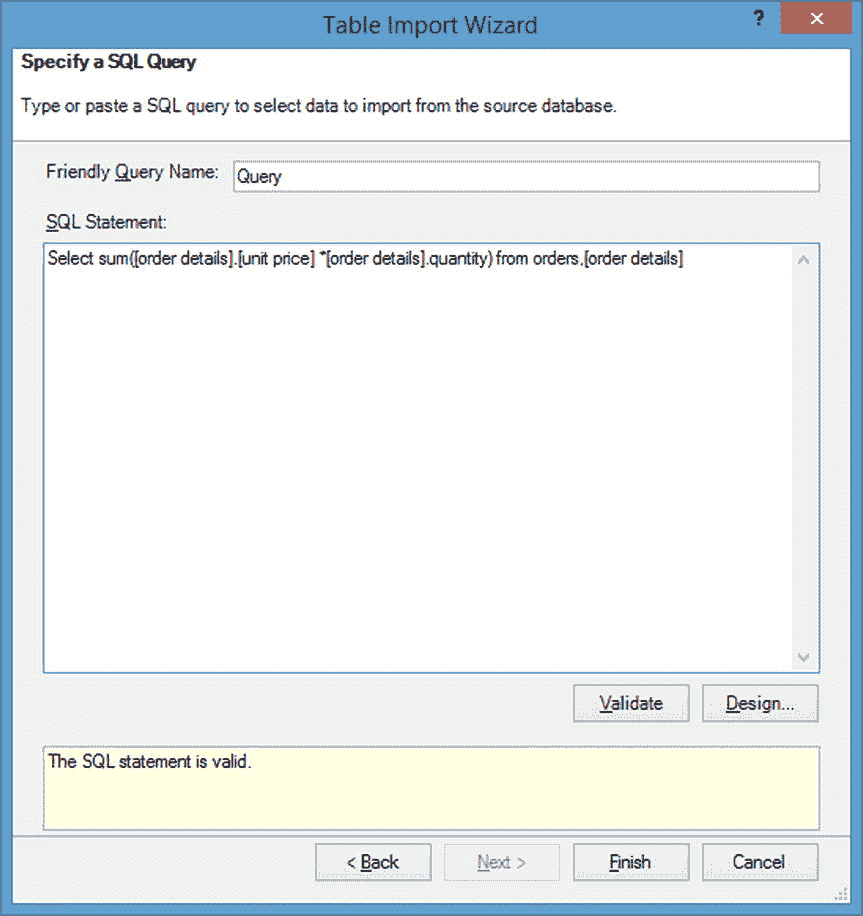

图 5-10. SQL 查询

```
Select sum([order details].[unit price] * [order details].quantity) from orders, [order details]
```

按 `Enter` 键并等待，直到出现成功屏幕。然后点击 `Close`。结果如图 5-11 所示。请注意，结果是一个单一数字，这是所有订单明细记录中单价乘以数量的总和。

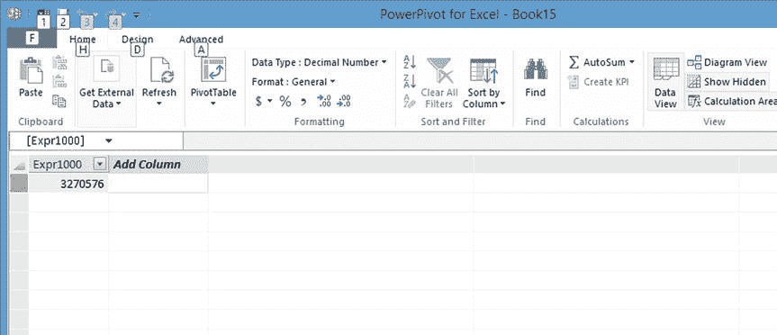

图 5-11. 结果为一个单一数字


## 按员工生成订单总金额报告

在此示例中，将生成一份按员工统计的订单总金额报告。要创建此报告，需要链接三个表：`employees`、`orders`和`order details`。

对于此示例，请按照“导入外部数据库”部分中前一个示例的步骤 1-6 操作。

输入以下 SQL 语句，如图 5-12 所示，以提取按员工细分的所有订单中单价乘以数量的总和。点击`Validate`确保 SQL 语句输入正确。

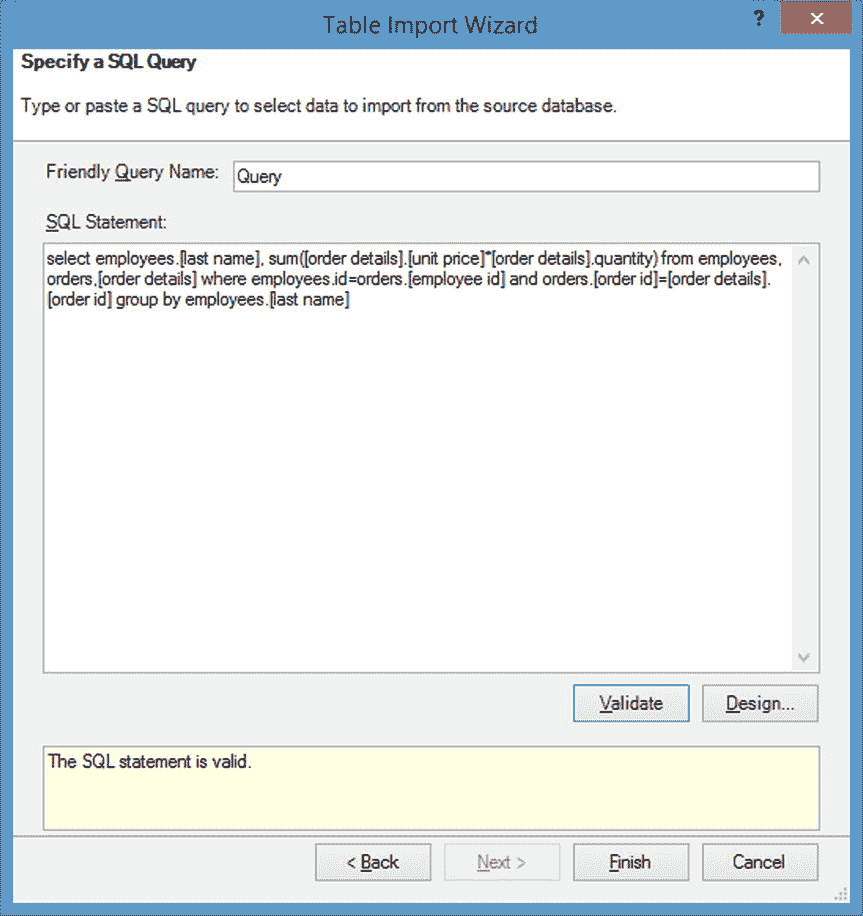

图 5-12.

SQL 查询语句 `Select employees.[last name], sum([order details].[unit price] * [order details].quantity) from employees, orders, [order details] where employees.id=orders.[employee id] and orders.[order id]=[order details].[order id] group by employees.[last name]`

请注意，基于图 5-3 所示的关系，使用了两个关系来链接三个表。`orders`表中没有显示任何字段，但该表被用作链接表。以下是此示例中使用的图 5-3 中的关系：

- `employees.id=orders.[employee id]`
- `orders.[order id]=[order details].[order id]`

点击`Finish`执行 SQL 语句。生成的实际数据如图 5-14 所示——按员工列出的订单价值。

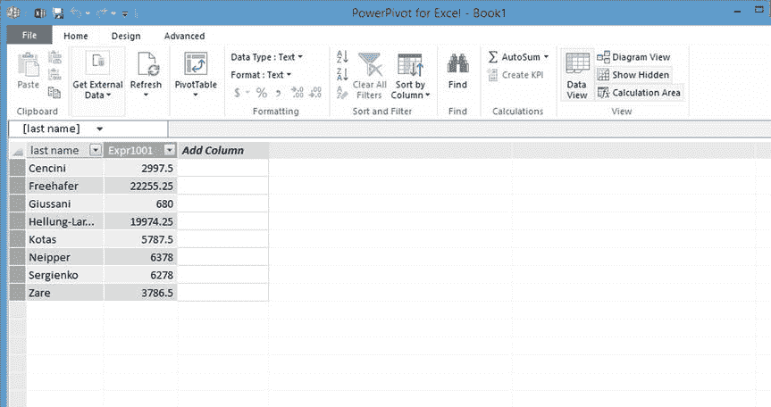

图 5-14.

按员工统计的订单总价值

该查询生成了八行数据，如图 5-13 所示。

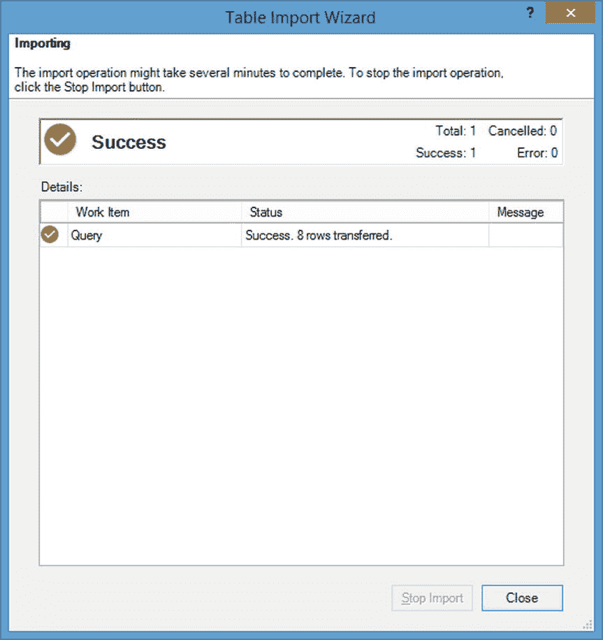

图 5-13.

成功屏幕显示该查询生成的八行数据

### 使用 MSQuery

另一种选择是使用带有 Microsoft Query 的 SQL。此示例将展示访问本章前面使用的`Northwind`数据库的另一种方法。请按照以下步骤操作：

要输入 SQL 查询，请点击菜单栏下方的`SQL`按钮，并输入 SQL 查询，如图 5-20 所示。

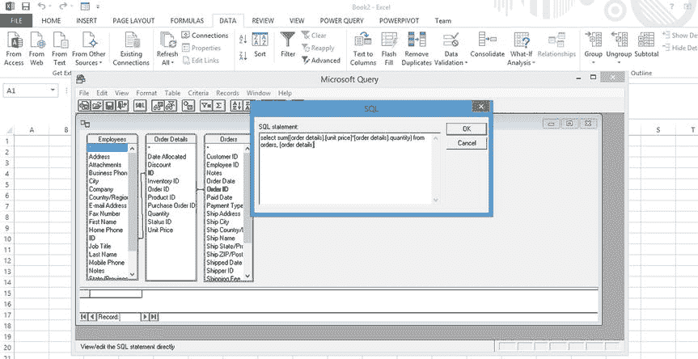

图 5-20.

显示 SQL 查询的查询界面 `Select sum([order details].[unit price] *[order details].quantity) from orders,[order details]`

点击`Close`并展开显示表格的窗口，以查看已定义的关系，如图 5-19 所示。

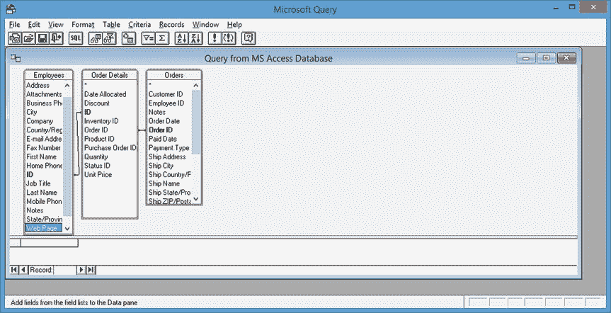

图 5-19.

显示表格和关系的查询界面

使用`Add Tables`窗口，通过双击每个表格来添加`employees`、`orders`和`order detail`表，如图 5-18 所示。

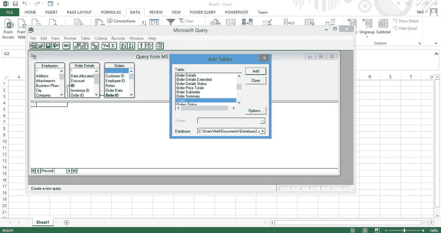

图 5-18.

用于添加表格的 Microsoft Query 窗口

选择之前下载的`Database2`，如图 5-17 所示，然后点击`OK`。

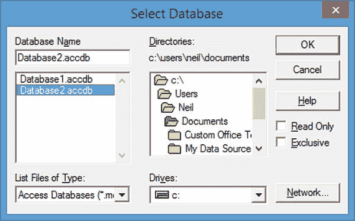

图 5-17.

选择数据库窗口

在`Choose Data Source`窗口中选择`MS Access Database`，如图 5-16 所示。取消勾选窗口底部的“使用查询向导创建/编辑查询”。然后点击`OK`。

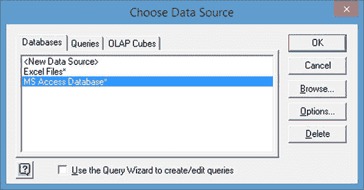

图 5-16.

选择数据源窗口

点击`Data`选项卡查看功能区，然后点击“从其他来源”。接着点击菜单中的最后一项“来自 Microsoft Query”，如图 5-15 所示。

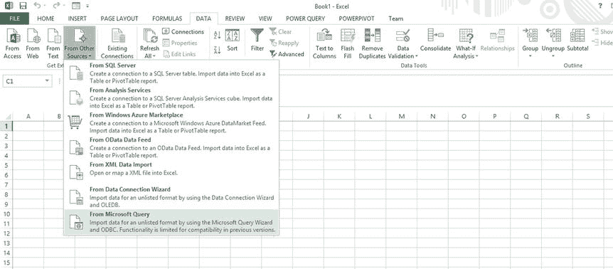

图 5-15.

显示如何访问 Microsoft Query 的屏幕

对于“SQL 查询无法以图形方式表示。是否继续？”的提示，点击`OK`，如图 5-21 所示。


图 5-21.

Microsoft Query 弹出窗口

单数字响应将显示出来，如图 5-22 所示。

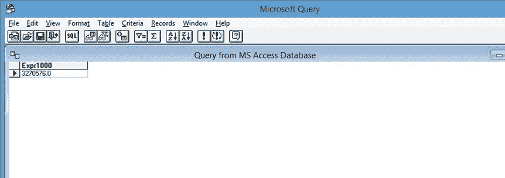

图 5-22.

查询结果

## 总结

本章展示了多种使用 SQL 与 Excel 和 PowerPivot 来从单个大表或一组表中汇总数据的方法。演示了如何根据指定条件连接表，以及如何使用聚合函数提取汇总统计信息。

