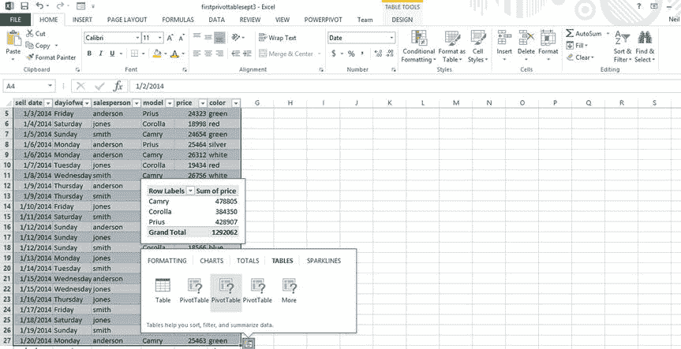
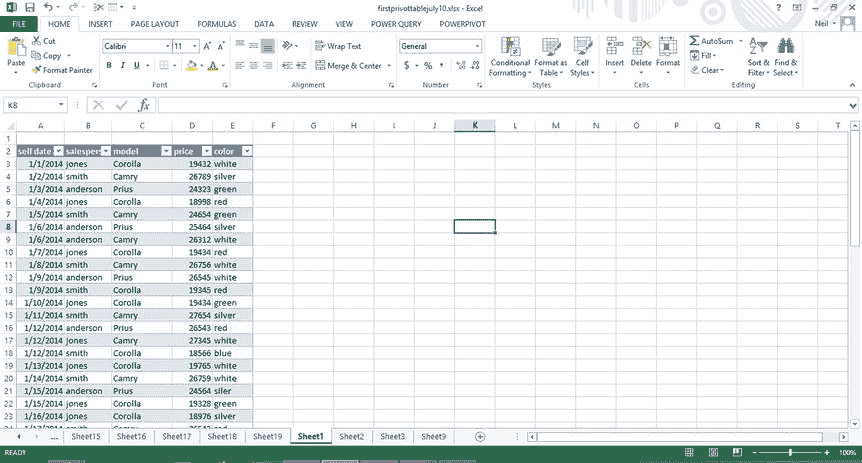
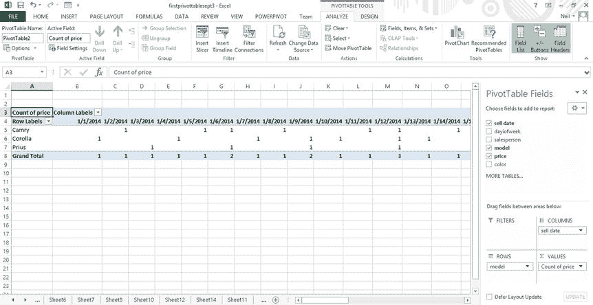
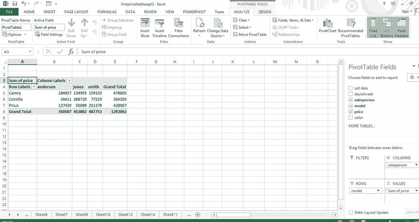
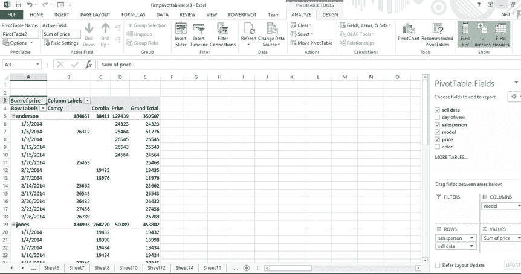
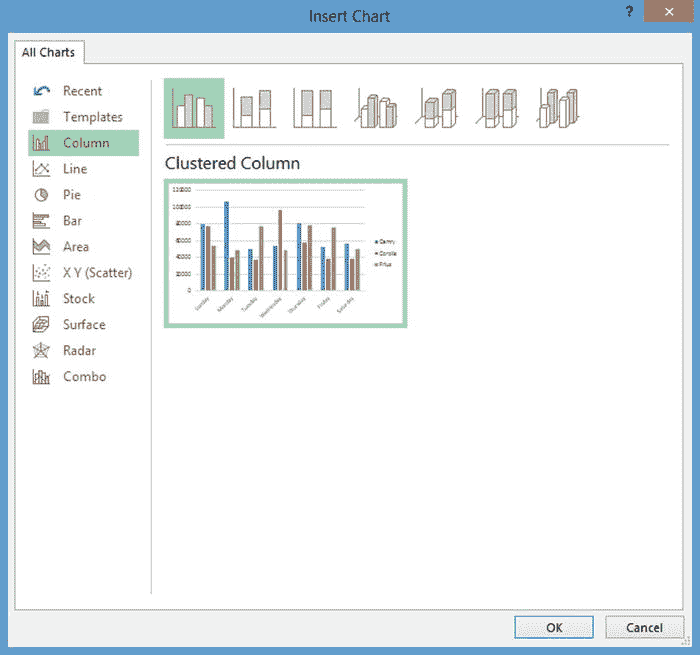
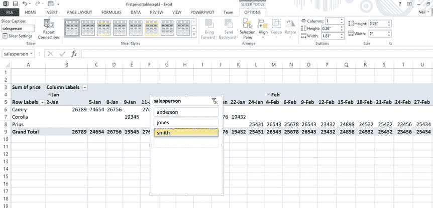
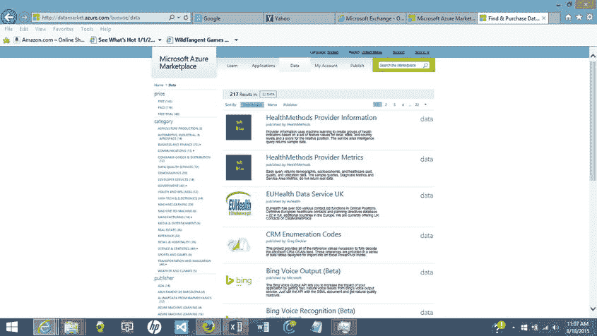
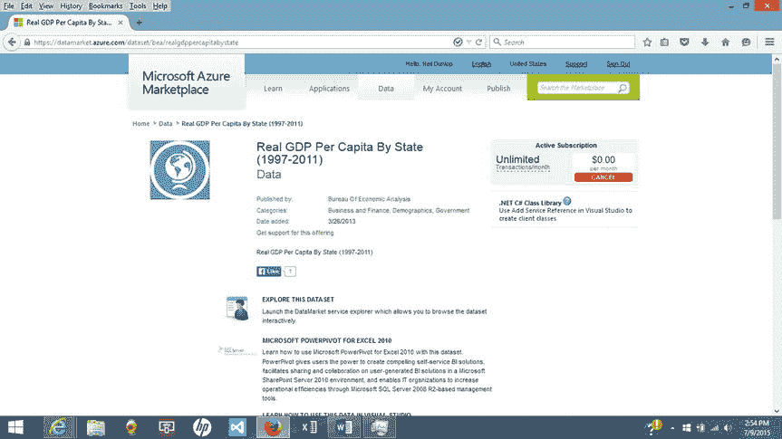
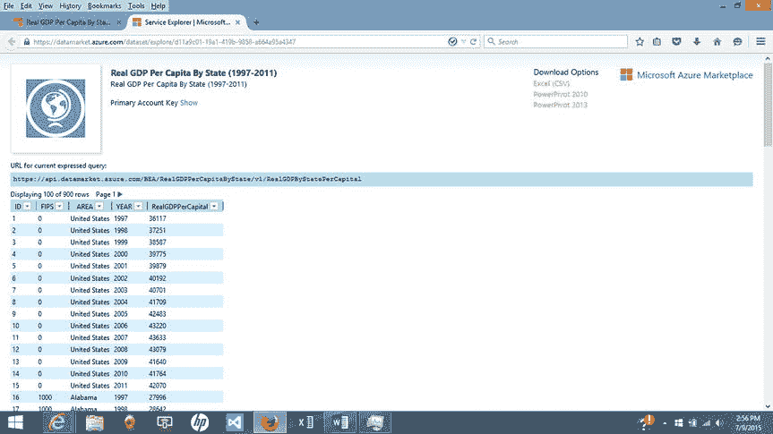

# 3. 数据透视表和数据透视图

本章介绍如何使用数据透视表和数据透视图从单个表格中提取汇总数据。本章还描述了如何使用数据透视表从 Azure Data Marketplace 导入数据。第 4 章将展示如何使用 Excel 数据模型从多个表格中提取汇总数据。

## Excel 2013 中的推荐数据透视表

Excel 2013 尝试通过推荐条件格式、图表、工具和数据透视表来预测你的需求。当高亮显示数据，或选中数据区域中的任意单元格并按 `Ctrl+Q` 时，区域右下角会显示一个快速分析透镜按钮。点击该透镜会显示分析工具窗口，其中包含各种条件格式选项，如图 3-1 所示。将光标移到某个条件格式选项上，会预览该条件格式应用于数据的效果。点击分析工具窗口右上角的 `表格` 选项卡，会显示几个建议的数据透视表。将鼠标悬停在每个数据透视表上会显示预览效果，如图 3-2 所示。

图 3-2. 数据透视表预览

图 3-1. 分析工具窗口

## 定义数据透视表

本节介绍如何基于一个假设的丰田销售数据的简单交易表来定义数据透视表。该交易表列出了交易记录，包括销售日期、车型、销售人员、颜色和售价，如图 3-3 所示。作为数据透视表基础的表应同时包含数值数据和类别字段，以便数值数据可以按类别进行划分和切分。

图 3-3. 汽车销售交易表

创建数据透视表不会更改底层数据；它实际上是获取数据的一个快照。当底层数据发生更改时，数据透视表不会自动刷新。要刷新，请点击数据透视表内的任意位置以高亮显示 **数据透视表工具 - 分析** 选项卡，然后点击 `刷新`。

### 定义问题

好的做法是思考清楚你想通过数据透视表回答哪些问题。一些典型问题如下：

- 每天的平均销售额是多少？
- 谁是最佳表现的销售人员？
- 一周中哪几天的销售额最高？
- 哪几个月的销售额最高？

## 创建数据透视表

定义数据透视表的步骤如下：

确保底层数据采用表格格式，第一行显示字段名称，并且数据周围有空白行和列，或者从第 1 行或 A 列开始。按 `Ctrl+T` 将数据定义为表格，如图 3-3 所示。点击表格内的任意位置，然后高亮显示 **插入** 选项卡。点击 `数据透视表`。将出现如图 3-4 所示的界面。请注意，当前表格已被选中，并且默认情况下，数据透视表将放置在新工作表中。点击 `确定`。

图 3-4. 创建数据透视表对话框

此时，你需要思考想要提取哪种类型的数据。我们将从每日销售汇总开始，并附带每日售出车型的细分情况。我们将通过将 `销售日期` 拖到 **列** 框，将 `车型` 拖到 **行** 框，将 `价格` 拖到 **值** 框来实现，如图 3-5 所示。请注意，默认显示的是 `价格之和`。

图 3-5. 显示按车型统计的汽车销售数量的基本数据透视表

要将 `价格之和` 更改为 `价格计数`，请右键单击单元格 `A3`，或下拉 **值** 下 `价格计数` 上的箭头，选择“值字段设置”和 `计数`。结果如图 3-6 所示。

图 3-6. 显示按车型统计的汽车销售金额的数据透视表

### 更改数据透视表

更改数据透视表非常容易。要将水平轴从日期更改为销售人员，只需点击 **列** 框中的 `销售日期`，将其拖回并选择“删除字段”。然后，将 `销售人员` 从字段列表拖到 **列** 框。结果如图 3-7 所示。

图 3-7. 显示按车型和销售人员统计的销售额的数据透视表

### 创建每日按销售人员的销售细分

可以修改数据透视表以显示每天按销售人员和车型统计的销售额。只需将 `模型` 字段拖到 **列** 框，将 `销售人员` 和 `销售日期` 字段拖到 **行** 框，这样 **行** 框中就会同时显示 `销售日期` 和 `销售人员`。结果如图 3-8 所示。

图 3-8. 显示每日按销售人员和车型细分的销售情况的数据透视表

### 按月显示销售额

要按月显示销售报表，请右键单击 `销售日期` 列中的任意单元格，然后从组合窗口中选择 `月`，如图 3-9 所示，再点击 `确定`。

图 3-9. 选择按月分组的对话框

生成的数据透视表如图 3-10 所示。

图 3-10. 显示按月统计的销售人员和车型销售额的数据透视表

## 创建数据透视图

要根据数据透视表创建数据透视图，请在屏幕上显示数据透视表的情况下，执行以下操作：

转到 **数据透视表工具 - 分析** 选项卡，然后选择 `数据透视图`。从显示在图 3-11 中的“插入图表”弹出窗口中选择所需的图表类型，然后点击 `确定`。在此示例中，我们将使用堆积柱形图。

图 3-11. 插入图表对话框

结果将如图 3-12 所示显示。

图 3-12. 带有数据透视表的数据透视图

## 调整小计与总计

小计可以在“数据透视表工具-设计”选项卡中进行调整。点击`小计`查看相关选项。

- 不显示小计
- 在组的底部显示所有小计
- 在组的顶部显示所有小计

点击`总计`查看以下选项：

- 对行和列禁用
- 对行和列启用
- 仅对行启用
- 仅对列启用

## 按星期几分析销售额

按星期几分析销售额可能非常有用。在此示例中，我们通过以下步骤为星期几添加了一列：

由于这是一个表格，公式会自动向下填充到整列。结果如图 3-13 所示。

图 3-13.

提取星期几

保存电子表格。在`插入`选项卡上，点击`数据透视表`。在“创建数据透视表”弹出窗口中点击`确定`以接受默认设置。在销售人员左侧插入一列。将新列命名为“星期几”。在单元格`B3`中输入以下公式以提取星期几：`=TEXT(A3,"dddd")`。如有必要，在“数据透视表工具-分析”选项卡上点击`刷新`以显示新列。在“数据透视表字段”选项卡上，将“型号”拖到“列”框，将“星期几”拖到“行”，将“价格之和”拖到“值”，即可得到如图 3-14 所示的数据透视表。

图 3-14.

按星期几和型号划分的销售额数据透视表

## 创建按星期几划分的销售额数据透视图

要按星期几直观地展示销售额，可从数据透视表创建数据透视图。在屏幕上显示数据透视表后，执行以下操作：

转到“数据透视表工具-分析”选项卡，选择`数据透视图`。从图 3-15 所示的“插入图表”弹出窗口中，选择所需的图表类型。

图 3-15.

插入图表对话框

如果选择了簇状柱形图，结果将如图 3-16 所示。

图 3-16.

按星期几划分的销售额数据透视图

## 使用切片器

切片器可用于筛选数据，并放大查看数据透视表中的特定字段值。要设置切片器，请执行以下操作：

转到“数据透视表工具-分析”选项卡，选择`插入切片器`。在“插入切片器”弹出窗口中，选择要切片的字段，例如`销售人员`和`日期`，然后点击`确定`。结果如图 3-17 所示，它显示了每个型号和日期下各销售人员的销售额……可以选中某个特定的销售人员，并选择切片器菜单来查看该销售人员的销售额。

图 3-17.

使用销售人员切片器筛选结果

## 添加时间线

可以添加时间线以便按时间间隔进行切片。要添加时间线，请执行以下操作：

在“数据透视表工具-分析”选项卡上，选择`插入时间线`。在“插入时间线”窗口中选择`销售日期`，然后点击`确定`。可以通过点击时间线窗口右上角的下拉箭头来选择年、季度、月或日，以确定时间线的时间段。如图 3-18 所示，时间线和切片器可协同工作。可以选择特定的销售人员和日期，以查看该销售人员在该日期的销售额。

图 3-18.

使用时间线和销售人员切片器筛选数据

## 从 Azure 市场导入数据透视表数据

可以从 Azure 市场导入数据到数据透视表，Azure 市场包含种类繁多的数据，例如人口统计、环境、金融、零售和体育数据。其中部分数据免费，部分收费。以下示例展示了如何访问免费数据。

访问 Azure 市场网站 `datamarket.azure.com/browse/data`。截至 2015 年 8 月，将显示如图 3-19 所示的屏幕。

图 3-19.

Azure 数据市场浏览屏幕

首次使用该网站时，系统可能会要求您填写帐户信息并创建一个免费帐户 ID。如果您已经拥有免费的 Microsoft 帐户，例如 `Hotmail.com` 或 `Outlook.com` 帐户，则可以使用该帐户。点击屏幕顶部的`数据`。将显示如图 3-20 所示的屏幕。

图 3-20.

Azure 市场

浏览数据源。要使用免费数据，您可能需要经历额外的注册过程。在此示例中，我们将使用“按州划分的实际人均 GDP (1997–2011)”，如图 3-21 所示。如果系统提示，请输入您的 Microsoft ID 并同意使用条款。

图 3-21.

按州划分的所有行业实际人均 GDP 数据库

点击屏幕中央的`探索此数据集`。数据将显示出来，如图 3-22 所示。请注意，屏幕右上角显示了 Excel (CSV)、PowerPivot 2010 和 PowerPivot 2013 的下载选项。选择`PowerPivot 2013`。

图 3-22.

实际人均 GDP 记录显示

系统将提示您保存文件。点击`确定`。该文件将出现在网页浏览器的下载部分。您接下来看到的内容取决于您使用的网页浏览器。要保存文件并在 Excel 中打开，请点击出现的任何提示。如果使用 Firefox，请双击文件名以启动该过程。如果系统提示您选择用于打开文件的程序，请选择 Excel。将出现一个弹出窗口，如图 3-23 所示，询问您希望如何查看数据。选择`数据透视表报告`，点击`确定`，然后等待数据下载。

图 3-23.

导入数据对话框

如果出现弹出窗口要求输入帐户密钥，请输入您的 Microsoft 用户名（例如 Hotmail 或 Outlook.com 电子邮件地址）。开始设计数据透视表。将`年份`拖到`列`框，将`地区`拖到`行`框，将`实际 GDP`拖到`值`，如图 3-24 所示。

图 3-24.

导入到 Excel 的实际 GDP 数据

要使用切片器筛选数据，请在“数据透视表工具-分析”选项卡上点击`插入切片器`。选择`地区`字段并点击`确定`。在切片器菜单中，选择一个州，例如加利福尼亚州，以查看其实际人均 GDP，如图 3-25 所示。

图 3-25.

经切片器筛选后的实际 GDP 数据

## 总结

本章展示了如何基于单个表格使用数据透视表和数据透视图，以及如何从 Microsoft Azure 市场导入数据。第 4 章将展示如何使用 Excel 数据模型从多个表中提取数据。

