# 4. 构建数据模型

本章将介绍 Excel 数据模型，也称为 PowerPivot 数据模型。适用于 Excel 2013 的 PowerPivot 基于在 Excel 内部运行的 SQL Server Analysis Services 2012 的表格引擎。数据模型允许关联多个表。它完全在内存中运行并对数据进行压缩，因此可以处理数百万行数据。

Excel 数据模型是一个表的集合，其中包含表之间的关系。数据模型为 Power BI 提供了基础结构。本章将演示如何使用数据透视表从数据模型中的多个表中提取摘要信息。所使用的示例将从简单逐渐过渡到复杂。

## 启用 PowerPivot

PowerPivot 随 Excel 2013 一同提供，但默认情况下未启用。要启用 PowerPivot，请按照以下步骤操作：

单击 `文件` 选项卡以查看 Backstage 视图。单击左窗格底部的 `选项`。在左窗格中选择 `加载项`。在窗口底部，下拉 `管理` 后面的箭头，选择 `COM 加载项`，然后单击 `转到`，如图 4-1 所示。

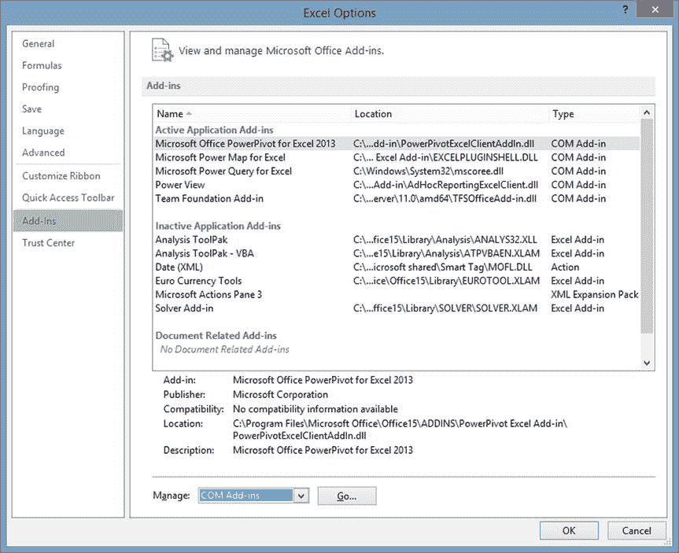

图 4-1.

Excel 选项屏幕 勾选 `Microsoft Office PowerPivot for Excel 2013`、`Microsoft Power Map for Excel` 和 `Power View`，如图 4-2 所示，然后单击 `确定`。

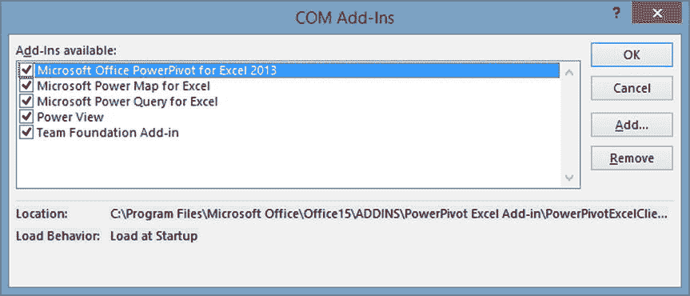

图 4-2.

COM 加载项对话框

## 关系数据库

直到几年前，关系数据库还是最广泛使用的数据库类型。近几年来，NoSQL（或非关系型）数据库在日志数据和其他类型的大数据中变得流行起来。NoSQL 数据库将在后续章节中进行更详细的介绍。然而时至今日，大多数事务性业务数据仍存储在关系数据库中。

关系数据库设计的原则之一是避免重复字段。如果遇到重复字段，数据会通过创建其他表来进行规范化，如第 1 章所述。例如，在一个人事示例中，员工表的主键将是员工的社会安全号码，因为它是唯一的，并且在财务报告中是必需的。员工会被分配到一个部门，但员工表中仅存储部门代码。部门代码是一个外键，指向部门表中的相应记录，该记录包含其他信息，例如部门办公室、部门经理和电话号码。因此，不必为每个员工记录重复部门信息。

## 数据库术语

以下术语常用于描述关系数据库以及数据库中表之间的关系。

* `字段` 是表中最小的数据单元。字段存储在 Excel 表的列中。
* `记录` 是关于一个人或一件事的所有数据或信息。在 Excel 中，记录是表中的一行。
* `表` 是数据库中按结构化格式存储的相关数据的集合。它由字段（列）和记录（行）组成。
* `数据库` 是表的集合。
* 关系表的`主键` 是唯一标识表中每条记录的一个或多个字段。对于涉及人员的数据，尤其是需要税务报告的数据，最常见的主键是社会安全号码。当然，在处理诸如社会安全号码之类的个人数据时，采取适当的安全措施至关重要。
* `外键` 是一个表中的某个或多个字段，用于唯一标识另一个表中的一行。
* `候选键` 是表中可以唯一标识任何记录而无需引用任何其他数据的一个或多个字段。每个表可能有一个或多个候选键，但会选择其中一个候选键作为主键。这通常是候选键中的最佳选择。
* 当一个键由多个列组成时，称为`复合键`。
* `关系` 允许基于键字段从多个表中访问数据。
* `规范化` 是组织关系数据库中的表以最小化冗余的过程。规范化通常涉及将大表划分为较小的表，并定义它们之间的关系。
* `第三范式` (3NF)，由关系数据库模型发明者 E. F. Codd 定义，消除了不依赖于主键的字段。要满足第三范式，表中的每个字段都必须依赖于该表的主键，并且只依赖于主键。这被称为消除传递依赖，即一个字段依赖于另一个非主键字段的情况。
* `源表` 是关系开始所在的表。在下一节的示例中，员工表是源表。
* `相关表` 是包含要查找的值的表。在以下示例中，部门表是相关表。

好的，作为一名高级文档工程师和翻译员，我将遵循您提供的注意事项和示例，将给定的英文文本翻译成中文。

## 从 Excel 表格创建数据模型

本节将以一个简单示例开始，说明关联表格的原理。在此示例中，我们将根据两个小表格（`employee` 和 `department`）来创建一个数据模型。这些表格是规范化的，这意味着重复的字段已被消除。在员工记录中，不再记录某个部门的所有信息，而仅使用一个部门代码。然后，在 `employee` 和 `department` 表格之间定义一个关系，这样就可以从 `department` 表格中提取部门信息了。

可以使用数据透视表从数据模型中提取有意义的信息。要创建一个利用两个表格的数据来显示各部门平均薪资的数据透视表，请执行以下操作：

通过单击表格内部并按 `Ctrl+T`，将每个数据组定义为一个表格。单击表格中的任意位置，然后单击“表格工具设计”选项卡。在功能区的左侧，输入表格名称，在此示例中，输入 `employees`，如图 4-3 所示。同时，将 `departments` 重命名。

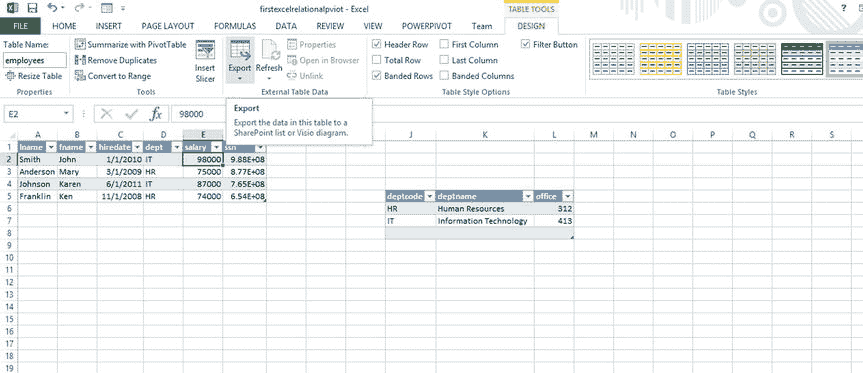

图 4-3. 员工和部门表格

选中 `employee` 表格。转到“插入”选项卡，然后选择“数据透视表”。在“创建数据透视表”对话框中，选择“将此数据添加到数据模型”，然后单击“确定”，如图 4-4 所示。

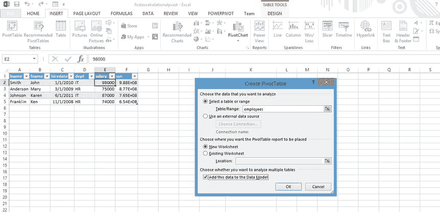

图 4-4. “创建数据透视表”对话框

在“数据透视表字段”窗格中，单击“全部”（位于右上角）以查看两个表格，如图 4-5 所示。将 `deptname` 字段从 `department` 表格拖到“列”框中。将“薪资总和”从 `employees` 表格拖到“值”中。请注意提示“可能需要表格之间的关系”。单击“创建”。

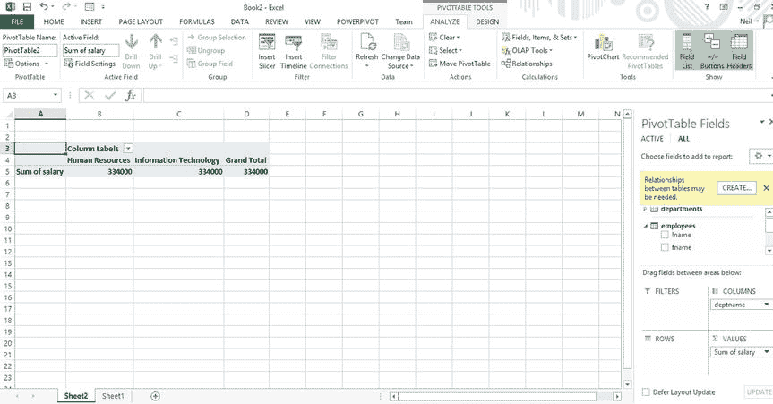

图 4-5. 按部门显示薪资总额的数据透视表

如图 4-6 所示，选择 `employees` 作为第一个表格，`dept` 作为外键。选择 `departments` 作为第二个表格，`deptcode` 作为主键。单击“确定”。请注意，由列标题定义的字段名称不必相同。

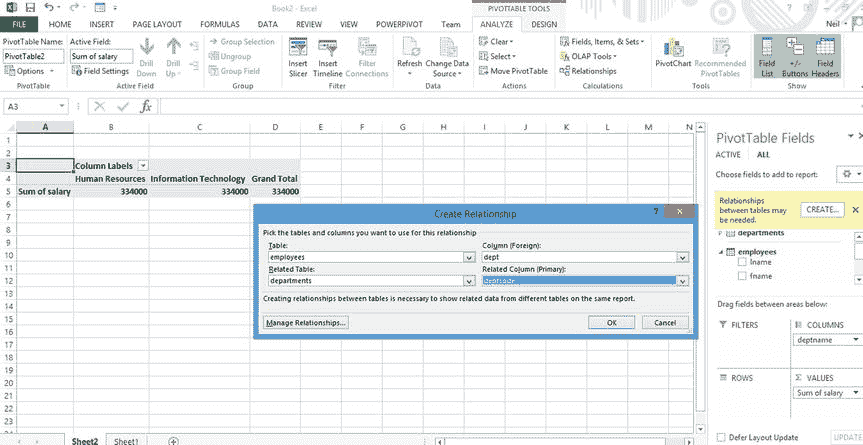

图 4-6. “创建关系”对话框

将 `lname` 拖到“行”框中。生成的数据透视表将显示按部门划分的薪资总额，如图 4-7 所示。

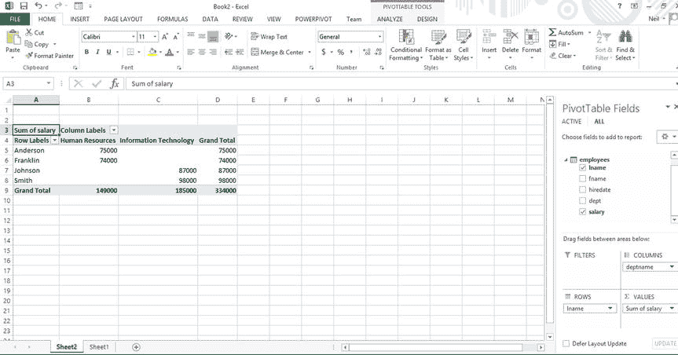

图 4-7. 按部门显示员工薪资的数据透视表

要改为查看各部门的平均薪资，首先从“行”框中删除 `lname` 字段，然后在“数据透视表字段”窗格中，单击“值”框中“薪资总和”旁边的下拉箭头。选择“值字段设置”，然后选择“平均值”以查看各部门的平均薪资，如图 4-8 所示。

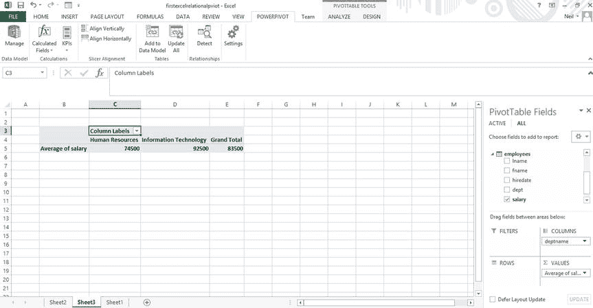

图 4-8. 按部门显示平均薪资的数据透视表

此示例展示了如何使用部门代码关联两个表格（`employees` 和 `departments`）。`dept` 是 `employees` 表格中的外键，`deptcode` 是 `departments` 表格的主键。数据透视表关联了这两个表格。

## 将数据直接加载到数据模型

在本示例中，我们将使用 Microsoft 的 Northwind Access 数据库中的一个示例，将数据直接加载到数据模型中。本示例演示了在 Excel 之上运行 PowerPivot。

要将数据直接加载到数据模型，请执行以下操作：

单击“PowerPivot”选项卡以打开功能区。单击功能区左上角的“管理”按钮。打开 PowerPivot 窗口后，可以通过单击“获取外部数据”组中的“从数据库”来加载数据。这将提供数据库源的选择，如图 4-9 所示。在本示例中，将选择“从 Access”。

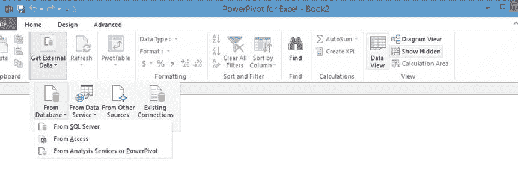

图 4-9. PowerPivot“获取外部数据”组

在“表导入向导”对话框中，单击“浏览”按钮找到要导入的 Access 文件。对于本示例，将选择文档文件夹中的 `Database1`。此文件可从 Apress 网站获取。单击“测试连接”。如果测试成功，请单击“下一步”。

PowerPivot 会打开“表导入向导”，如图 4-10 所示，引导您完成加载数据的过程。选择“从表和视图列表中选择”以选择要导入的数据。单击“下一步”。

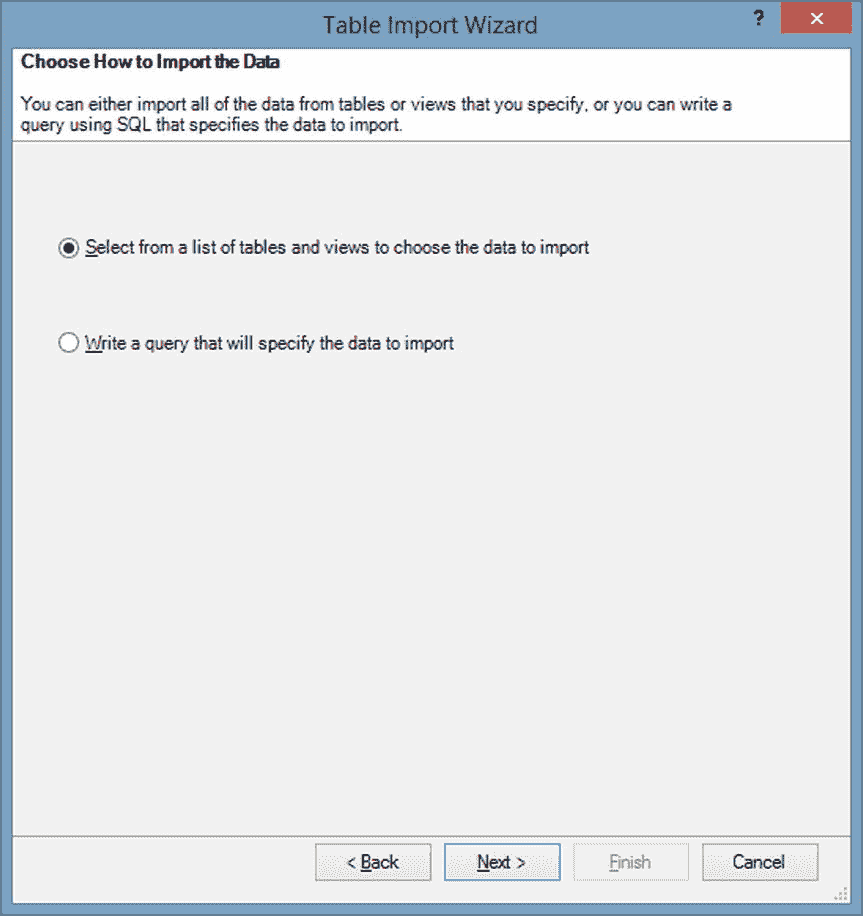

图 4-10. 表导入向导

单击左上角的框以选择所有表格，如图 4-11 所示。请注意，在对话框的右下角，有一个“预览和筛选”选项。此选项可用于从非常大的数据集中选择数据子集。在此示例中，将导入所有表格中的所有行。单击“完成”以完成导入。

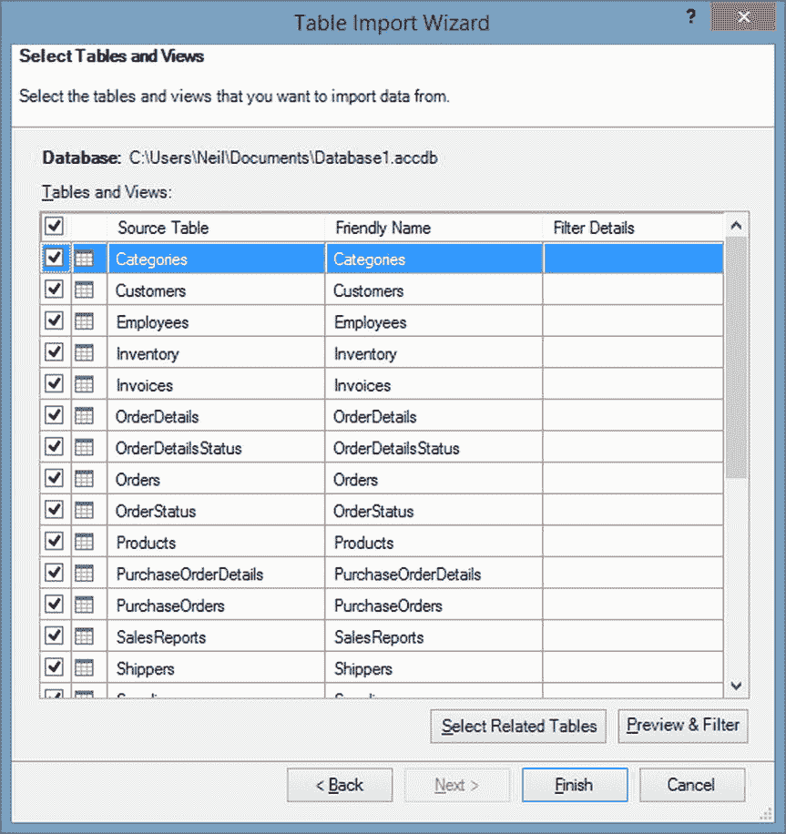

图 4-11. 表导入向导 — 选择表和视图

如果导入的数据中存在关系，这些关系将自动加载到数据模型中。请注意，PowerPivot 表格是只读的，因此无法更改数据。

要查看关系，请转到“PowerPivot”选项卡并选择“管理”以打开 PowerPivot 窗口。然后，单击功能区右端的“PowerPivot 关系图视图”以查看表格之间的关系，并单击“完成”以完成导入，如图 4-12 所示。

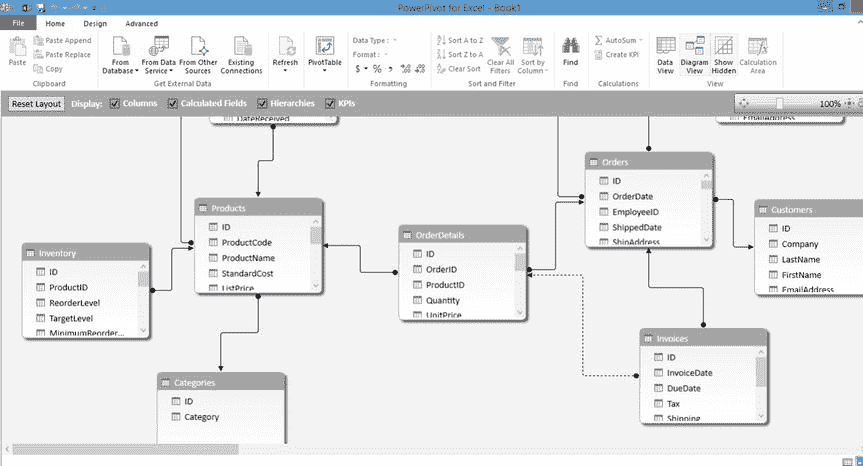

图 4-12. 关系图视图

## 从两个表格创建数据透视表

在此示例中，将基于 `inventory` 和 `products` 表格创建一个数据透视表。请注意，在图 4-12 中，两个表格基于产品代码进行链接。Inventory 表格包含库存中每个物料的现有量数据，主键为 `ProductCode`。要查找完整的产品名称，必须根据产品 ID 在产品表中执行查找。要基于这两个表格创建数据透视表，请执行以下操作：

在 PowerPivot 窗口中，单击“文件”选项卡上的“数据透视表”，然后从菜单中选择“数据透视表”。单击“确定”将数据透视表放在新工作表中。在“数据透视表字段”窗格中，单击 `products` 表格旁边的箭头，并将 `ProductName` 字段拖到“行”框中。然后向上滚动到 `inventory` 表格，单击左箭头显示字段，并将 `OnHand` 拖到“值”框中。结果如图 4-13 所示，其中显示了每种产品的现有量总和。

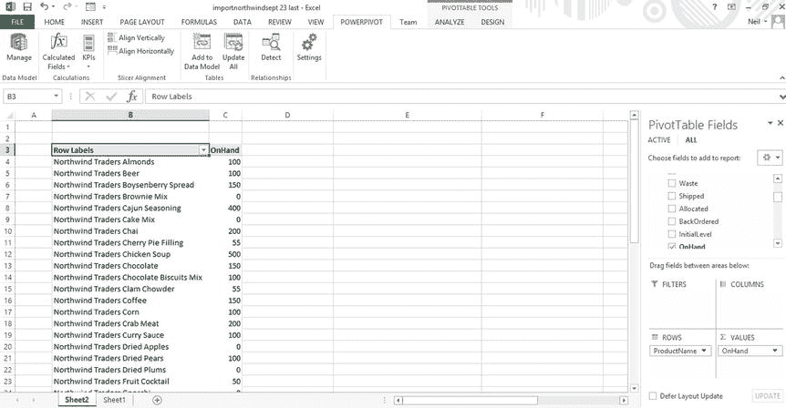

图 4-13. 显示产品名称和现有量的数据透视表

## 从多个表创建数据透视表

本示例将演示如何基于表之间的关系，从两个以上的表创建数据透视表。它将使用 Contoso 数据库中的 `PowerPivotTutorialSample` 电子表格，该电子表格可从以下 URL 下载：`Tinyurl.com/PowerPivotSamples`。

可以按照以下步骤，创建一个能够访问多个相关表中字段的数据透视表：

从前述 URL 下载 `PowerPivotTutorialSample` 电子表格。单击 PowerPivot 选项卡上的 `Manage` 图标以打开 PowerPivot 窗口。然后点击 `Diagram View` 查看关系图，如图 4-14 所示。请注意，箭头以某种不精确的方式显示关系：使用滚动条滚动字段名称不会改变箭头的位置。查看关系的一种更清晰的方式是最小化 PowerPivot 窗口，然后单击数据选项卡上的 `Relationships`，以查看在 `Manage Relationships` 屏幕中链接的实际字段名称，如图 4-15 所示。请注意，您也可以通过点击 PowerPivot 窗口设计选项卡上的 `Manage Relationships` 来查看类似视图。

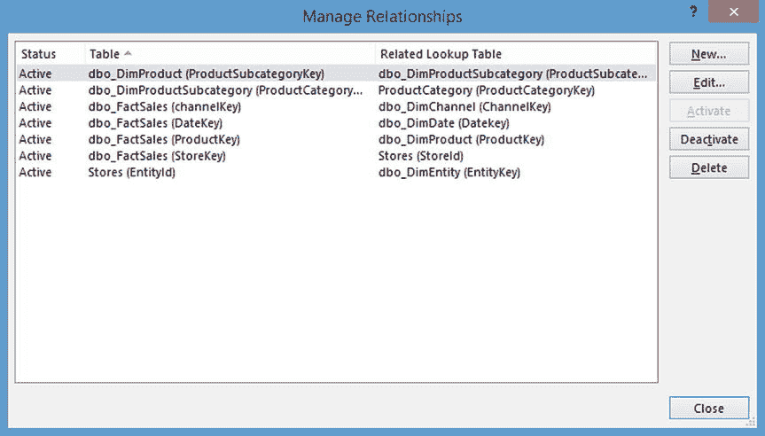

图 4-15. 管理关系屏幕

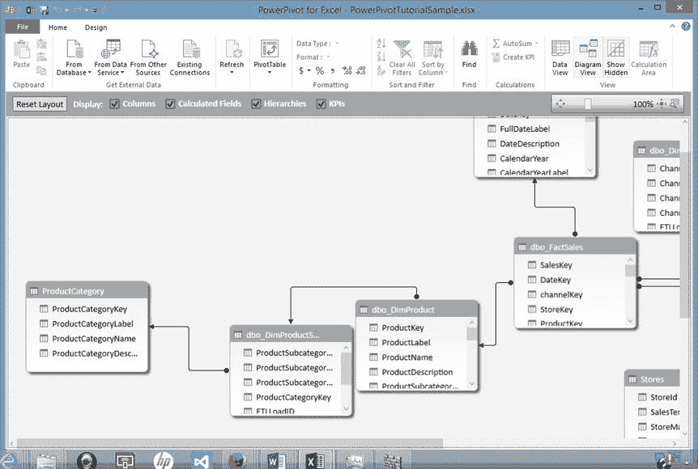

图 4-14. 关系图视图

要创建基于相关字段的数据透视表，请选择 PowerPivot 选项卡并单击 `Manage`。如果仍显示关系图视图，请单击 `Data View`。注意屏幕底部显示此示例中包含的表的选项卡。将创建一个数据透视表，用于链接 `dbo_FactSales` 表与 `dbo_DimProduct` 表和 `dbo_DimDate` 表。该数据透视表的目的是按日期分析产品销量。

单击 `Pivot Table` 并从下拉菜单中选择 `Pivot Table`。在 `Create PivotTable` 对话框中，通过单击 `OK` 接受默认的 `New Worksheet`。

在 `PivotTable Fields` 窗格中，表前面会显示一个向右箭头。单击向右箭头可查看该表中的字段。滚动到 `dbo_DimProduct` 表并单击箭头。将 `ProductName` 字段拖到“行”框中。单击 `dbo_DimProduct` 表左侧的箭头以隐藏字段显示。滚动到 `dbo_DimDate` 表并单击箭头以查看字段。将 `FullDateLabel` 字段拖到“列”框中。单击箭头以隐藏字段。滚动到 `dbo_FactSales` 表并单击箭头以查看字段。将 `SalesQuantity` 字段拖到“值”框中。结果将如图 4-16 所示。之所以能够链接多个表中的字段，是因为存在图 4-15 中所示的关系。

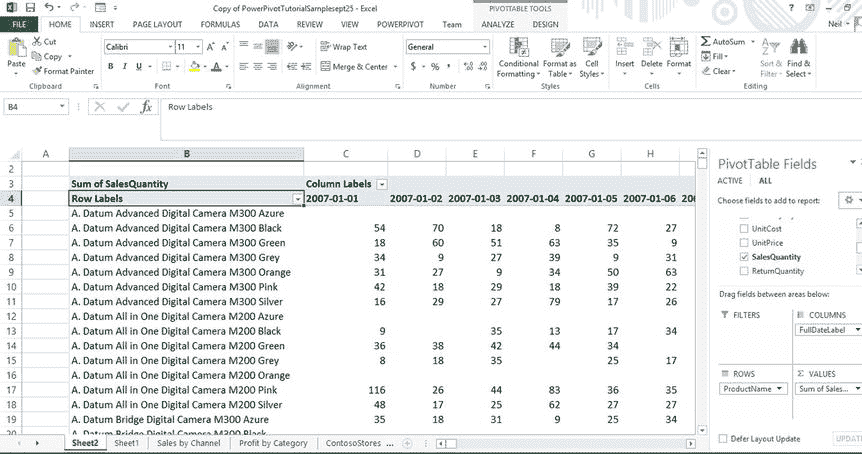

图 4-16. 显示按产品和日期划分的销售额的数据透视表

若要通过按年份查看产品销售额来进一步修改数据透视表，请从“列”框中移除 `FullDateLabel`，并将其替换为 `DimDate` 表中的 `CalenderYear`。结果如图 4-17 所示。

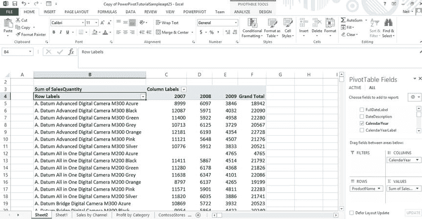

图 4-17. 显示按产品和年份划分的销售额的数据透视表

## 添加计算列

可以使用数据分析表达式 (DAX) 将计算列添加到 PowerPivot 中的表。常规的 Excel 公式基于单元格。相比之下，DAX 公式基于列。DAX 将在后续章节中更详细地介绍。此示例将展示如何设置计算列。要添加计算列，请执行以下步骤：

选择 PowerPivot 选项卡并单击 `Manage`。通过单击显示区域底部的选项卡来选择 `dbo_FactSales` 表。向右滚动到 `TotalProfit` 列。请注意，在右侧，列标题是 `Add Column`。选择该列中的任意单元格，然后键入 `=` 以开始公式。

创建一个扩展价格列，该列是单价乘以数量的乘积。为此，在键入 `=` 后，单击 `SalesQuantity` 列，键入 `*`，然后单击单价数量。公式显示在图 4-18 的公式栏中：`=[SalesQuantity]*[UnitPrice]`

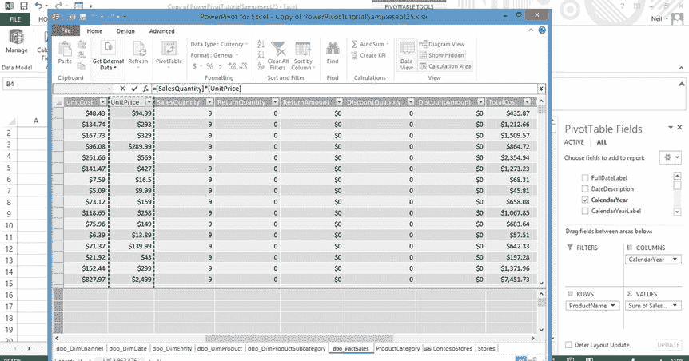

图 4-18. 添加计算列

然后按 `Enter` 以完成公式。要重命名该列，请右键单击该列标题，选择 `Rename Column`，并将其命名为“扩展价格”。结果如图 4-19 所示。请注意，新列中的值与 `TotalSales` 相同，但基于公式计算得出。

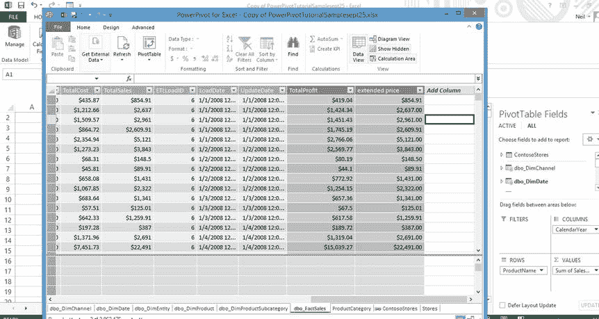

图 4-19. 重命名为“扩展价格”的列

使用 PowerPivot 计算列时，所有单元格都共享相同的公式。不可能使用涉及单个单元格的公式。聚合函数（如 `SUM()`、`Average()` 和 `COUNT()`）可应用于整个列，以提取汇总数据。

## 向数据模型添加计算字段

此示例将展示如何使用计算字段设计一个数据透视表，以显示按月份划分的每个产品的销量。请按照以下步骤操作：

单击 `Pivot Table` 图标并接受默认的新工作表。从 `dbo_DimDate` 表中，将 `CalenderMonthLabel` 字段拖到“行”框中。从 `ProductCategory` 表中，将 `ProductCategoryName` 字段拖到“列”框中。从 `dbo_FactSales` 表中，将 `SalesQuantity` 字段拖到“值”框中。

要向数据模型添加计算字段，请执行以下步骤：

在 PowerPivot 选项卡上，单击 `Calculated Field`。单击 `new Calculated Field`。从下拉列表中，选择计算字段所基于的表，此处为 `dbo_FactSales`。将计算字段命名为“盈利能力”。单击 `Fx` 图标以查看函数。许多函数与基本的 Excel 函数相似。向下滚动到 `SUM()`，如图 4-20 所示，然后单击 `OK`。

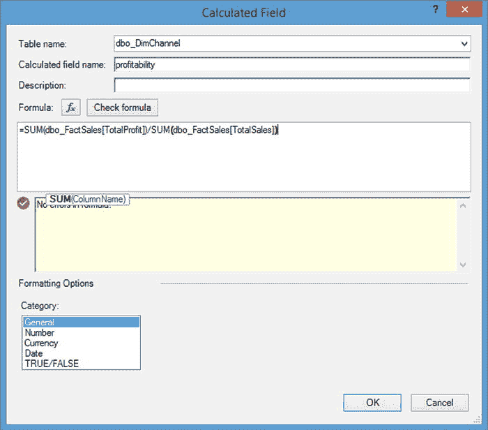

图 4-20. 计算字段对话框

在左括号之后，开始键入要使用的表名，此处为 `dbo_FactSales`。该表的字段随即会显示出来。向下滚动到 `dbo_FactSales[totalprofit]` 并双击。键入右括号。然后键入 `/` 和 `sum(dbo_FactsSales[totalsales])` 并键入右括号。然后点击 `check formula`。如果公式测试无误，请点击 `OK`。

计算字段列将出现，如图 4-21 所示。

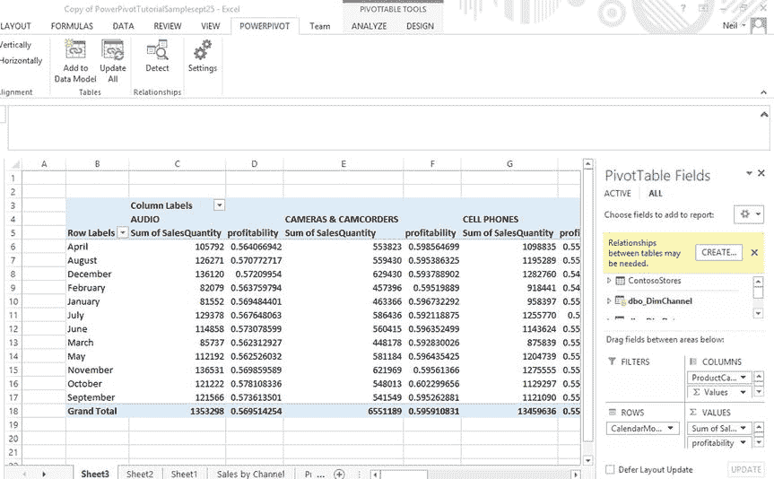

图 4-21. 显示按月份划分的盈利能力和销售额的数据透视表

## 总结

本章介绍了如何在 PowerPivot 中构建数据模型。在后续章节中，将探讨数据模型更高级的功能。图 4-22 显示了为每个表下载的行数。请注意，`dbo_FactSales` 表有近 400 万行。PowerPivot 支持此数量的行，但 Excel 不支持。

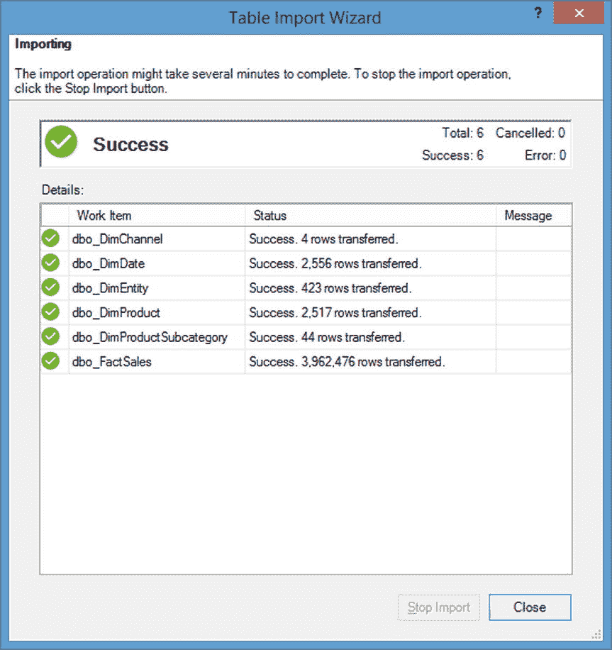

图 4-22. 显示导入行数的表导入向导

