# 6. 使用 Power View 设计报表

`Power View`是一种报表工具，可创建其自身类型的工作表。对于不精通 Excel 的用户而言，这是一种创建“沙盒”的方式，可以在不更改数据的情况下探索数据的子集。`Power View`通过创建包含基于 PowerPivot 模型或数据透视表的快速简便可视化效果的仪表板，让数据变得生动。可以基于同一数据创建多个`Power View`工作表。

## Power View 设计界面的元素

`Power View`界面包含以下元素，如图 6-1 所示：

- 左侧的设计图面
- 中间的筛选器区域，可在此处根据字段值筛选数据
- `Power View 字段`窗格，在此处选择要包含在报表中的字段。顶部包含所有可用字段，底部显示已选字段。

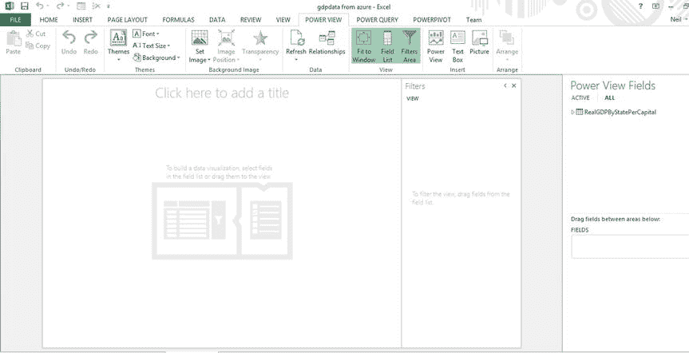

图 6-1. Power View 设计图面

## 使用 Power View 时的注意事项

始终从表格视图开始，然后基于该表格创建图表。可以向设计图面添加多个表格和/或图表。只需点击空白区域即可添加新图表。

在设计图面上仅包含报表所需的字段。除非与报表相关，否则通常建议不要包含用于链接表的关键值。

## 字段类型

通常有两种处理方式截然不同的字段类型：

- 非数字的分类或描述性字段
- 数字字段，可包含计算字段或度量值。求和符号用于指示可更改聚合类型的数字字段。

## 理解数据如何汇总

使用`Power View`时，最棘手的部分可能就是理解数据如何汇总。默认情况下，数字字段会被求和，即使这些字段的求和没有意义（如 ID 号或年份）。可以通过点击`Power View 字段`窗格底部字段名称后的向下箭头轻松更改聚合类型。聚合选项如下：

- 不汇总
- 求和
- 平均值
- 最小值
- 最大值
- 计数(非空)
- 计数(非重复)

请注意，要将数据绘制到图表上，必须使用上述数学函数之一对字段进行汇总。

## 单个表格示例

第一个示例将演示如何基于包含 1997 年至 2011 年各州实际人均 GDP（国内生产总值）数据的单个电子表格使用 Power View。从 Azure 市场下载该数据的说明已在第 3 章中介绍。要创建 Power View 查询，请执行以下步骤：

打开来自 Azure 电子表格的 GDP 数据，如图 6-2 所示。

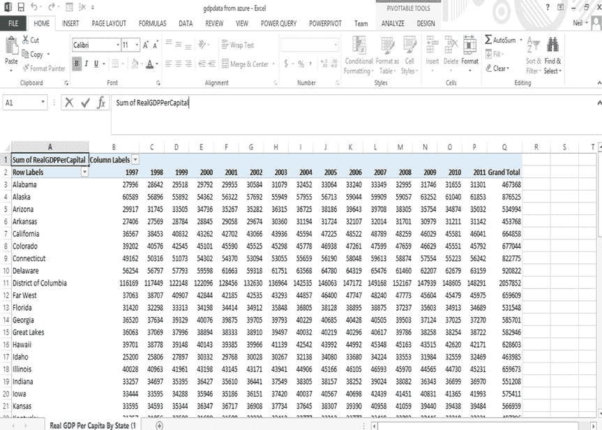

图 6-2. 各州实际人均 GDP 数据电子表格

点击`插入`选项卡，选择`Power View 报表`，然后等待 Power View 屏幕加载，如图 6-2 所示。如果提示安装 SilverLight，请点击`是`。注意左侧的设计面板、右侧的`Power View 字段`窗格以及中间的`筛选器`窗格。

在屏幕右侧的`Power View 字段`窗格中，点击`按州人均实际 GDP`左侧的右向三角形以展开字段。然后将`年份`字段拖拽到`筛选器`窗格中，如图 6-3 所示。

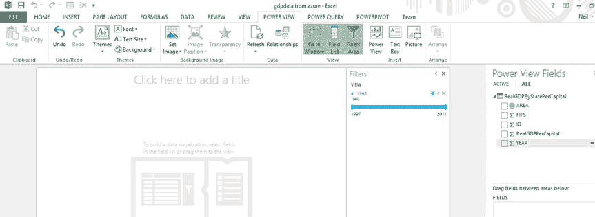

图 6-3. 设置筛选器

为了仅显示最近一年，即 2011 年，请在`筛选器`窗格中点击`年份`右侧最左边的图标，激活`列表筛选模式`以查看年份列表，并选择`2011`，如图 6-4 所示。

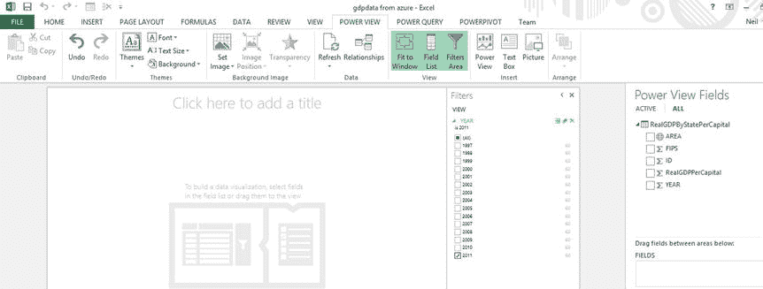

图 6-4. 设置筛选器（展开视图）

然后，在`Power View 字段`窗格中，勾选`地区`和`人均实际 GDP`前的复选框，将创建一个表格，如图 6-5 所示。

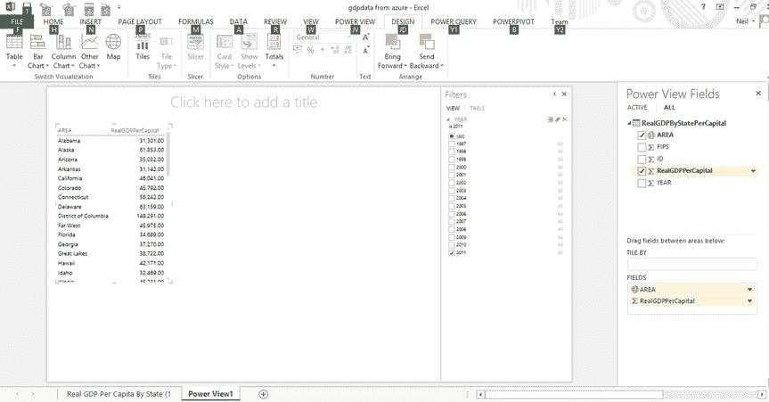

图 6-5. 显示人均实际 GDP 总和的表格

请注意，默认情况下显示的是`人均实际 GDP`的总和，这没有实际意义。如果您想更改此设置，请在`Power View 字段`窗格底部，点击`人均实际 GDP`后的下拉箭头，然后选择“不汇总”。然而，为了绘制后续的图表，必须将其保留为`总和`设置。结果如图 6-6 所示。请注意表格右侧的滚动条，它可以滚动浏览所有州。要展开表格，请点击它并拖拽控制手柄。

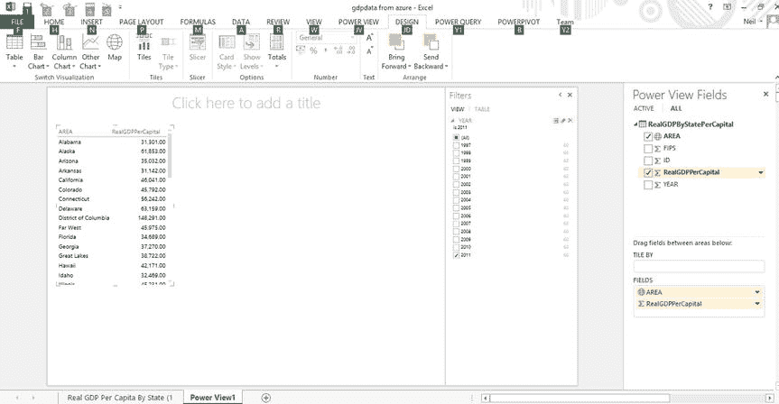

图 6-6. 按州显示人均实际 GDP 的表格

可以通过点击显示“点击此处添加标题”的位置并输入“2011 年各州人均实际 GDP”来添加标题，如图 6-7 所示。

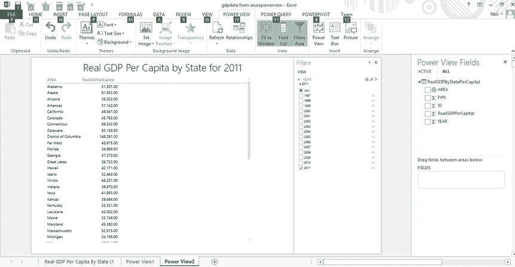

图 6-7. 已添加标题的表格

### 以不同方式查看数据

`Power View`支持多种数据查看格式。选中`设计`选项卡后，点击左侧的`表格`图标即可查看选项：表格、矩阵和卡片。卡片视图会为每个州创建一张卡片，如图 6-8 所示。矩阵视图与表格类似，但支持向下钻取。这将在后续示例中演示。要返回表格格式，只需点击`表格`图标下的`表格`即可。

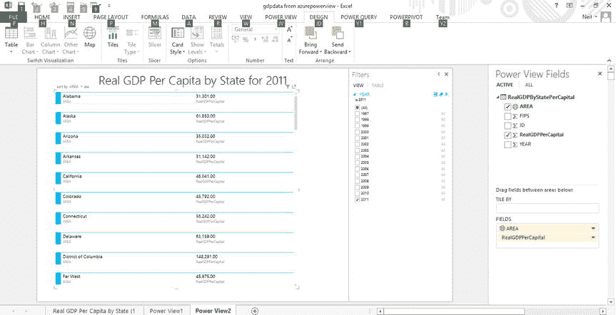

图 6-8. 卡片视图

### 创建单一年份的条形图

要创建显示各州人均实际 GDP 的条形图，请按照以下步骤操作：

- 点击表格中的任意位置，然后选择`设计`选项卡。
- 点击`条形图`。
- 选择`簇状条形图`。由于只有一个数据源，簇状或堆积条形图会显示相同的结果。

结果将如图 6-9 所示。2011 年每个州的人均 GDP 显示为单个条形。

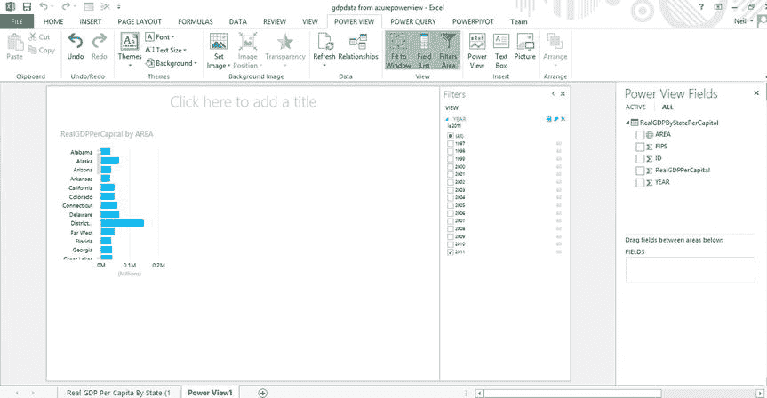

图 6-9. 条形图

要调整图表大小，请点击它并拖拽控制手柄。

请注意，您可以将鼠标悬停在图表中的任何条形上，查看该州的人均 GDP 数值。

### 柱形图

柱形图是条形图旋转 90 度后的形式，如图 6-10 所示。

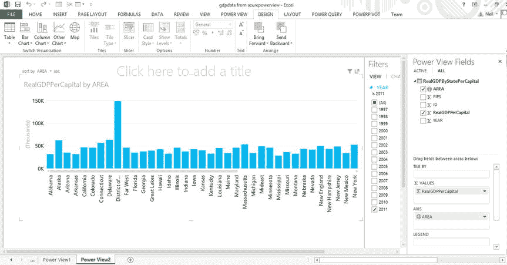

图 6-10. 柱形图

### 显示多个年份

如果更改筛选器以包含多个年份，方法是点击`筛选器`窗格中`年份`列表顶部的`全选`框，则表格中会为每个年份生成一个州实例，如图 6-11 所示。同时还需要在`Power View 字段`列表窗格中勾选`年份`，以便显示年份信息。

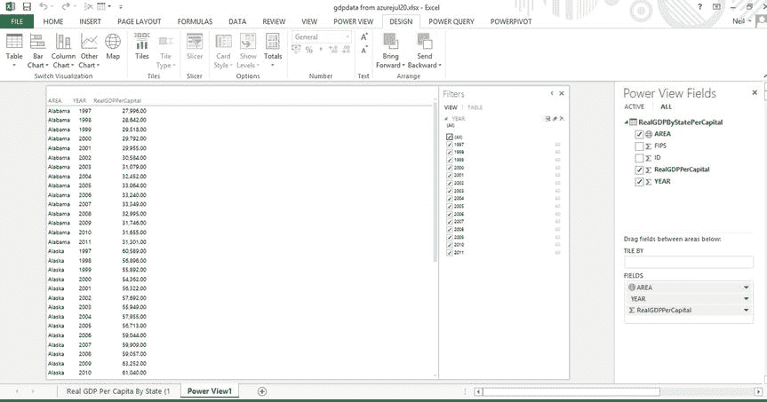

图 6-11. 多个年份的人均实际 GDP 表格

如果将视图切换为矩阵，其显示效果则如图 6-12 所示。请注意，需要通过在`Power View 字段`窗格的`字段`部分中点击`年份`后的箭头并选择“不汇总”，来告知系统不要对年份进行求和。

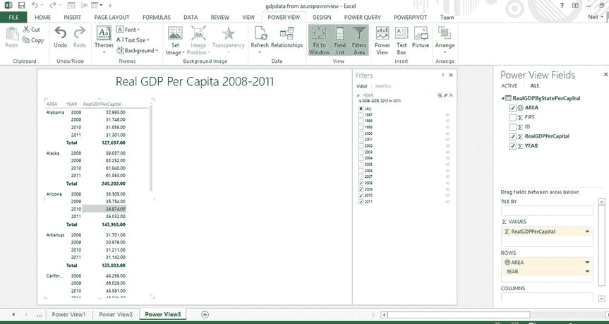

图 6-12. 多个年份 GDP 人均的矩阵视图

### 添加地图

要使用地图显示数据，请按照以下步骤操作：

- 点击表格以激活`设计`选项卡。
- 点击`地图`图标。如果显示的是世界地图，请使用右上角的`缩放`和`平移`图标来仅显示地图的所需区域，如图 6-13 所示。将鼠标悬停在一个气泡上，即可查看其关联的实际数值。

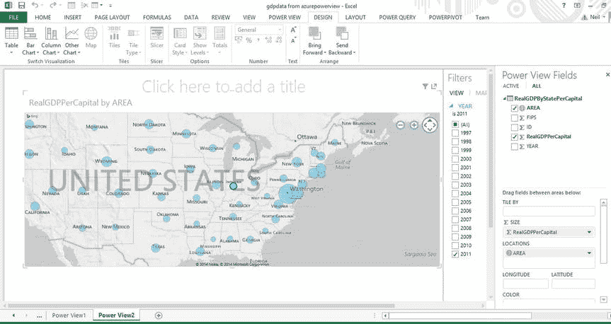

图 6-13. 显示各州人均 GDP 的地图视图

请注意，为每个州显示的气泡大小与该州的人均 GDP 成正比。在`筛选器`窗格中，可以选择单个或多个年份来查看这些年份的数据。

### 使用磁贴

查看数据的另一种方式是使用磁贴。只需选择一个表格，然后点击`设计`工具栏上的`磁贴`图标，即可看到如图 6-14 所示的显示效果。默认布局在显示顶部有一个标签条，允许点击每个州来查看该州的数值。

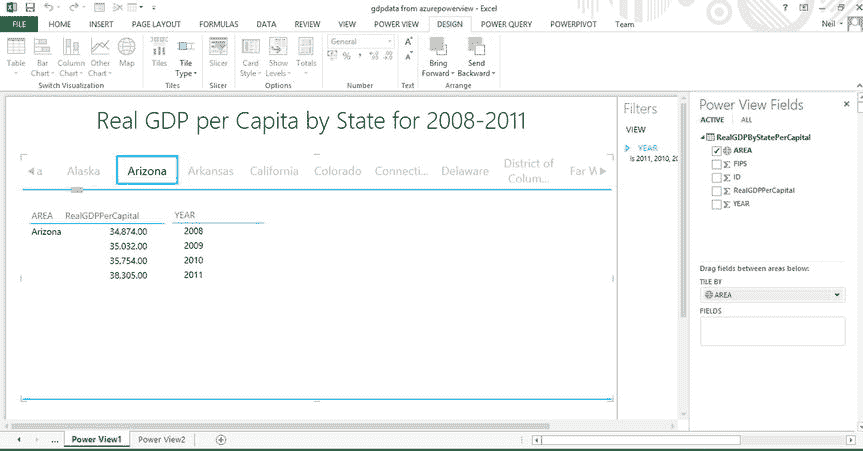

图 6-14. 磁贴格式

另一种选择是磁贴流格式，其磁贴在底部显示，如图 6-15 所示。可以通过点击`设计`工具栏上的`磁贴类型`图标在这些视图之间切换。

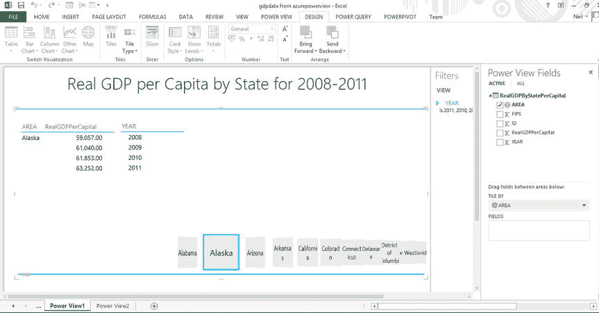

图 6-15. 磁贴流格式

## 关系示例

在本示例中，将使用 Access 的 `database2`（罗斯文数据库）。部分导入的表如图 6-16 所示。该数据库可从 Apress 网站下载。

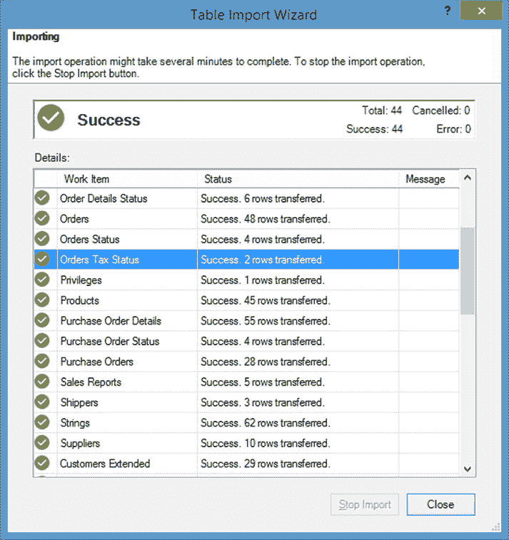

图 6-16. 罗斯文数据库表

按照第 4 章中描述的步骤导入 Access 数据。

单击 `PowerPivot` 选项卡以打开功能区。单击功能区左上角的 `Manage` 按钮。打开 `PowerPivot` 窗口后，您可以通过单击 `Get External Data` 组中的 `From Database` 来加载数据。这将提供数据库源的选择。在本示例中，将选择 `From Access`。在 `Table Import Wizard` 对话框中，单击 `Browse` 按钮找到要导入的 Access 文件。在本示例中，请使用 `Database2.accdb`。该文件可从 Apress 网站获取。单击 `Test Connection`。如果测试成功，请单击 `Next`。

`PowerPivot` 会打开 `Table Import Wizard`，引导您完成加载数据的过程。选择 `Select from a list of tables and views` 来选择要导入的数据。单击 `Next`。单击左上角的框以选择所有表。请注意，在该对话框的右下角有一个 `Preview & Filter` 选项。您可以使用此选项从非常大的数据集中选择数据子集。在本示例中，将导入所有表中的所有行。然后，单击 `Finish` 完成导入。导入的表如图 6-16 所示。

表之间的关系如图 6-17 所示。

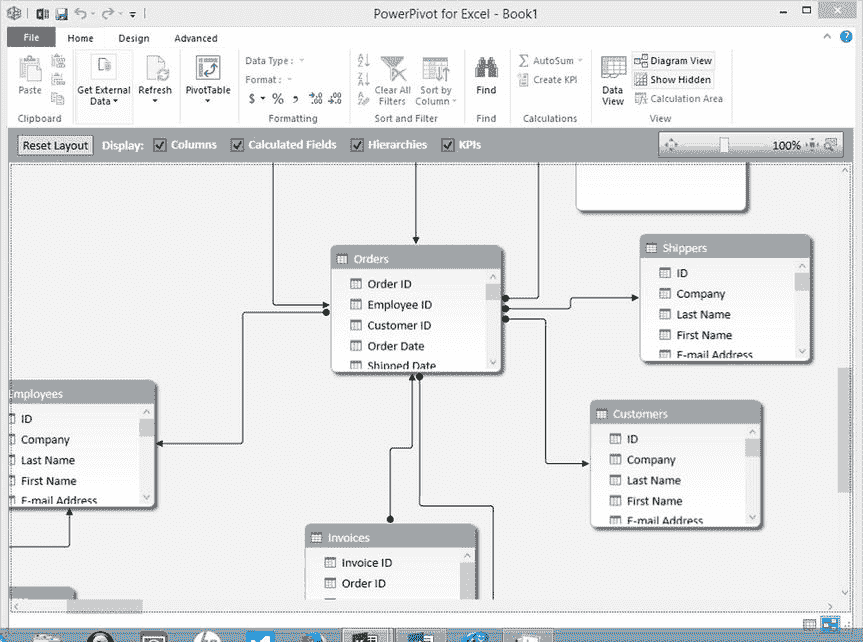

图 6-17. 关系图视图

本示例将使用 `orders` 表中的 `customer ID` 与 `customers` 表中的 `ID` 字段之间的关系。

关系的另一种视图如图 6-18 所示，可通过单击 `Data` 选项卡上的 `Relationships` 图标来访问。

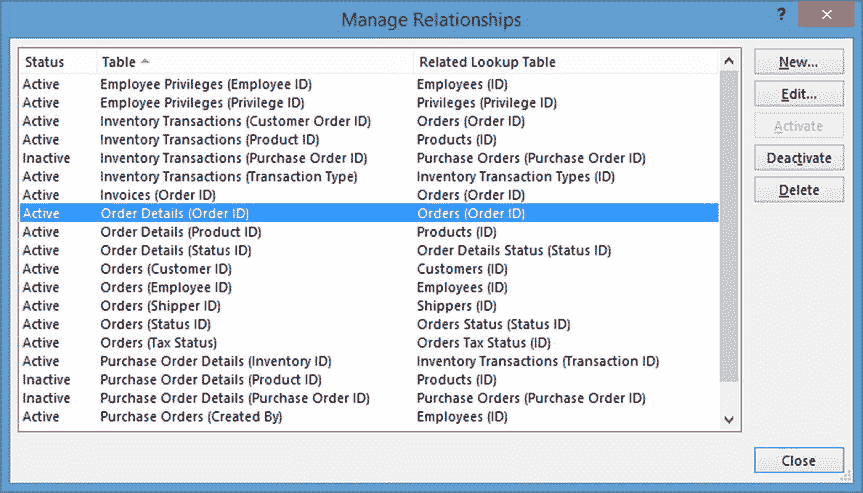

图 6-18. 关系

要创建 Power View 报表，请按照以下步骤操作：

单击 Excel 的 `Insert` 选项卡上的 `Power View Reports`。首先，从屏幕右侧的 `Power View Fields` 选项卡中选择字段以创建表。从 `customers` 表中，选择 `company`、`first name` 和 `job title` 字段，如图 6-19 所示。

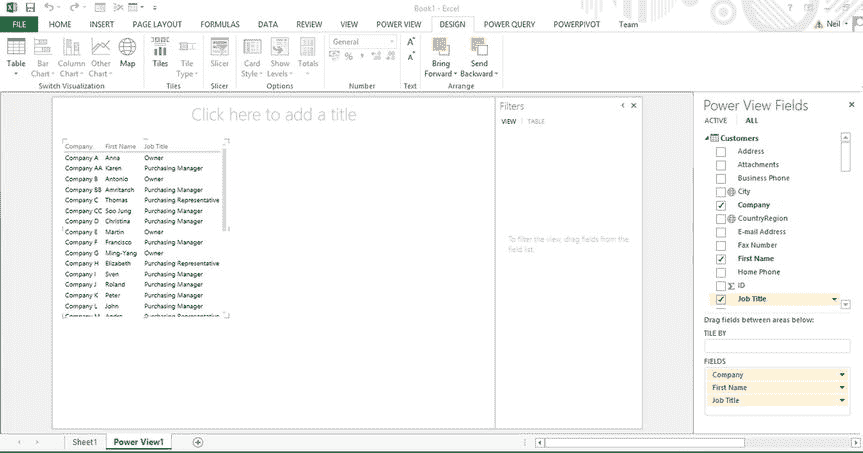

图 6-19. 显示公司、名字和职位

接下来，从 `Order Price Totals` 表中选择 `Price Total`。此操作依赖于 `customers` 表到 `orders` 表再到 `order price totals` 表之间的关系。结果如图 6-20 所示。

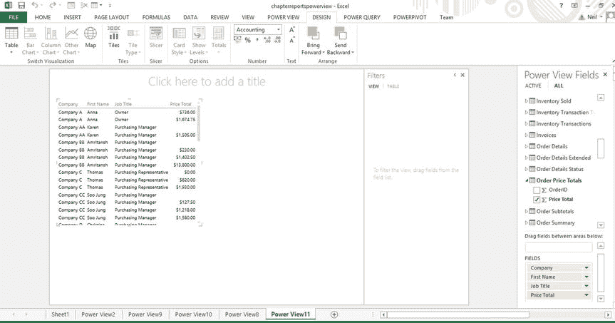

图 6-20. 显示订单总计

请注意，对于有多个订单的公司，表中会显示多行。如图 6-21 所示的矩阵视图使这一点更加明显。

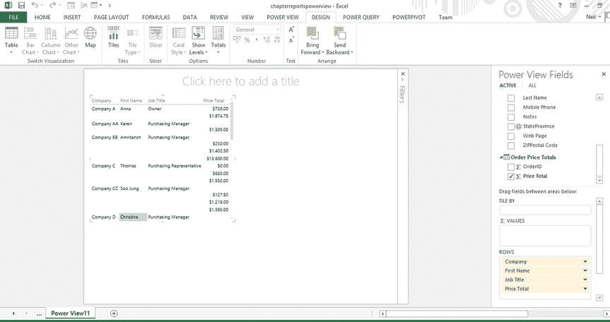

图 6-21. 矩阵视图

## 客户与城市示例

本示例将按城市显示客户。目标是显示来自每个城市的订单价值。请按照以下步骤操作：

单击 Excel 的 `Insert` 选项卡上的 `Power View Reports`。从 `Customers` 表中选择 `company` 和 `city`，如图 6-22 所示。如有必要，请在标题栏中选择列之间的线并拖动，以调整表中 `company` 列的宽度。

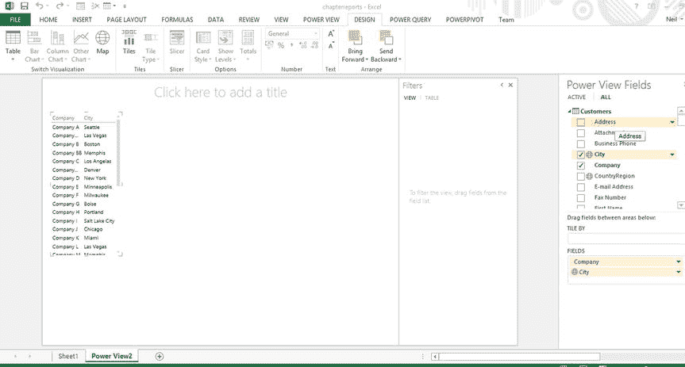

图 6-22. 公司和城市表

从 `order price totals` 表中选择 `price total` 字段。请注意，系统会提示您创建关系。由于未创建关系，因此会显示所有订单的总计，如图 6-23 所示。

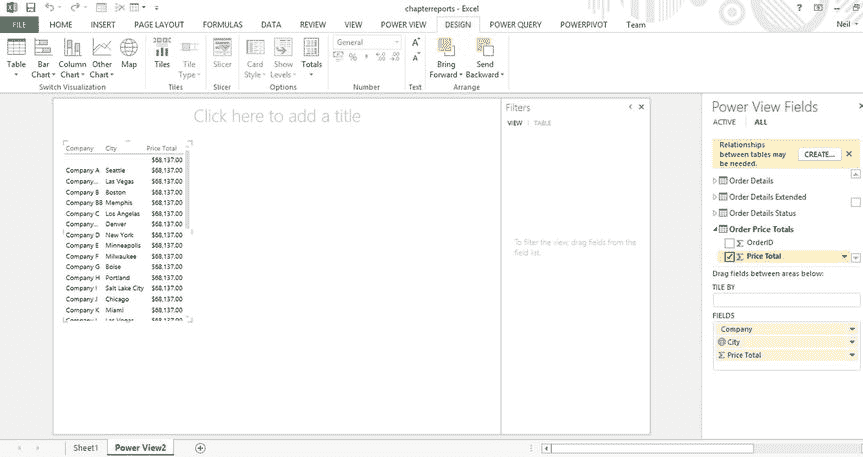

图 6-23. 显示公司、城市和订单价格总计的表

基于 `order ID` 创建 `orders` 表与 `order price totals` 表之间的关系，如图 6-24 所示，然后单击 `OK`。

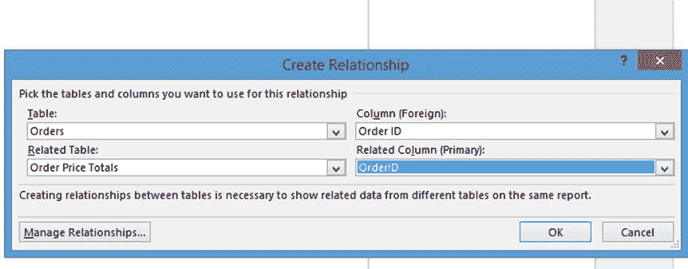

图 6-24. 在 `orders` 和 `order price totals` 表之间创建关系

接下来，单击 `Fields` 列表中 `Price Total` 后的箭头，并选择 `Do Not Summarize`，如图 6-25 所示。请注意，现在显示的是每个订单的价值，而不是所有订单的总计。

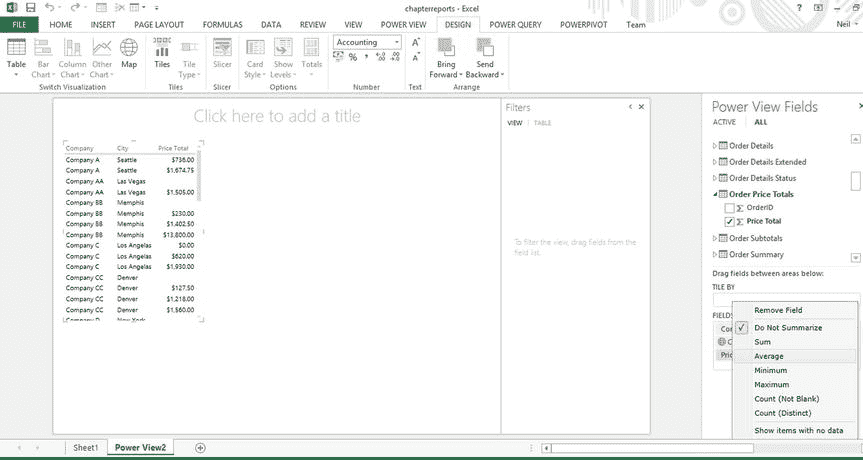

图 6-25. 显示各订单总计的表

通过单击 `Design` 选项卡上的 `Table`，选择 `Matrix`，并单击 `Fit to Window` 来选择矩阵视图，结果将如图 6-26 所示。请注意，已输入标题。您可以使用右侧的滚动条滚动视图。

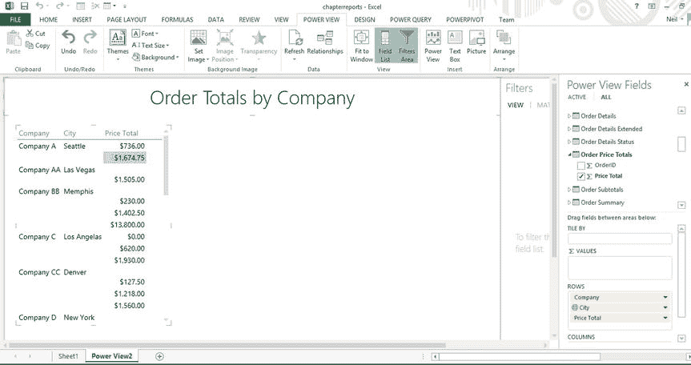

图 6-26. 矩阵视图

单击表格显示区域右上角的弹出图标，结果将如图 6-27 所示。

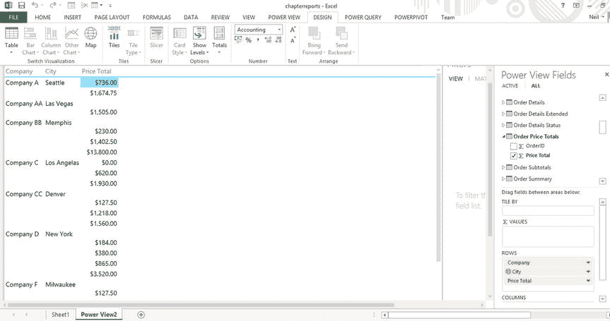

图 6-27. 矩阵的弹出视图

要筛选出没有订单的记录，请将 `Price Total` 字段拖到 `Filters` 窗格，并将左侧滑块向右拖动到某个大于零的任意较小数值，如图 6-28 所示。

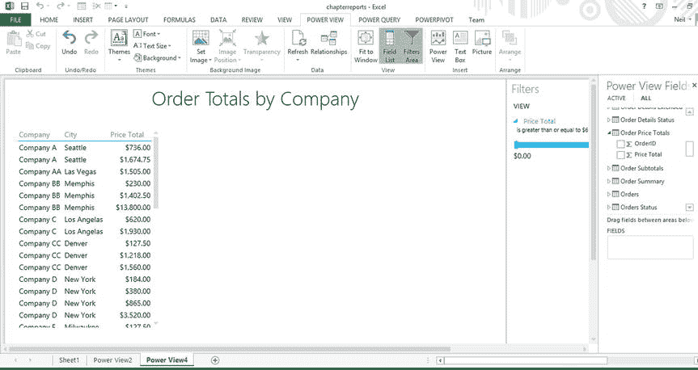

图 6-28. 筛选出没有订单的公司

或者，单击 `Price Total` 字段名称，将筛选条件设置为大于或等于 1，然后单击 `Apply Filter`，如图 6-29 所示。

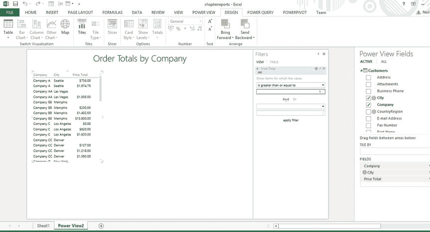

图 6-29. 筛选出没有订单公司的另一种方法

## 按员工显示订单

下一个示例将展示如何按员工统计订单数量，具体步骤如下：

在 `Power View` 选项卡上点击 `Power View`，创建一个新的 Power View 工作表。输入标题“按员工统计的订单”。在 `Power View 字段`窗格中，从 `Employees` 表中选择 `Last Name` 字段。

然后，从 `Orders` 表中选择 `Order ID` 字段。结果如图 6-30 所示。请注意，默认情况下，它会将 `Order ID` 求和，而这只是一个无意义的数字。

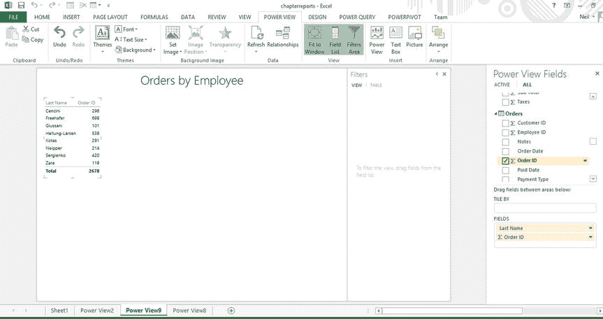
*图 6-30。显示员工和订单的表*

在 `Power View 字段`窗格的 `字段`区域中，点击 `Order ID` 后面的箭头，然后选择 `计数(非空)`。结果如图 6-31 所示。请注意，现在表中显示的是订单的计数。

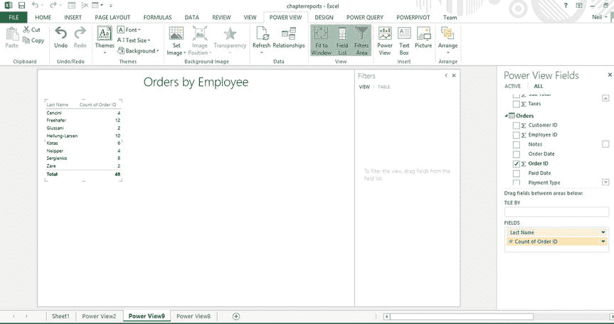
*图 6-31。显示员工及每位员工订单数量的表*

要创建数据的图表，右键点击表格并选择 `复制`。点击表格旁边的空白区域，右键点击，然后选择 `粘贴` 以获取另一份表格副本，如图 6-32 所示。

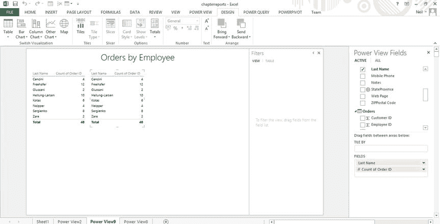
*图 6-32。在绘图前复制表格*

要绘制图表，选择刚刚粘贴的最右边的表格，点击 `设计` 选项卡上的 `条形图` 图标，然后选择 `堆积条形图` 以获取条形图，如图 6-33 所示。

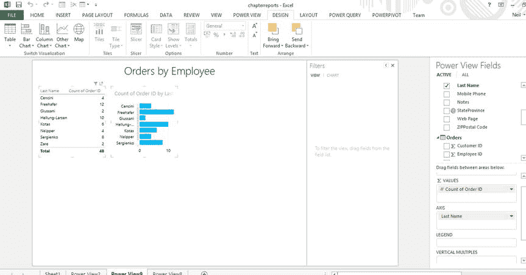
*图 6-33。按员工统计的订单条形图*

### 按产品汇总订单

此示例将展示如何按产品显示订单数量。请遵循以下步骤：

在 Excel 的 `插入` 选项卡上点击 `Power View 报表`。在 `Power View 字段`窗格中，选择 `products` 表中的 `Product Name` 字段，如图 6-34 所示。

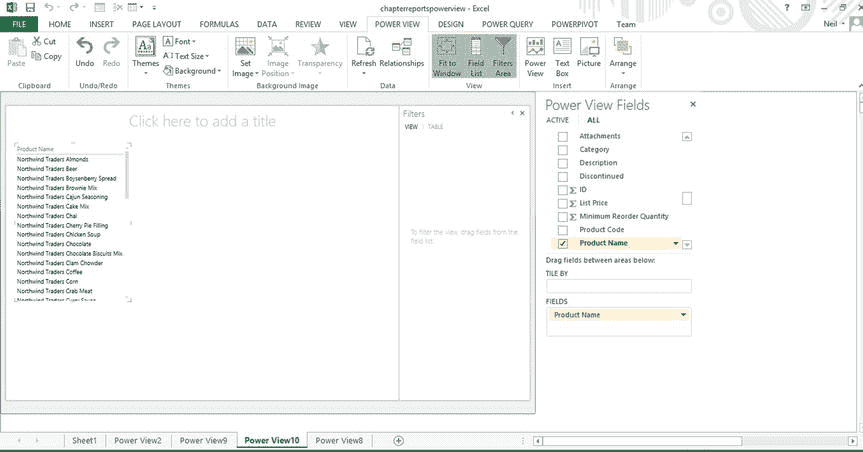
*图 6-34。产品列表*

接下来，选择 `Order Details` 表中的 `Quantity` 字段，如图 6-35 所示。注意，这里显示的是数量的总和。

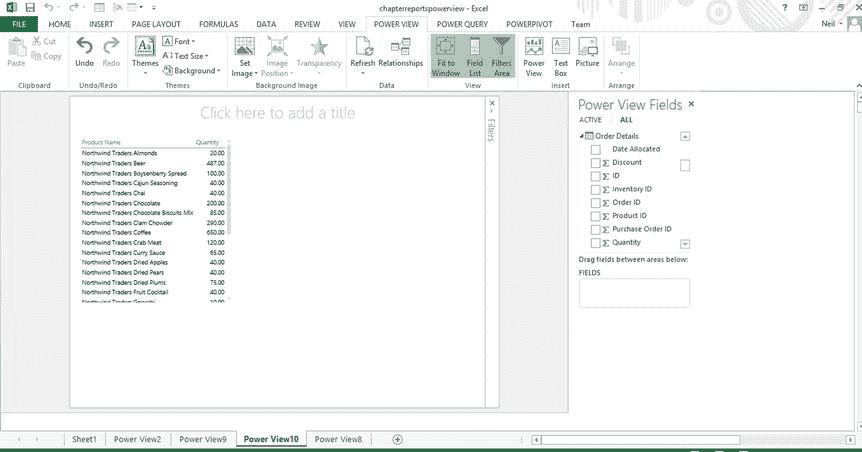
*图 6-35。订购的产品数量*

点击表格中的任意位置，并使用手柄展开它，如图 6-36 所示。

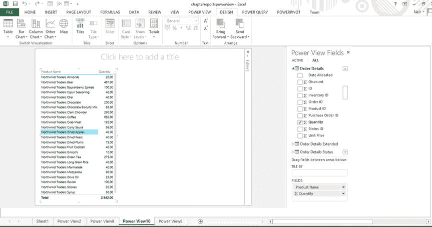
*图 6-36。表格的展开视图*

要创建图表，右键点击表格并选择 `复制`。点击设计界面表格右侧的位置，然后选择 `粘贴`。接着，在 `设计` 选项卡上，选择 `条形图` 和 `堆积条形图`。在设计屏幕顶部，输入标题“已售产品数量”。结果如图 6-37 所示。

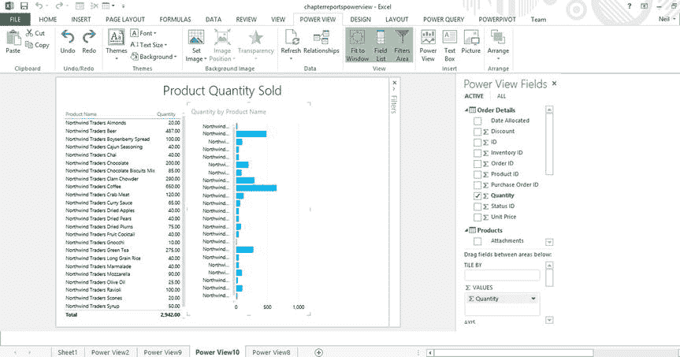
*图 6-37。已售产品数量的条形图*

请注意，在条形图中，只显示名称的前九个字符。您可以将鼠标指针悬停在条形图中的任何条上，以查看完整的产品名称和已售数量。若要显示更多字符，请点击图表窗口将其选中，然后拖动手柄以展开尺寸，如图 6-38 所示。

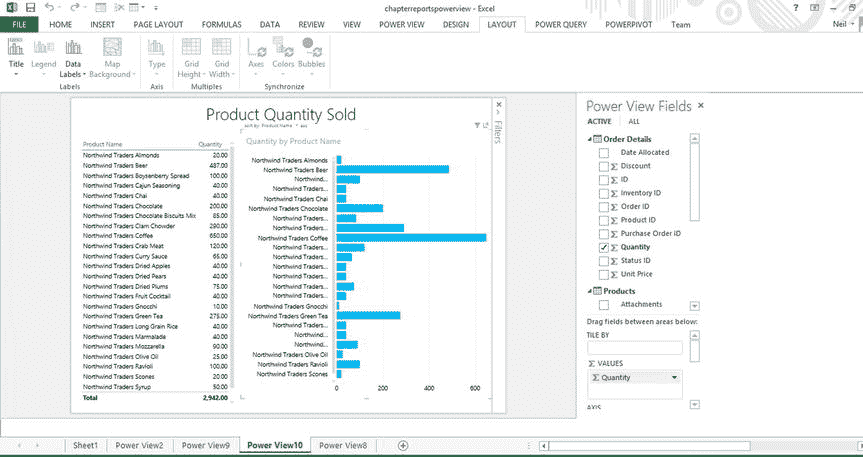
*图 6-38。产品名称展开后的条形图*

## 总结

本章仅浅析了如何使用 Power View 轻松生成数据表和图表，让数据栩栩如生。内容涵盖了如何按城市、员工和产品分析销售情况。同时还演示了如何创建简单地图。第 9 章将展示如何使用 Power Map 创建更复杂的地图。