# 5. 在 Excel 中使用 SQL

本章介绍如何在 Excel 中使用 SQL（结构化查询语言）来导入和操作大型数据文件的子集，并提取汇总统计数据。


## SQL 历史

SQL 最早由 IBM 在 20 世纪 70 年代初开发，当时被称为 SEQUEL（结构化英语查询语言）。它被用于操作和检索早期 IBM 关系数据库管理系统（RDBMS）中的数据。由于商标冲突，SEQUEL 被缩写为 SQL。随后，Oracle 以及后来的微软在其关系数据库管理系统中实现了 SQL。1986 年，美国国家标准协会（ANSI）发布了 SQL 标准。在我看来，正确的发音是 S-Q-L，但也有人仍将其读作“Sequel”。

SQL 是一种声明性语言，意味着它只指定所需的结果，而不定义如何获取。SQL 由数据定义语言和数据操作语言组成。在 Excel 中，主要使用数据操作语言的查询功能，因为数据定义是通过 Excel 从其他来源导入表来完成的。SQL 最初基于关系模型，这意味着数据根据固定结构存储在多个表中。

### NoSQL

如第 1 章所述，NoSQL 这一术语是用词不当的，因为某些 NoSQL 系统具有 SQL 接口。更准确的术语应该是非关系型，或者不只是 SQL。关系数据库具有固定模式，必须在输入任何数据之前定义好。相比之下，NoSQL 数据库可以访问具有不同模式的数据。这有时被称为读时模式。

### NewSQL

NewSQL 试图成为关系型数据库和 NoSQL 系统之间的折中方案。这些系统采用关系型架构，并以 SQL 作为其主要接口，但力求具备与 NoSQL 系统相同的可扩展性和灵活性。

### SQL++

SQL++ 是 SQL 的一种新形式，它扩展了传统 SQL，并基于半结构化数据模型，可以访问 JSON 数据以及传统关系数据。它通常向后兼容传统 SQL。

SQL++ 的一个实现是 N1QL（发音为“Nickel”），由 Couchbase 基于 Kian Win Ong、Yannis Papakonstantinou 和 Romain Vernoux 于 2014 年发表的论文《SQL++ 统一半结构化查询语言，以及 SQL-on-Hadoop、NoSQL 和 NewSQL 数据库的表达性基准测试》开发而成。

## SQL 语法

SQL 查询语言的核心是 `SELECT` 命令。该命令的语法如下所示。请注意，方括号内的子句是可选的。

```
SELECT [DISTINCT] <columns list>
[AS <optional alias name for returned columns>]
FROM <table name(s)>
[WHERE <condition>]
[GROUP BY <column expression for calculating aggregates>]
[HAVING <group level filter condition>]
[ORDER BY <sort order for the results table>]
```

`SELECT` 子句指定要显示的列或列表达式。可以使用星号来指定所有列。`FROM` 子句列出要访问的一个或多个表。`WHERE` 子句用于提供关联多个表的条件，和/或提供行级过滤器，用于排除不满足所需条件的行。`GROUP BY` 用于将结果表按组排列，以便进行数据聚合，例如小计。`HAVING` 子句为结果集提供组级过滤器。`ORDER BY` 子句用于按指定顺序排列结果表。本章将演示在 PowerPivot 和 Excel 中执行此操作的方法。

使用 `SELECT` 语句时，应考虑以下问题：

*   `SELECT`：需要显示哪些列或列表达式？
*   `FROM`：这些列位于哪些表中？
*   `WHERE`：关联表的条件是什么？用于排除不需要的行的选择标准是什么？
*   `GROUP BY`：哪些值将被聚合，例如用于计算小计？
*   `HAVING`：当使用聚合时，每条记录必须满足什么条件才能包含在结果表中？
*   `ORDER BY`：结果应以什么顺序呈现？

例如，以下 SQL `SELECT` 语句从 `addrlist` 表中提取邮政编码等于 “94704” 的姓名和地址字段。

```
SELECT name, address FROM addrlist WHERE zip="94704"
```

## SQL 聚合函数

SQL 包含各种聚合函数，允许根据 `WHERE` 子句中的条件计算小计、平均值、计数值等。

这些函数包括：

*   `COUNT()`：返回满足指定条件的非空行数
*   `SUM()`：返回指定列中所有值的总和
*   `MIN()`：返回指定列中的最小值
*   `MAX()`：返回指定列中的最大值
*   `AVG()`：返回指定列的平均值

这些函数可以应用于整个表或由 `WHERE` 条件定义的表子集。例如，查看这些语句：

*   `SELECT COUNT(*) FROM offices`：将返回 `offices` 表中的行数
*   `SELECT COUNT(*) FROM office WHERE region="CH"`：将返回芝加哥地区的办公室数量
*   `SELECT SUM(sales) FROM offices`：将返回 `offices` 表中所有行的销售额总和
*   `SELECT SUM(sales) FROM offices where region="CH"`：将返回芝加哥地区所有办公室 `sales` 字段的总和

## 小计

可以使用以下语句显示每个地区的办公室计数值：

```
SELECT region, COUNT(*) FROM offices GROUP BY region
```

可以使用以下语句生成所有地区的销售额小计：

```
SELECT region, SUM(sales) FROM offices GROUP BY region
```

## 连接表

当查询多个表时，最好使用 `WHERE` 子句指定连接表的条件。这称为等值连接，因为它基于相等性测试。如果省略 `WHERE` 子句，第一个表中的每一行将与第二个表中的每一行配对。这称为笛卡尔积，或两个表的外连接。


## 导入外部数据库

本示例将使用 Access 的 Northwind 示例数据库。要执行此示例，请执行以下步骤：

点击`测试连接`。如果连接测试成功，请点击`下一步`。选择第二个选项“编写一个查询来指定要导入的数据”，如图 5-2 所示。然后点击`下一步`。

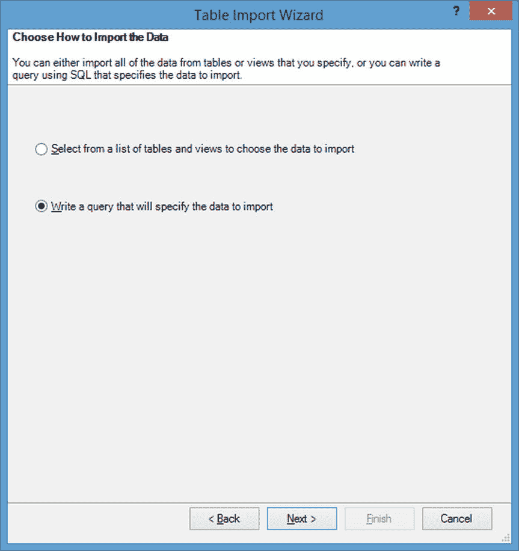

图 5-2. 选择“编写一个查询来指定要导入的数据”

点击`PowerPivot` 选项卡以打开功能区。点击`管理`按钮。在`PowerPivot` 选项卡上，点击“获取外部数据”，然后选择“来自数据库”。接着选择“来自 Access”。点击`浏览`并选择此前从 Northwind 数据库网站下载的 `Database2` 文件，如图 5-1 所示。该文件也可从 Apress 图书页面（[`www.apress.com/9781484205303`](http://www.apress.com/9781484205303)）的“源代码/下载”选项卡中下载。

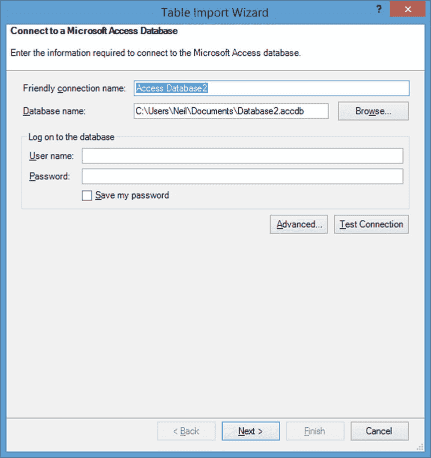

图 5-1. 使用表导入向导导入数据库

在编写查询之前，了解数据库中定义的结构和关系是很有帮助的。导入 Access 数据库时，Access 中定义的关系也会被一并导入，如图 5-3 所示。

第一个查询将根据图 5-3 所示的关系，从 `orders` 表和 `employees` 表中导入所有字段。在该关系中，`Orders` 表中的 `EmployeeId` 字段与 `Employees` 表中的 `ID` 字段相关联。在 SQL 语句窗口中，输入以下 SQL 语句：`SELECT * from orders, employees`

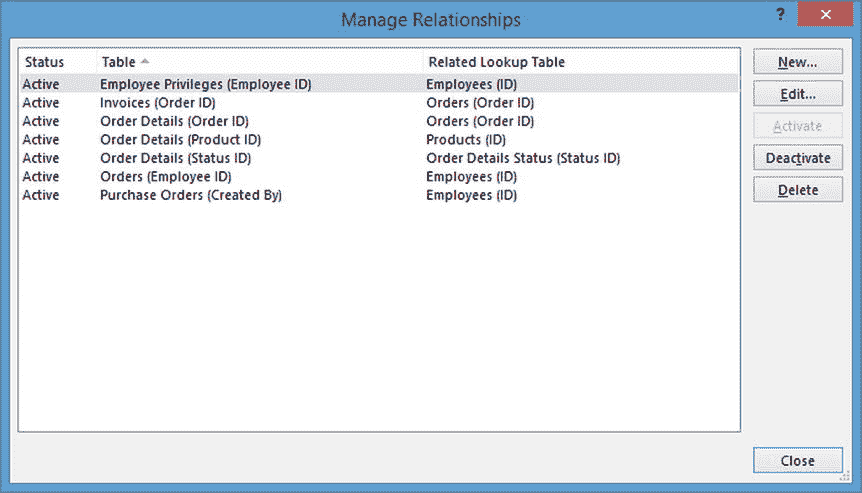

图 5-3. 现有关系

点击`完成`以查看结果，结果如图 5-5 所示。然后点击`关闭`以访问数据。

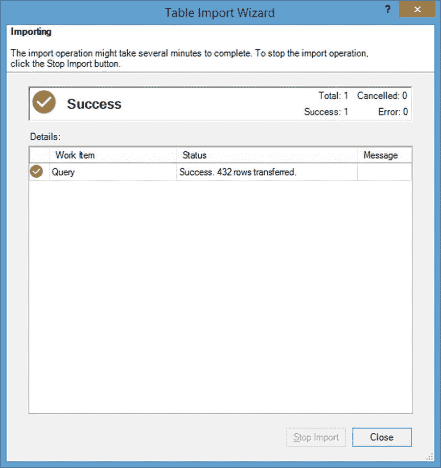

图 5-5. 显示已导入 432 行的成功界面

接着点击`验证`。如果 SQL 输入正确，窗口将如图 5-4 所示。

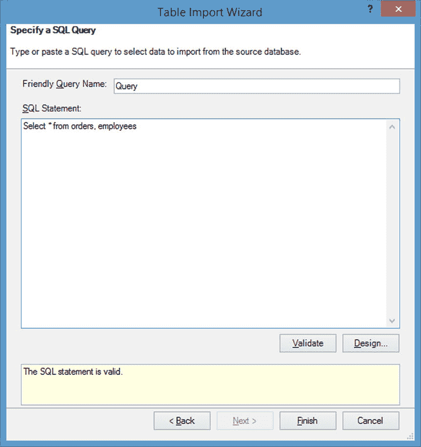

图 5-4. SQL 选择语句

点击`关闭`后检索到的实际数据如图 5-6 所示。请注意，共导入了 432 行，这是因为表之间没有指定任何关系，所以第一个表中的每一行都与第二个表中的每一行进行了配对。换句话说，432 是 `employees` 表中的 9 行与 `orders` 表中的 48 行的乘积。

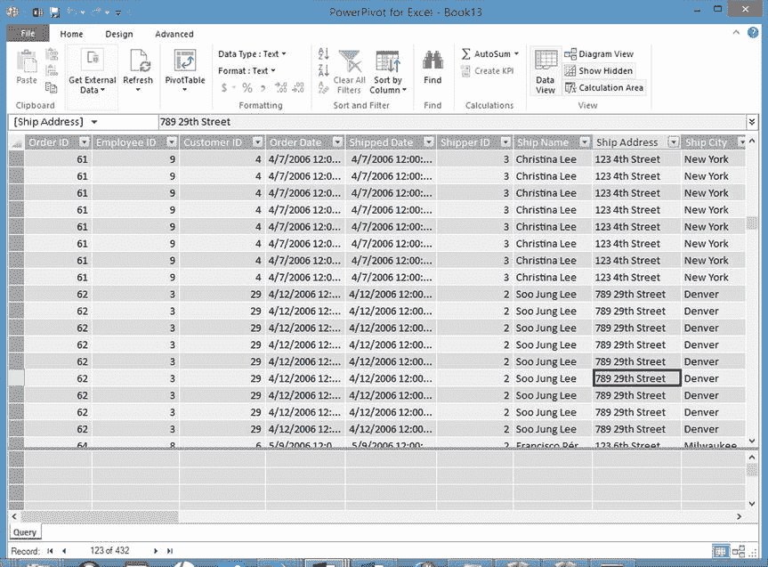

图 5-6. SQL 查询的结果表

## 指定 JOIN 条件与选定字段

在此示例中，将指定一个连接条件，以便仅为每位员工导入一条订单记录。此示例将演示如何仅导入选定字段。请注意，名称中包含空格的字段必须用方括号括起来。当从多个表导入字段时，字段名应指定为 `表名.字段名`。

对于此示例，请先按照前文“导入外部数据库”部分中的示例步骤 1-6 进行操作，然后完成以下步骤：

输入 SQL 语句，如图 5-7 所示。请注意，此处指定了 `WHERE` 条件，通过 `employees.id=orders.[employee id]` 将两个表关联起来。将从 `employees` 表中显示员工的姓氏。同时会从 `employees` 表和 `orders` 表中显示员工 ID，以证明它们是一致的。

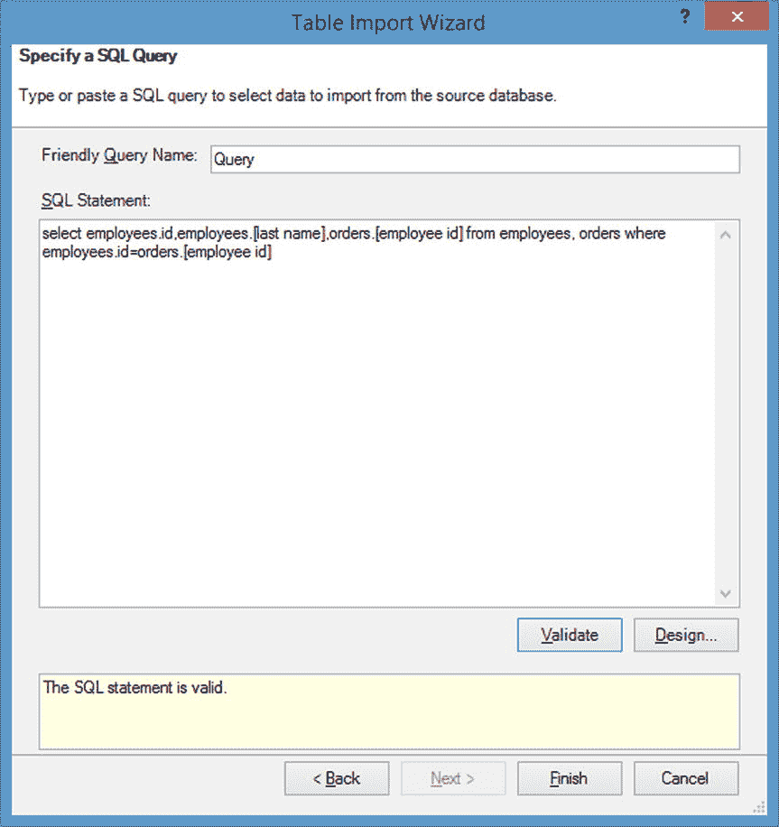

图 5-7. SQL 查询 `Select employees.id, employees.[last name],orders.[employee id] from employees, orders where employees.id=orders.[employee id]`

点击`关闭`以完成操作。结果如图 5-9 所示，该图显示了来自 `employees` 表的员工姓氏，以及来自 `employees` 表和 `orders` 表的员工 ID。

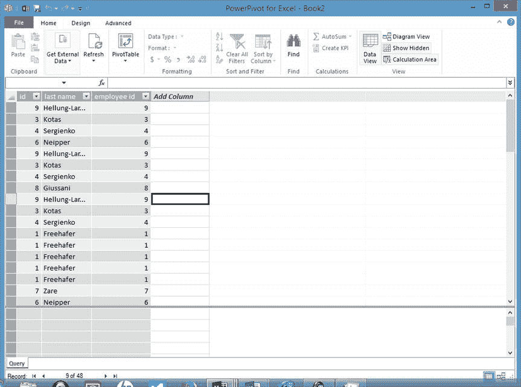

图 5-9. SQL 查询的结果表

现在，点击`完成`。请注意，由于指定了条件，因此仅导入了 48 行（即 `orders` 表的记录数），如图 5-8 所示。

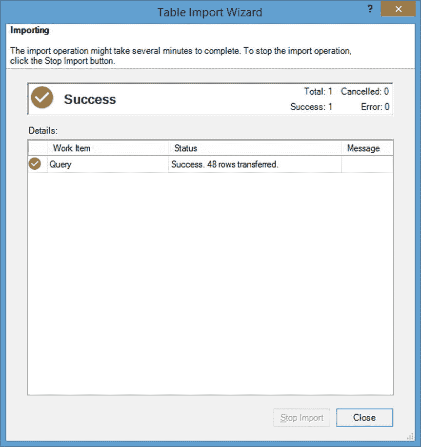

图 5-8. 显示已导入 48 行的成功界面

点击`验证`以确认查询有效，如图 5-7 所示。

## 使用 SQL 提取汇总统计信息

可以使用 SQL 通过聚合函数从一个或多个表中提取汇总统计信息。本示例将提取一个单一数值——即来自 `orders` 表和 `orders detail` 表的单价乘以数量的总和。

对于此示例，请先按照“导入外部数据库”部分中的示例步骤 1-6 进行操作。

输入以下 SQL 语句，如图 5-10 所示，以提取 `orders` 表中所有记录的单价乘以数量的总和。

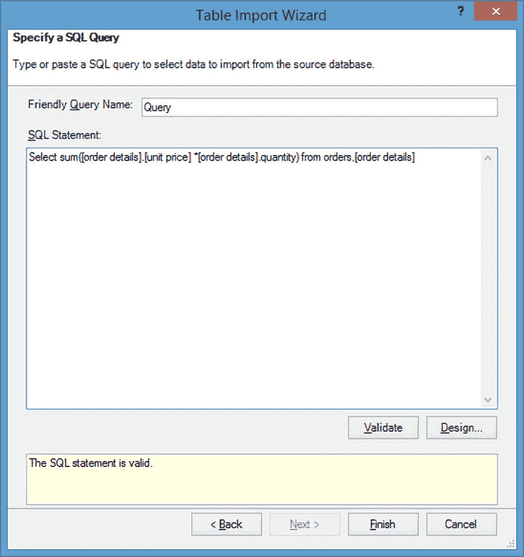

图 5-10. SQL 查询 `Select sum([order details].[unit price] *[order details].quantity) from orders,[order details]`

按下`回车键`，等待直到显示成功界面。然后点击`关闭`。结果如图 5-11 所示。请注意，结果是一个单一数值，即所有订单明细记录中单价乘以数量的总和。

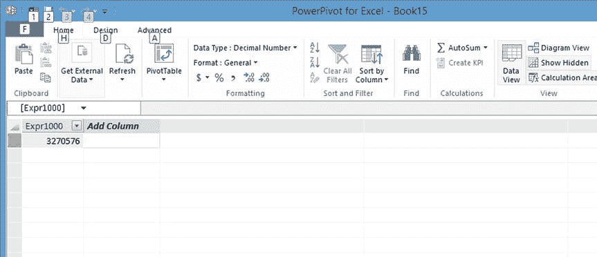

图 5-11. 结果是一个单一数值


## 按员工生成订单总额报表

本示例将按员工生成订单总额报表。要创建此报表，需要关联三个表：`employees`、`orders` 和 `order details`。

在本示例中，请按照“导入外部数据库”一节中前一示例的步骤 1-6 进行操作。

输入如图 5-12 所示的 SQL 语句，以提取所有订单中按员工细分的价格乘以数量的总和。单击**验证**以确保 SQL 语句输入正确。

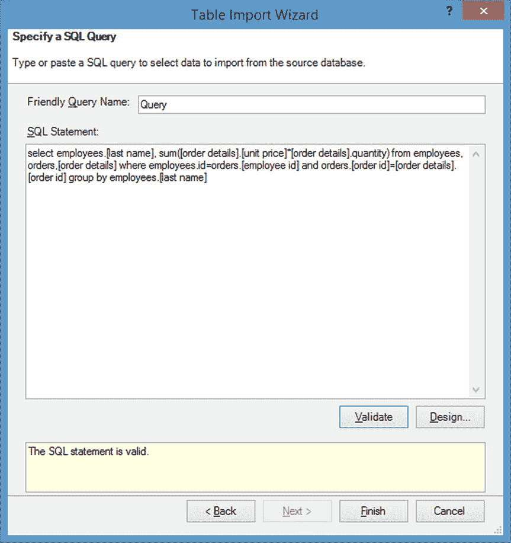

**图 5-12。**

SQL 查询：
```
Select employees.[last name], sum([order details].[unit price] * [order details].quantity) from employees, orders, [order details] where employees.id=orders.[employee id] and orders.[order id]=[order details].[order id] group by employees.[last name]
```

请注意，基于图 5-3 所示的关系，使用两个关系来关联三个表。`orders` 表中没有显示任何字段，但该表被用作关联表。以下是本示例中使用的图 5-3 中的关系：
- `employees.id=orders.[employee id]`
- `orders.[order id]=[order details].[order id]`

单击**完成**以执行 SQL 语句。生成的实际数据如图 5-14 所示——按员工列出的订单价值列表。

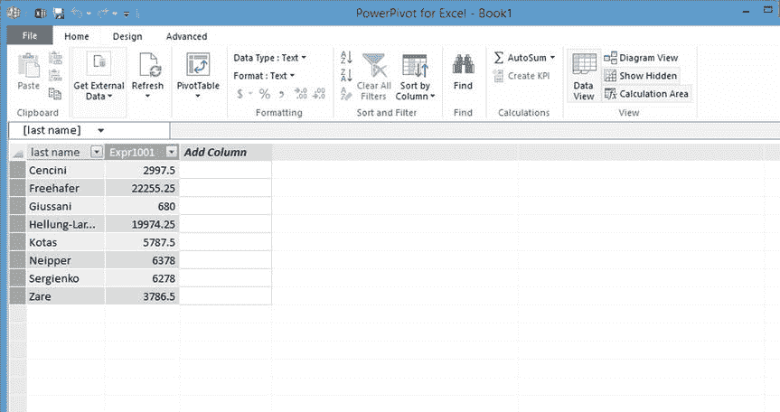

**图 5-14。**

按员工统计的订单总额。此查询生成八行，如图 5-13 所示。

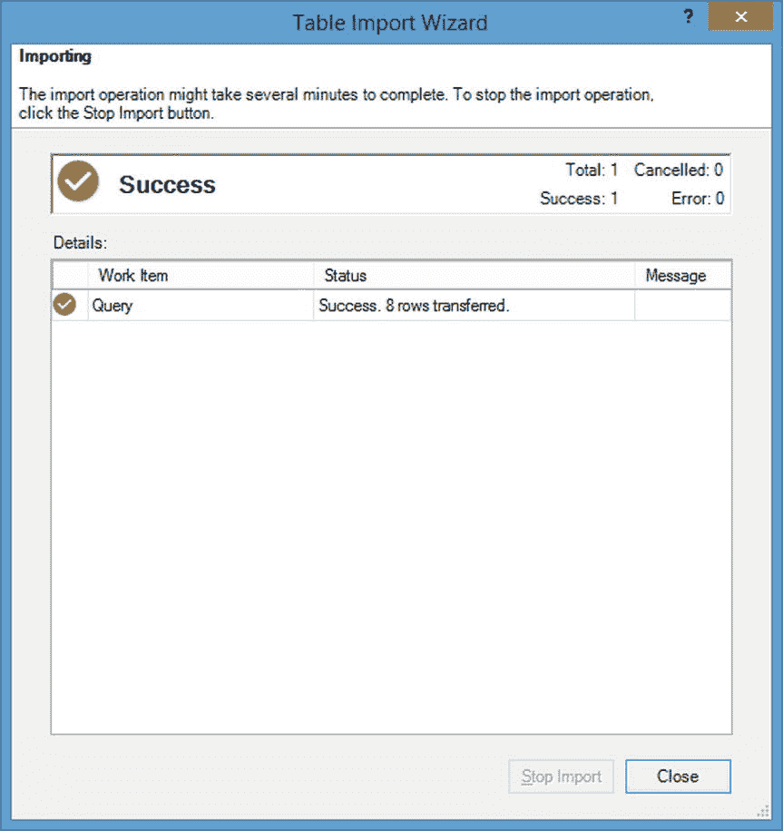

**图 5-13。**

显示此查询生成了八行的成功屏幕。

### 使用 MSQuery

另一种方法是结合 Microsoft Query 使用 SQL。本示例将演示另一种访问本章前面使用的 Northwind 数据库的方法。请按以下步骤操作：

要输入 SQL 查询，请单击**菜单**栏下的 **SQL** 按钮，然后输入如图 5-20 所示的 SQL 查询。

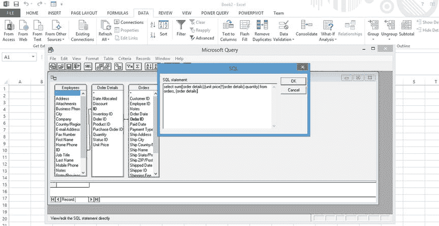

**图 5-20。**

显示 SQL 查询的查询屏幕：
```
Select sum([order details].[unit price] *[order details].quantity) from orders,[order details]
```

单击**关闭**并展开显示表的窗口，以查看已定义的关系，如图 5-19 所示。

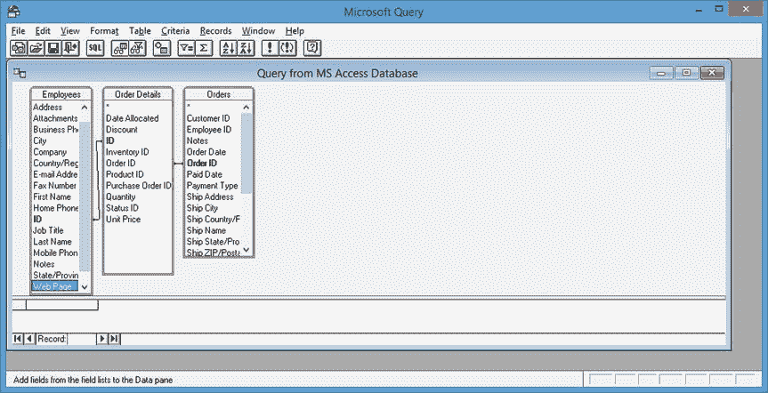

**图 5-19。**

显示表和关系的查询屏幕。使用**添加表**窗口，通过双击每个表来添加 `employees`、`orders` 和 `order detail` 表，如图 5-18 所示。

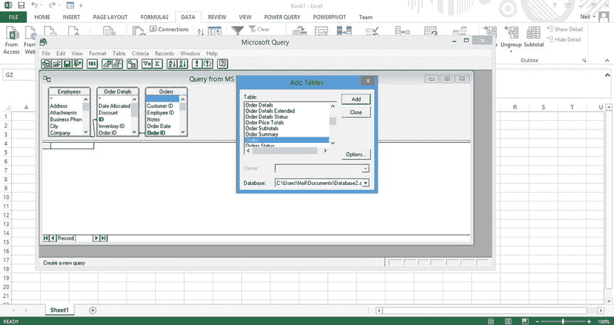

**图 5-18。**

用于添加表的 Microsoft Query 窗口。选择之前下载的 `Database2`，如图 5-17 所示，然后单击**确定**。

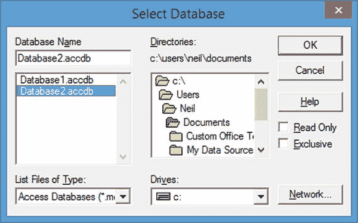

**图 5-17。**

选择数据库窗口。在**选择数据源**窗口中选择 **MS Access Database**，如图 5-16 所示。取消选中窗口底部的“使用查询向导创建/编辑查询”。然后单击**确定**。

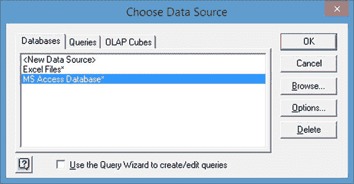

**图 5-16。**

选择数据源窗口。单击**数据**选项卡以查看功能区，然后单击**从其他来源**。接着单击菜单上的最后一项**来自 Microsoft Query**，如图 5-15 所示。

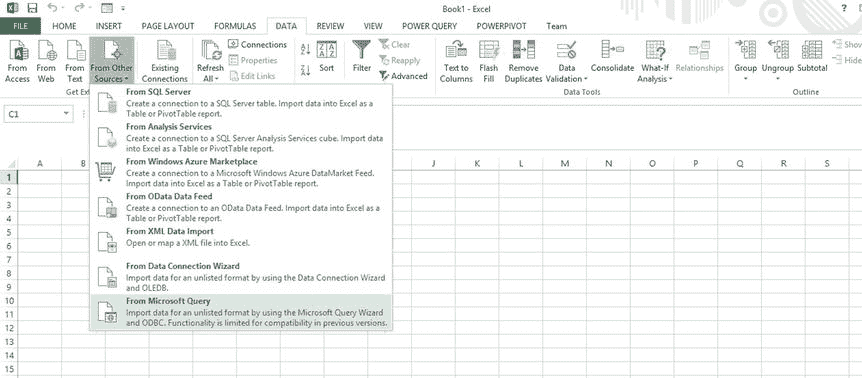

**图 5-15。**

显示如何访问 Microsoft Query 的屏幕。对于提示“SQL Query can't be represented graphically. Continue anyway?”，单击**确定**，如图 5-21 所示。


**图 5-21。**

Microsoft Query 弹出窗口。将显示单个数字的响应，如图 5-22 所示。

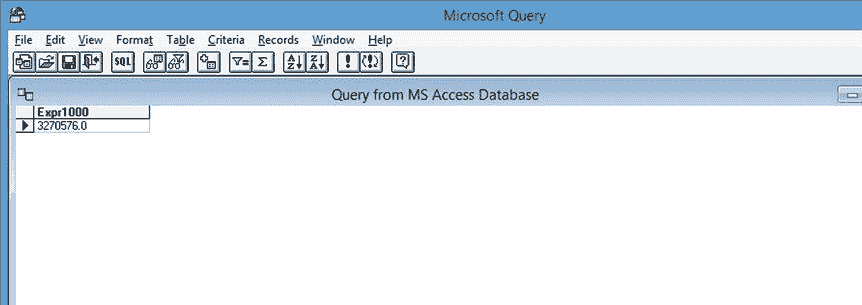

**图 5-22。**

查询结果。

## 总结

本章展示了在 Excel 和 PowerPivot 中使用 SQL 来汇总来自大表或表集合数据的几种方法。它演示了如何根据指定条件联接表，以及如何使用聚合来提取汇总统计信息。

