# 6. 使用 Power View 设计报表

Power View 是一种报表工具，可创建其自身类型的工作表。对于不精通 Excel 的用户而言，这是一种创建“沙盒”的方法，可以在不更改数据的情况下探索数据的子集。Power View 通过基于 PowerPivot 模型或数据透视表创建包含快速简便可视化效果的仪表板，来让数据变得生动。可以基于相同数据创建多个 Power View 工作表。

## Power View 设计界面的元素

Power View 界面包含以下元素，如图 6-1 所示：

- 左侧的设计图面
- 中间的筛选器区域，可以在此根据字段值筛选数据
- **Power View 字段**窗格，在此选择要包含在报表中的字段。顶部包括所有可用字段，底部显示已选字段。

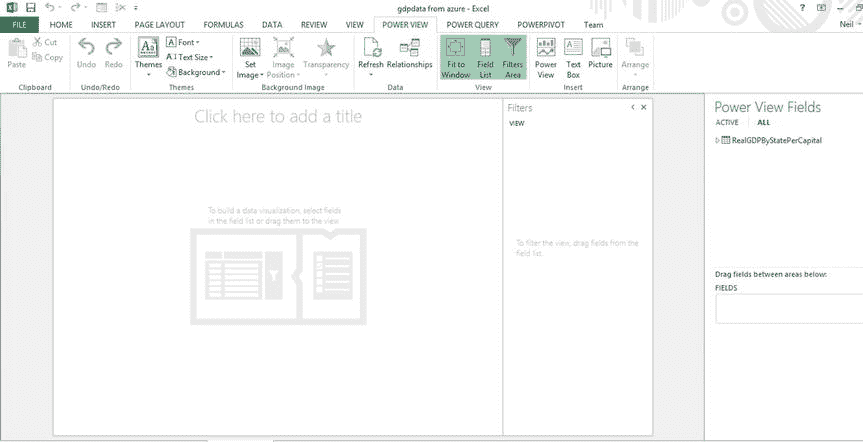

**图 6-1。**

Power View 设计图面。

## 使用 Power View 时的注意事项

始终从表视图开始，然后基于该表创建图表。可以向设计图面添加多个表和/或图表。只需单击空白区域即可添加新图表。

仅在设计图面上包含报表所必需的字段。一般来说，除非与报表相关，否则最好不要包含用于关联表的主键值。

## 字段类型

通常有两种处理方式截然不同的字段类型：

- 非数值的分类或描述性字段
- 可包含计算字段或度量的数值字段。求和符号 (Σ) 用于指示可更改其聚合类型的数值字段。

## 理解数据的汇总方式

使用 Power View 时，最棘手的部分可能在于理解数据的汇总方式。默认情况下，数值字段会被求和，即使这些字段（如 ID 号或年份）的求和毫无意义也是如此。聚合类型可以通过单击 **Power View 字段**窗格下半部分中字段名称后的向下箭头轻松更改。聚合选项如下：

- 不汇总
- 求和
- 平均值
- 最小值
- 最大值
- 计数（非空）
- 计数（非重复）

请注意，要绘制图表，必须使用上述数学函数之一对字段进行汇总。

## 单表示例

第一个示例将演示如何基于一张电子表格使用 Power View，该表格包含美国各州 1997 年至 2011 年每年的人均实际 GDP（国内生产总值）数据。从 Azure 市场下载此数据的说明已在第 3 章中介绍。要创建 Power View 查询，请执行以下步骤：

打开 Azure 电子表格中的 GDP 数据，如图 6-2 所示。

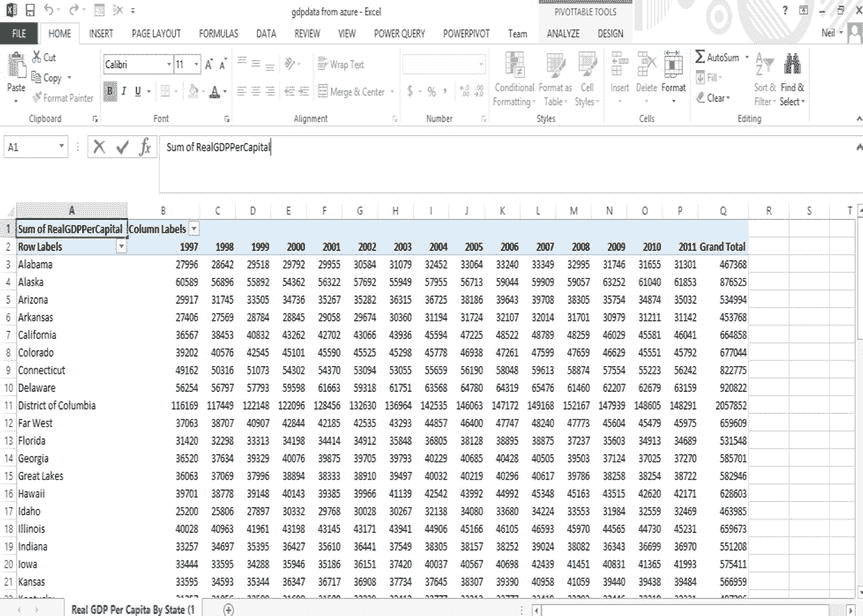

图 6-2. 各州人均实际 GDP 数据电子表格

单击 `Insert` 选项卡，选择 `Power View Reports`，然后等待 Power View 屏幕加载，如图 6-2 所示。如果系统提示安装 SilverLight，请单击 `Yes`。请注意左侧的设计图面、右侧的 `Power View Fields` 窗格以及中间的 `Filters` 窗格。

在屏幕右侧的 `Power View Fields` 窗格中，单击 `RealGDPByStatePerCapita` 左侧的右向三角形以展开字段。然后将 `year` 字段拖到 `Filters` 窗格中，如图 6-3 所示。

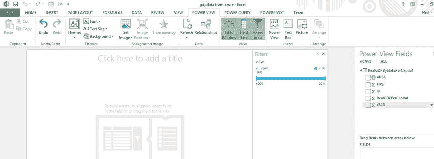

图 6-3. 设置筛选器

要仅显示最近年份（即 2011 年），请在 `Filters` 窗格中单击 `Year` 右侧最左侧的图标以激活 `List Filter Mode`，查看年份列表并选中 `2011`，如图 6-4 所示。

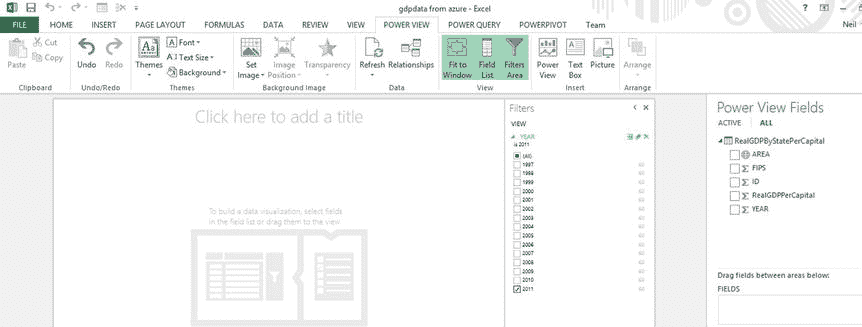

图 6-4. 设置筛选器（展开视图）

然后，在 `Power View Fields` 窗格中，单击 `Area` 和 `RealGDPPerCapita` 前面的复选框，即可创建一个表格，如图 6-5 所示。

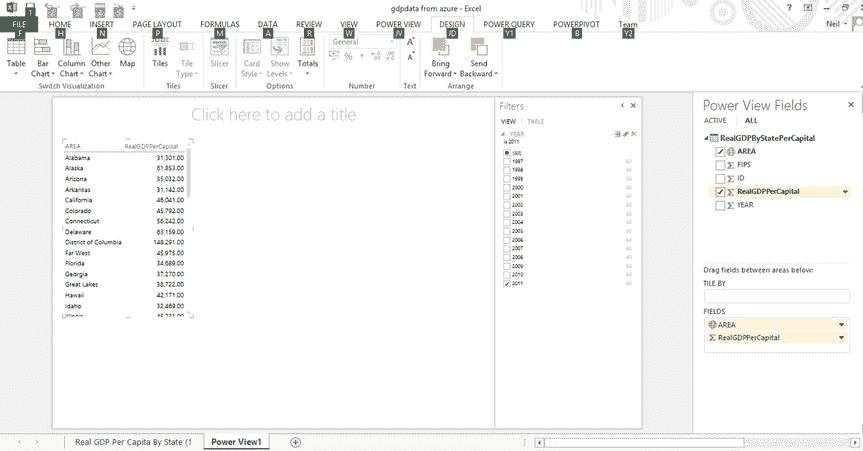

图 6-5. 显示人均实际 GDP 总和的表格

请注意，默认显示的是 `RealGDPPerCapita` 的总和，这没有实际意义。若要更改此设置，请在 `Power View Fields` 窗格底部，单击 `RealGDPPerCapita` 后的向下箭头，然后选择 `Do Not Summarize`。但是，为了绘制后续图表，必须将其保留为 `Sum` 设置。结果如图 6-6 所示。请注意表格右侧的滚动条，可用于滚动查看所有州。要展开表格，请单击表格并拖拽手柄。

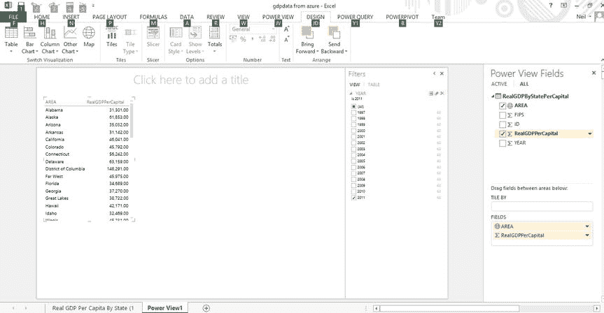

图 6-6. 显示各州人均实际 GDP 的表格

可以通过单击提示 `Click here to add a title` 的位置并输入 `Real GDP Per Capita by State for 2011` 来添加标题，如图 6-7 所示。

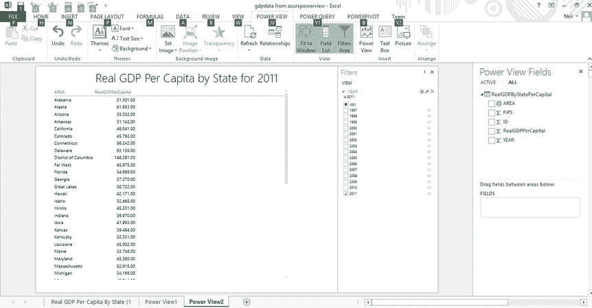

图 6-7. 添加标题后的表格

### 以不同方式查看数据

Power View 支持多种数据查看格式。选中 `Design` 选项卡后，单击左侧的 `Table` 图标可查看选项：表格、矩阵和卡片。卡片视图会为每个州创建一张卡片，如图 6-8 所示。矩阵视图类似于表格，但允许向下钻取，后续示例中会进行演示。要返回表格格式，只需在 `Table` 图标下单击 `Table` 即可。

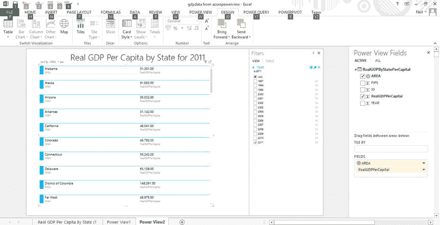

图 6-8. 卡片视图

### 为单一年份创建条形图

要创建显示各州人均实际 GDP 的条形图，请遵循以下步骤：

单击表格中的任意位置，选中 `Design` 选项卡。单击 `Bar Chart`。选择 `Clustered Bar`。由于只有一个数据源，选择聚集条形图或堆积条形图会显示相同的结果。

结果将如图 6-9 所示。2011 年每个州的人均 GDP 显示为单一条形。

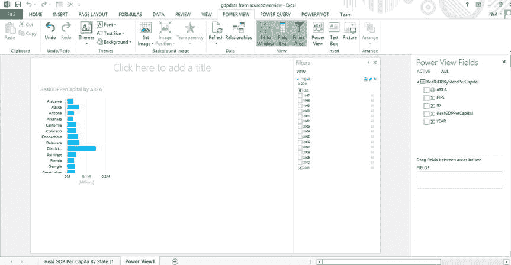

图 6-9. 条形图

要调整图表大小，请单击图表并拖拽手柄。

请注意，您可以将鼠标悬停在图表中的任意条形上，以查看该州的人均 GDP 值。

### 柱形图

柱形图是条形图旋转 90 度后的形式，如图 6-10 所示。

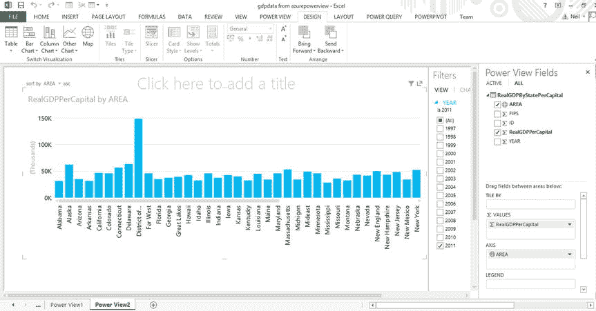

图 6-10. 柱形图

### 显示多个年份

如果更改筛选器以包含多个年份（通过在 `Filters` 窗格的 `Years` 列表顶部单击 `All` 复选框），则表格中会为每个州生成每个年份的实例，如图 6-11 所示。同时还需要在 `Power View Fields` 列表窗格中单击 `Year`，以便显示年份。

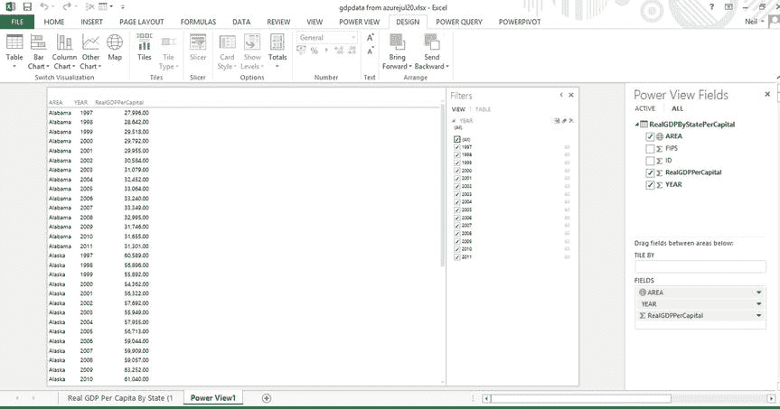

图 6-11. 多个年份的人均实际 GDP 表格

如果切换到矩阵视图，则显示如图 6-12 所示。请注意，需要指示 Power View 不要对年份进行求和：在 `Power View Fields` 窗格的 `Fields` 部分，单击 `Year` 后的箭头，选择 `Do not summarize`。

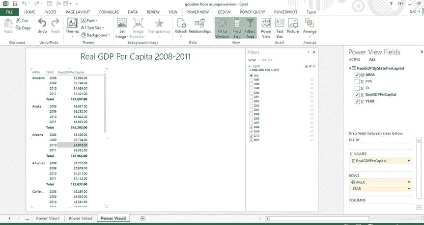

图 6-12. 多个年份人均 GDP 的矩阵视图

### 添加地图

要使用地图显示数据，请遵循以下步骤：

单击表格以激活 `Design` 选项卡。单击 `Map` 图标。如果显示的是世界地图，请使用右上角的 `Zoom` 和 `Pan` 图标仅显示地图的所需区域，如图 6-13 所示。将鼠标悬停在一个气泡上可查看其关联的实际数值。

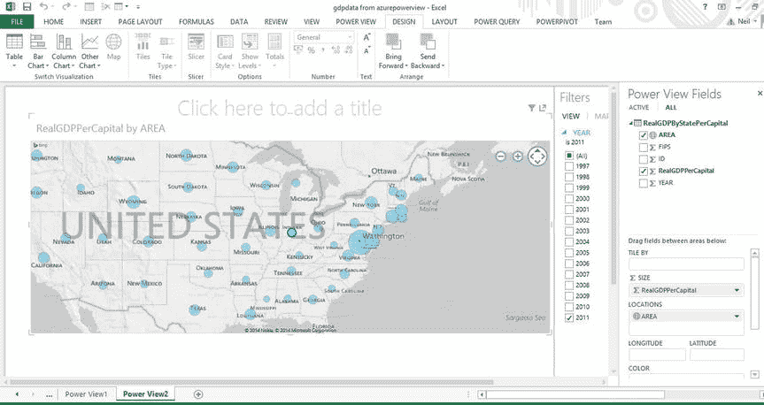

图 6-13. 显示各州人均 GDP 的地图视图

请注意，每个州显示的气泡大小与该州的人均 GDP 成比例。在 `Filters` 窗格中，可以选择单个或多个年份来查看这些年份的数据。

### 使用磁贴

另一种查看数据的方式是使用磁贴。只需选择一个表格，然后单击 `Design` 工具栏上的 `Tiles` 图标即可看到显示效果，如图 6-14 所示。默认布局在显示顶部有一个选项卡条，允许单击每个州以查看该州的值。

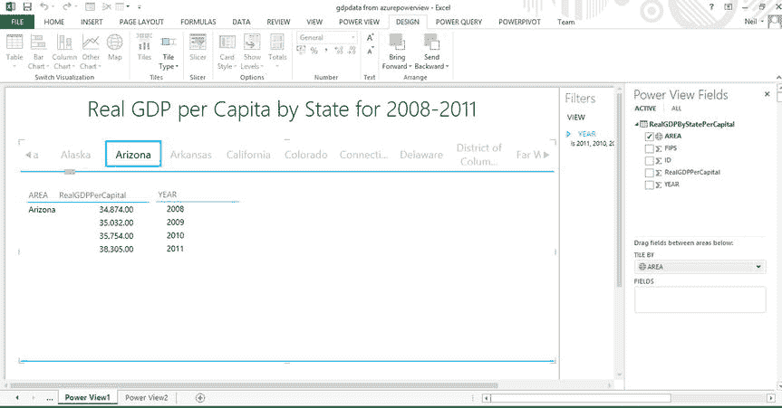

图 6-14. 磁贴格式

另一种选择是磁贴流格式，磁贴位于底部，如图 6-15 所示。可以通过单击 `Design` 工具栏上的 `Tile Type` 图标在这两种视图之间切换。

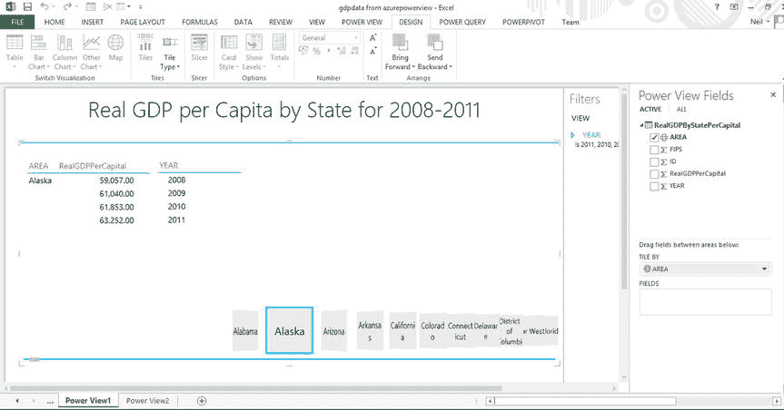

图 6-15. 磁贴流格式

## 关系示例

本示例将使用 Access 数据库 2（即 Northwind 数据库）。图 6-16 显示了部分已导入的表。该数据库可从 Apress 网站下载。

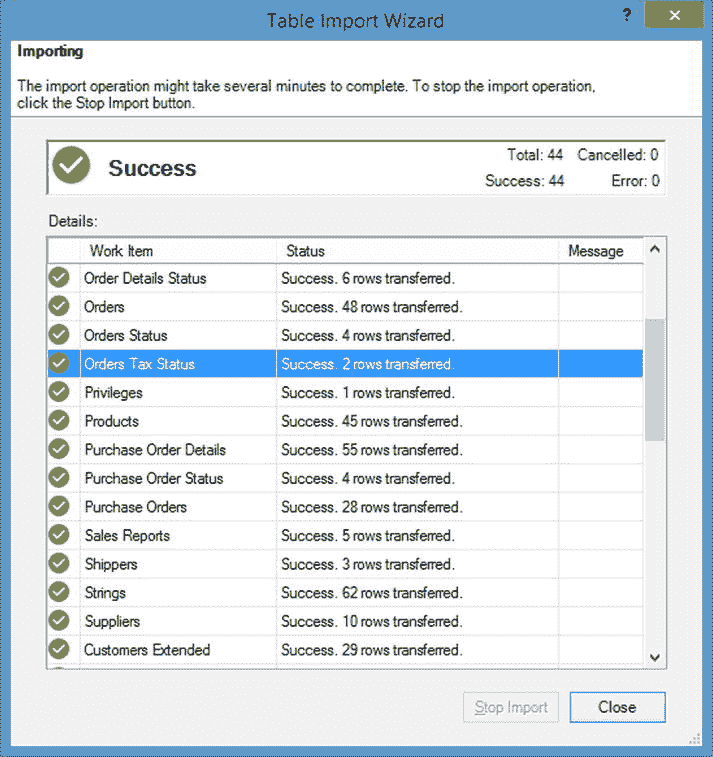

图 6-16. Northwind 数据表

请按照第 4 章中描述的步骤导入 Access 数据。

点击 `PowerPivot` 选项卡以打开功能区。点击功能区左上角的 `Manage` 按钮。`PowerPivot` 窗口打开后，您可以点击 `Get External Data` 组中的 `From Database` 来加载数据。这将提供数据库源的选择。在本示例中，将选择 `From Access`。在 `Table Import Wizard` 对话框中，点击 `Browse` 按钮找到您要导入的 Access 文件。本示例使用 `Database2.accdb`。此文件可从 Apress 网站获取。点击 `Test Connection`。如果测试成功，点击 `Next`。

`PowerPivot` 会打开 `Table Import Wizard` 引导您完成数据加载过程。选择 `Select from a list of tables and views` 来选择您要导入的数据。点击 `Next`。点击左上角的复选框以选择所有表。请注意，在对话框的右下角，有一个 `Preview & Filter` 选项。此选项可用于从非常大的数据集中选择数据子集。在本示例中，将导入所有表中的所有行。然后点击 `Finish` 完成导入。导入的表如图 6-16 所示。

表之间的关系如图 6-17 所示。

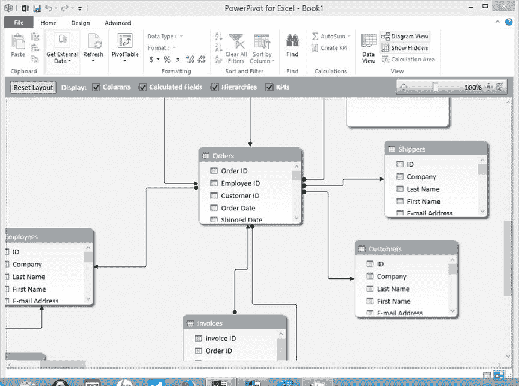

图 6-17. 关系图视图

本示例将使用 `orders` 表中的 `customer ID` 与 `customers` 表中的 `ID` 字段之间的关系。

关系的另一种视图如图 6-18 所示，可通过点击 `Data` 选项卡上的 `Relationships` 图标来访问。

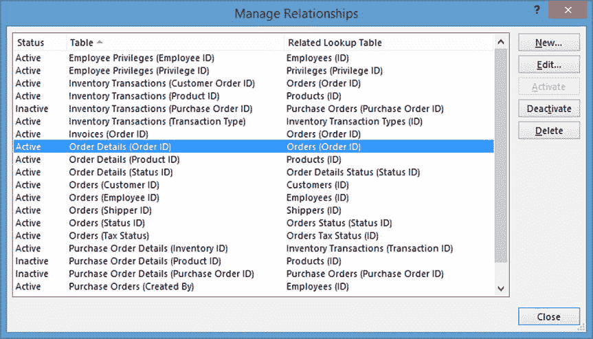

图 6-18. 关系

要创建 Power View 报表，请遵循以下步骤：

1.  在 Excel 的 `Insert` 选项卡上点击 `Power View Reports`。
2.  首先，从屏幕右侧的 `Power View Fields` 选项卡中选择字段来创建一个表。
3.  从 `customers` 表中选择 `company`、`first name` 和 `job title` 字段，如图 6-19 所示。

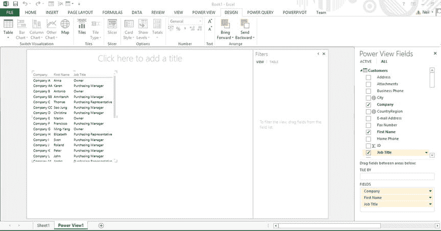

图 6-19. 显示公司、名字和职位的表格

接下来，从 `Order Price Totals` 表中选取 `Price Total`。此操作依赖于 `customers` 表到 `orders` 表再到 `order price totals` 表之间的关系。结果如图 6-20 所示。

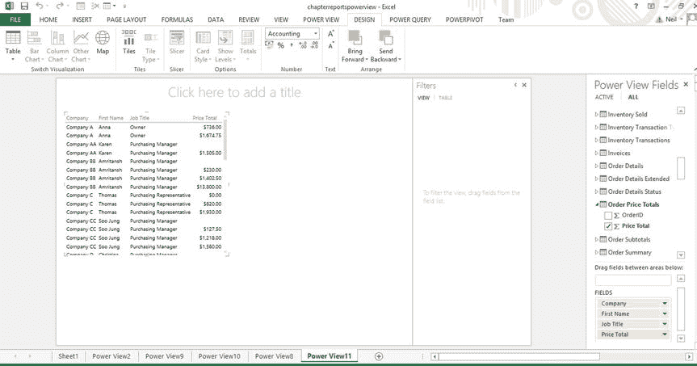

图 6-20. 显示订单总额的表格

请注意，对于有多个订单的公司，表中会显示多行。矩阵视图（如图 6-21 所示）使这一点更加明显。

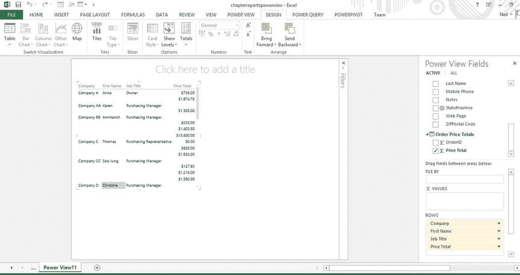

图 6-21. 矩阵视图

### 客户与城市示例

本示例将按城市显示客户。目的是显示来自每个城市的订单价值。请遵循以下步骤：

1.  在 Excel 的 `Insert` 选项卡上点击 `Power View Reports`。
2.  从 `Customers` 表中选择 `company` 和 `city`，如图 6-22 所示。如有必要，通过选择标题栏中两列之间的线条并拖动，调整表中 `company` 列的宽度。

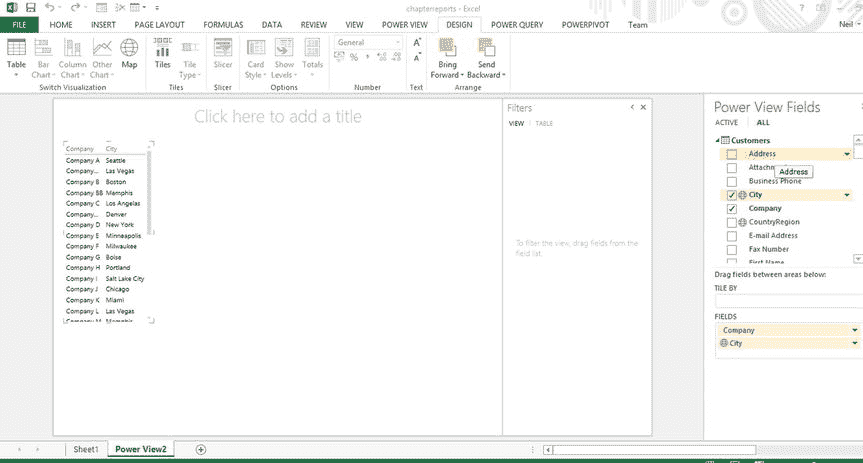

图 6-22. 公司和城市表格

3.  从 `order price totals` 表中选择 `price total` 字段。请注意，系统会提示创建关系。由于未创建关系，将显示所有订单的总和，如图 6-23 所示。

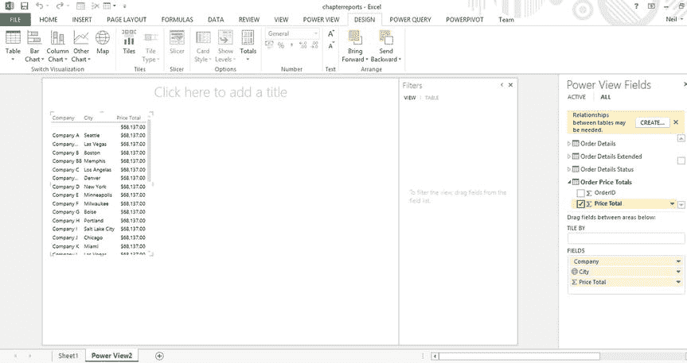

图 6-23. 显示公司、城市和订单价格总额的表格

4.  基于 `order ID` 创建 `orders` 表和 `order price totals` 表之间的关系，如图 6-24 所示，然后点击 `OK`。

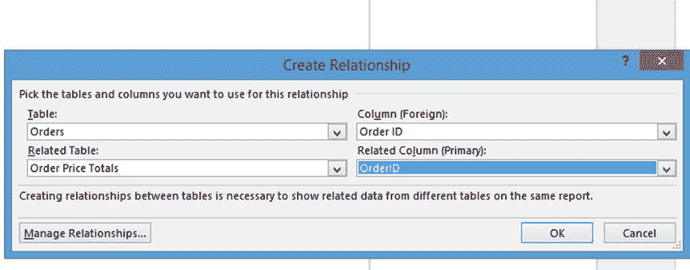

图 6-24. 创建 orders 表与 order price totals 表之间的关系

5.  接下来，点击 `Fields` 列表中 `Price Total` 后的箭头，并选择“Do Not Summarize”，如图 6-25 所示。请注意，现在显示的是每个订单的金额，而不是所有订单的总和。

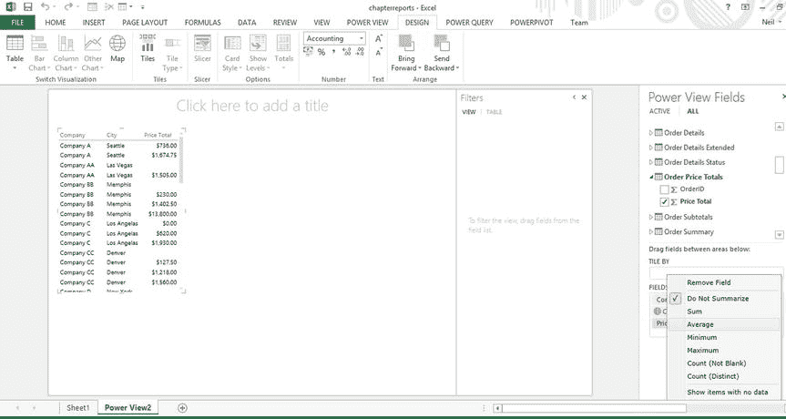

图 6-25. 显示单个订单总额的表格

6.  通过点击 `Design` 选项卡上的 `Table`，选择 `Matrix`，然后点击“Fit to Window”，选择矩阵视图，将得到如图 6-26 所示的显示效果。请注意，已输入了一个标题。可以使用右侧的滚动条滚动视图。

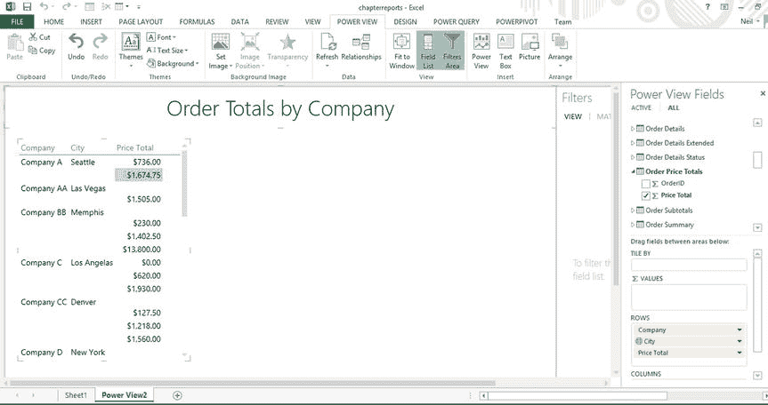

图 6-26. 矩阵视图

7.  点击表格显示区域右上角的弹出图标，将得到如图 6-27 所示的视图。

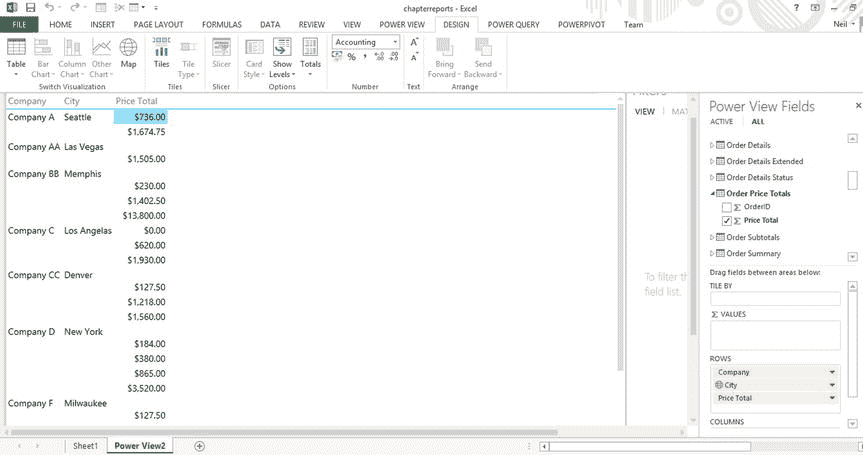

图 6-27. 矩阵的弹出视图

8.  要筛选出没有订单的记录，将 `Price Total` 字段拖到 `Filters` 窗格中，并将左侧的条形向右拖动到某个任意大于零的小数字，如图 6-28 所示。

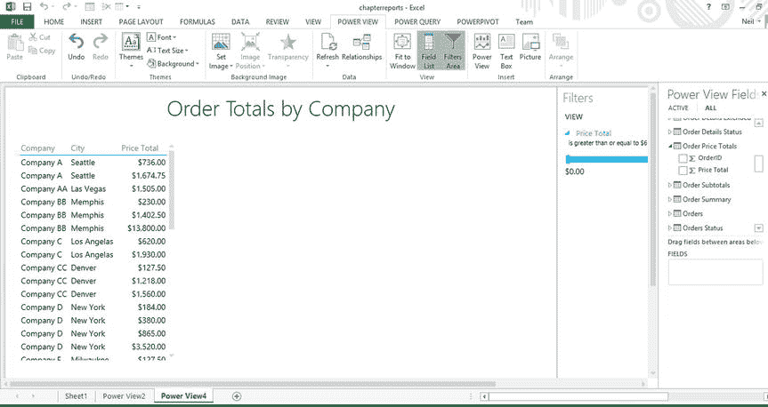

图 6-28. 筛选出没有订单的公司

或者，点击 `Price Total` 字段名称，将筛选条件设置为大于或等于 1，然后点击 `Apply Filter`，如图 6-29 所示。

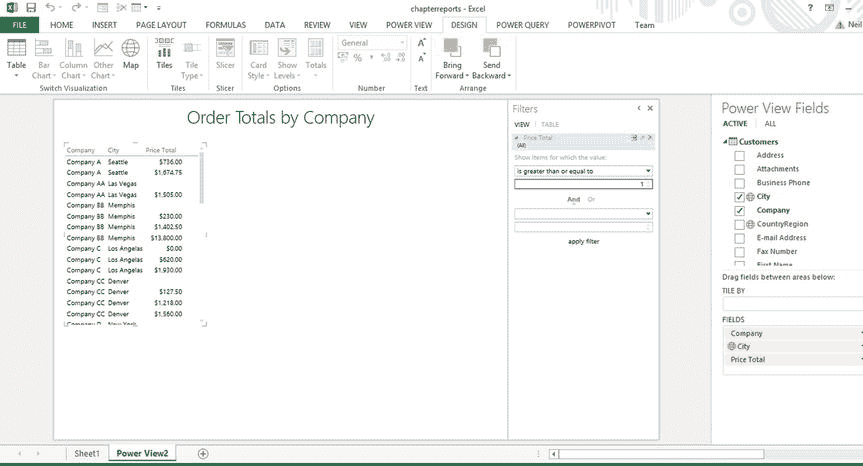

图 6-29. 筛选出没有订单公司的另一种方法

## 按雇员显示订单

下一个示例将展示如何按雇员显示订单数量，请执行以下步骤：

在“`Power View`”选项卡上点击“`Power View`”按钮，创建一个新的 Power View 工作表。输入标题“按雇员统计的订单”。在“`Power View 字段`”窗格中，从“`雇员`”表中选中“`姓氏`”字段。

然后，从“`订单`”表中选中“`订单 ID`”字段。结果如图 6-30 所示。请注意，默认情况下，它会对 `订单 ID` 进行求和，但这只是一个无意义的数字。

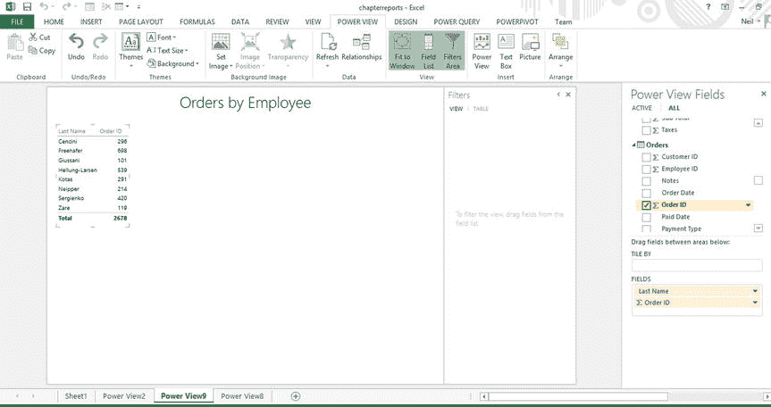

图 6-30. 显示雇员和订单的表格

在“`Power View 字段`”窗格的“`字段`”区域中，点击“`订单 ID`”后面的箭头，然后选择“`计数(非空白)`”。结果如图 6-31 所示。请注意，表格中现在显示的是订单计数。

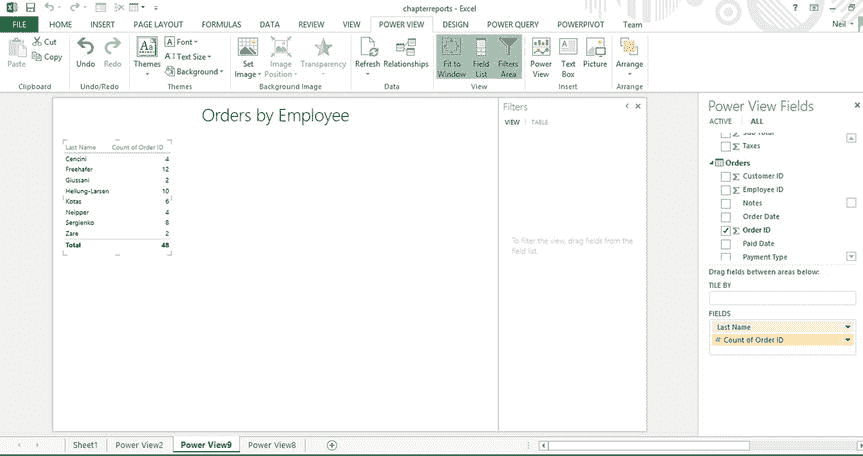

图 6-31. 显示雇员以及每位雇员订单数量的表格

要创建数据的图表，请右键单击表格并选择“`复制`”。点击表格旁边的空白区域，右键单击并选择“`粘贴`”，以获得表格的另一个副本，如图 6-32 所示。

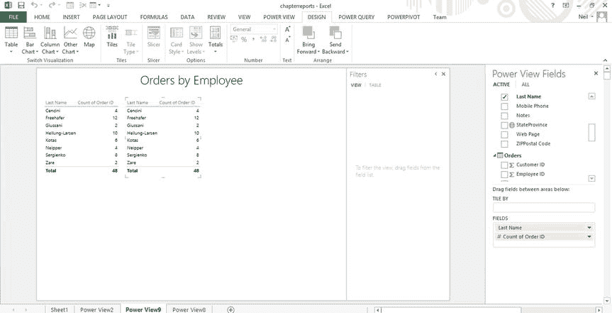

图 6-32. 在绘制图表前复制表格

要绘制图表，请选择刚粘贴的最右侧表格，点击“`设计`”选项卡上的“`条形图`”图标，然后选择“`堆积条形图`”以获取条形图，如图 6-33 所示。

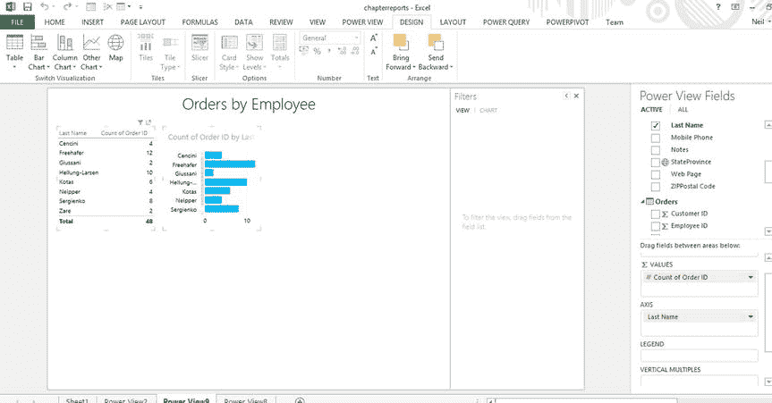

图 6-33. 按雇员统计的订单条形图

## 按产品聚合订单

此示例将展示如何按产品显示订单数量。请执行以下步骤：

在 Excel 的“`插入`”选项卡上，点击“`Power View 报表`”。在“`Power View 字段`”窗格中，选中“`产品`”表中的“`产品名称`”字段，如图 6-34 所示。

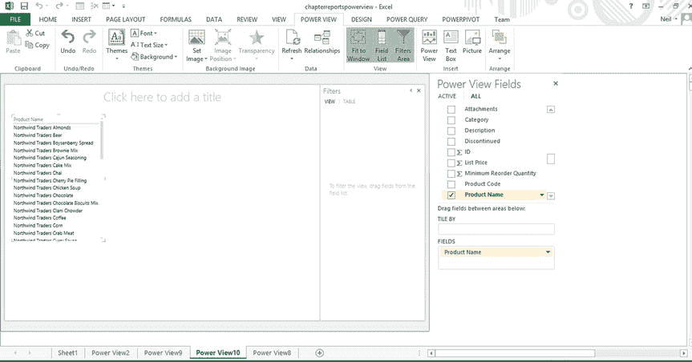

图 6-34. 产品列表

接下来，选中“`订单详情表`”中的“`数量`”字段，如图 6-35 所示。请注意，显示的是数量的总和。

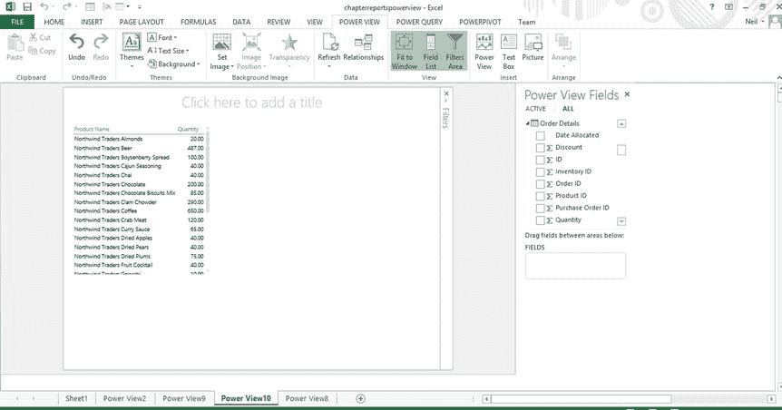

图 6-35. 已订购产品的数量

点击表格中的任意位置，并使用手柄将其展开，如图 6-36 所示。

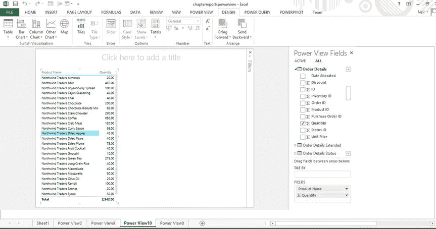

图 6-36. 表格的展开视图

要创建图表，请右键单击表格并选择“`复制`”。在设计界面上点击表格右侧，然后选择“`粘贴`”。接着，在“`设计`”选项卡上，选择“`条形图`”和“`堆积条形图`”。在设计屏幕的顶部，输入标题“已售产品数量”。结果如图 6-37 所示。

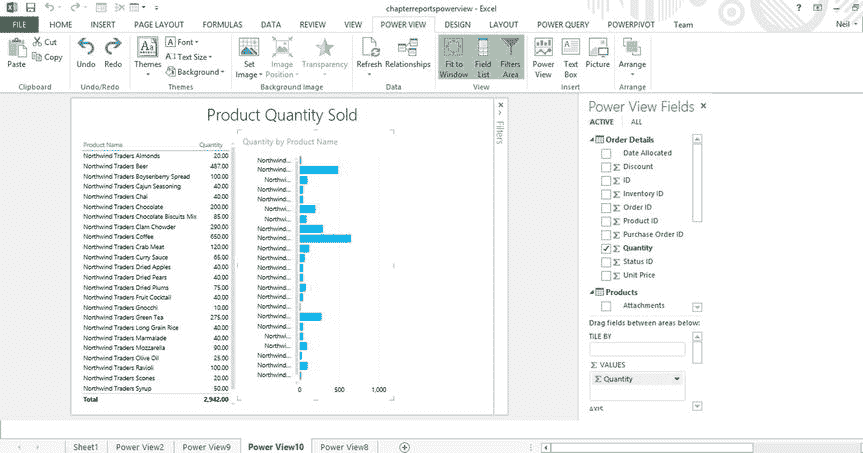

图 6-37. 已售产品数量的条形图

请注意，在条形图中，只显示了名称的前九个字符。可以将鼠标指针悬停在条形图中的任意条形上，以查看完整的产品名称和已售数量。要显示更多字符，请点击图表窗口将其选中，然后拖动手柄以放大尺寸，如图 6-38 所示。

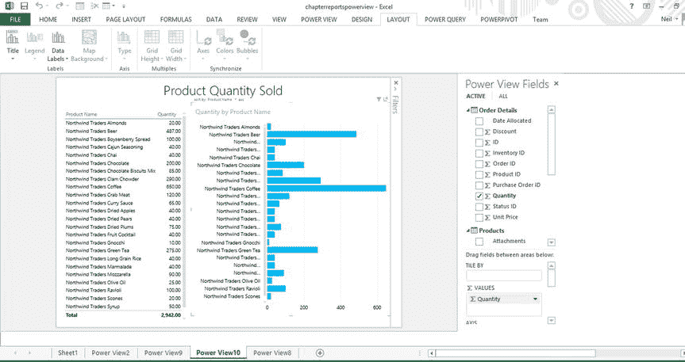

图 6-38. 产品名称展开后的条形图

## 总结

本章仅浅尝辄止地介绍了如何使用 Power View 轻松生成数据表和图表，从而使数据变得生动。它涵盖了如何按城市、雇员和产品分析销售额。本章还演示了如何创建简单的地图。第 9 章将介绍如何使用 Power Map 创建更复杂的地图。

