# 8. Power Query

Microsoft Power Query for Excel 是一种数据发现工具，用于从各种来源导入数据，包括关系型、半结构化和非结构化数据，这些数据可从 `OData`、`Hadoop` 和 `Azure Marketplace` 等来源获取。它是一个用于提取、转换和加载数据的自助式 ETL（导出、转换、加载）工具。它比之前介绍的一些方法更强大。微软在不断更新 Power Query，因此，到本书出版时，某些功能可能已发生变化。本章演示如何从 Web、表格格式、CSV 格式和 JSON 格式访问数据，然后使用 Power Query 编辑器对数据进行塑形，最后将其导入 Excel。

## 安装 Power Query

如果 `Power Query` 选项卡不可见，则必须安装它。Power Query 作为免费下载软件提供给 Excel 2010 和 2013 用户。可以通过搜索“Power Query 下载”来访问下载链接。如果安装了 32 位版本的 Excel，请务必安装 32 位版本；如果安装了 64 位版本的 Excel，请安装 64 位版本。安装后，按以下步骤启用 Power Query：

1. 单击`文件`选项卡以查看 Backstage 视图。
2. 单击左侧窗格底部的`选项`。
3. 在左侧窗格中选择`加载项`。
4. 在窗口底部，单击`管理`后面的箭头，选择`COM 加载项`，然后单击`转到`。
5. 勾选`Microsoft Office PowerPivot for Excel 2013`、`Microsoft Power Map for Excel`和`Power View`，然后单击`确定`。

安装后，`Power Query`选项卡将可见。

## Power Query 功能区上的关键选项

本节将介绍 Power Query 功能区上最有用的选项，如图 8-1 所示。

* `来自 Web`：允许从特定网站提取表格
* `来自文件`：从 Excel、CSV、XML、文本文件或文件夹中的一组文件导入
* `来自数据库`：从数据库导入，例如 SQL Server、Access、Oracle 和 MySQL
* `来自 Azure`：从 Azure 服务导入，例如 SQL Database、Market Place、HDInsight、Blob Storage 和 Table Storage
* `来自其他源`：从包括 SharePoint 列表、`OData` 源、`Hadoop (HDFS)`、Facebook、Salesforce 对象和报表以及 `ODBC` 在内的源导入
* `最近的源`：显示最近查询的源
* `来自 Excel 表数据`：从 Excel 电子表格导入一个区域
* `合并`：合并两个查询以添加列
* `追加`：将一个表追加到另一个结构相同的表
* `显示窗格`：切换屏幕右侧的工作簿查询窗格的显示
* `数据源设置`：管理通过 Power Query 访问的数据源的设置
* `选项`：设置用于加载数据的选项
* `更新`：在线检查 Power Query 更新
* `数据目录搜索`：搜索精选的网站集并提取表格
* `我的数据目录查询`：允许与其他用户共享查询

图 8-1. Power Query 功能区

## 使用查询编辑器

Power Query 允许将数据子集导入查询编辑器，以便在将数据导入 Excel 或数据模型之前，通过删除不需要的行或列，或创建计算列来塑形数据。查询编辑器中有三个选项卡：`主页`、`转换`和`添加列`。

### 查询编辑器主页功能区上的关键选项

本节介绍查询编辑器主页功能区上的关键选项，如图 8-2 所示。

- `Close & Load`：关闭编辑器并将数据加载到 Excel 工作表或数据模型中。
- `Refresh Preview`：刷新查询，重新处理所有步骤并预览结果。
- `Advanced Editor`：显示用于以 `M` 查询语言提取数据的代码。
- `Choose Columns`/`Remove Columns`：允许保留或移除选定的列。单击 `Choose Columns` 图标会显示一个列列表，可以取消勾选以移除某些列，如图 8-3 所示。

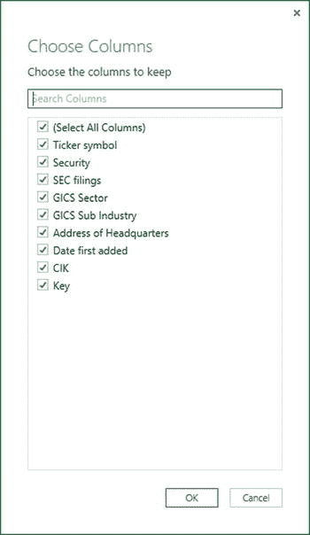

图 8-3. `Choose Columns` 对话框

- `Keep Rows`/`Remove Rows`：允许保留或移除选定的行。
- `Remove Duplicates`：移除重复项。请谨慎定义重复项的判定条件。例如，在按天列出的股票价格列表中，如果仅根据股票代码移除重复项，则每个股票只会保留一行唯一数据。
- `Sort`：按升序或降序对列进行排序。请记住，查询编辑器仅处理数据的子集。最好等到数据加载到工作表或数据模型中后再进行排序。
- `Split Column`：基于分隔符（如逗号或空格）拆分列。
- `Group By`：根据一个或多个字段对行进行分组。

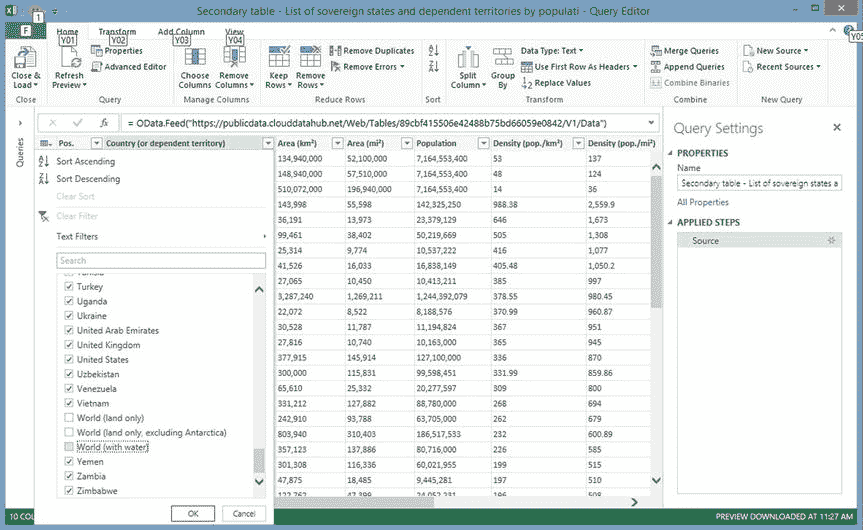

图 8-2. 查询编辑器界面

请注意，移除或筛选行的另一种方法是点击列标题右侧的箭头并取消选中相应的值，如图 8-2 所示。

## 一个简单的人口示例

本示例将展示如何使用 `Data Catalog Search` 选项以表格格式检索人口数据以供分析。`Data Catalog Search` 选项会搜索一个由公共数据网站（如 Wikipedia 和美国人口普查局网站）组成的精选数据目录，并允许轻松从这些网站提取表格。它并非功能齐全的搜索引擎，似乎能够理解以“最大”或“最多”等词语开头的搜索。登录公司网络后，它也可以搜索公司数据库。对于此示例，请执行以下步骤。

在 `Power Query` 选项卡上，单击 `Data Catalog Search`。在右侧的“搜索”窗格中，输入“most populated countries”。将鼠标指针悬停在结果上以预览数据。然后，将鼠标悬停在列表中来自 Wikipedia 的标题为“Secondary table—List of sovereign states and dependent territories by population density”的条目上。结果如图 8-4 所示。请注意底部的 `Load` 和 `Edit` 提示。

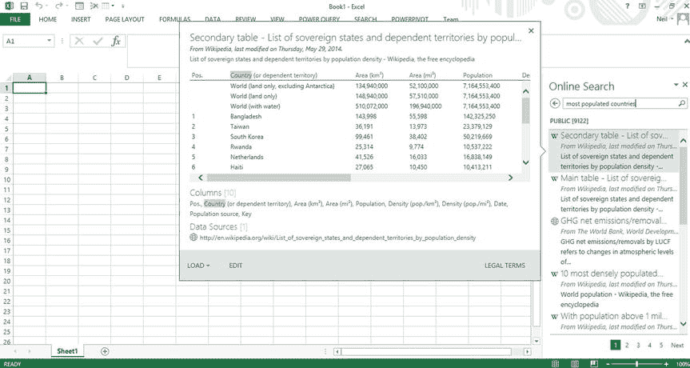

图 8-4. 人口数据预览

单击预览左下方的 `Edit`，将表格中的数据子集加载到查询编辑器中，如图 8-5 所示。该表格列出了国家及其以平方英里或平方公里为单位的人口和面积，并显示了每平方英里或平方公里的人口密度。

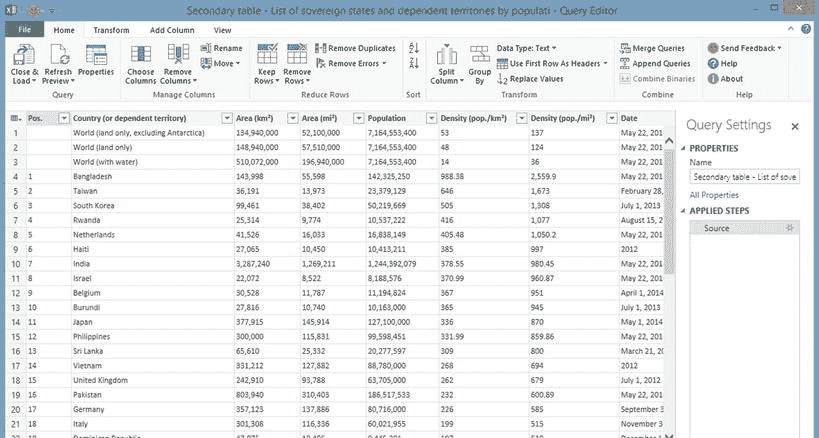

图 8-5. 查询编辑器中的入口数据

在查询编辑器中，可以通过删除行或列、拆分或合并列或移除重复项来处理数据。例如，要删除以公里为单位的面积或密度列，请先单击要删除的第一列的列标题，然后按住 `Ctrl` 键并单击第二列的列标题以选中这两列，如图 8-6 所示。

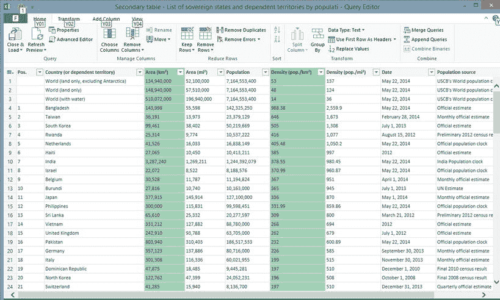

图 8-6. 高亮显示要删除的列

然后，在选项卡的 `Remove Columns` 下单击 `Remove Columns`，以移除选定的列。将数据调整为所需形状后，单击 `Close & Load`，将数据加载到 Excel 电子表格中。

## 标普 500 股票指数的表现

本示例将展示如何检索标普 500 指数的表现数据，请执行以下步骤：

在 `Power Query` 功能区上，单击 `Data Catalog Search`。在搜索框中，输入“S&P 500 performance”。将鼠标悬停在第一个链接（标题为“Total annual returns...”）上，如图 8-7 所示。

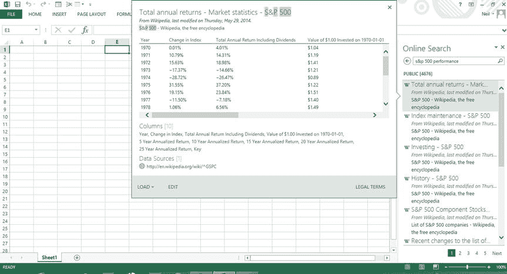

图 8-7. 数据预览

单击左下方的 `Edit`，将显示 1970 年至 2013 年每年标普 500 指数回报率的数据加载到查询编辑器中，如图 8-8 所示。

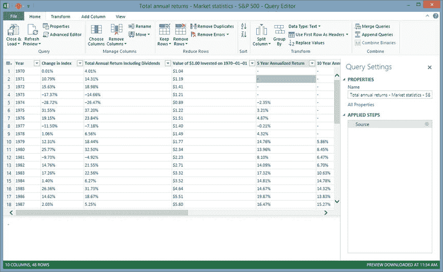

图 8-8. 查询编辑器中的数据

通过单击 `Choose Columns` 并取消勾选不需要的列来选择列。对于此示例，将移除 5 年、10 年、15 年和 20 年回报率列，如图 8-9 所示。单击 `OK`。

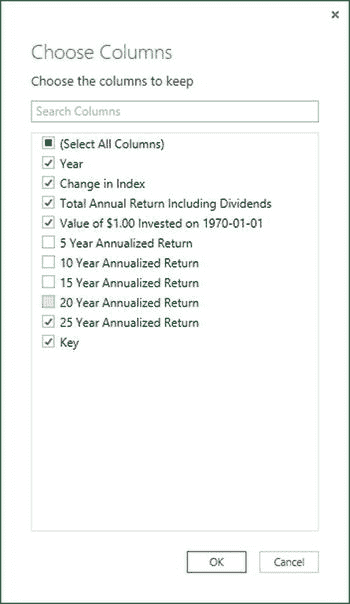

图 8-9. `Choose Columns` 对话框

要移除底部的四行，请单击 `Remove Rows`，然后选择 `Remove Bottom Rows`，并输入 `4` 作为要移除的行数，如图 8-10 所示，然后单击 `OK`。

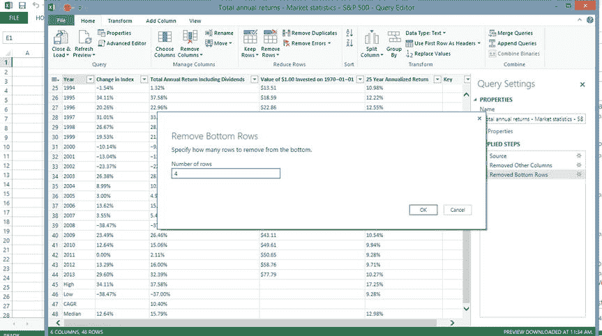

图 8-10. `Remove Rows` 对话框

然后，单击功能区左侧的 `Close & Load`，将数据导入电子表格，结果如图 8-11 所示。

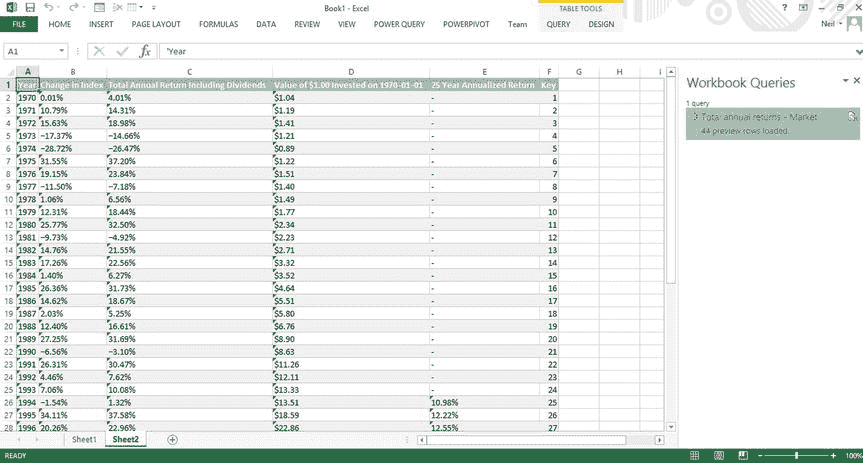

图 8-11. 数据已导入电子表格

## 从文件夹导入 CSV 文件

有时候，Hadoop 数据会以逗号分隔值的形式存储在文件中。无需将这些逗号分隔值文件加载到 `Hortonworks Sandbox` 或其他产品中作为 Hadoop 数据处理，而是可以**直接**使用 Power Query 将它们加载到 Excel 和 `PowerPivot` 中。下面的示例演示了如何操作。

首先，从以下 `URL` 下载股票市场压缩文件：`s3.amazonaws.com/hortonassets/mstut/nyse.zip`。下载完成后，在浏览器的下载窗口中双击该文件将其打开，如图 8-12 所示。

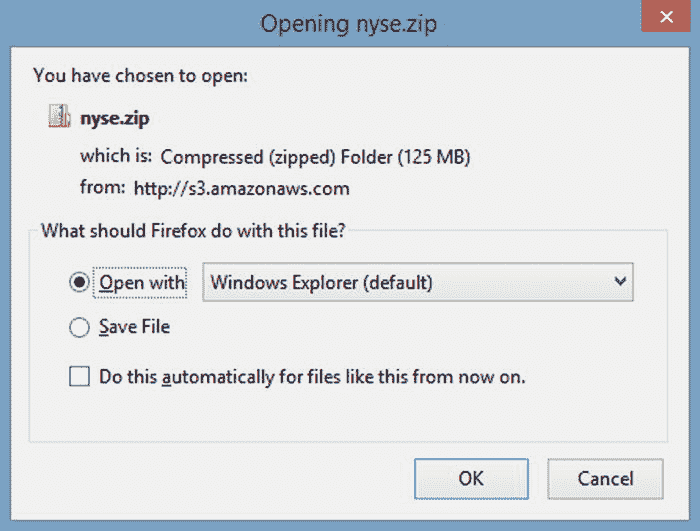

图 8-12. 下载窗口

将会下载两个包含 `.csv` 文件的文件夹，如图 8-13 所示。

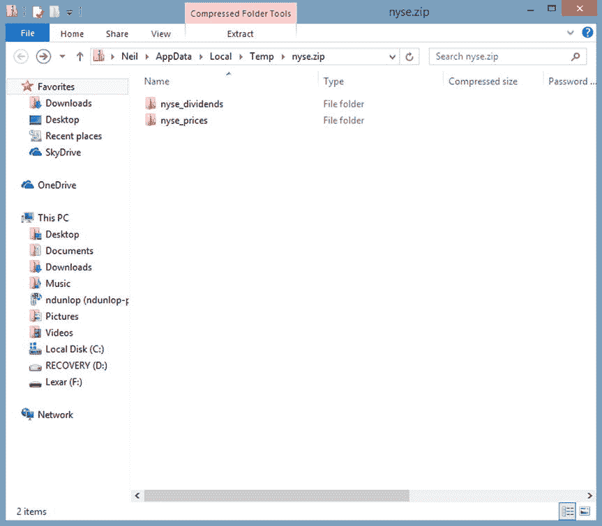

图 8-13. 显示文件文件夹的窗口

将文件夹 `nyse_prices` 拖到桌面上，以便于访问。打开 Excel 并点击“Power Query”选项卡。选择“从文件”和“从文件夹”，如图 8-14 所示。

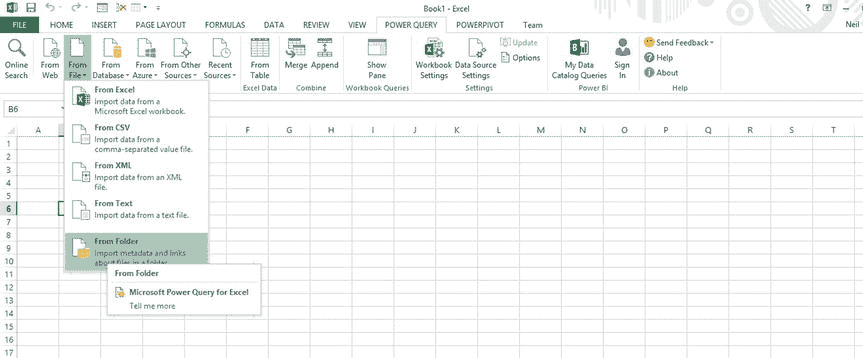

图 8-14. 用于从文件文件夹导入的 Power Query 界面

点击“浏览”并从桌面选择 `nyse_prices` 文件夹，如图 8-15 所示。点击“确定”。

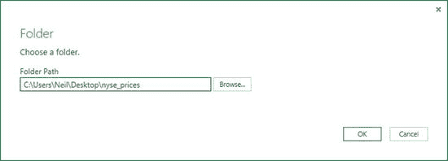

图 8-15. 文件夹界面

结果是一个 `.csv` 文件的列表，如图 8-16 所示。

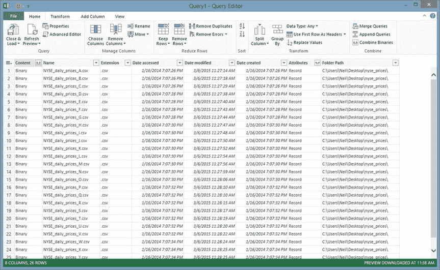

图 8-16. `.csv` 文件列表

要打开一个文件，请点击最左侧列中的“二进制”。在本示例中，选择第五行的文件。该文件将在查询编辑器中打开，结果如图 8-17 所示。请记住，查询编辑器只能包含总记录数的一个子集。

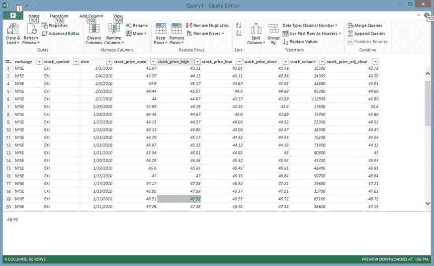

图 8-17. 导入查询编辑器的 CSV 文件

请注意，此文件包含每个股票在特定日期的开盘价、最高价、最低价、收盘价和成交量。在本示例中，将保留所有行和列。点击“关闭并加载”以将记录从查询编辑器加载到电子表格中。结果如图 8-18 所示。

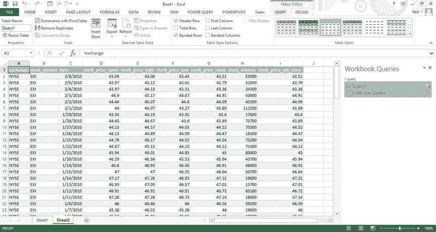

图 8-18. 数据已加载到电子表格中

### 分组依据

要按特定类别分组，请进入查询编辑器并按照以下步骤操作：

重新打开查询编辑器，点击“Power Query”选项卡上的“启动编辑器”。然后点击功能区左端的“转换”和“分组依据”。在“分组依据”对话框中，选择 `stock_symbol` 列作为分组依据条件，并保留默认的“计数”选项，如图 8-19 所示。

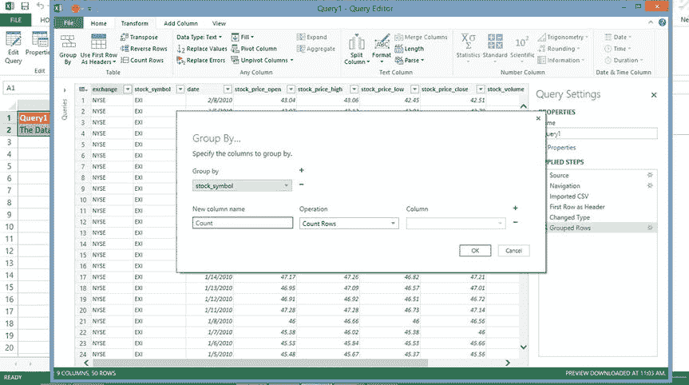

图 8-19. “分组依据”对话框

点击“确定”，将出现如图 8-20 所示的结果。

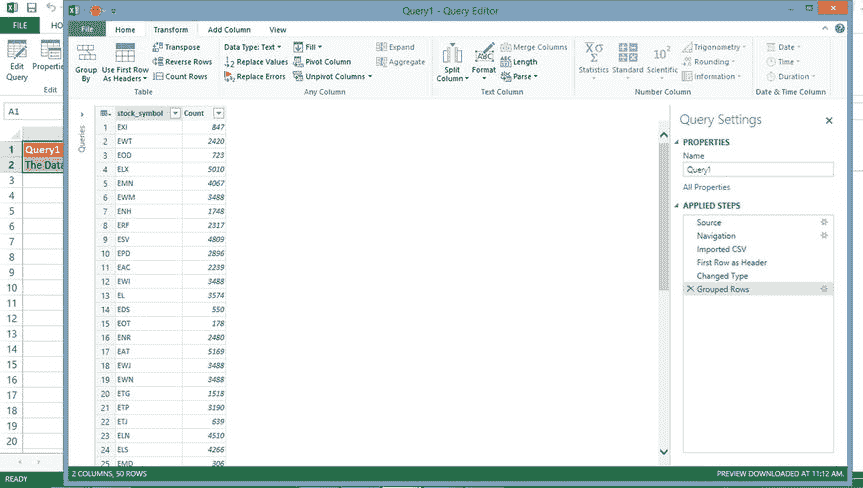

图 8-20. 对 `stock_symbol` 执行分组依据后的结果

# 导入 JSON

此示例演示如何使用 Power Query 从网站提取 JSON 数据。图 8-21 显示了关于诺贝尔奖得主的原始 JSON 数据。

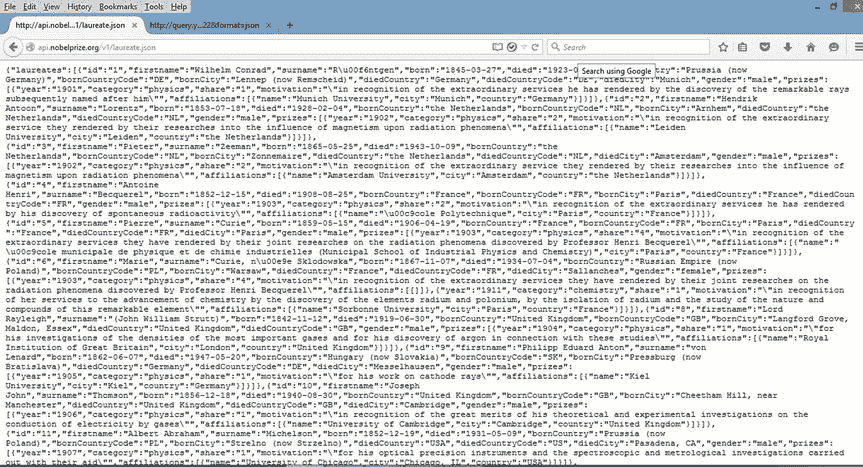
图 8-21. 原始 JSON 数据

要使用 Power Query 导入数据，请按照以下步骤操作：

点击“Power Query”选项卡。点击“从 Web”，输入以下 URL，如图 8-22 所示，然后点击“确定”：`http://api.nobelprize.org/v1/laureate.json`。

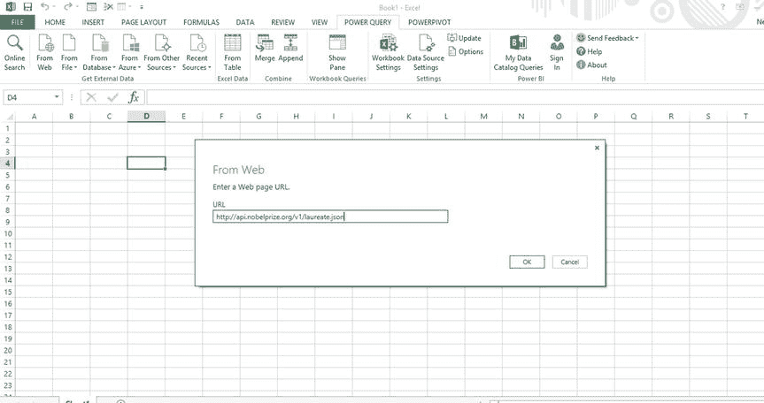
图 8-22. 使用“从 Web”选项导入

查询编辑器将打开。点击功能区左上角的“到表”图标，如图 8-23 所示。

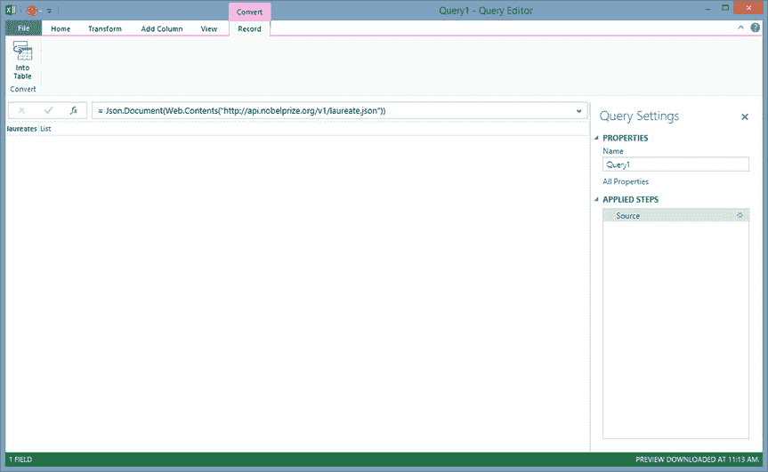
图 8-23. 用于导入 JSON 的“转换”界面

结果仅显示列标题，如图 8-24 所示。

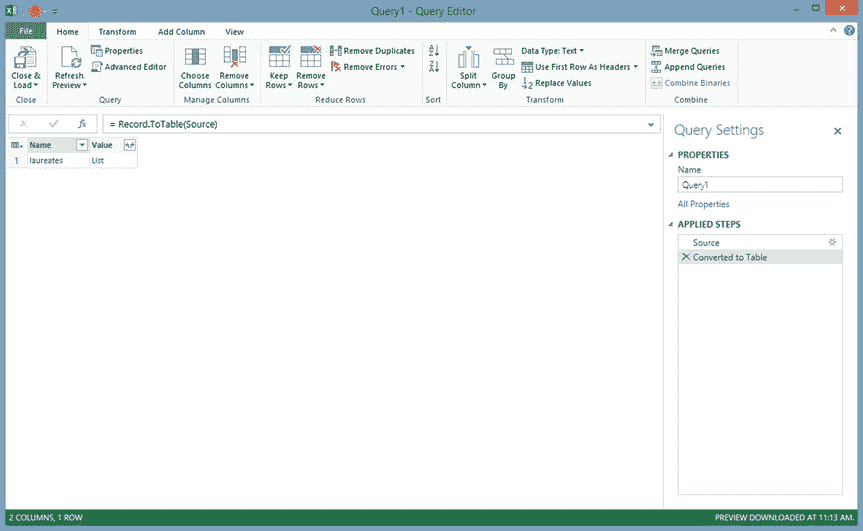
图 8-24. 顶级 JSON 导入

请注意“值”右侧的展开按钮。点击那个展开按钮。结果如图 8-25 所示。

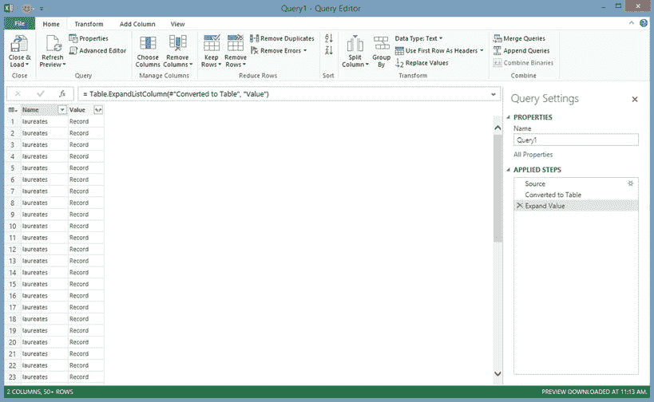
图 8-25. JSON 列列表

再次点击展开按钮。结果如图 8-26 所示。

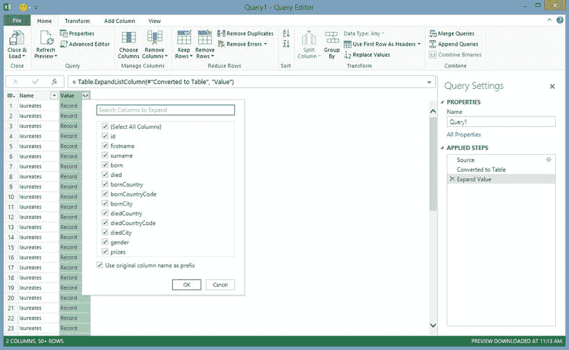
图 8-26. “选择列”对话框

接受默认设置并点击“确定”，得到如图 8-27 所示的结果，该结果显示实际记录，每位诺贝尔奖得主对应一行。

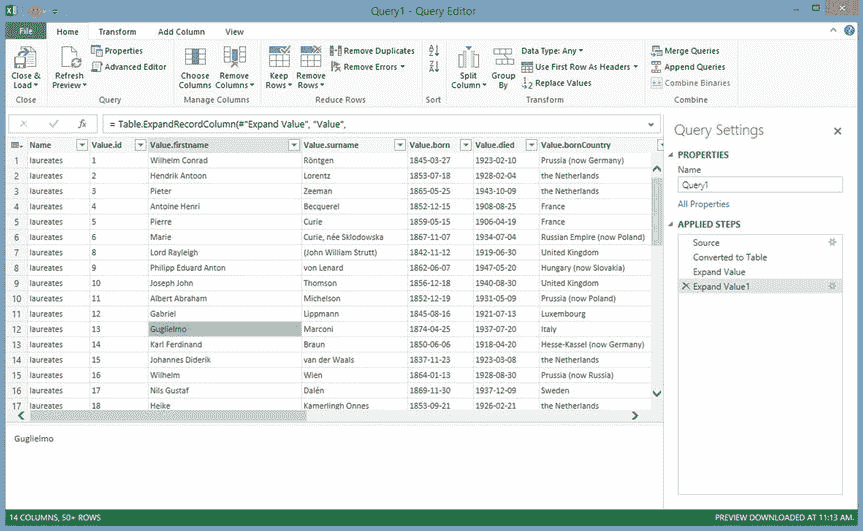
图 8-27. 行和列中的 JSON 数据

一直滚动到右侧以找到另一个展开按钮，如图 8-28 所示。

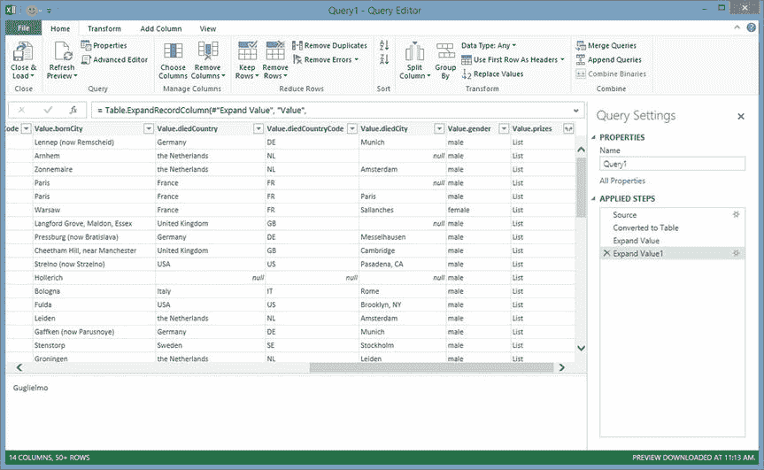
图 8-28. 其他列

点击此展开按钮将为多次获得诺贝尔奖的人生成多行，如图 8-29 所示。

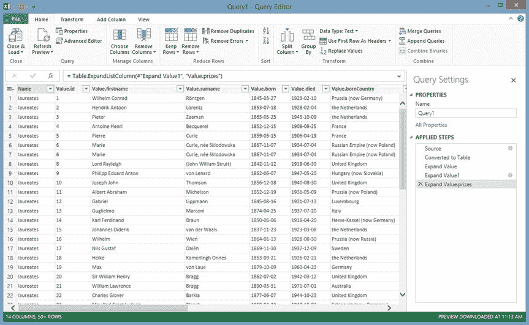
图 8-29. 为多次获得诺贝尔奖的获奖者生成的展开视图（含多行）

向右滚动，再次点击展开按钮，并接受默认设置，如图 8-30 所示，将展开之前未显示的一些字段，例如获奖原因。

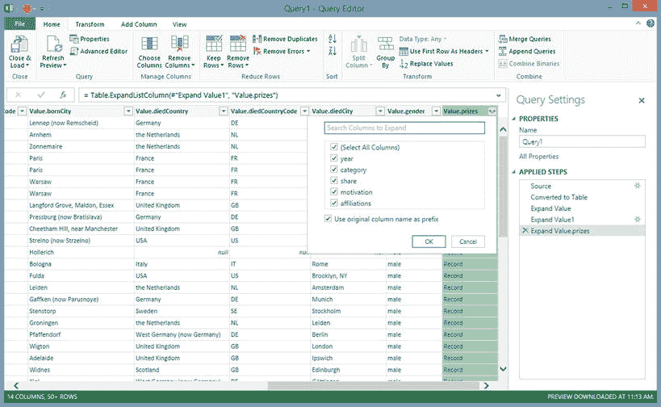
图 8-30. 进一步展开行

结果如图 8-31 所示。

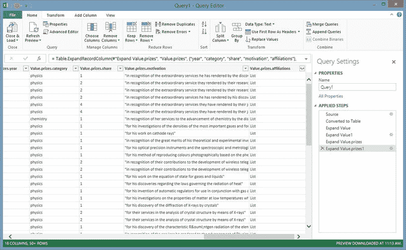
图 8-31. 显示诺贝尔奖原因（动机）的视图

可以决定如何对数据进行分组。例如，要按类别对数据进行分组，请点击类别列的标题以选择所需类别，然后右键单击并选择“分组依据”以查看“分组依据...”对话框，如图 8-32 所示。

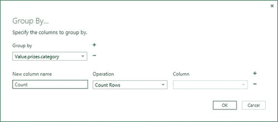
图 8-32. 包含单个字段的“分组依据...”对话框

点击“确定”将显示按类别划分的获奖数量计数，如图 8-33 所示。

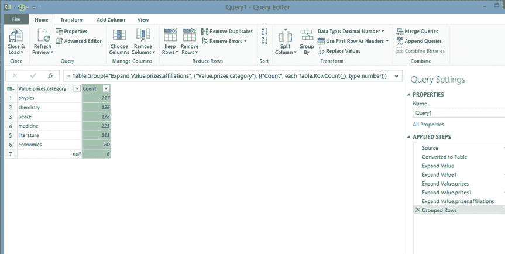
图 8-33. 按类别统计的诺贝尔奖数量

通过点击`Group By...`（分组依据）对话框中的加号来选择第二个字段，即可按两个字段（例如类别和年份）进行分组，如图 8-34 所示。可再次点击屏幕右侧`查询设置`窗格中`应用的步骤`列表底部`分组行`后的齿轮图标，以重新打开`Group By...`对话框。

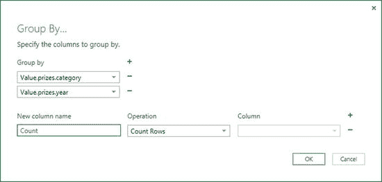
图 8-34. 包含两个字段的`Group By`对话框

结果如图 8-35 所示。

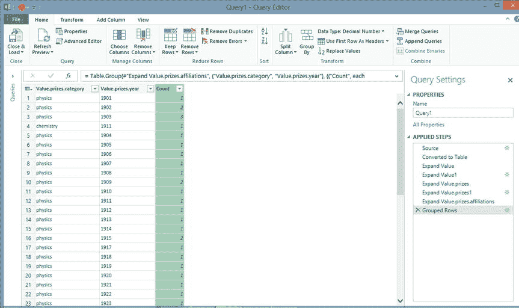
图 8-35. 按类别和年份统计的诺贝尔奖数量

若要添加第三个字段以显示获奖者姓名，请在`Group By...`对话框中再次选择`+`，并添加获奖者的姓氏，如图 8-36 所示。

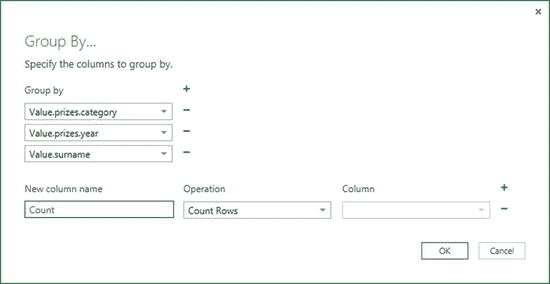
图 8-36. 包含三个字段的`Group By...`对话框

结果如图 8-37 所示。

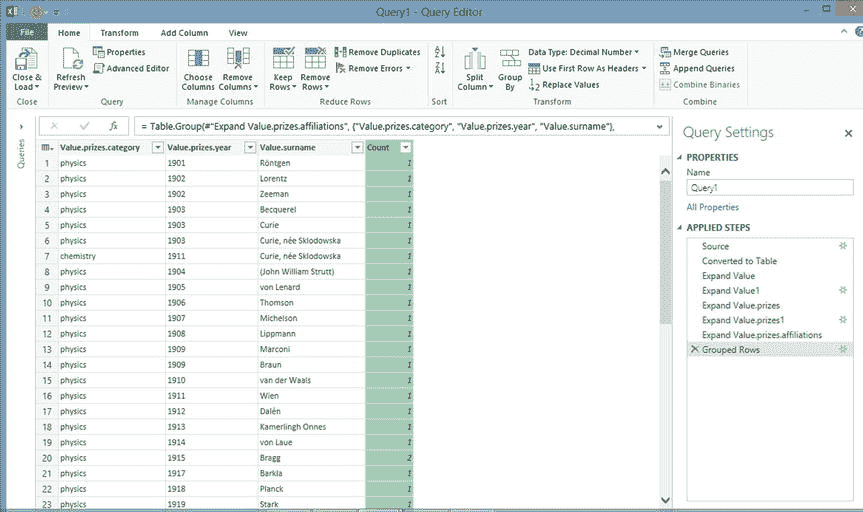
图 8-37. 按类别和年份显示诺贝尔奖及获奖者姓氏

## 小结

本章演示了如何使用 Power Query 从网站导入表格、从文件夹导入多个 CSV 文件以及导入 JSON 数据。这些示例展示了如何使用 Power Query 进行提取、转换和加载数据。后续章节将提供更多使用 Power Query 的示例。