# 7. 使用数据分析表达式 (DAX) 进行计算

本章介绍如何使用数据分析表达式 (DAX) 进行计算，以及如何使用关键绩效指标 (KPI) 衡量绩效。本章将重点介绍一些使用 DAX 和 KPI 的实际示例。

## 理解数据分析表达式

如第 4 章所述，数据分析表达式 (DAX) 是一种公式语言，用于基于 PowerPivot 的表格数据模型创建计算列和计算字段。DAX 公式与常规的、基于单元格的 Excel 公式不同，因为 DAX 公式适用于指定列中的所有行。DAX 公式用于以下两种场景：

**计算列。** 可以向现有的 PowerPivot 表添加计算列。当列包含公式时，将为每一行计算该值。要创建公式，请单击新列中的任意单元格，然后按 Enter 键开始输入基于列引用的公式。可以通过鼠标指向列名或在方括号内输入名称来引用列名。可以通过在列名前输入工作表名称来引用其他工作表中的列。如果工作表名称包含空格，则可以将其括在单引号中。DAX 表达式中最多可以嵌套 64 层函数。

**计算字段（或度量值）。** 它们位于 PowerPivot 窗口底部的计算区域。计算字段通常包含聚合函数，例如 `sum` 或 `average`，这些函数默认引用整个列。DAX 函数与 Excel 函数非常相似，但 DAX 函数是面向列的。可以通过点击 PowerPivot 窗口“`设计`”选项卡上的 `fx` 图标来查看所有可用的 DAX 函数。创建计算字段时，公式前面会带有一个标识符，它类似于变量名，可用于引用该计算字段。

> **警告：** 使用 DAX 时，最好避免为计算字段和计算列使用相同的名称。为了进一步避免歧义，最好在引用列时使用完全限定的列名，其中包含工作表的名称。

### DAX 运算符

DAX 使用以下运算符：

标准算术运算符：

- `+` 加法
- `-` 减法
- `*` 乘法
- `/` 除法
- `^` 乘幂

比较运算符：

- `=` 等于
- `>` 大于
- `<` 小于
- `>=` 大于或等于
- `<=` 小于或等于
- `<>` 不等于

文本连接运算符：

- `&` 连接

以及逻辑运算符：

- `&&` 与
- `||` 或

### 本章使用的关键 DAX 函数摘要

- `SUM`：简单求和，类似于 Excel 中的 SUM
- `SUMX`：逐行迭代以进行计算
- `CALCULATE`：允许基于筛选条件进行计算
- `LEFT`：返回指定文本字符串开头指定数量的字符


## 更新公式结果

有两种方法可以更新公式的结果。

刷新数据涉及更新底层数据源中的数据，例如 SQL Server、MySQL 或 Access。重新计算则是根据公式的变更来更新公式结果。

## 分析销售数据

本章将继续使用第 4 章末尾使用的示例——可从 `Tinyurl.com/PowerPivotSamples` 下载的 Contoso 数据库。请注意，该网址区分大小写。下载数据后，打开 `PowerPivotTutorialSamples` 电子表格。

思考此示例的一种方式是使用星型模型架构，该架构包含一个事实表，表中包含需要聚合的数字，事实表周围环绕着维度表，例如产品和商店。在此示例中，`dboFactSales` 表是事实表，如图 7-1 所示。要创建此示例，请按照以下步骤操作：

在 **PowerPivot** 选项卡上，单击**管理**，然后单击**关系图视图**，以在关系图视图中查看表，如图 7-1 所示。

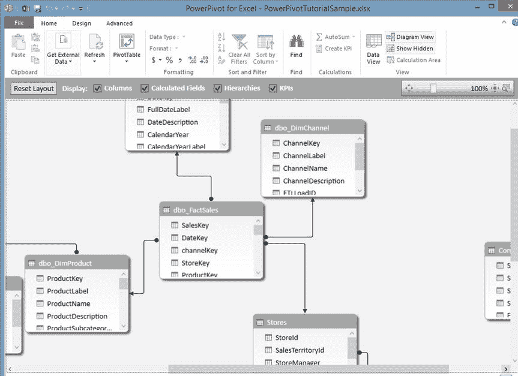

**图 7-1.** 关系图视图

单击**数据视图**，然后单击窗口底部的 `dbo_FactSales` 选项卡以查看 `dbo_FactSales` 表。一直滚动到右侧，注意最后一列 `TotalProfit`，这是一个基于 `TotalSales` 减去 `TotalCost` 的 DAX 计算字段，如图 7-2 所示。单击该列中的任意单元格，即可在功能区下方看到显示的公式。

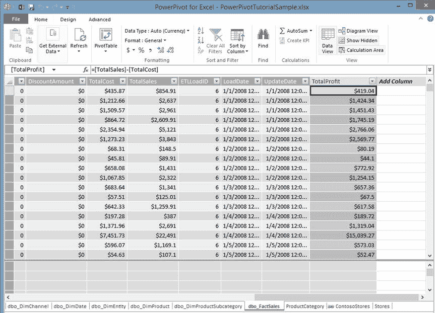

**图 7-2.** 计算列

## 创建度量值或计算字段

本节展示如何基于表中的数据创建度量值或计算字段。

要添加计算字段或度量值，请转到 `TotalProfit` 列底部数据网格下方的第一个单元格并选择该单元格。双击选项卡上的**自动求和**图标以获得总和。如果数据底部的计算区域或度量值网格不可见，请单击选项卡右端的**计算区域**图标。

接下来，选择刚创建的总和单元格下方的单元格，单击**自动求和**图标后的向下箭头，然后从下拉菜单中选择**平均值**，如图 7-3 所示。可能需要展开列才能看到总计。方法是单击分隔列标题的栏，当出现双箭头时，向右拖动。请注意，系统会创建一个标识符 `“Sum of Total Profits”` 和 `“Average of Total Profits”`。此标识符既用作标签，也用作引用计算字段的变量名。

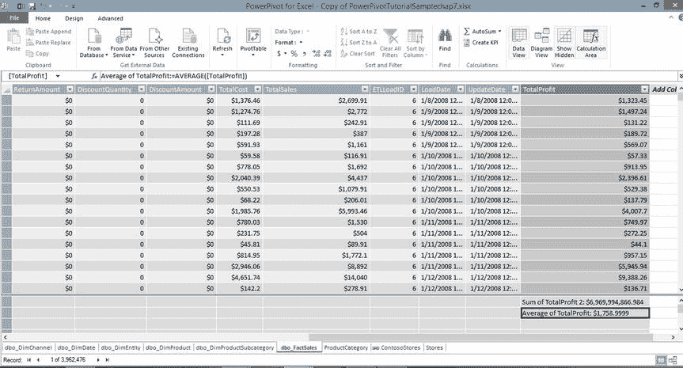

**图 7-3.** 计算字段

对 `Total Sales` 列执行相同步骤，添加总和和平均值，如图 7-4 所示。

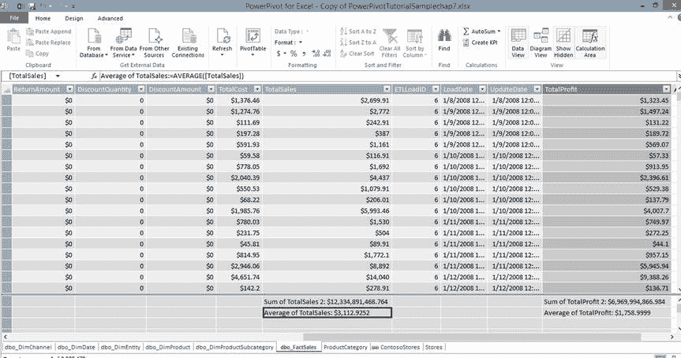

**图 7-4.** 附加计算字段

## 分析盈利能力

此示例将展示如何插入新列以分析每笔交易的盈利能力。

通过单击最右侧名为“添加列”的列中的任意位置并按“=”，添加计算列来计算盈利能力（即利润除以销售额）。然后，单击 `TotalProfit` 列，按 `/`，再单击 `TotalSales` 列以定义公式，然后按 **Enter**。结果如图 7-5 所示。

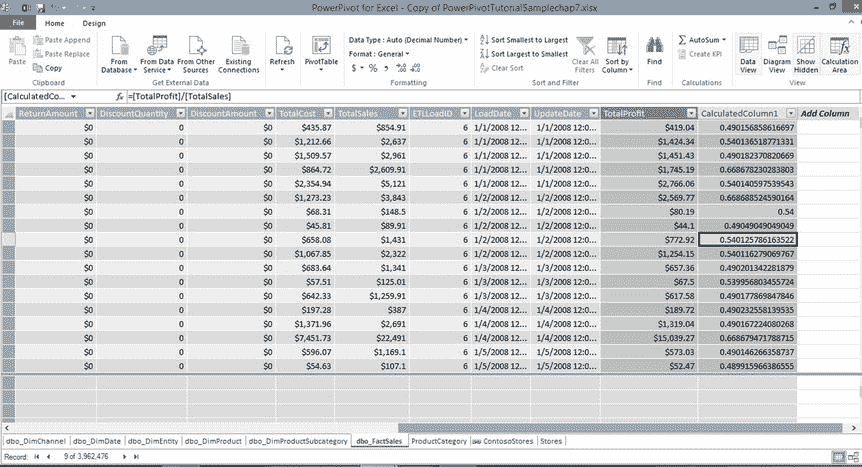

**图 7-5.** 利润/销售额的计算字段

要将列格式设置为显示百分比，请选择新列，然后在**开始**选项卡上单击**格式**后的向下箭头，选择**百分比**。结果如图 7-6 所示。

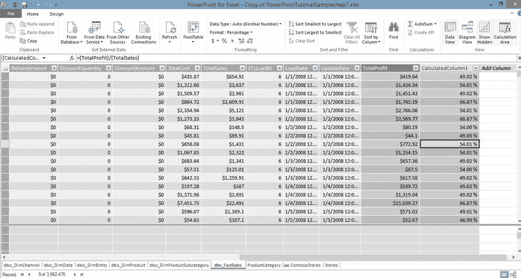

**图 7-6.** 格式化为百分比

要重命名列，请右键单击列标题，选择**重命名列**，然后输入 `Profit/Sales`，如图 7-7 所示。

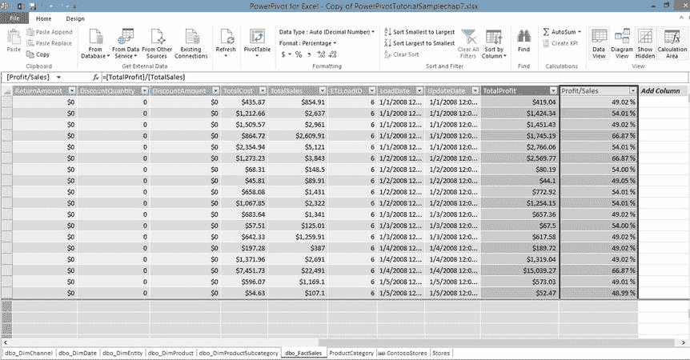

**图 7-7.** 重命名计算列

要创建一个计算字段，用于计算所有利润/销售额的平均值，请转到数据区域下方的计算区域。选择 `Profit/Sales` 列底部的单元格，然后单击功能区上**自动求和**图标后的向下箭头，选择**平均值**。将创建一个计算字段，如图 7-8 所示。根据需要展开列以显示完整值。

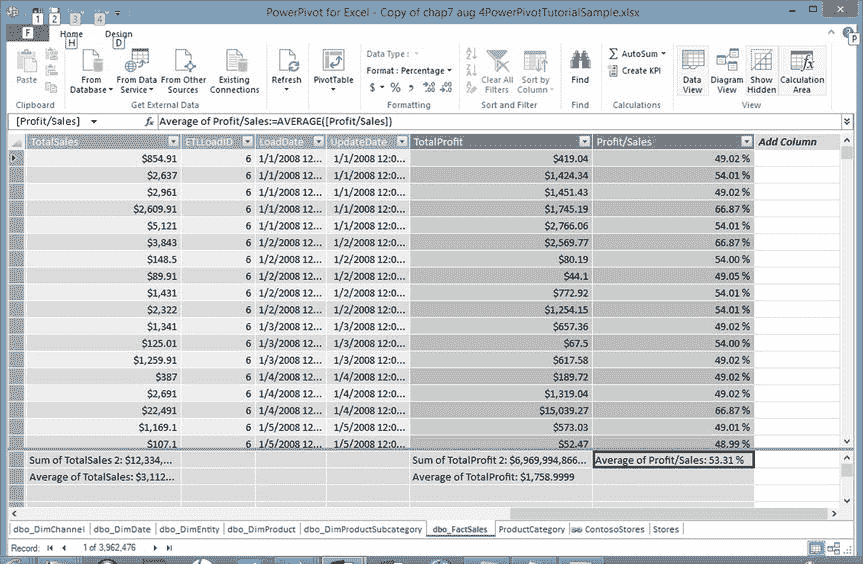

**图 7-8.** 利润/销售额的平均值

要为最小和最大利润/销售额添加计算字段，请选择计算区域中平均值下方的单元格。单击功能区上**自动求和**后的箭头，选择**最大值**，然后重复并选择**最小值**。将创建平均值、最小值和最大值计算字段，如图 7-9 所示。

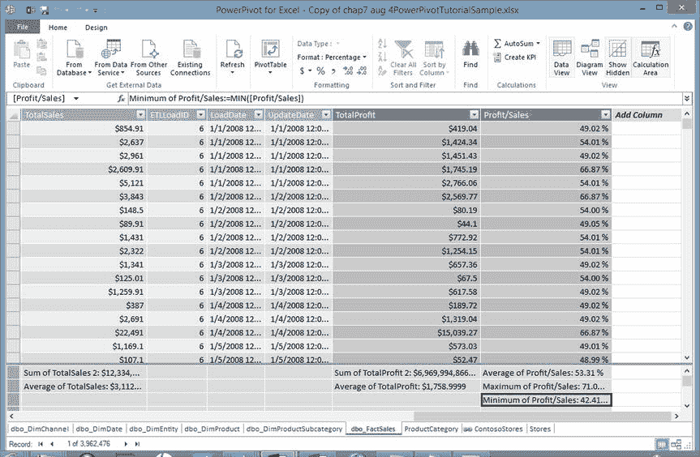

**图 7-9.** 为最小和最大利润/销售额添加计算字段

## 使用 SUMX 函数

`SUM` 函数可用于对单个列求和。相比之下，`SUMX` 会遍历每一列并执行计算。因此，例如，`SUMX` 可用于对每一行的价格乘以数量的乘积求和。为此，请按照以下步骤操作：

选择计算区域第一列中的下一个单元格。输入以下公式来测试 `SUMX`，并将其格式设置为货币，如图 7-10 所示：

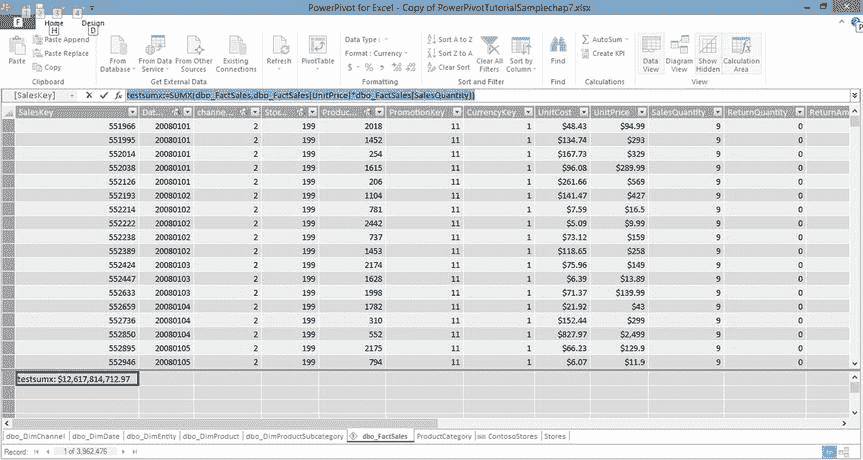

**图 7-10.** 使用 `SUMX` 函数

```
testsumx:=SUMX(dbo_FactSales,dbo_FactSales[UnitPrice]*dbo_FactSales[SalesQuantity])
```

## 使用 CALCULATE 函数

`CALCULATE()` 函数用于基于筛选器计算表达式。以下示例计算通过商店渠道的总销售额。请按照以下步骤操作：

选择**计算**区域中最左上角的单元格。输入公式，如图 7-11 所示。DAX 公式为：

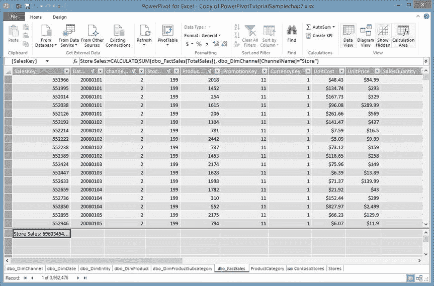

**图 7-11.** 使用 `CALCULATE` 函数显示商店总销售额

```
StoreSales:=CALCULATE(SUM(dbo_FactSales[TotalSales]), dbo_DimChannel[ChannelName]="Store")
```

请注意，公式以标签开头，后跟冒号。`StoreSales` 既是此计算字段的标签也是标识符。然后，`CALCULATE` 将对 `dbo_FactSales` 表中的 `TotalSales` 字段（其中渠道名称等于商店）进行求和。在输入函数名称或字段名称时，IntelliSense 会弹出一个列表，列出它认为您要输入的内容。突出显示所需值，然后按 **Tab** 键进行选择。

注意，总销售额数字未设置格式。可以通过选择该字段，单击功能区上**格式**图标后的向下箭头，选择**货币**来纠正此问题。该列也需要展开，可以通过单击列标题之间的栏并拖动来实现。结果如图 7-12 所示。

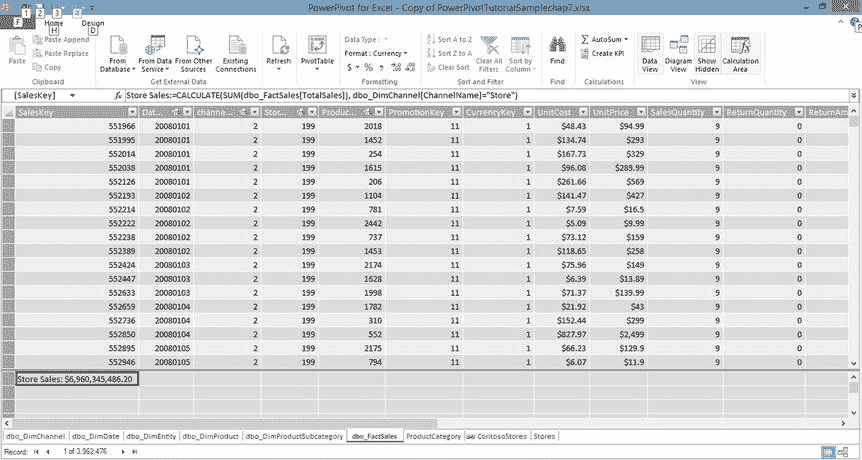

**图 7-12.** 格式化为货币


## 计算 2009 年门店销售额

计算字段可以基于其他计算字段。2009 年的门店销售额可以基于 `StoreSales` 计算字段的总数来计算。请按以下步骤操作：

在最左侧计算区域中选择下一个单元格。输入以下公式：

`StoreSales2009:=CALCULATE([StoreSales],LEFT(dbo_DimDate[Datekey],4)="2009")`

`LEFT` 函数用于从 `Datekey` 文本字符串中提取年份。结果如图 7-13 所示。

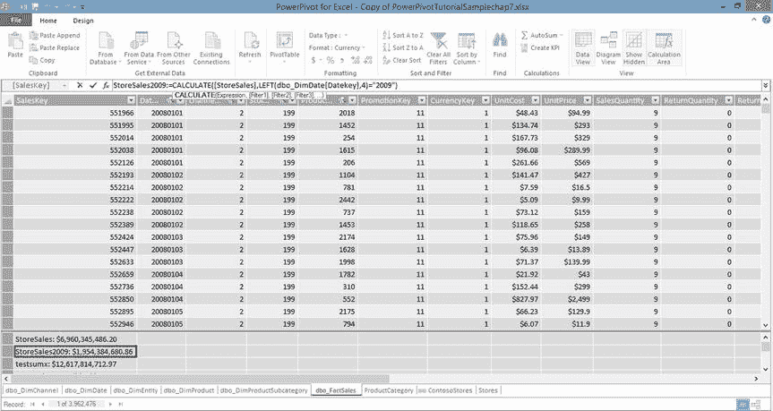

图 7-13. 计算 2009 年门店销售额

接下来，通过在下方单元格中输入以下 DAX 公式，为前一年（2008 年）的门店销售额创建计算字段，如图 7-14 所示。

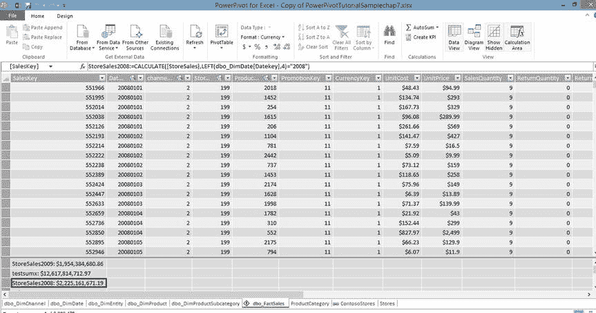

图 7-14. 计算 2008 年门店销售额

`StoreSales2008:=CALCULATE([StoreSales],LEFT(dbo_DimDate[Datekey],4)="2008")`

接下来，可以通过输入以下公式计算同比增长率，并将格式更改为百分比，如图 7-15 所示。计算字段的标识符必须括在方括号中。请注意，2009 年的销售额下降了 12%。

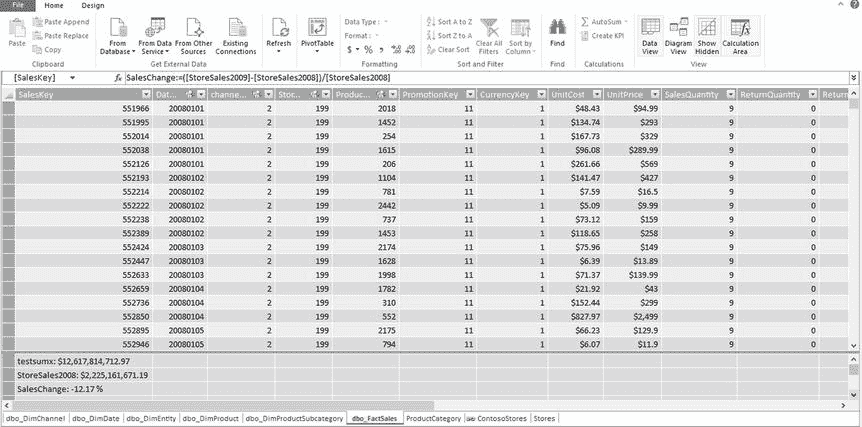

图 7-15. 计算年度或年度销售额变化

`SalesChange:=([StoreSales2009]-[StoreSales2008])/[StoreSales2008]`

## 创建盈利能力的 KPI

KPI（关键绩效指标）基于计算字段与值之间的关系。通过执行以下步骤为盈利能力创建 KPI：

创建一个利润/销售额平均值的计算字段，如图 7-16 所示，输入以下公式：

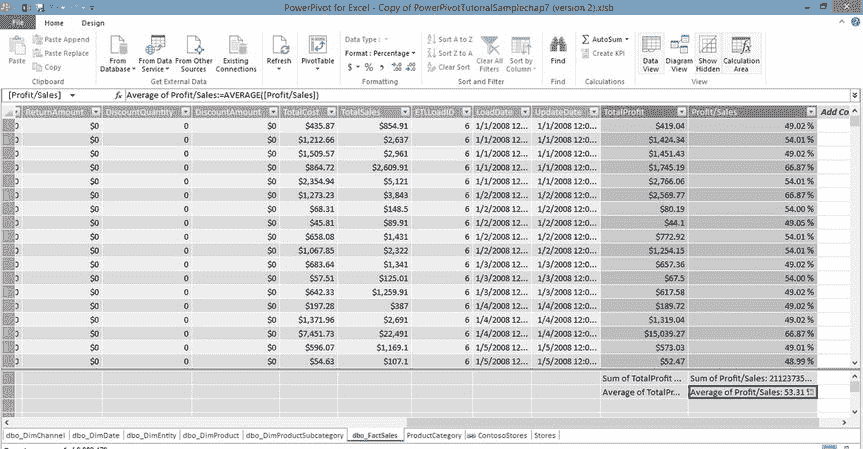

图 7-16. 创建利润/销售额平均值的计算字段

`Average of Profit/Sales:=AVERAGE([Profit/Sales])`

右键单击该计算字段，选择“创建 KPI”。输入绝对值 0.53（即 53%），调整滑块以使达到目标的值显示为绿色，如图 7-17 所示，然后单击“确定”。

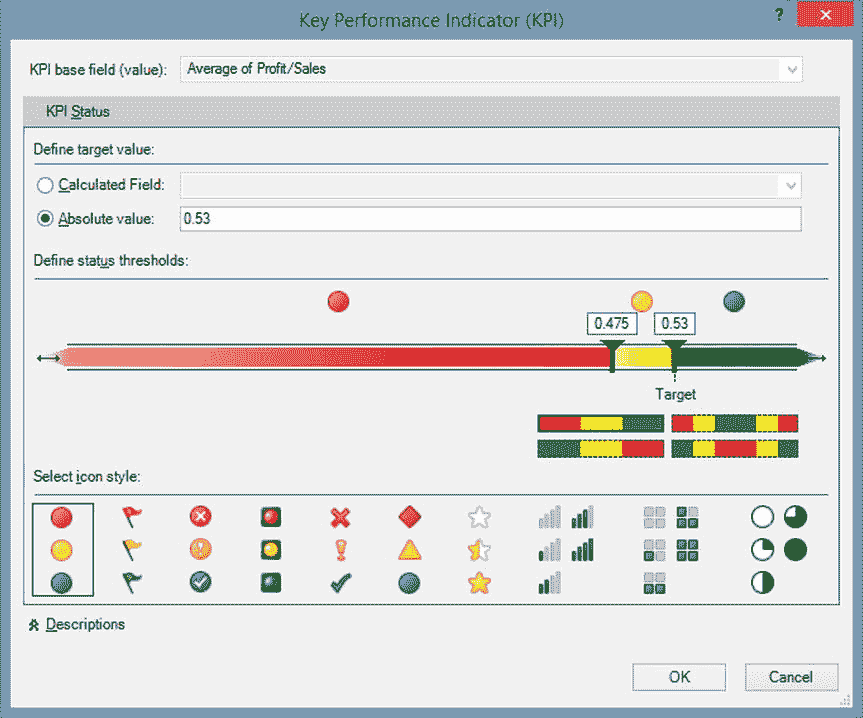

图 7-17. 定义 KPI

## 创建按产品线显示盈利能力的数据透视表

要创建按产品线显示盈利能力的数据透视表，请按以下步骤操作：

1. 选择 `dbo_FactSales` 选项卡。
2. 单击功能区上的“数据透视表”图标，然后选择“数据透视表”。
3. 在“创建数据透视表”对话框中选择“新建工作表”，然后单击“确定”。
4. 在“产品类别”表中选择“产品类别名称”字段。该字段将显示在屏幕右侧数据透视表窗格的“行”框中，如图 7-18 所示。

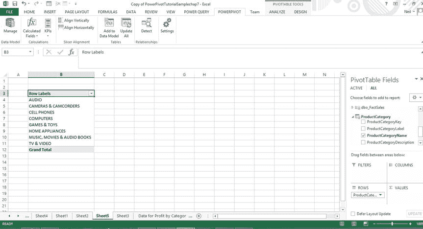

图 7-18. 将产品类别名称插入数据透视表

接下来，选择 `dbo_FactSales` 表中的“销售数量”字段以及位于字段列表底部的 `Average of Profit/Sales` 计算字段。单击该计算字段名称，然后选择“值”、“目标”和“状态”。该字段将显示在“值”框中，并创建一个数据透视表，如图 7-19 所示。

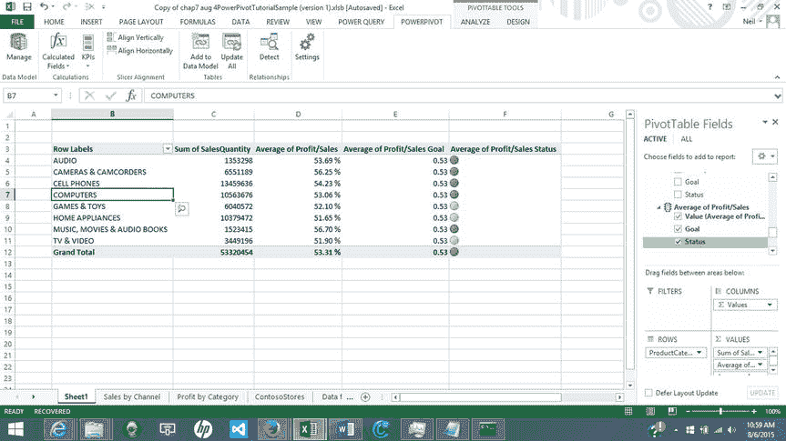

图 7-19. 将 KPI 添加到数据透视表

## 总结

本章介绍了如何使用 DAX 公式语言创建计算字段和计算列，以及如何创建关键绩效指标来监控业务活动。与引用特定单元格的 Excel 公式不同，DAX 公式引用的是列，但可以使用 `CALCULATE()` 函数基于筛选条件计算表达式。

