# 9. Power Map

Power Map 是一个强大的可视化工具，它利用必应地图技术，通过在三维地球仪上绘制基于 Excel 的地理空间数据，创建二维和三维可视化效果。本章将演示如何使用 Power Query 导入数据，然后使用 Power Map 进行绘制。

## 安装 Power Map

可以通过 Excel `插入`选项卡上的图标访问 Power Map。如果该图标未显示，则可能意味着您未安装当前版本的 Power Map。如果是这种情况，请搜索“下载 Power Map”，并从 Microsoft 下载最新版本。然后，按照以下步骤启用 Power Map：

1.  单击`文件`选项卡以进入 Backstage 视图。
2.  单击左侧窗格底部的`选项`。
3.  在左侧窗格中选择`加载项`。
4.  在窗口底部，下拉`管理`后的箭头，选择`COM 加载项`，然后单击`转到`。
5.  勾选`Microsoft Office PowerPivot for Excel 2013`、`Microsoft Power Map for Excel`和`Power View`，然后单击`确定`。

## 绘制地图

绘制地图的步骤包括：

1.  打开数据源，该数据源可以是包含地理描述符（如城市和州或地理坐标）的电子表格或数据模型。
2.  选择`插入`选项卡，单击`地图`，再单击`加载 Power Map`。
3.  在屏幕右侧的`字段`列表窗格中，选择要映射到的地理字段（例如城市和州或地理坐标），然后选择一个数据指标（例如人口）。Power Map 会调用必应地图服务来定位地图上的地理位置，然后绘制指标值。
4.  默认情况下，会显示柱形图。可以通过单击相应的图标将其更改为气泡图或热力图。

Power Map 视频导览是一种通过链接单个地图来讲述数据故事的动画。可以根据数据创建视频来讲述故事。一个视频是导览的集合，而一个导览是场景的集合。

## Power Map 功能区重要选项

本节重点介绍 Power Map 功能区中的一些重要选项，如图 9-1 所示。

-   **导览部分**
    -   `播放导览`：播放已创建的导览。
    -   `添加场景`：向导览添加一个场景。
    -   `创建视频`：从导览创建视频。
-   **地图部分**
    -   `主题`：更改地图样式。
    -   `地图标签`：添加国家或城市名称。
    -   `平面地图`：在二维和三维视图之间切换。
-   **图层部分**
    -   `添加图层`：添加新图层。
    -   `刷新数据`：从源刷新数据。
    -   `形状`：选择条形图的形状。
-   **插入部分**
    -   `二维图表`：添加二维图表。
    -   `文本框`：在地图上添加文本框。
    -   `图例`：在地图上添加图例。
-   **时间部分**
    -   `时间线`：在时间动画中显示或隐藏时间线。
    -   `日期和时间`：在时间动画中显示或添加日期和时间。
-   **视图部分**
    -   `导览编辑器`：显示或隐藏`导览编辑器`窗格（屏幕左侧）。
    -   `图层窗格`：显示或隐藏`图层窗格`（屏幕右侧）。

**图 9-1.** Power Map 功能区

## 故障排除

Power Map 对数据类型要求非常严格。如果您希望绘制的数值数据未被当作数值型数据处理（表现为仅显示计数聚合），或者时间数据未被识别，请按以下步骤操作：

检查列中是否存在无关的字符串数据，并删除包含字符串数据的行。确保数值数据列格式化为数字，日期列格式化为日期。更改格式后，单击 Power Map 功能区上的 `Refresh Data`。

## 练习 9-1：绘制加利福尼亚州犯罪统计数据示例

本示例演示如何使用 Power Query 按城市导入加利福尼亚州犯罪统计数据，以及如何使用 Power Map 绘制这些数据。

进入 Power Query，在数据目录中搜索 `“California Cities by Population and Crime Rate.”`。将鼠标悬停在 `“Cities—California locations by crime rate”` 上，选择 `Edit` 以加载到查询编辑器中。将出现如图 9-2 所示的屏幕。

**图 9-2.** 查询编辑器中的犯罪统计数据

在查询编辑器中，单击 `Add Column` 选项卡。在该选项卡的左端，单击 `Add Custom Column`。为州创建一个新列。设置内容为 `="CA"`，如图 9-3 所示。

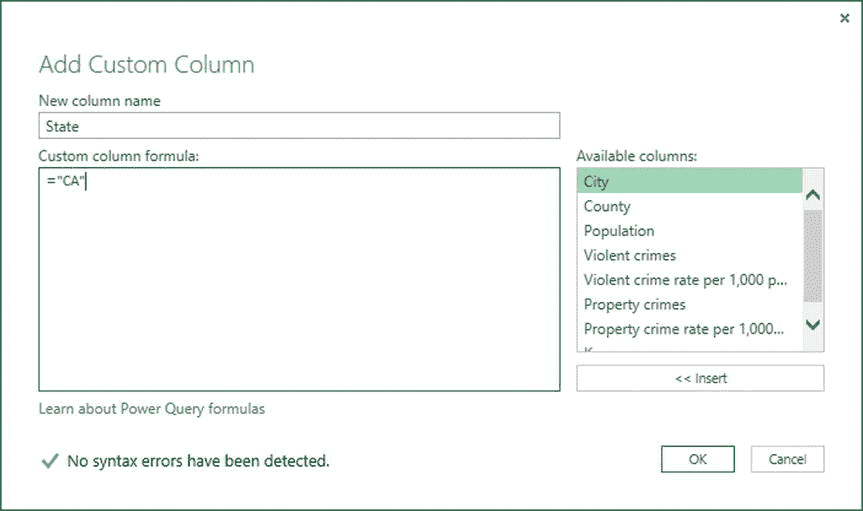

**图 9-3.** 添加“州”列

通过右键单击列标题，选择 `Change Type`，然后选择 `Decimal Number`，检查所有数值列的数据类型是否为十进制数。同时，检查数值列中是否没有非数值数据。当数据满足要求后，单击功能区上的 `Close & Load`，将其加载到电子表格中。电子表格应如图 9-4 所示。

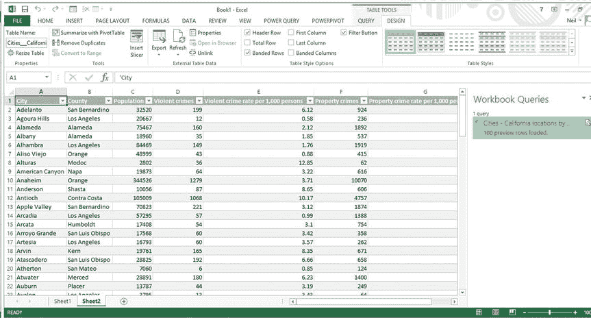

**图 9-4.** 犯罪数据加载到电子表格中

再次检查数字字段中是否存在可能导致 Power Map 无法正确解释内容的非数值数据。由于并非所有行都在查询编辑器中显示，对于较大的数据集，这需要在将数据加载到 Excel 后进行检查。如图 9-5 所示，数据的最后一行可能包含省略号。如果是这种情况，请右键单击该行并选择 `Delete Table Row` 来删除最后一行。

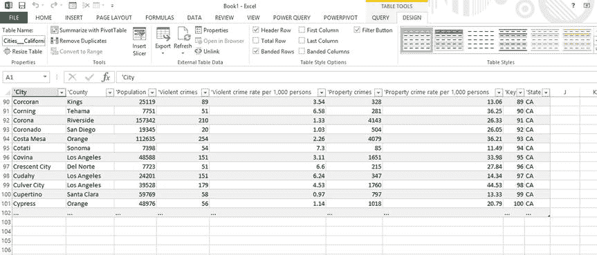

**图 9-5.** 需要删除的包含省略号的最后一行

通过高亮列（单击列顶部的字母）来检查每列的格式。右键单击选中的列，从上下文菜单中选择 `Format Cells`。对于人口、暴力犯罪和财产犯罪列，将格式设置为 `Number`，小数点后保留 0 位，如图 9-6 所示。对于每千人的暴力犯罪和财产犯罪列，将格式设置为 `Number`，小数点后保留 2 位。

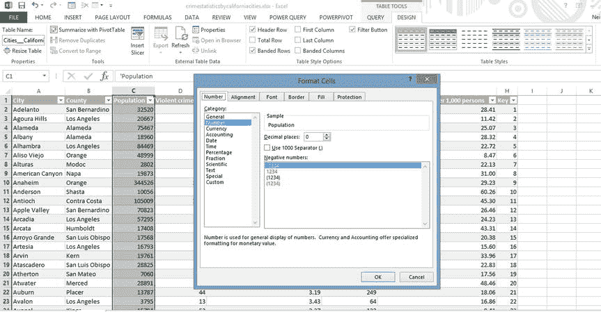

**图 9-6.** 将列格式化为数字

单击 `Insert` 选项卡，然后在 `Map` 下选择 `Launch Power Map`。如果您之前创建过地图，系统可能会提示您创建 `New Tour`。接受默认的地理字段 `City`、`County` 和 `State`，如图 9-7 所示。单击 `Next`。

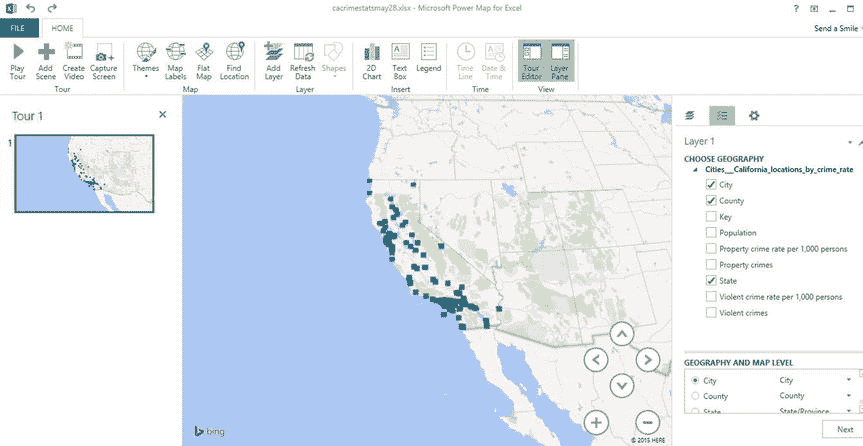

**图 9-7.** 设置地理字段

单击功能区上的 `Map Labels` 以显示城市名称。在“图层”窗格中，右键单击 `Property Crimes per 1,000 persons`，然后单击 `Add to Height`，如图 9-8 所示。请注意，Bing 地图服务在右上角显示地理映射的置信度为 94%。如果您想返回并编辑地理字段，请单击 94% 上方的图标。

**图 9-8.** 设置绘图高度字段

单击图例框并将其调整为更小，然后将其拖到地图的左上角。多次单击地图右下角的 `+` 号以放大。结果如图 9-9 所示。请注意，您可以将鼠标指向任何图形，以查看该城市犯罪率的详细信息。也可以双击任何位置进行放大。

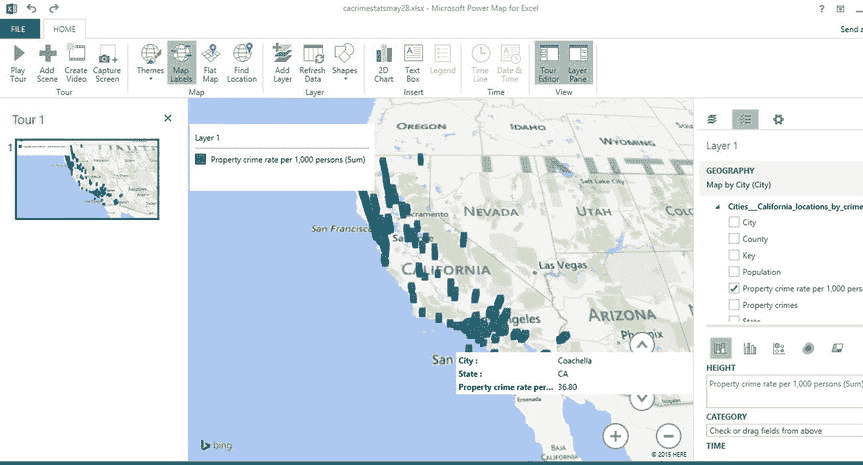

**图 9-9.** 带有图例和详细犯罪统计数据的地图

## 绘制多项统计数据

可以绘制多项指标——财产犯罪和暴力犯罪统计数据。为此，我们继续上一节中的示例。

### 练习 9-2：绘制加利福尼亚州犯罪统计数据（第二部分）

您可以按照以下步骤绘制财产犯罪和暴力犯罪统计数据：

在“图层”窗格中，右键单击 `Property crime rate per 1,000 persons` 并选择 `Add to Height`，如图 9-10 所示。

**图 9-10.** 添加暴力犯罪指标

请注意，默认视图是堆叠柱状图。可以通过单击堆叠柱状图右侧的图标将其更改为簇状柱状图，如图 9-11 所示。财产犯罪率以蓝色显示，暴力犯罪率以橙色显示。

**图 9-11.** 同时显示财产犯罪率和暴力犯罪率指标

单击功能区左端的 `Add Scene`。单击功能区上的 `Text Box` 图标，添加标题 `“California Cities Crime Rates,”`，如图 9-12 所示。

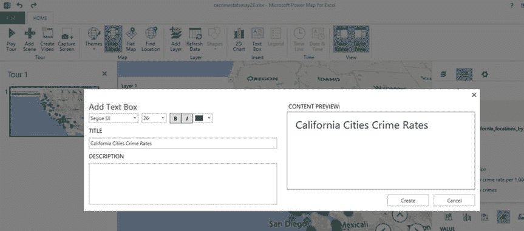

**图 9-12.** 为地图添加标题

将视图更改为气泡视图，它类似于饼图。可以调整文本框的大小并将其拖到地图上的适当位置，如图 9-13 所示。

**图 9-13.** 数据的气泡视图

可以通过单击“图层”窗格右上角的齿轮图标，选择 `Layer Options`，然后调整大小滑块来调整气泡的大小，如图 9-14 所示。

**图 9-14.** 调整气泡大小

单击功能区左端的 `Add Scene`。另一种视图是热力图视图，如图 9-15 所示。请注意，加利福尼亚州最大的两个城市旧金山和洛杉矶的犯罪率最高。

**图 9-15.** 数据的热力图视图

### 添加 2D 图表

可以通过单击功能区上的`2D Chart`为每千人财产犯罪率添加二维图表。结果如图 9-16 所示。

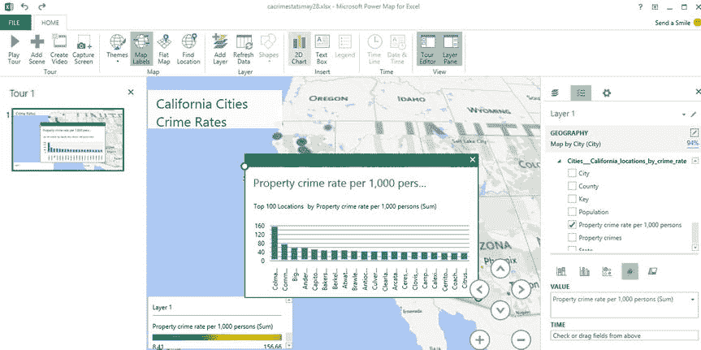

图 9-16.

#### 2D 图表练习 9-3：绘制欧洲失业率示例

本示例将展示如何将欧洲失业率数据加载到 Power Query 中，以及如何使用 Power Map 进行绘制。还将展示如何取消数据透视以添加时间动画。请按照以下步骤操作：

单击`Power Query`选项卡，然后选择`Data Catalog Search`。在搜索框中输入“European Unemployment”。将鼠标悬停在各结果上方以预览数据，如图 9-17 所示。

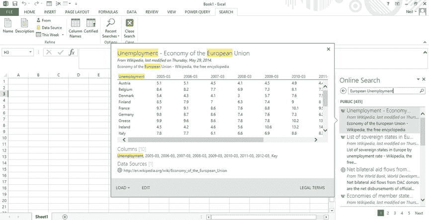

图 9-17.

欧洲失业数据预览

在预览屏幕底部选择`Edit`，将数据加载到查询编辑器中，如图 9-18 所示。

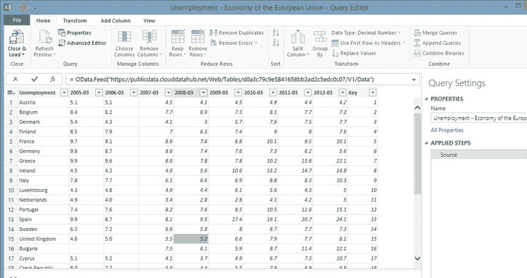

图 9-18.

查询编辑器中的失业数据

检查数据的形状，查看是否存在多余的列。在此例中，列包含国家名称、按年份划分的失业率以及一个使用顺序编号的键列。同时检查行。注意，数据中包含了美国、日本及欧洲的失业率行。

另外，检查每一列的数据类型是否正确。要检查数据类型，请单击列标题选中该列，并注意功能区右上部分显示的数据类型。要更改数据类型，请选中一列，单击功能区上`Data Type`后的箭头，然后选择正确的数据类型。注意，2005 年和 2006 年的数据类型是文本，而其他年份的数据类型是`Decimal Number`。使用此方法将所有数值列的类型更改为`Decimal Number`。

检查列标题。注意，包含国家名称的列的标题是`Unemployment`，这不够描述性。要更改列名，请右键单击该列标题并选择`Rename`。将其重命名为`country`，如图 9-19 所示。注意，列的重命名操作会列在屏幕右侧`Query Settings`窗格的`Applied Steps`下。

图 9-19.

重命名国家列后的查询编辑器

当数据形状达到要求后，在查询编辑器功能区最左侧选择`Close & Load`，将数据加载到电子表格中。请注意，数据也可以加载到数据模型中，但本示例将使用电子表格。

此时建议保存电子表格并将其命名为“European Unemployment”。

若要开始绘制地图，请选择`Insert`选项卡和`Map`，然后选择`Launch Power Map`。

将出现如图 9-20 所示的屏幕。请注意，在屏幕右侧的`Layer`窗格中，`country`已被选为地理字段。单击`Next`。

图 9-20.

选择国家作为地理字段

请注意，每个有数据的国家都出现了圆点。单击功能区上的`Map Labels`以显示国家名称，并选择将要绘制的数值字段。在此例中，将勾选 2012 年失业率以便绘制，如图 9-21 所示。请注意，勾选该字段后，它会被添加到`Height`框中。默认格式为堆积柱状图，默认的数值聚合方式为求和。将鼠标指向地图上的柱状图将显示该国家 2012 年的失业率。

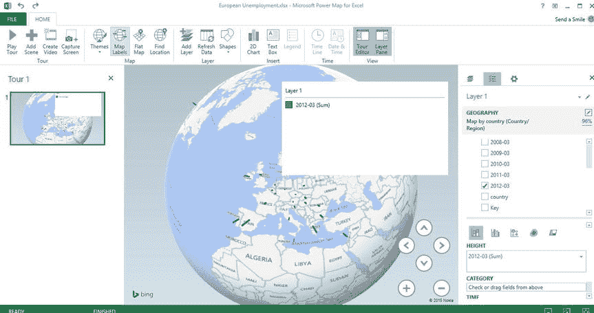

图 9-21.

以柱状图显示的 2012 年失业率

通过单击`Height`框右侧的箭头并选择`No Aggregation`，将聚合方式更改为无。通过单击图例框并使用手柄调整其大小，然后将其拖拽重新定位到地图左侧，如图 9-22 所示。

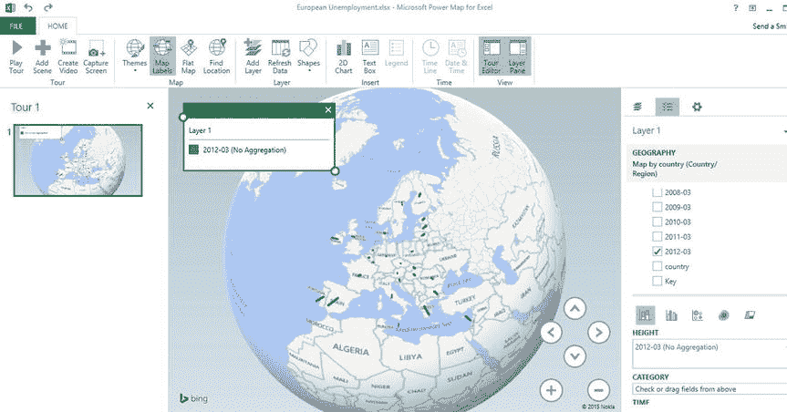

图 9-22.

移动图例框并将聚合更改为无后的地图

通过单击`Layer`窗格中`Height`字样上方的图标，尝试不同的可视化格式，以查看聚类柱状图、气泡图、热力图和区域图。注意，由于仅显示一组数据，聚类柱状图和堆积柱状图格式相同。气泡图视图如图 9-23 所示。

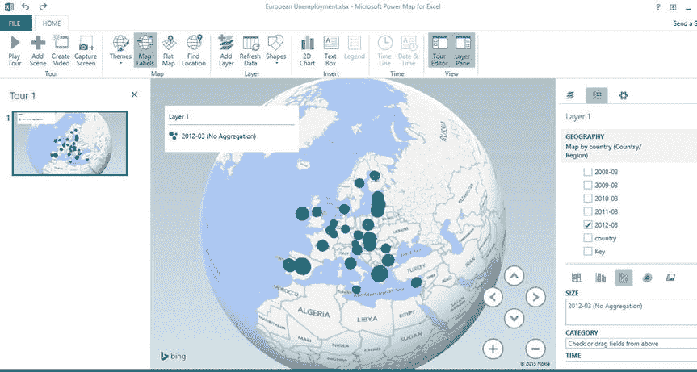

图 9-23.

气泡图视图

要放大地图，请单击地图右下角的大`+`号，或双击地图上的某个区域进行放大。

要更改气泡的不透明度、大小或厚度，请单击`Layer`窗格右上角的齿轮图标。图 9-24 显示了一个热力图视图，其中颜色比例设置为 180%，热力图半径设置为 191%，不透明度设置为 99%。`Layer 1`的图例框显示了基于失业率的颜色对应关系。请注意，您还可以通过勾选或取消勾选复选框来决定是否显示零值、负值和空值。

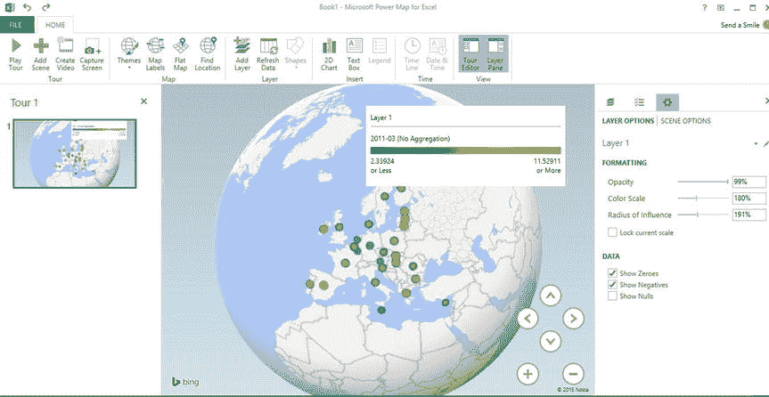

图 9-24.

热力图视图

### 显示两个或多个值

可以显示两个或多个值，例如显示两个不同年份的失业率。使用上一节的示例，图 9-25 以气泡图形式显示了 2011 年（橙色）和 2012 年（蓝色）的失业率。将鼠标指向气泡上的颜色将显示该年份的失业率。

图 9-25.

气泡图视图

图 9-26 以堆积柱状图形式显示了 2010 年（橙色）和 2011 年（蓝色）的失业率。将鼠标指向堆积柱状图上的颜色将显示该年份的失业率。

图 9-26.

堆积柱状图视图

使用聚类柱状图（柱状图并排排列）显示的相同数据如图 9-27 所示。

图 9-27.

聚类柱状图视图

### 创建二维图表

通过选中一系列年份，然后单击功能区上的 `2D Chart`，可以绘制一张二维图表来显示随时间推移的变化趋势。结果如图 9-28 所示。将鼠标悬停在二维图表上，会在标题后面弹出一个带有向下箭头的方框，通过它可以更改图表类型。

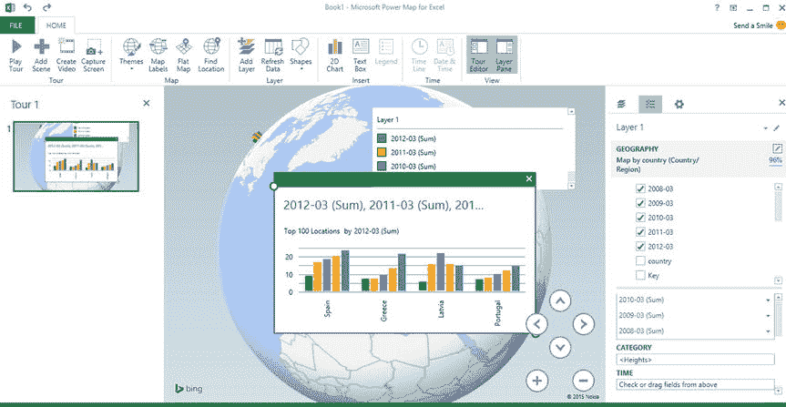

图 9-28.

### 二维图表 练习 9-4. 创建时间动画

可以对演示文稿进行动画设置，以显示不同时间点的地图数值。为此，需要将数据逆透视，以指示每个国家每年显示一个数值。若要从头开始，请返回“练习 9-3. 绘制欧洲失业率示例”开头的步骤 1–3，将数据加载到查询编辑器中，或者单击 PowerPivot 选项卡上的 `Recent Sources`，然后选择其中的数据。

在查询编辑器中，单击第一个年份列的标题以选中该列。然后按住 `Ctrl` 键并单击其他年份列标题以选中所有年份列，或者在选择第一个年份列后，按住 `Shift` 键并单击最后一个年份列以选中所有年份列。右键单击其中一个选中的列标题，然后选择 `Unpivot Columns`，如图 9-29 所示。

图 9-29.

显示 `Unpivot Columns` 选项的上下文菜单

结果如图 9-30 所示。已为每个国家和年份创建了一行数据。

图 9-30.

逆透视后的数据

请注意，包含年份的列被标记为 `Attribute`，这描述性不强。右键单击该列标题并选择 `Rename`，将其名称更改为 `year`。确保只选中 `Attribute` 列。然后，通过选中该列并单击功能区右上角 `Data Type` 旁边的向下箭头，选择 `date`，将数据类型更改为日期。将失业率列的名称更改为 `country`，将数值列的名称更改为 `unemployment`，并将该列的类型更改为小数。将失业率列的类型更改为小数后，所有数据将右对齐。数据应如图 9-31 所示。请注意，屏幕右侧的“查询设置”窗格中显示了 `Applied Steps`。

图 9-31.

重命名列后的电子表格

选择 `Close & Load` 以保存到电子表格。

此时，检查各列中是否存在任何无关的数据类型非常重要。例如，如果日期列包含非日期值，则映射将不正确。最好的检查方法是，通过下拉每个数值列和日期列顶部的箭头，分别按从低到高和从高到低的顺序对列进行排序。此过程可能会发现一行仅包含点号的情况，如图 9-32 所示。如果是这种情况，请通过高亮选中该行，右键单击，然后选择 `delete` 和 `table rows` 来删除此行。

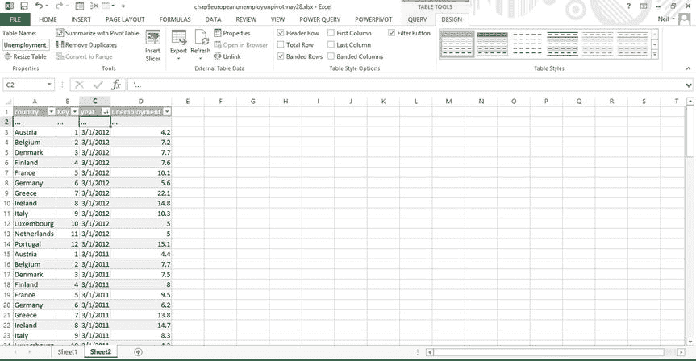

图 9-32.

顶部包含省略号的无关行

通过选中年份列并右键单击，检查其格式，确保选择的是日期格式，如图 9-33 所示。

图 9-33.

对年份列应用日期格式

此外，检查失业率列的格式，确保其采用保留两位小数的数字格式，如图 9-34 所示。

图 9-34.

对失业率列应用数字格式

然后选择 `Insert` 选项卡，单击 `Map` 和 `Launch Power Map`。

单击功能区上的 `Refresh Data` 图标。这对于应用格式更改非常重要。

通过单击 `Next` 确认 `country` 是地理字段，如图 9-35 所示。

图 9-35.

定义地理字段

单击功能区上的 `Map Labels`，然后单击 `unemployment` 字段以选择要绘制的指标，并将图例框拖到左侧，如图 9-36 所示。

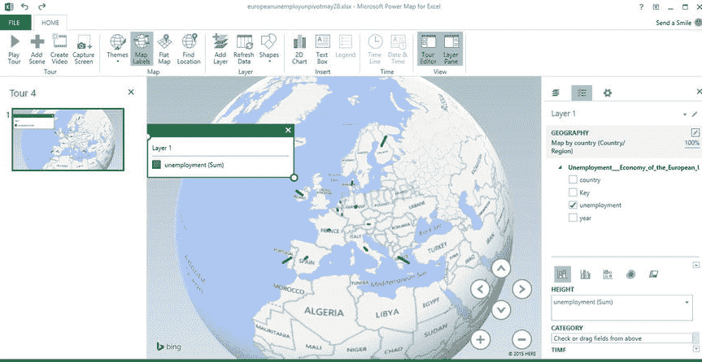

图 9-36.

选择失业率指标

通过单击“高度”窗口中 `unemployment` 后面的箭头并选择 `No Aggregation`，将 `unemployment` 字段的聚合方式更改为无聚合，如图 9-37 所示。

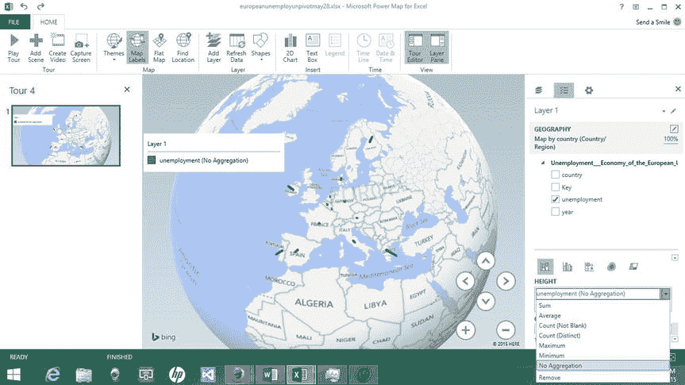

图 9-37.

将失业率聚合方式更改为无聚合

右键单击 `year` 并选择 `Set as Time`，如图 9-38 所示。

图 9-38.

将年份设置为时间字段

请注意，地图窗口底部会出现一个时间控件，时间显示在左上角的方框中，如图 9-39 所示。可以通过单击屏幕底部时间控件上的 `Play` 按钮来播放时间动画。

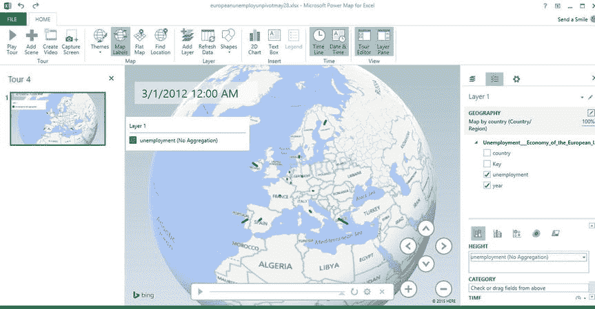

图 9-39.

为时间动画设置的地图

播放速度可以通过单击右上角的齿轮图标，再单击 `Scene Options` 来调整场景持续时间和效果，如图 9-40 所示。可以调整窗格底部的 `Speed` 滑块来减慢或加快过渡速度。

图 9-40.

设置场景持续时间

## 总结

本章演示了如何将数据加载到 Power Query，如何在查询编辑器中塑造数据，以及如何将其加载到 Power Map 中以创建关于数据的可视化故事。演示了 Power Map 的部分功能，例如创建二维和三维可视化，以及创建动画以显示随时间的变化。

